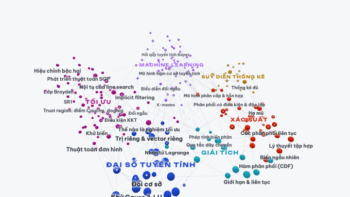
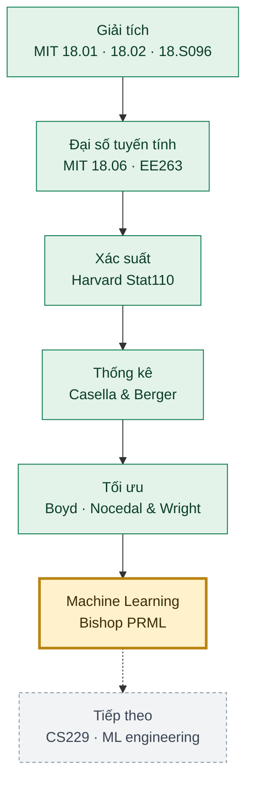

# Nền móng Machine Learning

**Học lại AI từ gốc, và học công khai.** 
Giải tích → Đại số tuyến tính → Xác suất → Thống kê → Tối ưu → Machine Learning. 
Mỗi chủ đề là một ghi chú mình tự giải thích lại; nhiều chủ đề có video ngắn trả lời đúng một câu “tại sao”.

**`~12,550 notes` · `~18,333 screenshots` · `18 notebooks`**

Bản đồ 233 chủ đề: bấm vào ảnh để mở bản đồ tương tác, xem lộ trình học và video của từng chủ đề. · [🌙 Bản nền tối](docs/map-spin-dark.gif)

**[Bản đồ & lộ trình](https://johntran-android.github.io/ml-map/)** · **[Video](#video-library)** · **[Ghi chú](#top-nav)** 
**[StudyBoard](https://studyboard.app/landing.html)** · **[Về mình](https://johntran-android.github.io)**

🇬🇧 Re-learning the math behind AI from the ground up, in public: study notes and short “why” videos (in Vietnamese) across MIT 18.01 / 18.06, Harvard Stat110, Casella & Berger, Nocedal & Wright and Bishop's PRML.

[↔ Xem README bản cũ](README_OLD.md)

## Lộ trình

Xanh: đã học · Vàng: đang học · Xám: sắp tới

## Câu chuyện

Khoảng 3 năm trước mình bắt đầu học AI với các khóa của Andrew Ng trên Coursera như Machine Learning, Deep Learning và NLP Specialization. Sau đó, nhờ đọc blog của Huyền Chip, mình tiếp tục với CS231N và CS224N của Stanford và tự làm các assignment.

Trong quá trình đó mình nhận ra một điều: **làm được assignment không đồng nghĩa với việc thật sự hiểu những gì đang diễn ra bên dưới**. Có những lúc gặp một câu hỏi lý thuyết mà ngay cả câu hỏi đang hỏi gì mình cũng chưa hiểu rõ.

Từ đó mình quyết định quay lại học nền tảng bài bản hơn.

Về calculus, mình học MIT 18.01, 18.02 và 18.S096. Linear algebra là MIT 18.06 của giáo sư Gilbert Strang. Probability là Harvard Stat110 của giáo sư Joe Blitzstein. Sau đó mình tiếp tục với Statistical Inference của Casella & Berger, Convex Optimization của Boyd, Numerical Optimization của Nocedal & Wright, và hiện tại là Pattern Recognition and Machine Learning của Christopher Bishop.

Ý tưởng chung của lộ trình này là đi từ các lớp nền về **calculus, linear algebra, probability, statistics và optimization**, rồi mới dần tiến lên các tầng machine learning phía trên.

## Cách mình học

Từ đầu mình chủ yếu học theo một Feynman loop khá đơn giản:

**Đọc/xem → dừng lại → tự giải thích theo cách hiểu của mình → kiểm tra lại → sửa nếu cần → học tiếp.**

Trước đây mình dùng SimpleMind để quản lý các ghi chú vì thích cách mind map/canvas cho phép nhìn kiến thức như một bảng lớn với các ý liên kết với nhau, thay vì một chuỗi note tuyến tính.

Các note trong repo này vì vậy không phải sách, giáo trình hay tài liệu được viết với mục tiêu thay thế nguồn gốc. Chúng đơn giản là những ghi chú mình tích lũy trong quá trình học, bao gồm cách mình diễn giải lại kiến thức theo cách hiểu của mình tại thời điểm đó.

## StudyBoard

Bên cạnh việc học AI, background của mình vốn là kĩ sư xây dựng chuyển hướng app development vì thích làm sản phẩm công nghệ. Mình đã tự build, ship và duy trì các sản phẩm thực tế trong nhiều năm; một trong những app mình từng phát triển là [**Sentence Master**](https://play.google.com/store/apps/details?id=com.hungdaovuong.sentencemaster.en).

Kinh nghiệm làm sản phẩm đó cũng là một phần nền để mình bắt đầu build [**StudyBoard**](https://studyboard.app/landing.html) từ đầu năm nay, xoay quanh chính workflow học ở trên.

Mục tiêu ban đầu khá thực dụng: làm cho Feynman loop thuận tiện hơn — quản lý note trên canvas, viết toán dễ hơn, dùng AI để kiểm tra cách hiểu, đánh dấu những chỗ cần quay lại, và hỗ trợ việc **learning in public**.

Repo GitHub này cũng là một sản phẩm của workflow đó: StudyBoard có thể đưa các notebook và ghi chú mình đang học lên GitHub để lưu trữ và chia sẻ.

StudyBoard hiện tại được phát triển theo kiểu **dogfooding**: mình dùng chính nó để học mỗi ngày. Những bất tiện gặp phải trong quá trình học trở thành vấn đề cần giải quyết trong sản phẩm; ngược lại, những kiến thức AI/ML mình học được cũng dần được áp dụng trở lại để cải thiện StudyBoard.

Nói cách khác, ngoài Feynman loop trong việc học còn có thêm một vòng lặp khác:

**học → dùng StudyBoard → gặp vấn đề → cải thiện StudyBoard → áp kiến thức mới vào sản phẩm → quay lại học tốt hơn.**

## Tiếp theo

Các môn như MIT 18.06, Stat110, Casella, Nocedal và Bishop đối với mình chủ yếu vẫn là tầng nền.

Hướng tiếp theo là tiếp tục đi lên các lớp ML ở tầng cao hơn như CS229 và các chủ đề về AI/ML engineering, trong khi vẫn phát triển StudyBoard song song và dần đưa những kiến thức đã học vào một sản phẩm thực tế.

Repository này vì vậy chủ yếu là một **learning log** — dấu vết của quá trình đi từ nền tảng toán, probability, statistics và optimization lên machine learning, đồng thời là một phần của quá trình build StudyBoard..

<!-- studyboard-toc:start -->

### 🗺️ Quick Navigation

| Group | Notebooks |
|:---|:---|
| [📂 **Calculus**](#group-calculus) | [MIT 18.01 — Single Variable Calculus](#nb-a0_mit1801) [MIT 18.02](#nb-mit_1802) [MIT 18S096 Matrix Calculus for ML](#nb-mit_18s096_matrix_calculus_for_ml) |
| [📂 **Linear Algebra**](#group-linear-algebra) | [EE263A — Linear Dynamical Systems](#nb-ee263a) [MIT 18.06 Book](#nb-mit_1806_book) [MIT 18.06](#nb-mit1806_gstrang) |
| [📂 **Probability & Statistics**](#group-probability-statistics) | [STAT110_Havard](#nb-stat110_havard) [Statistical Inference - Casella](#nb-statistical_inference_casella) |
| [📂 **Optimization**](#group-optimization) | [EE364a, Convex Optim_S.Boyd](#nb-ee364a_convex_optim_sboyd) [Numerical Optimization_J.Nocedal](#nb-numerical_optimization_jnocedal) |
| [📂 **Machine Learning Foundation**](#group-machine-learning-foundation) | [Pattern Recognition Machine Learning_C.Bishop](#nb-pattern_recognition_machine_learning_cbishop) |
| [📂 **Machine Learning & Deep Learning**](#group-machine-learning-deep-learning) | [CS224N_Stanford](#nb-cs224n_stanford) [CS231N_Stanford](#nb-cs231n_stanford) [DL Spec Coursera](#nb-dl_spec_coursera) [NLP Spec Coursera](#nb-nlp_spec_coursera) |
| [📂 **Other**](#group-other) | [LLM — Large Language Models](#nb-a1_llm) [Deep Learning Specialization_Cousera_Andrew Ng](#nb-deep_learning_specialization_cousera_andrew_ng) [Foundation of LLM](#nb-foundation_of_llm) |

🎬 [Xem Video Library ↓](#video-library)

<!-- studyboard-toc:end -->

## 📚 Syllabus / Mục lục

### 📂 Calculus

### MIT 18.01 — Single Variable Calculus
<!-- key: a0_mit1801 -->
<!-- group: Calculus -->
`317 notes · 331 screenshots · 12 sections`

> A comprehensive set of study notes for MIT 18.01 Single Variable Calculus, covering core topics from limits and derivatives to practical applications such as optimization, curve sketching, and approximation methods.
> 
> Tập hợp chi tiết các ghi chép học tập cho khóa học Giải tích một biến MIT 18.01, bao gồm các chủ đề cốt lõi từ giới hạn, đạo hàm cho đến các ứng dụng thực tế như tối ưu hóa, khảo sát hàm số và các phương pháp xấp xỉ.

📖 12 sections

| Section | Notes | Screenshots |
|---|---:|---:|
| [Lec 10: Curve Sketching](a0_mit1801/lec_10_curve_sketching.md) | 28 | 29 |
| [Lec 11: Max-min](a0_mit1801/lec_11_max_min.md) | 29 | 30 |
| [Lec 12: Related Rates](a0_mit1801/lec_12_related_rates.md) | 24 | 25 |
| [Lec 13: Newton's Method](a0_mit1801/lec_13_newtons_method.md) | 26 | 28 |
| [Lec 14: Mean](a0_mit1801/lec_14_mean_value_theorem.md) | 24 | 24 |
| [Lec 1: Rate Of Change](a0_mit1801/lec_1_rate_of_change.md) | 24 | 26 |
| [Lec 2: Limits](a0_mit1801/lec_2_limits.md) | 28 | 30 |
| [Lec 3: Derivatives](a0_mit1801/lec_3_derivatives.md) | 21 | 22 |
| [Lec 4: Chain Rule](a0_mit1801/lec_4_chain_rule.md) | 21 | 22 |
| [Lec 5: Implicit](a0_mit1801/lec_5_implicit_differentiaion.md) | 29 | 30 |
| [Lec 6: Exponential &](a0_mit1801/lec_6_exponential_log.md) | 36 | 37 |
| [Lec 9: Linear And Quadratic](a0_mit1801/lec_9_linear_and_quadratic_approximations.md) | 27 | 28 |

[↑ Back to navigation](#top-nav)

### MIT 18.02
<!-- key: mit_1802 -->
<!-- group: Calculus -->
`549 notes · 615 screenshots · 22 sections`

> This notebook contains study notes for MIT 18.02 (Multivariable Calculus), covering core topics such as vector algebra, matrices, partial derivatives, Lagrange multipliers, and double integrals.
> 
> Vở ghi chép này tổng hợp các kiến thức môn Giải tích đa biến (MIT 18.02), bao gồm các chủ đề cốt lõi như đại số vector, ma trận, đạo hàm riêng, phương pháp nhân tử Lagrange và tích phân kép.

📖 22 sections

| Section | Notes | Screenshots |
|---|---:|---:|
| [Lec 10: Second Derivative Test,](mit_1802/lec_10_second_derivative_test_boudaries_infinity.md) | 23 | 24 |
| [Lec 11: Differentials, Chain-rule](mit_1802/lec_11_differentials_chain_rule.md) | 20 | 21 |
| [Lec 12: Gradient, Directional](mit_1802/lec_12_gradient_directional_derivative_tangent_plane.md) | 30 | 37 |
| [Lec 13: Lagrange Multiplier](mit_1802/lec_13_lagrange_multiplier.md) | 33 | 36 |
| [Lec 14: Non-independent Random](mit_1802/lec_14_non_independent_random_variables.md) | 32 | 35 |
| [Lec 15: Partial Differentials Equations](mit_1802/lec_15_partial_differentials_equations.md) | 18 | 19 |
| [Lec 16: Double Integrals](mit_1802/lec_16_double_integrals.md) | 35 | 37 |
| [Lec 17: Double Integrals In](mit_1802/lec_17_double_integrals_in_polar_coordinates.md) | 21 | 21 |
| [Lec 18: Change Of Variables](mit_1802/lec_18_change_of_variables.md) | 33 | 36 |
| [Lec 19: Vector Fields](mit_1802/lec_19_vector_fields.md) | 36 | 44 |
| [Lec 1: Dot Products](mit_1802/lec_1_dot_products.md) | 0 | 4 |
| [Lec 20: Path Independence & Conservative Field](mit_1802/lec_20_path_independence_conservative_field.md) | 38 | 43 |
| [Lec 21: Gradient Field & Potential Function](mit_1802/lec_21_gradient_field_potential_function.md) | 35 | 35 |
| [Lec 22: Green's Theorem](mit_1802/lec_22_greens_theorem.md) | 26 | 29 |
| [Lec 2: Determinant, Cross Product](mit_1802/lec_2_determinant_cross_product.md) | 16 | 21 |
| [Lec 3: Matrix, Inverse Matrix](mit_1802/lec_3_matrix_inverse_matrix.md) | 26 | 31 |
| [Lec 4: Square System, Equation](mit_1802/lec_4_square_system_equation_of_plane.md) | 20 | 23 |
| [Lec 5: Parametric Equations For](mit_1802/lec_5_parametric_equations_for_lines_and_curves.md) | 23 | 24 |
| [Lec 6: Velocity, Acceleration,](mit_1802/lec_6_velocity_acceleration_keplers_second_law.md) | 27 | 28 |
| [Lec 7: Review](mit_1802/lec_7_review.md) | 16 | 17 |
| [Lec 8: Level Curves, Partial](mit_1802/lec_8_level_curves_partial_derivatives_tangent_plane.md) | 20 | 22 |
| [Lec 9: Max-min Problems, Least](mit_1802/lec_9_max_min_problems_least_squares.md) | 21 | 28 |

[↑ Back to navigation](#top-nav)

### MIT 18S096 Matrix Calculus for ML
<!-- key: mit_18s096_matrix_calculus_for_ml -->
<!-- group: Calculus -->
`210 notes · 221 screenshots · 19 sections`

> This notebook contains study notes and problem sets for MIT 18.S096 (Matrix Calculus for Machine Learning), covering core topics such as multidimensional derivatives, automatic differentiation, optimization, and computational graphs.
> 
> Sổ tay ghi chép này tổng hợp bài học và bài tập từ khóa học MIT 18.S096 (Giải tích Ma trận cho Học máy), bao gồm các chủ đề cốt lõi như đạo hàm đa chiều, đạo hàm tự động, tối ưu hóa và đồ thị tính toán.

📖 19 sections

| Section | Notes | Screenshots |
|---|---:|---:|
| [Lec 1 Part 1 Intro And Motivation](mit_18s096_matrix_calculus_for_ml/lec_1_part_1_intro_and_motivation.md) | 19 | 17 |
| [Lec 1 Part 2 Derivatives As Linear Operator](mit_18s096_matrix_calculus_for_ml/lec_1_part_2_derivatives_as_linear_operator.md) | 12 | 13 |
| [Lec 2 Part 1: Derivatives In Higher Dimensions: Jacobians And Matrix Functions](mit_18s096_matrix_calculus_for_ml/lec_2_part_1_derivatives_in_higher_dimensions_jacobians_and_matrix_functions.md) | 20 | 20 |
| [Lec 2 Part 2: Vectorization Of Matrix Function](mit_18s096_matrix_calculus_for_ml/lec_2_part_2_vectorization_of_matrix_function.md) | 3 | 3 |
| [Lec 3 Part 1 Kronecker Products And Jacobians](mit_18s096_matrix_calculus_for_ml/lec_3_part_1_kronecker_products_and_jacobians.md) | 24 | 26 |
| [Lec 3 Part 2 Finite-difference Approximations](mit_18s096_matrix_calculus_for_ml/lec_3_part_2_finite_difference_approximations.md) | 23 | 24 |
| [Lec 4 Part 1: Gradient And Inner Products In Other Vector Spaces](mit_18s096_matrix_calculus_for_ml/lec_4_part_1_gradient_and_inner_products_in_other_vector_spaces.md) | 18 | 16 |
| [Lec 4 Part 2: Nonlinear Rooting Finding, Optimization And Adjoint Gradient Methods](mit_18s096_matrix_calculus_for_ml/lec_4_part_2_nonlinear_rooting_finding_optimization_and_adjoint_gradient_methods.md) | 15 | 17 |
| [Lec 5 P1: Derivative Of Matrix Determinant And Invers](mit_18s096_matrix_calculus_for_ml/lec_5_p1_derivative_of_matrix_determinant_and_invers.md) | 7 | 6 |
| [Lec 5 P2: Forward Automatic Differentiation Via Dua Numbers](mit_18s096_matrix_calculus_for_ml/lec_5_p2_forward_automatic_differentiation_via_dua_numbers.md) | 22 | 23 |
| [Lec 5 P3 Differentiation On Computational Graphs](mit_18s096_matrix_calculus_for_ml/lec_5_p3_differentiation_on_computational_graphs.md) | 1 | 0 |
| [Lec 6 P1: Adjoint Differentiation On ODE Solutions](mit_18s096_matrix_calculus_for_ml/lec_6_p1_adjoint_differentiation_on_ode_solutions.md) | 1 | 0 |
| [Lec 6 P2: Calculus Of Variations & Gradient Of Functionals](mit_18s096_matrix_calculus_for_ml/lec_6_p2_calculus_of_variations_gradient_of_functionals.md) | 1 | 0 |
| [Lec 7 P1: Derivative Of Random Functions](mit_18s096_matrix_calculus_for_ml/lec_7_p1_derivative_of_random_functions.md) | 18 | 19 |
| [Lec 7 P2: Second Derivatives, Bilinear Form, Hessian](mit_18s096_matrix_calculus_for_ml/lec_7_p2_second_derivatives_bilinear_form_hessian.md) | 23 | 22 |
| [Lecture Note](mit_18s096_matrix_calculus_for_ml/lecture_note.md) | 2 | 4 |
| [Lec 8 P2: Automatic Differentiation On Computational Graph](mit_18s096_matrix_calculus_for_ml/lec_8_p2_automatic_differentiation_on_computational_graph.md) | 1 | 0 |
| [Problem Sets 1](mit_18s096_matrix_calculus_for_ml/problem_sets_1.md) | 0 | 3 |
| [Problem Sets 2](mit_18s096_matrix_calculus_for_ml/problem_sets_2.md) | 0 | 8 |

[↑ Back to navigation](#top-nav)

### 📂 Linear Algebra

### EE263A — Linear Dynamical Systems
<!-- key: ee263a -->
<!-- group: Linear Algebra -->
`77 notes · 113 screenshots · 12 sections`

> This notebook delves into fundamental linear algebra concepts such as Gram-Schmidt orthogonalization, matrix inverses, and linear independence. It extensively covers the Least Squares problem, exploring its geometric interpretation, solution methods (including QR factorization and the normal equation), and applications in data fitting and regression, while also considering computational complexity.

📖 12 sections

| Section | Notes | Screenshots |
|---|---:|---:|
| [10.1 Matrix matrix multiplication](ee263a/101_matrix_matrix_multiplication.md) | 4 | 5 |
| [11.1 Left Right Inverse](ee263a/111_left_right_inverse.md) | 6 | 7 |
| [11.2 Inverse](ee263a/112_inverse.md) | 9 | 9 |
| [11.3 Solving linear equation](ee263a/113_solving_linear_equation.md) | 5 | 6 |
| [11.5 Pseudo inverse](ee263a/115_pseudo_inverse.md) | 7 | 9 |
| [13.0 Least squares problem](ee263a/130_least_squares_problem.md) | 15 | 24 |
| [13.1 Least squares data fitting](ee263a/131_least_squares_data_fitting.md) | 14 | 20 |
| [1.5 Complexity of vector](ee263a/15_complexity_of_vector_computations.md) | 4 | 6 |
| [5.1 Linear Independent](ee263a/51_linear_independent.md) | 5 | 6 |
| [5.2 Basis](ee263a/52_basis.md) | 2 | 4 |
| [5.3 Orthonormal vectors](ee263a/53_orthonormal_vectors.md) | 4 | 5 |
| [5.4 Gram-Smidth algorithm](ee263a/54_gram_smidth_algorithm.md) | 2 | 12 |

[↑ Back to navigation](#top-nav)

### MIT 18.06 Book
<!-- key: mit_1806_book -->
<!-- group: Linear Algebra -->
`106 notes · 139 screenshots · 13 sections`

> A comprehensive compilation of study notes and solved problems for MIT 18.06 Linear Algebra, focusing on the four fundamental subspaces, matrix diagonalisation, singular value decomposition (SVD), and linear transformations.
> 
> Tài liệu tổng hợp ghi chép lý thuyết và bài tập giải chi tiết môn Đại số Tuyến tính MIT 18.06, tập trung vào bốn không gian con cơ bản, chéo hóa ma trận, phân tích kỳ dị (SVD) và biến đổi tuyến tính.

📖 13 sections

| Section | Notes | Screenshots |
|---|---:|---:|
| [📋 Overview](mit_1806_book/_overview.md) | 0 | 1 |
| [6.2 Diagonalizing A Matrix](mit_1806_book/62_diagonalizing_a_matrix.md) | 17 | 22 |
| [6.3 System Of Differential Equations](mit_1806_book/63_system_of_differential_equations.md) | 3 | 6 |
| [6.4 Symmetric Matrices](mit_1806_book/64_symmetric_matrices.md) | 3 | 4 |
| [7.2 Basis And Matrices In Svd](mit_1806_book/72_basis_and_matrices_in_svd.md) | 3 | 6 |
| [7.3 Pca By Svd](mit_1806_book/73_pca_by_svd.md) | 4 | 7 |
| [7.4 Geometry Of Svd](mit_1806_book/74_geometry_of_svd.md) | 17 | 19 |
| [8.1 Idea Of A Linear Transformation](mit_1806_book/81_idea_of_a_linear_transformation.md) | 17 | 20 |
| [8.2 The Matrix Of Linear Transformation](mit_1806_book/82_the_matrix_of_linear_transformation.md) | 20 | 23 |
| [8.3 In Search Of Good Basis](mit_1806_book/83_in_search_of_good_basis.md) | 3 | 4 |
| [11.2 Norm & Condition Number](mit_1806_book/112_norm_condition_number.md) | 13 | 15 |
| [11.3 Iterative Method & preconditioner](mit_1806_book/113_iterative_method_preconditioner.md) | 4 | 6 |
| [3. Vector Spaces and Subspaces](mit_1806_book/3_vector_spaces_and_subspaces.md) | 2 | 6 |

[↑ Back to navigation](#top-nav)

### MIT 18.06
<!-- key: mit1806_gstrang -->
<!-- group: Linear Algebra -->
<!-- videos: [{"url":"https://www.youtube.com/watch?v=fdjo2Nbwk2E","title":"Tại sao Left Nullspace vuông góc với Column Space?","videoId":"fdjo2Nbwk2E","uploadedAt":1792252122658},{"url":"https://www.youtube.com/watch?v=m3w2ZyvA8X8","title":"Hai vector còn lại có là cơ sở của không gian nào?","videoId":"m3w2ZyvA8X8","uploadedAt":1792040142582},{"url":"https://www.youtube.com/watch?v=ogUUI-lxqk0","title":"Vì sao 3 vector trong R² luôn phụ thuộc tuyến tính?","videoId":"ogUUI-lxqk0","uploadedAt":1791951066643},{"url":"https://www.youtube.com/watch?v=GCwrn_86Gos","title":"Tại sao tập chứa vector không luôn phụ thuộc tuyến tính?","videoId":"GCwrn_86Gos","uploadedAt":1791950686500},{"url":"https://www.youtube.com/watch?v=RlPbmEXWyTM","title":"Khi nào các vector v1,...,vl span một không gian vector?","videoId":"RlPbmEXWyTM","uploadedAt":1792024407738},{"url":"https://www.youtube.com/watch?v=OpXy96ENApE","title":"Vì sao x1 phụ thuộc khi tạo được từ x2 và x3?","videoId":"OpXy96ENApE","uploadedAt":1791949409848},{"url":"https://www.youtube.com/watch?v=WdqD4oyv45k","title":"Tại sao Basis là tập vector \"không dư, không thiếu\"?","videoId":"WdqD4oyv45k","uploadedAt":1792039609711},{"url":"https://youtu.be/x6hV9XYOkH8","title":"Tại sao ma trận khử E cho biết cơ sở Left Nullspace?","videoId":"x6hV9XYOkH8","uploadedAt":1793495921144},{"url":"https://www.youtube.com/watch?v=duV8R1iN4Ok","title":"Vì sao các cột pivot của U xác định cơ sở cho C(A)?","videoId":"duV8R1iN4Ok","uploadedAt":1793465978161},{"url":"https://www.youtube.com/watch?v=NrYt3dlnowY","title":"Tại Sao Rank = n Thì Không Có Biến Tự Do?","videoId":"NrYt3dlnowY","uploadedAt":1792022319119},{"url":"https://www.youtube.com/watch?v=OeiSCA8vnoU","title":"Tại Sao Ax=0 Có Nghiệm Khác 0 Khi Hàng Ít Hơn Cột?","videoId":"OeiSCA8vnoU","uploadedAt":1791948407540},{"url":"https://www.youtube.com/watch?v=FGeUpJFwQFM","title":"Tại sao khử Gauss đổi Column Space nhưng giữ nguyên Row Space?","videoId":"FGeUpJFwQFM","uploadedAt":1793470183626}] -->
`1,181 notes · 1,298 screenshots · 36 sections`

> This notebook covers fundamental linear algebra concepts, from solving systems of equations and matrix operations to eigenvalues, SVD, and linear transformations, often emphasizing their geometric interpretations.
> 
> Sổ tay này bao gồm các khái niệm cơ bản về đại số tuyến tính, từ giải hệ phương trình và các phép toán ma trận đến trị riêng, phân tích SVD và biến đổi tuyến tính, thường nhấn mạnh các diễn giải hình học của chúng.

📖 36 sections

| Section | Notes | Screenshots |
|---|---:|---:|
| [18.03 Lec 25](mit1806_gstrang/1803_lec_25.md) | 27 | 28 |
| [Lecture 1: The Geometry Of Linear Equations](mit1806_gstrang/lecture_1_the_geometry_of_linear_equations.md) | 18 | 20 |
| [Lecture 2: Elimination With Matrices](mit1806_gstrang/lecture_2_elimination_with_matrices.md) | 30 | 31 |
| [Lecture 3: Multiplication And Inverse Matrices](mit1806_gstrang/lecture_3_multiplication_and_inverse_matrices.md) | 22 | 24 |
| [Lecture 4: Factorization Into A = Lu](mit1806_gstrang/lecture_4_factorization_into_a_lu.md) | 23 | 25 |
| [Lecture 5: Transpose, Permutations, Spaces R^n](mit1806_gstrang/lecture_5_transpose_permutations_spaces_rn.md) | 23 | 24 |
| [Lecture 6: Column Space And Null Space](mit1806_gstrang/lecture_6_column_space_and_null_space.md) | 24 | 24 |
| [Lecture 7: Solving Ax = 0: Pivot Variables, Special Solutions](mit1806_gstrang/lecture_7_solving_ax_0_pivot_variables_special_solutions.md) | 32 | 37 |
| [Lecture 8: Solving Ax = B: Row Reduced Form R](mit1806_gstrang/lecture_8_solving_ax_b_row_reduced_form_r.md) | 35 | 37 |
| [Lecture 9: Independece, Basis, And Dimension](mit1806_gstrang/lecture_9_independece_basis_and_dimension.md) | 35 | 52 |
| [Lecture 10: The Four Fundamental Subspaces](mit1806_gstrang/lecture_10_the_four_fundamental_subspaces.md) | 24 | 43 |
| [Lecture 11: Matrix Spaces; Rank 1; Small World Graphs](mit1806_gstrang/lecture_11_matrix_spaces_rank_1_small_world_graphs.md) | 33 | 34 |
| [Lecture 12: Graphs, Networks, Incidence Matrices](mit1806_gstrang/lecture_12_graphs_networks_incidence_matrices.md) | 37 | 40 |
| [Lecture 13: Quiz Review](mit1806_gstrang/lecture_13_quiz_review.md) | 36 | 40 |
| [Lecture 14: Orthogonal Vectors And Subspaces](mit1806_gstrang/lecture_14_orthogonal_vectors_and_subspaces.md) | 37 | 37 |
| [Lecture 15: Projections Onto Subspaces](mit1806_gstrang/lecture_15_projections_onto_subspaces.md) | 45 | 47 |
| [Lecture 16: Projection Matrices And Least Squares](mit1806_gstrang/lecture_16_projection_matrices_and_least_squares.md) | 38 | 43 |
| [Lecture 17: Orthogonal Matrices And Gram-schmidt](mit1806_gstrang/lecture_17_orthogonal_matrices_and_gram_schmidt.md) | 38 | 39 |
| [Lecture 18: Properties Of Determinants](mit1806_gstrang/lecture_18_properties_of_determinants.md) | 34 | 39 |
| [Lecture 19: Determinant Formulas And Cofactors](mit1806_gstrang/lecture_19_determinant_formulas_and_cofactors.md) | 39 | 41 |
| [Lecture 20: Cramer's Rule, Inverse Matrix And Volume](mit1806_gstrang/lecture_20_cramers_rule_inverse_matrix_and_volume.md) | 29 | 30 |
| [Lecture 21: Eigenvalues And Eigenvectors](mit1806_gstrang/lecture_21_eigenvalues_and_eigenvectors.md) | 38 | 39 |
| [Lecture 22: Diagonalization And Powers Of A](mit1806_gstrang/lecture_22_diagonalization_and_powers_of_a.md) | 40 | 42 |
| [Lecture 23: Differential Equations And Exp(at)](mit1806_gstrang/lecture_23_differential_equations_and_expat.md) | 50 | 56 |
| [Lecture 24: Markow Matrices; Fourier Series](mit1806_gstrang/lecture_24_markow_matrices_fourier_series.md) | 35 | 37 |
| [Lecture 24b: Quiz 2 Review](mit1806_gstrang/lecture_24b_quiz_2_review.md) | 29 | 34 |
| [Lecture 25: Symmetric Matrices And Positive Definiteness](mit1806_gstrang/lecture_25_symmetric_matrices_and_positive_definiteness.md) | 28 | 30 |
| [Lecture 26: Complex Matrices; Fast Fourier Transform](mit1806_gstrang/lecture_26_complex_matrices_fast_fourier_transform.md) | 27 | 30 |
| [Lecture 27: Positive Definite Matrices And Minima](mit1806_gstrang/lecture_27_positive_definite_matrices_and_minima.md) | 36 | 39 |
| [Lecture 28: Similar Matrices And Jordan Form](mit1806_gstrang/lecture_28_similar_matrices_and_jordan_form.md) | 32 | 32 |
| [Lecture 29: Singular Value Decomposition](mit1806_gstrang/lecture_29_singular_value_decomposition.md) | 33 | 37 |
| [Lecture 30: Linear Transformations And Their Matrices](mit1806_gstrang/lecture_30_linear_transformations_and_their_matrices.md) | 42 | 46 |
| [Lecture 31: Change Of Basis; Image Compression](mit1806_gstrang/lecture_31_change_of_basis_image_compression.md) | 35 | 36 |
| [Lecture 32: Quiz 3 Review](mit1806_gstrang/lecture_32_quiz_3_review.md) | 35 | 38 |
| [Lecture 33: Left And Right Inverse; Pseudoinverse](mit1806_gstrang/lecture_33_left_and_right_inverse_pseudoinverse.md) | 30 | 33 |
| [Lecture 34: Final Course Review](mit1806_gstrang/lecture_34_final_course_review.md) | 32 | 34 |

[↑ Back to navigation](#top-nav)

### 📂 Probability & Statistics

### STAT110_Havard
<!-- key: stat110_havard -->
<!-- group: Probability & Statistics -->
`881 notes · 1,109 screenshots · 32 sections`

> This notebook explores foundational and advanced topics in probability and statistical inference, covering random variables, their distributions (discrete and continuous), expectation, variance, moment generating functions, and key theorems such as the Law of Large Numbers and Central Limit Theorem.
> 
> Sổ tay này khám phá các chủ đề cơ bản và nâng cao trong lý thuyết xác suất và suy luận thống kê, bao gồm các biến ngẫu nhiên, các phân phối của chúng (rời rạc và liên tục), kỳ vọng, phương sai, hàm sinh moment, và các định lý quan trọng như Luật Số lớn và Định lý Giới hạn Trung tâm.

📖 32 sections

| Section | Notes | Screenshots |
|---|---:|---:|
| [📋 Overview](stat110_havard/_overview.md) | 0 | 1 |
| [Cheatsheet (nhờ Ai)](stat110_havard/cheatsheet_nh_ai.md) | 5 | 98 |
| [Lec 10: Expected Value](stat110_havard/lec_10_expected_value.md) | 34 | 41 |
| [Lec 11: Poisson Distribution](stat110_havard/lec_11_poisson_distribution.md) | 31 | 39 |
| [Lec 12: Discrete Vs](stat110_havard/lec_12_discrete_vs_continuous_the_uniform.md) | 42 | 49 |
| [Lec 13: Normal Distribution](stat110_havard/lec_13_normal_distribution.md) | 33 | 42 |
| [Lec 14: Location, Scale, Lotus](stat110_havard/lec_14_location_scale_lotus.md) | 41 | 47 |
| [Lec 15: Midterm Review](stat110_havard/lec_15_midterm_review.md) | 29 | 32 |
| [Lec 16: Exponential](stat110_havard/lec_16_exponential_distribution.md) | 19 | 25 |
| [Lec 17: Moment](stat110_havard/lec_17_moment_generating_functions.md) | 49 | 60 |
| [Lec 18: MGF Continued](stat110_havard/lec_18_mgf_continued.md) | 42 | 49 |
| [Lec 19: Joint, Conditional And](stat110_havard/lec_19_joint_conditional_and_marginal_distribution.md) | 38 | 41 |
| [Lec 1: Probability & Counting](stat110_havard/lec_1_probability_counting.md) | 17 | 17 |
| [Lec 20: Multinomial And Cauchy](stat110_havard/lec_20_multinomial_and_cauchy.md) | 31 | 44 |
| [Lec 21: Covariance & Correlation](stat110_havard/lec_21_covariance_correlation.md) | 31 | 38 |
| [Lec 22: Transformations & Convolution](stat110_havard/lec_22_transformations_convolution.md) | 22 | 28 |
| [Lec 23: Beta Distribution](stat110_havard/lec_23_beta_distribution.md) | 10 | 13 |
| [Lec 24: Gamma Distribution & Poisson](stat110_havard/lec_24_gamma_distribution_poisson.md) | 24 | 24 |
| [Lec 25: Order Statistic &](stat110_havard/lec_25_order_statistic_conditional_expectation.md) | 27 | 31 |
| [Lec 26 Conditional](stat110_havard/lec_26_conditional_expectation.md) | 30 | 33 |
| [Lec 27: Conditional](stat110_havard/lec_27_conditional_expectation_given_an_rv.md) | 26 | 36 |
| [Lec 28: Inequalities](stat110_havard/lec_28_inequalities.md) | 19 | 21 |
| [Lec 29: Law Of Large Numbers &](stat110_havard/lec_29_law_of_large_numbers_law_of_central_limit.md) | 35 | 36 |
| [Lec 2: Story Proofs,](stat110_havard/lec_2_story_proofs_axioms_of_probability.md) | 23 | 23 |
| [Lec 30: Chi-square, Student-t,](stat110_havard/lec_30_chi_square_student_t_multi_variate_gaussian.md) | 21 | 22 |
| [Lec 3: Birthday Problem,](stat110_havard/lec_3_birthday_problem_properties_of_probability.md) | 21 | 23 |
| [Lec 4: Conditional Probability](stat110_havard/lec_4_conditional_probability.md) | 26 | 26 |
| [Lec 5: Conditional Probability,](stat110_havard/lec_5_conditional_probability_law_of_total_probability.md) | 31 | 35 |
| [Lec 6: Monty Hall, Simpson's](stat110_havard/lec_6_monty_hall_simpsons_paradox.md) | 23 | 23 |
| [Lec 7: Gambler's Ruin &](stat110_havard/lec_7_gamblers_ruin_random_variables.md) | 29 | 35 |
| [Lec 8: Random Variables &](stat110_havard/lec_8_random_variables_their_distributions.md) | 32 | 36 |
| [Lec 9: Expectation, Indicator](stat110_havard/lec_9_expectation_indicator_random_variables_linearity.md) | 40 | 41 |

[↑ Back to navigation](#top-nav)

### Statistical Inference - Casella
<!-- key: statistical_inference_casella -->
<!-- group: Probability & Statistics -->
<!-- videos: [{"url":"https://www.youtube.com/watch?v=rrOrZFTeyVE","title":"Làm sao tìm hàm mật độ Student's t từ tỷ số U/√(V/p)?","videoId":"rrOrZFTeyVE","uploadedAt":1791825199094},{"url":"https://www.youtube.com/watch?v=MRIIRaMOWAs","title":"Làm sao suy ra pdf Student's t từ tỉ số U/√(V/p) (cont)?","videoId":"MRIIRaMOWAs","uploadedAt":1791826248000},{"url":"https://www.youtube.com/watch?v=iyUvmtl4bpg","title":"Làm sao đảo Acceptance Region A(θ) thành khoảng tin cậy C(X)?","videoId":"iyUvmtl4bpg","uploadedAt":1790878283466},{"url":"https://www.youtube.com/watch?v=26Q9kLHdbkc","title":"Tại sao E[Y|X] = α + βx² vẫn là Linear Regression?","videoId":"26Q9kLHdbkc","uploadedAt":1792425779315},{"url":"https://www.youtube.com/watch?v=ecVQI3CJzPc","title":"Vì sao thống kê ANOVA với S²_p tuân theo phân phối t bậc N-k?","videoId":"ecVQI3CJzPc","uploadedAt":1792002750179},{"url":"https://www.youtube.com/watch?v=KRX39ibcBlE","title":"Làm sao tìm PDF của Y = X² từ hàm CDF?","videoId":"KRX39ibcBlE","uploadedAt":1791561404634},{"url":"https://www.youtube.com/watch?v=V-6BNavEGgU","title":"Tại sao cực tiểu hóa RSS không cần giả định phân phối?","videoId":"V-6BNavEGgU","uploadedAt":1792605338901},{"url":"https://www.youtube.com/watch?v=UmyowzIGpGE","title":"Large-Sample Binomial Tests","videoId":"UmyowzIGpGE","uploadedAt":1788452614121},{"url":"https://www.youtube.com/watch?v=UO_2KJVR6fY","title":"Tại sao nghịch đảo Score Test ra khoảng tin cậy cho p?","videoId":"UO_2KJVR6fY","uploadedAt":1790101523675},{"url":"https://www.youtube.com/watch?v=8oEGxDhqdME","title":"Vì Sao Trung Bình Mẫu Có Phân Phối Chuẩn N(μ, σ²/n)?","videoId":"8oEGxDhqdME","uploadedAt":1791304434638},{"url":"https://www.youtube.com/watch?v=dQ-blTqxLaM","title":"Cách tìm ước lượng MLE cho α và β từ log-likelihood?","videoId":"dQ-blTqxLaM","uploadedAt":1793209949125},{"url":"https://www.youtube.com/watch?v=qi2c2LvaefU","title":"Vì sao dùng √λ tốt hơn S cho khoảng tin cậy Poisson?","videoId":"qi2c2LvaefU","uploadedAt":1790183894478},{"url":"https://www.youtube.com/watch?v=gpURGn0c_74","title":"Chứng minh bất đẳng thức Cauchy-Schwarz không cần học thuộc lòng.","videoId":"gpURGn0c_74","uploadedAt":1792779273260},{"url":"https://www.youtube.com/watch?v=7zjlggrD-iQ","title":"Làm sao dẫn xuất quy tắc t-test từ Likelihood Ratio Test?","videoId":"7zjlggrD-iQ","uploadedAt":1792095967503},{"url":"https://www.youtube.com/watch?v=Z_OW_2fvLbE","title":"Làm sao xây dựng Generalized Wald Test từ M-estimator?","videoId":"Z_OW_2fvLbE","uploadedAt":1788902153576},{"url":"https://www.youtube.com/watch?v=PWkRReS5oM8","title":"Làm sao dùng LOTUS tính hàm MGF của phân phối chuẩn?","videoId":"PWkRReS5oM8","uploadedAt":1793987046914},{"url":"https://www.youtube.com/watch?v=6upP75ujeSM","title":"Tại sao Var(X) bằng ax² + bx² từ hai biến Normal độc lập?","videoId":"6upP75ujeSM","uploadedAt":1792431519702},{"url":"https://www.youtube.com/watch?v=V4s75gq78PI","title":"Tại sao (n-1)S²/σ² lại có phân phối Chi-Square χ²_{n-1}?","videoId":"V4s75gq78PI","uploadedAt":1791740253782},{"url":"https://www.youtube.com/watch?v=4QKRIw9ZxL8","title":"Ôn nhanh location scale family.","videoId":"4QKRIw9ZxL8","uploadedAt":1791740269729},{"url":"https://www.youtube.com/watch?v=ZqHWCkV8iG0","title":"Chứng minh X,Y ~ normal độc lập thì X+Y cũng là normal","videoId":"ZqHWCkV8iG0","uploadedAt":1791740286594},{"url":"https://www.youtube.com/watch?v=K8f2yncHnxg","title":"Vì sao miền chấp nhận tạo ra khoảng tin cậy cho beta?","videoId":"K8f2yncHnxg","uploadedAt":1794631750355},{"url":"https://www.youtube.com/watch?v=nC7WkJULeTs","title":"Thế nào là point estimation, confidence interval và hypothesis testing","videoId":"nC7WkJULeTs","uploadedAt":1790004244242},{"url":"https://www.youtube.com/watch?v=OcJDysX87L0","title":"Cách đảo ngược acceptance region thành khoảng tin cậy cho μ?","videoId":"OcJDysX87L0","uploadedAt":1790009733415},{"url":"https://www.youtube.com/watch?v=VUCJsx5AnYs","title":"Khi nào Cov(Ui, Vr) = 0 tương đương tính độc lập?","videoId":"VUCJsx5AnYs","uploadedAt":1793727767485},{"url":"https://www.youtube.com/watch?v=LLi-ShGm1AI","title":"Vì sao Ȳi. có phân phối n(θi, σ²/ni) trong mô hình ANOVA?","videoId":"LLi-ShGm1AI","uploadedAt":1791131506962},{"url":"https://www.youtube.com/watch?v=beyWo5KCi6c","title":"Tại sao [h(θ̂) - h(θ)] / √Var^(h(θ̂)) hội tụ về N(0,1)?","videoId":"beyWo5KCi6c","uploadedAt":1789149772425},{"url":"https://www.youtube.com/watch?v=Aq3dsND50OA","title":"Tại sao tổ hợp tuyến tính biến Normal độc lập là Normal?","videoId":"Aq3dsND50OA","uploadedAt":1793381492457},{"url":"https://www.youtube.com/watch?v=DwlKo2-RcYc","title":"Làm sao biến acceptance region A(θ0) thành confidence set C(X)?","videoId":"DwlKo2-RcYc","uploadedAt":1792185692481},{"url":"https://www.youtube.com/watch?v=iy-3owjYDYI","title":"Tại sao hàm likelihood là hàm của theta chứ không phải x?","videoId":"iy-3owjYDYI","uploadedAt":1794088336169},{"url":"https://www.youtube.com/watch?v=RBcsZYaHM-Q","title":"Vì Sao Kỳ Vọng Của Score Statistic E_θ[S(θ)] Bằng 0?","videoId":"RBcsZYaHM-Q","uploadedAt":1788566520328},{"url":"https://www.youtube.com/watch?v=t5L8jQeG_nU","title":"Cách lập phương trình bậc hai tìm khoảng tin cậy Binomial Score?","videoId":"t5L8jQeG_nU","uploadedAt":1789746141654},{"url":"https://www.youtube.com/watch?v=0QxT5Qi1RfE","title":"Ôn lại tí xíu về Best Unbiased Estimator, có Variance nhỏ nhất","videoId":"0QxT5Qi1RfE","uploadedAt":1792691097243}] -->
`938 notes · 1,253 screenshots · 53 sections`

> This notebook contains detailed study notes and proofs based on Casella and Berger's *Statistical Inference*, covering key topics in probability theory, estimation methods, hypothesis testing, and asymptotic properties.
> 
> Sổ tay học tập này tổng hợp các ghi chép và chứng minh chi tiết dựa trên giáo trình *Statistical Inference* của Casella và Berger, bao gồm các chủ đề cốt lõi về lý thuyết xác suất, phương pháp ước lượng, kiểm định giả thuyết và tính chất tiệm cận.

📖 53 sections

| Section | Notes | Screenshots |
|---|---:|---:|
| [📋 Overview](statistical_inference_casella/_overview.md) | 0 | 1 |
| [1.1 Set Theory](statistical_inference_casella/11_set_theory.md) | 6 | 9 |
| [1.2.1 Axiomatic Foundation](statistical_inference_casella/121_axiomatic_foundation.md) | 9 | 10 |
| [1.2.2 Calculus Of Probability](statistical_inference_casella/122_calculus_of_probability.md) | 5 | 9 |
| [1.2.3 Counting](statistical_inference_casella/123_counting.md) | 6 | 8 |
| [1.2.4 Enumerating Outcome](statistical_inference_casella/124_enumerating_outcome.md) | 10 | 14 |
| [1.3 Conditional Probability & Independence](statistical_inference_casella/13_conditional_probability_independence.md) | 12 | 16 |
| [1.4 Random Variables](statistical_inference_casella/14_random_variables.md) | 4 | 5 |
| [1.5 Distribution Function](statistical_inference_casella/15_distribution_function.md) | 9 | 11 |
| [1.6 PDF & Pmf](statistical_inference_casella/16_pdf_pmf.md) | 4 | 5 |
| [2.1 Distribution](statistical_inference_casella/21_distribution.md) | 15 | 21 |
| [2.2 Expected Value](statistical_inference_casella/22_expected_value.md) | 7 | 10 |
| [2.3 MGF](statistical_inference_casella/23_mgf.md) | 15 | 25 |
| [2.4 Differentiating Under Integral](statistical_inference_casella/24_differentiating_under_integral.md) | 11 | 19 |
| [2.5 Ex](statistical_inference_casella/25_ex.md) | 1 | 2 |
| [3.1&2 Discrete Distribution](statistical_inference_casella/312_discrete_distribution.md) | 20 | 32 |
| [3.3 Continuous Distribution](statistical_inference_casella/33_continuous_distribution.md) | 24 | 38 |
| [3.4 Exponential Families](statistical_inference_casella/34_exponential_families.md) | 10 | 15 |
| [3.5 Location And Scale Families](statistical_inference_casella/35_location_and_scale_families.md) | 12 | 17 |
| [3.6 Inequalities](statistical_inference_casella/36_inequalities.md) | 9 | 12 |
| [4.1 Joint & Marginal Distribution](statistical_inference_casella/41_joint_marginal_distribution.md) | 13 | 19 |
| [4.2 Conditional Distributions & Independent](statistical_inference_casella/42_conditional_distributions_independent.md) | 18 | 27 |
| [4.3 Bivariate Transformation](statistical_inference_casella/43_bivariate_transformation.md) | 14 | 24 |
| [4.4 Hierarchical Model & Mixture Distribution](statistical_inference_casella/44_hierarchical_model_mixture_distribution.md) | 11 | 19 |
| [4.5 Covariance & Correlation](statistical_inference_casella/45_covariance_correlation.md) | 19 | 29 |
| [4.6 Multi-variate Distribution](statistical_inference_casella/46_multi_variate_distribution.md) | 22 | 28 |
| [4.7 Inequalities](statistical_inference_casella/47_inequalities.md) | 1 | 0 |
| [5.1 Basic Concepts Of Random Samples](statistical_inference_casella/51_basic_concepts_of_random_samples.md) | 13 | 16 |
| [5.2 Σ Of Random Variables From A Random Sample](statistical_inference_casella/52_of_random_variables_from_a_random_sample.md) | 18 | 26 |
| [5.3 Sampling From The Normal Distribution](statistical_inference_casella/53_sampling_from_the_normal_distribution.md) | 21 | 31 |
| [5.4 Order Statistic](statistical_inference_casella/54_order_statistic.md) | 12 | 16 |
| [5.5 Convergence Concepts](statistical_inference_casella/55_convergence_concepts.md) | 42 | 52 |
| [5.6 Generating Random Sample](statistical_inference_casella/56_generating_random_sample.md) | 31 | 43 |
| [5.7 Ex](statistical_inference_casella/57_ex.md) | 0 | 1 |
| [6.1 Introduction](statistical_inference_casella/61_introduction.md) | 3 | 4 |
| [6.2 The Sufficient Principle](statistical_inference_casella/62_the_sufficient_principle.md) | 46 | 59 |
| [6.3 The Likelihood Principle](statistical_inference_casella/63_the_likelihood_principle.md) | 19 | 23 |
| [6.4 The Equivariance Principle](statistical_inference_casella/64_the_equivariance_principle.md) | 11 | 14 |
| [7.1 Introduction](statistical_inference_casella/71_introduction.md) | 3 | 3 |
| [7.2 Method Of Finding Estimators](statistical_inference_casella/72_method_of_finding_estimators.md) | 42 | 52 |
| [7.3 Methods Of Evaluating Estimators](statistical_inference_casella/73_methods_of_evaluating_estimators.md) | 63 | 74 |
| [8.1 Introduction](statistical_inference_casella/81_introduction.md) | 5 | 5 |
| [8.2 Method Of Finding Tests](statistical_inference_casella/82_method_of_finding_tests.md) | 21 | 26 |
| [8.3 Methods Of Evaluating Test](statistical_inference_casella/83_methods_of_evaluating_test.md) | 53 | 64 |
| [9.1 Introduction](statistical_inference_casella/91_introduction.md) | 9 | 9 |
| [9.2 Methods Of Finding Interval Estimators](statistical_inference_casella/92_methods_of_finding_interval_estimators.md) | 52 | 61 |
| [9.3 Methods Of Evaluating Interval Estimators](statistical_inference_casella/93_methods_of_evaluating_interval_estimators.md) | 34 | 35 |
| [10.1 Point Estimation](statistical_inference_casella/101_point_estimation.md) | 42 | 48 |
| [10.2 Robustness](statistical_inference_casella/102_robustness.md) | 16 | 20 |
| [10.3 Hypothesis Testing](statistical_inference_casella/103_hypothesis_testing.md) | 22 | 26 |
| [10.4 Interval Estimation](statistical_inference_casella/104_interval_estimation.md) | 15 | 23 |
| [11.1 & 2  introduction, One-way Anova](statistical_inference_casella/111_2_introduction_one_way_anova.md) | 26 | 38 |
| [11.3 Simple Linear Regression](statistical_inference_casella/113_simple_linear_regression.md) | 32 | 59 |

[↑ Back to navigation](#top-nav)

### 📂 Optimization

### EE364a, Convex Optim_S.Boyd
<!-- key: ee364a_convex_optim_sboyd -->
<!-- group: Optimization -->
`875 notes · 1,347 screenshots · 21 sections`

> A comprehensive collection of study notes and lecture summaries for Stephen Boyd's Convex Optimization course (EE364a), covering fundamental concepts such as convex sets and functions, duality theory, KKT conditions, and optimization algorithms.
> 
> Bộ sưu tập chi tiết các ghi chép học tập và tóm tắt bài giảng cho khóa học Tối ưu hóa Lồi (EE364a) của Stephen Boyd, bao gồm các khái niệm nền tảng như tập hợp và hàm lồi, lý thuyết đối ngẫu, điều kiện KKT và các thuật toán tối ưu hóa.

📖 21 sections

| Section | Notes | Screenshots |
|---|---:|---:|
| [Appendix A](ee364a_convex_optim_sboyd/appendix_a.md) | 5 | 15 |
| [Appendix C](ee364a_convex_optim_sboyd/appendix_c.md) | 43 | 63 |
| [Chap 10](ee364a_convex_optim_sboyd/chap_10.md) | 60 | 99 |
| [Chap 11:1,2,3,4,5](ee364a_convex_optim_sboyd/chap_1112345.md) | 53 | 95 |
| [Chap 11.6](ee364a_convex_optim_sboyd/chap_116.md) | 32 | 60 |
| [Chap 9.1 - 9.4](ee364a_convex_optim_sboyd/chap_91_94.md) | 34 | 68 |
| [Chap 9.5](ee364a_convex_optim_sboyd/chap_95.md) | 44 | 81 |
| [Lec 1](ee364a_convex_optim_sboyd/lec_1.md) | 51 | 63 |
| [Lec 10](ee364a_convex_optim_sboyd/lec_10.md) | 35 | 64 |
| [Lec 10b](ee364a_convex_optim_sboyd/lec_10b.md) | 33 | 60 |
| [Lec 11](ee364a_convex_optim_sboyd/lec_11.md) | 48 | 92 |
| [Lec 2](ee364a_convex_optim_sboyd/lec_2.md) | 34 | 49 |
| [Lec 3](ee364a_convex_optim_sboyd/lec_3.md) | 60 | 76 |
| [Lec 4](ee364a_convex_optim_sboyd/lec_4.md) | 39 | 43 |
| [Lec 5](ee364a_convex_optim_sboyd/lec_5.md) | 61 | 82 |
| [Lec 6](ee364a_convex_optim_sboyd/lec_6.md) | 31 | 36 |
| [Lec 7](ee364a_convex_optim_sboyd/lec_7.md) | 56 | 77 |
| [Lec 8 A](ee364a_convex_optim_sboyd/lec_8_a.md) | 45 | 59 |
| [Lec 8 B](ee364a_convex_optim_sboyd/lec_8_b.md) | 37 | 51 |
| [Lec 9](ee364a_convex_optim_sboyd/lec_9.md) | 48 | 64 |
| [Lec 9b](ee364a_convex_optim_sboyd/lec_9b.md) | 26 | 50 |

[↑ Back to navigation](#top-nav)

### Numerical Optimization_J.Nocedal
<!-- key: numerical_optimization_jnocedal -->
<!-- group: Optimization -->
<!-- videos: [{"url":"https://youtu.be/dWWDrFxObGg","title":"Tại sao các vectơ liên hợp luôn độc lập tuyến tính?","videoId":"dWWDrFxObGg","uploadedAt":1794024830641},{"url":"https://www.youtube.com/watch?v=wgdR-pmFiBM","title":"Làm sao tính bước nhảy alpha trong phương pháp hướng liên hợp?","videoId":"wgdR-pmFiBM","uploadedAt":1794028313340},{"url":"https://www.youtube.com/watch?v=rqNag5i113c","title":"Tại sao Z^T G Z được gọi là Reduced Hessian?","videoId":"rqNag5i113c","uploadedAt":1793293237841},{"url":"https://www.youtube.com/watch?v=PzLtTlIO-kE","title":"Khi nào minimizer của Lagrangian cho ra đúng nghiệm Primal x̄?","videoId":"PzLtTlIO-kE","uploadedAt":1790705388728},{"url":"https://www.youtube.com/watch?v=qSrfcPuiA4k","title":"Tại sao nghiệm KKT λ̃ làm cực đại hóa hàm đối ngẫu q(λ)?","videoId":"qSrfcPuiA4k","uploadedAt":1790430332543},{"url":"https://www.youtube.com/watch?v=j85JoFMH0F0","title":"Tại sao bài toán đối ngẫu LP có ràng buộc ngầm A^T λ = c?","videoId":"j85JoFMH0F0","uploadedAt":1790911824364},{"url":"https://youtu.be/6g2qIzX9yO0","title":"Vì sao df/dε = -λ*||∇ci|| khi thay đổi ràng buộc ci(x)?","videoId":"6g2qIzX9yO0","uploadedAt":1789916409346},{"url":"https://www.youtube.com/watch?v=HB2-G1ppSjQ","title":"Vì Sao Nghiệm Primal (x̄, ƛ) Cũng Là Nghiệm Của Wolfe Dual?","videoId":"HB2-G1ppSjQ","uploadedAt":1790828129254},{"url":"https://www.youtube.com/watch?v=wy_PaBOEbnY","title":"Tại sao nhân tử Lagrange λ* = 0 khi ràng buộc không active?","videoId":"wy_PaBOEbnY","uploadedAt":1789858516690},{"url":"https://youtu.be/oS8uhtEOI9w","title":"Vì sao Projected Hessian Zᵀ∇²LZ giúp kiểm tra cực tiểu dễ hơn?","videoId":"oS8uhtEOI9w","uploadedAt":1789916587155},{"url":"https://www.youtube.com/watch?v=V688_8gu1X4","title":"Vì sao x = Yb + ZxN trượt trên Null Space?","videoId":"V688_8gu1X4","uploadedAt":1792259640410},{"url":"https://youtu.be/V3qSJFNY3HM","title":"Vì sao phương pháp hướng liên hợp hội tụ sau tối đa n bước?","videoId":"V3qSJFNY3HM","uploadedAt":1794374219628},{"url":"https://www.youtube.com/watch?v=4pAJlcx-stw","title":"Schur-Complement Method","videoId":"4pAJlcx-stw","uploadedAt":1793417776447},{"url":"https://www.youtube.com/watch?v=Gl4aCDchTAs","title":"Làm sao khử ràng buộc Ax = b đưa về tối ưu không ràng buộc?","videoId":"Gl4aCDchTAs","uploadedAt":1791491686650},{"url":"https://www.youtube.com/watch?v=63NedgBej6I","title":"Tại sao chọn cột 3 và 6 để tìm B⁻¹ dễ nhất?","videoId":"63NedgBej6I","uploadedAt":1791647917033},{"url":"https://www.youtube.com/watch?v=zjAzLlTsl44","title":"Vì sao nghiệm Y(AY)⁻¹b từ phân rã QR là Least-Norm?","videoId":"zjAzLlTsl44","uploadedAt":1792685292570},{"url":"https://www.youtube.com/watch?v=JyhO5lX_IZQ","title":"Phép chiếu Gram Schmidt và QR factor","videoId":"JyhO5lX_IZQ","uploadedAt":1792686105800},{"url":"https://www.youtube.com/watch?v=-9nfMosuj58","title":"Tại sao Z = [-B⁻¹N; I] là basis của Nullspace?","videoId":"-9nfMosuj58","uploadedAt":1791657693355},{"url":"https://www.youtube.com/watch?v=zUdZtRFHlYg","title":"Vì sao AY khả nghịch khi phân tách nghiệm x = Yx_Y + Zx_Z?","videoId":"zUdZtRFHlYg","uploadedAt":1792469693852},{"url":"https://youtu.be/otwKnGhj1vE","title":"Tại sao rank(AB) = rank(A) khi ma trận B khả nghịch?","videoId":"otwKnGhj1vE","uploadedAt":1793733491163},{"url":"https://www.youtube.com/watch?v=pia4HYygkUo","title":"Làm sao dùng phương pháp null-space để giải hệ KKT?","videoId":"pia4HYygkUo","uploadedAt":1793858493951},{"url":"https://www.youtube.com/watch?v=GtOATZjDGQs","title":"Theorem 12.11 Weak Duality","videoId":"GtOATZjDGQs","uploadedAt":1790393266298},{"url":"https://www.youtube.com/watch?v=UGddFxbogXU","title":"Tại sao hàm dual objective q(λ) luôn concave và domain 𝒟 lồi?","videoId":"UGddFxbogXU","uploadedAt":1790306878388},{"url":"https://youtu.be/zYeJv7A0Hns","title":"Vì sao ma trận SᵀAS là ma trận đường chéo?","videoId":"zYeJv7A0Hns","uploadedAt":1794514466822},{"url":"https://www.youtube.com/watch?v=LdqakqsyBRY","title":"Làm sao xây dựng ma trận chuyển cơ sở S⁻¹V?","videoId":"LdqakqsyBRY","uploadedAt":1794416066575},{"url":"https://www.youtube.com/watch?v=SyvGCGAjrtQ","title":"Vì sao A full row rank đảm bảo hệ Ax=b luôn có nghiệm?","videoId":"SyvGCGAjrtQ","uploadedAt":1791258118869},{"url":"https://www.youtube.com/watch?v=sNjOXBKz0YM","title":"Mượn bài toán  lập hệ ma trận KKT để ôn cách tìm gradient và Hessian hàm bậc hai.","videoId":"sNjOXBKz0YM","uploadedAt":1792856418435},{"url":"https://www.youtube.com/watch?v=2u9U3nA1768","title":"Mượn bài toán tối ưu để ôn lại vài kiến thức đại số tuyến tính.","videoId":"2u9U3nA1768","uploadedAt":1792860207679},{"url":"https://www.youtube.com/watch?v=jg7rbTIx6Wk","title":"Ví dụ 16.2 minh họa một bài toán QP có nghiệm duy nhất.","videoId":"jg7rbTIx6Wk","uploadedAt":1792863324417},{"url":"https://www.youtube.com/watch?v=t6pKTKzIX_o","title":"Vì sao phương sai danh mục đầu tư là xᵀGx?","videoId":"t6pKTKzIX_o","uploadedAt":1791149804497},{"url":"https://www.youtube.com/watch?v=QpNTm5otibM","title":"Tại sao cực tiểu hóa phi tương đương r_x vuông góc p_i?","videoId":"QpNTm5otibM","uploadedAt":1794718274523},{"url":"https://www.youtube.com/watch?v=TYA0HbfhlHQ","title":"Vì sao ma trận KKT khả nghịch khi ZᵀGZ xác định dương?","videoId":"TYA0HbfhlHQ","uploadedAt":1792726769059}] -->
`456 notes · 708 screenshots · 42 sections`

> This notebook delves into core numerical optimization algorithms like line search, trust-region, quasi-Newton, and conjugate gradient methods, alongside essential concepts such as automatic differentiation, convergence analysis, and numerical linear algebra techniques.
> 
> Sổ tay này đi sâu vào các thuật toán tối ưu hóa số cốt lõi như tìm kiếm đường thẳng, vùng tin cậy, quasi-Newton và gradient liên hợp, cùng các khái niệm thiết yếu như đạo hàm tự động, phân tích hội tụ và kỹ thuật đại số tuyến tính số.

📖 42 sections

| Section | Notes | Screenshots |
|---|---:|---:|
| [📋 Overview](numerical_optimization_jnocedal/_overview.md) | 1 | 1 |
| [2.1 Funds of Unconstrained Optim - What's Solution](numerical_optimization_jnocedal/21_funds_of_unconstrained_optim_whats_solution.md) | 15 | 21 |
| [2.2 Funds of Unconstrained Optim - Overview of Algorithms](numerical_optimization_jnocedal/22_funds_of_unconstrained_optim_overview_of_algorithms.md) | 24 | 36 |
| [3.1 Line Search Method: Step Length](numerical_optimization_jnocedal/31_line_search_method_step_length.md) | 13 | 20 |
| [3.2 Line Search Method: Convergence of Line Search Methods](numerical_optimization_jnocedal/32_line_search_method_convergence_of_line_search_methods.md) | 10 | 13 |
| [3.3 Line Search Method: Rate of Convergence](numerical_optimization_jnocedal/33_line_search_method_rate_of_convergence.md) | 19 | 23 |
| [3.4 Line Search Method: Newton’s Method with Hessian Modification](numerical_optimization_jnocedal/34_line_search_method_newtons_method_with_hessian_modification.md) | 24 | 29 |
| [3.5 Line Search Method: Step-Length Selection Algorithms](numerical_optimization_jnocedal/35_line_search_method_step_length_selection_algorithms.md) | 12 | 17 |
| [4.0 Trust-Region Methods: Outline of the Trust-Region Approach](numerical_optimization_jnocedal/40_trust_region_methods_outline_of_the_trust_region_approach.md) | 12 | 11 |
| [4.1 Trust-Region Methods: Algorithms Based on the Cauchy Point](numerical_optimization_jnocedal/41_trust_region_methods_algorithms_based_on_the_cauchy_point.md) | 11 | 17 |
| [4.2 Trust-Region Methods: Global Convergence](numerical_optimization_jnocedal/42_trust_region_methods_global_convergence.md) | 13 | 16 |
| [4.3 Trust-Region Methods: Iterative Solution of the Subproblem](numerical_optimization_jnocedal/43_trust_region_methods_iterative_solution_of_the_subproblem.md) | 16 | 26 |
| [4.4 Trust-Region Methods: Local Convergence of Trust-Region Newton Method](numerical_optimization_jnocedal/44_trust_region_methods_local_convergence_of_trust_region_newton_method.md) | 1 | 0 |
| [4.5 Trust-Region Methods: Other Enhancements](numerical_optimization_jnocedal/45_trust_region_methods_other_enhancements.md) | 5 | 8 |
| [5.1 Linear Conjugate Gradient](numerical_optimization_jnocedal/51_linear_conjugate_gradient.md) | 23 | 66 |
| [6.1 The BFGS Method](numerical_optimization_jnocedal/61_the_bfgs_method.md) | 20 | 27 |
| [6.2 The SR1 Method](numerical_optimization_jnocedal/62_the_sr1_method.md) | 6 | 15 |
| [6.4 Convergence Analysis](numerical_optimization_jnocedal/64_convergence_analysis.md) | 5 | 6 |
| [7.1 Inexact Newton Methods](numerical_optimization_jnocedal/71_inexact_newton_methods.md) | 22 | 28 |
| [7.2 Limited-Memory Quasi-Newton Methods](numerical_optimization_jnocedal/72_limited_memory_quasi_newton_methods.md) | 19 | 23 |
| [8.1 Finite-Difference Derivative Approx](numerical_optimization_jnocedal/81_finite_difference_derivative_approx.md) | 20 | 29 |
| [8.2 Automatic differentiation](numerical_optimization_jnocedal/82_automatic_differentiation.md) | 36 | 46 |
| [10.1 Least-square problem](numerical_optimization_jnocedal/101_least_square_problem.md) | 11 | 13 |
| [10.2 Linear Least-Square Problem](numerical_optimization_jnocedal/102_linear_least_square_problem.md) | 9 | 11 |
| [10.3 Algorithms for nonlinear least-squares problem](numerical_optimization_jnocedal/103_algorithms_for_nonlinear_least_squares_problem.md) | 14 | 23 |
| [10.4 Orthogonal Distance Regression (bỏ qua)](numerical_optimization_jnocedal/104_orthogonal_distance_regression_b_qua.md) | 1 | 1 |
| [12.0 Theory of Constrained Optimization](numerical_optimization_jnocedal/120_theory_of_constrained_optimization.md) | 5 | 8 |
| [12.1 Examples](numerical_optimization_jnocedal/121_examples.md) | 9 | 17 |
| [12.2 Tangent Cone & Constraint Qualification](numerical_optimization_jnocedal/122_tangent_cone_constraint_qualification.md) | 6 | 14 |
| [12.3 First Order Optimality Condition](numerical_optimization_jnocedal/123_first_order_optimality_condition.md) | 3 | 5 |
| [12.5  Second-Order Conditions](numerical_optimization_jnocedal/125_second_order_conditions.md) | 14 | 26 |
| [12.6 Other constraint qualification](numerical_optimization_jnocedal/126_other_constraint_qualification.md) | 2 | 2 |
| [12.8 Lagrange Multipliers and Sensitivity](numerical_optimization_jnocedal/128_lagrange_multipliers_and_sensitivity.md) | 3 | 5 |
| [12.9 Duality](numerical_optimization_jnocedal/129_duality.md) | 8 | 12 |
| [15.3 Elimination of variables](numerical_optimization_jnocedal/153_elimination_of_variables.md) | 9 | 27 |
| [16.0 Quadratic Programming](numerical_optimization_jnocedal/160_quadratic_programming.md) | 3 | 6 |
| [16.1 Equality-constrained Quadratic Programs](numerical_optimization_jnocedal/161_equality_constrained_quadratic_programs.md) | 5 | 16 |
| [16.2 Direct solution of KKT system](numerical_optimization_jnocedal/162_direct_solution_of_kkt_system.md) | 6 | 16 |
| [16.3 Iterative method solve KKT system](numerical_optimization_jnocedal/163_iterative_method_solve_kkt_system.md) | 3 | 6 |
| [Appendix A](numerical_optimization_jnocedal/appendix_a.md) | 1 | 1 |
| [A.1 Error Analysis & Floating-Point Arithmetic](numerical_optimization_jnocedal/a1_error_analysis_floating_point_arithmetic.md) | 8 | 10 |
| [A.1 Matrix Factorizations: Cholesky, LU, QR](numerical_optimization_jnocedal/a1_matrix_factorizations_cholesky_lu_qr.md) | 9 | 11 |

[↑ Back to navigation](#top-nav)

### 📂 Machine Learning Foundation

### Pattern Recognition Machine Learning_C.Bishop
<!-- key: pattern_recognition_machine_learning_cbishop -->
<!-- group: Machine Learning Foundation -->
<!-- videos: [{"url":"https://www.youtube.com/watch?v=0DIv7EViwmk","title":"Vì sao K classes nên maximize P(correct) thay vì minimize P(mistake)?","videoId":"0DIv7EViwmk","uploadedAt":1792098849270},{"url":"https://www.youtube.com/watch?v=qAxY0gbf8rM","title":"Vì sao xấp xỉ tuyến tính Sigmoid biến Logistic Regression thành Least Squares?","videoId":"qAxY0gbf8rM","uploadedAt":1790377296587},{"url":"https://www.youtube.com/watch?v=K9QxrW2g1z4","title":"Canonical Link Function Gradient","videoId":"K9QxrW2g1z4","uploadedAt":1790973977150},{"url":"https://youtu.be/-wqvroqdiWs","title":"Làm sao tính chính xác ma trận Hessian theo các trọng số? (phần 1)","videoId":"-wqvroqdiWs","uploadedAt":1794012465151},{"url":"https://www.youtube.com/watch?v=psQkLoQpYdI","title":"Làm sao tính Hessian cho trọng số ở hai tầng khác nhau? (phần 2)","videoId":"psQkLoQpYdI","uploadedAt":1794013870968},{"url":"https://www.youtube.com/watch?v=qsnFuqhhQhI","title":"Tại sao hàm Sigmoid khiến Bayesian Logistic Regression bị intractable?","videoId":"qsnFuqhhQhI","uploadedAt":1791413887315},{"url":"https://www.youtube.com/watch?v=uW9swHIgaPw","title":"Vì sao nghiệm IRLS lại có dạng Weighted Least Squares?","videoId":"uW9swHIgaPw","uploadedAt":1790291738339},{"url":"https://www.youtube.com/watch?v=E55dfUAdwjE","title":"Vì sao giáo sư Bishop gọi S1, S2 là covariance matrix","videoId":"E55dfUAdwjE","uploadedAt":1789680661454},{"url":"https://www.youtube.com/watch?v=0ZCEjdG0CXs","title":"Làm sao tính xấp xỉ đường chéo ma trận Hessian bằng backprop?","videoId":"0ZCEjdG0CXs","uploadedAt":1793834142716},{"url":"https://www.youtube.com/watch?v=uF2pBk9VPxg","title":"Làm sao tính ma trận Hessian của hàm lỗi E theo W?","videoId":"uF2pBk9VPxg","uploadedAt":1793839297544},{"url":"https://www.youtube.com/watch?v=OefUwDAl93Q","title":"Tại sao Newton-Raphson trong Logistic Regression lại ra Weighted Least Squares?","videoId":"OefUwDAl93Q","uploadedAt":1790282941701},{"url":"https://www.youtube.com/watch?v=W4pQ_271eXE","title":"Tại sao đạo hàm hàm Sigmoid lại bằng σ(1 - σ)?","videoId":"W4pQ_271eXE","uploadedAt":1790022243689},{"url":"https://www.youtube.com/watch?v=x2nqrx_1N-g","title":"Tại sao đạo hàm Softmax Cross-Entropy theo ak bằng yk - tk?","videoId":"x2nqrx_1N-g","uploadedAt":1792948096043},{"url":"https://www.youtube.com/watch?v=LyNb3hLs4Rg","title":"Hàm Log-Likelihood để ước lượng μ Bernoulli?","videoId":"LyNb3hLs4Rg","uploadedAt":1792964040343},{"url":"https://www.youtube.com/watch?v=L_0FU59P6Ts","title":"Tại sao f(x,C1) ≥ f(x,C2) giúp tối thiểu hóa p(mistake)?","videoId":"L_0FU59P6Ts","uploadedAt":1792017925990},{"url":"https://www.youtube.com/watch?v=fuo5lM8PyCk","title":"Làm sao chọn threshold cho Fisher Discriminant nhờ CLT và MLE?","videoId":"fuo5lM8PyCk","uploadedAt":1788910581229},{"url":"https://www.youtube.com/watch?v=ZI3dek5QaCc","title":"Tại sao nghiệm MLE của 𝜍1 lại chính là trung bình mẫu?","videoId":"ZI3dek5QaCc","uploadedAt":1789592527015},{"url":"https://www.youtube.com/watch?v=Ovmp-M7j5II","title":"Vì sao họ Exponential với scale chung cho Log-odds tuyến tính?","videoId":"Ovmp-M7j5II","uploadedAt":1789683381098},{"url":"https://www.youtube.com/watch?v=8da1j43ayzk","title":"Vì sao X là normal thì Y = AX cũng vậy? (Learn with me)","videoId":"8da1j43ayzk","uploadedAt":1791671525136},{"url":"https://www.youtube.com/watch?v=8K6GOCshz9Q","title":"Vì sao X là normal thì Y = AX cũng vậy?","videoId":"8K6GOCshz9Q","uploadedAt":1791672266066},{"url":"https://www.youtube.com/watch?v=FZ8WIyEcWwk","title":"Mẹo dùng vi phân vector để tìm ma trận Hessian của Logistic Regression chỉ trong 3 phút.","videoId":"FZ8WIyEcWwk","uploadedAt":1790220529722},{"url":"https://www.youtube.com/watch?v=K9yDgHwWRc0","title":"The Laplace Approximation","videoId":"K9yDgHwWRc0","uploadedAt":1790982064549},{"url":"https://www.youtube.com/watch?v=SNbte9J7NL8","title":"Tại sao đạo hàm Cross-Entropy theo w_j bằng (y_nj - t_nj)Φ_n?","videoId":"SNbte9J7NL8","uploadedAt":1790716426862},{"url":"https://www.youtube.com/watch?v=COfLYidpH6w","title":"Cách suy ra công thức MLE của 1/β và ma trận Σ?","videoId":"COfLYidpH6w","uploadedAt":1792623317326},{"url":"https://www.youtube.com/watch?v=AxZbMJ3AD1E","title":"Vì sao Least Squares lại cho cùng nghiệm w với Fisher Criterion?","videoId":"AxZbMJ3AD1E","uploadedAt":1788988069347},{"url":"https://www.youtube.com/watch?v=4_PShg7dBDo","title":"Cách biến đổi hàm Log-Likelihood theo tham số η trong GLM?","videoId":"4_PShg7dBDo","uploadedAt":1790958963978},{"url":"https://www.youtube.com/watch?v=shn4HGB4mrQ","title":"Tại sao công thức 5.71 chỉ là vi phân toàn phần?","videoId":"shn4HGB4mrQ","uploadedAt":1793657931726},{"url":"https://youtu.be/SamIRKfN5no","title":"Làm sao tính từng hàng ma trận Jacobian của y theo x?","videoId":"SamIRKfN5no","uploadedAt":1793743590404},{"url":"https://www.youtube.com/watch?v=kbQmbgK_CTY","title":"Tại sao đạo hàm ∂E/∂a_k lại bằng y_k - t_k?","videoId":"kbQmbgK_CTY","uploadedAt":1792874521839},{"url":"https://www.youtube.com/watch?v=_ny2GNFdhfo","title":"So sánh logistic regression và neural network","videoId":"_ny2GNFdhfo","uploadedAt":1792874991241},{"url":"https://www.youtube.com/watch?v=TSv9sh-O1Os","title":"Vì sao Least Squares phân loại kém do giả định Gaussian?","videoId":"TSv9sh-O1Os","uploadedAt":1788623614956},{"url":"https://www.youtube.com/watch?v=RfrcgvaQmgU","title":"Activation Derivative for Maximum Likelihood","videoId":"RfrcgvaQmgU","uploadedAt":1790626221283},{"url":"https://www.youtube.com/watch?v=_xIqFZNeKYE","title":"Tại sao E[t|x] là dự đoán tối ưu cho squared loss?","videoId":"_xIqFZNeKYE","uploadedAt":1791406705520},{"url":"https://www.youtube.com/watch?v=jg-WZOiNjuk","title":"Tại sao dự đoán tối ưu với Squared Loss lại là E[t|x]?","videoId":"jg-WZOiNjuk","uploadedAt":1791407367226},{"url":"https://www.youtube.com/watch?v=bn50Fk9l3-8","title":"Tại sao Linear Regression lại dùng wᵀx làm dự đoán tối ưu (finish)?","videoId":"bn50Fk9l3-8","uploadedAt":1791839085485},{"url":"https://www.youtube.com/watch?v=qpbXwm7Wsy8","title":"Tại sao lại dùng wᵀx làm prediction trong Linear Regression?","videoId":"qpbXwm7Wsy8","uploadedAt":1791761893964},{"url":"https://www.youtube.com/watch?v=9RZ7m6mqCDc","title":"Tại sao Linear Regression lại dùng wᵀx làm prediction? (cont)","videoId":"9RZ7m6mqCDc","uploadedAt":1791762526956},{"url":"https://www.youtube.com/watch?v=no5efrUg8rs","title":"Vì sao Gaussian N(μ, σ²) chỉ làm rescale hệ số w trong Probit?","videoId":"no5efrUg8rs","uploadedAt":1790809152043},{"url":"https://www.youtube.com/watch?v=fdCQxx5mvnE","title":"Vì sao Gradient giúp giảm số bước tính từ O(M³) xuống O(M²)?","videoId":"fdCQxx5mvnE","uploadedAt":1793246975209},{"url":"https://www.youtube.com/watch?v=N2py3U9LNrY","title":"Tại sao Basis Function giúp Linear Regression phi tuyến với input?","videoId":"N2py3U9LNrY","uploadedAt":1791401397631},{"url":"https://www.youtube.com/watch?v=qBtQHf2RkQ4","title":"Hàm Lỗi E(w) Ra Sao Khi Xác Suất Nhãn Sai Là ε?","videoId":"qBtQHf2RkQ4","uploadedAt":1792794813122},{"url":"https://www.youtube.com/watch?v=V6oCEsXYSxA","title":"Làm sao đưa xác suất gán nhãn sai ε vào P(T=1|a)?","videoId":"V6oCEsXYSxA","uploadedAt":1790896523980},{"url":"https://www.youtube.com/watch?v=qOrOKM71YhI","title":"Làm sao tính tích chập hàm Probit Φ(λa) và Gaussian bằng P(Z ≤ λA)?","videoId":"qOrOKM71YhI","uploadedAt":1791909797690},{"url":"https://youtu.be/vsLY94KCVew","title":"Vì sao số node ẩn M chưa đủ quyết định test error?","videoId":"vsLY94KCVew","uploadedAt":1794346555521},{"url":"https://www.youtube.com/watch?v=KaRfsb0rGJA","title":"Tại sao Binary Cross Entropy thực chất là Negative Log-Likelihood?","videoId":"KaRfsb0rGJA","uploadedAt":1792709083694},{"url":"https://www.youtube.com/watch?v=-9YldVmpmPU","title":"Tại sao Class Posterior lại là Softmax tuyến tính của feature Φ?","videoId":"-9YldVmpmPU","uploadedAt":1790378986165},{"url":"https://www.youtube.com/watch?v=hY_5sPoMfWE","title":"Làm sao suy ra công thức PMF của phân phối nhị thức Binomial(n, p)?","videoId":"hY_5sPoMfWE","uploadedAt":1792968934316},{"url":"https://www.youtube.com/watch?v=BOlKZldjLic","title":"Làm sao dùng Laplace Approximation xấp xỉ Posterior trong Logistic Regression?","videoId":"BOlKZldjLic","uploadedAt":1791416448429},{"url":"https://www.youtube.com/watch?v=IJMvYy5NB-k","title":"Tại sao Cross-Entropy Loss thực chất là Negative Log-Likelihood?","videoId":"IJMvYy5NB-k","uploadedAt":1790031455474},{"url":"https://www.youtube.com/watch?v=bHTMl05EoAY","title":"Tại sao Activation Function trong Noisy Threshold Model là CDF của θ?","videoId":"bHTMl05EoAY","uploadedAt":1790809010064},{"url":"https://www.youtube.com/watch?v=cpsMJoxEAms","title":"Vì sao regularization bậc hai tương đương với tiên nghiệm Gaussian?","videoId":"cpsMJoxEAms","uploadedAt":1794348512222},{"url":"https://www.youtube.com/watch?v=3p7bkNSwRJc","title":"Vì sao dùng phân phối Beta liên hợp để ước lượng tham số mu?","videoId":"3p7bkNSwRJc","uploadedAt":1793569456216},{"url":"https://www.youtube.com/watch?v=bbf8qVhzBL8","title":"Tại sao phân phối hậu nghiệm của Bernoulli lại ra Beta?","videoId":"bbf8qVhzBL8","uploadedAt":1793588787860},{"url":"https://www.youtube.com/watch?v=SCVs2NRRo7s","title":"Cách suy ra hàm Cross-Entropy Multi-Label từ phân phối Bernoulli?","videoId":"SCVs2NRRo7s","uploadedAt":1792800866564},{"url":"https://www.youtube.com/watch?v=Rdn5CyR1QgI","title":"Tại sao công thức E[Loss] 1.80 được suy ra từ LOTUS?","videoId":"Rdn5CyR1QgI","uploadedAt":1792107488465},{"url":"https://www.youtube.com/watch?v=D1LgZ77Hxgs","title":"Dự đoán \"Quá đúng\" lại bị SSE phạt nặng, hạn chế của mô hình phân loại tuyến tính theo least square ","videoId":"D1LgZ77Hxgs","uploadedAt":1788488738804},{"url":"https://www.youtube.com/watch?v=LNW4K9FY_As","title":"Learning with me: Maximum Likelihood on Linearly Separable Data ","videoId":"LNW4K9FY_As","uploadedAt":1790112160343},{"url":"https://www.youtube.com/watch?v=XzhGTA5AeNU","title":"Tại sao MLE làm norm của W tiến ra vô cực?","videoId":"XzhGTA5AeNU","uploadedAt":1790117348534},{"url":"https://www.youtube.com/watch?v=DW22LgJKcKM","title":"Tại Sao Đi Tìm Phân Phối p(x,t) Được Gọi Là Inference?","videoId":"DW22LgJKcKM","uploadedAt":1791929036430},{"url":"https://www.youtube.com/watch?v=5kKAasvIeGI","title":"Vì Sao Basis Function ϕ(x) Biến Dữ Liệu Thành Linearly Separable?","videoId":"5kKAasvIeGI","uploadedAt":1789771898531},{"url":"https://www.youtube.com/watch?v=t2-pF0WzwD0","title":"Vì Sao Hidden Unit Trong Neural Network Chính Là Basis Function?","videoId":"t2-pF0WzwD0","uploadedAt":1792448480633},{"url":"https://www.youtube.com/watch?v=9rn2c18KCbI","title":"Tại sao vectơ chiếu w phải song song với đường nối hai tâm?","videoId":"9rn2c18KCbI","uploadedAt":1788632547156},{"url":"https://youtu.be/oc3MeNvCth0","title":"Làm Sao Dùng Vi Phân Toàn Phần Tính Ma Trận Jacobian?","videoId":"oc3MeNvCth0","uploadedAt":1793741444468},{"url":"https://www.youtube.com/watch?v=_IFymiaGRCQ","title":"Làm Sao Xấp Xỉ Model Evidence Từ Normalizing Constant Z?","videoId":"_IFymiaGRCQ","uploadedAt":1791236305241},{"url":"https://www.youtube.com/watch?v=56_O8qpinzE","title":"Tại sao hàm lỗi Multi-class có dạng -Σ tk ln yk?","videoId":"56_O8qpinzE","uploadedAt":1792881156227},{"url":"https://www.youtube.com/watch?v=Rzqf70LRGXU","title":"Vì sao ma trận chuyển cơ sở lại có dạng U^-1 V?","videoId":"Rzqf70LRGXU","uploadedAt":1793140485123},{"url":"https://www.youtube.com/watch?v=Vb8O7m3jSBQ","title":"Vì sao trị riêng Hessian H quyết định trục elip hàm lỗi E(w)?","videoId":"Vb8O7m3jSBQ","uploadedAt":1793148735005},{"url":"https://www.youtube.com/watch?v=kI2yukn25aQ","title":"Cách tự derive gradient và Hessian của hàm quadratic","videoId":"kI2yukn25aQ","uploadedAt":1790195064225},{"url":"https://www.youtube.com/watch?v=KQozp2d2dy8","title":"Vì sao Newton-Raphson giải Linear Regression chỉ trong đúng 1 bước?","videoId":"KQozp2d2dy8","uploadedAt":1790197183525},{"url":"https://www.youtube.com/watch?v=tycNSi6cf2E","title":"Giải thích model là gì và so sánh model theo Bayesian là sao?","videoId":"tycNSi6cf2E","uploadedAt":1791321405097},{"url":"https://www.youtube.com/watch?v=1qi4xJ1oBss","title":"Làm sao tính xấp xỉ ma trận Hessian cho hàm cross-entropy?","videoId":"1qi4xJ1oBss","uploadedAt":1793934320732},{"url":"https://www.youtube.com/watch?v=cs2g9gIdUpU","title":"Tại Sao Phải Chọn Lớp Có Posterior p(Ck|x) Cao Nhất?","videoId":"cs2g9gIdUpU","uploadedAt":1792011971090},{"url":"https://youtu.be/s0CUmjNqJO8","title":"Vì sao hướng dốc nhất khiến Gradient Descent đi zíc zắc?","videoId":"s0CUmjNqJO8","uploadedAt":1793310390804},{"url":"https://youtu.be/S4kORpAgTsQ","title":"Từ Likelihood suy ra Multiclass Cross-Entropy Loss như thế nào?","videoId":"S4kORpAgTsQ","uploadedAt":1790632928275},{"url":"https://www.youtube.com/watch?v=87DFX_8wgPE","title":"2.4.1 Maximum likelihood & sufficient statistic","videoId":"87DFX_8wgPE","uploadedAt":1790952673452},{"url":"https://www.youtube.com/watch?v=X3c2DARr8EM","title":"Cách Suy Ra Công Thức Backpropagation 5.56 Bằng Vi Phân Toàn Phần?","videoId":"X3c2DARr8EM","uploadedAt":1793327180119},{"url":"https://www.youtube.com/watch?v=OMWS53GIrUI","title":"Tại sao nên giả định trực tiếp f(C|x) thay vì ước lượng f(x|C)?","videoId":"OMWS53GIrUI","uploadedAt":1789766773670},{"url":"https://youtu.be/ynakCCSkgh0","title":"Cách Tính Đạo Hàm Backprop Trong Mạng 2 Layer Dùng Hàm Tanh?","videoId":"ynakCCSkgh0","uploadedAt":1793394902361},{"url":"https://www.youtube.com/watch?v=w2H10rAb_XM","title":"Tại sao Decision Boundary tối ưu phải nằm tại giao điểm x0?","videoId":"w2H10rAb_XM","uploadedAt":1792020643905},{"url":"https://www.youtube.com/watch?v=YN8gyl1HEAA","title":"Tại sao Logistic Regression chỉ tốn M tham số thay vì M(M+5)/2+1?","videoId":"YN8gyl1HEAA","uploadedAt":1789775417418},{"url":"https://www.youtube.com/watch?v=Y4YG0TJQ-tA","title":"Inference khác Decision thế nào trong chẩn đoán ung thư?","videoId":"Y4YG0TJQ-tA","uploadedAt":1791930582295},{"url":"https://www.youtube.com/watch?v=yOm1k_DQ3K0","title":"Tại sao bước lặp Newton dùng xấp xỉ bậc hai cục bộ?","videoId":"yOm1k_DQ3K0","uploadedAt":1790121880818},{"url":"https://www.youtube.com/watch?v=pYfey6Xqi14","title":"Vì Sao Tích Phân M Chiều σ(wᵀΦ) Tính Được Qua LOTUS?","videoId":"pYfey6Xqi14","uploadedAt":1791589439712},{"url":"https://www.youtube.com/watch?v=Zo8OaL3lIDI","title":"Làm sao rút tích phân M chiều σ(wᵀΦ) về một biến a?","videoId":"Zo8OaL3lIDI","uploadedAt":1791591461640},{"url":"https://www.youtube.com/watch?v=AvNmmtQ7ZiA","title":"Tại sao hàm lỗi Sum of Squares lại viết bằng Trace?","videoId":"AvNmmtQ7ZiA","uploadedAt":1792193504242},{"url":"https://www.youtube.com/watch?v=STiYw1o_W1E","title":"Tại sao ma trận hiệp phương sai MLE chung lại bằng S?","videoId":"STiYw1o_W1E","uploadedAt":1789597319502},{"url":"https://www.youtube.com/watch?v=2Dy41xan6xg","title":"Vì sao ma trận hiệp phương sai chung Σ bằng S?","videoId":"2Dy41xan6xg","uploadedAt":1789610153199},{"url":"https://www.youtube.com/watch?v=PEL_sI4YGSg","title":"Tại sao không tối ưu Perceptron bằng số ca phân loại sai?","videoId":"PEL_sI4YGSg","uploadedAt":1789160475415},{"url":"https://www.youtube.com/watch?v=pqzGU1xMTGo","title":"Tại sao λ² = π/8 khi xấp xỉ Sigmoid bằng Probit?","videoId":"pqzGU1xMTGo","uploadedAt":1791844365267},{"url":"https://www.youtube.com/watch?v=g7UVXPc31tw","title":"Derive công thức Sn, covariance của Gaussian xấp xỉ Laplace cho phân phối posterior của w","videoId":"g7UVXPc31tw","uploadedAt":1791499659166},{"url":"https://www.youtube.com/watch?v=BulxSUVG87E","title":"Derive công thức Sn, covariance của Gaussian xấp xỉ Laplace cho phân phối posterior của w (p2)","videoId":"BulxSUVG87E","uploadedAt":1791499884880},{"url":"https://www.youtube.com/watch?v=IGptJPe9ENw","title":"Conditional Mean in Exponential Family","videoId":"IGptJPe9ENw","uploadedAt":1790956154446},{"url":"https://www.youtube.com/watch?v=E2W9KwyCmy8","title":"Tại sao Decision Boundary của Predictive Distribution trùng với w_MAP?","videoId":"E2W9KwyCmy8","uploadedAt":1791926175951},{"url":"https://www.youtube.com/watch?v=CsOAZYm9BHE","title":"Cách tính đạo hàm ma trận để tìm nghiệm W̃ = X̃⁺T?","videoId":"CsOAZYm9BHE","uploadedAt":1792194022415},{"url":"https://www.youtube.com/watch?v=ue09Y3gKJVI","title":"Vì sao mạng nơ-ron nhiều tầng tuyến tính chỉ là linear model?","videoId":"ue09Y3gKJVI","uploadedAt":1792534125884},{"url":"https://www.youtube.com/watch?v=W_XXQCusF6Q","title":"Vì sao weight decay không nhất quán khi co giãn đầu vào?","videoId":"W_XXQCusF6Q","uploadedAt":1794361224439},{"url":"https://www.youtube.com/watch?v=fGd-ViSTpuo","title":"Vì sao cần lambda riêng cho từng layer trong L2 regularization?","videoId":"fGd-ViSTpuo","uploadedAt":1794455226702},{"url":"https://www.youtube.com/watch?v=XWXHBKtAWK0","title":"Vì sao hướng tối ưu w của Fisher là Sw⁻¹(m2 - m1)?","videoId":"XWXHBKtAWK0","uploadedAt":1788839850967},{"url":"https://www.youtube.com/watch?v=92V18SjUb00","title":"Cách tính Var(X) = μ(1-μ) của phân phối Bernoulli bằng LOTUS?","videoId":"92V18SjUb00","uploadedAt":1792963585008},{"url":"https://www.youtube.com/watch?v=zhoOSzo1jv4","title":"Vì sao Occam Factor xấp xỉ thành -(1/2)M ln N trong BIC?","videoId":"zhoOSzo1jv4","uploadedAt":1791383060015},{"url":"https://www.youtube.com/watch?v=k8p6u6uWNU8","title":"Tại sao Occam Factor phạt mô hình bằng -(1/2)M ln N?","videoId":"k8p6u6uWNU8","uploadedAt":1791392261297},{"url":"https://www.youtube.com/watch?v=OjExYWYwgbQ","title":"Vì sao M! × 2^M bộ trọng số lại cho cùng một mapping?","videoId":"OjExYWYwgbQ","uploadedAt":1792533895231},{"url":"https://youtu.be/y3SUVfjJbPc","title":"Vì sao không phạt bias dẫn đến tiên nghiệm không hợp lệ?","videoId":"y3SUVfjJbPc","uploadedAt":1794458242495},{"url":"https://www.youtube.com/watch?v=0uDZAp4dJl4","title":"Vì sao Taylor bậc hai của ln f(z) tạo ra Gaussian?","videoId":"0uDZAp4dJl4","uploadedAt":1790986264800},{"url":"https://www.youtube.com/watch?v=dgb3RYacT4g","title":"Hyperparameter của weight và bias định hình hàm số mạng thế nào?","videoId":"dgb3RYacT4g","uploadedAt":1794594019796},{"url":"https://www.youtube.com/watch?v=jbPysqwE8nc","title":"Vì sao Naive Bayes giảm số tham số từ 2^D xuống D?","videoId":"jbPysqwE8nc","uploadedAt":1789678706927},{"url":"https://www.youtube.com/watch?v=7rFrudmIrBk","title":"Tại sao ma trận hiệp phương sai của xấp xỉ Laplace là A⁻¹?","videoId":"7rFrudmIrBk","uploadedAt":1791216881325},{"url":"https://www.youtube.com/watch?v=PN_OLQMByOU","title":"Tại sao Least Squares ước lượng xác suất P(C|x) ngoài (0, 1)?","videoId":"PN_OLQMByOU","uploadedAt":1792191529035},{"url":"https://www.youtube.com/watch?v=vnhEb1jYjho","title":"Tại sao Backpropagation chỉ tốn O(W) còn Finite Difference tốn O(W^2)?","videoId":"vnhEb1jYjho","uploadedAt":1793401546500},{"url":"https://www.youtube.com/watch?v=EdO4zFFBwpI","title":"Vì sao p(mistake) bằng tích phân f(C, x) trên Decision Regions?","videoId":"EdO4zFFBwpI","uploadedAt":1792012621924},{"url":"https://www.youtube.com/watch?v=Sz2QRKW9wLA","title":"Tại sao ma trận Hessian Multiclass gồm các block M×M?","videoId":"Sz2QRKW9wLA","uploadedAt":1790730933980},{"url":"https://www.youtube.com/watch?v=kGoVAIslUsQ","title":"Vì Sao Ma Trận Hessian Của Multiclass Logistic Regression Gồm Các Block M×M (p2) ?","videoId":"kGoVAIslUsQ","uploadedAt":1790800830972},{"url":"https://www.youtube.com/watch?v=LfNYAOHXklE","title":"Vì sao MLE trong Neural Network tương đương hàm Loss bình phương?","videoId":"LfNYAOHXklE","uploadedAt":1792551316135},{"url":"https://www.youtube.com/watch?v=YrNpRZMgk-4","title":"Vì sao Probit Regression nhạy cảm với Outlier hơn Logistic Regression?","videoId":"YrNpRZMgk-4","uploadedAt":1790892354795},{"url":"https://youtu.be/GJojz_jbdoc","title":"Điểm khác nhau giữa linear regression và neural network regression.","videoId":"GJojz_jbdoc","uploadedAt":1793918944595},{"url":"https://www.youtube.com/watch?v=xxcxiTXNEYo","title":"Vì sao yn - tn có kỳ vọng bằng 0?","videoId":"xxcxiTXNEYo","uploadedAt":1793927309462},{"url":"https://www.youtube.com/watch?v=NP2YnuUjMIU","title":"Làm sao SGD thoát khỏi local minima và điểm yên ngựa?","videoId":"NP2YnuUjMIU","uploadedAt":1793311708161}] -->
`523 notes · 879 screenshots · 98 sections`

> This notebook summarizes key concepts from C. Bishop's 'Pattern Recognition and Machine Learning,' covering foundational probability theory, Bayesian inference, common machine learning models, and essential mathematical tools.
> 
> Sổ tay này tóm tắt các khái niệm chính từ sách 'Pattern Recognition and Machine Learning' của C. Bishop, bao gồm lý thuyết xác suất nền tảng, suy luận Bayes, các mô hình học máy phổ biến và những công cụ toán học thiết yếu.

📖 98 sections

| Section | Notes | Screenshots |
|---|---:|---:|
| [📋 Overview](pattern_recognition_machine_learning_cbishop/_overview.md) | 0 | 1 |
| [1.0 Into](pattern_recognition_machine_learning_cbishop/10_into.md) | 8 | 8 |
| [1.1 Example: Polynomial Curve Fitting](pattern_recognition_machine_learning_cbishop/11_example_polynomial_curve_fitting.md) | 13 | 20 |
| [1.2.0 Probability theory](pattern_recognition_machine_learning_cbishop/120_probability_theory.md) | 13 | 21 |
| [1.2.1&2 Probability densities & Expectations Covariances](pattern_recognition_machine_learning_cbishop/1212_probability_densities_expectations_covariances.md) | 14 | 18 |
| [1.2.3 Bayesian probabilities](pattern_recognition_machine_learning_cbishop/123_bayesian_probabilities.md) | 11 | 14 |
| [1.2.4 The Gaussian distribution](pattern_recognition_machine_learning_cbishop/124_the_gaussian_distribution.md) | 10 | 14 |
| [1.2.5 Curve fitting re-visited.](pattern_recognition_machine_learning_cbishop/125_curve_fitting_re_visited.md) | 9 | 11 |
| [1.2.6 Bayesian curve fitting](pattern_recognition_machine_learning_cbishop/126_bayesian_curve_fitting.md) | 6 | 7 |
| [1.3 Model Selection](pattern_recognition_machine_learning_cbishop/13_model_selection.md) | 5 | 6 |
| [1.4 The Curse Of Dimensionality](pattern_recognition_machine_learning_cbishop/14_the_curse_of_dimensionality.md) | 6 | 15 |
| [1.5 Decision Theory](pattern_recognition_machine_learning_cbishop/15_decision_theory.md) | 30 | 50 |
| [1.6 Information Theory](pattern_recognition_machine_learning_cbishop/16_information_theory.md) | 24 | 32 |
| [1.7 Excersices](pattern_recognition_machine_learning_cbishop/17_excersices.md) | 1 | 0 |
| [2.0 Intro](pattern_recognition_machine_learning_cbishop/20_intro.md) | 4 | 5 |
| [2.1 Binary Variables](pattern_recognition_machine_learning_cbishop/21_binary_variables.md) | 16 | 24 |
| [2.2 Multinomial Variables](pattern_recognition_machine_learning_cbishop/22_multinomial_variables.md) | 7 | 10 |
| [2.3.0 Gaussian Distribution](pattern_recognition_machine_learning_cbishop/230_gaussian_distribution.md) | 16 | 27 |
| [2.3.1 Conditional Gaussian](pattern_recognition_machine_learning_cbishop/231_conditional_gaussian.md) | 6 | 7 |
| [2.3.2 Marginal Gaussian](pattern_recognition_machine_learning_cbishop/232_marginal_gaussian.md) | 3 | 7 |
| [2.3.3 Bayes's theorem for Gaussian variables](pattern_recognition_machine_learning_cbishop/233_bayess_theorem_for_gaussian_variables.md) | 6 | 9 |
| [2.3.4 Maximum Likelihood for Gaussian](pattern_recognition_machine_learning_cbishop/234_maximum_likelihood_for_gaussian.md) | 4 | 4 |
| [2.3.5 Sequential  estimation](pattern_recognition_machine_learning_cbishop/235_sequential_estimation.md) | 5 | 8 |
| [2.3.6 Bayes inference for the Gaussian](pattern_recognition_machine_learning_cbishop/236_bayes_inference_for_the_gaussian.md) | 8 | 13 |
| [2.3.7 Studen's t-distribution](pattern_recognition_machine_learning_cbishop/237_studens_t_distribution.md) | 4 | 9 |
| [2.3.8 Periodic variables](pattern_recognition_machine_learning_cbishop/238_periodic_variables.md) | 7 | 17 |
| [2.3.9 Mixtures of Gaussians](pattern_recognition_machine_learning_cbishop/239_mixtures_of_gaussians.md) | 5 | 9 |
| [2.4 The Exponential Family](pattern_recognition_machine_learning_cbishop/24_the_exponential_family.md) | 6 | 9 |
| [2.4.1 Maximum likelihood & sufficient statistic](pattern_recognition_machine_learning_cbishop/241_maximum_likelihood_sufficient_statistic.md) | 4 | 4 |
| [2.4.4 Conjugate prior](pattern_recognition_machine_learning_cbishop/244_conjugate_prior.md) | 1 | 1 |
| [2.4.3 Non-informative priors](pattern_recognition_machine_learning_cbishop/243_non_informative_priors.md) | 7 | 8 |
| [2.5 Non-parametric model](pattern_recognition_machine_learning_cbishop/25_non_parametric_model.md) | 5 | 5 |
| [2.5.1 Kernel density estimators](pattern_recognition_machine_learning_cbishop/251_kernel_density_estimators.md) | 7 | 9 |
| [2.5.2 Nearest-neighbour methods](pattern_recognition_machine_learning_cbishop/252_nearest_neighbour_methods.md) | 5 | 10 |
| [3.1.0 Linear Regression and Basis Functions](pattern_recognition_machine_learning_cbishop/310_linear_regression_and_basis_functions.md) | 7 | 9 |
| [3.1.1 Maximum likelihood and least squares](pattern_recognition_machine_learning_cbishop/311_maximum_likelihood_and_least_squares.md) | 7 | 10 |
| [3.1.2 Geometry of least squares](pattern_recognition_machine_learning_cbishop/312_geometry_of_least_squares.md) | 1 | 2 |
| [3.1.3 Sequential Learning](pattern_recognition_machine_learning_cbishop/313_sequential_learning.md) | 1 | 2 |
| [3.1.5 Multiple outputs](pattern_recognition_machine_learning_cbishop/315_multiple_outputs.md) | 3 | 3 |
| [3.1.4 Regularized least squares](pattern_recognition_machine_learning_cbishop/314_regularized_least_squares.md) | 3 | 7 |
| [3.2.0 The Bias-Variance Decomposition](pattern_recognition_machine_learning_cbishop/320_the_bias_variance_decomposition.md) | 8 | 16 |
| [3.3.2 Predictive distribution](pattern_recognition_machine_learning_cbishop/332_predictive_distribution.md) | 6 | 10 |
| [3.3.1 Bayesian Linear Regression](pattern_recognition_machine_learning_cbishop/331_bayesian_linear_regression.md) | 8 | 12 |
| [3.3.3 Equivalent kernel](pattern_recognition_machine_learning_cbishop/333_equivalent_kernel.md) | 5 | 8 |
| [3.4 Bayesian Model Comparison](pattern_recognition_machine_learning_cbishop/34_bayesian_model_comparison.md) | 11 | 15 |
| [3.5.1 Evaluation of the evidence function](pattern_recognition_machine_learning_cbishop/351_evaluation_of_the_evidence_function.md) | 4 | 9 |
| [3.5 Evidence Approximation](pattern_recognition_machine_learning_cbishop/35_evidence_approximation.md) | 6 | 6 |
| [3.5.2 Maximizing the evidence function](pattern_recognition_machine_learning_cbishop/352_maximizing_the_evidence_function.md) | 3 | 4 |
| [3.5.3 Effective number of parameters](pattern_recognition_machine_learning_cbishop/353_effective_number_of_parameters.md) | 6 | 17 |
| [3.6 Limitations of Fixed Basis Functions](pattern_recognition_machine_learning_cbishop/36_limitations_of_fixed_basis_functions.md) | 1 | 2 |
| [3.7 Exercises](pattern_recognition_machine_learning_cbishop/37_exercises.md) | 6 | 7 |
| [4.0 Linear model for Classification](pattern_recognition_machine_learning_cbishop/40_linear_model_for_classification.md) | 4 | 5 |
| [4.1.2 Multiple Class](pattern_recognition_machine_learning_cbishop/412_multiple_class.md) | 3 | 7 |
| [4.1.1 Discriminant Functions](pattern_recognition_machine_learning_cbishop/411_discriminant_functions.md) | 1 | 3 |
| [4.1.3 Least squares for classification](pattern_recognition_machine_learning_cbishop/413_least_squares_for_classification.md) | 7 | 13 |
| [4.1.4 Fisher's linear discriminant](pattern_recognition_machine_learning_cbishop/414_fishers_linear_discriminant.md) | 3 | 9 |
| [4.1.5 Relation to least square](pattern_recognition_machine_learning_cbishop/415_relation_to_least_square.md) | 2 | 3 |
| [4.1.6 Fisher’s discriminant for multiple classes](pattern_recognition_machine_learning_cbishop/416_fishers_discriminant_for_multiple_classes.md) | 2 | 4 |
| [4.1.7 Perceptron](pattern_recognition_machine_learning_cbishop/417_perceptron.md) | 6 | 10 |
| [4.2 Probabilistic Generative Model](pattern_recognition_machine_learning_cbishop/42_probabilistic_generative_model.md) | 2 | 4 |
| [4.2.1 Continuous inputs](pattern_recognition_machine_learning_cbishop/421_continuous_inputs.md) | 3 | 7 |
| [4.2.2 Maximum likelihood solution](pattern_recognition_machine_learning_cbishop/422_maximum_likelihood_solution.md) | 4 | 6 |
| [4.2.4 Discrete features](pattern_recognition_machine_learning_cbishop/424_discrete_features.md) | 1 | 1 |
| [4.2.4 Exponential family](pattern_recognition_machine_learning_cbishop/424_exponential_family.md) | 1 | 2 |
| [4.3. Probabilistic Discriminative Models](pattern_recognition_machine_learning_cbishop/43_probabilistic_discriminative_models.md) | 1 | 2 |
| [4.3.1 Fixed basis functions](pattern_recognition_machine_learning_cbishop/431_fixed_basis_functions.md) | 2 | 5 |
| [4.3.2 Logistic regression](pattern_recognition_machine_learning_cbishop/432_logistic_regression.md) | 5 | 7 |
| [4.3.3 Iterative reweighted least squares](pattern_recognition_machine_learning_cbishop/433_iterative_reweighted_least_squares.md) | 6 | 9 |
| [4.3.5 Probit Regression](pattern_recognition_machine_learning_cbishop/435_probit_regression.md) | 4 | 7 |
| [4.3.4 Multiclass logistic regression](pattern_recognition_machine_learning_cbishop/434_multiclass_logistic_regression.md) | 5 | 8 |
| [4.3.6 Canonical link function](pattern_recognition_machine_learning_cbishop/436_canonical_link_function.md) | 4 | 4 |
| [4.4 Laplace Approximation](pattern_recognition_machine_learning_cbishop/44_laplace_approximation.md) | 5 | 7 |
| [4.4.1 Model comparison and BIC](pattern_recognition_machine_learning_cbishop/441_model_comparison_and_bic.md) | 2 | 3 |
| [4.5 Bayesian Logistic Regression](pattern_recognition_machine_learning_cbishop/45_bayesian_logistic_regression.md) | 3 | 4 |
| [4.5.2 Predictive distribution](pattern_recognition_machine_learning_cbishop/452_predictive_distribution.md) | 5 | 8 |
| [5.0 Neural Network](pattern_recognition_machine_learning_cbishop/50_neural_network.md) | 3 | 3 |
| [5.1 Feed-forward Network Functions](pattern_recognition_machine_learning_cbishop/51_feed_forward_network_functions.md) | 8 | 20 |
| [5.1.1 Parameter optimization](pattern_recognition_machine_learning_cbishop/511_parameter_optimization.md) | 2 | 4 |
| [5.2 Training](pattern_recognition_machine_learning_cbishop/52_training.md) | 10 | 24 |
| [5.2.3 Use of gradient information](pattern_recognition_machine_learning_cbishop/523_use_of_gradient_information.md) | 1 | 3 |
| [5.2.4 Gradient descent optimization](pattern_recognition_machine_learning_cbishop/524_gradient_descent_optimization.md) | 2 | 6 |
| [5.2.2 Local quadratic approximation](pattern_recognition_machine_learning_cbishop/522_local_quadratic_approximation.md) | 3 | 14 |
| [5.3.1 Evaluation of error-function derivatives](pattern_recognition_machine_learning_cbishop/531_evaluation_of_error_function_derivatives.md) | 4 | 13 |
| [5.3.2 A simple example](pattern_recognition_machine_learning_cbishop/532_a_simple_example.md) | 1 | 6 |
| [5.3.3 Efficiency of backpropagation](pattern_recognition_machine_learning_cbishop/533_efficiency_of_backpropagation.md) | 1 | 3 |
| [5.3.4 The Jacobian matrix](pattern_recognition_machine_learning_cbishop/534_the_jacobian_matrix.md) | 3 | 10 |
| [5.4 The Hessian Matrix](pattern_recognition_machine_learning_cbishop/54_the_hessian_matrix.md) | 3 | 10 |
| [5.4.2 Outer product approximation](pattern_recognition_machine_learning_cbishop/542_outer_product_approximation.md) | 4 | 4 |
| [5.4.3 Inverse Hessian](pattern_recognition_machine_learning_cbishop/543_inverse_hessian.md) | 1 | 2 |
| [5.4.4 Finite differences](pattern_recognition_machine_learning_cbishop/544_finite_differences.md) | 1 | 2 |
| [5.4.5 Exact evaluation of the Hessian](pattern_recognition_machine_learning_cbishop/545_exact_evaluation_of_the_hessian.md) | 1 | 6 |
| [5.4.6 Fast multiplication by the Hessian](pattern_recognition_machine_learning_cbishop/546_fast_multiplication_by_the_hessian.md) | 1 | 4 |
| [5.5. Regularization in Neural Networks](pattern_recognition_machine_learning_cbishop/55_regularization_in_neural_networks.md) | 2 | 6 |
| [5.5.1 Consistent Gaussian priors](pattern_recognition_machine_learning_cbishop/551_consistent_gaussian_priors.md) | 4 | 9 |
| [5.5.2 Early stopping](pattern_recognition_machine_learning_cbishop/552_early_stopping.md) | 0 | 6 |
| [5.7 Ex](pattern_recognition_machine_learning_cbishop/57_ex.md) | 1 | 5 |
| [Appendix C. Matrices](pattern_recognition_machine_learning_cbishop/appendix_c_matrices.md) | 19 | 23 |
| [Appendix D. Calculus of Variation](pattern_recognition_machine_learning_cbishop/appendix_d_calculus_of_variation.md) | 5 | 7 |

[↑ Back to navigation](#top-nav)

### 📂 Machine Learning & Deep Learning

### CS224N_Stanford
<!-- key: cs224n_stanford -->
<!-- group: Machine Learning & Deep Learning -->
`791 notes · 1,108 screenshots · 27 sections`

> A comprehensive study notebook for Stanford's CS224N (Natural Language Processing with Deep Learning) course, covering fundamental to advanced NLP concepts from word embeddings (Word2Vec, GloVe) to neural architectures like RNNs, Transformers, and RLHF.
> 
> Sổ tay học tập toàn diện cho khóa học CS224N của Stanford (Xử lý Ngôn ngữ Tự nhiên với Học sâu), bao gồm các kiến thức từ cơ bản đến nâng cao từ biểu diễn từ (Word2Vec, GloVe) cho đến các kiến trúc mạng nơ-ron như RNN, Transformer và RLHF.

📖 27 sections

| Section | Notes | Screenshots |
|---|---:|---:|
| [📋 Overview](cs224n_stanford/_overview.md) | 1 | 1 |
| [Assignment 1](cs224n_stanford/assignment_1.md) | 18 | 29 |
| [Assignment 2 - Word2vec](cs224n_stanford/assignment_2_word2vec.md) | 22 | 56 |
| [Assignment 3 -](cs224n_stanford/assignment_3_dependency_parsing.md) | 31 | 47 |
| [Assignment 4 - NMT](cs224n_stanford/assignment_4_nmt.md) | 18 | 45 |
| [Assignment 5: Self-attention, Transformers And Pretraining](cs224n_stanford/assignment_5_self_attention_transformers_and_pretraining.md) | 9 | 9 |
| [Lec 9 Reading](cs224n_stanford/lec_9_reading.md) | 1 | 1 |
| [Lecture 10: Prompting & RLHF](cs224n_stanford/lecture_10_prompting_rlhf.md) | 51 | 63 |
| [Lecture 11: Question & Answering](cs224n_stanford/lecture_11_question_answering.md) | 46 | 55 |
| [Lecture 12: Natural Language Generation](cs224n_stanford/lecture_12_natural_language_generation.md) | 59 | 68 |
| [Lecture 13: Coreference Resolution](cs224n_stanford/lecture_13_coreference_resolution.md) | 50 | 52 |
| [Lecture 14: Insights Between NLP And Linguistic](cs224n_stanford/lecture_14_insights_between_nlp_and_linguistic.md) | 32 | 38 |
| [Lecture 15: Add Knowledge To Language Model](cs224n_stanford/lecture_15_add_knowledge_to_language_model.md) | 23 | 27 |
| [Lecture 2: Neural Classifiers](cs224n_stanford/lecture_2_neural_classifiers.md) | 58 | 74 |
| [Lecture 3: Backprop And Neural Networks](cs224n_stanford/lecture_3_backprop_and_neural_networks.md) | 29 | 54 |
| [Lecture 4: Syntactic Structure](cs224n_stanford/lecture_4_syntactic_structure_and_dependency_parsing.md) | 41 | 53 |
| [Lecture 5: Recurrent Neural Network](cs224n_stanford/lecture_5_recurrent_neural_network.md) | 15 | 21 |
| [Lecture 6: Simple And Lstm Rnns](cs224n_stanford/lecture_6_simple_and_lstm_rnns.md) | 39 | 58 |
| [Lecture 7: Translation, Seq2seq, Attention](cs224n_stanford/lecture_7_translation_seq2seq_attention.md) | 42 | 48 |
| [Lecture 8: Translation, Seq2seq, Attention](cs224n_stanford/lecture_8_translation_seq2seq_attention.md) | 8 | 17 |
| [Lecture 9: Pretraining](cs224n_stanford/lecture_9_pretraining.md) | 42 | 51 |
| [Lecture 9: Self-attention And Transformers](cs224n_stanford/lecture_9_self_attention_and_transformers.md) | 41 | 45 |
| [Lecture Note - 03](cs224n_stanford/lecture_note_03_backpropagation.md) | 7 | 24 |
| [Lecture Note 04 -](cs224n_stanford/lecture_note_04_dependency_parsers.md) | 13 | 17 |
| [Lecture Notes 05 Language](cs224n_stanford/lecture_notes_05_language_model_rnn_lstm_gru.md) | 38 | 77 |
| [Reading](cs224n_stanford/reading.md) | 0 | 1 |
| [Week 1: Intro & Word Vectors](cs224n_stanford/week_1_intro_word_vectors.md) | 57 | 77 |

[↑ Back to navigation](#top-nav)

### CS231N_Stanford
<!-- key: cs231n_stanford -->
<!-- group: Machine Learning & Deep Learning -->
`1,603 notes · 2,702 screenshots · 46 sections`

> This notebook contains comprehensive study notes, lecture summaries, and programming assignments from Stanford's CS231n course on Convolutional Neural Networks for Visual Recognition.
> 
> Cuốn sổ tay này tổng hợp các ghi chép học tập, tóm tắt bài giảng và bài tập thực hành từ khóa học CS231n của Đại học Stanford về Mạng nơ-ron tích chập cho Nhận dạng Thị giác.

📖 46 sections

| Section | Notes | Screenshots |
|---|---:|---:|
| [📋 Overview](cs231n_stanford/_overview.md) | 1 | 1 |
| [Assignment 1 - 2 Layer Nn](cs231n_stanford/assignment_1_2_layer_nn.md) | 28 | 38 |
| [Assignment 1 - KNN](cs231n_stanford/assignment_1_knn.md) | 31 | 45 |
| [Assignment 2 - Batch Normalization](cs231n_stanford/assignment_2_batch_normalization.md) | 18 | 35 |
| [Assignment 2 -](cs231n_stanford/assignment_2_convolutional_network.md) | 27 | 64 |
| [Assignment 2 - Dropout](cs231n_stanford/assignment_2_dropout.md) | 6 | 14 |
| [Assignment 2 - Fully Connected Nn](cs231n_stanford/assignment_2_fully_connected_nn.md) | 25 | 61 |
| [Assignment 2](cs231n_stanford/assignment_2_pytorch.md) | 22 | 32 |
| [Assignment 3 - Lstm Captioning](cs231n_stanford/assignment_3_lstm_captioning.md) | 9 | 34 |
| [Assignment 3 - RNN Captioning](cs231n_stanford/assignment_3_rnn_captioning.md) | 12 | 49 |
| [Assignment 4 - Transformer Image Captioning](cs231n_stanford/assignment_4_transformer_image_captioning.md) | 20 | 36 |
| [Eecs498-007 Lecture 17: 3d Vision](cs231n_stanford/eecs498_007_lecture_17_3d_vision.md) | 49 | 59 |
| [Eecs498-007](cs231n_stanford/eecs498_007_lecture_18_video.md) | 55 | 66 |
| [EECS 498-007/598-005 (2022) - ASSIGNMENT 4 (Part 1):](cs231n_stanford/eecs_498_007598_005_2022_assignment_4_part_1_one_state_object_detector.md) | 49 | 118 |
| [EECS 498-007/598-005 (2022) - ASSIGNMENT 4 (Part 2):](cs231n_stanford/eecs_498_007598_005_2022_assignment_4_part_2_two_stage_detector.md) | 33 | 123 |
| [Eecs 498-007_598-005 (2020) Assignment 4 (part 1):](cs231n_stanford/eecs_498_007_598_005_2020_assignment_4_part_1_single_stage_detector_yolo.md) | 43 | 158 |
| [Eecs 498-007_598-005 (2020) Assignment 4 (part 2):](cs231n_stanford/eecs_498_007_598_005_2020_assignment_4_part_2_two_stage_detector_faster_rcnn.md) | 14 | 90 |
| [Eecs 498-007_598-005 (2020) Assignment 6:](cs231n_stanford/eecs_498_007_598_005_2020_assignment_6_network_visualization.md) | 8 | 33 |
| [Eecs 498-007_598-005 (2020) Assignment 6:](cs231n_stanford/eecs_498_007_598_005_2020_assignment_6_style_transfer.md) | 10 | 39 |
| [Eecs 498-007_598-005 (2022) Assignment 6:](cs231n_stanford/eecs_498_007_598_005_2022_assignment_6_generative_adversarial_network.md) | 20 | 59 |
| [Eecs 498-007_598-005 (2022) Assignment 6:](cs231n_stanford/eecs_498_007_598_005_2022_assignment_6_variational_auto_encoder.md) | 18 | 43 |
| [Guess Lecture - Adversarial Machine Learning](cs231n_stanford/guess_lecture_adversarial_machine_learning.md) | 9 | 12 |
| [Lecture 10/16 - Recurrent Neural Network](cs231n_stanford/lecture_1016_recurrent_neural_network.md) | 67 | 86 |
| [Lecture 11/16 - Detection And](cs231n_stanford/lecture_1116_detection_and_segmentation.md) | 108 | 144 |
| [Lecture 1/16 - Introduction To CNN](cs231n_stanford/lecture_116_introduction_to_cnn.md) | 11 | 31 |
| [Lecture 12/16 - Visualization And](cs231n_stanford/lecture_1216_visualization_and_understanding.md) | 60 | 84 |
| [Lecture 13/16 - Generative Models](cs231n_stanford/lecture_1316_generative_models.md) | 72 | 86 |
| [Lecture 14/16 - Deep Reinforcement](cs231n_stanford/lecture_1416_deep_reinforcement_learning.md) | 24 | 29 |
| [Lecture 14/16 - Generative Models Ii](cs231n_stanford/lecture_1416_generative_models_ii.md) | 45 | 53 |
| [Lecture 2/16 - Image Classification](cs231n_stanford/lecture_216_image_classification.md) | 41 | 58 |
| [Lecture 3/16 - Loss Functions And Optimization](cs231n_stanford/lecture_316_loss_functions_and_optimization.md) | 117 | 154 |
| [Lecture 4/16 - Introduction To Neural Networks](cs231n_stanford/lecture_416_introduction_to_neural_networks.md) | 23 | 55 |
| [Lecture 5/16 - Convolutional Neural Networks](cs231n_stanford/lecture_516_convolutional_neural_networks.md) | 52 | 63 |
| [Lecture 6/16 - Training Neural Network I](cs231n_stanford/lecture_616_training_neural_network_i.md) | 65 | 105 |
| [Lecture 7/16 - Training Neural Network Ii](cs231n_stanford/lecture_716_training_neural_network_ii.md) | 70 | 90 |
| [Lecture 8/16 - Deep Learning Software](cs231n_stanford/lecture_816_deep_learning_software.md) | 89 | 107 |
| [Lecture 9/16 - CNN Architecture](cs231n_stanford/lecture_916_cnn_architecture.md) | 55 | 72 |
| [LECTURE NOTE: Image Classification:](cs231n_stanford/lecture_note_image_classification_data_driven_approach_k_nearest_neighbor_trainvaltest_splits.md) | 1 | 0 |
| [Lecture Note](cs231n_stanford/lecture_note_introduction_to_rnn.md) | 13 | 19 |
| [Lecture Note Nn P1](cs231n_stanford/lecture_note_nn_p1.md) | 1 | 14 |
| [Lecture X: Transformer](cs231n_stanford/lecture_x_transformer.md) | 41 | 47 |
| [Note #4 Backpropagation](cs231n_stanford/note_4_backpropagation.md) | 9 | 13 |
| [Note - Convolutional Net](cs231n_stanford/note_convolutional_net.md) | 22 | 31 |
| [Note - Neural](cs231n_stanford/note_neural_network_part_2.md) | 44 | 59 |
| [Note - Neural Network Part 3](cs231n_stanford/note_neural_network_part_3.md) | 49 | 61 |
| [Paper: Batch normalization](cs231n_stanford/paper_batch_normalization.md) | 17 | 32 |

[↑ Back to navigation](#top-nav)

### DL Spec Coursera
<!-- key: dl_spec_coursera -->
<!-- group: Machine Learning & Deep Learning -->
`1,083 notes · 1,827 screenshots · 19 sections`

> A comprehensive compilation of notes, quizzes, and programming assignments from the Coursera Deep Learning Specialization. It covers topics ranging from foundational neural networks to advanced computer vision, NLP architectures, and model optimization using TensorFlow.
> 
> Tổng hợp toàn diện các ghi chép, bài trắc nghiệm và bài tập lập trình từ Chuyên ngành Deep Learning trên Coursera. Nội dung bao gồm từ các khái niệm mạng nơ-ron cơ bản đến các kiến trúc nâng cao về thị giác máy tính, NLP và tối ưu hóa mô hình bằng TensorFlow.

📖 19 sections

| Section | Notes | Screenshots |
|---|---:|---:|
| [📋 Overview](dl_spec_coursera/_overview.md) | 0 | 1 |
| [C1w1_introduction To N.n](dl_spec_coursera/c1w1_introduction_to_nn.md) | 7 | 24 |
| [C1w2_n.n Basic](dl_spec_coursera/c1w2_nn_basic.md) | 64 | 163 |
| [C1w3_shalow Neural Networks](dl_spec_coursera/c1w3_shalow_neural_networks.md) | 23 | 91 |
| [C1w4_deep Neural Network](dl_spec_coursera/c1w4_deep_neural_network.md) | 21 | 95 |
| [C2w1_practical Aspects Of Deep Learning](dl_spec_coursera/c2w1_practical_aspects_of_deep_learning.md) | 51 | 121 |
| [C2w2_optimization Algorithms](dl_spec_coursera/c2w2_optimization_algorithms.md) | 50 | 96 |
| [C2w3_hyperparamter Tuning, Batch Normalization & Programming Frameworks](dl_spec_coursera/c2w3_hyperparamter_tuning_batch_normalization_programming_frameworks.md) | 58 | 85 |
| [C3w1_machine Learning Strategy 1](dl_spec_coursera/c3w1_machine_learning_strategy_1.md) | 42 | 47 |
| [C3w2_machine Learning Strategy 2](dl_spec_coursera/c3w2_machine_learning_strategy_2.md) | 43 | 40 |
| [C4w1_foundations Of Convolutional Neural Network](dl_spec_coursera/c4w1_foundations_of_convolutional_neural_network.md) | 80 | 117 |
| [C4w2_deep Convolutional Models: Case Studies](dl_spec_coursera/c4w2_deep_convolutional_models_case_studies.md) | 88 | 118 |
| [C4w3_object Detection](dl_spec_coursera/c4w3_object_detection.md) | 59 | 138 |
| [C4w4_face Recognition & Neural Style Transfer](dl_spec_coursera/c4w4_face_recognition_neural_style_transfer.md) | 73 | 105 |
| [C5w1_recurrent Neural Networks](dl_spec_coursera/c5w1_recurrent_neural_networks.md) | 99 | 165 |
| [C5w2_natural Language Processing & Word Embeddings](dl_spec_coursera/c5w2_natural_language_processing_word_embeddings.md) | 59 | 103 |
| [C5w3_sequence Models & Attention Mechanism](dl_spec_coursera/c5w3_sequence_models_attention_mechanism.md) | 72 | 116 |
| [C5w4_transformer Network](dl_spec_coursera/c5w4_transformer_network.md) | 193 | 202 |
| [Untitled](dl_spec_coursera/untitled.md) | 1 | 0 |

[↑ Back to navigation](#top-nav)

### NLP Spec Coursera
<!-- key: nlp_spec_coursera -->
<!-- group: Machine Learning & Deep Learning -->
`1,808 notes · 2,287 screenshots · 19 sections`

> A comprehensive collection of study notes, practical exercises, and implementations from the Coursera NLP Specialization, covering foundational NLP techniques, sequence models, and modern Transformer architectures.
> 
> Cuốn sổ tay tổng hợp các ghi chép học tập, bài tập thực hành và mã nguồn từ khóa học Chuyên sâu về NLP trên Coursera, bao gồm các kỹ thuật NLP nền tảng, mô hình chuỗi và kiến trúc Transformer hiện đại.

📖 19 sections

| Section | Notes | Screenshots |
|---|---:|---:|
| [📋 Overview](nlp_spec_coursera/_overview.md) | 0 | 1 |
| [C1w1_logistic Regression](nlp_spec_coursera/c1w1_logistic_regression.md) | 64 | 113 |
| [C1w2 - Naive Bayes](nlp_spec_coursera/c1w2_naive_bayes.md) | 83 | 112 |
| [C1w3 - Vector Space Models](nlp_spec_coursera/c1w3_vector_space_models.md) | 146 | 122 |
| [C1w4 - Machine Translation & Document Search](nlp_spec_coursera/c1w4_machine_translation_document_search.md) | 108 | 115 |
| [C2_natural Language Processing With Probabilistic Models](nlp_spec_coursera/c2_natural_language_processing_with_probabilistic_models.md) | 0 | 1 |
| [C2w1_autocorrect](nlp_spec_coursera/c2w1_autocorrect.md) | 110 | 123 |
| [C2w2_part Of Speech Tagging And Hidden Markov Models](nlp_spec_coursera/c2w2_part_of_speech_tagging_and_hidden_markov_models.md) | 169 | 171 |
| [C2w3_autocomplete And Language Models](nlp_spec_coursera/c2w3_autocomplete_and_language_models.md) | 152 | 143 |
| [C3w1_neural Networks For Sentiment Analysis](nlp_spec_coursera/c3w1_neural_networks_for_sentiment_analysis.md) | 94 | 141 |
| [C3w2_recurrent Neural Networks For Language Modeling](nlp_spec_coursera/c3w2_recurrent_neural_networks_for_language_modeling.md) | 85 | 138 |
| [C3W3_LSTMs AND NAMED ENTITY REGCONITION:](nlp_spec_coursera/c3w3_lstms_and_named_entity_regconition.md) | 69 | 108 |
| [C3w4 - Siamese Network](nlp_spec_coursera/c3w4_siamese_network.md) | 82 | 122 |
| [C3w4_word Embeddings With Neural Networks](nlp_spec_coursera/c3w4_word_embeddings_with_neural_networks.md) | 173 | 211 |
| [C4_natural Language Processing With Attention Models](nlp_spec_coursera/c4_natural_language_processing_with_attention_models.md) | 0 | 1 |
| [C4w1_neural Machine Translation](nlp_spec_coursera/c4w1_neural_machine_translation.md) | 167 | 220 |
| [C4w2_text Summarization](nlp_spec_coursera/c4w2_text_summarization.md) | 86 | 145 |
| [C4w3 - Question Answering](nlp_spec_coursera/c4w3_question_answering.md) | 130 | 187 |
| [C4w4_chatbot](nlp_spec_coursera/c4w4_chatbot.md) | 90 | 113 |

[↑ Back to navigation](#top-nav)

### 📂 Other

### LLM — Large Language Models
<!-- key: a1_llm -->
`478 notes · 505 screenshots · 4 sections`

> This notebook explores Large Language Models, covering their architecture, fine-tuning techniques like PEFT and RLHF, model evaluation, responsible AI considerations, and deployment strategies.

📖 4 sections

| Section | Notes | Screenshots |
|---|---:|---:|
| [📋 Overview](a1_llm/_overview.md) | 0 | 1 |
| [Week3 - Rhhf](a1_llm/week3_rhhf.md) | 153 | 169 |
| [Week 1_introduction To Llms And The Generative Ai Project Lifecycle](a1_llm/week_1_introduction_to_llms_and_the_generative_ai_project_lifecycle.md) | 181 | 179 |
| [Week 2 - Finetuning And Evaluating Large Language Model](a1_llm/week_2_finetuning_and_evaluating_large_language_model.md) | 144 | 156 |

[↑ Back to navigation](#top-nav)

### Deep Learning Specialization_Cousera_Andrew Ng
<!-- key: deep_learning_specialization_cousera_andrew_ng -->
`634 notes · 1,827 screenshots · 6 sections`

> This notebook provides a comprehensive overview of core deep learning concepts, optimization techniques, and regularization methods. It also dives into building and applying various neural network architectures, from CNNs and RNNs to Transformers, for tasks like image segmentation, object detection, and natural language processing.

📖 6 sections

| Section | Notes | Screenshots |
|---|---:|---:|
| [📋 Overview](deep_learning_specialization_cousera_andrew_ng/_overview.md) | 0 | 1 |
| [Course 1 - Neural Networks & Deep Learning](deep_learning_specialization_cousera_andrew_ng/course_1_neural_networks_deep_learning.md) | 73 | 373 |
| [Course 2 - Improving Deep Neural Networks:](deep_learning_specialization_cousera_andrew_ng/course_2_improving_deep_neural_networks_hyperparams_tuning_regularization_optimization.md) | 103 | 302 |
| [Course 3 - Structuring Machine Learning Projects](deep_learning_specialization_cousera_andrew_ng/course_3_structuring_machine_learning_projects.md) | 64 | 87 |
| [Course 4 - Convolutional Neural Network](deep_learning_specialization_cousera_andrew_ng/course_4_convolutional_neural_network.md) | 168 | 478 |
| [Course 5 - Sequence Models](deep_learning_specialization_cousera_andrew_ng/course_5_sequence_models.md) | 226 | 586 |

[↑ Back to navigation](#top-nav)

### Foundation of LLM
<!-- key: foundation_of_llm -->
`40 notes · 64 screenshots · 3 sections`

> This notebook explores the foundations of Large Language Models (LLMs), covering various pre-training strategies, key architectures like Encoder-Decoder, and techniques for fine-tuning and adapting these powerful models.

📖 3 sections

| Section | Notes | Screenshots |
|---|---:|---:|
| [📋 Overview](foundation_of_llm/_overview.md) | 0 | 1 |
| [Giới thiệu Mô hình ngôn ngữ lớn](foundation_of_llm/gii_thiu_m_hnh_ngn_ng_ln.md) | 22 | 28 |
| [Tiền huấn luyện tự giám sát](foundation_of_llm/tin_hun_luyn_t_gim_st.md) | 18 | 35 |

[↑ Back to navigation](#top-nav)

<!-- studyboard-videos:start -->

### 🎬 Video Library

**`193 videos · 4 topics`**

#### 🆕 Mới nhất

<table>
<tr><td width="50%" valign="top"><a href="https://www.youtube.com/watch?v=QpNTm5otibM"> <b>Tại sao cực tiểu hóa phi tương đương r_x vuông góc p_i?</b></a> 15/11/2026</td><td width="50%" valign="top"><a href="https://www.youtube.com/watch?v=K8f2yncHnxg"> <b>Vì sao miền chấp nhận tạo ra khoảng tin cậy cho beta?</b></a> 14/11/2026</td></tr>
<tr><td width="50%" valign="top"><a href="https://www.youtube.com/watch?v=dgb3RYacT4g"> <b>Hyperparameter của weight và bias định hình hàm số mạng thế nào?</b></a> 13/11/2026</td><td width="50%" valign="top"><a href="https://www.youtube.com/watch?v=zYeJv7A0Hns"> <b>Vì sao ma trận SᵀAS là ma trận đường chéo?</b></a> 12/11/2026</td></tr>
<tr><td width="50%" valign="top"><a href="https://www.youtube.com/watch?v=y3SUVfjJbPc"> <b>Vì sao không phạt bias dẫn đến tiên nghiệm không hợp lệ?</b></a> 12/11/2026</td><td width="50%" valign="top"><a href="https://www.youtube.com/watch?v=fGd-ViSTpuo"> <b>Vì sao cần lambda riêng cho từng layer trong L2 regularization?</b></a> 12/11/2026</td></tr>
<tr><td width="50%" valign="top"><a href="https://www.youtube.com/watch?v=LdqakqsyBRY"> <b>Làm sao xây dựng ma trận chuyển cơ sở S⁻¹V?</b></a> 11/11/2026</td><td width="50%" valign="top"><a href="https://www.youtube.com/watch?v=V3qSJFNY3HM"> <b>Vì sao phương pháp hướng liên hợp hội tụ sau tối đa n bước?</b></a> 11/11/2026</td></tr>
<tr><td width="50%" valign="top"><a href="https://www.youtube.com/watch?v=W_XXQCusF6Q"> <b>Vì sao weight decay không nhất quán khi co giãn đầu vào?</b></a> 11/11/2026</td><td width="50%" valign="top"><a href="https://www.youtube.com/watch?v=cpsMJoxEAms"> <b>Vì sao regularization bậc hai tương đương với tiên nghiệm Gaussian?</b></a> 10/11/2026</td></tr>
<tr><td width="50%" valign="top"><a href="https://www.youtube.com/watch?v=vsLY94KCVew"> <b>Vì sao số node ẩn M chưa đủ quyết định test error?</b></a> 10/11/2026</td><td width="50%" valign="top"><a href="https://www.youtube.com/watch?v=iy-3owjYDYI"> <b>Tại sao hàm likelihood là hàm của theta chứ không phải x?</b></a> 07/11/2026</td></tr>
<tr><td width="50%" valign="top"><a href="https://www.youtube.com/watch?v=wgdR-pmFiBM"> <b>Làm sao tính bước nhảy alpha trong phương pháp hướng liên hợp?</b></a> 07/11/2026</td><td width="50%" valign="top"><a href="https://www.youtube.com/watch?v=dWWDrFxObGg"> <b>Tại sao các vectơ liên hợp luôn độc lập tuyến tính?</b></a> 07/11/2026</td></tr>
<tr><td width="50%" valign="top"><a href="https://www.youtube.com/watch?v=psQkLoQpYdI"> <b>Làm sao tính Hessian cho trọng số ở hai tầng khác nhau? (phần 2)</b></a> 07/11/2026</td><td width="50%" valign="top"><a href="https://www.youtube.com/watch?v=-wqvroqdiWs"> <b>Làm sao tính chính xác ma trận Hessian theo các trọng số? (phần 1)</b></a> 07/11/2026</td></tr>
<tr><td width="50%" valign="top"><a href="https://www.youtube.com/watch?v=PWkRReS5oM8"> <b>Làm sao dùng LOTUS tính hàm MGF của phân phối chuẩn?</b></a> 06/11/2026</td><td width="50%" valign="top"><a href="https://www.youtube.com/watch?v=1qi4xJ1oBss"> <b>Làm sao tính xấp xỉ ma trận Hessian cho hàm cross-entropy?</b></a> 06/11/2026</td></tr>
<tr><td width="50%" valign="top"><a href="https://www.youtube.com/watch?v=xxcxiTXNEYo"> <b>Vì sao yn - tn có kỳ vọng bằng 0?</b></a> 06/11/2026</td><td width="50%" valign="top"><a href="https://www.youtube.com/watch?v=GJojz_jbdoc"> <b>Điểm khác nhau giữa linear regression và neural network regression.</b></a> 05/11/2026</td></tr>
</table>

#### Tất cả video, theo chủ đề

#### 📂 Linear Algebra

🎬 12 videos

| Video | Ngày đăng |
|---|---|
| [Tại sao ma trận khử E cho biết cơ sở Left Nullspace?](https://youtu.be/x6hV9XYOkH8) | 01/11/2026 |
| [Tại sao khử Gauss đổi Column Space nhưng giữ nguyên Row Space?](https://www.youtube.com/watch?v=FGeUpJFwQFM) | 31/10/2026 |
| [Vì sao các cột pivot của U xác định cơ sở cho C(A)?](https://www.youtube.com/watch?v=duV8R1iN4Ok) | 31/10/2026 |
| [Tại sao Left Nullspace vuông góc với Column Space?](https://www.youtube.com/watch?v=fdjo2Nbwk2E) | 17/10/2026 |
| [Hai vector còn lại có là cơ sở của không gian nào?](https://www.youtube.com/watch?v=m3w2ZyvA8X8) | 15/10/2026 |
| [Tại sao Basis là tập vector "không dư, không thiếu"?](https://www.youtube.com/watch?v=WdqD4oyv45k) | 15/10/2026 |
| [Khi nào các vector v1,...,vl span một không gian vector?](https://www.youtube.com/watch?v=RlPbmEXWyTM) | 15/10/2026 |
| [Tại Sao Rank = n Thì Không Có Biến Tự Do?](https://www.youtube.com/watch?v=NrYt3dlnowY) | 14/10/2026 |
| [Vì sao 3 vector trong R² luôn phụ thuộc tuyến tính?](https://www.youtube.com/watch?v=ogUUI-lxqk0) | 14/10/2026 |
| [Tại sao tập chứa vector không luôn phụ thuộc tuyến tính?](https://www.youtube.com/watch?v=GCwrn_86Gos) | 14/10/2026 |
| [Vì sao x1 phụ thuộc khi tạo được từ x2 và x3?](https://www.youtube.com/watch?v=OpXy96ENApE) | 14/10/2026 |
| [Tại Sao Ax=0 Có Nghiệm Khác 0 Khi Hàng Ít Hơn Cột?](https://www.youtube.com/watch?v=OeiSCA8vnoU) | 14/10/2026 |

#### 📂 Probability & Statistics

🎬 32 videos

| Video | Ngày đăng |
|---|---|
| [Vì sao miền chấp nhận tạo ra khoảng tin cậy cho beta?](https://www.youtube.com/watch?v=K8f2yncHnxg) | 14/11/2026 |
| [Tại sao hàm likelihood là hàm của theta chứ không phải x?](https://www.youtube.com/watch?v=iy-3owjYDYI) | 07/11/2026 |
| [Làm sao dùng LOTUS tính hàm MGF của phân phối chuẩn?](https://www.youtube.com/watch?v=PWkRReS5oM8) | 06/11/2026 |
| [Khi nào Cov(Ui, Vr) = 0 tương đương tính độc lập?](https://www.youtube.com/watch?v=VUCJsx5AnYs) | 03/11/2026 |
| [Tại sao tổ hợp tuyến tính biến Normal độc lập là Normal?](https://www.youtube.com/watch?v=Aq3dsND50OA) | 30/10/2026 |
| [Cách tìm ước lượng MLE cho α và β từ log-likelihood?](https://www.youtube.com/watch?v=dQ-blTqxLaM) | 28/10/2026 |
| [Chứng minh bất đẳng thức Cauchy-Schwarz không cần học thuộc lòng.](https://www.youtube.com/watch?v=gpURGn0c_74) | 23/10/2026 |
| [Ôn lại tí xíu về Best Unbiased Estimator, có Variance nhỏ nhất](https://www.youtube.com/watch?v=0QxT5Qi1RfE) | 22/10/2026 |
| [Tại sao cực tiểu hóa RSS không cần giả định phân phối?](https://www.youtube.com/watch?v=V-6BNavEGgU) | 21/10/2026 |
| [Tại sao Var(X) bằng ax² + bx² từ hai biến Normal độc lập?](https://www.youtube.com/watch?v=6upP75ujeSM) | 19/10/2026 |
| [Tại sao E\[Y\|X\] = α + βx² vẫn là Linear Regression?](https://www.youtube.com/watch?v=26Q9kLHdbkc) | 19/10/2026 |
| [Làm sao biến acceptance region A(θ0) thành confidence set C(X)?](https://www.youtube.com/watch?v=DwlKo2-RcYc) | 16/10/2026 |
| [Làm sao dẫn xuất quy tắc t-test từ Likelihood Ratio Test?](https://www.youtube.com/watch?v=7zjlggrD-iQ) | 15/10/2026 |
| [Vì sao thống kê ANOVA với S²\_p tuân theo phân phối t bậc N-k?](https://www.youtube.com/watch?v=ecVQI3CJzPc) | 14/10/2026 |
| [Làm sao suy ra pdf Student's t từ tỉ số U/√(V/p) (cont)?](https://www.youtube.com/watch?v=MRIIRaMOWAs) | 12/10/2026 |
| [Làm sao tìm hàm mật độ Student's t từ tỷ số U/√(V/p)?](https://www.youtube.com/watch?v=rrOrZFTeyVE) | 12/10/2026 |
| [Chứng minh X,Y ~ normal độc lập thì X+Y cũng là normal](https://www.youtube.com/watch?v=ZqHWCkV8iG0) | 11/10/2026 |
| [Ôn nhanh location scale family.](https://www.youtube.com/watch?v=4QKRIw9ZxL8) | 11/10/2026 |
| [Tại sao (n-1)S²/σ² lại có phân phối Chi-Square χ²\_{n-1}?](https://www.youtube.com/watch?v=V4s75gq78PI) | 11/10/2026 |
| [Làm sao tìm PDF của Y = X² từ hàm CDF?](https://www.youtube.com/watch?v=KRX39ibcBlE) | 09/10/2026 |
| [Vì Sao Trung Bình Mẫu Có Phân Phối Chuẩn N(μ, σ²/n)?](https://www.youtube.com/watch?v=8oEGxDhqdME) | 06/10/2026 |
| [Vì sao Ȳi. có phân phối n(θi, σ²/ni) trong mô hình ANOVA?](https://www.youtube.com/watch?v=LLi-ShGm1AI) | 04/10/2026 |
| [Làm sao đảo Acceptance Region A(θ) thành khoảng tin cậy C(X)?](https://www.youtube.com/watch?v=iyUvmtl4bpg) | 01/10/2026 |
| [Vì sao dùng √λ tốt hơn S cho khoảng tin cậy Poisson?](https://www.youtube.com/watch?v=qi2c2LvaefU) | 23/09/2026 |
| [Tại sao nghịch đảo Score Test ra khoảng tin cậy cho p?](https://www.youtube.com/watch?v=UO_2KJVR6fY) | 22/09/2026 |
| [Cách đảo ngược acceptance region thành khoảng tin cậy cho μ?](https://www.youtube.com/watch?v=OcJDysX87L0) | 21/09/2026 |
| [Thế nào là point estimation, confidence interval và hypothesis testing](https://www.youtube.com/watch?v=nC7WkJULeTs) | 21/09/2026 |
| [Cách lập phương trình bậc hai tìm khoảng tin cậy Binomial Score?](https://www.youtube.com/watch?v=t5L8jQeG_nU) | 18/09/2026 |
| [Tại sao \[h(θ̂) - h(θ)\] / √Var^(h(θ̂)) hội tụ về N(0,1)?](https://www.youtube.com/watch?v=beyWo5KCi6c) | 11/09/2026 |
| [Làm sao xây dựng Generalized Wald Test từ M-estimator?](https://www.youtube.com/watch?v=Z_OW_2fvLbE) | 08/09/2026 |
| [Vì Sao Kỳ Vọng Của Score Statistic E\_θ\[S(θ)\] Bằng 0?](https://www.youtube.com/watch?v=RBcsZYaHM-Q) | 05/09/2026 |
| [Large-Sample Binomial Tests](https://www.youtube.com/watch?v=UmyowzIGpGE) | 03/09/2026 |

#### 📂 Optimization

🎬 32 videos

| Video | Ngày đăng |
|---|---|
| [Tại sao cực tiểu hóa phi tương đương r\_x vuông góc p\_i?](https://www.youtube.com/watch?v=QpNTm5otibM) | 15/11/2026 |
| [Vì sao ma trận SᵀAS là ma trận đường chéo?](https://youtu.be/zYeJv7A0Hns) | 12/11/2026 |
| [Làm sao xây dựng ma trận chuyển cơ sở S⁻¹V?](https://www.youtube.com/watch?v=LdqakqsyBRY) | 11/11/2026 |
| [Vì sao phương pháp hướng liên hợp hội tụ sau tối đa n bước?](https://youtu.be/V3qSJFNY3HM) | 11/11/2026 |
| [Làm sao tính bước nhảy alpha trong phương pháp hướng liên hợp?](https://www.youtube.com/watch?v=wgdR-pmFiBM) | 07/11/2026 |
| [Tại sao các vectơ liên hợp luôn độc lập tuyến tính?](https://youtu.be/dWWDrFxObGg) | 07/11/2026 |
| [Làm sao dùng phương pháp null-space để giải hệ KKT?](https://www.youtube.com/watch?v=pia4HYygkUo) | 05/11/2026 |
| [Tại sao rank(AB) = rank(A) khi ma trận B khả nghịch?](https://youtu.be/otwKnGhj1vE) | 03/11/2026 |
| [Schur-Complement Method](https://www.youtube.com/watch?v=4pAJlcx-stw) | 31/10/2026 |
| [Tại sao Z^T G Z được gọi là Reduced Hessian?](https://www.youtube.com/watch?v=rqNag5i113c) | 29/10/2026 |
| [Ví dụ 16.2 minh họa một bài toán QP có nghiệm duy nhất.](https://www.youtube.com/watch?v=jg7rbTIx6Wk) | 24/10/2026 |
| [Mượn bài toán tối ưu để ôn lại vài kiến thức đại số tuyến tính.](https://www.youtube.com/watch?v=2u9U3nA1768) | 24/10/2026 |
| [Mượn bài toán  lập hệ ma trận KKT để ôn cách tìm gradient và Hessian hàm bậc hai.](https://www.youtube.com/watch?v=sNjOXBKz0YM) | 24/10/2026 |
| [Vì sao ma trận KKT khả nghịch khi ZᵀGZ xác định dương?](https://www.youtube.com/watch?v=TYA0HbfhlHQ) | 23/10/2026 |
| [Phép chiếu Gram Schmidt và QR factor](https://www.youtube.com/watch?v=JyhO5lX_IZQ) | 22/10/2026 |
| [Vì sao nghiệm Y(AY)⁻¹b từ phân rã QR là Least-Norm?](https://www.youtube.com/watch?v=zjAzLlTsl44) | 22/10/2026 |
| [Vì sao AY khả nghịch khi phân tách nghiệm x = Yx\_Y + Zx\_Z?](https://www.youtube.com/watch?v=zUdZtRFHlYg) | 20/10/2026 |
| [Vì sao x = Yb + ZxN trượt trên Null Space?](https://www.youtube.com/watch?v=V688_8gu1X4) | 17/10/2026 |
| [Tại sao Z = \[-B⁻¹N; I\] là basis của Nullspace?](https://www.youtube.com/watch?v=-9nfMosuj58) | 10/10/2026 |
| [Tại sao chọn cột 3 và 6 để tìm B⁻¹ dễ nhất?](https://www.youtube.com/watch?v=63NedgBej6I) | 10/10/2026 |
| [Làm sao khử ràng buộc Ax = b đưa về tối ưu không ràng buộc?](https://www.youtube.com/watch?v=Gl4aCDchTAs) | 08/10/2026 |
| [Vì sao A full row rank đảm bảo hệ Ax=b luôn có nghiệm?](https://www.youtube.com/watch?v=SyvGCGAjrtQ) | 06/10/2026 |
| [Vì sao phương sai danh mục đầu tư là xᵀGx?](https://www.youtube.com/watch?v=t6pKTKzIX_o) | 04/10/2026 |
| [Tại sao bài toán đối ngẫu LP có ràng buộc ngầm A^T λ = c?](https://www.youtube.com/watch?v=j85JoFMH0F0) | 02/10/2026 |
| [Vì Sao Nghiệm Primal (x̄, ƛ) Cũng Là Nghiệm Của Wolfe Dual?](https://www.youtube.com/watch?v=HB2-G1ppSjQ) | 01/10/2026 |
| [Khi nào minimizer của Lagrangian cho ra đúng nghiệm Primal x̄?](https://www.youtube.com/watch?v=PzLtTlIO-kE) | 29/09/2026 |
| [Tại sao nghiệm KKT λ̃ làm cực đại hóa hàm đối ngẫu q(λ)?](https://www.youtube.com/watch?v=qSrfcPuiA4k) | 26/09/2026 |
| [Theorem 12.11 Weak Duality](https://www.youtube.com/watch?v=GtOATZjDGQs) | 26/09/2026 |
| [Tại sao hàm dual objective q(λ) luôn concave và domain 𝒟 lồi?](https://www.youtube.com/watch?v=UGddFxbogXU) | 25/09/2026 |
| [Vì sao Projected Hessian Zᵀ∇²LZ giúp kiểm tra cực tiểu dễ hơn?](https://youtu.be/oS8uhtEOI9w) | 20/09/2026 |
| [Vì sao df/dε = -λ\*\|\|∇ci\|\| khi thay đổi ràng buộc ci(x)?](https://youtu.be/6g2qIzX9yO0) | 20/09/2026 |
| [Tại sao nhân tử Lagrange λ\* = 0 khi ràng buộc không active?](https://www.youtube.com/watch?v=wy_PaBOEbnY) | 19/09/2026 |

#### 📂 Machine Learning Foundation

🎬 117 videos

| Video | Ngày đăng |
|---|---|
| [Hyperparameter của weight và bias định hình hàm số mạng thế nào?](https://www.youtube.com/watch?v=dgb3RYacT4g) | 13/11/2026 |
| [Vì sao không phạt bias dẫn đến tiên nghiệm không hợp lệ?](https://youtu.be/y3SUVfjJbPc) | 12/11/2026 |
| [Vì sao cần lambda riêng cho từng layer trong L2 regularization?](https://www.youtube.com/watch?v=fGd-ViSTpuo) | 12/11/2026 |
| [Vì sao weight decay không nhất quán khi co giãn đầu vào?](https://www.youtube.com/watch?v=W_XXQCusF6Q) | 11/11/2026 |
| [Vì sao regularization bậc hai tương đương với tiên nghiệm Gaussian?](https://www.youtube.com/watch?v=cpsMJoxEAms) | 10/11/2026 |
| [Vì sao số node ẩn M chưa đủ quyết định test error?](https://youtu.be/vsLY94KCVew) | 10/11/2026 |
| [Làm sao tính Hessian cho trọng số ở hai tầng khác nhau? (phần 2)](https://www.youtube.com/watch?v=psQkLoQpYdI) | 07/11/2026 |
| [Làm sao tính chính xác ma trận Hessian theo các trọng số? (phần 1)](https://youtu.be/-wqvroqdiWs) | 07/11/2026 |
| [Làm sao tính xấp xỉ ma trận Hessian cho hàm cross-entropy?](https://www.youtube.com/watch?v=1qi4xJ1oBss) | 06/11/2026 |
| [Vì sao yn - tn có kỳ vọng bằng 0?](https://www.youtube.com/watch?v=xxcxiTXNEYo) | 06/11/2026 |
| [Điểm khác nhau giữa linear regression và neural network regression.](https://youtu.be/GJojz_jbdoc) | 05/11/2026 |
| [Làm sao tính ma trận Hessian của hàm lỗi E theo W?](https://www.youtube.com/watch?v=uF2pBk9VPxg) | 05/11/2026 |
| [Làm sao tính xấp xỉ đường chéo ma trận Hessian bằng backprop?](https://www.youtube.com/watch?v=0ZCEjdG0CXs) | 04/11/2026 |
| [Làm sao tính từng hàng ma trận Jacobian của y theo x?](https://youtu.be/SamIRKfN5no) | 03/11/2026 |
| [Làm Sao Dùng Vi Phân Toàn Phần Tính Ma Trận Jacobian?](https://youtu.be/oc3MeNvCth0) | 03/11/2026 |
| [Tại sao công thức 5.71 chỉ là vi phân toàn phần?](https://www.youtube.com/watch?v=shn4HGB4mrQ) | 02/11/2026 |
| [Tại sao phân phối hậu nghiệm của Bernoulli lại ra Beta?](https://www.youtube.com/watch?v=bbf8qVhzBL8) | 02/11/2026 |
| [Vì sao dùng phân phối Beta liên hợp để ước lượng tham số mu?](https://www.youtube.com/watch?v=3p7bkNSwRJc) | 01/11/2026 |
| [Tại sao Backpropagation chỉ tốn O(W) còn Finite Difference tốn O(W^2)?](https://www.youtube.com/watch?v=vnhEb1jYjho) | 30/10/2026 |
| [Cách Tính Đạo Hàm Backprop Trong Mạng 2 Layer Dùng Hàm Tanh?](https://youtu.be/ynakCCSkgh0) | 30/10/2026 |
| [Cách Suy Ra Công Thức Backpropagation 5.56 Bằng Vi Phân Toàn Phần?](https://www.youtube.com/watch?v=X3c2DARr8EM) | 30/10/2026 |
| [Làm sao SGD thoát khỏi local minima và điểm yên ngựa?](https://www.youtube.com/watch?v=NP2YnuUjMIU) | 29/10/2026 |
| [Vì sao hướng dốc nhất khiến Gradient Descent đi zíc zắc?](https://youtu.be/s0CUmjNqJO8) | 29/10/2026 |
| [Vì sao Gradient giúp giảm số bước tính từ O(M³) xuống O(M²)?](https://www.youtube.com/watch?v=fdCQxx5mvnE) | 29/10/2026 |
| [Vì sao trị riêng Hessian H quyết định trục elip hàm lỗi E(w)?](https://www.youtube.com/watch?v=Vb8O7m3jSBQ) | 28/10/2026 |
| [Vì sao ma trận chuyển cơ sở lại có dạng U^-1 V?](https://www.youtube.com/watch?v=Rzqf70LRGXU) | 27/10/2026 |
| [Làm sao suy ra công thức PMF của phân phối nhị thức Binomial(n, p)?](https://www.youtube.com/watch?v=hY_5sPoMfWE) | 25/10/2026 |
| [Hàm Log-Likelihood để ước lượng μ Bernoulli?](https://www.youtube.com/watch?v=LyNb3hLs4Rg) | 25/10/2026 |
| [Cách tính Var(X) = μ(1-μ) của phân phối Bernoulli bằng LOTUS?](https://www.youtube.com/watch?v=92V18SjUb00) | 25/10/2026 |
| [Tại sao đạo hàm Softmax Cross-Entropy theo ak bằng yk - tk?](https://www.youtube.com/watch?v=x2nqrx_1N-g) | 25/10/2026 |
| [Tại sao hàm lỗi Multi-class có dạng -Σ tk ln yk?](https://www.youtube.com/watch?v=56_O8qpinzE) | 24/10/2026 |
| [So sánh logistic regression và neural network](https://www.youtube.com/watch?v=_ny2GNFdhfo) | 24/10/2026 |
| [Tại sao đạo hàm ∂E/∂a\_k lại bằng y\_k - t\_k?](https://www.youtube.com/watch?v=kbQmbgK_CTY) | 24/10/2026 |
| [Cách suy ra hàm Cross-Entropy Multi-Label từ phân phối Bernoulli?](https://www.youtube.com/watch?v=SCVs2NRRo7s) | 24/10/2026 |
| [Hàm Lỗi E(w) Ra Sao Khi Xác Suất Nhãn Sai Là ε?](https://www.youtube.com/watch?v=qBtQHf2RkQ4) | 23/10/2026 |
| [Tại sao Binary Cross Entropy thực chất là Negative Log-Likelihood?](https://www.youtube.com/watch?v=KaRfsb0rGJA) | 22/10/2026 |
| [Cách suy ra công thức MLE của 1/β và ma trận Σ?](https://www.youtube.com/watch?v=COfLYidpH6w) | 21/10/2026 |
| [Vì sao MLE trong Neural Network tương đương hàm Loss bình phương?](https://www.youtube.com/watch?v=LfNYAOHXklE) | 21/10/2026 |
| [Vì sao mạng nơ-ron nhiều tầng tuyến tính chỉ là linear model?](https://www.youtube.com/watch?v=ue09Y3gKJVI) | 20/10/2026 |
| [Vì sao M! × 2^M bộ trọng số lại cho cùng một mapping?](https://www.youtube.com/watch?v=OjExYWYwgbQ) | 20/10/2026 |
| [Vì Sao Hidden Unit Trong Neural Network Chính Là Basis Function?](https://www.youtube.com/watch?v=t2-pF0WzwD0) | 19/10/2026 |
| [Cách tính đạo hàm ma trận để tìm nghiệm W̃ = X̃⁺T?](https://www.youtube.com/watch?v=CsOAZYm9BHE) | 16/10/2026 |
| [Tại sao hàm lỗi Sum of Squares lại viết bằng Trace?](https://www.youtube.com/watch?v=AvNmmtQ7ZiA) | 16/10/2026 |
| [Tại sao Least Squares ước lượng xác suất P(C\|x) ngoài (0, 1)?](https://www.youtube.com/watch?v=PN_OLQMByOU) | 16/10/2026 |
| [Tại sao công thức E\[Loss\] 1.80 được suy ra từ LOTUS?](https://www.youtube.com/watch?v=Rdn5CyR1QgI) | 15/10/2026 |
| [Vì sao K classes nên maximize P(correct) thay vì minimize P(mistake)?](https://www.youtube.com/watch?v=0DIv7EViwmk) | 15/10/2026 |
| [Tại sao Decision Boundary tối ưu phải nằm tại giao điểm x0?](https://www.youtube.com/watch?v=w2H10rAb_XM) | 14/10/2026 |
| [Tại sao f(x,C1) ≥ f(x,C2) giúp tối thiểu hóa p(mistake)?](https://www.youtube.com/watch?v=L_0FU59P6Ts) | 14/10/2026 |
| [Vì sao p(mistake) bằng tích phân f(C, x) trên Decision Regions?](https://www.youtube.com/watch?v=EdO4zFFBwpI) | 14/10/2026 |
| [Tại Sao Phải Chọn Lớp Có Posterior p(Ck\|x) Cao Nhất?](https://www.youtube.com/watch?v=cs2g9gIdUpU) | 14/10/2026 |
| [Inference khác Decision thế nào trong chẩn đoán ung thư?](https://www.youtube.com/watch?v=Y4YG0TJQ-tA) | 13/10/2026 |
| [Tại Sao Đi Tìm Phân Phối p(x,t) Được Gọi Là Inference?](https://www.youtube.com/watch?v=DW22LgJKcKM) | 13/10/2026 |
| [Tại sao Decision Boundary của Predictive Distribution trùng với w\_MAP?](https://www.youtube.com/watch?v=E2W9KwyCmy8) | 13/10/2026 |
| [Làm sao tính tích chập hàm Probit Φ(λa) và Gaussian bằng P(Z ≤ λA)?](https://www.youtube.com/watch?v=qOrOKM71YhI) | 13/10/2026 |
| [Tại sao λ² = π/8 khi xấp xỉ Sigmoid bằng Probit?](https://www.youtube.com/watch?v=pqzGU1xMTGo) | 12/10/2026 |
| [Tại sao Linear Regression lại dùng wᵀx làm dự đoán tối ưu (finish)?](https://www.youtube.com/watch?v=bn50Fk9l3-8) | 12/10/2026 |
| [Tại sao Linear Regression lại dùng wᵀx làm prediction? (cont)](https://www.youtube.com/watch?v=9RZ7m6mqCDc) | 11/10/2026 |
| [Tại sao lại dùng wᵀx làm prediction trong Linear Regression?](https://www.youtube.com/watch?v=qpbXwm7Wsy8) | 11/10/2026 |
| [Vì sao X là normal thì Y = AX cũng vậy?](https://www.youtube.com/watch?v=8K6GOCshz9Q) | 10/10/2026 |
| [Vì sao X là normal thì Y = AX cũng vậy? (Learn with me)](https://www.youtube.com/watch?v=8da1j43ayzk) | 10/10/2026 |
| [Làm sao rút tích phân M chiều σ(wᵀΦ) về một biến a?](https://www.youtube.com/watch?v=Zo8OaL3lIDI) | 10/10/2026 |
| [Vì Sao Tích Phân M Chiều σ(wᵀΦ) Tính Được Qua LOTUS?](https://www.youtube.com/watch?v=pYfey6Xqi14) | 09/10/2026 |
| [Derive công thức Sn, covariance của Gaussian xấp xỉ Laplace cho phân phối posterior của w (p2)](https://www.youtube.com/watch?v=BulxSUVG87E) | 08/10/2026 |
| [Derive công thức Sn, covariance của Gaussian xấp xỉ Laplace cho phân phối posterior của w](https://www.youtube.com/watch?v=g7UVXPc31tw) | 08/10/2026 |
| [Làm sao dùng Laplace Approximation xấp xỉ Posterior trong Logistic Regression?](https://www.youtube.com/watch?v=BOlKZldjLic) | 07/10/2026 |
| [Tại sao hàm Sigmoid khiến Bayesian Logistic Regression bị intractable?](https://www.youtube.com/watch?v=qsnFuqhhQhI) | 07/10/2026 |
| [Tại sao dự đoán tối ưu với Squared Loss lại là E\[t\|x\]?](https://www.youtube.com/watch?v=jg-WZOiNjuk) | 07/10/2026 |
| [Tại sao E\[t\|x\] là dự đoán tối ưu cho squared loss?](https://www.youtube.com/watch?v=_xIqFZNeKYE) | 07/10/2026 |
| [Tại sao Basis Function giúp Linear Regression phi tuyến với input?](https://www.youtube.com/watch?v=N2py3U9LNrY) | 07/10/2026 |
| [Tại sao Occam Factor phạt mô hình bằng -(1/2)M ln N?](https://www.youtube.com/watch?v=k8p6u6uWNU8) | 07/10/2026 |
| [Vì sao Occam Factor xấp xỉ thành -(1/2)M ln N trong BIC?](https://www.youtube.com/watch?v=zhoOSzo1jv4) | 07/10/2026 |
| [Giải thích model là gì và so sánh model theo Bayesian là sao?](https://www.youtube.com/watch?v=tycNSi6cf2E) | 06/10/2026 |
| [Làm Sao Xấp Xỉ Model Evidence Từ Normalizing Constant Z?](https://www.youtube.com/watch?v=_IFymiaGRCQ) | 05/10/2026 |
| [Tại sao ma trận hiệp phương sai của xấp xỉ Laplace là A⁻¹?](https://www.youtube.com/watch?v=7rFrudmIrBk) | 05/10/2026 |
| [Vì sao Taylor bậc hai của ln f(z) tạo ra Gaussian?](https://www.youtube.com/watch?v=0uDZAp4dJl4) | 03/10/2026 |
| [The Laplace Approximation](https://www.youtube.com/watch?v=K9yDgHwWRc0) | 02/10/2026 |
| [Canonical Link Function Gradient](https://www.youtube.com/watch?v=K9QxrW2g1z4) | 02/10/2026 |
| [Cách biến đổi hàm Log-Likelihood theo tham số η trong GLM?](https://www.youtube.com/watch?v=4_PShg7dBDo) | 02/10/2026 |
| [Conditional Mean in Exponential Family](https://www.youtube.com/watch?v=IGptJPe9ENw) | 02/10/2026 |
| [2.4.1 Maximum likelihood & sufficient statistic](https://www.youtube.com/watch?v=87DFX_8wgPE) | 02/10/2026 |
| [Làm sao đưa xác suất gán nhãn sai ε vào P(T=1\|a)?](https://www.youtube.com/watch?v=V6oCEsXYSxA) | 01/10/2026 |
| [Vì sao Probit Regression nhạy cảm với Outlier hơn Logistic Regression?](https://www.youtube.com/watch?v=YrNpRZMgk-4) | 01/10/2026 |
| [Vì sao Gaussian N(μ, σ²) chỉ làm rescale hệ số w trong Probit?](https://www.youtube.com/watch?v=no5efrUg8rs) | 30/09/2026 |
| [Tại sao Activation Function trong Noisy Threshold Model là CDF của θ?](https://www.youtube.com/watch?v=bHTMl05EoAY) | 30/09/2026 |
| [Vì Sao Ma Trận Hessian Của Multiclass Logistic Regression Gồm Các Block M×M (p2) ?](https://www.youtube.com/watch?v=kGoVAIslUsQ) | 30/09/2026 |
| [Tại sao ma trận Hessian Multiclass gồm các block M×M?](https://www.youtube.com/watch?v=Sz2QRKW9wLA) | 30/09/2026 |
| [Tại sao đạo hàm Cross-Entropy theo w\_j bằng (y\_nj - t\_nj)Φ\_n?](https://www.youtube.com/watch?v=SNbte9J7NL8) | 29/09/2026 |
| [Từ Likelihood suy ra Multiclass Cross-Entropy Loss như thế nào?](https://youtu.be/S4kORpAgTsQ) | 28/09/2026 |
| [Activation Derivative for Maximum Likelihood](https://www.youtube.com/watch?v=RfrcgvaQmgU) | 28/09/2026 |
| [Tại sao Class Posterior lại là Softmax tuyến tính của feature Φ?](https://www.youtube.com/watch?v=-9YldVmpmPU) | 25/09/2026 |
| [Vì sao xấp xỉ tuyến tính Sigmoid biến Logistic Regression thành Least Squares?](https://www.youtube.com/watch?v=qAxY0gbf8rM) | 25/09/2026 |
| [Vì sao nghiệm IRLS lại có dạng Weighted Least Squares?](https://www.youtube.com/watch?v=uW9swHIgaPw) | 24/09/2026 |
| [Tại sao Newton-Raphson trong Logistic Regression lại ra Weighted Least Squares?](https://www.youtube.com/watch?v=OefUwDAl93Q) | 24/09/2026 |
| [Mẹo dùng vi phân vector để tìm ma trận Hessian của Logistic Regression chỉ trong 3 phút.](https://www.youtube.com/watch?v=FZ8WIyEcWwk) | 24/09/2026 |
| [Vì sao Newton-Raphson giải Linear Regression chỉ trong đúng 1 bước?](https://www.youtube.com/watch?v=KQozp2d2dy8) | 23/09/2026 |
| [Cách tự derive gradient và Hessian của hàm quadratic](https://www.youtube.com/watch?v=kI2yukn25aQ) | 23/09/2026 |
| [Tại sao bước lặp Newton dùng xấp xỉ bậc hai cục bộ?](https://www.youtube.com/watch?v=yOm1k_DQ3K0) | 23/09/2026 |
| [Tại sao MLE làm norm của W tiến ra vô cực?](https://www.youtube.com/watch?v=XzhGTA5AeNU) | 22/09/2026 |
| [Learning with me: Maximum Likelihood on Linearly Separable Data](https://www.youtube.com/watch?v=LNW4K9FY_As) | 22/09/2026 |
| [Tại sao Cross-Entropy Loss thực chất là Negative Log-Likelihood?](https://www.youtube.com/watch?v=IJMvYy5NB-k) | 21/09/2026 |
| [Tại sao đạo hàm hàm Sigmoid lại bằng σ(1 - σ)?](https://www.youtube.com/watch?v=W4pQ_271eXE) | 21/09/2026 |
| [Tại sao Logistic Regression chỉ tốn M tham số thay vì M(M+5)/2+1?](https://www.youtube.com/watch?v=YN8gyl1HEAA) | 18/09/2026 |
| [Vì Sao Basis Function ϕ(x) Biến Dữ Liệu Thành Linearly Separable?](https://www.youtube.com/watch?v=5kKAasvIeGI) | 18/09/2026 |
| [Tại sao nên giả định trực tiếp f(C\|x) thay vì ước lượng f(x\|C)?](https://www.youtube.com/watch?v=OMWS53GIrUI) | 18/09/2026 |
| [Vì sao họ Exponential với scale chung cho Log-odds tuyến tính?](https://www.youtube.com/watch?v=Ovmp-M7j5II) | 17/09/2026 |
| [Vì sao giáo sư Bishop gọi S1, S2 là covariance matrix](https://www.youtube.com/watch?v=E55dfUAdwjE) | 17/09/2026 |
| [Vì sao Naive Bayes giảm số tham số từ 2^D xuống D?](https://www.youtube.com/watch?v=jbPysqwE8nc) | 17/09/2026 |
| [Vì sao ma trận hiệp phương sai chung Σ bằng S?](https://www.youtube.com/watch?v=2Dy41xan6xg) | 17/09/2026 |
| [Tại sao ma trận hiệp phương sai MLE chung lại bằng S?](https://www.youtube.com/watch?v=STiYw1o_W1E) | 16/09/2026 |
| [Tại sao nghiệm MLE của 𝜍1 lại chính là trung bình mẫu?](https://www.youtube.com/watch?v=ZI3dek5QaCc) | 16/09/2026 |
| [Tại sao không tối ưu Perceptron bằng số ca phân loại sai?](https://www.youtube.com/watch?v=PEL_sI4YGSg) | 11/09/2026 |
| [Vì sao Least Squares lại cho cùng nghiệm w với Fisher Criterion?](https://www.youtube.com/watch?v=AxZbMJ3AD1E) | 09/09/2026 |
| [Làm sao chọn threshold cho Fisher Discriminant nhờ CLT và MLE?](https://www.youtube.com/watch?v=fuo5lM8PyCk) | 08/09/2026 |
| [Vì sao hướng tối ưu w của Fisher là Sw⁻¹(m2 - m1)?](https://www.youtube.com/watch?v=XWXHBKtAWK0) | 08/09/2026 |
| [Tại sao vectơ chiếu w phải song song với đường nối hai tâm?](https://www.youtube.com/watch?v=9rn2c18KCbI) | 05/09/2026 |
| [Vì sao Least Squares phân loại kém do giả định Gaussian?](https://www.youtube.com/watch?v=TSv9sh-O1Os) | 05/09/2026 |
| [Dự đoán "Quá đúng" lại bị SSE phạt nặng, hạn chế của mô hình phân loại tuyến tính theo least square](https://www.youtube.com/watch?v=D1LgZ77Hxgs) | 04/09/2026 |

[↑ Back to navigation](#top-nav)

<!-- studyboard-videos:end -->

---

*📚 Notes exported with [StudyBoard](https://studyboard.app/landing.html) — build your personal learning repository.*