# Lecture 10: The Four Fundamental Subspaces

📊 **Progress:** `24` Notes | `39` Screenshots | `16` AI Reviews

---

 

<kbd>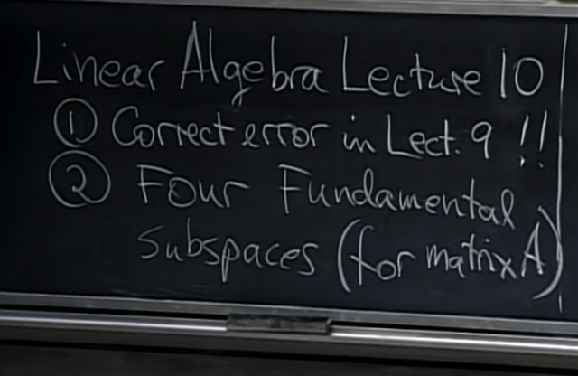</kbd>

 

### Không gian hàng và cột

<kbd></kbd>

<kbd></kbd>

> [!NOTE]
> Ok, đại khái là gs nói rằng trong bài trước **có một sai
> sót** đó là khi gs nói về **basis của R3**, thì sau khi nói
> về một **basis dễ thấy nhất** - ba vector đơn vị **(1 0 0),
> (0 1 0), (0 0 1)** thì ta đã lấy một bộ 3 vector khác với
> với hai cái đầu là hai vector độc lập: (1 1 2), (2 2 5). Và
> cho rằng chỉ cần vector thứ 3 không phải là linear
> dependent của hai cái kia là ta sẽ có một basis. Điều
> này đúng, và gs đã lấy (3 3 8) vì cho rằng " à, (3 3 7) sẽ
> là tổng hai thằng kia nên lấy (3 3 8) chắc sẽ không nằm
> trong plane span bởi v1, v2.
>
>
>
> Đây chính là chỗ sai khi có **người phát hiện rằng trong
> matrix này, hàng 1 bằng hàng 2**. Tức là, **ba hàng này
> ko độc lập**. Và như bữa trước đã thấy, nếu elimination,
> U sẽ **chỉ còn 2 pivot**. vì chỉ có mỗi pivot mỗi hàng và
> mỗi cột. Thành ra theo hàng thì chỉ có 2 pivot thì đồng
> nghĩa theo cột cũng sẽ chỉ có 2 pivot. Vậy **ba cột này
> chắc chắn ko độc lập.**
>
>
>
> Và bài này gs sẽ cho ta thấy **sự liên hệ giữa columns
> space và row spaces.**

📹 [Xem video trên YouTube](https://www.youtube.com/watch?v=fdjo2Nbwk2E)

> [!TIP]
> 🤖 **AI Check** — 🟢 Pass — ✅ **95/100** · ✓ Move on
>
> Ghi chú rất xuất sắc, nắm bắt chính xác sai sót thú vị của giáo sư Strang trên bảng và hiểu sâu sắc bản chất: hàng 1 bằng hàng 2 dẫn đến rank tối đa là 2 (số pivot hàng = số pivot cột), do đó 3 cột không thể độc lập tuyến tính.
>
> **🟡 Minor issues**
>
> **1.** *"chỉ cần vector thứ 3 không phải là linear dependent của hai cái kia"*
>
> Thuật ngữ chính xác nên là 'không phải là tổ hợp tuyến tính (linear combination) của hai vector kia' hoặc 'độc lập tuyến tính với hai vector kia'.
>
>
> **✓ Strengths**
> - Nhận diện chính xác sai lầm trên bảng khi các cột [1 1 2]^T, [2 2 5]^T, [3 3 8]^T tạo thành ma trận có hàng 1 và hàng 2 trùng nhau.
> - Hiểu rất rõ định lý nền tảng: số pivot theo hàng bằng số pivot theo cột (row rank = column rank), từ đó suy ra 3 vector cột không thể tạo thành cơ sở cho R^3.
>
> **💡 Deeper notes**
> - Việc hàng 1 bằng hàng 2 triệt tiêu ngay lập tức một pivot khi khử Gauss (R2 - R1 = 0), đảm bảo ma trận có định thức bằng 0 và không khả nghịch.

 

#### Không gian hàng ma trận

<kbd></kbd>

<kbd></kbd>

> [!NOTE]
> Và ta sẽ nói về một subspace quan trọng thứ 3 bên cạnh
> **columns** **space** và **nullspace**: **ROW SPACE**.
>
>
>
> Vậy rowspace là space tạo bởi **mọi linear combination của
> các matrix row**. Hay nói cách khác, các row vector của A sẽ
> span rowspace. Nhưng again, **chưa chắc các row của A sẽ là
> basis của rowspace** nhé, vì **có thể chúng không independent**
> ví dụ như trong matrix hồi nãy, rows của A chỉ span 2D plane
> trong R3.
>
>
>
> Rồi, tiếp gs nói tôi không thích làm việc với row vector, nên
> tôi có thể dùng **columns của Aᵀ** để chỉ row của A. Vậy **rowspace
> của A là columns space của Aᵀ**

> [!TIP]
> 🤖 **AI Check** — 🟢 Pass — ✅ **100/100** · ✓ Move on
>
> Ghi chú rất chính xác và nắm bắt trọn vẹn bản chất của không gian hàng (row space), mối liên hệ với C(Aᵀ) cũng như phân biệt rõ ràng giữa tập sinh (span) và cơ sở (basis).
>
> **✓ Strengths**
> - Định nghĩa chính xác row space là không gian sinh bởi tất cả các tổ hợp tuyến tính của các hàng trong ma trận A.
> - Hiểu rõ sự khác biệt giữa tập sinh và cơ sở khi nhấn mạnh các hàng chỉ là cơ sở khi chúng độc lập tuyến tính.
> - Nắm bắt chuẩn xác đẳng thức kỹ thuật quan trọng: row space của A chính là column space của Aᵀ, tức C(Aᵀ).
>
> **💡 Deeper notes**
> - Nếu ma trận A có kích thước m x n, thì các hàng nằm trong Rⁿ, do đó row space C(Aᵀ) là một không gian con của Rⁿ (khác với column space C(A) là không gian con của Rᵐ).

 

##### The Four Fundamental Subspaces

<kbd></kbd>

<kbd></kbd>

> [!NOTE]
> Và fundamental subspace thứ 4 là **null-space của Aᵀ** hay
> còn được gọi là **LEFT NULLSPACE** của A
>
>
>
> Cho matrix A [m,n] thì **C(A) sẽ là subspace của Rm** (mỗi
> cols  có m component)
>
>
>
> **N(A) sẽ là subspace của Rn** (có n cols, nên x khiến Ax = 0
> sẽ  có n component)
>
>
>
> **C(Aᵀ) cũng là subspace của Rn**, mỗi row là vector có n
> phần tử.
>
>
>
> Và **N(Aᵀ) sẽ là subspace của Rm**

> [!TIP]
> 🤖 **AI Check** — 🟢 Pass — ✅ **100/100** · ✓ Move on
>
> Ghi chú rất chính xác và tóm tắt đúng bản chất của 4 không gian con cơ bản cùng không gian chứa (R^m hoặc R^n) tương ứng của ma trận kích thước m x n.
>
> **✓ Strengths**
> - Xác định chính xác tên gọi và không gian bao chứa (R^m hoặc R^n) cho cả 4 không gian con cơ bản.
> - Giải thích trực quan và đúng đắn lý do vì sao mỗi không gian con lại thuộc về R^m hay R^n dựa trên số chiều của các vector cột, hàng và nghiệm.
>
> **💡 Deeper notes**
> - Tên gọi 'left nullspace' (không gian không bên trái) xuất phát từ việc phương trình Aᵀy = 0 có thể viết lại thành yᵀA = 0ᵀ, trong đó vector hàng yᵀ nhân vào ma trận A từ phía bên trái.
> - Trong các bài học tiếp theo, số chiều cụ thể của từng không gian con sẽ gắn liền với hạng r của ma trận: dim(C(A)) = dim(C(Aᵀ)) = r, dim(N(A)) = n - r, và dim(N(Aᵀ)) = m - r.

 

###### Bốn không gian con

<kbd></kbd>

<kbd></kbd>

> [!NOTE]
> Gs phác thảo **rowspace và null-space là subspace
> của Rn** và **columns space và nullspace of Aᵀ là
> subspace của Rm**

> [!TIP]
> 🤖 **AI Check** — 🟢 Pass — ✅ **100/100** · ✓ Move on
>
> Ghi chú tóm tắt rất chính xác sơ đồ 4 không gian con cơ bản của ma trận A kích thước m x n mà Giáo sư Gilbert Strang đang phác thảo trên bảng.
>
> **✓ Strengths**
> - Xác định đúng không gian hàng (row space) và không gian nghiệm (nullspace) thuộc R^n.
> - Xác định đúng không gian cột (column space) và không gian nghiệm trái N(A^T) thuộc R^m.
>
> **💡 Deeper notes**
> - Hai cặp không gian con này không chỉ nằm trong R^n và R^m mà còn là phần bù trực giao (orthogonal complements) của nhau: Row Space ⟂ Nullspace trong R^n, và Column Space ⟂ N(A^T) trong R^m.

 

###### Bốn không gian con nền tảng

<kbd></kbd>

> [!NOTE]
> Vậy thì nếu có thể biết được **4 subspace nền tảng** này thì
> coi như biết về một nửa của Linear Algebra.
>
>
>
> Câu hỏi là với 4 subspace này, **basis** là gì, và **dimension**?
>
>
>
> Thế thì với basis, gs yêu cầu một quy trình để xác định
> basis. 
>
>
>
> Còn với dimension, thì yêu cầu cho biết dimension là một
> con số thôi. 
>
>
>
> Gs: tôi có thể trả lời luôn **dimension** cho **columns space** 
> trước: Đó chính là **rank r của matrix A**. Và ta đã đi biết vụ
> này ở bài trước. Đương nhiên gs nói tiếp ta có thể **đi tìm
> basis** và **số vector của basis chính là dimension**

> [!TIP]
> 🤖 **AI Check** — 🟢 Pass — ✅ **100/100** · ✓ Move on
>
> Ghi chú tóm tắt rất chính xác tinh thần và nội dung bài giảng của GS. Gilbert Strang về câu hỏi trọng tâm (basis và dimension) đối với 4 không gian con cơ bản.
>
> **✓ Strengths**
> - Nắm bắt chính xác hai câu hỏi trọng tâm được đặt ra trên bảng: tìm cơ sở (basis) và số chiều (dimension) cho các không gian con.
> - Hiểu đúng khái niệm số chiều của column space chính bằng hạng (rank r) của ma trận A và liên hệ chuẩn xác giữa số vector trong cơ sở với số chiều.
>
> **💡 Deeper notes**
> - Ở các bước tiếp theo của bài giảng, GS. Strang sẽ chỉ ra rằng không gian hàng (row space) cũng có cùng số chiều r (hạng hàng bằng hạng cột), từ đó dẫn đến định lý Rank-Nullity cho nullspace và left nullspace.

 

###### Cơ sở không gian cột

<kbd>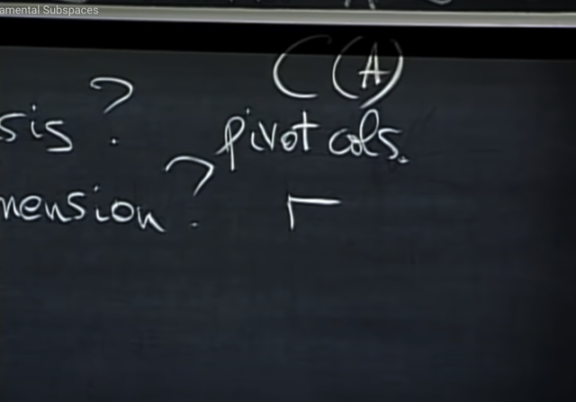</kbd>

<kbd>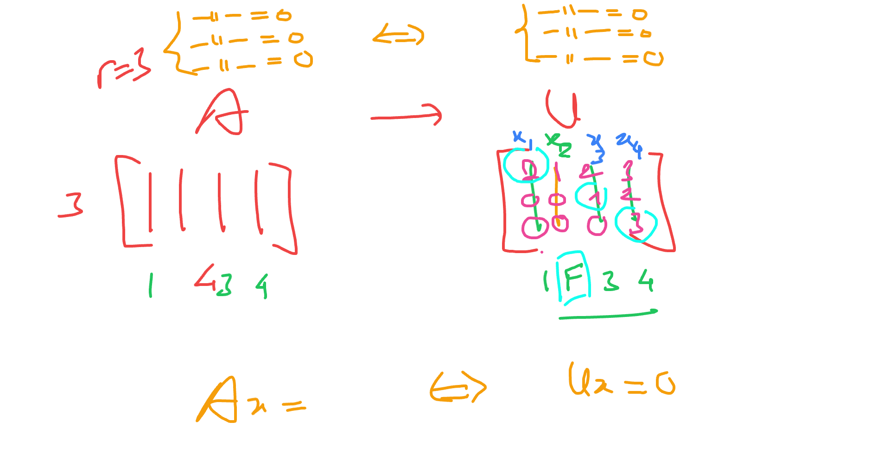</kbd>

<kbd>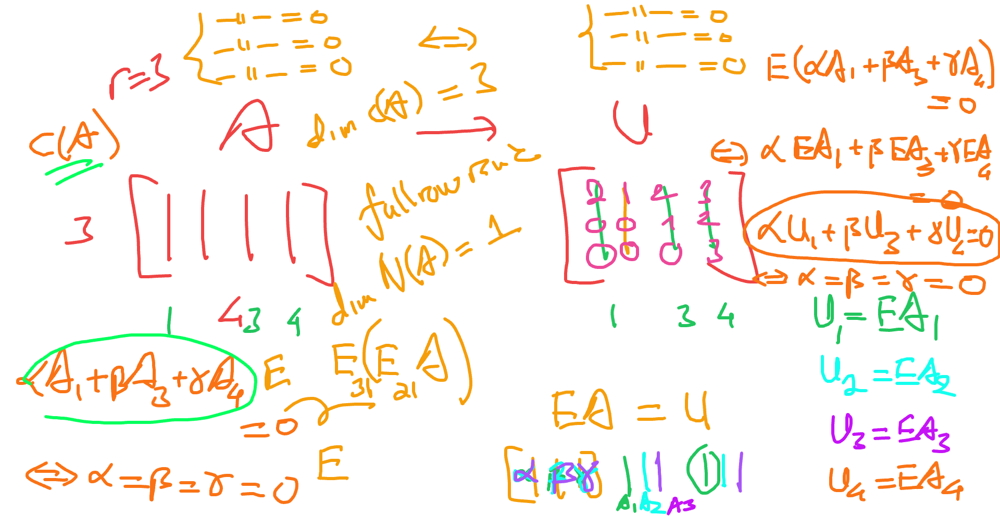</kbd>

> [!NOTE]
> Và như ta đã làm chán chê bữa giờ, khi ta dùng **elimination** để đưa A về Row Echelon form - **U**. Để xác định được **pivot** cols và **free** cols.
>
>
>
> Thế thì **các pivot cols (của A) chính là tạo nên một basis của cols space** và **số lượng pivot chính là rank** và **chính là dimensions của columns space**.
>
>
>
> **Vì sao pivots cols là basis của columns space?**
>
>
>
> thì bởi vì **chúng là các cols vector độc lập** trong các cols vector, thì chúng là những vector **vừa đủ để span cols space**, **nên chúng là basis của cols space**.
>
>
>
> Tóm lại, chúng ta đã hiểu khá nhiều về cols space. Gs cho rằng ta sẽ quay lại để chứng minh cái này dù mình đã biết là nó đúng
>
>
>
> ---
>
>
>
> Nhưng vì sao khử Gauss cho ta xác định cột 1,3,4 của U là pivots thì cột 1,3,4 của A cũng là bộ cơ sở?
>
>
>
> Thử giải thích: Chứng minh rất dễ: Chỉ cần xét tổ hợp tuyến tính của chúng: c1 A1 + c3 A3 + c4 A4. Vì EA = U, và theo góc nhìn nhân hai matrix thứ 3, U1 chính là EA1, U2 = EA2, U3 = EA3. Do đó

📹 [Xem video trên YouTube](https://www.youtube.com/watch?v=duV8R1iN4Ok)

> [!TIP]
> 🤖 **AI Check** — 🟢 Pass — ✅ **95/100** · ✓ Move on
>
> Ghi chú thể hiện tư duy rất tốt khi không chỉ ghi nhớ kết quả mà còn giải thích chính xác bản chất vì sao các cột pivot của A tạo thành cơ sở cho C(A) thông qua nghiệm của hệ Ax = 0.
>
> **✓ Strengths**
> - Hiểu rõ và nhấn mạnh chuẩn xác việc lấy các cột pivot của ma trận gốc A để làm cơ sở cho C(A), cùng với chiều không gian là rank r.
> - Lập luận rất chuẩn xác khi dùng tính bảo toàn nghiệm của Ax = 0 qua Ux = 0 để giải thích sự tương ứng về phụ thuộc tuyến tính giữa các cột.
>
> **💡 Deeper notes**
> - Dù phép khử hàng làm thay đổi không gian cột (C(A) ≠ C(U)), nó bảo toàn hoàn toàn không gian nghiệm (N(A) = N(U)). Do đó, tổ hợp tuyến tính nào triệt tiêu các cột của U thì cũng triệt tiêu chính các cột tương ứng của A.

 

###### Số chiều không gian hàng

<kbd>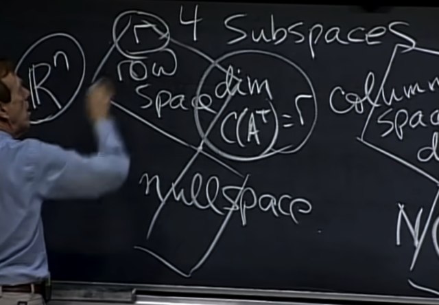</kbd>

<kbd>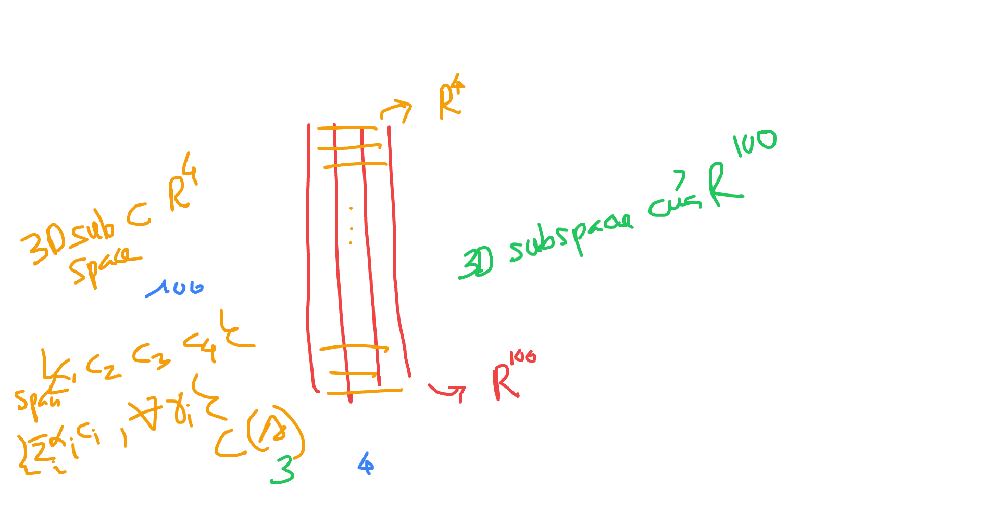</kbd>

> [!NOTE]
> Thế thì xét qua **row space of A.**
>
>
>
> Về dimension, gs cho biết **DIMENSION CỦA ROWSPACE
> CŨNG LÀ RANK CỦA A** 
>
>
>
> Và đây là một tính chất tuyệt vời. **Cols space và rows
> space của A đều có dimension là r**

📹 [Xem video trên YouTube](https://www.youtube.com/watch?v=FGeUpJFwQFM)

> [!TIP]
> 🤖 **AI Check** — 🟢 Pass — ✅ **100/100** · ✓ Move on
>
> Ghi chú nắm bắt rất chính xác tính chất cốt lõi từ bài giảng: số chiều của cả row space và column space đều bằng rank r của ma trận.
>
> **✓ Strengths**
> - Hiểu đúng và nêu bật định lý quan trọng: dimension của row space và column space luôn bằng nhau và bằng rank r của ma trận A.
>
> **💡 Deeper notes**
> - Cần lưu ý thêm rằng dù có cùng số chiều r, row space C(A^T) là không gian con của R^n, trong khi column space C(A) là không gian con của R^m (khi A là ma trận m x n).

**🔗 See also:** [Dimension of Left Nullspace](./lecture_12_graphs_networks_incidence_matrices.md#node-xk4c9wi)

 

###### Rank và không gian cột

<kbd>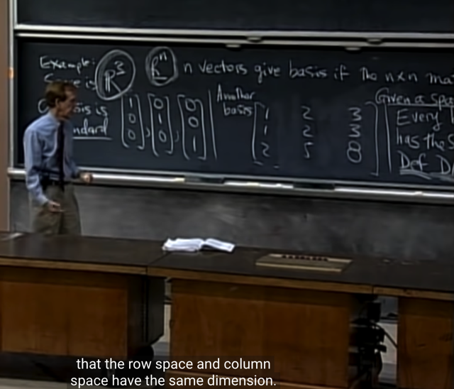</kbd>

> [!NOTE]
> Và nhờ điều này nên ta quay lại cái sai sót hồi bài trước.
> Khi ta có matrix này, thì nhìn cols ta không biết chúng có
> dependence không. Nhưng nhìn row là dễ thấy ngay chúng
> ta chỉ có 2 independence row.
>
>
>
> Và do đó **chỉ có thể có rank bằng 2** (vì mới nói
> dimensions của rowspace chính là rank, mà trong 3 row
> vector, ta chỉ có  2 row vector độc lập nên basis của
> rowspace chỉ có 2 vector, nên dimension của rowspace là 2
> → rank = 2)
>
>
>
> Và do đó **suy ra cols space cũng chỉ có dimension = 2**,
> vậy **Suy ra 3 cols vector không độc lập** (mà sẽ chỉ có 2
> trong số đó độc lập tuyến tính)

> [!TIP]
> 🤖 **AI Check** — 🟡 Minor issues — ✅ **95/100** · ✓ Move on
>
> Ghi chú rất tốt, nắm bắt chính xác định lý cốt lõi: số chiều của không gian dòng bằng số chiều của không gian cột (bằng rank), từ đó suy ra sự phụ thuộc tuyến tính của các cột.
>
> **🟡 Minor issues**
>
> **1.** *"mà sẽ chỉ có 2 trong số đó độc lập tuyến tính"*
>
> Cách diễn đạt hơi thiếu tính quy chuẩn; chính xác hơn là 'số cột độc lập tuyến tính cực đại là 2' (hoặc ta có thể chọn ra 2 cột độc lập tuyến tính để làm cơ sở cho không gian cột), tránh gây hiểu nhầm là chỉ có đúng một cặp 2 cột cố định nào đó độc lập.
>
>
> **✓ Strengths**
> - Hiểu và vận dụng xuất sắc mối quan hệ dim(Row Space) = dim(Col Space) = rank để kiểm tra tính độc lập tuyến tính.
> - Lập luận logic chặt chẽ: từ việc nhận diện 2 hàng độc lập suy ra rank = 2, từ đó kết luận 3 vector cột trong không gian 2 chiều bắt buộc phải phụ thuộc tuyến tính.
>
> **💡 Deeper notes**
> - Trong một ma trận m x n, nếu số cột n > rank(A) thì các cột chắc chắn phụ thuộc tuyến tính vì số vector vượt quá số chiều cực đại của không gian mà chúng sinh ra.

 

###### Dimensions of Four Fundamental Subspaces

<kbd>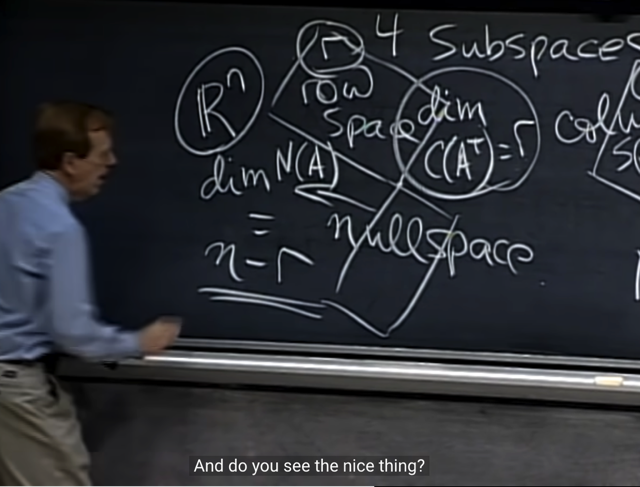</kbd>

> [!NOTE]
> Thế thì với nullspace (of A):
>
>
>
> Gs nhắc lại ta nhớ lại việc tìm **solution của Ax=0** (solution của nó chính là thuộc nullspace): Ta sẽ **elimination**, đưa A về row echelon form **U**, thậm chí reduced row echelon form **R**.
>
>
>
> Sau đó ta sẽ **tìm ra pivol cols/variable** đồng nghĩa biết **free cols/variable**. Và với từ đó gán giá trị tùy ý cho các free variable để back-substitution tính ra pivot variable.
>
>
>
> Và nhớ lại, ta thường cho lần lượt mỗi free variable một lần mang giá trị 1, mấy cái còn lại 0 (ý là ví dụ có 2 free variable x1, x3 thì **lần đầu ta cho x1=1, x3=0**, lần sau cho **x3=1, x1=0** để tính ra pivot var. Và đó các solution tìm theo cách gán này được gọi là các **special solution**.
>
>
>
> Vậy dễ thấy **các special solution này independence** (vì ta được phép chọn giá trị bất kì cho free variable, thì dĩ nhiên luôn có thể chọn gía trị khiến các special solution độc lập.)
>
>
>
> Và gs vì vậy (**independence** và **span** **nullspace**) nên đó **cũng chính là basis vector** của nullspace.
>
>
>
> Như vậy, mỗi free variable sẽ cho ta một special solution (again, gán 1 cho nó, gán 0 cho mấy free variable khác và thế vào tính ra pivot var, để có một special solution)
>
>
>
> mà các special solution tạo thành một basis, cho nên số special solution = số free column chính là dimension của nullspace cũng như là số pivot column chính là dimension của column space / row space
>
>
>
> Vậy với matrix n cột, rank r, thì có r pivot, nên có n-r free variable ⇒ có n-r special solution và như vậy dimension của nullspace là n-r
>
> Hãy xét thêm hai câu hỏi sau: Tại sao chắc chắn rằng các special solution sẽ span nullspace, và tại sao chúng independence? (để từ đó kết luận chúng là basis của nullspace)

> [!TIP]
> 🤖 **AI Check** — 🟡 Minor issues — ✅ **90/100** · ✓ Move on
>
> Ghi chú nắm rất tốt bản chất cách tìm Nullspace qua dạng bậc thang và mối liên hệ giữa số biến tự do với chiều n - r. Có một điểm lập luận về tính độc lập tuyến tính hơi thiếu chặt chẽ nhưng bạn đã chủ động nhận diện để đào sâu thêm ở cuối.
>
> **🟡 Minor issues**
>
> **1.** *"vì ta được phép chọn giá trị bất kì cho free variable, thì dĩ nhiên luôn có thể chọn gía trị khiến các special solution độc lập."*
>
> Lập luận này hơi trực giác và chưa chặt chẽ về mặt toán học. Lý do cốt lõi khiến các special solution độc lập tuyến tính là vì tại các vị trí thành phần ứng với biến tự do, các vector này tạo thành một ma trận đơn vị I (mỗi vector có đúng một số 1 tại vị trí biến tự do của nó và 0 ở các biến tự do còn lại), do đó tổ hợp tuyến tính bằng 0 thì các hệ số buộc phải bằng 0.
>
>
> **✓ Strengths**
> - Hiểu chính xác quy trình xây dựng nghiệm đặc biệt (special solutions) từ biến tự do (free variables) qua phép khử Gauss-Jordan.
> - Kết nối chính xác giữa số pivot r, số biến tự do n - r với số chiều của không gian nghiệm Nullspace đúng như bài giảng của GS Strang minh họa trên bảng.
>
> **💡 Deeper notes**
> - Để chứng minh các special solution sinh ra toàn bộ Nullspace (span): Mọi nghiệm x bất kỳ của Ax = 0 đều có các thành phần biến tự do c1, c2, ..., c_(n-r). Khi lấy x trừ đi tổ hợp tuyến tính (c1*s1 + ... + c_(n-r)*s_(n-r)), ta thu được một nghiệm của Ax = 0 mà tất cả các biến tự do đều bằng 0, dẫn tới tất cả biến pivot cũng buộc bằng 0 (nghiệm tầm thường 0), chứng minh x phải bằng chính tổ hợp đó.

 

###### Số chiều Rowspace và Nullspace

<kbd></kbd>

> [!NOTE]
> Và ta có nhận xét rằng rowspace và nullspace, đều là
> subspace Rn. Thì, dimension của rowspace là r,
> dimension của nullspace là n-r. **Tổng dimension là n-r + r
> = n = số cols của A**

> [!TIP]
> 🤖 **AI Check** — 🟢 Pass — ✅ **100/100** · ✓ Move on
>
> Ghi chú hoàn toàn chính xác và nắm đúng bản chất của định lý Rank-Nullity cho hai không gian con trong R^n tràn bảng.
>
> **✓ Strengths**
> - Xác định chính xác row space và null space đều là các không gian con của R^n.
> - Hiểu rõ và tính đúng tổng số chiều của hai không gian là r + (n - r) = n (số cột của A).
>
> **💡 Deeper notes**
> - Bài giảng của Gilbert Strang sau đó còn nhấn mạnh row space và null space không chỉ có tổng số chiều bằng n mà còn là cặp trực giao bù của nhau (orthogonal complements) trong R^n.

**🔗 See also:** [Incidence Matrix of a Graph](./lecture_12_graphs_networks_incidence_matrices.md#node-6w3cdka)

 

###### Dimensions of Fundamental Subspaces

<kbd>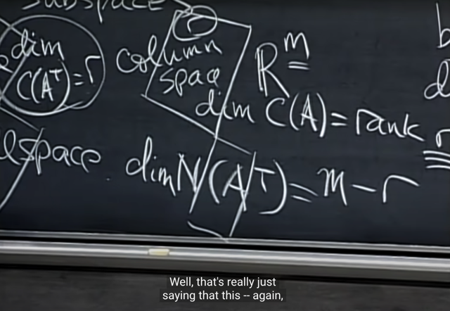</kbd>

<kbd>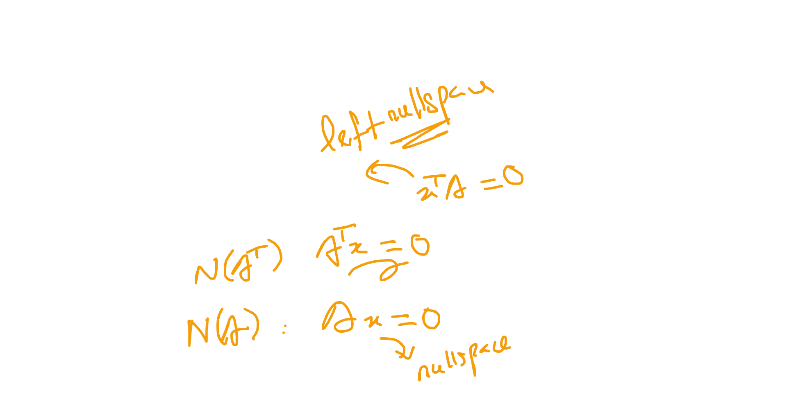</kbd>

<kbd>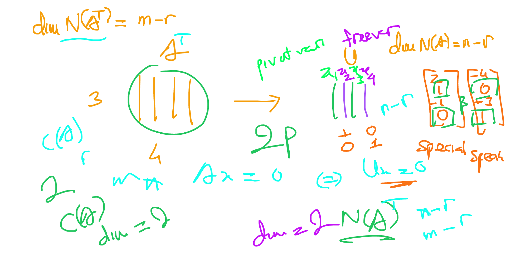</kbd>

> [!NOTE]
> Và dimension của nullspace của Aᵀ sẽ là m-r: Vì sao?
>
>
>
> Vì Aᵀ sẽ là matrix có n hàng, m cột (vì A là matrix mxn).
> Thế thì đã nói bên kia **cols space của A và row space
> của A đều có dimension là rank r của A**. Mà **rowspace
> của A chính là column space của Aᵀ.**
>
>
>
> Vậy **columns space Aᵀ có dimension = r** có nghĩa là
> **Aᵀ cũng có r pivot.**
>
>
>
> Nên (Aᵀ)x=0 cũng có r pivot var, nên số free var là m-r.
>
>
>
> Và do đó (Aᵀ)x=0 có m-r special solution, vậy dimension
> cuả nullspace của Aᵀ là m-r
>
>
>
> Và có thể thấy **nó cũng tuân theo cùng một rule: dim C(Aᵀ) + dim N(Aᵀ) = r + m - r = m = số columns của Aᵀ**

> [!TIP]
> 🤖 **AI Check** — 🟢 Pass — ✅ **100/100** · ✓ Move on
>
> Ghi chú giải thích rất mạch lạc, chặt chẽ và chính xác bản chất vì sao số chiều của left nullspace N(Aᵀ) lại bằng m - r thông qua định lý Rank-Nullity áp dụng cho ma trận Aᵀ.
>
> **✓ Strengths**
> - Xác định chính xác kích thước của ma trận chuyển vị Aᵀ là n × m (n hàng, m cột).
> - Kết nối chính xác mối quan hệ giữa row space của A với column space của Aᵀ cùng số lượng pivot.
> - Lập luận chặt chẽ từ số biến tự do (free variables), số nghiệm đặc biệt (special solutions) đến số chiều của nullspace theo Rank-Nullity Theorem.
>
> **💡 Deeper notes**
> - Không gian N(Aᵀ) thường được gọi là 'left nullspace' (hạt nhân trái) của A vì phương trình Aᵀy = 0 tương đương với yᵀA = 0.

 

###### Column Space and Pivot Columns

<kbd>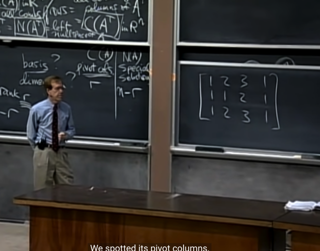</kbd>

<kbd>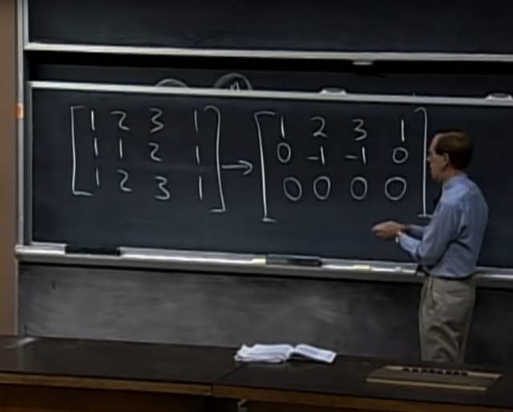</kbd>

<kbd>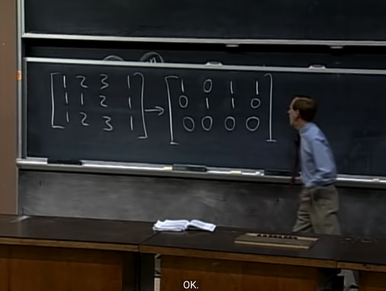</kbd>

> [!NOTE]
> tới đây ta đã trả lời xong câu hỏi dimension của chúng là gì,
> bây giờ ta sẽ tìm basis của chúng.
>
>
>
> Thế thế gs cho biết, tìm basis của C(A) thì ta biết rồi, đó là tìm ra
> các pivot cols. Thế thì basis của rowspace C(Aᵀ) thì sao?
>
>
>
> Gs nói rằng, ừ thì đại khái là các bạn cũng có thể cho rằng ta
> có thể lật cái A lại thành Aᵀ để rồi dùng elimination để tìm
> pivot cols của Aᵀ, khi đó transpose chúng lại ta sẽ có các
> linear independent row.
>
>
>
> Gs cho ví dụ matrix này, dễ thấy nó có 2 pivot cols (1 và 2,
> vì 3 và 4 đều linear dependent với 1, 2).
>
>
>
> Gs mới elimination để đưa nó về RREF matrix R

> [!TIP]
> 🤖 **AI Check** — 🟢 Pass — ✅ **95/100** · ✓ Move on
>
> Ghi chú tóm tắt rất chính xác mạch bài giảng của GS. Strang về cách xác định cơ sở cho không gian cột và không gian hàng qua các phép khử đưa về RREF.
>
> **✓ Strengths**
> - Nắm bắt chính xác mạch tư duy từ việc xác định số chiều (dimension) chuyển sang tìm cơ sở (basis) cho 4 không gian con cơ bản.
> - Nhận diện đúng số lượng và vị trí các cột pivot (cột 1 và 2) của ma trận ví dụ và mối quan hệ phụ thuộc tuyến tính của các cột còn lại.
> - Mô tả đúng các bước khử ma trận từ dạng ban đầu sang dạng bậc thang rút gọn (RREF) trên bảng.
>
> **💡 Deeper notes**
> - Cần lưu ý quan trọng: khi lấy cơ sở cho không gian cột C(A), ta phải chọn các cột pivot từ ma trận gốc A, chứ không lấy các cột từ ma trận R sau khi đã biến đổi (vì phép biến đổi hàng làm thay đổi không gian cột).
> - Ngược lại, các phép biến đổi hàng không làm thay đổi không gian hàng, do đó các hàng khác không của ma trận R (hoặc U) chính là cơ sở cho row space C(Aᵀ) mà không nhất thiết phải chuyển vị Aᵀ rồi khử lại từ đầu.

 

###### Cấu trúc ma trận rút gọn

<kbd>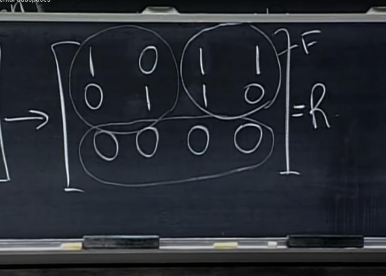</kbd>

> [!NOTE]
> và ta nhận xét thấy nó có một
> Identity matrix, Free matrix, hàng dưới = 0

> [!TIP]
> 🤖 **AI Check** — 🟡 Minor issues — ✅ **90/100** · ✓ Move on
>
> Ghi chú đã nắm đúng cấu trúc dạng khối kinh điển của ma trận bậc thang rút gọn R gồm ma trận đơn vị I, khối cột tự do F và các hàng số 0 bên dưới.
>
> **🟡 Minor issues**
>
> **1.** *"Free matrix"*
>
> Thuật ngữ chuẩn trong đại số tuyến tính (theo bài giảng của Gilbert Strang) thường gọi khối này là 'khối F' (block F) hay khối các cột tương ứng với biến tự do (free variables/free columns), thay vì gọi cả khối là 'free matrix'.
>
>
> **✓ Strengths**
> - Nhận diện chính xác 3 thành phần khối được khoanh tròn trên bảng: ma trận đơn vị I, khối F và hàng toàn số 0.
>
> **💡 Deeper notes**
> - Cấu trúc khối tổng quát của ma trận RREF thường được viết dưới dạng R = [I, F; 0, 0], trong đó các cột của I ứng với các biến cơ sở (pivot variables) và F ứng với các biến tự do (free variables).

 

###### Không gian hàng và cột

<kbd>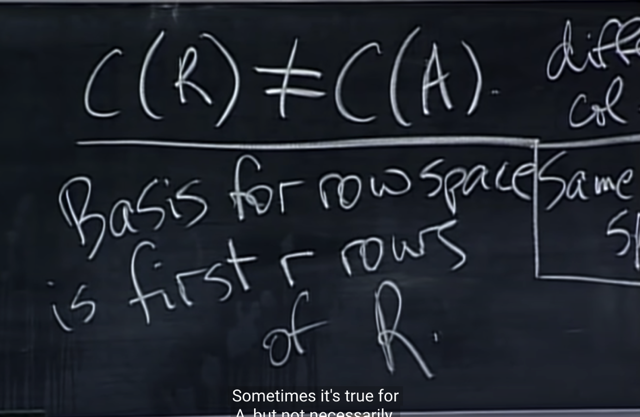</kbd>

<kbd>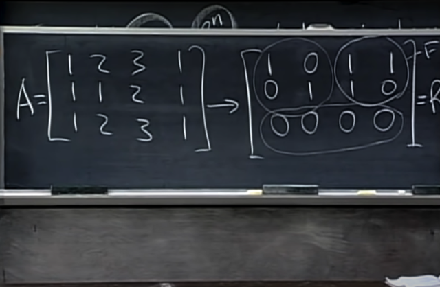</kbd>

<kbd>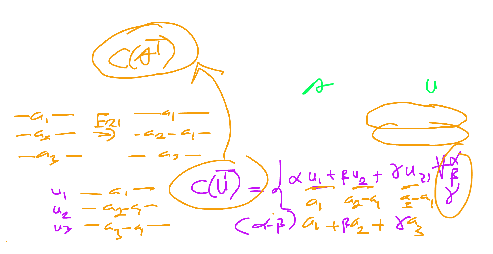</kbd>

> [!NOTE]
> **COLUMN SPACE CỦA R KHÁC COLUMN SPACE CỦA
> A**. Gs cho biết, vì **TRONG QUÁ TRÌNH ELIMINATION
> TA ĐÃ THAY  ĐỔI CÁC COLUMN**
>
>
>
> Nhưng **ROW SPACE CỦA R CHÍNH LÀ ROW SPACE
> CỦA A**. Và **basis của R** chính là hai row đầu, thì do đó
> chúng **cũng là basis của rowspace của A**
>
> Column-space của R không bằng cols space của A. 
> Nhưng row-space của R chính là row space của A

> [!TIP]
> 🤖 **AI Check** — 🟢 Pass — ✅ **95/100** · ✓ Move on
>
> Ghi chú nắm rất chính xác sự khác biệt giữa column space và row space qua phép khử Gauss, đồng thời hiểu rõ cách lấy cơ sở (basis) cho row space từ ma trận R.
>
> **✓ Strengths**
> - Hiểu chính xác bản chất: các phép biến đổi dòng làm thay đổi column space nhưng bảo toàn row space.
> - Nắm vững quy tắc chọn cơ sở cho row space là $r$ dòng khác không đầu tiên của ma trận rút gọn bậc thang $R$.
>
> **💡 Deeper notes**
> - Mặc dù $C(R) \neq C(A)$, các phép biến đổi hàng vẫn bảo toàn mối quan hệ phụ thuộc tuyến tính giữa các cột, cho phép xác định các cột trụ (pivot columns) của $A$ để làm cơ sở cho $C(A)$.

 

###### Sự bảo toàn row space

<kbd></kbd>

> [!NOTE]
> Tại sao row space của R chính là row space của A để rồi hai vector đầu là basis của rowspace của R cũng chính là basis của rowspace của A?
>
>
>
> Lí do là vì, khi thực hiện quá trình row **elimination** matrix A, ta đã **THAY CÁC ROW BẰNG LINEAR COMBINATION CỦA CHÚNG (và quá trình này khả nghịch do các matrxi E khả nghịch**)
>
>
>
> Gs đề nghị ngẫm lại xem có phải vậy không. Đúng là như vậy. Thế thì điều đó có nghĩa là **ROWSPACE CỦA A TRONG QUÁ TRÌNH ELIMINATION KHÔNG THAY ĐỔI**, do đó rowspace của R vẫn chính là rowspace của A. Khi thay hai vector (row) bằng hai vector khác trong cùng row space (linear combination của hai vector gốc) thì đương nhiên vẫn là rowspace đó.
>
>
>
> Do đó chỉ là **quá trình elimination giúp ta CHUYỂN HAI BASIS VECTOR CỦA ROWSPACE CỦA A THÀNH HAI BASIS KHÁC RÕ RÀNG HƠN THÔI**. Gs gọi nó là **the** **best basis**

> [!TIP]
> 🤖 **AI Check** — 🟢 Pass — ✅ **95/100** · ✓ Move on
>
> Ghi chú thể hiện sự hiểu biết rất sâu sắc và chính xác về bản chất đại số tuyến tính: phép khử hàng (nhân ma trận khả nghịch E) bảo toàn không gian hàng (row space), và các hàng khác không của R tạo thành cơ sở trực quan/tốt nhất cho không gian hàng của A.
>
> **✓ Strengths**
> - Hiểu chính xác bản chất vì sao Row Space không đổi: mỗi phép biến đổi dòng sơ cấp là một tổ hợp tuyến tính khả nghịch (tương ứng với phép nhân ma trận E khả nghịch).
> - Nắm bắt đúng thuật ngữ và trực giác của Giáo sư Gilbert Strang khi coi các dòng khác không của R là 'the best basis' (cơ sở tốt nhất) cho Row Space vì chứa các khối đơn vị rõ ràng.
>
> **💡 Deeper notes**
> - Đối với Column Space thì ngược lại ($C(R) \neq C(A)$): phép biến đổi hàng làm thay đổi không gian cột nhưng vẫn giữ nguyên mối quan hệ phụ thuộc tuyến tính giữa các cột, do đó cơ sở của $C(A)$ phải được lấy từ các cột pivot tương ứng của ma trận gốc $A$ chứ không lấy từ $R$.

 

###### Row Space of Reduced Matrix

<kbd>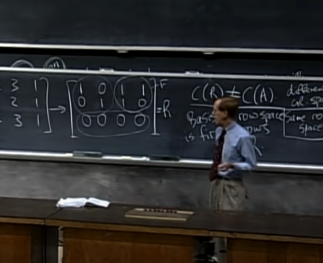</kbd>

> [!NOTE]
> Và cũng như đối với cols space, hai pivot cols (mà ở dạng
> reduced row echelon form) sẽ chính là hai cols gắn với cái
> Identity matrix là the best basis của cols space.
>
>
>
> CHÚ Ý: KHI NÓI BASIS CỦA COLUMN SPACE LÀ PIVOT
> COLUMN, THÌ PHẢI HIỂU Ý NÓI **PIVOT COLUMN CỦA A**
> CHỨ KHÔNG PHẢI CỦA R HAY U. CÓ NGHĨA LÀ NHỜ
> PIVOT COLUMN CỦA U, TA **BIẾT VỊ TRÍ CỦA PIVOT
> COLUMN CỦA A**. ĐIỀU NÀY **KHÁC VỚI ROWSPACE**, KHI
> VỚI ROWSPACE THÌ **PIVOT ROW CỦA R/U CŨNG
> CHÍNH LÀ PIVOT ROW (BASIS)  CỦA A** VÌ NHƯ ĐÃ NÓI
> CHÚNG **CÙNG MỘT ROWSPACE**
>
>
>
> Thì hai row đầu tiên của R trong trường hợp này là the best
> basis của row space (best mang ý nghĩa là nó đã được
> clean / tối giản hết mức có thể)

> [!TIP]
> 🤖 **AI Check** — 🟡 Minor issues — ⚠️ **85/100** · ✓ Move on
>
> Ghi chú nắm rất tốt sự khác biệt cốt lõi giữa Column Space và Row Space khi biến đổi về dạng R: cột cơ sở của C(A) phải lấy từ ma trận A gốc, trong khi cơ sở của Row Space có thể lấy trực tiếp từ các hàng pivot của R.
>
> **🟡 Minor issues**
>
> **1.** *"Và cũng như đối với cols space, hai pivot cols (mà ở dạng reduced row echelon form) sẽ chính là hai cols gắn với cái Identity matrix là the best basis của cols space."*
>
> Câu này gây mâu thuẫn trực tiếp với phần CHÚ Ý ngay bên dưới. Các cột pivot của R (chứa ma trận đơn vị I) chỉ là cơ sở của C(R), tuyệt đối không phải là cơ sở của C(A) vì C(R) ≠ C(A).
>
> **2.** *"PIVOT ROW CỦA R/U CŨNG CHÍNH LÀ PIVOT ROW (BASIS) CỦA A"*
>
> Diễn đạt chưa chuẩn xác về mặt thuật ngữ. Các hàng khác không của R không phải là 'hàng của A' (vì đã qua phép khử Gauss), mà chúng là 'cơ sở cho không gian hàng của A' (vì Row(R) = Row(A)).
>
>
> **✓ Strengths**
> - Phân biệt rất chính xác điểm khác nhau căn bản: tìm cơ sở cho C(A) thì chỉ dùng R để lấy chỉ số (index) rồi phải quay về A, còn Row Space thì lấy trực tiếp các hàng pivot của R.
> - Hiểu đúng bản chất vì sao các hàng pivot của R được GS. Strang gọi là 'the best basis' cho row space (nhờ chứa khối đơn vị I nên rất tối giản, trực quan và dễ biểu diễn).
>
> **💡 Deeper notes**
> - Khi thực hiện các phép biến đổi dòng sơ cấp, ta đang nhân ma trận sơ cấp E từ bên trái (R = EA), do đó tổ hợp tuyến tính các dòng không làm thay đổi Row Space (Row(A) = Row(R)), nhưng làm thay đổi Column Space (C(R) ≠ C(A)).
> - Nếu muốn lấy cơ sở của Row Space trực tiếp từ các dòng ban đầu của ma trận A, ta phải chọn các dòng của A tương ứng với các pivot rows, nhưng chúng thường không 'sạch' (clean) bằng các dòng của R.

 

###### Cơ sở không gian hàng

<kbd>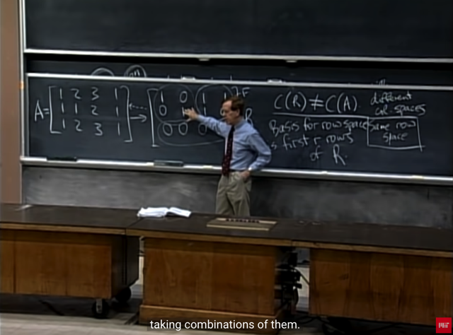</kbd>

> [!NOTE]
> Gs: làm sao tôi biết các row của A span cùng một vector
> space với hai basis vector? Hay nói cách khác, làm sao
> biết các row vector cũng nằm trong cùng space span bởi
> hai basis vector? 
>
>
>
> Thì bởi vì ta **có thể làm ngược qúa trình elimination** lại
> **để** **từ hai basis vector ra lại các row của A**. Thì điều này 
> đồng nghĩa các **row của A là linear combination của các
> basis vector**. Và **cũng đồng nghĩa rowspace cuả A chính
> là rowspace của R.**

 

###### The Left Nullspace N(Aᵀ)

<kbd>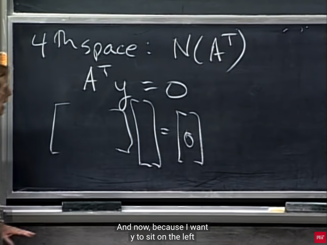</kbd>

<kbd>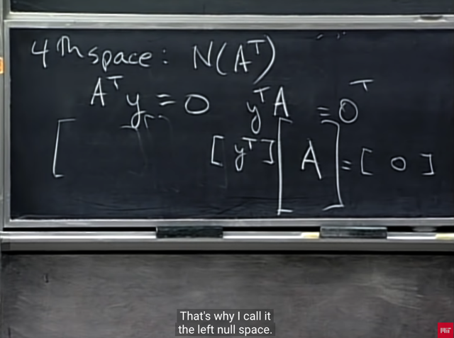</kbd>

> [!NOTE]
> rồi, gs xét qua **nullspace của Aᵀ**. hay còn gọi là **left nullspace** như nãy đã nói.
>
>
>
> Thế thì đầu tiên nullspace của Aᵀ đương nhiên theo định nghĩa là **mọi linear combination của các solution của Aᵀy=0**
>
>
>
> Vậy thì đầu tiên tìm hiểu tại sao lại gọi là left nullspace.
>
>
>
> đại khái là vì, ta có thể transpose hai vế của Aᵀy = 0 để có yᵀA = 0. Có nghĩa là nullspace của Aᵀ là linear combination của mọi vector y thì nó cũng là linear combination của mọi yᵀ và vì yᵀ nằm bên trái A nên mới nói **nullspace của Aᵀ là left nullspace của A.**
>
>
>
> Nhưng gs nói rằng tôi ít dùng cách gọi này

 

###### Phép khử Gauss-Jordan

<kbd>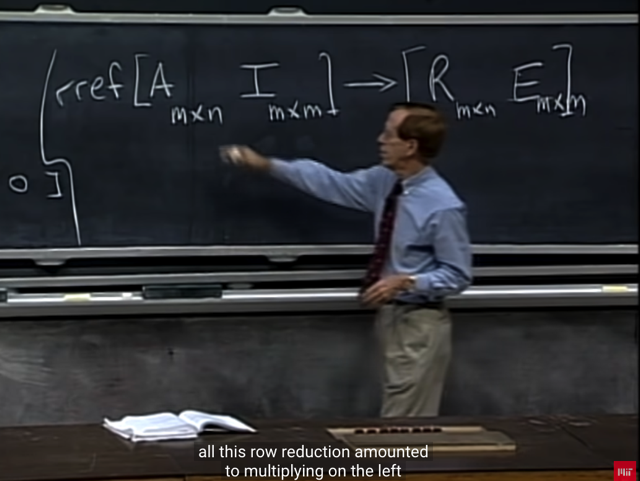</kbd>

> [!NOTE]
> thế thì gs cho rằng elimination biến A thành R cũng có
> reveal ít nhiều về matrix Aᵀ, do đó, ta sẽ ôn lại một
> chút về qúa trình elimination biến A thành R (Reduced
> Row Echelon Form)
>
>
>
> Dùng **Gauss - Jordan** mà ta đã từng gặp ở mấy bài trước,
> Trong đó đại khái là ta sẽ **viết identity matrix kẹp với matrix
> A**, và khi elimination, ta **cũng áp dụng các bước biến đổi
> đối với matrix I**. Từ đó **khi A thành R**, **I trở thành matrix nào
> đó, gọi là E** (cố tình đặt tên là E)

**🔗 See also:** [Phương pháp khử Gauss-Jordan](./lecture_3_multiplication_and_inverse_matrices.md#node-o2kdp8j)

 

###### Bản chất ma trận khử

<kbd>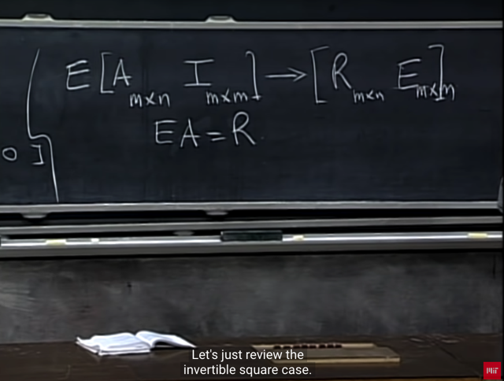</kbd>

> [!NOTE]
> Và như đã biết các bước **elimination biến A thành I** có thể 
> biểu diễn bởi việc **transform matrix A bằng matrix E**: EA
>
>
>
> Và thật sự **E chính là matrix mà I trở thành** ở trên.
>
>
>
> Vì sao? Vì EA=R thì cũng những bước biến đổi đó áp 
> dụng lên I, thì kết quả chính là kết quả của E × I. Mà vì I là
> Identity matrix nên **EI = E**. Vậy suy ra **cái matrix kết quả
> của I trở thành chính là E.**

 

###### Ma trận nghịch đảo Gauss-Jordan

<kbd>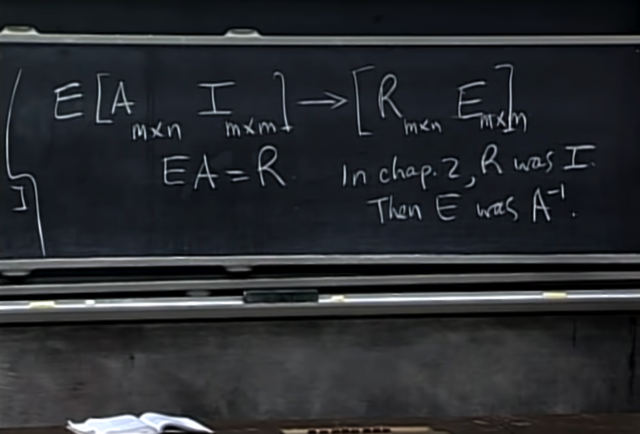</kbd>

> [!NOTE]
> Gs ôn lại trong bài bữa trước về Gauss Jordan, ta
> đang có A là **square & invertible** matrix. Khi đó sau khi
> elimination, ta có **A trở thành I.**
>
>
>
> Vì A trở thành I, có nghĩa là EA=I, nên **E chính là A.inv**
> vậy việc **Gauss Jordan elimination sẽ giúp ta có được
> A.inv**

 

###### Reduced Row Echelon Form

<kbd>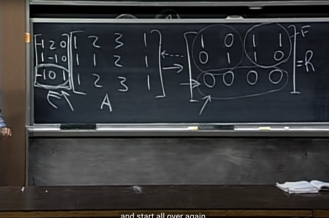</kbd>

> [!NOTE]
> Ok, quay lại đây, nhớ rằng ta đang đi tìm basis của nullspace  của Aᵀ (hay còn
> gọi là left-nullspace của A)
>
>
>
> Thế thì như đã nói, ta không cần phải transpose A, để rồi tìm basis của nullspace
> của Aᵀ bằng các xét solution của  (Aᵀ)y = 0, tức là làm theo cách thông thường
> khi tìm nullspace của A.
>
>
>
> Mà ở đây ta đang nói rằng quá trình elimination từ A trở thành R CŨNG ĐÃ CÓ
> REVEAL THÔNG TIN VỀ NULLSPACE CỦA Aᵀ RỒI. Đó là:
>
>
>
> Như mới nói quá trình elimination tương đương với việc nhân E với A để có R. Và
> như vừa nói xong, phương pháp Gaussian Jordan sẽ cho ta biết E là gì (là cái mà
> I trở thành sau khi cũng apply các bước elimination biến A thành R). Nên gs mới
> lẩm nhẩm apply các bước như vậy với I để có matrix E như trên.
>
>
>
> Rồi, thế thì, EA = R. Và đây chính là lúc mà quá trình elimination biến A thành R
> cũng reveal thông tin cho ta biết basis của nullspace của Aᵀ đây:
>
>
>
> Đầu tiên, nhớ lại định nghĩa row vector r1 (1xm) nhân với matrix A (mxn),  chính là
> tạo ra một row bằng cách linear combination các row của A với các coeff là các
> phần tử của r1. Và matrix E (3xn) có 3 row r1, r2, r3 thì khi nhân E (3xm) với A
> (mxn) chính là tạo matrix mà mỗi hàng là linear combination của các hàng của A
> với coeff là giá trị của vector hàng tương ứng của E:
>
>
>
> Tức EA = R, thì hàng 1 của R chính là linear combination các hàng của A dùng
> coeff là hàng 1 của E, hàng 2 của R chính là linear combination của A với coeff là
> hàng 2 của E,....
>
>
>
> Vậy thì **hãy nhìn hàng 3 của R, là vector zero**. Có nghĩa là **TA CÓ LINEAR
> COMBINATION CỦA CÁC HÀNG CỦA A VỚI HỆ SỐ LÀ HÀNG 3 CỦA E TẠO RA
> KẾT QỦA ZERO.**
>
>
>
> Thì điều này theo định nghĩa của nullspace của Aᵀ là mọi vector y khiến Aᵀy=0
> tương đương mọi vector y khiến yᵀ×A = 0, tương đương mọi vector y mà hệ số
> của nó sẽ tạo linear combination các hàng của A cho ra zero. Thế thì theo **đó,
> ROW 3 CỦA E CHÍNH LÀ MỘT VECTOR TRONG NULLSPACE CỦA Aᵀ
>
>
>
> Rồi, bây giờ ta sẽ chứng minh nó cũng chính là basis:**
>
>
>
> Là bởi như bài trước ta đã cũng nhau chứng minh để đi đến kết luận là
> **dimension của nullspace của Aᵀ sẽ là m - r**. Vậy thì đối với matrix A này m = 3,
> n = 4 và rank = 2. Vậy dimension của nullspace của Aᵀ = m-r=3-2 = 1
>
>
>
> À, vậy **dimension của nullspace của Aᵀ = 1** nên basis của nullspace của Aᵀ
> cũng **CHỈ CÓ 1 VECTOR** (vì như đã biết theo định nghĩa dimension của vector
> Space là số vector trong basis của nó). Từ đó suy ra, **cái row thứ 3 của E chính
> là một basis của nullspace của Aᵀ
>
>
>
> Và từ đó ta đã biết cách thông qua elimination biến A thành R mà cũng giúp
> review được basis của nullspace của Aᵀ**

 

###### Subspaces of Matrix Spaces

<kbd>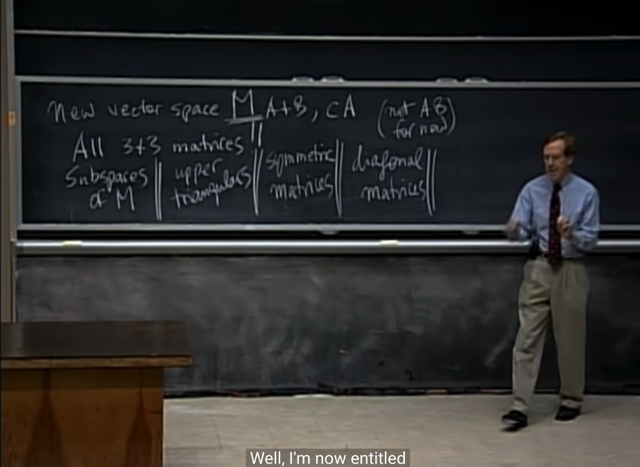</kbd>

> [!NOTE]
> Rồi, những phút cuối gs mở rộng vấn đề qua một vector
> space  mới: Từ những bài trước tới nay, đại khái là ta làm
> việc với vector space nếu thỏa tính chất
>
>
>
> **Hai vector cộng nhau vẫn trong vector space**. **Scale vector
> thì vẫn được vector nằm trong space**.
>
>
>
> Ví dụ hai vector v1,v2 có 3 phần tử. (thuộc R3). Thì v1+v2,
> hay v1 × c đều tạo một vector cũng có 3 phần tử (tức cũng
> thuộc R3)
>
>
>
> Thì tương tự vậy, ta xét 2 matrix 3x3: V1, V2. Thì V1+V2,
> hay V1 × c đều cho ra matrix 3x3 khác. **Do đó có thể xét
> vector space R3x3: tập hợp mọi matrix 3x3**. Thì nếu V1,V2
> thuộc R3x3 thì ta cũng có **V1+V2, V1 × c cũng thuộc R3x3**.
>
>
>
> Đây chính là sự **mở rộng vector space Rⁿ thành R^nxn**
>
>
>
> *Tạm thời gs đề nghị bỏ qua một tính chất là V1 có thể
> nhân với V2 (trong bảng là A nhân B)

 

###### Không gian con ma trận

<kbd>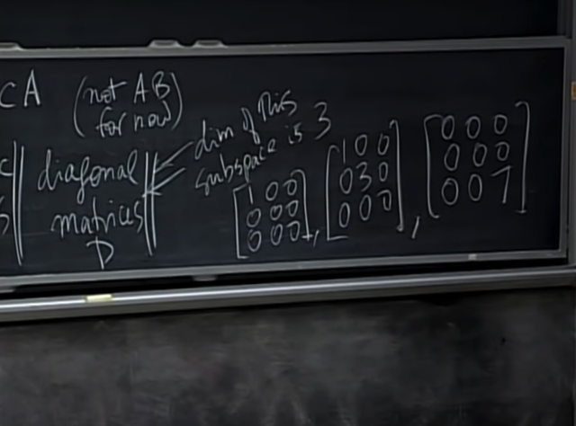</kbd>

> [!NOTE]
> Thế thì ta cũng sẽ có **các subspace** của M: như:
>
>
>
> (nhắc lại M là tập hợp mọi matrix 3x3)
>
>
>
> **mọi matrix U (3x3)**, hay
>
>
>
> mọi **symmetric 3x3 matrix**
>
>
>
> mọi **diagonal 3x3 matrix**. D
>
>
>
> Thì trong đó ta sẽ cùng nhau tìm basis và dimension
> của các subspace này trong bài sau
>
>
>
> ví dụ như ta cũng sẽ thấy dimension của D là 3, có
> nghĩa là 3 basis của nó sẽ gồm 3 matrix như này.
>
>
>
> rồi ta cũng sẽ thông qua dimension để làm rõ việc
> D sẽ chứa các vector subspace kia ra sao

 

