# Lecture 11: Matrix Spaces; Rank 1; Small World Graphs

📊 **Progress:** `33` Notes | `34` Screenshots | `11` AI Reviews

---

 

## Đại số tuyến tính Bài 11

<kbd></kbd>

 

### Không gian ma trận

<kbd></kbd>

> [!NOTE]
> Rồi, cuối bài trước gs đã đề nghị ta **xét đến một loại vector
> space mới**, mà trong đó thứ mà ta làm việc với thật ra
> **không phải vector**, **mà là matrix**.
>
>
>
> Nhưng mình vẫn có thể **add** chúng, **scale** chúng. Có
> thể gọi nó là **matrix space** cũng được. Và gs cho rằng
> khi nào mà ta **vẫn đảm bảo hai khả năng add và scale
> này** (again, tạm bỏ qua việc ta có thể nhân hai matrix) thì
> **ta sẽ thấy các tính chất mà mình đã làm bữa giờ với
> normal vector space vẫn đúng**

> [!TIP]
> 🤖 **AI Check** — 🟡 Minor issues — ✅ **95/100** · ✓ Move on
>
> Ghi chú nắm rất chuẩn ý tưởng cốt lõi của giáo sư Strang khi mở rộng khái niệm không gian vector sang không gian ma trận thông qua hai phép toán cộng và nhân vô hướng.
>
> **🟡 Minor issues**
>
> **1.** *"thứ mà ta làm việc với thật ra không phải vector, mà là matrix"*
>
> Về mặt thuật ngữ đại số trừu tượng, bất kỳ phần tử nào thuộc một không gian vector (vector space) đều được gọi là 'vector' theo định nghĩa, do đó các ma trận trong không gian này chính là các vector (chỉ là không phải vector dạng cột thông thường trong R^n).
>
>
> **✓ Strengths**
> - Hiểu chính xác điều kiện tiên quyết để một tập hợp tạo thành không gian vector là tính đóng dưới phép cộng và phép nhân vô hướng (linear combinations).
> - Nhận thức đúng việc tạm gác phép nhân hai ma trận sang một bên vì phép toán này không phải là điều kiện cấu thành không gian vector cơ bản.
>
> **💡 Deeper notes**
> - Để thỏa mãn đầy đủ định nghĩa tiên đề của không gian vector, hai phép toán cộng và nhân vô hướng còn cần thỏa mãn 8 tiên đề (như tính kết hợp, giao hoán, phần tử không, phần tử đối, v.v.), vốn dĩ ma trận thông thường đều thỏa mãn trọn vẹn.

 

#### Không gian con ma trận

<kbd>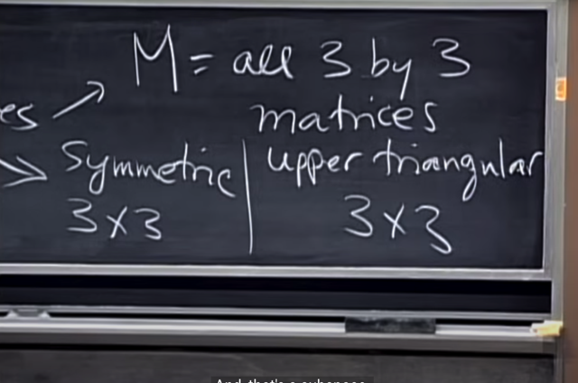</kbd>

> [!NOTE]
> Và ta sẽ xét M là **mọi (linear combination) của các 3x3
> matrix**. Với hai subspace là các **symmetric matrix** và **upper
> triangular matrix**
>
>
>
> Tại sao chúng là subspace? vì chúng vẫn thỏa add và
> scale rule:
>
>
>
> **Cộng** **hai matrix đối xứng** hay **nhân nó với một scalar** thì
> vẫn được **một matrix đối xứng**
>
>
>
> tương tự, **cộng** hai matrix U hay **scale** nó bởi scalar thì **vẫn
> được một upper triangular matrix**

 

##### Cơ sở không gian R3x3

<kbd>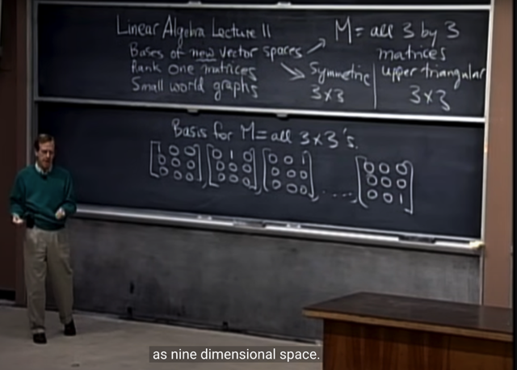</kbd>

> [!NOTE]
> Thế thì ta sẽ **đi tìm basis** cũng như từ đó biết được dimension của M
>
>
>
> Thế thì cũng như không gian R3 sẽ dễ thấy có một basis cơ bản là (1 0 0), (0 1 0), (0 0 1) (chính là standard basis)
>
>
>
> Thì với **R^3x3** ta cũng có một bộ basis gồm **9** matrix như này

 

###### Số chiều không gian con

<kbd>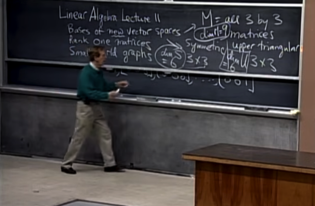</kbd>

> [!NOTE]
> Vậy **dimension của M là 9**, còn S (các symmetric 3x3
> matrix) sẽ có dim là 6, vì cần 6 con số để định nghĩa ra một
> symmetric matrix: 3 trên đường chéo, 3 ở trên đường chéo
> (đồng thời là ở dưới vì đối xứng) nên basis của S sẽ có 6
> matrix
>
>
>
> tương tự, **dimension của U là 6.**
>
>
>
> Thế thì gs nói rằng với U thì ta bỗng nhiên thấy rằng trong
> 9 matrix basis của M cũng chứa 6 matrix basis của U,
> nhưng với S thì không được vậy,

 

###### Số chiều ma trận chéo

<kbd>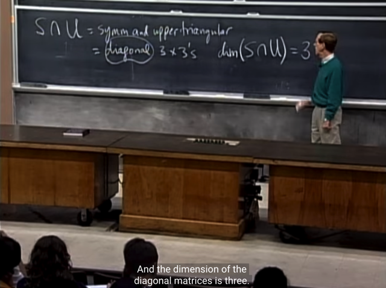</kbd>

> [!NOTE]
> Rồi, thế **S intersect U, sẽ là space các diagonal matrix D.**
> (Matrix vừa **đối xứng** mà còn có **nửa dưới đường chéo
> bằng 0** thì chỉ có thể là matrix **chéo** - cả trên cả dưới 
> đường chéo đều bằng 0)
>
>
>
> Và D có dimension = 3 (vì chỉ cần 3 số để define một diagonal
> matrix 3x3, nên standard basis của nó sẽ có 3 matrix)
>
>
>
> Chỗ này có lẽ tự nhủ mình đừng bối rối khi ta xác định
> dimension dễ dàng như vậy, trong khi mấy bữa trước để
> xác định dimension của vector space, ta phải nào là xác
> định basis của nó, và đếm số vector trong basis thì mới
> có dimension. Lí do là vì cái này ta đang xét các space
> rất chung.
>
>
>
> Cũng như nếu hỏi dimension của R3 thì đương nhiên là
> 3, vì cần 3 con số (tọa độ) mới định nghĩa ra một vector
> trong R3 nên standard basis sẽ có 3 vector [1 0 0], [0 1 0], 
> [0 0 1]. Thì ở đây cũng tương tự vậy.

 

###### Hợp hai không gian con

<kbd></kbd>

> [!NOTE]
> Thế thì chuyển qua **S union U**, gs hỏi **tại sao nó không phải
> là một subspace?**
>
>
>
> Me: Rất đơn giản, là vì theo định nghĩa vector space phải
> thỏa mãn hai tính chất: cộng hai vector hay scale vector với
> một số thực thì vẫn được vector mới nằm trong space.
>
>
>
> Vậy mà với S u U - **tập hợp các matrix Symmetric HOẶC
> Upper Triangular**, giả sử ta lấy một S matrix cộng với một U
> matrix, ta sẽ ra một matrix không còn symmetric cũng
> không còn upper triangular, nó đã nằm ngoài S u U.
>
>
>
> Do đó, S u U ko phải là vector space
>
>
>
> ====
>
>
>
> GS: đúng vậy, nó giống như ta có hai plane nhưng khác
> hướng nhau (S, và U đều có dimension là 6) nhưng chỉ lấy
> hai plane đó không đủ để có / lấp đầy một space

 

###### Biểu diễn ma trận S+U

<kbd>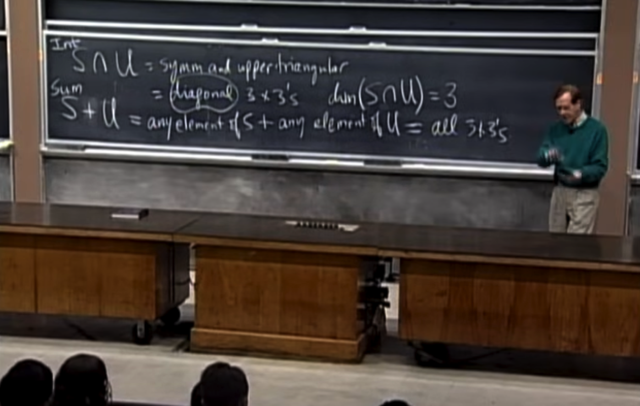</kbd>

> [!NOTE]
> Thế thì gs cho rằng thay vào đó, **ta sẽ quan tâm đến S +
> U**: với định nghĩa là tập hợp **mọi matrix đối xứng cùng với
> mọi matrix upper triangular**
>
>
>
> Thì S + U như trên sẽ cho ra cái gì?
>
>
>
> tập hợp mọi ma trận đối xứng, cùng với mọi matrix upper
> triangular sẽ làm thành **mọi matrix.** Có thể hiểu là bởi bất
> kì matrix 3x3 nào cũng có thể biểu diễn bởi một matrix đối
> xứng S + một matrix U. (Ngẫm một chút sẽ thấy đúng)

> [!TIP]
> 🤖 **AI Check** — 🟡 Minor issues — ⚠️ **88/100** · ✓ Move on
>
> Ghi chú nắm rất tốt ý nghĩa cốt lõi của không gian tổng S + U và việc mọi ma trận 3x3 đều phân tích được thành tổng của một ma trận đối xứng và một ma trận tam giác trên. Cần chú ý cách diễn đạt định nghĩa ban đầu để tránh gây hiểu nhầm sang phép hợp tập hợp.
>
> **🟡 Minor issues**
>
> **1.** *"với định nghĩa là tập hợp **mọi matrix đối xứng cùng với mọi matrix upper triangular**"*
>
> Cách diễn đạt 'cùng với' dễ gây nhầm lẫn không gian tổng (sum of subspaces, S + U) với phép hợp tập hợp (union, S ∪ U). Định nghĩa chính xác của S + U là tập hợp tất cả các tổng s + u, trong đó s thuộc S và u thuộc U (như bảng ghi: 'any element of S + any element of U').
>
>
> **✓ Strengths**
> - Hiểu đúng bản chất kết quả: S + U bao phủ toàn bộ không gian các ma trận 3x3.
> - Giải thích trực quan chính xác ý nghĩa đại số: mọi ma trận 3x3 đều biểu diễn được dưới dạng tổng s + u.
>
> **💡 Deeper notes**
> - Có thể củng cố bằng công thức số chiều không gian con: dim(S + U) = dim(S) + dim(U) - dim(S ∩ U) = 6 + 6 - 3 = 9, đúng bằng số chiều của không gian ma trận 3x3.

 

###### Công thức cộng số chiều

<kbd>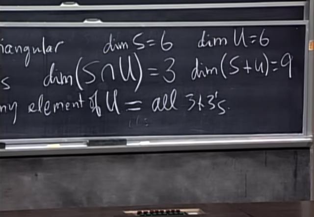</kbd>

> [!NOTE]
> Và từ đó ta thấy **dimension của của S intersect U là 3**,
> **dimension của S + U là 9** (vì S + U là tạo thành mọi
> matrix 3x3)
>
>
>
> Trong khi đó **dim S** và **dim U = 6**.
>
>
>
> gs cho rằng ta **đã thấy một công thức xuất hiện**

> [!TIP]
> 🤖 **AI Check** — 🟢 Pass — ✅ **100/100** · ✓ Move on
>
> Ghi chú hoàn toàn chính xác và tóm tắt đúng nội dung trên bảng cùng ý đồ của bài giảng.
>
> **✓ Strengths**
> - Xác định chính xác các giá trị số chiều của S, U, S ∩ U và S + U dựa trên ví dụ ma trận 3x3.
> - Nắm bắt được trực giác bài giảng hướng tới công thức liên hệ giữa số chiều của tổng và giao hai không gian con.
>
> **💡 Deeper notes**
> - Công thức tổng quát được giáo sư nhắc tới là: dim(S + U) = dim(S) + dim(U) - dim(S ∩ U) (tương đương với 9 = 6 + 6 - 3).
> - Trong ví dụ này, S là không gian ma trận đối xứng 3x3, U là ma trận tam giác trên 3x3, và giao S ∩ U chính là không gian các ma trận đường chéo 3x3 có số chiều bằng 3.

 

###### Công thức số chiều Grassmann

<kbd></kbd>

> [!NOTE]
> đó là **dim S + dim U = dim (S intersect U) + dim (S + U)**

> [!TIP]
> 🤖 **AI Check** — 🟢 Pass — ✅ **100/100** · ✓ Move on
>
> Ghi chú hoàn toàn chính xác, nhận diện đúng công thức Grassmann về số chiều của tổng và giao hai không gian con mà giáo sư đang minh họa trên bảng.
>
> **✓ Strengths**
> - Nhận diện và viết chính xác định lý số chiều: dim S + dim U = dim(S ∩ U) + dim(S + U).
>
> **💡 Deeper notes**
> - Công thức này áp dụng cho các không gian con hữu hạn chiều của cùng một không gian vector và thường được phát biểu dưới dạng dim(S + U) = dim S + dim U - dim(S ∩ U), tương tự nguyên lý bao hàm - loại trừ.

 

###### Nghiệm phương trình vi phân

<kbd>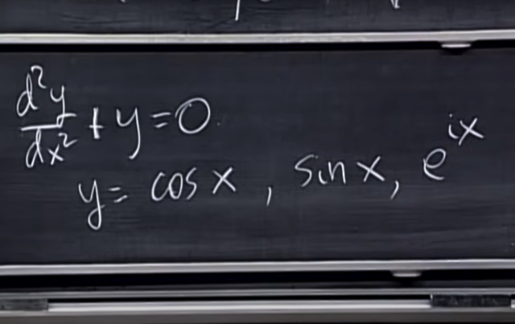</kbd>

> [!NOTE]
> Tiếp theo gs xét **differential equation** (phương trình vi
> phân) này.
>
>
>
> Các y thỏa (tức là solution) phương tình này gồm có 
> y = cos(x), sin(x), e^ix

 

###### Không gian vector hàm số

<kbd></kbd>

> [!NOTE]
> đại khái là ta **có thể hiểu khái niệm vector space rộng
> hơn**
>
>
>
> Như cosx, sinx dù là function nhưng nó **vẫn thỏa các tính
> chất của vector space** như **cộng** nó và scale nó **vẫn
> tạo ra cái khác cũng là solution** - **cũng thuộc solution
> space** của equation này.

 

###### Hạng ma trận bằng một

<kbd>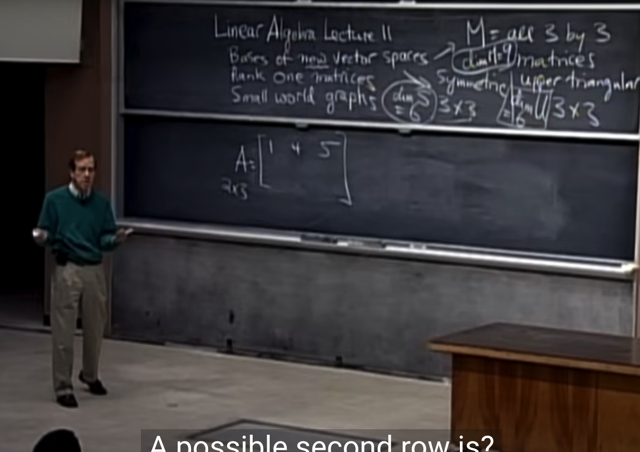</kbd>

> [!NOTE]
> tiếp, gs muốn **bàn sâu hơn về rank**, cho **matrix A (2x3)**,
> câu hỏi là, hàng 2 có thể như thế nào **để rank A = 1**.
>
>
>
> Me: hàng 2 **chỉ việc là linear combination của hàng 1** để A
> **chỉ có 1 independence row** là được

 

###### Không gian dòng và cột

<kbd>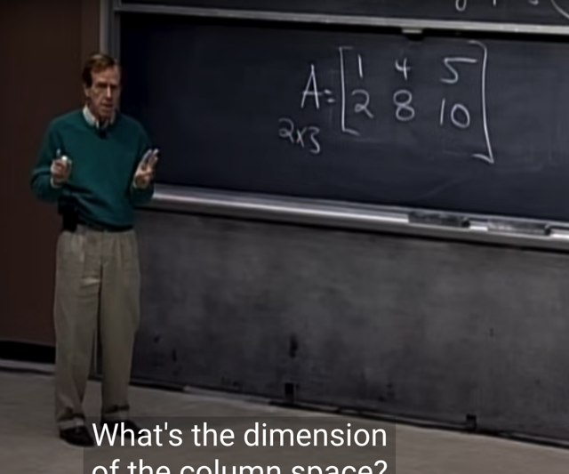</kbd>

> [!NOTE]
> Gs: Đúng, vậy basis của row space là?
>
>
>
> Me: 1st row
>
>
>
> Gs: correct, vậy còn cols space? Đầu tiên là cols space
> có dimension bao nhiêu?
>
>
>
> Me: 1 luôn, vì đã nói rank A = 1, mà như bài trước đã
> biết cols space và row space của A đều có cùng dimension.

> [!TIP]
> 🤖 **AI Check** — 🟢 Pass — ✅ **100/100** · ✓ Move on
>
> Ghi chú trả lời chính xác câu hỏi trong bài giảng; bạn đã nắm vững định lý cốt lõi rằng số chiều của không gian hàng và không gian cột đều bằng hạng của ma trận (rank = 1).
>
> **✓ Strengths**
> - Xác định đúng số chiều của không gian cột là 1 dựa trên việc hạng của ma trận bằng 1.
> - Nắm vững mối liên hệ cơ bản trong đại số tuyến tính: dim(C(A)) = dim(C(A^T)) = rank(A).
>
> **💡 Deeper notes**
> - Về mặt ký hiệu toán học chặt chẽ, cơ sở (basis) là một tập hợp các véc-tơ độc lập tuyến tính sinh ra không gian, ví dụ {[1, 4, 5]}, thay vì chỉ gọi ngắn gọn là '1st row'.

 

###### Tích ma trận cột-hàng

<kbd>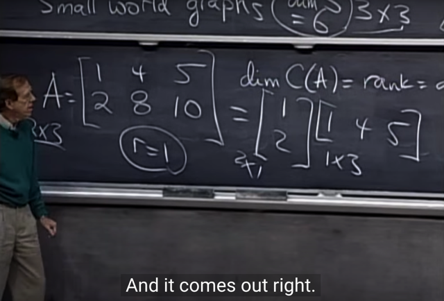</kbd>

> [!NOTE]
> Gs: correct
>
>
>
> Gs: Thế thì tôi có thể viết nó thành dạng hai matrix này nhân
> nhau - matrix bởi 1 cols và matrix bởi 1 row

> [!TIP]
> 🤖 **AI Check** — 🟡 Minor issues — ⚠️ **85/100** · ✓ Move on
>
> Ghi chú đã nắm đúng bản chất của ma trận hạng 1 là tích của một ma trận cột (vector cột) và một ma trận hàng (vector hàng) như bài giảng thể hiện.
>
> **🟡 Minor issues**
>
> **1.** *"matrix bởi 1 cols và matrix bởi 1 row"*
>
> Cách dùng từ mang tính khẩu ngữ và chưa chuẩn thuật ngữ; chính xác hơn nên gọi là tích giữa ma trận cột (vector cột kích thước m x 1) và ma trận hàng (vector hàng kích thước 1 x n), hay còn gọi là tích ngoài (outer product).
>
>
> **✓ Strengths**
> - Nhận diện chính xác phép phân tích ma trận hạng 1 thành tích của một cột và một hàng theo bài giảng của Giáo sư Gilbert Strang.
>
> **💡 Deeper notes**
> - Mọi ma trận có hạng r = 1 đều có thể viết dưới dạng tích uv^T (với u là vector cột và v^T là vector hàng). Không gian cột C(A) khi đó là đường thẳng sinh bởi cột u, và không gian hàng sinh bởi hàng v^T.

 

###### Ma trận rank-1 trong LoRA

<kbd>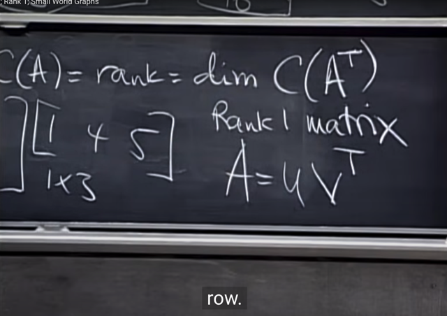</kbd>

> [!NOTE]
> Và từ đó **cho ta một kiến thức** là: **matrix có rank 1** sẽ **có
> thể biểu diễn dưới dạng một phép nhân bởi 1 vector cột
> nào đó của nó u và một vector hàng nào đó của nó (v)**:
>
>
>
> **A = u(vᵀ)**
>
>
>
> Từ đây mình liên hệ cái vụ PEFT = Parameter Efficient
> Finetuning của LLM có nhắc đến các low-rank matrix
> (phương pháp LoRA), thì bây giờ mình đã có thể hiểu tại
> sao nó được gọi là **low-rank matrix**, à bởi vì nó là matrix
> kết quả của việc **nhân một vector cột với một vector hàng**

> [!TIP]
> 🤖 **AI Check** — 🟡 Minor issues — ⚠️ **85/100** · ✓ Move on
>
> Bạn đã nắm rất tốt cốt lõi của ma trận rank 1 là tích của vector cột và vector hàng, đồng thời có liên hệ trực quan xuất sắc với LoRA. Cần lưu ý thêm là ma trận low-rank tổng quát có thể có rank r > 1 (tích của ma trận hẹp thay vì chỉ 1 vector), và u, v cần tỉ lệ phù hợp chứ không hẳn là lấy nguyên xi một hàng và một cột của A.
>
> **🟡 Minor issues**
>
> **1.** *"một vector cột nào đó của nó u và một vector hàng nào đó của nó (v)"*
>
> u và v^T không nhất thiết đồng thời là cột và hàng nguyên bản lấy trực tiếp từ A. Nếu u là một cột của A, thì v^T chứa các hệ số tỉ lệ của các cột còn lại so với u (v^T cùng phương với hàng của A nhưng thường cần chuẩn hoá hoặc chia cho hệ số pivot).
>
> **2.** *"bởi vì nó là matrix kết quả của việc nhân một vector cột với một vector hàng"*
>
> Phép nhân 1 vector cột với 1 vector hàng chỉ cho ra ma trận rank 1 (trường hợp r = 1 trong LoRA). Trong thực tế, low-rank matrix có thể có hạng r > 1 (ví dụ r = 4, 8, 16), được tạo từ tích của ma trận d x r với r x k, tương đương tổng của r ma trận rank 1.
>
>
> **✓ Strengths**
> - Hiểu chính xác công thức cốt lõi A = u v^T cho ma trận rank 1 từ bài giảng của GS. Gilbert Strang.
> - Có liên hệ thực tiễn và trực giác rất tốt với kỹ thuật PEFT/LoRA trong Deep Learning.
>
> **💡 Deeper notes**
> - Trong LoRA với rank r bất kỳ, ma trận cập nhật Delta W được biểu diễn dưới dạng tích B * A (với B kích thước d x r và A kích thước r x k), bản chất là tổng của r ma trận rank 1 dạng u_i * v_i^T.
> - Mọi ma trận rank 1 đều có không gian cột (Column Space) và không gian hàng (Row Space) là đường thẳng 1 chiều, do đó mọi cột đều là bội số của u và mọi hàng đều là bội số của v^T.

 

###### Ma trận hạng 1

<kbd>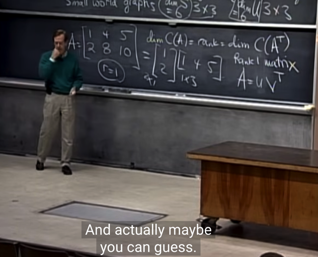</kbd>

> [!NOTE]
> và gs cho ta biết rằng **rank 1 matrix là building block của
> mọi matrix rank cao hơn**. Và việc tính determinant,
> eigenvector của rank 1 matrix đều dễ, sau này sẽ thấy.
>
>
>
> Và giả sử mình có một **matrix 5x17 có RANK 4**, thì ta
> **LUÔN CÓ THỂ BREAK NÓ THÀNH COMBINATION CỦA
> 4 CÁI RANK 1 MATRIX
>
>
>
> Và 4 CÁI RANK 1 MATRIX ĐÓ SẼ LÀ BASIS CỦA MỌI
> RANK 4 MATRIX** - 4 cái rank 1 matrix đó sẽ có thể tạo
> nên mọi rank 4 matrix

 

###### Subspace ma trận hạng 4

<kbd></kbd>

> [!NOTE]
> Từ đó dẫn đến một câu hỏi đó là, vậy **tập hợp các rank 4
> matrix 5x17 đó có là một subspace không?**

> [!TIP]
> 🤖 **AI Check** — 🟢 Pass — ⚠️ **85/100** · ✓ Move on
>
> Ghi chú đã nắm bắt chính xác câu hỏi gợi mở quan trọng được đặt ra trong bài giảng về không gian con ma trận.
>
> **✓ Strengths**
> - Ghi chép chính xác câu hỏi bản lề của giáo sư khi mở rộng khái niệm không gian con sang không gian ma trận.
>
> **💡 Deeper notes**
> - Câu trả lời cho câu hỏi này là 'Không': tập hợp các ma trận có rank cố định (ví dụ rank 4) không tạo thành không gian con vì không chứa ma trận không (ma trận không có rank 0) và không đóng kín dưới phép cộng (tổng của hai ma trận rank 4 có thể có rank khác 4, chẳng hạn triệt tiêu nhau về rank 0 hoặc thành rank khác).

 

###### Hạng của tổng ma trận

<kbd>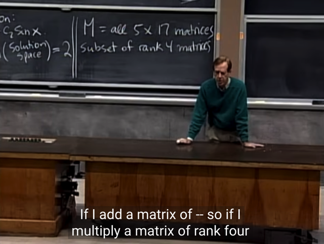</kbd>

> [!NOTE]
> Hỏi lại, cho **M là mọi 5x17 matrices** là một vector space (vì
> cộng hai matrix hay nhân matrix với một số đều tạo một 5x17
> matrix mới = nằm trong space, nên M là vector space) thì
> **subset mọi rank 4 [5x17] matrices có phải là vector space
> không?**
>
>
>
> Vậy đầu tiên xem **thử cộng hai rank 4 matrix 5x17** **có cho
> ra một rank 4 matrix 5x17 không?**
>
>
>
> Me: Thử lập luận vầy, như gs vừa nói, cho hai rank 4
> matric  5x17. Có nghĩa là chúng đều có 4 independent
> cols. Cho rằng với V là v1,v2,v3,v4 và với U là u1,u2,u3,
> u5. và matrix U+V sẽ có các cols là v1+u1, v2+u2, v3+u3,
> v4+u4, v5+u5.
>
>
>
> Thì có vẻ như là, có thể đoán là có thể ta sẽ 5 cols của U+V
> là independence → U+V có rank = 5

> [!TIP]
> 🤖 **AI Check** — 🟡 Minor issues — ⚠️ **75/100** · ✓ Move on
>
> Ghi chú có trực giác phản chứng rất tốt khi nhận ra tổng của hai ma trận rank 4 có thể đạt rank 5, nhưng chưa chốt kết luận cuối cùng và cách biểu diễn các cột còn nhầm lẫn giữa số cột (17) với số chiều không gian cột.
>
> **🟡 Minor issues**
>
> **1.** *"Thì có vẻ như là, có thể đoán là có thể ta sẽ 5 cols của U+V là independence → U+V có rank = 5"*
>
> Chưa đưa ra kết luận logic cuối cùng: vì U + V có thể có rank = 5 (khác 4), tập này không đóng kín dưới phép cộng, do đó subset này KHÔNG phải là vector space.
>
> **2.** *"Cho rằng với V là v1,v2,v3,v4 và với U là u1,u2,u3, u5. và matrix U+V sẽ có các cols là v1+u1, v2+u2, v3+u3, v4+u4, v5+u5."*
>
> Ma trận kích thước 5x17 có 17 cột (mỗi cột là vector trong R^5). Việc liệt kê chỉ 4 hoặc 5 cột thể hiện sự nhầm lẫn giữa số lượng cột thực tế (17 cột) và số cột độc lập tuyến tính (tối đa 5).
>
>
> **✓ Strengths**
> - Có trực giác đúng đắn khi nhận diện được tổng của hai ma trận rank 4 có thể cho ra ma trận rank 5 để phá vỡ tính đóng kín của phép cộng.
> - Chủ động tự đặt câu hỏi và xây dựng lập luận cá nhân thay vì chỉ chép lại bài giảng.
>
> **💡 Deeper notes**
> - Cách nhanh nhất để kiểm tra: Ma trận không (zero matrix) có rank bằng 0, không thuộc tập hợp các ma trận rank 4, nên tập hợp này lập tức không thể là một vector space.
> - Xét phép nhân vô hướng: nếu lấy 0 nhân với một ma trận rank 4 ta được ma trận 0 (rank 0 != 4), vi phạm tính đóng đối với phép nhân vô hướng.
> - Xét phép cộng: một phản ví dụ hiển nhiên khác là A + (-A) = 0 (rank 0 != 4), chứng minh phép cộng hai ma trận rank 4 không nhất thiết ra ma trận rank 4.

 

###### Ma trận rank và subspace

<kbd></kbd>

> [!NOTE]
> gs: đúng vậy, **không phải là subspace**. Ví dụ như **cộng hai
> matrix rank 1 cũng chưa chắc ra matrix rank 1**, mà khả
> năng cao ta sẽ ra matrix rank 2

> [!TIP]
> 🤖 **AI Check** — 🟢 Pass — ✅ **100/100** · ✓ Move on
>
> Ghi chú hoàn toàn chính xác và nắm đúng bản chất vì sao tập các ma trận rank 1 không phải là không gian con thông qua tính không đóng kín dưới phép cộng.
>
> **✓ Strengths**
> - Hiểu đúng kết luận trên bảng rằng tập các ma trận có rank bằng 1 không tạo thành một không gian con (subspace).
> - Đưa ra giải thích trực quan và chính xác: tổng của hai ma trận rank 1 không nhất thiết có rank 1 (thường có rank bằng 2), vi phạm tính đóng dưới phép cộng.
>
> **💡 Deeper notes**
> - Một lý do trực tiếp khác khiến tập này không phải là không gian con: ma trận không (zero matrix) có rank bằng 0 chứ không phải rank 1, do đó tập này không chứa phần tử không.
> - Tổng của hai ma trận rank 1 cũng có thể cho ra ma trận rank 0 (ví dụ A + (-A) = 0), điều này cũng vi phạm tính đóng kín.

 

###### Không gian con của R4

<kbd>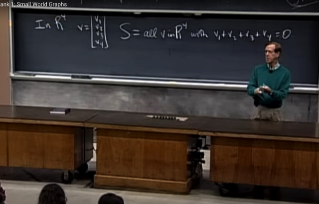</kbd>

> [!NOTE]
> Tiếp, ta xét thử set chứa **mọi R4 vector mà tổng
> component của nó là 0**. Gs: Tại sao nó là subspace?
>
>
>
> Me: Vì giả sử **xét u, v thuộc S**, thì **xét m = c1 × u+c2 × v.** Ta sẽ
> có tổng các component của m:
>
>
>
> c1 × u1 + c1 × u2 + c1 × u3 + c1 × u4 + c2 × v1 + c2 × v2 + v2 × v3 +
> v2 × v4
>
>
>
> = **dễ thấy cũng sẽ = 0** ⇒ m **cũng sẽ thuộc S**, nên thỏa hai
> tính chất của vector space: Cộng hai vector và scale vector
> thuộc S đều cho ra thêm một vector thuộc S

 

###### Cơ sở và số chiều

<kbd>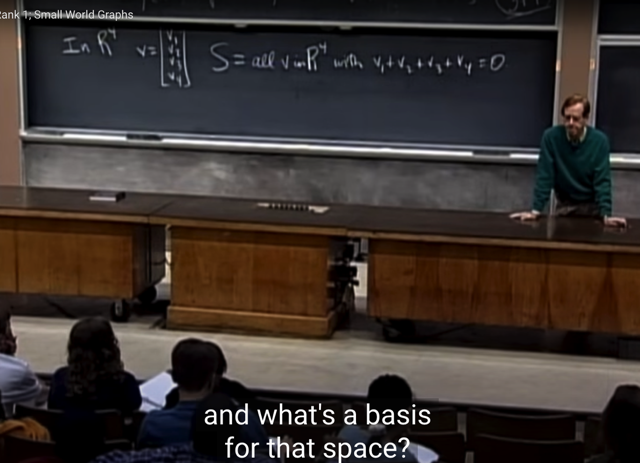</kbd>

> [!NOTE]
> Gs: Ok, vậy **dimension bao nhiêu? và basis của S?**

 

###### Nullspace của tập hợp S

<kbd>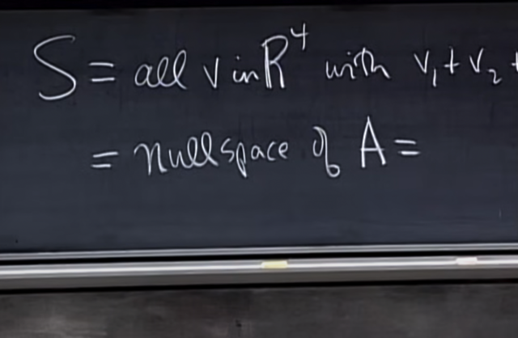</kbd>

> [!NOTE]
> Gs **gợi ý** là thử nghĩ xem S (tập hợp mọi vector v sao cho
> v1 +v2 + v3 + v4 = 0) **có phải là nullspace của matrix nào
> không**. Nếu xác định được, ta sẽ phân tích matrix đó và trả
> lời được basis cũng như dimension của nullspace đó và
> cũng là của S
>
>
>
> Me: là **nullspace của (1x4) matrix A = [1, 1, 1, 1]**, vì theo
> định nghĩa nullspace của nó sẽ là mọi vector x sao cho Ax =
> 0, và như vậy với x là <x1, x2, x3, x4> thì ta sẽ có nullspace
> của A là mọi vector x sao cho x1 × 1 + x2 × 1 + x3 × 1 + x4 × 1 = 0

 

###### Số chiều của Nullspace

<kbd>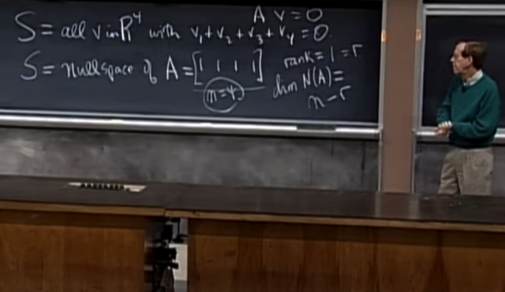</kbd>

> [!NOTE]
> GS: Correct. Và từ đó chỉ cần phân tích A. **Rank của A là 1**
> (dễ thấy, v**ì nó chỉ có 1 row**, nên c**hắc chắn row đó độc
> lập**)
>
>
>
> Và theo công thức bài trước đã biết nullspace của A (m,n) sẽ
> có dimension = **n - r = 4 - 1 = 3**. Vậy **dimension của S là 3**
>
>
>
> (hoặc không cần nhớ công thức n - r làm gì, vì chỉ cần thấy
> vì rank = 1 nên **trong 4 column chỉ có 1 pivot column**, và
> như vậy có **3 free columns** ⇒ số **special solution** của
> Ax=0 = **số vector trong basis** của nullspace = **dimension
> của nullspace**  = 3.
>
>
>
> Còn giải thích theo n - r thì nên hiểu một cách bản chất hơn
> đó là ta có **rowspace** và **nullspace** **đều là subspace
> của R4** vì row vector có 4 phần tử, cũng như vì có 4 cột nên
> cần 4 component để combine các cột để thành 0. Vậy nên
> theo một định lý mà ta đã học đó là **tổng dimension của
> rowspace và nullspace sẽ bằng 4** với ý nghĩa là **rowspace
> và nullspace sẽ cover toàn bộ không gian R4**, và **chúng
> vuông góc nhau**. Vì vậy với việc ta có dimension của
> rowspace là 1 thì suy ra dimension của nullspace là 4 - 1 = 3.

 

###### Cơ sở của Nullspace

<kbd>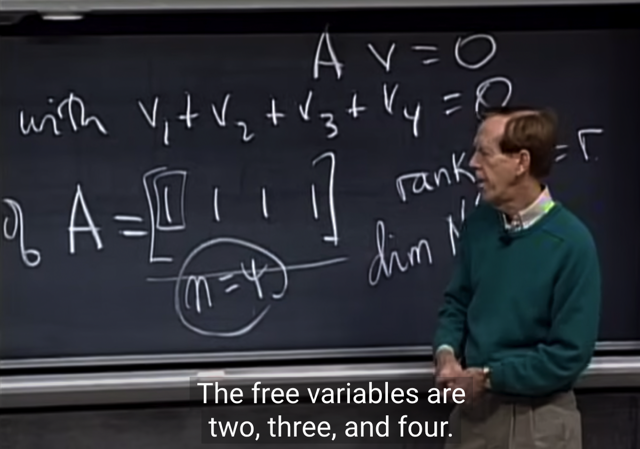</kbd>

> [!NOTE]
> tiếp, **basis của nullspace N(A) cũng là S là gì?**, thì ta biết
> để tìm basis của nullspace of A, ta sẽ tìm các **free** variable,
> thế thì dễ thấy cái pivol columns là cols đầu tiên, nên 3 cols
> tiếp theo là free cols, cũng suy ra các variable tương ứng - 
> v2,v3,v4 sẽ là free variable.
>
>
>
> Vậy ta sẽ **cho mỗi free variable lần lượt = 1**, **các free variable
> còn lại bằng 0** để **thế vào tìm pivot** var, là có được 3 special
> solution. Và đó chính là **3 basis của nullspace of A**

 

###### Cơ sở không gian con S

<kbd>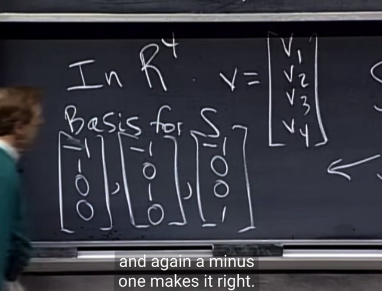</kbd>

> [!NOTE]
> Và đó cũng là basis của S

 

###### Không gian cột C(A)

<kbd>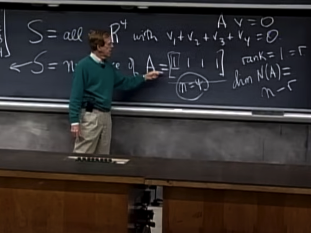</kbd>

> [!NOTE]
> Gs: Columns space của A C(A) thì sao? (Gs đang xét **4
> fundamental subspace**)
>
>
>
> Me: Như bài trước đã biết **cols space và row space đều có
> cùng dimension = rank**, nên cols space có dimension = 1.
>
>
>
> Basis của nó sẽ là pivot cols như đã biết, và đương nhiên
> nó sẽ là cột đầu tiên.
>
>
>
> Phải nói thêm cols là subspace của R1 (vì chỉ có 1
> component)

> [!TIP]
> 🤖 **AI Check** — 🟢 Pass — ✅ **95/100** · ✓ Move on
>
> Ghi chú rất chính xác, hiểu đúng bản chất về không gian cột (Column Space), số chiều và cơ sở của ma trận 1x4.
>
> **✓ Strengths**
> - Áp dụng chính xác định lý số chiều của không gian cột bằng số chiều của không gian hàng và bằng rank (r = 1).
> - Xác định đúng cột pivot (cột đầu tiên [1]) làm cơ sở cho C(A).
> - Nhận diện đúng C(A) là không gian con thuộc R^1 (do số hàng m = 1).
>
> **💡 Deeper notes**
> - Vì C(A) là một không gian con 1 chiều nằm trong R^1, nên thực chất C(A) chính là toàn bộ R^1.

 

###### Không gian cột C(A)

<kbd>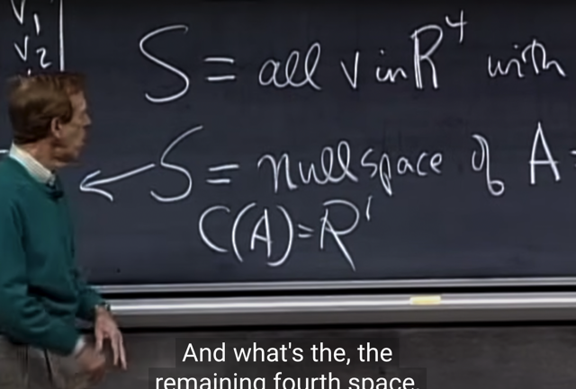</kbd>

> [!NOTE]
> và **[1] cũng chính là basis của R1**
> nên **cols space của A chính là R1**

 

###### Left Nullspace N(Aᵀ)

<kbd>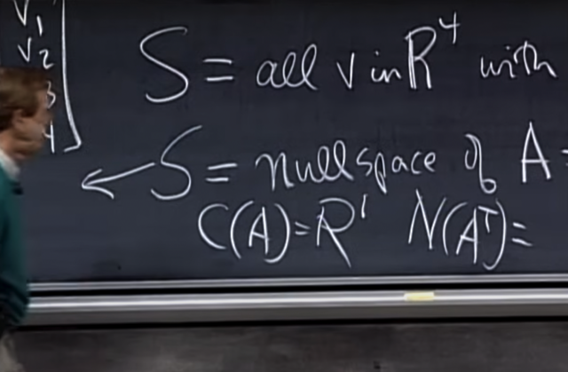</kbd>

> [!NOTE]
> và fundamental subspace cuối cùng: left nullspace /
> nullspace of Aᵀ:
>
>
>
> Như đã biết nó là tập hợp solution của (Aᵀ)y = 0. Mà Aᵀ chỉ
> có 1 cols, nên y sẽ chỉ có 1 component, suy ra nullspace of
> Aᵀ cũng là subspace của R1.
>
>
>
> Thế thì dễ thấy **chỉ có thể y = 0 thì mới khiến (Aᵀ)y = 0**
> nên nullspace của Aᵀ **chỉ chứa zero vector**.
>
>
>
> Đối chiếu với bài trước, ta có **dimension của N(Aᵀ) là m - r
> = 1 - 1 = 0** là **cũng có thể suy ra nullspace của Aᵀ chỉ chứa
> zero.**

 

###### Nullspace của Aᵀ

<kbd>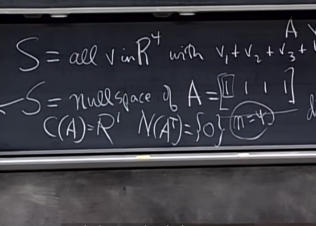</kbd>

> [!NOTE]
> Đúng vậy, nullspace của
> Aᵀ chỉ chứa zero và có dim = 0

 

###### Fundamental Subspaces Matrix Dimensions

<kbd>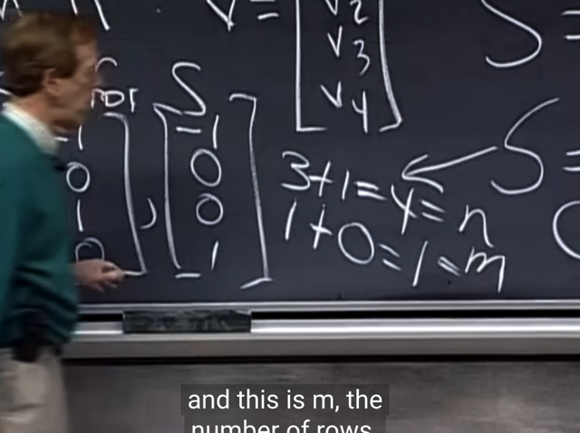</kbd>

> [!NOTE]
> Và gs cũng cho biết các **vector space mà chỉ chứa 1
> điểm zero đó có dimension = 0, và basis cũng rỗng.** 
>
>
>
> Để rồi mọi thứ đều thỏa với công thức bữa trước:
>
>
>
> C(A) và N(Aᵀ) đều là subspace của R1:
>
>
>
> dim C(A) + dim N(Aᵀ)  = 1 + 0 = r + m - r = m = 1
>
>
>
> Và 
>
>
>
> C(Aᵀ) và N(A)  đều là subspace của R4
>
>
>
> dim C(Aᵀ) + dim N(A) = 1 + 3 = r + n - r = n = 4

 

###### Đồ thị và Ma trận

<kbd>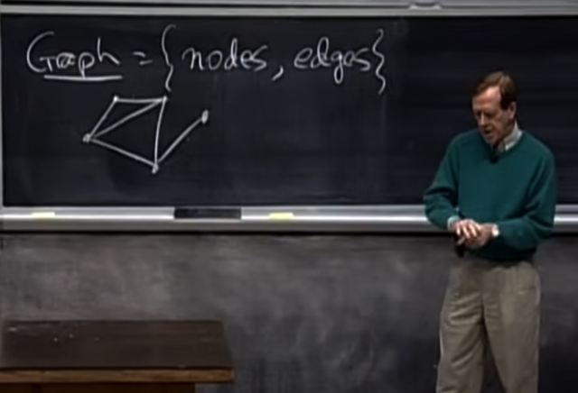</kbd>

> [!NOTE]
> những phút cuối gs nói qua Graph, nó là một set các
> **nodes** và **edges**. Và ta sẽ thấy một matrix nào đó sẽ
> đứng sau cái graph này

 

###### Khái niệm đồ thị cơ bản

<kbd></kbd>

> [!NOTE]
> thế thì lấy ví dụ một **lớp học**, mỗi **student là một node**, và
> mỗi khi **hai đứa là bạn thì ta có một edge**, thì ta sẽ có
> một **graph**.
>
>
>
> Hay rộng hơn, một graph như vậy ở phạm vi toàn  nước
> mỹ, chẳng hạn. thì câu hỏi là: how far giữa hai node.
>
>
>
> gs lấy ví dụ, giữa ông và Clinton là 2, vì ông quen với
> ông bạn làm Senator, mà ông đó quen ông Clinton.

 

###### Khoảng cách trong đồ thị

<kbd></kbd>

> [!NOTE]
> bài sau ta sẽ tìm hiểu **để thấy về mặt toán học**, **số bước để
> đi từ một người tới một người khác trong cái graph đó có
> thể giảm xuống nhanh đến mức nào**, ví dụ như gs nói vui
> rằng bằng cách học lớp 1806 này mà khoảng cách từ các
> bạn tới Clinton drop xuống chỉ còn 3 rất nhanh chóng (vì
> quen giáo sư - người có distant tới Clinton là 2

 

