# Lecture 14: Orthogonal Vectors And Subspaces

📊 **Progress:** `37` Notes | `46` Screenshots | `32` AI Reviews

---

 

## Không gian con trực giao

<kbd>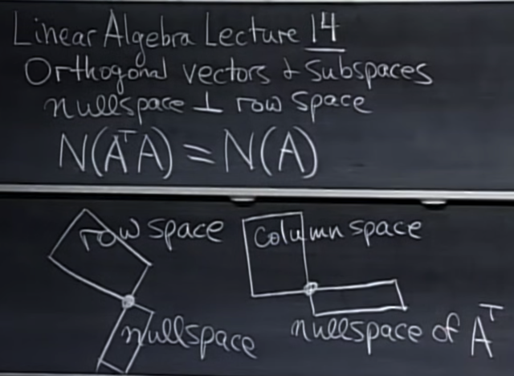</kbd>

> [!NOTE]
> Bài này gs sẽ nói về khái niệm hai **vector space** **orthogonal**

📹 [Xem video trên YouTube](https://www.youtube.com/watch?v=GomcsySSQCw)

 

### Bốn không gian con trực giao

<kbd>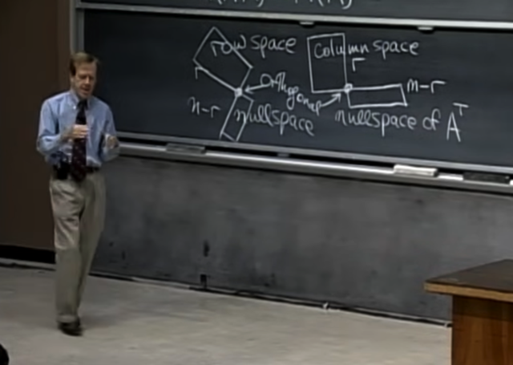</kbd>

> [!NOTE]
> Đầu tiên gs cho biết đại khái là đến giờ ta **đã biết 4 subspace quan trọng** này, với việc biết **basis** và **dimension** của chúng.
>
>
>
> Nay ta sẽ học về việc **chúng orthogonal với nhau** là sao, thể hiện qua hình ảnh này.

> [!TIP]
> 🤖 **AI Check** — 🟢 Pass — ✅ **95/100** · ✓ Move on
>
> Ghi chú tóm tắt rất tốt và chính xác bối cảnh bài giảng của giáo sư Gilbert Strang về 4 không gian con cơ bản và tính trực giao giữa chúng.
>
> **✓ Strengths**
> - Nắm đúng tiến trình kiến thức: sau khi xác định được cơ sở (basis) và số chiều (dimension) của 4 không gian con, bước tiếp theo là khảo sát tính trực giao (orthogonality).
> - Nhận diện đúng sơ đồ 'The Big Picture of Linear Algebra' thể hiện mối quan hệ hình học giữa các không gian con.
>
> **💡 Deeper notes**
> - Cần lưu ý tính trực giao ở đây là trực giao theo từng cặp bổ sung trực giao trong hai không gian khác nhau: Row space trực giao với Nullspace trong R^n, và Column space trực giao với Left Nullspace (Nullspace of A^T) trong R^m, chứ 4 không gian không cùng nằm chung trong một không gian để trực giao đồng thời với nhau.

 

#### Hai vector trực giao

<kbd>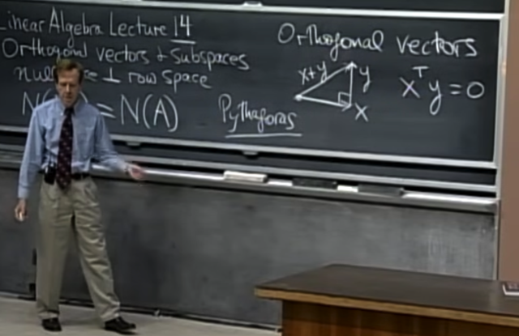</kbd>

> [!NOTE]
> gs nói qua về khái niệm **hai vector orthogonal**, thì nó đồng nghĩa với từ **perpendicular** - vuông góc. Và cho hai vector x,y. Để biết chúng có vuông góc không thì chỉ việc **tính dot product của chúng xem có bằng 0 không**

> [!TIP]
> 🤖 **AI Check** — 🟢 Pass — ✅ **100/100** · ✓ Move on
>
> Ghi chú nắm rất chính xác và súc tích định nghĩa hai vector trực giao (orthogonal/perpendicular) thông qua tích vô hướng (dot product) bằng 0.
>
> **✓ Strengths**
> - Hiểu đúng bản chất trực giao tương đương với tính chất vuông góc và tích vô hướng bằng 0 (x^T y = 0).
>
> **💡 Deeper notes**
> - Theo định nghĩa đại số x^T y = 0, vector không (zero vector) trực giao với mọi vector khác, dù về mặt hình học trực quan nó không có hướng xác định.
> - Trên bảng, giáo sư dùng định lý Pythagoras (||x + y||^2 = ||x||^2 + ||y||^2) để chứng minh và dẫn dắt ra điều kiện x^T y = 0.

 

##### Vector vuông góc và Pythagoras

<kbd>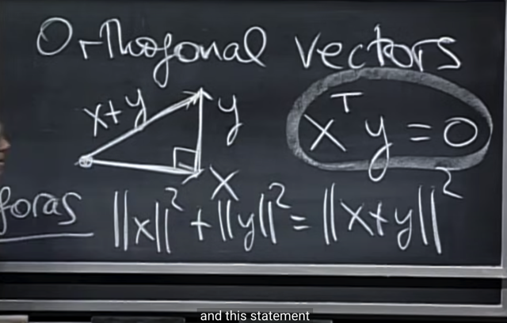</kbd>

> [!NOTE]
> Thế thì câu hỏi gs đặt ra là **tại sao dot product bằng 0 lại là dấu hiệu của hai vector vuông góc**. Hai nói cách khác, gs đề nghị tìm **liên hệ giữa định lý Pythagores** với dot product xᵀy = 0.

> [!TIP]
> 🤖 **AI Check** — 🟢 Pass — ✅ **100/100** · ✓ Move on
>
> Ghi chú nắm rất chuẩn xác vấn đề trọng tâm và câu hỏi dẫn dắt của giáo sư trên bảng về mối liên hệ giữa định lý Pythagoras và tích vô hướng xᵀy = 0.
>
> **✓ Strengths**
> - Xác định đúng câu hỏi cốt lõi của bài giảng về lý do tại sao tích vô hướng xᵀy = 0 lại thể hiện tính trực giao thông qua định lý Pythagoras.
>
> **💡 Deeper notes**
> - Để thấy rõ mối liên hệ này trong bước tiếp theo, ta khai triển ||x + y||² = (x + y)ᵀ(x + y) = ||x||² + ||y||² + 2xᵀy, từ đó suy ra ||x + y||² = ||x||² + ||y||² khi và chỉ khi xᵀy = 0.

 

###### Properties of Transpose Matrix A^T

<kbd></kbd>

> [!NOTE]
> Gs: thế thì đầu tiên nếu cho vector (1,2,3) thì length square ||u||² là gì?
>
>
>
> Me: \[√(1² + 2² + 3²)\]² = 1² + 2² + 3²

> [!TIP]
> 🤖 **AI Check** — 🟢 Pass — ✅ **95/100** · ✓ Move on
>
> Ghi chú trả lời chính xác định nghĩa và công thức tính bình phương độ dài của vector. Bạn có thể tính thêm bước cuối ra giá trị số cụ thể là 14.
>
> **✓ Strengths**
> - Hiểu chính xác mối quan hệ giữa độ dài (chuẩn Euclidean) và bình phương độ dài của một vector.
> - Biết rằng bình phương độ dài ||u||² chính là tổng bình phương các thành phần (tương đương với uᵀu).
>
> **💡 Deeper notes**
> - Trong đại số tuyến tính, ||u||² thường được tính trực tiếp qua tích vô hướng uᵀu = 1² + 2² + 3² = 14 thay vì phải lấy căn bậc hai rồi bình phương ngược lại.

 

###### Biểu diễn chuẩn qua xᵀx

<kbd>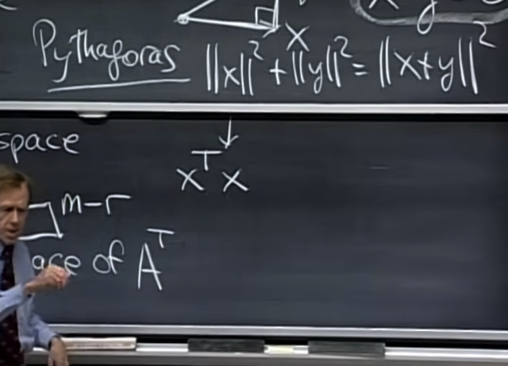</kbd>

> [!NOTE]
> gs: đúng, và có thể thể hiện dưới dạng xᵀx

 

###### Ví dụ vector trực giao

<kbd>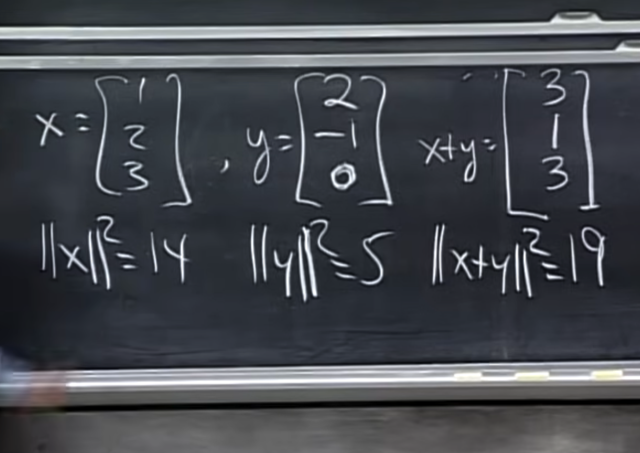</kbd>

> [!NOTE]
> gs ví dụ 2 vector

> [!TIP]
> 🤖 **AI Check** — 🟡 Minor issues — ❌ **35/100** · ✓ Move on
>
> Ghi chú quá ngắn gọn và mới chỉ dừng lại ở việc đánh dấu đây là ví dụ của giáo sư. Cần ghi lại cụ thể hai vector trực giao và hệ thức Pythagoras liên quan để nắm được nội dung bài giảng.
>
> **🟡 Minor issues**
>
> **1.** *"gs ví dụ 2 vector"*
>
> Ghi chú thiếu toàn bộ nội dung trọng tâm của ví dụ: hai vector vuông góc (tích vô hướng x·y = 0) dẫn đến định lý Pythagoras cho vector: ||x+y||^2 = ||x||^2 + ||y||^2 (14 + 5 = 19).
>
>
> **✓ Strengths**
> - Nhận biết được đây là phần giảng viên đưa ra ví dụ minh họa bằng vector số cụ thể.
>
> **💡 Deeper notes**
> - Ví dụ trên bảng minh họa cho trường hợp hai vector trực giao trong R^3: tích vô hướng x^T y = 1(2) + 2(-1) + 3(0) = 0, từ đó ||x+y||^2 = ||x||^2 + ||y||^2.

 

###### Pythagorean Theorem in Linear Algebra

<kbd>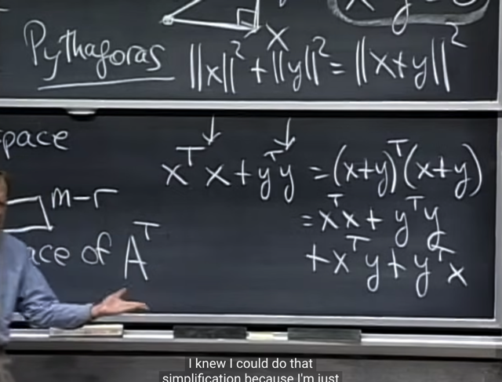</kbd>

> [!NOTE]
> Tương tự, triển khai ra ta có.
>
>
>
> Với (x+y)ᵀ(x+y) triển khai như vầy:
>
>
>
> = (xᵀ+yᵀ)(x+y) = xᵀx + xᵀy + yᵀx + yᵀy

> [!TIP]
> 🤖 **AI Check** — 🟢 Pass — ✅ **100/100** · ✓ Move on
>
> Ghi chú hoàn toàn chính xác và rõ ràng, bổ sung bước trung gian chuyển vị $(x+y)^T = x^T + y^T$ giúp việc khai triển biểu thức trở nên trực quan, dễ hiểu.
>
> **✓ Strengths**
> - Áp dụng chính xác tính chất chuyển vị của một tổng để triển khai tích vô hướng của hai vectơ.
>
> **💡 Deeper notes**
> - Vì $x^T y$ là một số vô hướng (scalar), ta có $x^T y = (x^T y)^T = y^T x$, do đó $x^T y + y^T x = 2x^T y$. Từ đó, đẳng thức Pythagoras chỉ xảy ra khi số hạng chéo này bằng 0 ($x^T y = 0$, tức $x \perp y$).

 

###### Pythagoras và tích vô hướng

<kbd>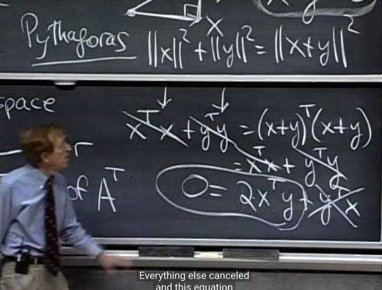</kbd>

> [!NOTE]
> Khử đi hai vế và gom xᵀy và yᵀx (đều giống nhau) ta có **2xᵀy = 0**
>
>
>
> Và đây là mối liên hệ giữa **định lí Pytagores** và việc **dot product của hai vector bằng 0**

> [!TIP]
> 🤖 **AI Check** — 🟢 Pass — ✅ **95/100** · ✓ Move on
>
> Ghi chú rất chính xác và tóm lược đúng bản chất phép suy dẫn từ định lý Pythagoras sang điều kiện trực giao (tích vô hướng bằng 0).
>
> **✓ Strengths**
> - Nhận diện đúng phép giản ước hai vế và tính chất giao hoán của tích vô hướng đối với vector thực (xᵀy = yᵀx) để ra 2xᵀy = 0.
> - Nắm được cốt lõi bài giảng: định lý Pythagoras tương đương với việc hai vector trực giao (tích vô hướng bằng 0).
>
> **💡 Deeper notes**
> - Tính chất xᵀy = yᵀx đúng với các vector thuộc không gian thực ℝⁿ vì kết quả là một số vô hướng (scalar). Đối với không gian phức ℂⁿ, tích vô hướng có tính liên hợp phức: xᴴy = (yᴴx)*.

 

###### Trực giao của vector không

<kbd></kbd>

<kbd>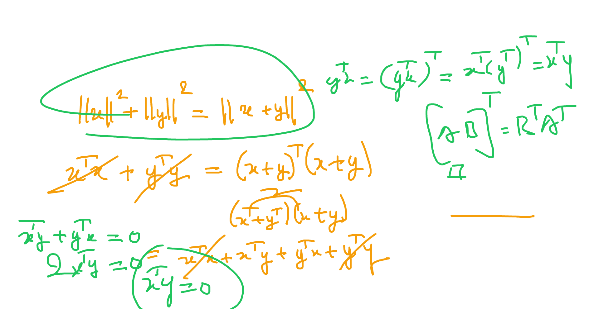</kbd>

> [!NOTE]
> Tiếp gs hỏi thế zero vector thì sao → với zero vector thì
> vì chúng dot product với vector nào cũng bằng 0 nên cứ
> theo luật mà làm, **nó sẽ orthogonal với mọi vector**

> [!TIP]
> 🤖 **AI Check** — 🟢 Pass — ✅ **100/100** · ✓ Move on
>
> Ghi chép hoàn toàn chính xác theo đúng định nghĩa đại số tuyến tính: vector không trực giao với mọi vector vì tích vô hướng của nó với bất kỳ vector nào cũng bằng 0.
>
> **✓ Strengths**
> - Nắm bắt chính xác và giải thích rõ ràng lý do vector không trực giao với mọi vector dựa trên định nghĩa x^T y = 0.
>
> **💡 Deeper notes**
> - Hệ quả từ định nghĩa này là vector không trực giao với chính nó (0^T 0 = 0), và đây cũng là vector duy nhất có tính chất trực giao với chính mình.

 

###### Không gian con trực giao

<kbd></kbd>

> [!NOTE]
> Tiếp ta sẽ mở rộng từ **orthogonal vector** sang **orthogonal subspace**
>
>
>
> Gs đề nghị ta coi **bức tường** là subspace thứ nhất (a 2D subspace trong R3), và **mặt sàn** là subspace thứ hai. Câu hỏi là chúng **có là phải là hai orthogonal subspace?**

> [!TIP]
> 🤖 **AI Check** — 🟢 Pass — ✅ **95/100** · ✓ Move on
>
> Ghi chú nắm rất chuẩn câu hỏi dẫn nhập và ví dụ trực quan mà giáo sư Gilbert Strang đưa ra khi mở rộng khái niệm trực giao sang không gian con.
>
> **✓ Strengths**
> - Nắm bắt chính xác hướng phát triển bài học từ vector trực giao sang không gian con trực giao.
> - Tóm lược đúng ví dụ thực tế (bức tường và mặt sàn) mà giáo sư dùng để kích thích tư duy người học.
>
> **💡 Deeper notes**
> - Về mặt bản chất: Bức tường và mặt sàn gặp nhau tại một đường thẳng (giao tuyến khác 0); do đó, một vector nằm trên giao tuyến thuộc cả hai không gian và không thể tự trực giao với chính nó (trừ vector 0). Vì vậy hai không gian con 2 chiều này không trực giao với nhau.

 

###### Không gian con trực giao

<kbd>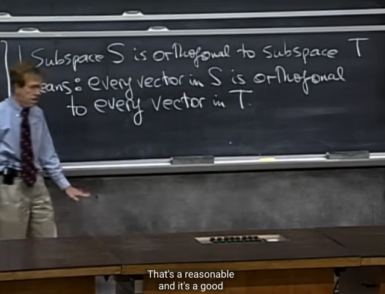</kbd>

> [!NOTE]
> Thế thì đầu tiên gs đưa ra định nghĩa, hai subspace
> **orthogonal** khi **MỌI vector trong subspace** này
> **orthogonal với MỌI vector trong subspace kia**

> [!TIP]
> 🤖 **AI Check** — 🟢 Pass — ✅ **100/100** · ✓ Move on
>
> Ghi chú hoàn toàn chính xác và nắm trọn vẹn định nghĩa hai không gian con trực giao được giảng dạy trên bảng.
>
> **✓ Strengths**
> - Nắm bắt chính xác điều kiện toàn thể 'mọi vector' giữa hai không gian con, tránh được nhầm lẫn phổ biến rằng chỉ cần vài vector trực giao với nhau.
>
> **💡 Deeper notes**
> - Từ định nghĩa này, hệ quả quan trọng là giao của hai không gian con trực giao S và T chỉ có thể là vector không {0}, vì nếu có vector v khác không thuộc cả hai thì v phải trực giao với chính nó (v·v = 0, vô lý với vector khác 0).

 

###### Không gian con trực giao

<kbd>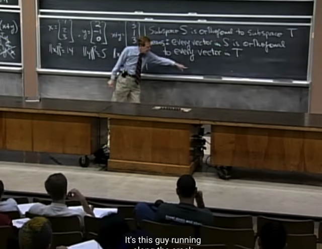</kbd>

<kbd>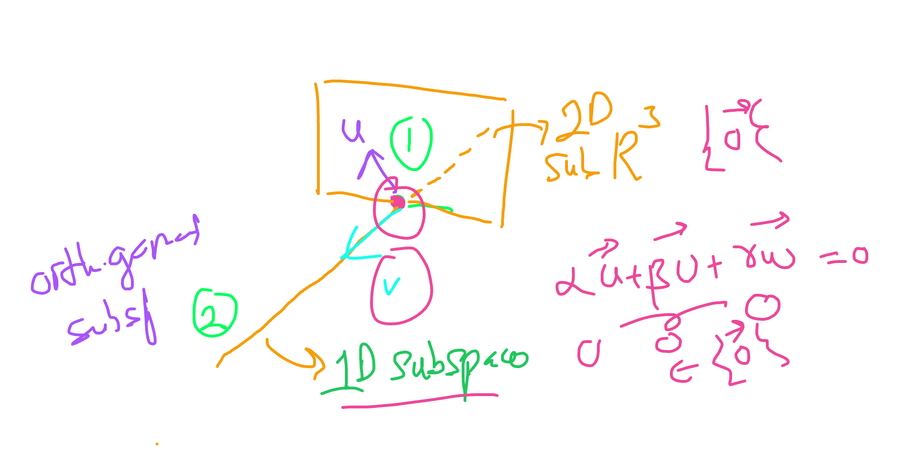</kbd>

> [!NOTE]
> Và theo định nghĩa này thì **hai subspace không
> orthogonal** - vì dễ thấy không phải mọi vector nào của
> mặt tường cũng orthogonal với mặt sàn. Và điển hình là
> trên intersection line, vector không thể orthogonal với
> chính nó
>
>
>
> Do đó, theo gs, **hai subspace không nên intersect nhau
> bởi một line** nếu muốn orthogonal. Hoặc đúng hơn là nếu
> muốn orthogonal thì chúng **chỉ có thể intersect nhau tại
> ZERO vì chỉ có zero vector mới orthogonal với chính nó**

> [!TIP]
> 🤖 **AI Check** — 🟢 Pass — ✅ **100/100** · ✓ Move on
>
> Ghi chú nắm rất chính xác bản chất và trực giác hình học của bài giảng: hai không gian con trực giao chỉ có thể cắt nhau tại vector không.
>
> **✓ Strengths**
> - Hiểu chính xác phản ví dụ của GS Gilbert Strang: vector nằm trên giao tuyến (vết nứt giữa sàn và tường) thuộc cả hai không gian nên phải trực giao với chính nó, điều bất khả thi với vector khác không.
> - Rút ra đúng kết luận then chốt: hai không gian con muốn trực giao thì phần giao của chúng chỉ có thể là vector không duy nhất (zero vector).
>
> **💡 Deeper notes**
> - Về mặt đại số hình thức: Nếu vector v thuộc S ∩ T và S ⊥ T, thì theo định nghĩa v ⊥ v, tức là v^T v = ||v||^2 = 0, suy ra v bắt buộc phải là vector không.

 

###### Orthogonal subspace trong R2

<kbd>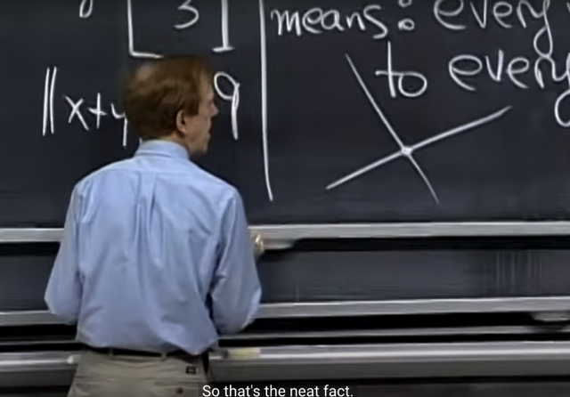</kbd>

> [!NOTE]
> Tiếp gs đề nghị hãy **xét các orthogonal subspace** của **R2**
>
>
>
> Ta có các case sau:
>
>
>
> i) một **zero vector** (đã biết, nó **vẫn là một subspace**), và một **line đi qua zero** (cũng là một space): mọi vector trong line đều orthogonal với vector duy nhất trong zero vector space (đương nhiên là vector zero) (Bởi dot product của vector nào với zero vector đều bằng 0) Nên thỏa yêu cầu **orthogonal subspaces**
>
>
>
> ii) **hai line qua origin** (là hai subpace) mà **vuông góc nhau**. Đương nhiên mọi vector trong line này cũng sẽ đều vuông góc mọi vector trong line kia → thỏa mãn điều kiện hai orthogonal subspace.

> [!TIP]
> 🤖 **AI Check** — 🟢 Pass — ✅ **95/100** · ✓ Move on
>
> Ghi chú nắm rất chính xác định nghĩa hai không gian con trực giao (orthogonal subspaces) trong R^2 cùng các ví dụ trực quan phù hợp với bài giảng của GS Gilbert Strang.
>
> **✓ Strengths**
> - Hiểu đúng bản chất hai không gian con trực giao: mọi vector thuộc không gian này phải trực giao với mọi vector thuộc không gian kia.
> - Nhận diện chính xác không gian con chứa vector không {0} trực giao với bất kỳ không gian con nào do tính chất của tích vô hướng.
> - Minh họa chuẩn xác trường hợp hai đường thẳng đi qua gốc tọa độ vuông góc nhau là hai không gian con trực giao 1 chiều trong R^2.
>
> **💡 Deeper notes**
> - Ngoài hai ví dụ trên, trong R^2 còn có cặp không gian con trực giao là không gian chỉ gồm vector không {0} và toàn bộ không gian R^2.
> - Trường hợp hai đường thẳng vuông góc nhau qua gốc tọa độ không chỉ là orthogonal subspaces mà còn là orthogonal complements (bổ sung trực giao) của nhau, vì tổng số chiều của chúng bằng số chiều của R^2 (1 + 1 = 2).

 

###### Trực giao Rowspace và Nullspace

<kbd>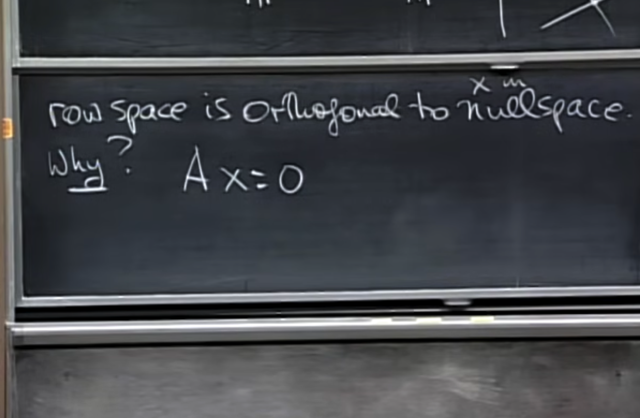</kbd>

> [!NOTE]
> Đầu tiên gs cho biết **rowspace** sẽ orthogonal with **nullspace**. Tại sao?

> [!TIP]
> 🤖 **AI Check** — 🟡 Minor issues — ⚠️ **75/100** · ✓ Move on
>
> Ghi chép đã nắm đúng tính chất cốt lõi rằng không gian hàng (row space) trực giao với không gian nghiệm (nullspace), nhưng chưa ghi lại gợi ý trả lời 'Ax = 0' từ bài giảng để giải thích cho câu hỏi 'Tại sao?'.
>
> **🟡 Minor issues**
>
> **1.** *"Tại sao"*
>
> Ghi chú dừng lại ở câu hỏi 'Tại sao' mà chưa ghi nhận câu trả lời cốt lõi trên bảng là $Ax = 0$, nơi mỗi hàng của $A$ nhân vô hướng với nghiệm $x$ đều bằng 0.
>
>
> **✓ Strengths**
> - Nắm bắt chính xác quan hệ trực giao giữa row space và nullspace theo bài giảng.
>
> **💡 Deeper notes**
> - Để trả lời đầy đủ câu hỏi 'Tại sao?': Với mọi $x \in N(A)$, ta có $Ax = 0$. Phép nhân ma trận này có nghĩa là tích vô hướng của từng hàng của $A$ với $x$ đều bằng 0, suy ra mọi tổ hợp tuyến tính của các hàng (tức toàn bộ row space) đều vuông góc với $x$.
> - Row space và nullspace không chỉ trực giao mà còn là hai không gian bù trực giao (orthogonal complements) của nhau trong $\mathbb{R}^n$, với tổng số chiều bằng $n$ theo định lý Rank-Nullity.

 

###### Row space trực giao Nullspace

<kbd>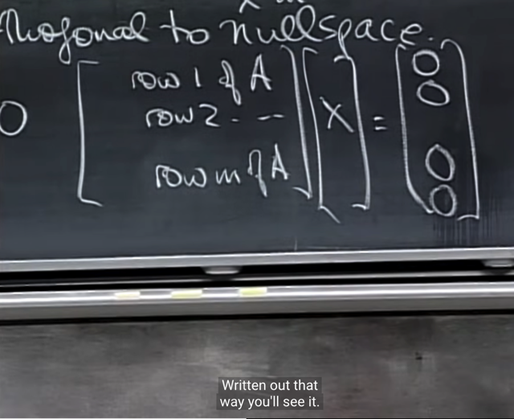</kbd>

> [!NOTE]
> thế thì chỉ cần viết ra như thế này thì **ngay lập tức có thể thấy tại
> sao** lại như vậy. Đó là, nhìn theo row view, ta đang có một set các row
> vector (tức matrix A), nhân với một matrix x có n row, và mỗi row chỉ có
> 1 phần tử.
>
>
>
> Theo góc nhìn row, ta row 1 của A khi nhân với "matrix" x (matrix chỉ có
> 1 cols) sẽ cho ra linear combination CÁC HÀNG CỦA x (mà mỗi hàng
> chỉ có 1 phần tử) với coefficient là các phần tử của row 1 của A. Và
> đương nhiên kết quả của cũng là một hàng - và cũng chỉ có 1 phần tử
> → đó chính là phần tử đầu tiên của vector kết qủa.
>
>
>
> Hiểu theo row-viewpoint là như vậy, nhưng nói ngắn gọn thì là ta có
> phần tử đầu tiên của kết quả sẽ là **DOT PRODUCT CỦA HÀNG 1
> CỦA A VÀ VECTOR X**. Mà đang xét nullspace, tức là các x sao cho
> Ax=0, tức là kết qủa của dot product  của row 1 của A và x là 0. Theo
> kết luận hồi nãy, ta có thể suy ra **row 1 của A ORTHOGONAL với x**.
>
>
>
> Và điều này tương tự với mọi row của A. Vậy thì, **mọi row của A, đều
> orthogonal với x** - mọi solution của nullspace.
>
>
>
> (Giải thích theo row view hơi dài dòng, vì một viewpoint khác của việc
> matrix A x matrix B là, mỗi component là dot product của row của A với
> column của B)
>
>
>
> Và **MỌI ROW CỦA A ĐỀU ORTHOGONAL VỚI x THÌ** **MỌI
> LINEAR COMBINATION CỦA CHÚNG CŨNG SẼ ORTHOGONAL VỚI
> X** (điều này hoàn toàn dễ hiểu vì **tính chất phân phối**:
>
>
>
> (c × u1 + v × u2)x = c × u1x + v × u2x = c × 0 + d × 0 = 0)
>
>
>
> Từ đó ta có trạng thái là **mọi vector trong row space đều orthogonal với
> mọi vector trong nullspace**.
>
>
>
> Đây là cơ sở để kết luận ta có **hai subspace orthogonal nhau là row
> space và nullspace**

> [!TIP]
> 🤖 **AI Check** — 🟡 Minor issues — ✅ **95/100** · ✓ Move on
>
> Ghi chú giải thích rất chính xác và trực quan tại sao row space lại vuông góc với nullspace dựa trên phép nhân ma trận $Ax = 0$. Các bước suy luận từ tích vô hướng của từng hàng đến tổ hợp tuyến tính đều rất rõ ràng.
>
> **🟡 Minor issues**
>
> **1.** *"(c × u1 + v × u2)x = c × u1x + v × u2x = c × 0 + d × 0 = 0"*
>
> Có lỗi ký hiệu nhỏ không nhất quán giữa hệ số v và d (vế trái dùng v nhưng vế phải lại viết là d × 0).
>
>
> **✓ Strengths**
> - Hiểu rất rõ bản chất của phương trình Ax = 0 theo góc nhìn từng hàng (row-by-row) tương đương với tích vô hướng bằng 0.
> - Chứng minh chặt chẽ việc nếu từng hàng trực giao với x thì mọi tổ hợp tuyến tính của các hàng cũng trực giao với x nhờ tính chất tuyến tính.
>
> **💡 Deeper notes**
> - Ngoài việc row space và nullspace trực giao với nhau, chúng còn là 'orthogonal complements' (phần bù trực giao) của nhau trong không gian R^n vì tổng số chiều của chúng đúng bằng n (dim(C(A^T)) + dim(N(A)) = r + (n - r) = n).

 

###### Row Space trực giao Nullspace

<kbd>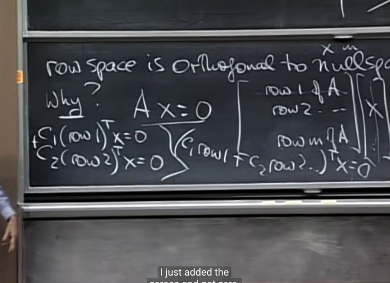</kbd>

> [!NOTE]
> Gs: Correct!

> [!TIP]
> 🤖 **AI Check** — 🔴 Critical issues — ❌ **0/100** · ✗ Fix first
>
> Ghi chú hoàn toàn chưa có nội dung kiến thức nào về bài giảng (chứng minh không gian dòng trực giao với nullspace) mà chỉ ghi lại một câu nói ngoài lề.
>
> **🔴 Critical issues**
>
> **1.** *"Gs: Correct!"*
>
> Ghi chú không tóm tắt hay ghi lại bất kỳ nội dung toán học nào từ bảng bài giảng (khái niệm và chứng minh tại sao row space lại trực giao với nullspace thông qua Ax = 0).
>
>
> **💡 Deeper notes**
> - Từ phương trình Ax = 0, mỗi hàng của ma trận A nhân vô hướng với vector x trong nullspace đều bằng 0, nghĩa là mọi vector hàng đều trực giao với x. Do tổ hợp tuyến tính bất kỳ của các hàng cũng sẽ trực giao với x, toàn bộ không gian dòng (row space) trực giao với nullspace.

 

###### Orthogonality of Fundamental Subspaces

<kbd>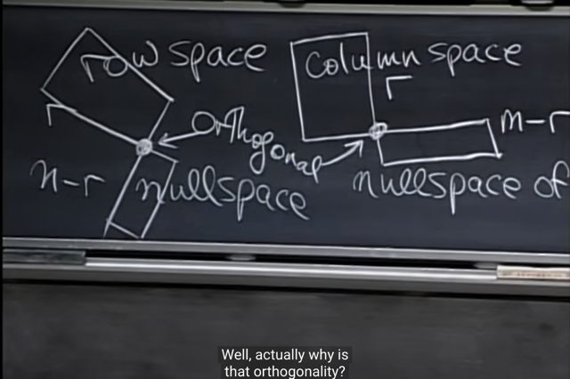</kbd>

<kbd>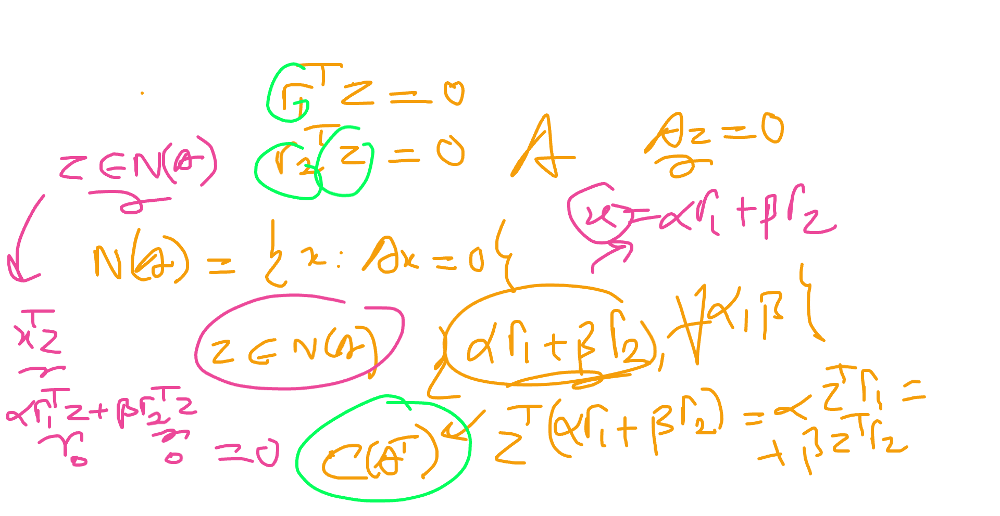</kbd>

> [!NOTE]
> Tương tự, ta sẽ xem thử tại sao **C(A) lại orthogonal với
> N(Aᵀ)**
>
>
>
> Me: Là bởi với y của N(Aᵀ) tức Aᵀy = 0, thì tương tự, ta
> sẽ có **CÁC ROW CỦA Aᵀ vuông góc với các y trong
> N(Aᵀ).**
>
>
>
> Mà c**ác row của Aᵀ THÌ CHÍNH LÀ CÁC COLS CỦA A**.
>
>
>
> Vậy nên ta có **mọi vector y của N(Aᵀ)** **đều orthogonal** với
> mọi row của rowspace của Aᵀ cũng là **mọi cols của A**.
> Vậy column space của A orthogonal với null space of Aᵀ

 

###### Bốn không gian con cơ bản

<kbd>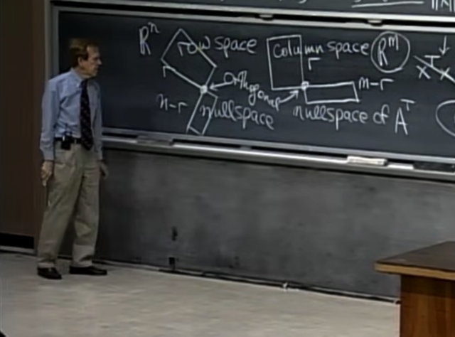</kbd>

<kbd>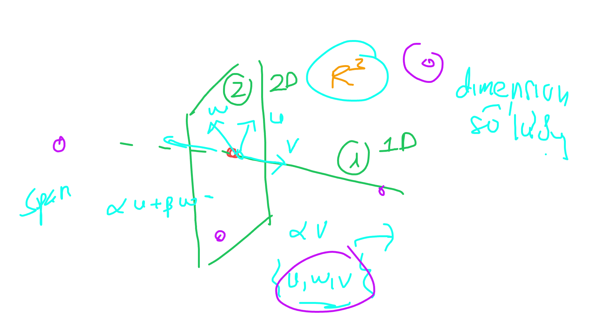</kbd>

> [!NOTE]
> gs: correct. Và ta có thể thấy kiểu như **2 subspace
> Rowspace và Nullspace khắc họa nên Rⁿ**.
>
>
>
> Còn **Columns space và Left nullspace** khắc họa nên
> **R^m**

> [!TIP]
> 🤖 **AI Check** — 🟡 Minor issues — ✅ **92/100** · ✓ Move on
>
> Ghi chú nắm rất chính xác bức tranh tổng thể về 4 không gian con cơ bản: Row space và Nullspace tạo nên Rⁿ, còn Column space và Left nullspace tạo nên Rᵐ.
>
> **🟡 Minor issues**
>
> **1.** *"khắc họa nên Rⁿ"*
>
> Cách dùng từ 'khắc họa nên' mang tính trực giác; về mặt toán học chuẩn xác, hai không gian con này là phần bù trực giao của nhau và tạo thành tổng trực tiếp (direct sum) để phân rã hoàn toàn không gian Rⁿ (tương tự với Rᵐ).
>
>
> **✓ Strengths**
> - Xác định đúng cặp không gian con thuộc về Rⁿ (Row space và Nullspace) và cặp thuộc về Rᵐ (Column space và Left nullspace).
> - Nắm được cốt lõi của định lý cơ bản của đại số tuyến tính về sự phân rã của hai không gian.
>
> **💡 Deeper notes**
> - Cụ thể hơn, hai cặp không gian con này trực giao với nhau (orthogonal complements): bất kỳ vector nào trong Rⁿ đều có thể phân tích duy nhất thành tổng của một vector thuộc Row space và một vector thuộc Nullspace (Rⁿ = Row(A) ⊕ Null(A) và Rᵐ = Col(A) ⊕ Null(Aᵀ)).
> - Số chiều (dimension) của chúng cộng lại khớp hoàn toàn: r + (n - r) = n và r + (m - r) = m.

 

###### Số chiều Rowspace và Nullspace

<kbd></kbd>

<kbd>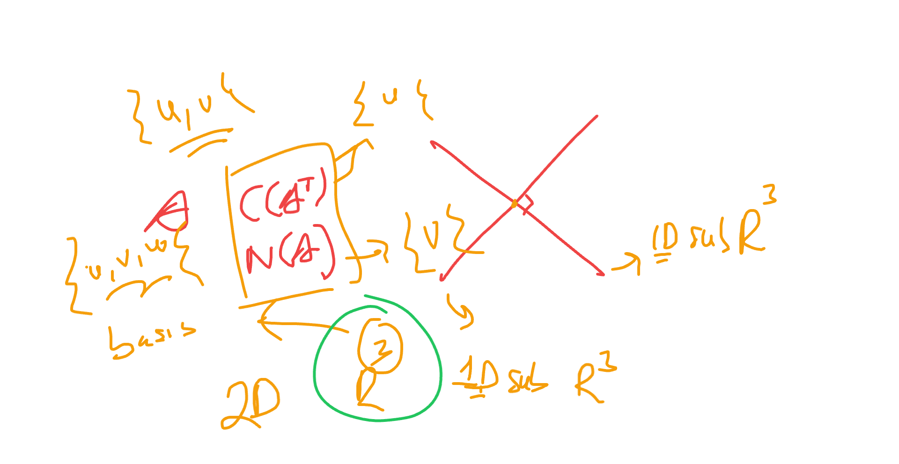</kbd>

<kbd>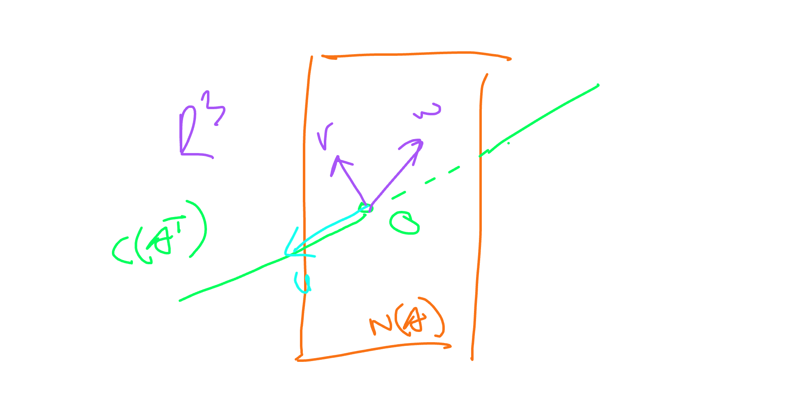</kbd>

> [!NOTE]
> Tiếp gs đặt câu hỏi là, tưởng tượng trong R³, ta lấy hai subspace là **2 orthogonal line** (đương nhiên đi qua gốc zero), và chúng **KHÔNG** **CÙNG NHAU LẤP ĐẦY CẢ R³** (vì chúng chỉ tạo một plane)
>
>
>
> Thì gs hỏi là: Có khi nào một rowspace và nullspace đóng vai của hai line đó - tức 2 subspace orthogonal nhưng không tạo toàn bộ R³
>
>
>
> Trả lời: Không, vì tính chất **tổng dimension của rowspace (r) và nullspace (n-r) phải bằng n**. Do đó không thể có vụ rowspace và nullspace đều là subspace của R³ (matrix có 3 cols) mà mỗi cái đều là một line (dim = 1) được

📹 [Xem video trên YouTube](https://www.youtube.com/watch?v=53VJU032wbM)

> [!TIP]
> 🤖 **AI Check** — 🟢 Pass — ✅ **100/100** · ✓ Move on
>
> Ghi chú rất chuẩn xác và lập luận hoàn toàn chính xác dựa trên định lý Rank-Nullity (tổng số chiều của row space và null space luôn bằng số cột n).
>
> **✓ Strengths**
> - Nắm bắt chính xác bản chất câu hỏi của giáo sư Gilbert Strang về khái niệm bù trực giao (orthogonal complement) trong R³.
> - Áp dụng chính xác định lý về số chiều: dim(Row space) + dim(Nullspace) = r + (n - r) = n để bác bỏ khả năng cả hai đều là đường thẳng trong R³.
>
> **💡 Deeper notes**
> - Khái niệm chính xác cần nhớ là hai không gian này không chỉ đơn thuần là trực giao (orthogonal) mà là bù trực giao của nhau (orthogonal complements in Rⁿ), nghĩa là tổng số chiều của chúng luôn lấp đầy toàn bộ không gian gốc.

 

###### Số chiều Rowspace và Nullspace

<kbd>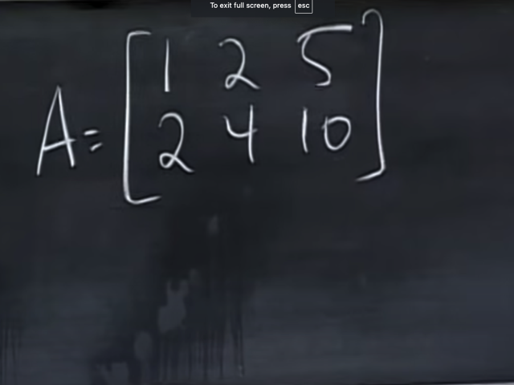</kbd>

<kbd>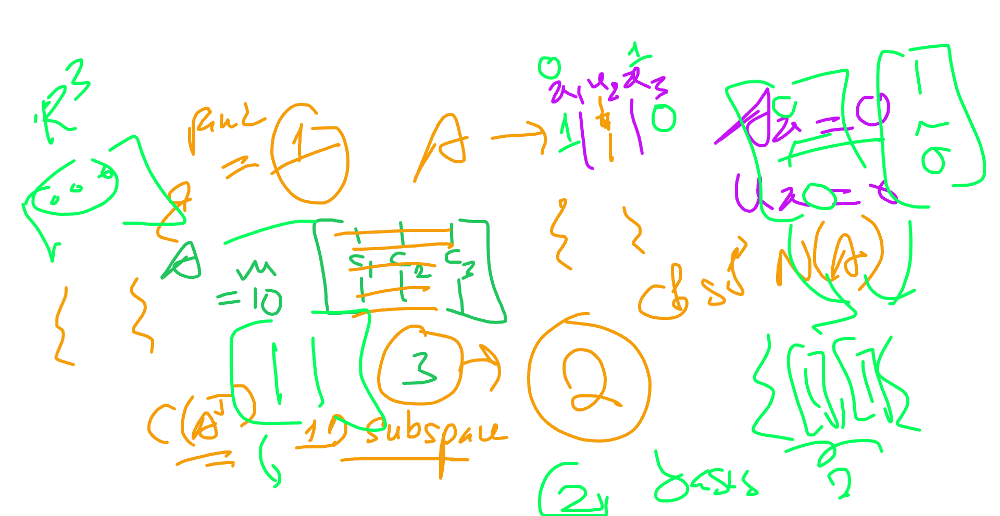</kbd>

<kbd>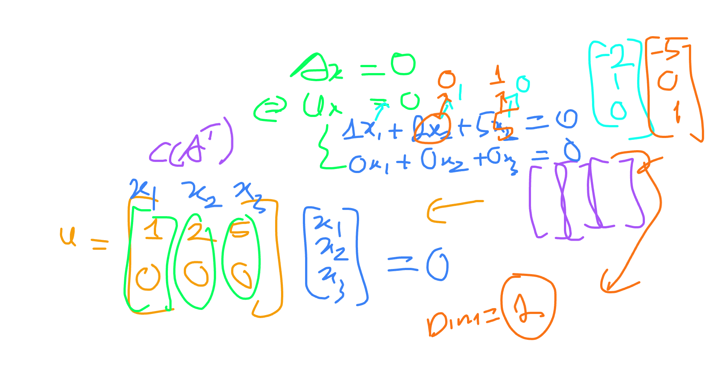</kbd>

> [!NOTE]
> Gs cho ví dụ này, dễ thấy hai row dependent, → chỉ có **1 independent row** → **rowspace có dim = 1**, và do đó matrix rank 1, và cũng dẫn tới chỉ có 1 independent cols, nên chỉ có **2 free cols** ứng với 2 special solution → chỉ có 2 vector trong basis và do đó nullspace có dim = 2
>
>
>
> Và đúng là 1 + 2 = 3 (cả rowspace và nullspace là subspace của R3)

> [!TIP]
> 🤖 **AI Check** — 🟢 Pass — ✅ **100/100** · ✓ Move on
>
> Ghi chú rất chính xác và đầy đủ về việc xác định hạng (rank), số chiều của row space và null space cũng như liên hệ định lý Rank-Nullity trong R^3.
>
> **✓ Strengths**
> - Nhận diện chính xác tính phụ thuộc tuyến tính giữa hai hàng để suy ra rank = 1.
> - Áp dụng chuẩn xác định lý Rank-Nullity: số cột pivot (1) + số cột tự do (2) = số chiều không gian cột n = 3.
> - Hiểu đúng bản chất row space và null space đều là các không gian con trực giao trong R^3.
>
> **💡 Deeper notes**
> - Có thể bổ sung thêm rằng row space và null space không chỉ cùng nằm trong R^3 mà còn là phần bù trực giao của nhau (orthogonal complements) trong R^3.

 

###### Dimension of Matrix Nullspace

<kbd>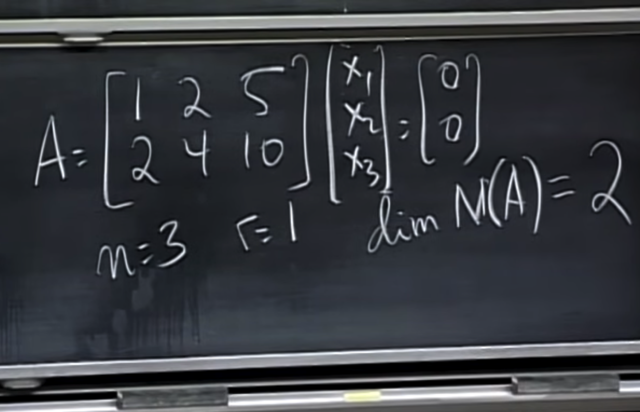</kbd>

> [!NOTE]
> gs: correct, ta có rowspace là 1 line: vector \[1 2 5\]ᵀ và nullspace là một plane.
>
>
>
> gs: Plane nào?
>
>
>
> me: Plane quy định bởi phương trình 1 x1 + 2 x2 + 5 x3 = 0 Đó chính là phương trình đường mặt phẳng nullspace: tập hợp tất cả các vector / đường thẳng vuông góc với vector \[1 2 5\]
>
>
>
> gs: correct
>
>
>
> Và liên hệ với 18.02 ta biết &lt;1, 2, 5&gt; chính là NORMAL VECTOR (vector pháp tuyến) của mặt phẳng, nó sẽ vuông góc với mọi vector trong mặt phẳng. Vậy từ đó trong trường hợp này bức tranh về rowspace C(Aᵀ) và nullspace N(A) rất rõ rằng, C(Aᵀ) chính là line đi qua normal vector và N(A) chính là plane. Và xác nhận lại rằng mọi vector trong plane (nullspace) đều vuông góc với normal vector (mọi vector trong row space)

> [!TIP]
> 🤖 **AI Check** — 🟢 Pass — ✅ **95/100** · ✓ Move on
>
> Ghi chú rất xuất sắc, hiểu sâu sắc mối liên hệ hình học giữa row space C(Aᵀ) và nullspace N(A) như hai không gian bù trực giao trong R³.
>
> **✓ Strengths**
> - Nhận diện chính xác C(Aᵀ) là đường thẳng sinh bởi vector [1, 2, 5]ᵀ (do rank = 1) và N(A) là mặt phẳng có số chiều bằng 2.
> - Liên hệ rất trực quan và chuẩn xác với hình học giải tích (18.02): vector dòng chính là vector pháp tuyến của mặt phẳng nghiệm x₁ + 2x₂ + 5x₃ = 0.
> - Nắm vững tính chất trực giao cốt lõi: mọi vector trong nullspace đều vuông góc với mọi vector trong row space (N(A) ⊥ C(Aᵀ)).
>
> **💡 Deeper notes**
> - Cần lưu ý thêm về mặt chuẩn xác đại số tuyến tính: cả đường thẳng (row space) và mặt phẳng (nullspace) đều bắt buộc phải đi qua gốc tọa độ (0, 0, 0) để thỏa mãn định nghĩa không gian con (subspace).
> - Cụm từ 'phương trình đường mặt phẳng' chỉ là lỗi diễn đạt khẩu ngữ lặp từ ('đường' và 'mặt phẳng'), nên gọi chuẩn xác là 'phương trình mặt phẳng'.

 

###### Phần bù trực giao trong R^n

<kbd>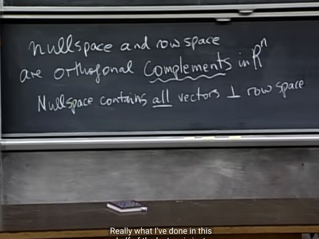</kbd>

<kbd>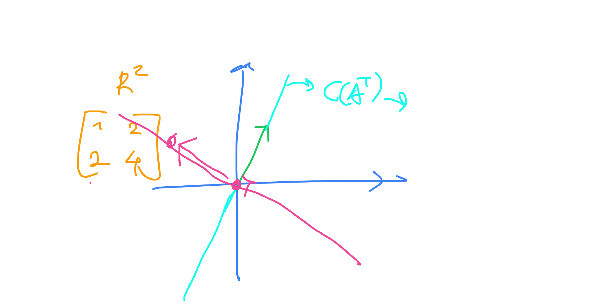</kbd>

> [!NOTE]
> và, đại khái là vì ta có hai subspace này (nullspace và
> rowspace) **orthogonal** đồng thời **tổng dimension của
> chúng bằng n**. Nên tgọi chúng là **ORTHOGONAL
> COMPLEMENT IN R^N**

> [!TIP]
> 🤖 **AI Check** — 🟢 Pass — ✅ **100/100** · ✓ Move on
>
> Ghi chú rất chính xác và nắm trọn vẹn bản chất: hai không gian con trực giao có tổng số chiều bằng n thì chính là phần bù trực giao (orthogonal complements) của nhau trong R^n.
>
> **✓ Strengths**
> - Hiểu chính xác điều kiện để hai không gian con là orthogonal complements: vừa trực giao với nhau vừa có tổng số chiều bằng số chiều của không gian mẹ (R^n).
> - Kết nối tốt giữa khái niệm trực giao và định lý Rank-Nullity (r + (n - r) = n).
>
> **💡 Deeper notes**
> - Hệ quả trực tiếp của việc là orthogonal complement là mọi vector x trong R^n đều có thể phân tích duy nhất thành x = x_row + x_null (tổng trực tiếp R^n = C(A^T) ⊕ N(A)).

 

###### Solving Ax=b With No Solution

<kbd>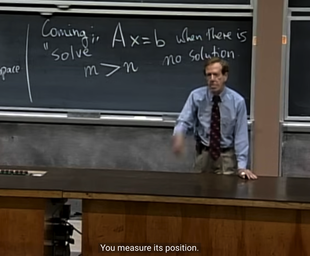</kbd>

> [!NOTE]
> Tiếp gs cho biết ta sẽ bàn **LEAST SQUARE** - **giải Ax=b
> khi mà không có solution** - tức là **khi b không nằm trong
> cols space**.
>
>
>
> Và bên cạnh đó ta sẽ **đặt mình trong trạng thái m > n**,
> tức ta có matrix **cao ốm**, nơi **có số cols ít hơn số row**.
> Thế thì vì trong trạng thái này, cols space là subspace của
> Rm, nhưng lại chỉ có n < m cols, nên **chắc chắn các cols
> không span hết được Rm**. Do đó **chắc chắn tồn tại b
> khiến Ax=b vô nghiệm**.
>
>
>
> Gs cho rằng ví dụ về matrix như này có rất nhiều, ví dụ
> như ta **đo heart rate**, chỉ có một variable, nhưng mỗi lần
> đo ta sẽ một giá trị khác, để rồi ta có rất nhiều equation,
> nhưng chỉ có 1 cols. Và **giá trị khác nhau mỗi lần là do
> noise**, tuy nhiên bên trong giá trị **vẫn chứa thông tin**.
> Và ta **muốn tách những thông tin hữu ích ra khỏi noise**

📹 [Xem video trên YouTube](https://www.youtube.com/watch?v=Utf0bKKqqio)

> [!TIP]
> 🤖 **AI Check** — 🟢 Pass — ✅ **95/100** · ✓ Move on
>
> Ghi chú nắm rất chắc và chính xác bản chất hình học của việc $Ax = b$ vô nghiệm khi $m > n$ cũng như động lực thực tế dẫn đến phương pháp bình phương tối thiểu (Least Squares).
>
> **✓ Strengths**
> - Hiểu chính xác điều kiện vô nghiệm của hệ $Ax = b$ xuất phát từ việc $b$ không nằm trong không gian cột (column space).
> - Lập luận chặt chẽ: ma trận có $n < m$ cột thì không gian cột tối đa có số chiều là $n$, không thể phủ hết $\mathbb{R}^m$, dẫn đến luôn tồn tại vector $b$ làm hệ vô nghiệm.
> - Nắm bắt đúng trực giác mô hình hóa thực tế: nhiều phép đo lặp lại có nhiễu (noise) dẫn đến hệ thừa ẩn và cần Least Squares để ước lượng giá trị tối ưu.
>
> **💡 Deeper notes**
> - Khái niệm 'giải' trong ngoặc kép trên bảng ('solve') thực chất là tìm nghiệm xấp xỉ tốt nhất $\hat{x}$ sao cho sai số $\|Ax - b\|$ đạt cực tiểu, hình chiếu của $b$ lên $C(A)$ chính là $p = A\hat{x}$.

 

###### Ý tưởng loại bỏ phương trình

<kbd>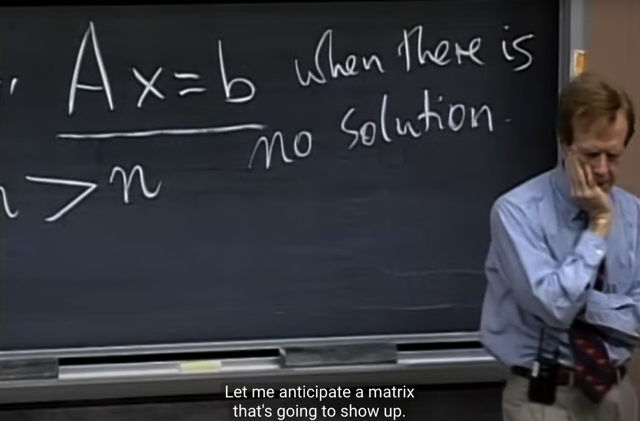</kbd>

> [!NOTE]
> Gs cho rằng ta có thể nghĩ đến việc **tiếp cận** giải pháp
> bằng cách **THROW AWAY CÁC EQUATION CHO ĐẾN
> KHI TA CÓ MỘT INVERTIBLE MATRIX VÀ TỪ ĐÓ CÓ
> THỂ CÓ SOLUTION**
>
>
>
> Nhưng rõ ràng việc này **không hợp lí**, vì **không có lí do gì
> để cho rằng equation này thì tốt hơn equation khác** để
> mà **vứt đi bớt**

> [!TIP]
> 🤖 **AI Check** — 🟢 Pass — ✅ **100/100** · ✓ Move on
>
> Ghi chú nắm bắt rất chính xác trực giác mà Giáo sư Gilbert Strang truyền tải: không nên tùy tiện loại bỏ phương trình khi gặp hệ $m > n$ vì các dữ liệu/phép đo đều có giá trị như nhau.
>
> **✓ Strengths**
> - Hiểu đúng trực giác và lý do tại sao phương án bỏ bớt phương trình để thu được ma trận khả nghịch là không hợp lý.
> - Nắm bắt được vấn đề cốt lõi dẫn dắt đến phương pháp bình phương tối thiểu (Least Squares) thay vì loại bỏ dữ liệu quan sát.
>
> **💡 Deeper notes**
> - Trong thực tế, khi $m > n$, các phương trình thường tương ứng với các phép đo thực nghiệm có chứa nhiễu (noise); việc sử dụng tất cả phương trình thông qua phương pháp bình phương tối thiểu ($A^TA\hat{x} = A^Tb$) sẽ giúp trung hòa sai số thay vì làm mất thông tin hữu ích nếu bỏ bớt.

 

###### Matrix Multiplication A Transpose A

<kbd>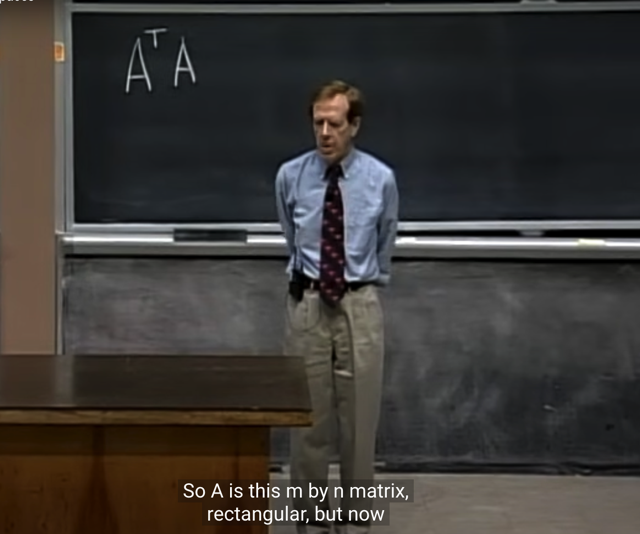</kbd>

> [!NOTE]
> Gs đề nghị ta **nghĩ về matrix này AᵀA**, câu hỏi là, nó là matrix ntn?
>
>
>
> me: **square**, điều này dễ thấy. Và cũng **đối xứng (symmetric)**: Và ta cũng đã chứng minh cái này mà cũng dễ chứng minh lại:
>
>
>
> (AᵀA)ᵀ = Aᵀ(Aᵀᵀ) = AᵀA. Tức là bằng cách cho thấy **AᵀA transpose của nó bằng chính nó nên AᵀA đối xứng.**

> [!TIP]
> 🤖 **AI Check** — 🟢 Pass — ✅ **100/100** · ✓ Move on
>
> Ghi chú rất chính xác và súc tích, đã giải thích rõ tại sao $A^TA$ là ma trận vuông và chứng minh đúng tính đối xứng qua phép chuyển vị.
>
> **✓ Strengths**
> - Xác định đúng hai tính chất nền tảng của ma trận $A^TA$ là ma trận vuông và ma trận đối xứng.
> - Chứng minh tính đối xứng $(A^TA)^T = A^TA$ chính xác dựa trên quy tắc chuyển vị tích $(AB)^T = B^TA^T$ và $(A^T)^T = A$.
>
> **💡 Deeper notes**
> - Nếu ma trận $A$ có kích thước $m \times n$ thì $A^TA$ luôn có kích thước cụ thể là $n \times n$ (trong khi $AA^T$ sẽ là $m \times m$).
> - Ngoài tính đối xứng, $A^TA$ còn có tính chất quan trọng là luôn nửa xác định dương (positive semi-definite), và sẽ khả nghịch nếu $A$ có các cột độc lập tuyến tính (full column rank).

 

###### Symmetric Matrix A Transpose A

<kbd>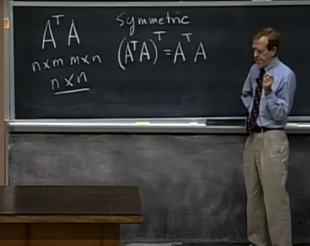</kbd>

> [!NOTE]
> đúng vậy, nó **square**, và còn **đối xứng**. vì **(AᵀA)ᵀ cũng bằng AᵀA**

> [!TIP]
> 🤖 **AI Check** — 🟢 Pass — ✅ **100/100** · ✓ Move on
>
> Ghi chú ngắn gọn, chính xác tuyệt đối về tính chất vuông và đối xứng của ma trận tích $A^T A$.
>
> **✓ Strengths**
> - Nắm rõ ma trận $A^T A$ luôn là ma trận vuông kích thước $n \times n$.
> - Hiểu và chỉ ra đúng tính chất đối xứng thông qua đẳng thức $(A^T A)^T = A^T A$.
>
> **💡 Deeper notes**
> - Để chứng minh chặt chẽ hơn tại sao $(A^T A)^T = A^T A$, ta áp dụng quy tắc chuyển vị tích: $(AB)^T = B^T A^T$, do đó $(A^T A)^T = A^T (A^T)^T = A^T A$.

 

###### Tính khả nghịch

<kbd></kbd>

> [!NOTE]
> Câu hỏi tiếp theo là nó **có
> invertible không?**

> [!TIP]
> 🤖 **AI Check** — 🟢 Pass — ✅ **100/100** · ✓ Move on
>
> Ghi chú nắm bắt chính xác và đúng trọng tâm câu hỏi của giáo sư trong bài giảng.
>
> **✓ Strengths**
> - Ghi nhận chính xác câu hỏi cốt lõi mà giảng viên đặt ra về tính khả nghịch (invertible) của ma trận.
>
> **💡 Deeper notes**
> - Tính khả nghịch (invertibility) thường chỉ áp dụng cho ma trận vuông và tương đương với việc định thức khác 0, ma trận có hạng đầy đủ (full rank) hoặc các cột độc lập tuyến tính.

 

###### Least Squares Normal Equations

<kbd>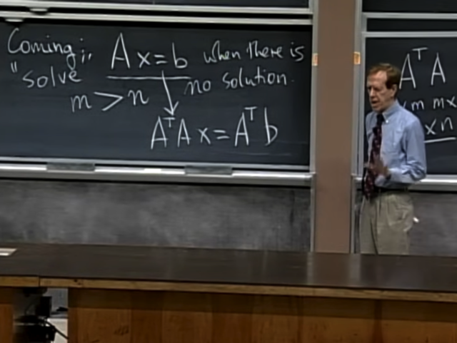</kbd>

> [!NOTE]
> Đại khái là, từ Ax=b, là equation mà gs đã nói ở trên đại ý là **khả năng cao nó không có solution** (vì như đã nói C(A) không span toàn bộ Rm)
>
>
>
> gs cho rằng tôi sẽ **nhân hai vế của Ax=b với Aᵀ** để hi vọng rằng **có thể có solution của phương trình này**, gs gọi là **x̂**

> [!TIP]
> 🤖 **AI Check** — 🟡 Minor issues — ⚠️ **88/100** · ✓ Move on
>
> Ghi chú nắm rất đúng trực giác cốt lõi: khi m > n, C(A) không phủ hết R^m nên Ax=b thường vô nghiệm, và việc nhân Aᵀ dẫn tới phương trình pháp phương để tìm nghiệm x̂ xấp xỉ tốt nhất.
>
> **🟡 Minor issues**
>
> **1.** *"để hi vọng rằng có thể có solution của phương trình này"*
>
> Cách dùng từ 'hi vọng' tạo cảm giác hên xui. Về mặt toán học, hệ phương trình AᵀAx̂ = Aᵀb luôn luôn đảm bảo có nghiệm với mọi vector b (do Aᵀb luôn thuộc C(Aᵀ) = C(AᵀA)).
>
>
> **✓ Strengths**
> - Giải thích chính xác lý do hình học vì sao Ax=b thường vô nghiệm khi m > n (do không gian cột C(A) không thể span toàn bộ R^m).
> - Nhận diện đúng ký hiệu nghiệm x̂ (nghiệm bình phương tối thiểu) cho phương trình chuẩn tắc AᵀAx̂ = Aᵀb.
>
> **💡 Deeper notes**
> - Hệ phương trình AᵀAx̂ = Aᵀb luôn có nghiệm; hơn nữa, nghiệm x̂ sẽ là duy nhất nếu ma trận A có các cột độc lập tuyến tính (tức A có full column rank n, khi đó AᵀA khả nghịch).

 

###### Least Squares Normal Equation

<kbd>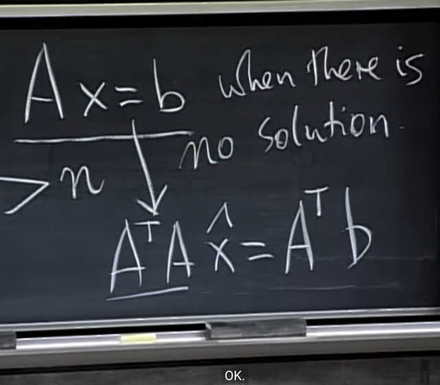</kbd>

> [!NOTE]
> Và khi đó **AᵀAx̂ = Aᵀb** sẽ là equation mà ông gọi là **good
> equation**

> [!TIP]
> 🤖 **AI Check** — 🟢 Pass — ✅ **95/100** · ✓ Move on
>
> Ghi chú ngắn gọn và nắm đúng phương trình cốt lõi $A^TA\hat{x} = A^Tb$ dùng khi hệ $Ax = b$ vô nghiệm theo bài giảng của GS. Gilbert Strang.
>
> **✓ Strengths**
> - Ghi nhận chính xác phương trình chuẩn (normal equation) $A^TA\hat{x} = A^Tb$ dùng để tìm nghiệm xấp xỉ tốt nhất (bình phương tối thiểu) khi $Ax = b$ không có nghiệm.
>
> **💡 Deeper notes**
> - Thuật ngữ toán học chuẩn mực cho phương trình này là 'normal equations' (hệ phương trình chuẩn).
> - Nghiệm $\hat{x} = (A^TA)^{-1}A^Tb$ sẽ là duy nhất khi và chỉ khi ma trận $A$ có các cột độc lập tuyến tính (tức $A^TA$ khả nghịch).

 

###### Normal Equations for Least Squares

<kbd>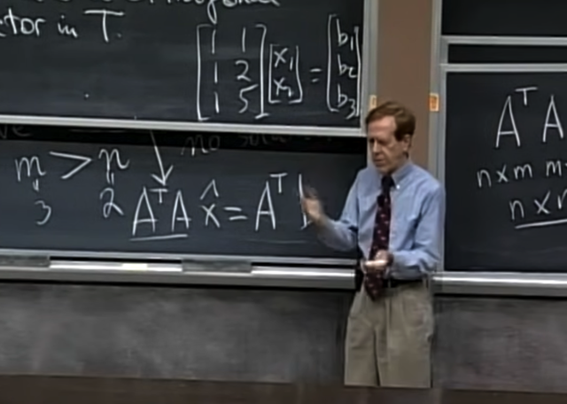</kbd>

> [!NOTE]
> Gs lấy ví dụ như matrix này, 3 rows, 2 cols. **Dễ thấy rank = 2**
>
>
>
> Và như đã nói chỉ khi nào b **NẰM TRÊN COLS SPACE − LÀ 2D PLANE TRONG R3**, THÌ mới system of equation này mới solvable

> [!TIP]
> 🤖 **AI Check** — 🟢 Pass — ✅ **100/100** · ✓ Move on
>
> Ghi chú hoàn toàn chính xác về mặt toán học và phản ánh đúng bản chất hình học của hệ phương trình Ax = b mà Giáo sư Gilbert Strang đang giảng.
>
> **✓ Strengths**
> - Xác định chính xác ma trận A kích thước 3x2 có hai cột độc lập tuyến tính nên rank = 2.
> - Hiểu đúng bản chất hình học: không gian cột C(A) là một mặt phẳng 2 chiều trong không gian R3, và hệ Ax = b chỉ có nghiệm khi b thuộc không gian này.
>
> **💡 Deeper notes**
> - Vì b thông thường không nằm trong C(A) (hệ vô nghiệm do m > n), bài toán thực tế sẽ dẫn đến việc tìm nghiệm xấp xỉ bình phương tối thiểu (least squares) thông qua phương trình chuẩn tắc A^T A x̂ = A^T b như trên bảng.

 

###### Normal Equations for Least Squares

<kbd>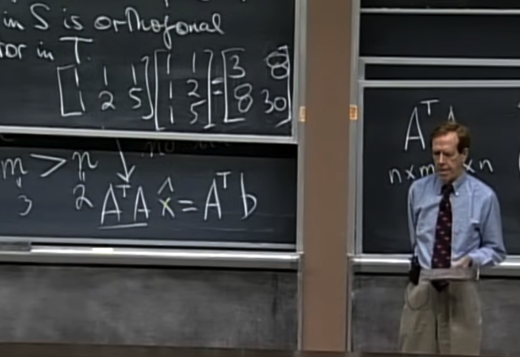</kbd>

> [!NOTE]
> Và **tính AᵀA** ra, ta **có thể thấy nó invertible** vì nó
> fullrank
>
>
>
> Tuy nhiên gs cho biết **không phải lúc nào ta cũng có
> invertible AᵀA**
>
>
>
> (Ta sẽ gặp lại AᵀA sau, trong đó ta s**ẽ chứng minh AᵀA
> fullrank chỉ khi nào A full column rank (theo link)**

> [!TIP]
> 🤖 **AI Check** — 🟢 Pass — ✅ **100/100** · ✓ Move on
>
> Ghi chú rất chính xác và nắm bắt trọn vẹn bản chất bài giảng: ma trận $A^T A$ ở ví dụ khả nghịch do có hạng đủ, và điều kiện tổng quát để $A^T A$ khả nghịch là $A$ phải có các cột độc lập tuyến tính (full column rank).
>
> **✓ Strengths**
> - Nhận diện chính xác ví dụ tính toán cụ thể $A^T A$ ra ma trận khả nghịch.
> - Nắm vững định lý cốt lõi: $A^T A$ khả nghịch (full rank kích thước $n \times n$) khi và chỉ khi $A$ có full column rank (các cột của $A$ độc lập tuyến tính).
>
> **💡 Deeper notes**
> - Bản chất của tính chất này xuất phát từ việc $A$ và $A^T A$ có cùng không gian nghiệm: $N(A^T A) = N(A)$, do đó nếu $Ax = 0$ chỉ có nghiệm tầm thường $x = 0$ (cột độc lập tuyến tính) thì $A^T A x = 0$ cũng vậy, đảm bảo $A^T A$ khả nghịch.

**🔗 See also:** [Invertibility of Aᵀ A](#node-3l4hkq3)

 

###### Ma trận không khả nghịch

<kbd>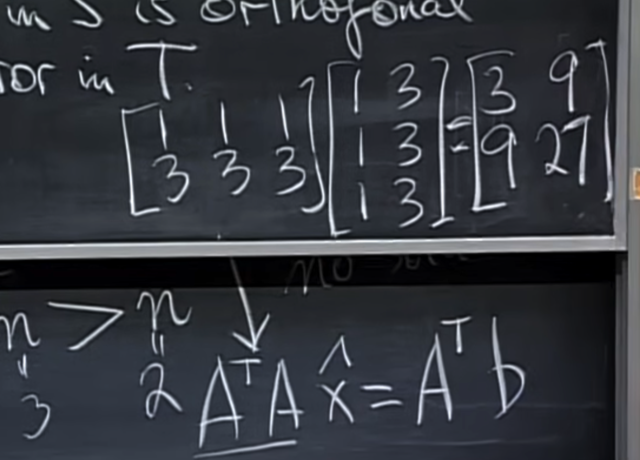</kbd>

> [!NOTE]
> Ví dụ như matrix này, không invertible, vì result
> matrix chỉ có **rank = 1**

> [!TIP]
> 🤖 **AI Check** — 🟢 Pass — ✅ **95/100** · ✓ Move on
>
> Ghi chú hoàn toàn chính xác khi nhận xét ma trận kết quả $A^T A$ có rank = 1 nên không khả nghịch (singular/non-invertible).
>
> **✓ Strengths**
> - Nhận diện chính xác ma trận $A^T A = \begin{bmatrix} 3 & 9 \\ 9 & 27 \end{bmatrix}$ kích thước 2x2 nhưng chỉ có rank bằng 1 do các hàng/cột phụ thuộc tuyến tính.
> - Hiểu đúng hệ quả: ma trận vuông kích thước 2x2 có rank = 1 < 2 thì định thức bằng 0 và không thể nghịch đảo.
>
> **💡 Deeper notes**
> - Bản chất sâu xa là do ma trận $A$ ban đầu có các cột phụ thuộc tuyến tính (cột 2 gấp 3 lần cột 1, tức $\text{rank}(A) = 1 < n = 2$), dẫn đến $\text{rank}(A^T A) = \text{rank}(A) = 1$, khiến phương trình chuẩn $A^T A \hat{x} = A^T b$ không có nghiệm duy nhất.

 

###### Rank of Matrix Product A Transpose A

<kbd></kbd>

> [!NOTE]
> và gs nói rằng ông đã biết chắc kết quả sẽ không invertible vì **AᵀA SẼ CÓ RANK CHÍNH XÁC BẰNG RANK CỦA A**. mà trong trường hợp này RANK A = 1, NÊN AᵀA CŨNG CÓ RANK BẰNG 1, TRONG KHI NÓ LÀ MATRIX 2X2 NÊN NÓ KHÔNG FULLRANK
>
>
>
> Active recall chút: Rank của một matrix, ta còn nhớ, sẽ chính là số cột (cũng như số hàng) độc lập tuyến tính.
>
>
>
> Vậy câu hỏi sẽ là, vì sao số cột, số hàng độc lập của AᵀA và A giống nhau.
>
>
>
> Mấu chốt là ta hãy nghĩ về nullspace.
>
>
>
> Nếu có vector x khác 0, khiến Ax = 0, ta biết nó là vector thuộc nullspace N(A).
>
>
>
> Mà Ax = 0 thì AᵀAx cũng = 0, nên x cũng sẽ thuộc nullspace của AᵀA, tức N(AᵀA)
>
>
>
> Vậy giả sử A là matrix m × n có d vector khác 0 trong nullspace thì AᵀA cũng vậy.
>
>
>
> Vậy nếu matrix A có rank = r thì có nghĩa là nó có r cột độc lập, và r hàng độc lập. Như vậy nó sẽ có n - r cột tự do và mỗi cột tự do này sẽ ứng với một non-zero nullspace vector. Vậy nên AᵀA cũng có n - r cột tự do (do đã bảo số non-zero nullspace vector của hai thằng này như nhau). Vậy AᵀA có m - (n - r) cột độc lập.
>
>
>
> Nên hạng của AᵀA là n - n + r = r

> [!TIP]
> 🤖 **AI Check** — 🟢 Pass — ✅ **100/100** · ✓ Move on
>
> Ghi chú hoàn toàn chính xác và nắm bắt trọn vẹn bản chất lý thuyết: rank(AᵀA) = rank(A), từ đó giải thích rõ ràng tại sao ma trận AᵀA cấp 2x2 lại không khả nghịch (singular) khi rank A = 1.
>
> **✓ Strengths**
> - Nắm vững định lý cốt lõi rằng rank(AᵀA) bằng với rank(A) đối với ma trận thực.
> - Lập luận logic chuẩn xác: vì AᵀA có kích thước 2x2 nhưng chỉ có rank bằng 1 nên không full rank, dẫn đến việc không khả nghịch (invertible).
>
> **💡 Deeper notes**
> - Tính chất rank(AᵀA) = rank(A) dựa trên việc không gian nghiệm nullspace N(AᵀA) = N(A), áp dụng cho ma trận số thực (đối với số phức cần dùng ma trận chuyển vị liên hợp AᴴA).

 

###### Nullspace và Rank của AᵀA

<kbd>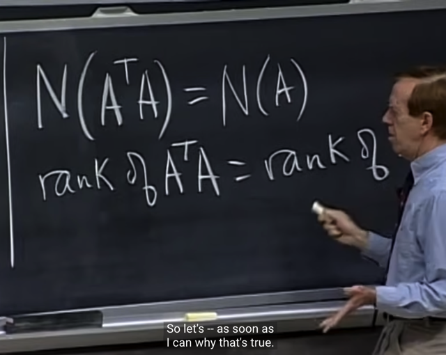</kbd>

> [!NOTE]
> Như vậy **Nullspace của A cũng chính là nullspace của AᵀA**
> (vì **Ax=0 tương đương AᵀAx = 0**)
>
>
>
> và **rank cũng chúng cũng bằng nhau nữa**

 

###### Invertibility of Aᵀ A

<kbd>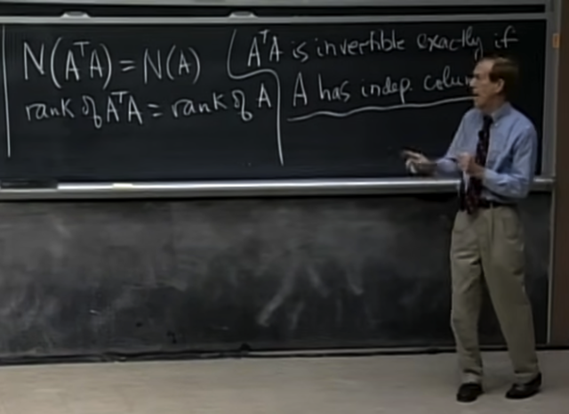</kbd>

> [!NOTE]
> Và từ đó gs kết luận **AᵀA INVERTIBLE CHỈ KHI A CÓ CÁC
> COLS INDEPENDENT (FULL COLUMNS RANK)**
>
>
>
> \~Điều này có thể dễ hiểu bởi, vì AᵀA có shape (n, n) và rank
> của nó bằng rank A, vậy rõ ràng chỉ khi nào rank A bằng n thì
> AᵀA mới full-rank. Và điều này xảy ra tức là khi CÁC COLS
> CỦA ĐỀU LÀ PIVOT, và cũng chính là nullspace của A CHỈ
> CÓ ZERO (vì không có free cols nào)\~
>
>
>
> Chứng minh **AᵀAx=0 ⇔ Ax = 0 như sau (sau này gs sẽ
> chứng minh cái này (theo link)**:
>
>
>
> Nếu Ax = 0 thì nhân hai vế cho Aᵀ đương nhiên ta có  AᵀAx
> = 0. Vậy Ax = 0 ⇒ AᵀAx = 0.
>
>
>
> Ngược lại, nếu AᵀAx = 0, nhân hai vế cho xᵀ ta có:
>
>
>
> xᵀAᵀAx = 0 ⇔ (Ax)ᵀ(Ax) = 0 ⇔ ||Ax|| = 0, mà length của
> vector Ax >= 0 nên dấu bằng xảy chỉ khi Ax = 0. Vậy AᵀAx = 0
> ⇒ Ax = 0
>
>
>
> Từ đó giúp kết luận AᵀAx = 0 ⇔ Ax = 0, hai matrix AᵀA  và A
> chung nullspace **N(AᵀA) = N(A)**. Vậy thì đương nhiên để
> **AᵀA fullrank/non-singular/invertible** thì **N(AᵀA) phải bằng
> {0}**, đồng nghĩa **N(A) cũng vậy**, mà điều này dễ thấy sẽ
> tương đương với việc **A Full Column Rank khi đó dim C(A)
> =  rank = n ⇒ dim N(A) = 0**

**🔗 See also:** [Normal Equations for Least Squares](#node-30t8kt0) · [linked note](./lecture_16_projection_matrices_and_least_squares.md#node-ho17455)

 

###### Tính chất ma trận AᵀA

<kbd>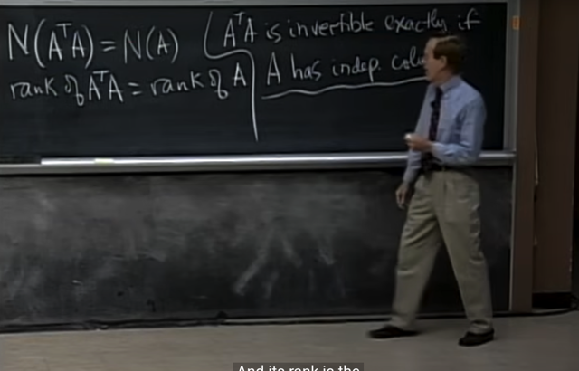</kbd>

> [!NOTE]
> Và bài sau ta sẽ thấy AᵀA đóg vai trò **CRUCIAL**

> [!TIP]
> 🤖 **AI Check** — 🟢 Pass — ⚠️ **75/100** · ✓ Move on
>
> Ghi chú ghi nhận đúng tầm quan trọng cốt lõi của ma trận AᵀA trong các bài học tiếp theo (hình chiếu, bình phương tối thiểu), tuy nhiên chưa ghi lại các tính chất đại số then chốt được trình bày trên bảng.
>
> **✓ Strengths**
> - Nhận thức đúng vai trò trọng tâm của ma trận AᵀA trong chuỗi bài giảng tiếp theo về đại số tuyến tính.
>
> **💡 Deeper notes**
> - Nên bổ sung 3 kết quả toán học quan trọng hiển thị trên bảng: N(AᵀA) = N(A), rank(AᵀA) = rank(A), và AᵀA khả nghịch khi và chỉ khi ma trận A có các cột độc lập tuyến tính.

 

