# Lecture 15: Projections Onto Subspaces

📊 **Progress:** `45` Notes | `51` Screenshots | `39` AI Reviews

---

 

## Ma trận hình chiếu

<kbd>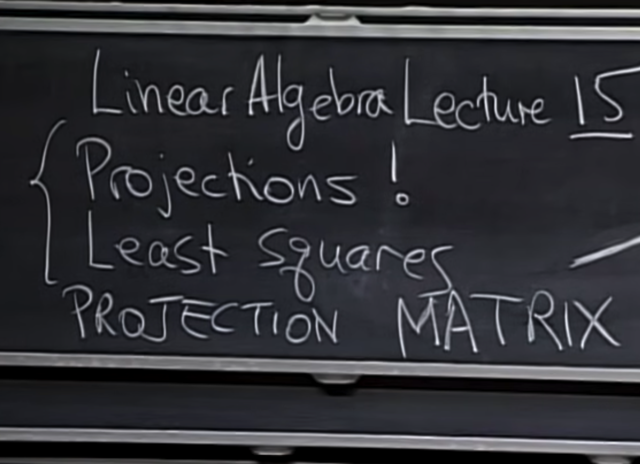</kbd>

 

### Phép chiếu lên Subspace

<kbd>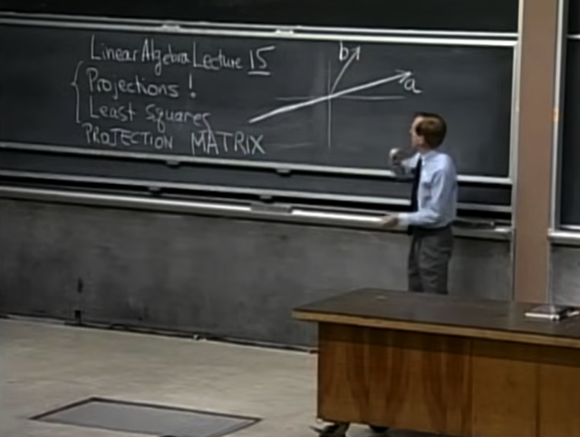</kbd>

> [!NOTE]
> Gs cho rằng đây là một bài **rất quan trọng** khi ta sẽ nói về **projection lên subspace**
>
>
>
> Đầu tiên, gs dùng ví dụ trong **1D dimension subspace** - đó là **đường thẳng a**: **tìm điểm trên a sao cho gần nhất với b**

📹 [Xem video trên YouTube](https://www.youtube.com/watch?v=N3lyFCha--0)

> [!TIP]
> 🤖 **AI Check** — 🟢 Pass — ✅ **100/100** · ✓ Move on
>
> Ghi chú nắm bắt rất chính xác và súc tích bản chất hình học của phép chiếu: tìm điểm trên không gian con (ở đây là đường thẳng) gần vector đích nhất.
>
> **✓ Strengths**
> - Hiểu đúng bản chất của bài toán chiếu là bài toán tối ưu khoảng cách (tìm điểm gần nhất).
> - Xác định chính xác trường hợp mở đầu là chiếu lên không gian con 1 chiều (đường thẳng đi qua vector a).
>
> **💡 Deeper notes**
> - Về mặt thuật ngữ, cụm từ '1D dimension subspace' hơi thừa từ (1D đã là 1-dimension), chỉ cần gọi là 'không gian con 1 chiều' (1D subspace).
> - Về mặt hình học, điểm gần nhất $p$ trên đường thẳng đi qua $a$ thỏa mãn điều kiện vector sai số $e = b - p$ phải vuông góc (orthogonal) với $a$.

 

#### Hình chiếu vector lên vector

<kbd>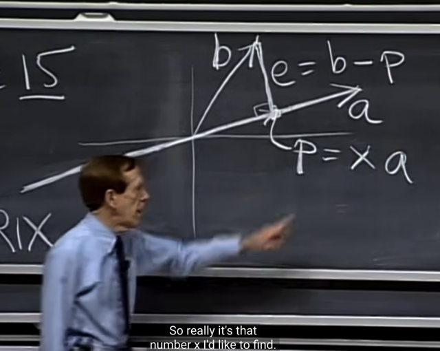</kbd>

> [!NOTE]
> ok thế thì với bài toán này, ta biết rằng, mình cần **tìm
> điểm (vector p) như hình vẽ**, và **e (viết tắt của error)** sẽ
> thể hiện **difference giữa b và p**, cho ta biết **sai số ta sẽ
> chịu khi project b lên a**.
>
>
>
> Và **vector p nằm trên phương vector a**, ta có **p = xa** và 
> bài toán trở thành **tìm p** tức là tìm ra x.

> [!TIP]
> 🤖 **AI Check** — 🟢 Pass — ✅ **95/100** · ✓ Move on
>
> Ghi chú tóm tắt rất chính xác mô hình bài toán chiếu: tìm hình chiếu p trên đường thẳng a quy về việc tìm hệ số vô hướng x, cùng với định nghĩa vector sai số e = b - p.
>
> **✓ Strengths**
> - Hiểu chính xác mục tiêu bài toán: vector hình chiếu p nằm trên đường thẳng chứa vector a nên p = xa, bài toán quy về việc tìm hệ số vô hướng x.
> - Nắm đúng bản chất và công thức của vector sai số e = b - p (error) khi chiếu vector b lên vector a.
>
> **💡 Deeper notes**
> - Để thực sự giải tìm x ở bước tiếp theo, chìa khóa hình học quan trọng nhất (được ký hiệu vuông góc trên hình) là tính trực giao: e vuông góc với a, tức a^T(b - xa) = 0.

 

##### Hình chiếu trực giao

<kbd>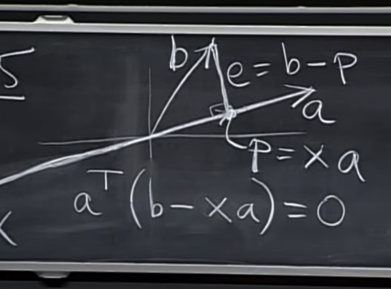</kbd>

> [!NOTE]
> Mọi thứ (cái vụ vuông góc) thể hiện qua equation này: 
>
>
>
> aᵀe = 0 ⇔ aᵀ(b-p) = 0 ⇔ aᵀ(b-xa) = 0 ⇔ aᵀ(b-xa) = 0

> [!TIP]
> 🤖 **AI Check** — 🟡 Minor issues — ✅ **95/100** · ✓ Move on
>
> Ghi chú nắm rất chính xác bản chất hình học của phép chiếu thông qua điều kiện trực giao giữa vector sai số e và vector a. Có một lỗi lặp lại nhỏ ở cuối biểu thức biến đổi.
>
> **🟡 Minor issues**
>
> **1.** *"⇔ aᵀ(b-xa) = 0 ⇔ aᵀ(b-xa) = 0"*
>
> Bước biến đổi cuối cùng bị lặp lại hai lần giống hệt nhau (lỗi gõ văn bản).
>
>
> **✓ Strengths**
> - Hiểu chính xác điều kiện trực giao a ⊥ e được biểu diễn bằng tích vô hướng aᵀe = 0.
> - Liên hệ mạch lạc giữa hình học (hình chiếu p = xa) và phương trình đại số aᵀ(b - xa) = 0.
>
> **💡 Deeper notes**
> - Từ phương trình aᵀ(b - xa) = 0, khi khai triển ta được aᵀb - x(aᵀa) = 0, suy ra x = (aᵀb)/(aᵀa) với điều kiện a ≠ 0.
> - Lưu ý x là một đại lượng vô hướng (scalar) trong không gian 1 chiều (chiếu lên một đường thẳng), trước khi mở rộng lên ma trận A trong không gian nhiều chiều.

 

###### Công thức hình chiếu vector

<kbd>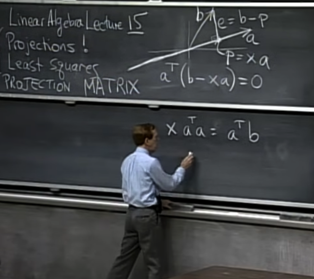</kbd>

> [!NOTE]
> triển khai ra, chuyển vế ta có thế này:
>
>
>
> aᵀ(b-xa) = 0 ⇔ aᵀb-aᵀxa = 0
>
>
>
> ⇔ aᵀb = aᵀxa = xaᵀa (vì x là scalar nên move đi đâu cũng
> được)

> [!TIP]
> 🤖 **AI Check** — 🟢 Pass — ✅ **100/100** · ✓ Move on
>
> Ghi chú rất chính xác và giải thích rõ ràng lý do có thể chuyển vị trí của đại lượng vô hướng x trong biểu thức.
>
> **✓ Strengths**
> - Hiểu đúng và khai triển chính xác điều kiện trực giao aᵀ(b - xa) = 0.
> - Nắm rõ tính chất x là một đại lượng vô hướng (scalar) nên có thể giao hoán linh hoạt trong phép nhân ma trận/vector.
>
> **💡 Deeper notes**
> - Để tìm nghiệm x = (aᵀb)/(aᵀa), cần lưu ý điều kiện a ≠ 0 để tích vô hướng aᵀa = ||a||² khác 0.

 

###### Phép chiếu vectơ

<kbd>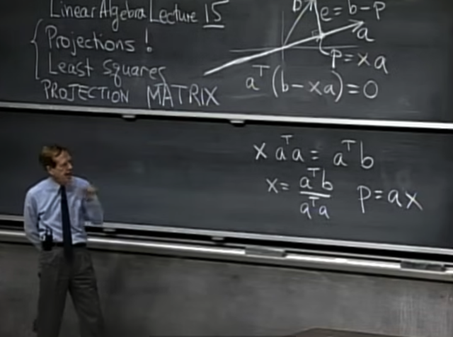</kbd>

> [!NOTE]
> và chia hai vế cho aᵀa, ta có x = aᵀb / aᵀa 
>
>
>
> Và đó là cái cần tìm khi giải bài toán tìm projection của 
> b trên a

> [!TIP]
> 🤖 **AI Check** — 🟡 Minor issues — ⚠️ **85/100** · ✓ Move on
>
> Ghi chép đã nắm đúng công thức tính hệ số vô hướng x từ bài giảng, tuy nhiên cần phân biệt rõ giữa hệ số x và vectơ hình chiếu p = ax.
>
> **🟡 Minor issues**
>
> **1.** *"Và đó là cái cần tìm khi giải bài toán tìm projection của b trên a"*
>
> Đại lượng x = aᵀb / aᵀa chỉ là hệ số vô hướng (scalar component). Vectơ hình chiếu thực sự cần tìm là p = ax. Nếu không làm rõ bước này, người học dễ nhầm lẫn hình chiếu là một số thay vì một vectơ.
>
>
> **✓ Strengths**
> - Nắm bắt chính xác bước biến đổi đại số để tìm hệ số x từ phương trình trực giao trên bảng.
>
> **💡 Deeper notes**
> - Phép chia cho aᵀa đòi hỏi điều kiện vectơ a khác vectơ không (tức aᵀa = ||a||² > 0).
> - Từ x, vectơ hình chiếu hoàn chỉnh là p = a(aᵀb / aᵀa) = (aaᵀ / aᵀa)b, dẫn đến khái niệm ma trận chiếu P = aaᵀ / aᵀa ở phần tiếp theo của bài giảng.

 

###### Tính chất hình chiếu vector

<kbd>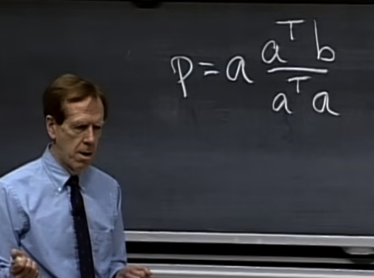</kbd>

> [!NOTE]
> thay x vào p = ax ta có p tính theo a, b như vầy.
> Gs đặt câu hỏi **gỉa sử cho b scale lên thành 2b**
> thì **projection của nó trên a sẽ ra sao**. 
>
>
>
> Thử trả lời: sẽ scale lên **thành 2p**

> [!TIP]
> 🤖 **AI Check** — 🟢 Pass — ✅ **100/100** · ✓ Move on
>
> Ghi chú rất chính xác và trả lời đúng câu hỏi tư duy của giáo sư: phép chiếu tuyến tính đối với vector b nên khi b gấp đôi thì hình chiếu p cũng gấp đôi.
>
> **✓ Strengths**
> - Hiểu đúng bản chất tuyến tính của phép chiếu đối với vector được chiếu (b -> 2b dẫn đến p -> 2p).
>
> **💡 Deeper notes**
> - Một câu hỏi phụ đi kèm rất quan trọng của GS Strang: nếu scale vector đích a lên thành 2a thì hình chiếu p sẽ không đổi, vì a xuất hiện ở cả tử số và mẫu số (bậc hai) nên tự triệt tiêu, phản ánh đúng tính chất hình chiếu chỉ phụ thuộc vào phương của đường thẳng.

 

###### Công thức hình chiếu vector

<kbd>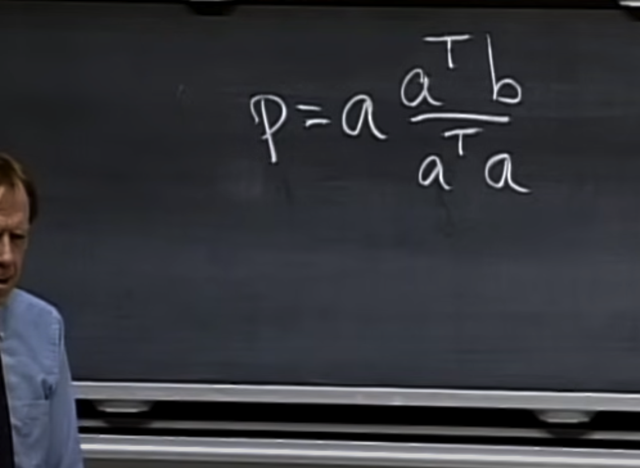</kbd>

> [!NOTE]
> gs: Correct. Thế nếu double a lên?
>
>
>
> Thì nó không thay đổi gì. Như công thức có thể thấy a
> thành 2a thì cả tử và mẫu cũng đều x4, và nó sẽ
> cancel nhau nên p không thay đổi gì

> [!TIP]
> 🤖 **AI Check** — 🟢 Pass — ✅ **100/100** · ✓ Move on
>
> Ghi chú hoàn toàn chính xác cả về mặt đại số lẫn ý nghĩa hình học của phép chiếu.
>
> **✓ Strengths**
> - Nắm rõ tính chất bất biến theo tỷ lệ (scale-invariance) của phép chiếu lên đường thẳng tạo bởi vector a.
> - Lập luận đại số chính xác khi nhận thấy cả tử và mẫu (khi gộp vector a ngoài cùng vào tử) đều là bậc 2 đối với a, nên đều nhân 4 và triệt tiêu nhau.
>
> **💡 Deeper notes**
> - Về mặt hình học, vector a chỉ đóng vai trò xác định phương của đường thẳng (không gian con một chiều), do đó thay đổi độ dài của a không làm thay đổi đường thẳng và giữ nguyên hình chiếu p.

 

###### Ma trận hình chiếu

<kbd>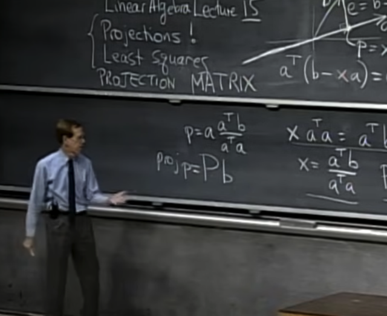</kbd>

> [!NOTE]
> thế thì gs cho biết ta có thể **biểu diễn phép projection bởi
> một matrix**, gọi nó là **Projection matrix P**, và **thông qua
> nó ta sẽ tìm được projection của vector b**

> [!TIP]
> 🤖 **AI Check** — 🟢 Pass — ✅ **100/100** · ✓ Move on
>
> Ghi chú tóm tắt rất chính xác ý tưởng cốt lõi của bài giảng: biểu diễn phép chiếu hình học dưới dạng một toán tử tuyến tính thông qua ma trận chiếu P tác động lên vector b (p = Pb).
>
> **✓ Strengths**
> - Nắm bắt chính xác vai trò và bản chất của ma trận chiếu P trong việc tìm hình chiếu của vector b.
>
> **💡 Deeper notes**
> - Trong trường hợp chiếu lên đường thẳng (subspace 1 chiều sinh bởi vector a), ma trận chiếu có dạng cụ thể là P = (a a^T) / (a^T a).

 

###### Ma trận chiếu P

<kbd>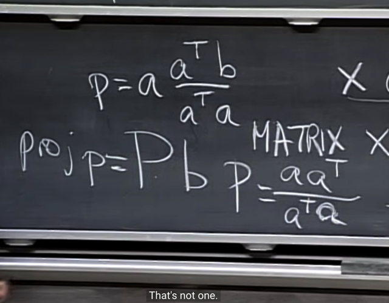</kbd>

> [!NOTE]
> Và **aaᵀ/aᵀa chính là matrix P**, mẫu số là một
> **scalar** (dot product của a với chính nó) và **aaᵀ
> là một cols x một row** → như ta đã biết nó là
> một **RANK 1 MATRIX**

> [!TIP]
> 🤖 **AI Check** — 🟢 Pass — ✅ **98/100** · ✓ Move on
>
> Ghi chú nắm rất chắc bản chất đại số tuyến tính: phân biệt rõ scalar ở mẫu số và tích ngoài tạo ma trận hạng 1 ở tử số để hình thành ma trận chiếu P.
>
> **✓ Strengths**
> - Hiểu chính xác công thức ma trận chiếu P = aaᵀ / aᵀa và phân biệt rõ mẫu số là scalar còn tử số là ma trận.
> - Nhận diện chính xác tích giữa vector cột và vector hàng (outer product) tạo ra ma trận có hạng bằng 1 (rank 1 matrix).
>
> **💡 Deeper notes**
> - Điều kiện cần là vector a khác 0 (a ≠ 0) để mẫu số vô hướng aᵀa > 0 và ma trận chiếu xác định.
> - Ma trận chiếu P = aaᵀ / aᵀa này luôn có hai tính chất nền tảng: đối xứng (Pᵀ = P) và lũy đẳng (P² = P).

 

###### Không gian cột của P

<kbd>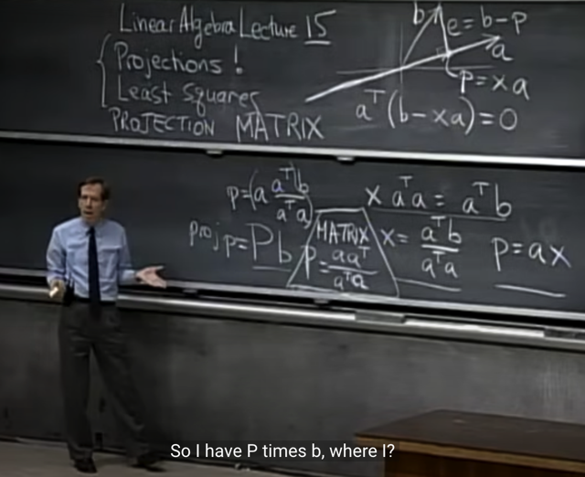</kbd>

> [!NOTE]
> Ở đây gs cho biết m**ột điểm tuy dễ hiểu** nhưng kiểu như
> ta **có thể chưa để ý tới** đó là **column space của matrix
> P** sẽ là **subspace** mà khi ta n**hân P với một vector nào
> đó**, **kết quả sẽ luôn nằm trong columns space của P.** Và
> đương nhiên không chỉ Projection matrix P mà là bất kì
> matrix nào
>
>
>
> Điều này dễ hiểu, vì khi **nhân matrix A với vector u** nào đó
> thì kết quả đương nhiên là một **linear combination các cols
> của A** , và nó **sẽ là một vector thuộc columns space**.
>
>
>
> Vậy gs hỏi rằng **columns space của P là gì**, hay nói cách
> khác, khi tôi n**hân P với vector b thì kết quả ở đâu?**
>
>
>
> → matrix **P là rank 1 matrix**, có **cols space với dim = 1**,
> và vector a chính là vector duy nhất trong basis. Nên **cols
> space của P chính là line đi qua vector a**. Nên kết quả của
> **Pb sẽ vẫn nằm trên line này**

> [!TIP]
> 🤖 **AI Check** — 🟢 Pass — ✅ **98/100** · ✓ Move on
>
> Ghi chú rất chính xác, hiểu sâu sắc bản chất đại số tuyến tính về không gian cột (column space) của ma trận chiếu P và tích ma trận - vector.
>
> **✓ Strengths**
> - Nắm rất vững định nghĩa cơ bản: kết quả nhân ma trận với một vector luôn là tổ hợp tuyến tính các cột và nằm trong column space của ma trận đó.
> - Hiểu rõ ma trận chiếu lên đường thẳng (vector a) có rank bằng 1 và column space chính là đường thẳng sinh bởi vector a.
>
> **💡 Deeper notes**
> - Tính chất ma trận P có rank = 1 và basis là {a} ngầm định điều kiện vector a khác 0 (non-zero vector).
> - Một tính chất quan trọng khác của ma trận chiếu P là tính lũy đẳng (P^2 = P) và đối xứng (P^T = P), giải thích tại sao chiếu hai lần lên cùng một đường thẳng thì kết quả không đổi.

**🔗 See also:** [Dạng ma trận Aᵀ(b-Âx)=0](#node-5su5cq6)

 

###### Hạng của ma trận chiếu

<kbd>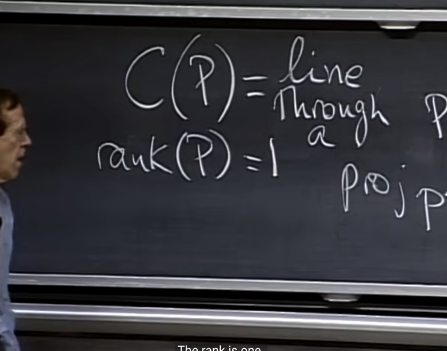</kbd>

> [!NOTE]
> Gs: Đúng vậy

> [!TIP]
> 🤖 **AI Check** — 🔴 Critical issues — ❌ **0/100** · ✗ Fix first
>
> Ghi chú không chứa bất kỳ nội dung toán học hay kiến thức nào từ bài giảng (về ma trận hình chiếu P, không gian cột C(P) và hạng rank(P) = 1). Bạn cần ghi lại kiến thức trọng tâm thay vì chỉ ghi một câu cảm thán/đồng ý.
>
> **🔴 Critical issues**
>
> **1.** *"Gs: Đúng vậy"*
>
> Ghi chú hoàn toàn thiếu nội dung bài học. Bảng thể hiện tính chất của ma trận chiếu lên một đường thẳng qua vector a: C(P) là đường thẳng đi qua a và rank(P) = 1, nhưng ghi chú không ghi nhận bất kỳ khái niệm hay công thức nào.
>
>
> **💡 Deeper notes**
> - Khi chiếu một vector lên một đường thẳng (span{a}), không gian cột C(P) là không gian 1 chiều sinh bởi a, do đó hạng của ma trận hình chiếu rank(P) luôn bằng 1.

 

###### Projection Matrix Column Space

<kbd></kbd>

> [!NOTE]
> Tiếp gs cho rằng rất tự nhiên để hỏi tiếp **matrix này có
> symmetric không?**
>
>
>
> Có, vì Pᵀ = **(aaᵀ/aᵀa)ᵀ** = (aaᵀ)ᵀ/(aᵀa) = aᵀᵀaᵀ/aᵀa 
>
>
>
> = **aaᵀ/aᵀa** = P
>
>
>
> ⇒ tức là vẫn transpose bằng chính nó, nên nó mà 
> **symmetric** matrix

> [!TIP]
> 🤖 **AI Check** — 🟢 Pass — ✅ **100/100** · ✓ Move on
>
> Ghi chú rất chính xác và logic, bạn đã chứng minh tính đối xứng của ma trận hình chiếu P một cách rõ ràng qua các bước chuyển vị chuẩn xác.
>
> **✓ Strengths**
> - Áp dụng chính xác quy tắc chuyển vị của tích hai ma trận (AB)ᵀ = BᵀAᵀ.
> - Kết luận đúng bản chất ma trận hình chiếu 1 chiều luôn là ma trận đối xứng (Pᵀ = P).
>
> **💡 Deeper notes**
> - Ở bước mẫu số giữ nguyên (aᵀa), về mặt bản chất đây là một số vô hướng (scalar, tích vô hướng của a với chính nó), do đó chuyển vị của nó bằng chính nó.

 

###### Projection onto a Line

<kbd>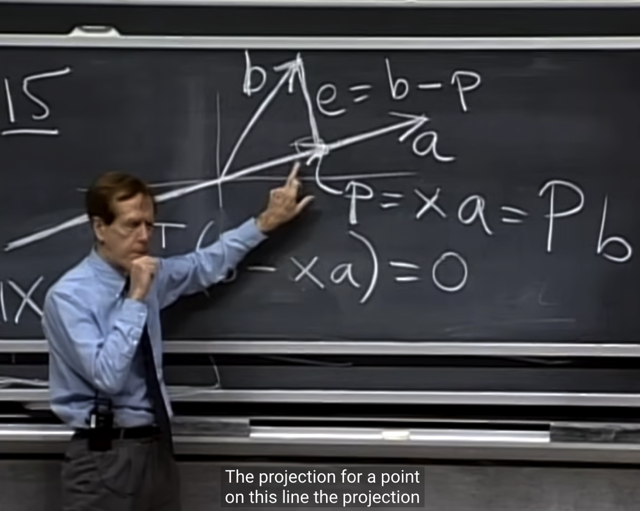</kbd>

> [!NOTE]
> Gs hỏi tiếp nếu ta **project lần thứ hai** thì ta sẽ có gì.
>
>
>
> \-&gt; Rõ ràng ta **sẽ vẫn ở đó**. Vậy là PP = P

> [!TIP]
> 🤖 **AI Check** — 🟢 Pass — ✅ **100/100** · ✓ Move on
>
> Ghi chú rất chính xác và nắm trọn vẹn bản chất hình học của tính chất lũy đẳng (idempotent) của ma trận hình chiếu: P² = P.
>
> **✓ Strengths**
> - Hiểu đúng trực quan hình học: khi một điểm đã nằm trên đường thẳng/không gian con thì phép chiếu tiếp tục sẽ giữ nguyên điểm đó, dẫn đến P² = P.
>
> **💡 Deeper notes**
> - Tính chất P² = P là điều kiện cần và đủ cho một ma trận hình chiếu (projection matrix); nếu là hình chiếu trực giao (orthogonal projection) như trong bài giảng thì P còn có thêm tính chất đối xứng Pᵀ = P.

 

###### Properties of Projection Matrices

<kbd>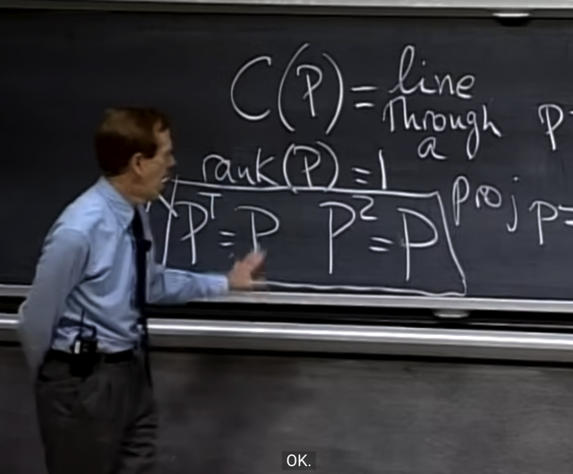</kbd>

<kbd>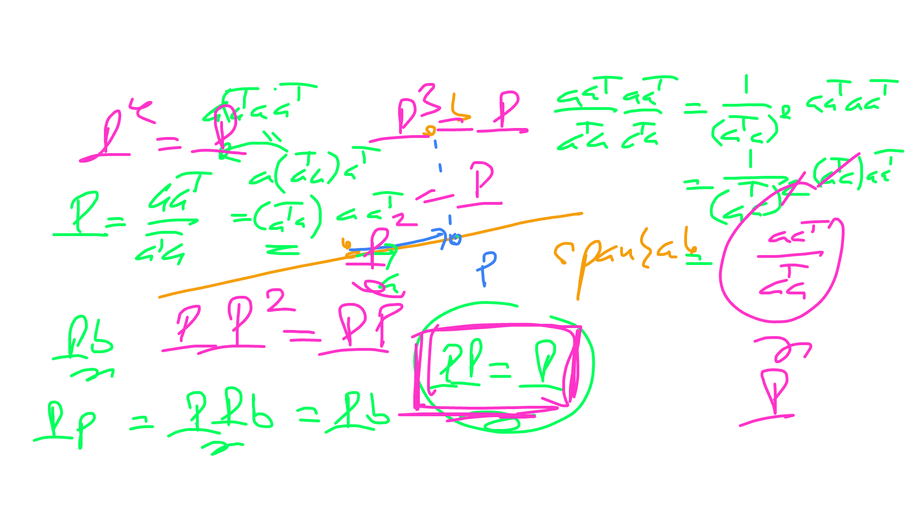</kbd>

> [!NOTE]
> Từ đó ta có hai tính chất của matrix P: Pᵀ = P và P² = P

> [!TIP]
> 🤖 **AI Check** — 🟢 Pass — ✅ **100/100** · ✓ Move on
>
> Ghi chú hoàn toàn chính xác khi nắm bắt hai tính chất đặc trưng cơ bản nhất của ma trận hình chiếu P: tính đối xứng (Pᵀ = P) và tính lũy đẳng (P² = P).
>
> **✓ Strengths**
> - Ghi chép chính xác hai tính chất cốt lõi của ma trận hình chiếu trực giao từ bài giảng.
>
> **💡 Deeper notes**
> - Tính chất P² = P (lũy đẳng) đúng với mọi ma trận chiếu nói chung, trong khi tính chất Pᵀ = P (đối xứng) là điều kiện cần và đủ để phép chiếu đó là hình chiếu trực giao (orthogonal projection).

 

###### Lý do sử dụng Projection

<kbd>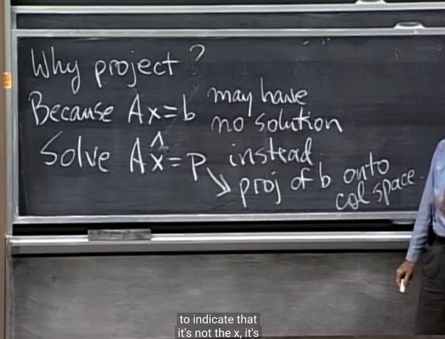</kbd>

> [!NOTE]
> Tiếp gs nói về **lí do** mà ta muốn **nghiên cứu về
> Projection**
>
>
>
> Đó là vì ở đầu bài ta đã nói là ta đang **deal với một
> equation system Ax=b** mà trong đó **khả năng cao là
> KHÔNG CÓ SOLUTION**, vì lí do có thể như ta có matrix A
> là matrix CAO, ỐM (khi trong các bài toán thực tế ta có
> nhiều sample hơn feature, nhiều equation hơn là số
> variable)
>
>
>
> Và matrix CAO, ỐM dẫn đến là **không đủ số cols (n) để
> span được toàn bộ không gian Rᵐ**. Nên luôn có thể **có
> b nằm ngoài cols space** khiến Ax=b vô nghiệm
>
>
>
> Thành ra để giải quyết, ta có thể **GIẢI MỘT BÀI TOÁN
> KHÁC GẦN VỚI BÀI TOÁN GỐC: Ax̂ = p**, với p là b
> project lên Cols space của A C(A). Và điều này cũng có
> nghĩa là p **CHẮC CHẮN NẰM TRONG C(A) ĐỂ TỪ ĐÓ
> Ax̂ = p CHẮC CHẮN SOLVABLE**
>
>
>
> Kí hiệu x̂ để ám chỉ solution này là của bài toán gần với
> bài toán gốc

📹 Video 1: [Vì sao phải dùng phép chiếu khi hệ Ax = b vô nghiệm?](https://www.youtube.com/watch?v=WAwC0dYKEDs)

📹 Video 2: [Làm sao tìm ma trận chiếu lên không gian cột C(A)? (phần 3)](https://www.youtube.com/watch?v=GaugfLdPv3I)

> [!TIP]
> 🤖 **AI Check** — 🟢 Pass — ✅ **98/100** · ✓ Move on
>
> Ghi chú giải thích rất chính xác và trực quan bản chất hình học vì sao cần dùng phép chiếu khi hệ phương trình Ax=b vô nghiệm.
>
> **✓ Strengths**
> - Nắm rất vững trực giác hình học: ma trận cao và ốm (m > n) thì số cột không đủ span toàn bộ R^m, khiến vector b dễ rơi ra ngoài C(A).
> - Hiểu chuẩn xác mục đích của hình chiếu: đưa b về p thuộc C(A) để hệ phương trình Ax̂ = p chắc chắn có nghiệm.
>
> **💡 Deeper notes**
> - Hệ Ax̂ = p luôn đảm bảo có nghiệm vì p ∈ C(A), tuy nhiên nghiệm x̂ chỉ là duy nhất nếu các cột của A độc lập tuyến tính (rank(A) = n).

 

###### Phép chiếu lên mặt phẳng

<kbd>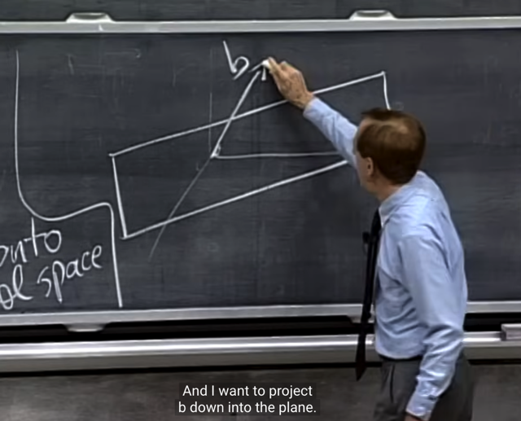</kbd>

<kbd>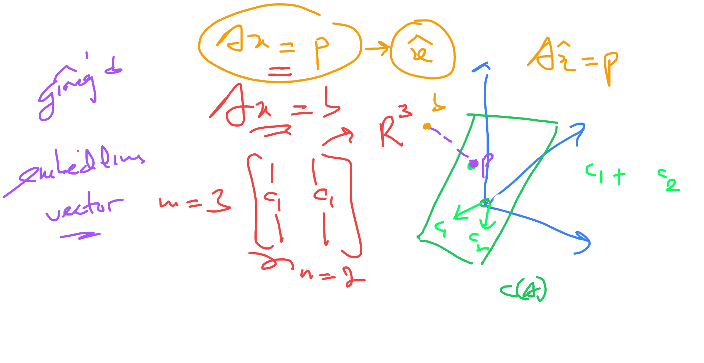</kbd>

> [!NOTE]
> Nhân tiện gs cũng đang **move từ 1D subspace**, project
> b lên line qua vector a hồi nãy sang **higher dimension**
> subspace - **a plane**

> [!TIP]
> 🤖 **AI Check** — 🟢 Pass — ✅ **100/100** · ✓ Move on
>
> Ghi chú nắm rất chuẩn xác ngữ cảnh bài giảng: chuyển từ bài toán chiếu lên không gian 1 chiều (đường thẳng đi qua vector a) sang không gian nhiều chiều hơn (mặt phẳng / column space).
>
> **✓ Strengths**
> - Nhận diện chính xác bước chuyển tiếp sư phạm của giáo sư từ phép chiếu 1D lên không gian con nhiều chiều hơn (2D/mặt phẳng).
>
> **💡 Deeper notes**
> - Mặt phẳng mà giáo sư đang vẽ trên bảng minh họa cho không gian cột (column space) của ma trận A (như dòng chữ 'onto col space' ở góc trái).

 

###### Hình chiếu lên mặt phẳng

<kbd>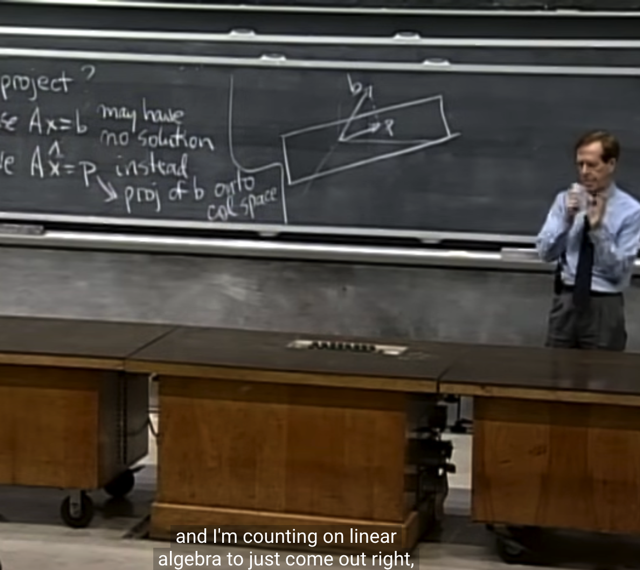</kbd>

> [!NOTE]
> Và ta cũng sẽ đi **tìm projection
> của b lên plane này**

> [!TIP]
> 🤖 **AI Check** — 🟢 Pass — ✅ **95/100** · ✓ Move on
>
> Ghi chú ngắn gọn và nắm đúng ý tưởng chính của bài giảng: khi hệ $Ax = b$ vô nghiệm, ta tìm hình chiếu $p$ của vector $b$ lên không gian cột (thể hiện bằng mặt phẳng trong hình vẽ).
>
> **✓ Strengths**
> - Nhận diện chính xác mục tiêu hình học được vẽ và trình bày trên bảng: chiếu vector b xuống mặt phẳng để tìm p.
>
> **💡 Deeper notes**
> - "Mặt phẳng này" trên bảng vẽ chính là không gian cột (column space) $C(A)$ của ma trận $A$, và hình chiếu $p$ sẽ thỏa mãn phương trình $A\hat{x} = p$ luôn có nghiệm.

 

###### Mặt phẳng và Column Space

<kbd>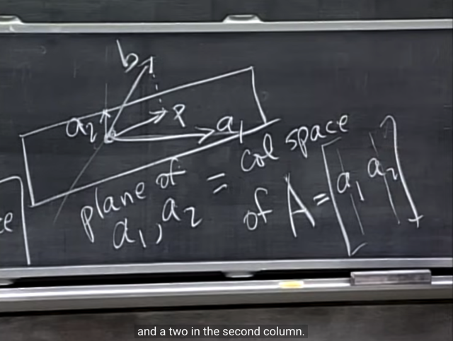</kbd>

> [!NOTE]
> Thế thì đầu tiên gs đề nghị ta **định nghĩa plane**. Thì ta đã biết, một plane, cụ thể hơn trong ví dụ đang là 2D plane trong R³ Thì nó là **2D subspace của R³** thì nó sẽ có 2 basis vector (hay nói đúng hơn là **cần 2 vector độc lập để có một basi**s của subspace này). Ta gọi nó là {a1, a2}
>
>
>
> Gs cũng cho biết **a1 a2 không nhất thiết vuông góc nhau**, vì có vô số basis - và như ta còn nhớ **miễn là chúng là hai vector độc lập** (khác phương) là đủ thành basis rồi.
>
>
>
> Và plane này là columns space của matrix A. **Đồng nghĩa a1, a2 là basis của C(A)** - và ta xài luôn **hai cols của A luôn** vì ta đang coi như có hai column độc lập (để C(A) là một plane)
>
>
>
> Còn b thì không nằm trong columns space
>
>
>
> #lec15

> [!TIP]
> 🤖 **AI Check** — 🟢 Pass — ✅ **100/100** · ✓ Move on
>
> Ghi chú nắm rất chắc và chính xác bản chất hình học của không gian con: mặt phẳng đi qua gốc toạ độ là không gian cột C(A) sinh bởi hai vector độc lập tuyến tính a1, a2, và b nằm ngoài mặt phẳng.
>
> **✓ Strengths**
> - Hiểu chính xác điều kiện để 2 vector tạo thành cơ sở của mặt phẳng (chỉ cần độc lập tuyến tính, không bắt buộc trực giao).
> - Kết nối tốt giữa biểu diễn hình học (mặt phẳng trong R3) và đại số tuyến tính (không gian cột C(A) của ma trận A = [a1 a2]).
> - Nhận diện đúng thiết lập bài toán hình chiếu khi b không thuộc không gian cột.
>
> **💡 Deeper notes**
> - Việc giả định a1, a2 độc lập tuyến tính (A có full column rank) là điều kiện then chốt để ma trận A^T A khả nghịch, phục vụ cho việc suy ra công thức hình chiếu p = A(A^T A)^(-1) A^T b ở các bước tiếp theo.

 

###### Phép chiếu vector lên C(A)

<kbd></kbd>

> [!NOTE]
> Gs nói n**ếu b nằm trong C(A) thì khỏe rồ**i,
> **projection của b lên A sẽ chỉ là chính nó**

> [!TIP]
> 🤖 **AI Check** — 🟡 Minor issues — ✅ **95/100** · ✓ Move on
>
> Ghi chú nắm rất chính xác ý cốt lõi của bài giảng: khi vector b đã thuộc không gian cột của ma trận thì hình chiếu của nó chính là chính nó (sai số triệt tiêu).
>
> **🟡 Minor issues**
>
> **1.** *"projection của b lên A"*
>
> Về mặt thuật ngữ chuẩn, phép chiếu là chiếu lên một không gian con (subspace), cụ thể ở đây là không gian cột C(A) của ma trận A, chứ không phải chiếu lên bản thân ma trận A.
>
>
> **✓ Strengths**
> - Nắm bắt chính xác trực giác hình học của phép chiếu: nếu vector đã nằm sẵn trong không gian con thì hình chiếu p bằng chính nó (p = b) và sai số e = 0.
>
> **💡 Deeper notes**
> - Khi b nằm trong C(A), hệ phương trình Ax = b có nghiệm chính xác, do đó ma trận chiếu P tác động lên b sẽ giữ nguyên b: Pb = A(A^T A)^(-1) A^T b = b.

 

###### Vectơ sai số trực giao

<kbd>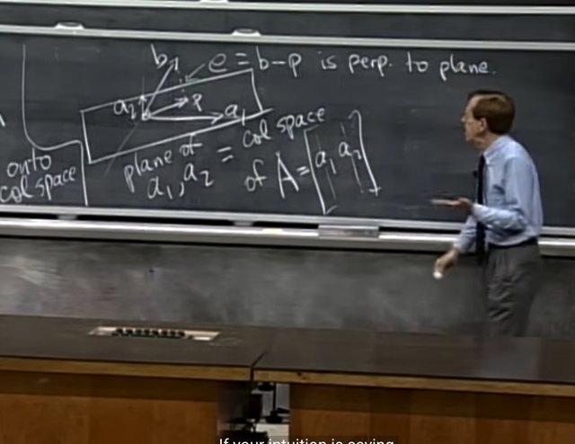</kbd>

> [!NOTE]
> Nhưng **b không nằm trong C(A)**, nên ta **gọi e là b - p, (||e|| là khoảng cách từ) từ b với p**. Xong gs cho rằng, từ trực giác ta có **e = b-p sẽ perpendicular với plane**
>
>
>
> (giống như e perpendicular với line a hồi nãy)

> [!TIP]
> 🤖 **AI Check** — 🟢 Pass — ✅ **100/100** · ✓ Move on
>
> Ghi chú tóm tắt rất chính xác trực giác hình học: khi b không nằm trong không gian cột C(A), vector sai số e = b - p sẽ vuông góc với mặt phẳng C(A), mở rộng tự nhiên từ trường hợp chiếu lên một đường thẳng.
>
> **✓ Strengths**
> - Hiểu đúng bản chất vector sai số e = b - p và độ dài ||e|| là khoảng cách từ b đến hình chiếu p.
> - Nắm bắt chính xác trực giác hình học mở rộng từ phép chiếu lên đường thẳng sang phép chiếu lên mặt phẳng (không gian con).
>
> **💡 Deeper notes**
> - Điều kiện e vuông góc với toàn bộ mặt phẳng C(A) về mặt đại số tương đương với việc e vuông góc với từng vector sinh ra mặt phẳng đó, tức là a_1^T e = 0 và a_2^T e = 0 (hay A^T (b - p) = 0).

 

###### Projection Vector Formula

<kbd>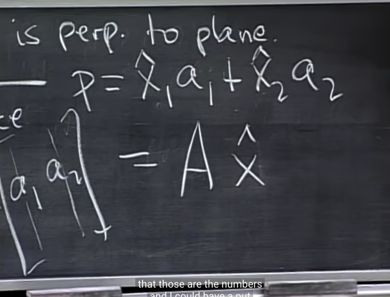</kbd>

> [!NOTE]
> Thế thì như đã nói p là projection của b trên C(A) nên p thuộc column space thành ra chắc chắn nó là một linear combination của hai basis vector a1, a2.
>
>
>
> Và 2 coefficient trong linear combination này CHÍNH LÀ x̂: \[x̂1, x̂2\]
>
>
>
> p = x̂1 a1 +x̂2 a2 hay ghi thế này cũng được p = Ax̂

> [!TIP]
> 🤖 **AI Check** — 🟢 Pass — ✅ **100/100** · ✓ Move on
>
> Ghi chú rất chuẩn xác và nắm vững bản chất hình học cũng như đại số tuyến tính: vector hình chiếu p nằm trong không gian cột C(A) nên biểu diễn được dưới dạng tổ hợp tuyến tính p = Ax̂.
>
> **✓ Strengths**
> - Hiểu chính xác bản chất vector hình chiếu p thuộc C(A) nên biểu diễn được qua tổ hợp tuyến tính của các cột của A.
> - Chuyển đổi mượt mà và chính xác giữa dạng tổ hợp tuyến tính x̂₁a₁ + x̂₂a₂ và dạng ma trận nhân vector Ax̂.
>
> **💡 Deeper notes**
> - Để a₁ và a₂ là 'basis vector' (cơ sở) như bạn ghi chú, giả định ngầm ở đây là hai cột a₁ và a₂ phải độc lập tuyến tính (đây cũng là điều kiện chuẩn trong bài giảng để ma trận AᵀA khả nghịch khi tìm x̂).

 

###### Hình chiếu lên C(A)

<kbd>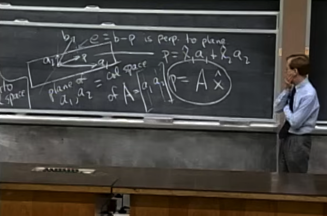</kbd>

> [!NOTE]
> Và từ đó cho ta định nghĩa của problem ta đang gỉải quyết:
>
>
>
> Việc tìm projection của b trên C(A) sẽ là TÌM x̂ SAO CHO e = b-p VUÔNG GÓC VỚI C(A)

> [!TIP]
> 🤖 **AI Check** — 🟢 Pass — ✅ **100/100** · ✓ Move on
>
> Ghi chú tóm tắt rất chính xác bản chất hình học và mục tiêu đại số của bài toán tìm hình chiếu lên không gian cột.
>
> **✓ Strengths**
> - Nắm bắt chính xác bản chất bài toán: tìm vector hệ số x̂ sao cho vector sai số e = b - p vuông góc với toàn bộ không gian cột C(A).
>
> **💡 Deeper notes**
> - Để vector sai số e vuông góc với toàn bộ không gian cột C(A), điều kiện tương đương thuận tiện cho việc tính toán là e phải vuông góc với từng vector cơ sở/cột a_i của A, dẫn đến hệ phương trình chuẩn A^T (b - A x̂) = 0.

 

###### Bài toán hình chiếu vuông góc

<kbd>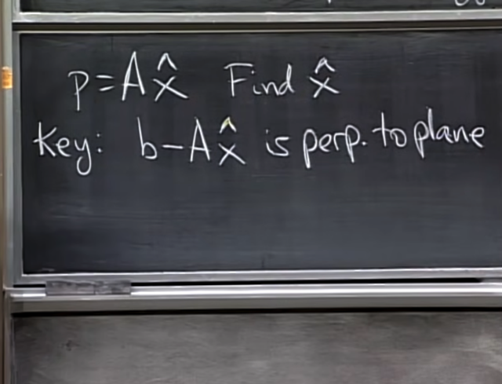</kbd>

> [!NOTE]
> Viết lại bài toán đặt ra: tìm x̂ sao cho e = b-p = b-Ax̂ vuông góc với plane C(A)

> [!TIP]
> 🤖 **AI Check** — 🟢 Pass — ✅ **100/100** · ✓ Move on
>
> Ghi chú tóm tắt rất chính xác bản chất bài toán tìm hình chiếu trên bảng, đồng thời làm rõ được mặt phẳng ở đây chính là không gian cột C(A).
>
> **✓ Strengths**
> - Xác định đúng mục tiêu cốt lõi: tìm vector x̂ sao cho vector sai số e = b - Ax̂ vuông góc với mặt phẳng.
> - Bổ sung chính xác hiểu biết rằng 'plane' trên bảng biểu diễn cho không gian cột C(A) của ma trận A.
>
> **💡 Deeper notes**
> - Về mặt đại số tuyến tính, điều kiện trực giao e ⊥ C(A) sẽ dẫn trực tiếp đến phương trình chuẩn (normal equation): A^T(b - Ax̂) = 0, tức A^T A x̂ = A^T b.

 

###### Trực giao của vector e

<kbd>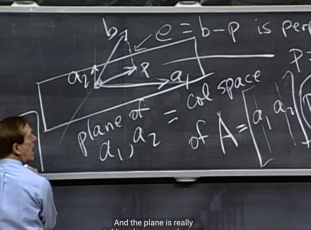</kbd>

<kbd>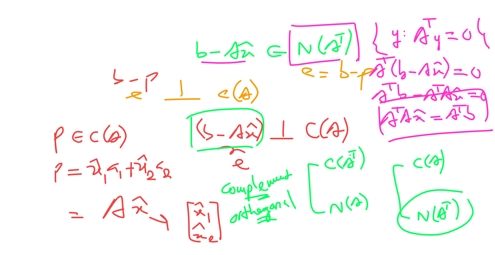</kbd>

> [!NOTE]
> Thế thì e vuông góc với plane thì cũng có nghĩa là nó vuông vóc với mọi vector trong plane (lưu ý plane này là plane của một subspace, nó có đi qua gốc O)
>
>
>
> Như vậy e cũng vuông góc với vector a1, và a2

> [!TIP]
> 🤖 **AI Check** — 🟢 Pass — ✅ **100/100** · ✓ Move on
>
> Ghi chú rất chính xác và nắm trọn vẹn bản chất hình học của phép chiếu: vector sai số e vuông góc với không gian con thì sẽ vuông góc với mọi vector trong đó, bao gồm các vector cơ sở a1 và a2.
>
> **✓ Strengths**
> - Hiểu chính xác định nghĩa trực giao giữa một vector và một không gian con (subspace).
> - Nhận diện đúng điều kiện tiên quyết rằng mặt phẳng này là một không gian con (đi qua gốc tọa độ O).
> - Suy luận chính xác rằng e trực giao với hai vector cơ sở/cột a1 và a2, đây là nền tảng để thiết lập phương trình A^T * e = 0.
>
> **💡 Deeper notes**
> - Về mặt đại số, việc e vuông góc với cả a1 và a2 tương đương với hệ a1^T * e = 0 và a2^T * e = 0, hay viết gọn dưới dạng ma trận là A^T * e = 0 (tức là e nằm trong không gian hạch trái N(A^T)).
> - Có một lỗi chính tả nhỏ gõ nhầm ('vuông vóc' thay vì 'vuông góc') nhưng không ảnh hưởng đến việc hiểu bản chất toán học.

 

###### Điều kiện trực giao phép chiếu

<kbd>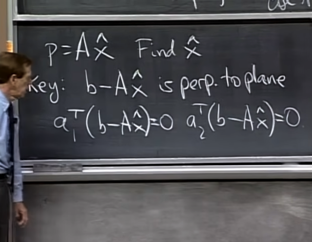</kbd>

> [!NOTE]
> Từ đó ta có dot product của e và a1, a2 bằng 0

> [!TIP]
> 🤖 **AI Check** — 🟢 Pass — ✅ **100/100** · ✓ Move on
>
> Ghi chú hoàn toàn chính xác, nắm đúng bản chất hình học rằng vector sai số e vuông góc với mặt phẳng nên tích vô hướng của nó với các vector cơ sở a1, a2 đều bằng 0.
>
> **✓ Strengths**
> - Nhận diện chính xác vector sai số e = b - A x_hat trực giao với các vector cột a1, a2 của ma trận A.
> - Hiểu đúng bản chất của phương trình a_i^T (b - A x_hat) = 0 chính là phép tính tích vô hướng (dot product) bằng 0.
>
> **💡 Deeper notes**
> - Hai phương trình vô hướng a1^T e = 0 và a2^T e = 0 có thể được ghép gọn gàng thành phương trình ma trận A^T e = A^T (b - A x_hat) = 0, dẫn tới phương trình chuẩn tắc (Normal Equations).

 

###### Dạng ma trận Aᵀ(b-Âx)=0

<kbd>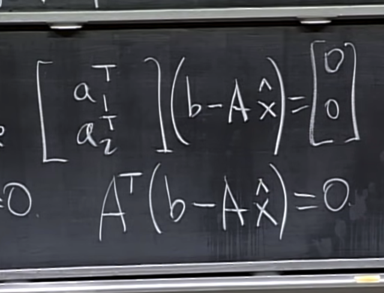</kbd>

> [!NOTE]
> Xong gs muốn thể hiện hai equation trên dưới dạng matrix
>
>
>
> a1ᵀ và a2ᵀ - tức là transpose hai columns của A, đương nhiên sẽ có matrix Aᵀ, ta có:
>
>
>
> Aᵀ(b-Ax̂) = 𝟎
>
>
>
> để ý rằng hồi nãy, equation ta có là aᵀe = aᵀ(b-Ax̂) = 0 còn bây giờ ta có hai vector a1 a2 basis của C(A) nên ta có : 
>
>
>
> Aᵀ(b-Ax̂) = 0

> [!TIP]
> 🤖 **AI Check** — 🟡 Minor issues — ✅ **95/100** · ✓ Move on
>
> Ghi chú nắm rất chính xác bản chất việc ghép các phương trình trực giao thành dạng ma trận Aᵀ(b - Ax̂) = 0 và liên hệ tốt với trường hợp 1 chiều trước đó.
>
> **🟡 Minor issues**
>
> **1.** *"Aᵀ(b-Ax̂) = 0"*
>
> Vế phải ở đây là vector không (zero vector) có kích thước 2x1 tương ứng với [0; 0], chứ không phải là scalar 0 đơn thuần.
>
>
> **✓ Strengths**
> - Hiểu đúng cách xây dựng ma trận Aᵀ từ việc chuyển vị các vector cột của A thành các hàng.
> - Liên hệ mạch lạc giữa trường hợp hình chiếu lên một đường thẳng (aᵀe = 0) và hình chiếu lên không gian nhiều chiều C(A).
>
> **💡 Deeper notes**
> - Để suy ra nghiệm duy nhất x̂ = (AᵀA)⁻¹Aᵀb ở bước tiếp theo, các vector cột a1, a2 cần độc lập tuyến tính để ma trận AᵀA khả nghịch.

**🔗 See also:** [Không gian cột của P](#node-u1oddq3)

 

###### Projection onto Column Space

<kbd>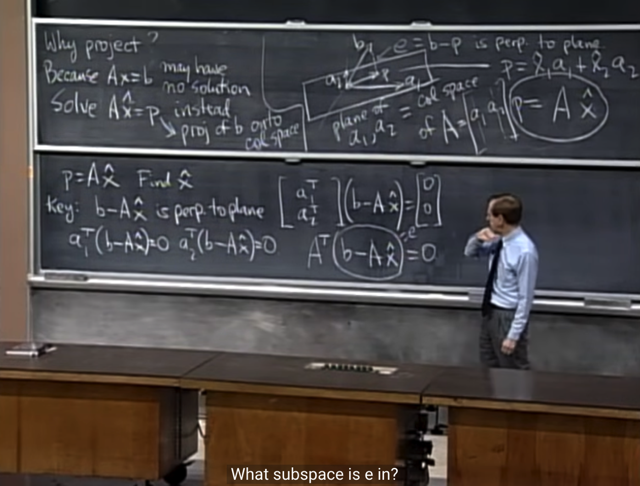</kbd>

> [!NOTE]
> tiếp, gs đề nghị ta, vì bây giờ đã biết về 4 subspace, thì ta hãy đưa nó vào đây.
>
>
>
> đầu tiên đó là, trong aᵀ(b-ax̂) = 0, thì e=b-ax̂ connect với subspace nào?
>
>
>
> Thử trả lời: đương nhiên vì e là solution của aᵀy=0 nên nó chính là nằm trong nullspace của aᵀ, hay còn gọi là left nullspace của a

> [!TIP]
> 🤖 **AI Check** — 🟢 Pass — ✅ **100/100** · ✓ Move on
>
> Ghi chú hoàn toàn chính xác và trả lời đúng trọng tâm câu hỏi trên bảng: vector sai số e nằm trong nullspace của Aᵀ (left nullspace của A) vì thỏa mãn Aᵀe = 0.
>
> **✓ Strengths**
> - Xác định chính xác e thuộc không gian nghiệm N(Aᵀ) (left nullspace của A) từ phương trình chuẩn Aᵀ(b - Ax̂) = 0.
>
> **💡 Deeper notes**
> - Điều này cũng hoàn toàn nhất quán với tính chất hình học: e vuông góc với không gian cột C(A), mà định lý cơ bản của đại số tuyến tính khẳng định N(Aᵀ) chính là phần bù trực giao (orthogonal complement) của C(A).

 

###### Trực giao N(Aᵀ) và C(A)

<kbd>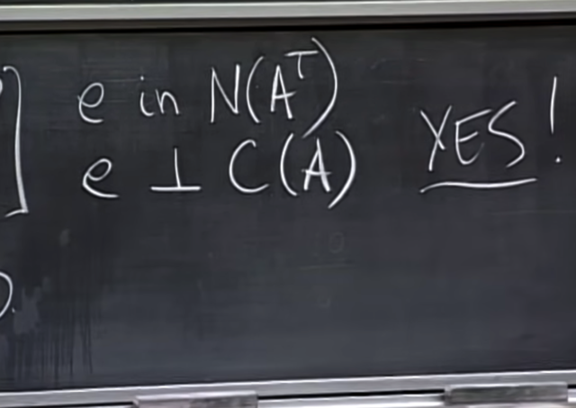</kbd>

> [!NOTE]
> Tiếp equation Aᵀe = 0 có nghĩa là **e nằm trong nullspace
> của Aᵀ**, và vì vậy **nó sẽ vuông góc với columns space
> của A** vì bài trước ta đã biết các **cặp subspace
> orthogonal** là (nullspace of A và rowspace of A),
> (nullspace of Aᵀ và columspace of A)

> [!TIP]
> 🤖 **AI Check** — 🟢 Pass — ✅ **98/100** · ✓ Move on
>
> Ghi chú rất chính xác và mạch lạc, giải thích rõ mối liên hệ giữa phương trình Aᵀe = 0, không gian hạt nhân bên trái N(Aᵀ) và tính trực giao với không gian cột C(A).
>
> **✓ Strengths**
> - Hiểu đúng bản chất đại số tuyến tính: Aᵀe = 0 đồng nghĩa với việc e nằm trong nullspace của Aᵀ.
> - Liên kết chính xác tính chất trực giao giữa các cặp không gian con cơ bản: N(Aᵀ) ⊥ C(A) và N(A) ⊥ C(Aᵀ).
>
> **💡 Deeper notes**
> - Cụ thể và chặt chẽ hơn, N(Aᵀ) và C(A) không chỉ trực giao mà còn là phần bù trực giao của nhau (orthogonal complements) trong không gian vector ℝᵐ.

 

###### Phương trình pháp tuyến

<kbd>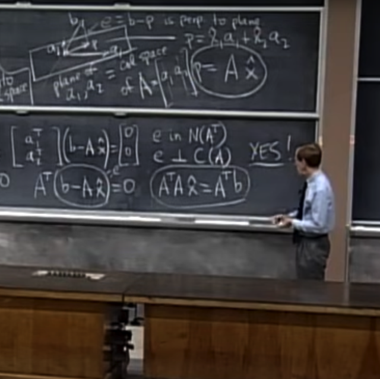</kbd>

> [!NOTE]
> nhân Aᵀ vào (b-Ax̂), chuyển Aᵀb qua bên
> phải ta có equation **AᵀAx̂ = Aᵀb**

> [!TIP]
> 🤖 **AI Check** — 🟢 Pass — ✅ **95/100** · ✓ Move on
>
> Ghi chú hoàn toàn chính xác về bước biến đổi đại số từ điều kiện trực giao $A^T(b - A\hat{x}) = 0$ sang hệ phương trình chuẩn tắc (normal equation) $A^TA\hat{x} = A^Tb$.
>
> **✓ Strengths**
> - Hiểu đúng và tóm tắt chính xác phép biến đổi đại số tuyến tính từ điều kiện trực giao sang phương trình chuẩn tắc.
>
> **💡 Deeper notes**
> - Phương trình $A^TA\hat{x} = A^Tb$ được gọi là hệ phương trình chuẩn tắc (Normal Equations). Để có nghiệm duy nhất $\hat{x} = (A^TA)^{-1}A^Tb$, ma trận $A$ cần có các cột độc lập tuyến tính (full column rank) để $A^TA$ khả nghịch.

 

###### Phương trình chuẩn tắc

<kbd>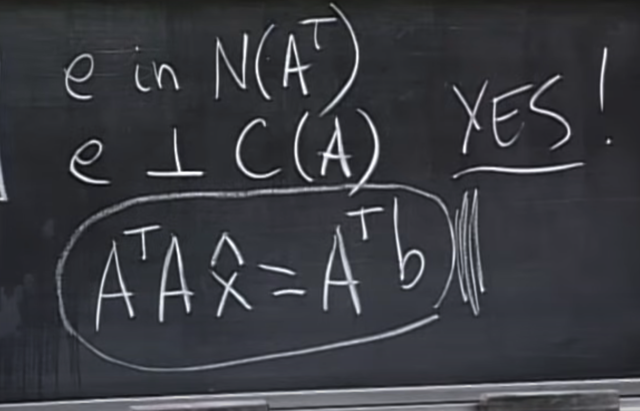</kbd>

<kbd></kbd>

> [!NOTE]
> gs nhận xét rằng, hồi nãy với 1 dimension, ta có **aᵀa là scalar**, aᵀb cũng là scalar, và x sẽ là một factor giữa hai con số đó. Còn bây giờ ta có **AᵀA là n × n matrix.**

> [!TIP]
> 🤖 **AI Check** — 🟢 Pass — ✅ **100/100** · ✓ Move on
>
> Ghi chú hoàn toàn chính xác, nắm bắt rất tốt sự chuyển tiếp từ hình chiếu trên đường thẳng (1 chiều) sang không gian con nhiều chiều bằng ma trận phương trình chuẩn (normal equation).
>
> **✓ Strengths**
> - Hiểu rõ bản chất phép chiếu 1 chiều với $a^T a$ và $a^T b$ là các vô hướng (scalar).
> - Nhận diện chính xác kích thước của ma trận $A^T A$ là $n \times n$ khi tổng quát hóa lên trường hợp ma trận $A$ kích thước $m \times n$.
>
> **💡 Deeper notes**
> - Để giải tìm nghiệm duy nhất $\hat{x} = (A^T A)^{-1} A^T b$, các cột của ma trận $A$ phải độc lập tuyến tính, khi đó ma trận vuông đối xứng $A^T A$ khả nghịch (khác 0 như phép chia cho vô hướng $a^T a$ ở trường hợp 1 chiều).

 

###### Projection Matrix and Least Squares

<kbd>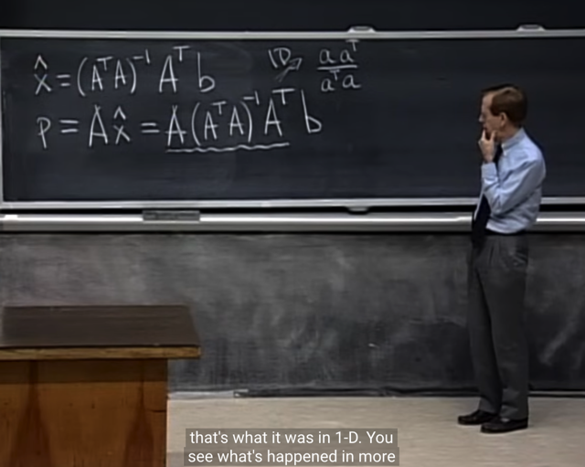</kbd>

> [!NOTE]
> Thế thì câu hỏi là x̂ là gì, và projection p là gì.
>
>
>
> Vậy thì từ AᵀAx̂ = Aᵀb, nhân hai vế cho (AᵀA)⁻¹ ta sẽ có x̂ = (AᵀA)⁻¹Aᵀb
>
>
>
> Và p = Ax̂ (hồi nãy đã nói, p là projection của b lên column space của A nên p là linear combination của các A cols hay p = Ax̂)
>
>
>
> Giờ có x̂ rồi thì thế vào ta có p = A(AᵀA)⁻¹Aᵀb
>
>
>
> Và gs liên hệ nó với trường hợp 1D hồi nãy, a là vector, thì p = aaᵀ/aᵀab còn bây giờ A là matrix thì công thức là vậy.
>
>
>
> Thì nó cũng như nhau thôi vì 1/aᵀa cũng chính là (aᵀa)⁻¹− có thể coi là inverse của aᵀa

> [!TIP]
> 🤖 **AI Check** — 🟡 Minor issues — ✅ **92/100** · ✓ Move on
>
> Ghi chú nắm rất chính xác bản chất và các bước suy diễn từ phương trình chuẩn (normal equation) sang vector nghiệm x̂ và hình chiếu p, đồng thời thấy rõ sự tương đồng với trường hợp 1 chiều.
>
> **🟡 Minor issues**
>
> **1.** *"nhân hai vế cho (AᵀA)⁻¹"*
>
> Bước này ngầm giả định ma trận AᵀA khả nghịch (có nghịch đảo). Điều kiện này chỉ thỏa mãn khi các cột của ma trận A độc lập tuyến tính.
>
>
> **✓ Strengths**
> - Suy luận chuẩn xác từ phương trình pháp tuyến AᵀAx̂ = Aᵀb để tìm x̂ và thế vào công thức p = Ax̂.
> - Liên hệ và đối chiếu trực quan, chính xác giữa công thức tổng quát nhiều chiều và công thức 1 chiều trước đó.
>
> **💡 Deeper notes**
> - Ma trận chiếu P = A(AᵀA)⁻¹Aᵀ có hai tính chất đặc trưng cơ bản: P² = P (idempotent) và Pᵀ = P (symmetric).
> - Nếu các cột của A phụ thuộc tuyến tính, AᵀA sẽ không khả nghịch và khi đó phải sử dụng giả nghịch đảo (pseudoinverse - Moore-Penrose).

 

###### Projection Matrix Formula

<kbd>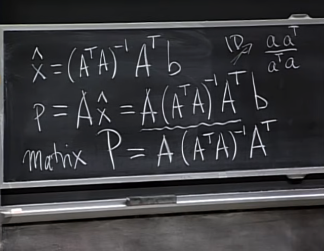</kbd>

<kbd>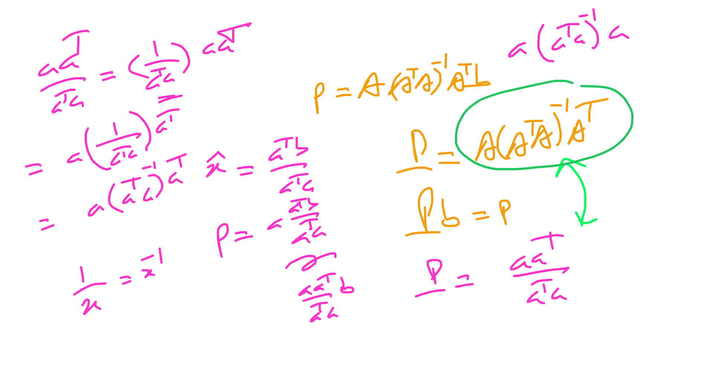</kbd>

> [!NOTE]
> và projection matrix P
> chính là **A(AᵀA)⁻¹Aᵀ**

> [!TIP]
> 🤖 **AI Check** — 🟢 Pass — ✅ **100/100** · ✓ Move on
>
> Ghi chú hoàn toàn chính xác công thức ma trận hình chiếu (projection matrix) như được trình bày trên bảng.
>
> **✓ Strengths**
> - Xác định và ghi lại chính xác dạng ma trận hình chiếu P = A(AᵀA)⁻¹Aᵀ.
>
> **💡 Deeper notes**
> - Công thức này ngầm định các cột của ma trận A độc lập tuyến tính để AᵀA khả nghịch.
> - Ma trận hình chiếu P luôn thỏa mãn hai tính chất quan trọng: đối xứng (Pᵀ = P) và lũy đẳng (P² = P).

 

###### Sai lầm rút gọn (AᵀA)⁻¹

<kbd>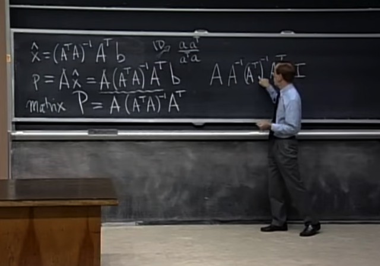</kbd>

> [!NOTE]
> tiếp, gs **GIẢ BỘ RẰNG ta tuân theo rule**:
>
>
>
> (AᵀA)⁻¹ = A⁻¹(Aᵀ)⁻¹
>
>
>
> thì khi đó P sẽ hóa ra AA⁻¹(Aᵀ)⁻¹Aᵀ = I × I = I
>
>
>
> Rõ ràng là **sai**. Và gs cho rằng, ta sai là bởi **A không
> phải là square invertible matrix**, vì như đã nói ban đầu **A
> là LONG & THIN MATRIX** có vài cols nhưng nhiều row.
>
>
>
> **DO ĐÓ A⁻¹ KHÔNG TỒN TẠI.**
>
>
>
> Và **cái rule ở (AᵀA)⁻¹ = A⁻¹(Aᵀ)⁻¹ chỉ đúng khi A square
> & invertible matrix** mà thôi

> [!TIP]
> 🤖 **AI Check** — 🟢 Pass — ✅ **100/100** · ✓ Move on
>
> Ghi chú nắm rất chính xác và trọn vẹn bản chất lập luận của giáo sư: việc tách $(A^TA)^{-1}$ thành $A^{-1}(A^T)^{-1}$ là sai lầm phổ biến do ngộ nhận $A$ khả nghịch, trong khi $A$ là ma trận chữ nhật đứng (tall & thin).
>
> **✓ Strengths**
> - Hiểu rõ tại sao không thể áp dụng công thức nghịch đảo tích $(AB)^{-1} = B^{-1}A^{-1}$ khi các ma trận thành phần không vuông và không khả nghịch.
> - Nắm đúng đặc điểm kích thước của ma trận $A$ (nhiều hàng hơn cột / tall and thin) trong bài toán bình phương tối thiểu.
>
> **💡 Deeper notes**
> - Về mặt hình học: nếu $A$ là ma trận vuông và khả nghịch thì không gian cột $C(A)$ phủ kín toàn bộ không gian $\mathbb{R}^m$. Khi đó hình chiếu của vector $b$ lên $C(A)$ chính là chính nó ($P b = b$), do đó ma trận hình chiếu $P = I$ là hoàn toàn chuẩn xác trong trường hợp đó.

 

###### Column space ma trận invertible

<kbd>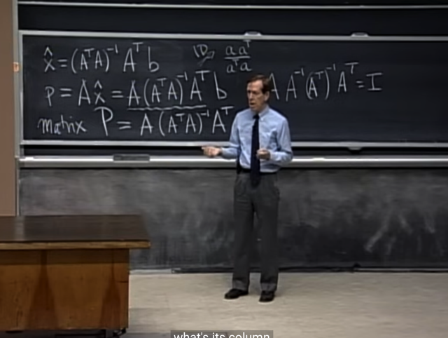</kbd>

> [!NOTE]
> gs: Thế thì **nếu A square invertible** thì sao?
>
>
>
> khi đó **cols space của A là gì.**
>
>
>
> → **Rⁿ**, vì khi đó **mọi n cols và n rows của A đều là independent**, chúng sẽ **span toàn bộ Rn**

> [!TIP]
> 🤖 **AI Check** — 🟢 Pass — ✅ **100/100** · ✓ Move on
>
> Ghi chú rất chính xác và nắm đúng bản chất: khi ma trận A vuông và khả nghịch (kích thước n x n), các cột độc lập tuyến tính nên không gian cột chính là toàn bộ R^n.
>
> **✓ Strengths**
> - Hiểu đúng rằng ma trận vuông khả nghịch n x n có n cột độc lập tuyến tính và span toàn bộ R^n.
> - Bắt trúng câu hỏi gợi mở của giáo sư Strang khi dẫn dắt về trường hợp ma trận chiếu P trở thành ma trận đơn vị I.
>
> **💡 Deeper notes**
> - Khi C(A) = R^n, hình chiếu của bất kỳ vector b nào lên C(A) chính là chính nó (p = b), do đó ma trận chiếu P = I; điều này giải thích về mặt hình học cho phép biến đổi đại số P = A(A^T A)^(-1) A^T = A A^(-1) (A^T)^(-1) A^T = I trên bảng.

 

###### Ma trận chiếu toàn không gian

<kbd></kbd>

> [!NOTE]
> Gs: correct. Thế thì **khi đó**, **Projection** **matrix** (tức là cái
> matrix **giúp làm cái việc projection**) sẽ là gì khi ta
> project b LÊN COLS SPACE CỦA A, MÀ LÚC NÀY LÀ
> THE WHOLE SPACE R^N
>
>
>
> Thử trả lời: Đương nhiên **b đã nằm trong Rn** rồi mà **giờ project
> nó "lên" Rn** thì đương nhiên **chả cần làm gì**, tức là 
> chỉ cần nhân với Identity matrix → **P = I**

> [!TIP]
> 🤖 **AI Check** — 🟡 Minor issues — ✅ **95/100** · ✓ Move on
>
> Ghi chú thể hiện trực giác hình học rất chính xác: hình chiếu của một vector lên toàn bộ không gian chứa nó chính là chính nó, do đó ma trận hình chiếu là ma trận đơn vị I.
>
> **🟡 Minor issues**
>
> **1.** *"THE WHOLE SPACE R^N"*
>
> Với ma trận A kích thước m x n, không gian cột (Column Space) nằm trong R^m chứ không phải R^n (trừ khi ma trận vuông n x n). Khi không gian cột phủ toàn bộ không gian thì đó là R^m.
>
>
> **✓ Strengths**
> - Hiểu đúng bản chất hình học: nếu vector b đã nằm sẵn trong không gian đích thì phép chiếu giữ nguyên b (P*b = b), suy ra P = I.
>
> **💡 Deeper notes**
> - Về mặt đại số, khi các cột của A sinh ra toàn bộ R^m thì A là ma trận vuông khả nghịch (m = n). Khi đó (A^T * A)^(-1) tách thành A^(-1) * (A^T)^(-1), triệt tiêu với A và A^T ở hai bên để cho ra đúng P = I.

 

###### Ma trận hình chiếu P

<kbd>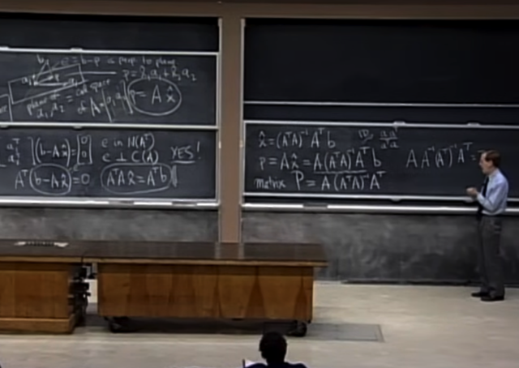</kbd>

> [!NOTE]
> Gs: Đúng vậy, khi A invertible, và **C(A) CHÍNH LÀ TOÀN
> BỘ Rn** thì ta **được phép triển khai như vừa rồi** và **sẽ
> thấy rằng P chính là I**
>
>
>
> Nhưng khi C(A) không phải là Rⁿ mà chỉ là một subspace
> của Rⁿ thì ta không được làm vậy

 

###### Projection Matrix and Properties

<kbd>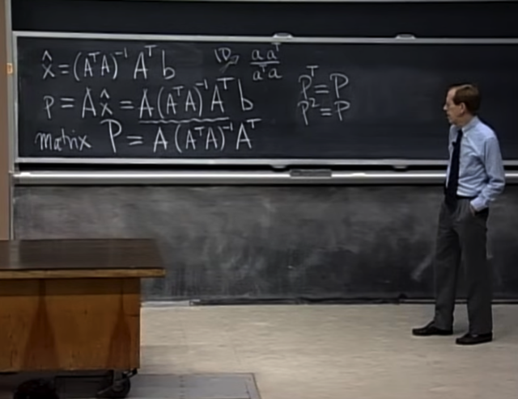</kbd>

> [!NOTE]
> Tiếp, gs cho rằng ta vẫn sẽ có 2 tính chất của projection matrix P đó là symmetric.
>
>
>
> Điều này dễ thấy vì (AᵀA)⁻¹ sẽ symmetric vì AᵀA symmetric. Nên \[A(AᵀA)⁻¹Aᵀ\]ᵀ sẽ vẫn bằng A(AᵀA)⁻¹Aᵀ thôi

> [!TIP]
> 🤖 **AI Check** — 🟡 Minor issues — ⚠️ **85/100** · ✓ Move on
>
> Ghi chú giải thích rất chính xác tính đối xứng (Pᵀ = P) của ma trận chiếu P dựa trên tính đối xứng của AᵀA. Tuy nhiên, bạn nhắc đến '2 tính chất' nhưng mới chỉ nêu và kiểm tra 1 tính chất (đối xứng) mà chưa đề cập tính chất thứ hai (P² = P).
>
> **🟡 Minor issues**
>
> **1.** *"vẫn sẽ có 2 tính chất của projection matrix P đó là symmetric"*
>
> Câu nói đề cập đến '2 tính chất' nhưng đoạn sau chỉ nêu và chứng minh tính đối xứng (Pᵀ = P), bỏ sót tính chất lũy đẳng (idempotent: P² = P) được ghi trên bảng.
>
>
> **✓ Strengths**
> - Lập luận tính đối xứng của (AᵀA)⁻¹ từ tính đối xứng của AᵀA là hoàn toàn chính xác.
> - Hiểu đúng quy tắc lấy chuyển vị của tích ma trận để suy ra Pᵀ = P.
>
> **💡 Deeper notes**
> - Để (AᵀA)⁻¹ tồn tại, ma trận A cần có các cột độc lập tuyến tính (full column rank).
> - Tính chất còn lại trên bảng là P² = P (chiếu hai lần liên tiếp không làm thay đổi kết quả, [A(AᵀA)⁻¹Aᵀ][A(AᵀA)⁻¹Aᵀ] = A(AᵀA)⁻¹Aᵀ).

 

###### Properties of Projection Matrix

<kbd>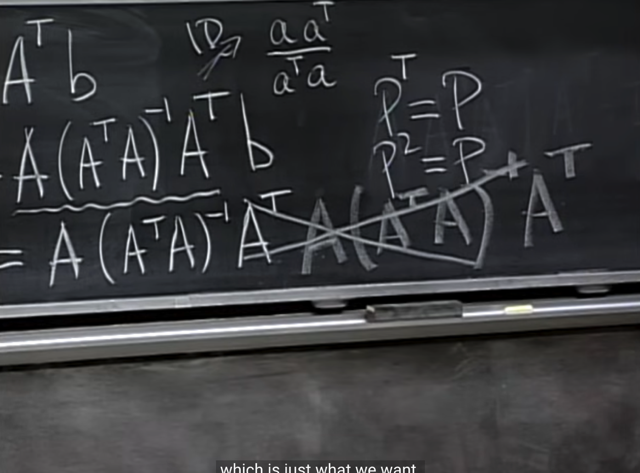</kbd>

> [!NOTE]
> và tính chất thứ hai là projection của projection thì vẫn vậy. Và dễ dàng thấy điều này là đúng khi nhân P với P vẫn ra lại P:
>
>
>
> PP = A(AᵀA)⁻¹Aᵀ A(AᵀA)⁻¹Aᵀ = A(AᵀA)⁻¹Aᵀ = P

> [!TIP]
> 🤖 **AI Check** — 🟢 Pass — ✅ **100/100** · ✓ Move on
>
> Ghi chép rất chính xác và súc tích về tính chất lũy đẳng (idempotent) P² = P của ma trận hình chiếu.
>
> **✓ Strengths**
> - Hiểu đúng bản chất hình học: chiếu một vector đã nằm trên không gian con thì không làm thay đổi vector đó (P² = P).
> - Thực hiện phép nhân đại số chính xác, nhận diện đúng việc cụm AᵀA ở giữa triệt tiêu với (AᵀA)⁻¹ thành ma trận đơn vị.
>
> **💡 Deeper notes**
> - Công thức P = A(AᵀA)⁻¹Aᵀ ngầm giả định ma trận A có các cột độc lập tuyến tính (full column rank) để AᵀA khả nghịch.

 

###### Bài toán Least Squares

<kbd>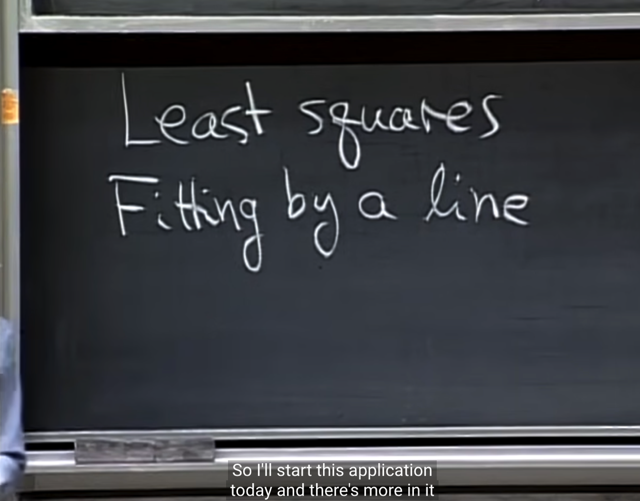</kbd>

> [!NOTE]
> và gs cho rằng **ta sẽ bắt đầu "xài" matrix P** này, trong các
> bài toán mà ta cần **solve một system of equation** có **rất
> nhiều equation**. Và một application điển hình **chính là bài
> toán LEAST SQUARE**

> [!TIP]
> 🤖 **AI Check** — 🟢 Pass — ✅ **100/100** · ✓ Move on
>
> Ghi chú tóm tắt rất chính xác bối cảnh và mục đích ứng dụng của ma trận hình chiếu trong việc giải hệ phương trình có nhiều phương trình hơn ẩn số qua bài toán Least Squares.
>
> **✓ Strengths**
> - Nắm bắt chính xác vai trò cầu nối của ma trận hình chiếu P đối với bài toán xấp xỉ bình phương tối thiểu (Least Squares).
> - Nhận diện đúng dạng bài toán dẫn đến Least Squares là hệ phương trình có quá nhiều phương trình so với số ẩn (hệ overdetermined).
>
> **💡 Deeper notes**
> - Khi hệ Ax = b có nhiều phương trình hơn số ẩn (m > n), vector b thường không nằm trong không gian cột C(A); ma trận chiếu P được dùng để chiếu b vuông góc lên C(A) nhằm tìm nghiệm xấp xỉ tối ưu.

 

###### Bài toán khớp đường thẳng

<kbd>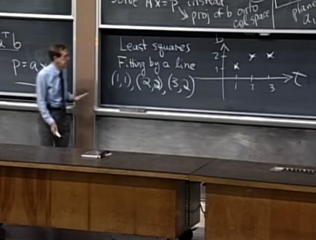</kbd>

> [!NOTE]
> Và bài toán là ta cần vẽ, **tìm một đường thẳng** sao cho
> nó **fit được với 3 điểm này**

 

###### Phương pháp bình phương tối thiểu

<kbd>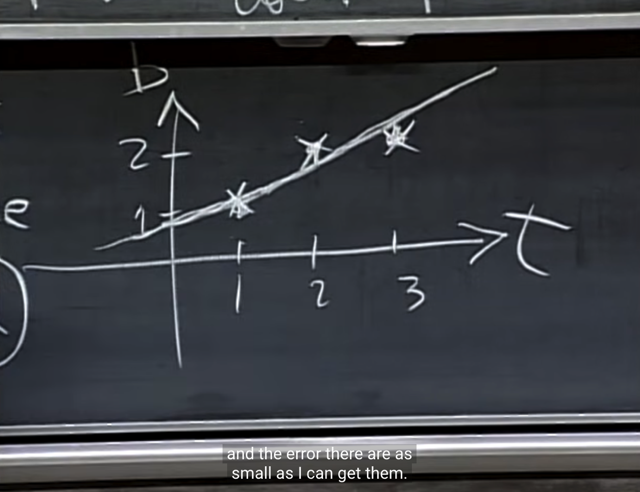</kbd>

> [!NOTE]
> sao cho các
> error nhỏ nhất

 

###### Hệ phương trình tìm đường thẳng

<kbd>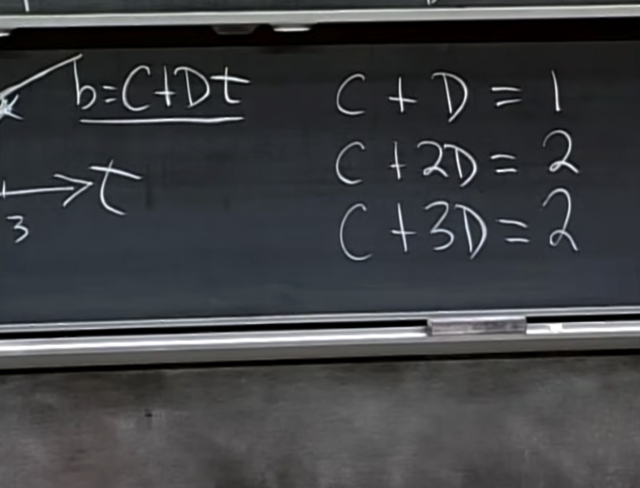</kbd>

> [!NOTE]
> gs đề nghị đầu tiên hãy tìm matrix thể hiện bài toán này.
>
>
>
> Vậy ta gọi đường thẳng cần tìm là **b = C + D × t**
>
>
>
> Vậy dựa vào việc **ta muốn nó đi qua 3 điểm** trên nên
> ta có
>
>
>
> t = 1, b = 1 →  C + D = 1 
>
>
>
> t = 2, b = 2 → C + 2D = 2 
>
>
>
> t = 3, b = 2 → C + 3D = 2
>
>
>
> Đương nhiên nếu system of equation này giải được thì
> ta đã có solution (C, D) tức là xác định được đường
> thẳng đi qua 3 điểm rồi.

 

###### Phương trình ma trận Ax = b

<kbd>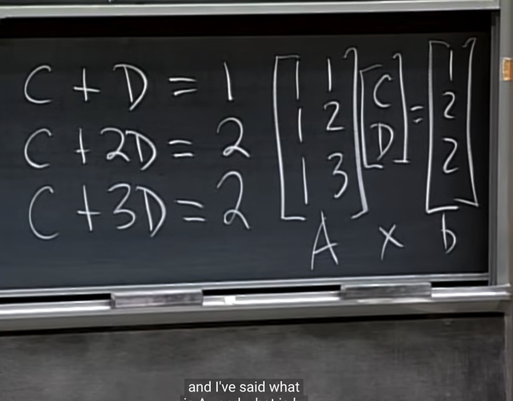</kbd>

> [!NOTE]
> và cái matrix A ở đây sẽ là matrix 3x2 (cao ốm) có hai
> cols là [1, 1, 1]ᵀ và [1 2 3]ᵀ,
>
>
>
> hai variable C, D,
>
>
>
> và vector b là [1, 2, 2]ᵀ

 

###### Phương trình chuẩn AᵀAx̂ = Aᵀb

<kbd>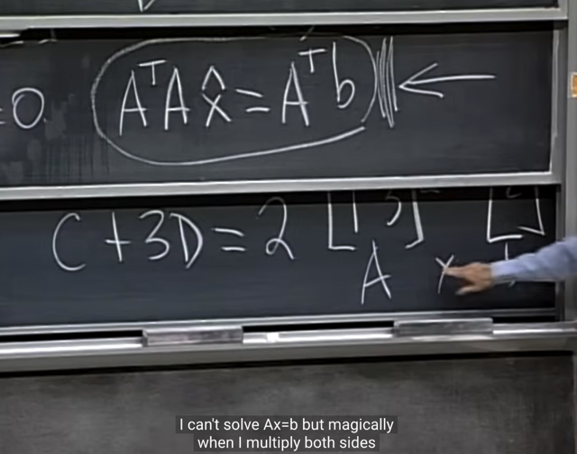</kbd>

> [!NOTE]
> Và gs cho rằng, đây (Ax=b) như dễ thấy là một equation với no
> solution. Ta sẽ không thể tìm ra C, D
>
>
>
> Nhưng ta sẽ vẫn muốn LÀM TỐT NHẤT CÓ THỂ, mang ý
> nghĩa là tuy không thể vẽ được, tìm được đường thẳng đi qua
> cả 3 điểm, giúp error đều = 0, nhưng ta có thể tìm ra phương
> án tốt nhất có thể BẰNG CÁCH GIẢI MỘT BÀI  TOÁN KHÁC
> GẦN NHẤT VỚI NÓ mà bài toán đó CÓ  SOLUTION
>
>
>
> Đó là **thay vì giải equation Ax = b**, ta sẽ **giải equation AᵀAx̂ =
> Aᵀb**

> [!TIP]
> 🤖 **AI Check** — 🟢 Pass — ✅ **100/100** · ✓ Move on
>
> Ghi chú nắm rất chính xác và trực quan bản chất của phương pháp bình phương tối thiểu (least squares): thay thế hệ vô nghiệm bằng hệ phương trình chuẩn (normal equation) để tìm nghiệm tối ưu.
>
> **✓ Strengths**
> - Hiểu rõ động lực chuyển từ việc giải hệ vô nghiệm Ax = b sang giải phương trình chuẩn AᵀAx̂ = Aᵀb để tối thiểu hóa sai số.
> - Liên hệ tốt giữa bài toán đại số tuyến tính với bài toán thực tế khớp đường thẳng (tìm C, D qua 3 điểm không thẳng hàng).
>
> **💡 Deeper notes**
> - Để phương trình chuẩn AᵀAx̂ = Aᵀb có nghiệm duy nhất thì ma trận AᵀA phải khả nghịch, điều này tương đương với việc các cột của ma trận A độc lập tuyến tính.
> - Bản chất hình học của việc giải bài toán gần nhất này là chiếu vector b vuông góc xuống không gian cột C(A) để thu được vector p = Ax̂ gần b nhất.

 

###### Phép chiếu tối ưu

<kbd>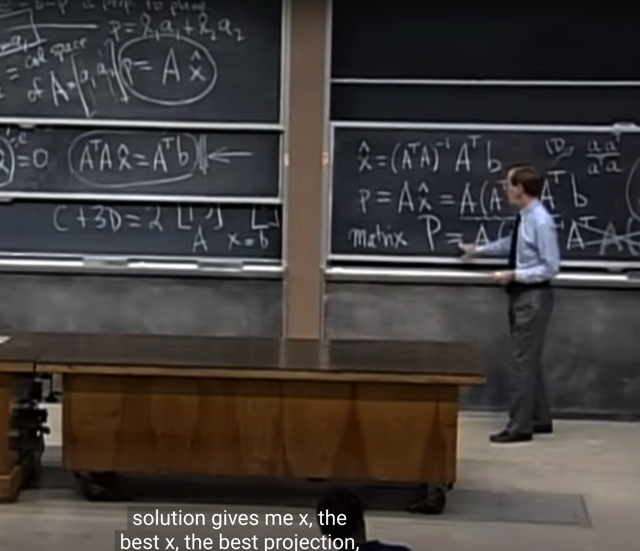</kbd>

> [!NOTE]
> Khi đó ta sẽ có được **x̂**, và từ đó ta có **best projection** 
> Nội dung này sẽ tiếp tục ở lecture 16

 

