# Lecture 9: Independece, Basis, And Dimension

📊 **Progress:** `35` Notes | `52` Screenshots | `33` AI Reviews

---

 

## Linear Independence, Basis and Dimension

<kbd></kbd>

 

### Nonzero Solutions to Ax = 0

<kbd></kbd>

> [!NOTE]
> đầu tiên gs giả sử ta có matrix A với **số hàng ít hơn số
> cột**. Thì ta có thể kết luận rằng hệ phương trình **Ax=0
> SẼ CÓ SOLUTION KHÁC 0**. Câu hỏi là, vì sao ta có
> thể kết luận như vậy?

📹 [Xem video trên YouTube](https://www.youtube.com/watch?v=OeiSCA8vnoU)

> [!TIP]
> 🤖 **AI Check** — 🟢 Pass — ✅ **100/100** · ✓ Move on
>
> Ghi chú đã tóm tắt hoàn toàn chính xác định lý được nêu trên bảng: khi số hàng ít hơn số cột (m < n) thì hệ thuần nhất Ax = 0 luôn có nghiệm phi tầm thường (khác 0).
>
> **✓ Strengths**
> - Nắm bắt chính xác điều kiện m < n (số phương trình ít hơn số ẩn) và kết luận tồn tại nghiệm khác 0 của hệ Ax = 0.
> - Đặt câu hỏi đúng trọng tâm bài học để tìm hiểu bản chất đại số tuyến tính đằng sau định lý.
>
> **💡 Deeper notes**
> - Để trả lời cho câu hỏi 'vì sao': Hạng của ma trận r = rank(A) luôn nhỏ hơn hoặc bằng số hàng m (r ≤ m). Vì m < n nên r < n, điều này đảm bảo luôn có ít nhất n - r ≥ n - m > 0 biến tự do (free variables), do đó không gian hạt nhân (nullspace) N(A) có số chiều ít nhất là 1, dẫn đến luôn tồn tại nghiệm x ≠ 0.

 

#### Nonzero Solutions to Homogeneous Systems

<kbd></kbd>

> [!NOTE]
> thế thì ta **có thể lập luận dựa trên những gì đã biết** về
> việc ta có một giải thuật **elimination** giúp đưa system
> of equation về dạng **Row Echelon**, 
>
>
>
> để từ đó, ta **xác định các pivot**, cũng như pivot column
> và nếu có **free column**, ta sẽ **assign giá trị tùy ý cho 
> free variable** để back-substitution, tính ra các **special 
> solution** (và nhờ free variable có thể chọn giá trị tùy
> ý nên đương nhiên special solution khác 0)
>
>
>
> Vậy nhìn lại đây, vì m < n, số hàng < số cột, nên **kiểu
> gì cũng chỉ có tối đa m pivot variable/column**, thành ra
> **luôn có n-m > 0 các free variable/column**.
>
>
>
> Vậy ta có thể kết luận Ax=0 **chắc chắn có solution khác 0**

> [!TIP]
> 🤖 **AI Check** — 🟢 Pass — ✅ **95/100** · ✓ Move on
>
> Ghi chú lập luận rất chính xác và logic, liên kết chặt chẽ giữa phép khử Gauss, số lượng pivot và biến tự do để giải thích sự tồn tại của nghiệm khác không.
>
> **✓ Strengths**
> - Giải thích bản chất rất rõ ràng bằng cách kết nối với quy trình khử hàng (Row Echelon), vị trí pivot và biến tự do.
> - Hiểu đúng rằng số pivot r bị chặn trên bởi số hàng m (r <= m), dẫn đến luôn có biến tự do khi m < n.
>
> **💡 Deeper notes**
> - Cần chính xác hơn về mặt từ ngữ: số biến tự do thực tế là n - r >= n - m > 0 (nghĩa là có 'ít nhất' n - m biến tự do, vì nếu xuất hiện hàng toàn số 0 thì số pivot r còn nhỏ hơn m).

 

##### Definition of Linear Independence

<kbd></kbd>

<kbd></kbd>

> [!NOTE]
> Qua khái niệm **independent**, gs định nghĩa là, đám vector x1, x2....xn independent (có thể nói dài dòng là linear independent) **NẾU KHÔNG CÓ LINEAR COMBINATION NÀO CỦA CHÚNG BẰNG 0**, **NGOẠITRỪ** một trường hợp được phép, là khi **MỌI COEFFICIENT c_i ĐỀU BẰNG 0**
>
>
>
> Suy nghĩ một chút có thể hiểu vì sao lại vậy, là bởi vì **nếu tồn tại một linear combination (non trivial) của chúng bằng 0** thì chuyển vế đổi dấu một vector một cái qua ta sẽ thấy ngay **vector đó là linear combination của các vector còn lại**, tức là nó **phụ thuộc tuyến tính với đám kia.**
>
>
>
> Như vậy thì **cả đám không độc lập tuyến tính nhau,**

📹 [Xem video trên YouTube](https://www.youtube.com/watch?v=OpXy96ENApE)

> [!TIP]
> 🤖 **AI Check** — 🟢 Pass — ✅ **95/100** · ✓ Move on
>
> Ghi chú nắm rất chắc định nghĩa độc lập tuyến tính trên bảng và diễn giải trực quan chính xác lý do vì sao định nghĩa này tương đương với việc không vector nào biểu diễn được qua các vector còn lại.
>
> **✓ Strengths**
> - Hiểu và diễn đạt chính xác định nghĩa độc lập tuyến tính thông qua tổ hợp tuyến tính triệt tiêu (chỉ có nghiệm tầm thường c_i = 0).
> - Nêu bật được trực giác bản chất: nếu có nghiệm không tầm thường thì có thể rút một vector ra biểu diễn tuyến tính qua các vector còn lại.
>
> **💡 Deeper notes**
> - Về mặt biến đổi chi tiết: khi chuyển vế và chia hệ số để biểu diễn vector đó theo các vector còn lại, ta cần chọn vector có hệ số c_k khác 0 (điều này luôn khả thi vì đây là tổ hợp không tầm thường).

 

###### Linear Independence of Vectors

<kbd></kbd>

> [!NOTE]
> Thầy lấy ví dụ v1 và v2 = 2v1. Đương nhiên ta biết nó
> dependence, chỉ là soi chiếu theo định nghĩa thì ta thấy có
> thể kiếm được một linear combination giữa chúng để tạo
> vector zero: 2v1 - v2 = 0

> [!TIP]
> 🤖 **AI Check** — 🟡 Minor issues — ✅ **95/100** · ✓ Move on
>
> Ghi chú nắm rất chính xác ví dụ minh họa và bản chất đại số của tính phụ thuộc tuyến tính từ bài giảng.
>
> **🟡 Minor issues**
>
> **1.** *"kiếm được một linear combination giữa chúng để tạo vector zero: 2v1 - v2 = 0"*
>
> Định nghĩa phụ thuộc tuyến tính yêu cầu các hệ số không đồng thời bằng 0 (ở đây là 2 và -1). Cần lưu ý điều này vì tổ hợp tuyến tính với các hệ số đều bằng 0 luôn luôn tạo ra vector 0 với bất kỳ vector nào.
>
>
> **✓ Strengths**
> - Hiểu đúng bản chất hình học và đại số của ví dụ: hai vector cùng phương dẫn đến sự phụ thuộc tuyến tính.
> - Liên hệ chính xác ví dụ trên bảng với định nghĩa tổ hợp tuyến tính bằng vector không.
>
> **💡 Deeper notes**
> - Về thuật ngữ, nên dùng tính từ 'linearly dependent' (hoặc 'phụ thuộc tuyến tính') thay vì danh từ 'dependence' khi mô tả quan hệ giữa các vector.

 

###### Sự phụ thuộc tuyến tính

<kbd>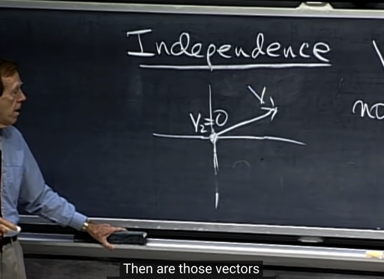</kbd>

<kbd></kbd>

> [!NOTE]
> Ví dụ khác, v1 và v2 = 0. Cũng là dependence. Vì có thể
> có 0 × v1 + 100 × v2 = 0 + 0 = 0. Vẫn thỏa điều kiện là **tồn tại
> bộ non-zero coefficients để tạo linear combination = zero**

📹 [Xem video trên YouTube](https://www.youtube.com/watch?v=GCwrn_86Gos)

> [!TIP]
> 🤖 **AI Check** — 🟡 Minor issues — ✅ **95/100** · ✓ Move on
>
> Ghi chú rất chính xác về bản chất: bất kỳ tập hợp vector nào chứa vector 0 đều phụ thuộc tuyến tính, kèm ví dụ minh họa trực quan và đúng định nghĩa.
>
> **🟡 Minor issues**
>
> **1.** *"tồn tại bộ non-zero coefficients"*
>
> Thuật ngữ chuẩn xác hơn nên là 'tồn tại các hệ số không đồng thời bằng 0' (not all zero coefficients) thay vì 'bộ non-zero', vì trong ví dụ hệ số của v1 vẫn bằng 0, chỉ cần ít nhất một hệ số khác 0 (ở đây là 100).
>
>
> **✓ Strengths**
> - Nắm vững định nghĩa sự phụ thuộc tuyến tính thông qua việc tìm ra một tổ hợp tuyến tính triệt tiêu có hệ số khác 0.
> - Ví dụ cụ thể (0*v1 + 100*v2 = 0) giúp chứng minh trực tiếp và trực quan tại sao tập hợp chứa vector 0 luôn phụ thuộc tuyến tính.
>
> **💡 Deeper notes**
> - Quy tắc tổng quát hữu ích: Bất kỳ họ vector nào chứa vector zero đều tự động phụ thuộc tuyến tính (linearly dependent), vì luôn có thể gán hệ số khác 0 cho vector zero và hệ số 0 cho tất cả các vector còn lại.

 

###### Linear Independence of Vectors

<kbd></kbd>

> [!NOTE]
> đúng là như vậy, và ta có thể kết luân **NẾU TRONG
> SET CÁC VECTOR CÓ MỘT ZERO VECTOR**, thì coi
> như không có chuyện linear independence nữa

> [!TIP]
> 🤖 **AI Check** — 🟢 Pass — ✅ **100/100** · ✓ Move on
>
> Ghi chú hoàn toàn chính xác về mặt toán học: một tập hợp vector chứa vector không (zero vector) thì luôn phụ thuộc tuyến tính (linearly dependent).
>
> **✓ Strengths**
> - Nắm bắt chính xác tính chất quan trọng của tính độc lập tuyến tính từ ví dụ minh họa của bài giảng: bất kỳ tập vector nào chứa vector không đều phụ thuộc tuyến tính.
>
> **💡 Deeper notes**
> - Lý do chặt chẽ là ta luôn có thể gán hệ số khác 0 (ví dụ bằng 6 như giáo sư viết trên bảng) cho vector không và hệ số 0 cho tất cả các vector còn lại để tạo ra tổ hợp tuyến tính bằng 0 mà không cần tất cả hệ số bằng 0.

 

###### Linear Independence of Vectors

<kbd>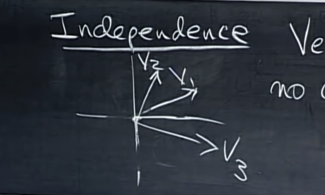</kbd>

> [!NOTE]
> tiếp, gs lấy ví dụ hai vector v1, v2 như thế này, rõ ràng,
> vì **khác phương**, nên **không thể nào có linear
> combination** giữa chúng **với coefficient không cùng
> bằng 0** **mà ra 0 được.**
>
>
>
> Thế thì, gs vẽ thêm v3, và hỏi rằng, nếu tôi vẽ v3 tùy
> tiện như vầy, thì 3 vector này có independence không?
>
>
>
> Thử trả lời: Không. Vì như đã biết, **vì v1, v2 independence**,
> **nên mọi linear combination của chúng đã tạo thành
> plane R²**.
>
>
>
> Và **v3 nằm trong R²**, nên **nó cũng là kết quả của
> một linear combination giữa v1 và v2**. Vậy ba vector
> này không independence.

 

###### Linear Independence Definition

<kbd></kbd>

 

###### Tính phụ thuộc tuyến tính

<kbd></kbd>

<kbd></kbd>

> [!NOTE]
> gs: có thể giải thích vì sao tôi biết 3 vector này dependence
> là vì soi lại cái ta vừa nhận định: Nếu matrix A có **số hàng
> nhỏ hơn số cột** thì kiểu gì cũng sẽ **có solution khác 0** (như
> đã giải thích, vì số pivot lớn nhất **sẽ chỉ là m < n** nên sẽ
> **luôn có free column** / free variable → nên chắc chắn có thể
> chọn giá trị khác không cho free variable và thế vào ta tính
> ra pivot variable để **có special solution khác 0**.
>
>
>
> Vậy nếu ta xét matrix A có 3 cột là 3 column vector v1,v2,v3
> thì đương nhiên ta có matrix A với m<n như vậy. Từ đó
> Ax=0 luôn có solution khác 0, gọi nó là [c1, c2, c3]ᵀ đi
>
>
>
> Thì như đã biết Ac=0 chính là linear combination của các
> cột với coefficient là các phần tử của c = 0 → Dependence.

📹 [Xem video trên YouTube](https://www.youtube.com/watch?v=ogUUI-lxqk0)

> [!TIP]
> 🤖 **AI Check** — 🟢 Pass — ✅ **100/100** · ✓ Move on
>
> Ghi chú nắm rất chắc và chính xác bản chất: ma trận có $m < n$ luôn có biến tự do (free variables), dẫn đến nghiệm phi tầm thường ($c \neq 0$) cho hệ $Ac = 0$, chứng minh các vector cột phụ thuộc tuyến tính.
>
> **✓ Strengths**
> - Hiểu đúng mối liên hệ cốt lõi giữa số hàng nhỏ hơn số cột ($m < n$) với việc luôn tồn tại biến tự do và nghiệm khác không (nullspace chứa vector khác 0).
> - Kết nối chính xác phương trình ma trận $Ac = 0$ với tổ hợp tuyến tính của các vector cột bằng 0 để kết luận tính phụ thuộc tuyến tính.
>
> **💡 Deeper notes**
> - Cần lưu ý trong cách diễn đạt đoạn cuối: 'Ac=0 chính là linear combination của các cột bằng 0 với hệ số c không đồng thời bằng 0', tránh viết nhầm thành hệ số bằng 0.

 

###### Column Independence via Nullspace

<kbd>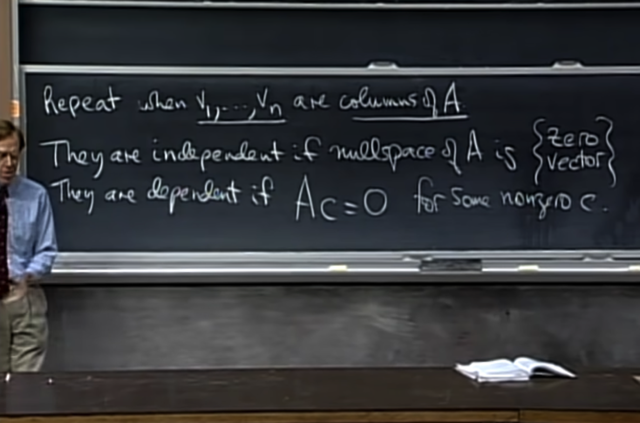</kbd>

> [!NOTE]
> vậy từ đó ta có thể đưa ra nhận định, với **v1,v2..vn là columns của
> A** thì:
>
>
>
> Chúng sẽ **independence** nếu **nullspace của A chỉ chứa zero**.
>
>
>
> Và **dependence** nếu nullspace của A **có vector khác ngoài
> zero**.
>
>
>
> ===
>
>
>
> Vì nullspace của A là mọi solution của Ax=0, hay, mọi vector x tạo ra
> linear combination của các A's column bằng 0. Vì nó là một vector
> space, nên nó nhất định, ít nhất thì cũng chứa vector zero (ôn lại
> tiếp, vì vector space có tính chất linear combination của hai vector
> đều tạo một véctơ cũng nằm trong space, nên vector space luôn
> phải có zero, vì nếu không 0 × a = 0 sẽ không nằm trong space thì sẽ
> không thỏa điều kiện vừa nói)
>
>
>
> Vậy thì **nếu nullspace của A chỉ có mỗi zero vector**, thì có nghĩa là
> **ngoài bộ coeffs toàn 0**, thì **chẳng có bộ nào khác** tạo ra linear
> combination của A's column để **cho ra 0** → nên các **column của
> A independence**
>
>
>
> Còn nếu nullspace của A **có vector khác zero vector**, thì có
> nghĩa là **có một coeff khác mà không** **phải là 0** hết có thể tạo linear
> combination của A's cols ra 0 → **dependence.**

> [!TIP]
> 🤖 **AI Check** — 🟢 Pass — ✅ **98/100** · ✓ Move on
>
> Ghi chú rất xuất sắc, giải thích cặn kẽ và chính xác bản chất vì sao nghiệm của Ax=0 (nullspace) lại tương đương với tính độc lập tuyến tính của các cột.
>
> **🟡 Minor issues**
>
> **1.** *"có nghĩa là có một coeff khác mà không phải là 0 hết"*
>
> Cách dùng từ hơi lẫn lộn giữa 'một hệ số' và 'bộ hệ số'. Chính xác hơn là 'tồn tại một vector nghiệm khác vector 0, nghĩa là có ít nhất một hệ số khác 0'.
>
>
> **✓ Strengths**
> - Hiểu rất rõ định nghĩa nullspace là tập nghiệm của phương trình Ax = 0, đồng thời là các tổ hợp tuyến tính của các cột bằng 0.
> - Giải thích chính xác vì sao không gian vector luôn phải chứa vector 0 dựa trên tính chất đóng của tổ hợp tuyến tính.
> - Kết nối mạch lạc giữa sự tồn tại của nghiệm tầm thường/không tầm thường với tính độc lập và phụ thuộc tuyến tính.
>
> **💡 Deeper notes**
> - Khi dùng tiếng Anh, 'independent'/'dependent' là tính từ (dùng cho các vector), còn 'independence'/'dependence' là danh từ.

 

###### Matrix Rank and Free Variables

<kbd>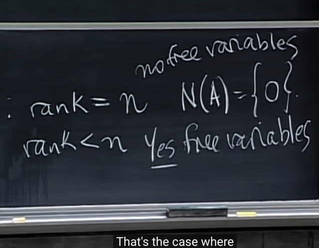</kbd>

<kbd></kbd>

<kbd></kbd>

> [!NOTE]
> Vậy, với trường hợp **mọi cols của A đều independence**, thì
> chính là ta có **mỗi cột một pivot**, nên trường hợp này ta
> có n pivot → **rank = n**. Nhớ lại, rank là số pivot
>
>
>
> Còn với trường hợp các cols của A **dependence**, thì ta có
> số **pivot < số cột**, đồng nghĩa có free columns , và rank < n

📹 [Xem video trên YouTube](https://www.youtube.com/watch?v=NrYt3dlnowY)

> [!TIP]
> 🤖 **AI Check** — 🟢 Pass — ✅ **95/100** · ✓ Move on
>
> Ghi chú rất chính xác và nắm vững bản chất: liên hệ đúng giữa số lượng pivot, hạng của ma trận (rank), tính độc lập tuyến tính của các cột và sự xuất hiện của biến tự do.
>
> **✓ Strengths**
> - Nắm vững mối quan hệ giữa độc lập tuyến tính của các cột và việc mỗi cột đều có một pivot (rank = n).
> - Hiểu rõ khi các cột phụ thuộc tuyến tính thì số pivot < n dẫn tới sự xuất hiện của các cột tự do (free variables/free columns).
>
> **💡 Deeper notes**
> - Về thuật ngữ tiếng Anh: nên dùng tính từ 'independent' và 'dependent' thay vì danh từ 'independence' và 'dependence' khi mô tả đặc tính của các cột.
> - Trên bảng giảng viên còn ghi thêm N(A) = {0} cho trường hợp rank = n, tức là nghiệm của hệ Ax = 0 chỉ có duy nhất nghiệm tầm thường x = 0.

**🔗 See also:** [Nghiệm đặc biệt và Nullspace](./lecture_7_solving_ax_0_pivot_variables_special_solutions.md#node-xpxaf8g)

 

###### Linear Independence and Nullspace

<kbd></kbd>

> [!NOTE]
> Gs nói qua khái niệm span: một đ**ám vector "span" một
> space** là sao
>
>
>
> thì ông cho biết mình đã thấy nó rồi, khi ta nhớ đã từng nói
> **vector space** tạo bởi **mọi linear combination của column
> của matrix A** được gọi là **columns spac**e của A. Thì đó
> cũng chính là nói rằng **CÁC COLUMNS CỦA A SPAN
> COLUMN SPACE C(A)**

> [!TIP]
> 🤖 **AI Check** — 🟢 Pass — ✅ **95/100** · ✓ Move on
>
> Ghi chú nắm rất chính xác và tự nhiên bản chất khái niệm không gian sinh (span) thông qua liên hệ trực tiếp với column space C(A).
>
> **✓ Strengths**
> - Hiểu đúng định nghĩa cốt lõi của 'span': tập hợp tất cả các tổ hợp tuyến tính của các vector đã cho.
> - Liên hệ chính xác giữa các cột của ma trận A và không gian cột C(A) như một ví dụ cụ thể cho khái niệm span.
>
> **💡 Deeper notes**
> - Cần phân biệt giữa 'span' (chỉ việc bao trùm toàn bộ không gian) và 'basis' (cơ sở: vừa span được không gian, vừa phải độc lập tuyến tính).

**🔗 See also:** [Không gian cột ma trận](./lecture_5_transpose_permutations_spaces_rn.md#node-sobom5t)

 

###### Định nghĩa span vector

<kbd>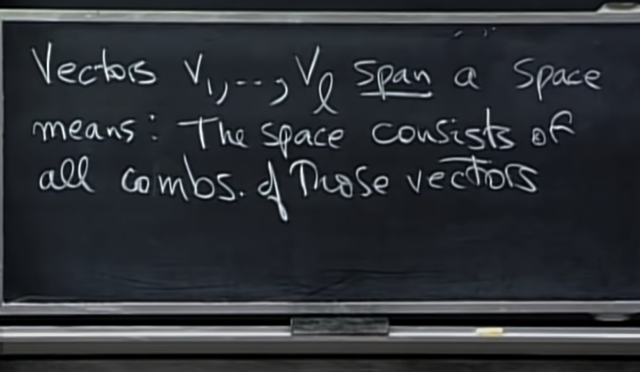</kbd>

<kbd></kbd>

> [!NOTE]
> vậy ta có định nghĩa của **span**: Ta nói rằng đám vector
> v1,v2...vl **span một vector space** nếu vector space
> được **tạo thành bởi mọi linear combination của các
> vector đó**

📹 [Xem video trên YouTube](https://www.youtube.com/watch?v=RlPbmEXWyTM)

> [!TIP]
> 🤖 **AI Check** — 🟢 Pass — ✅ **100/100** · ✓ Move on
>
> Ghi chú nắm bắt rất chính xác và trọn vẹn định nghĩa không gian sinh (span) từ bài giảng.
>
> **✓ Strengths**
> - Định nghĩa chuẩn xác: một tập hợp vector sinh ra một không gian vector khi mọi phần tử trong không gian đó đều biểu diễn được dưới dạng tổ hợp tuyến tính của chúng.
>
> **💡 Deeper notes**
> - Một chi tiết kỹ thuật nhỏ: các hệ số trong tổ hợp tuyến tính (linear combinations) là các đại lượng vô hướng (scalars) thuộc về trường số mà không gian vector đó xác định trên (thường là tập số thực R).

 

###### Khái niệm cơ sở Basis

<kbd>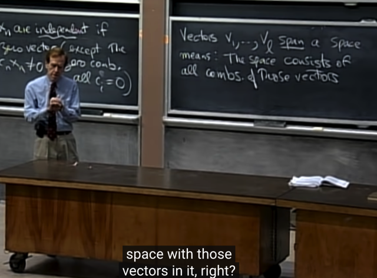</kbd>

<kbd></kbd>

<kbd></kbd>

> [!NOTE]
> gs: thay vì phải nói dài dòng là a..tôi **lấy mọi linear
> combination của các vector này và tạo thành một space**,
> thì bây giờ chỉ cần nói từ **các vector này "span" một
> space**
>
>
>
> ví dụ các columns của A span columns space của A
>
>
>
> Tiếp theo gs lập luận rằng, vậy ta có column space, và ta
> nói các **column span column space đó**.
>
>
>
> Thế thì ta cũng biết **các column** có thể **independence**
> hoặc **dependence** nhau.
>
>
>
> Dẫn ta đến khái niệm **BASIS**, mà bản thân từ basis đã
> mang một hàm nghĩa là **KHÔNG DƯ, KHÔNG THIẾU.**

📹 [Xem video trên YouTube](https://www.youtube.com/watch?v=WdqD4oyv45k)

> [!TIP]
> 🤖 **AI Check** — 🟢 Pass — ✅ **100/100** · ✓ Move on
>
> Ghi chú tóm tắt rất chính xác và súc tích bản chất của khái niệm span và cách giáo sư dẫn dắt sang khái niệm cơ sở (basis). Trực giác 'không dư, không thiếu' cho basis là hoàn toàn chuẩn xác.
>
> **✓ Strengths**
> - Nắm rất chuẩn định nghĩa trực quan của 'span' như được ghi trên bảng: không gian gồm tất cả các tổ hợp tuyến tính của các vector đó.
> - Kết nối mạch lạc giữa hai khái niệm: span (không thiếu) và độc lập tuyến tính (không dư) để tạo nên khái niệm basis.
>
> **💡 Deeper notes**
> - Trực giác 'không dư, không thiếu' của Basis có thể hình thức hóa rất đẹp: 'không thiếu' tương ứng với việc các vector phải span toàn bộ không gian, còn 'không dư' tương ứng với tính độc lập tuyến tính (không có vector nào là tổ hợp tuyến tính thừa thãi của các vector khác).

 

###### Định nghĩa cơ sở

<kbd>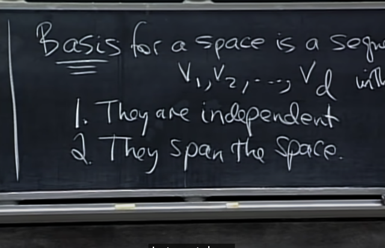</kbd>

> [!NOTE]
> thế thì gs định nghĩa **basis** của một space là bộ vector có hai tính chất:
>
>
>
> a. Chúng linearly **independent**
>
>
>
> b. Chúng **span space đó.**

> [!TIP]
> 🤖 **AI Check** — 🟢 Pass — ✅ **100/100** · ✓ Move on
>
> Ghi chú nắm rất chính xác định nghĩa cơ bản của một cơ sở (basis) cho không gian vector đúng như trên bài giảng.
>
> **✓ Strengths**
> - Hiểu và ghi lại chính xác hai điều kiện cốt lõi của một cơ sở: độc lập tuyến tính (linearly independent) và sinh ra không gian (span the space).
>
> **💡 Deeper notes**
> - Các vector này phải nằm trong chính không gian đó, và số lượng vector trong cơ sở (ở đây ký hiệu là d) cũng chính là số chiều (dimension) của không gian vector.

 

###### Cơ sở chính tắc R³

<kbd>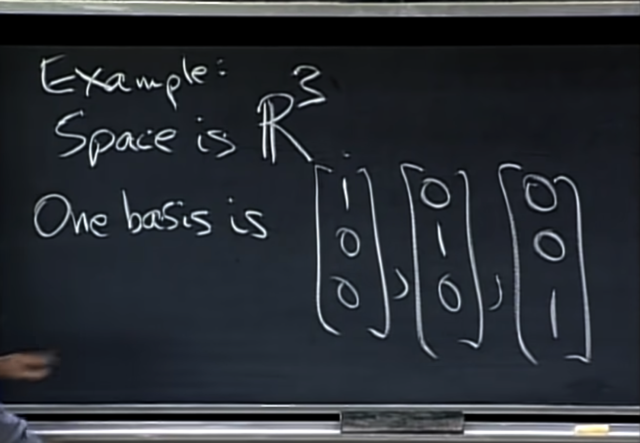</kbd>

<kbd></kbd>

> [!NOTE]
> Gs lấy ví dụ space là **R³**. Thì một **basis** của nó là (1 0
> 0), (0 1 0), (0 0 1) (Đây gọi là **STANDARD** BASIS).
>
>
>
> Và chú ý rằng **nó không phải là basis duy nhất.**  Để xem
> xét ba vector này **có phải basis không** thì ta xem **chúng
> có independence không** đã.
>
>
>
> Thì dễ thấy chúng là 3 vector **trùng với 3 trục của không
> gian R³**, nên nếu **muốn c1 × v1 + c2 × v2 + c3 × v3 = 0** thì
> **chỉ có một case là c1=c2=c3=0.**
>
>
>
> Hoặc có thể lập luận rằng ta **đặt nó làm cols của matrix A**,
> Thì dễ thấy ta sẽ có **matrix Identity I**. Sau đó ta **xem xét
> null space của I: Ix = 0**. Thì rõ ràng, **vector nào nhân với
> Identity matrix cũng bằng chính nó**, vậy **Ix = 0 KHI VÀ CHỈ
> KHI x = 0**.
>
>
>
> Vậy **nullspace của I chỉ có zero vector** ⇒ như hồi nãy đã
> biết, điều này có thể **kết luận các cols independence.**

> [!TIP]
> 🤖 **AI Check** — 🟡 Minor issues — ✅ **92/100** · ✓ Move on
>
> Ghi chú rất tốt, giải thích rõ ràng và chính xác bản chất độc lập tuyến tính của hệ vector đơn vị qua cả định nghĩa tổ hợp tuyến tính và nullspace của ma trận đơn vị.
>
> **🟡 Minor issues**
>
> **1.** *"Để xem xét ba vector này có phải basis không thì ta xem chúng có independence không đã."*
>
> Định nghĩa của cơ sở (basis) đòi hỏi 2 điều kiện: độc lập tuyến tính (independence) và sinh ra toàn bộ không gian (spanning). Ghi chú mới kiểm tra tính độc lập tuyến tính mà chưa nhắc đến điều kiện span (hoặc lý luận rằng trong không gian 3 chiều, 3 vector độc lập tuyến tính tự động tạo thành một cơ sở).
>
>
> **✓ Strengths**
> - Nhận thức đúng đắn rằng một không gian vector có vô số cơ sở và cơ sở đang xét là standard basis.
> - Liên hệ xuất sắc giữa tính độc lập tuyến tính của các cột với việc giải phương trình thuần nhất Ix = 0 (nullspace chỉ chứa vector không).
>
> **💡 Deeper notes**
> - Trong R^n, nếu đã có đúng n vector và chứng minh được chúng độc lập tuyến tính, định lý về số chiều (dimension) đảm bảo rằng chúng sẽ tự động sinh ra toàn bộ R^n mà không cần kiểm tra thêm bước span.

 

###### Another Basis in Vector Space

<kbd>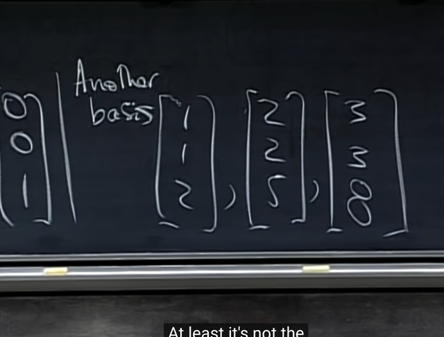</kbd>

> [!NOTE]
> và **một basis khác**, **miễn là** gồm **3 independent** vector là 
> được.
>
>
>
> Chỉ 2 vec được không? ⇒ Không, **vì 2 vector (independence)
> chỉ span được một 2D plane trong R3**

> [!TIP]
> 🤖 **AI Check** — 🟢 Pass — ✅ **100/100** · ✓ Move on
>
> Ghi chú rất chính xác và nắm vững bản chất về số lượng vector cần thiết để tạo thành cơ sở của không gian $\mathbb{R}^3$.
>
> **✓ Strengths**
> - Hiểu đúng nguyên lý cơ bản: trong không gian 3 chiều ($\mathbb{R}^3$), bất kỳ hệ gồm 3 vector độc lập tuyến tính nào cũng tạo thành một cơ sở.
> - Giải thích chính xác lý do 2 vector độc lập không thể là cơ sở của $\mathbb{R}^3$ vì chúng chỉ span một mặt phẳng 2 chiều đi qua gốc tọa độ.
>
> **💡 Deeper notes**
> - Trong $\mathbb{R}^n$, bất kỳ tập hợp nào gồm đúng $n$ vector độc lập tuyến tính thì tự động là cơ sở (đảm bảo sinh ra toàn bộ không gian mà không cần kiểm tra thêm điều kiện span).

 

###### Kiểm tra hệ cơ sở

<kbd></kbd>

> [!NOTE]
> Vậy **làm sao để test 3 vector có phải là basis không?**
>
>
>
> Gs nói rằng thì như đã biết, chỉ việc **tạo matrix bởi 3
> vector** và **elimination về row echelon form** rồi **xem có
> free column** nào không.
>
>
>
> Nếu có **tức là các vector không independence.** Từ đó kết
> luận **Không phải basis**

> [!TIP]
> 🤖 **AI Check** — 🟢 Pass — ✅ **95/100** · ✓ Move on
>
> Ghi chú nắm rất chính xác phương pháp dùng phép khử Gauss để kiểm tra tính độc lập tuyến tính nhằm xác định cơ sở.
>
> **✓ Strengths**
> - Hiểu đúng quy trình kiểm tra: lập ma trận từ các vector, đưa về dạng bậc thang (echelon form) và kiểm tra cột tự do (free column).
> - Kết luận chuẩn xác rằng sự xuất hiện của cột tự do đồng nghĩa với việc các vector phụ thuộc tuyến tính, do đó không thể là cơ sở.
>
> **💡 Deeper notes**
> - Quy tắc 'chỉ cần kiểm tra độc lập tuyến tính là đủ kết luận cơ sở' hoạt động vì số lượng vector đúng bằng số chiều của không gian (3 vector trong không gian R^3). Nếu số vector khác 3, một tập hợp độc lập tuyến tính chưa chắc đã span được không gian.

 

###### Ma trận vuông khả nghịch

<kbd></kbd>

<kbd></kbd>

<kbd></kbd>

> [!NOTE]
> vậy với **matrix vuông thì sao**. Hay gs yêu cầu ta suy nghĩ cho câu hỏi: **bộ n vector sẽ tạo basis** nếu **matrix (n,n**) với các cols tạo bởi các vector đó **có tính chất gì?**
>
>
>
> → **Full rank, hay invertible**.
>
>
>
> Vì sao? Vì với matrix mxn, rank tối đa của nó là chính là m (=n), vì ta pivot thì tối đa mỗi hàng một cái và mỗi cột một cái, nói gọn hơn thì chỉ tối đa là 1 pivot trong mỗi hàng hay cột. Vậy nếu ít hàng hơn cột thì tối đa số pivot chỉ bằng số hàng, ngược lại nếu ít cột hơn hàng thì tối đa số pivot chỉ bằng số hàng.
>
>
>
> Vậy đang nói matrix vuông có các cols tạo bởi các vector independence thì có nghĩa là khi đưa matrix A về row echelon form, ta sẽ có **mỗi cột một pivot** (và vì số hàng bằng số cột) nên ta cũng có **mỗi hàng một pivot**. Và khi **số hàng bằng số cột bằng số pivot, ta gọi là Full Rank**
>
>
>
> Và reduced row echelon form của A sẽ là I.
>
>
>
> Đồng nghĩa **EA = I** (E là elimination matrix). Từ đó suy ra **E chính là A⁻¹** đồng nghĩa **A là invertible matrix (vì tồn tại A⁻¹)**

> [!TIP]
> 🤖 **AI Check** — 🟡 Minor issues — ✅ **92/100** · ✓ Move on
>
> Ghi chú giải thích rất tốt và chặt chẽ mối liên hệ giữa cơ sở trong Rⁿ, ma trận vuông đầy đủ hạng (full rank), phép khử Gauss-Jordan đưa về I và tính khả nghịch. Có một lỗi diễn đạt nhầm nhỏ khi nói về trường hợp ma trận có ít cột hơn hàng.
>
> **🟡 Minor issues**
>
> **1.** *"ngược lại nếu ít cột hơn hàng thì tối đa số pivot chỉ bằng số hàng"*
>
> Đây là lỗi viết nhầm (typo logic): nếu số cột ít hơn số hàng (n < m), thì số pivot tối đa chỉ bằng số cột (n), vì rank tối đa luôn là min(m, n).
>
>
> **✓ Strengths**
> - Hiểu chính xác điều kiện n vector trong không gian n chiều tạo thành cơ sở khi và chỉ khi ma trận vuông ghép từ các cột đó khả nghịch (invertible).
> - Kết nối mạch lạc giữa khái niệm pivot, dạng bậc thang thu gọn (RREF = I) và việc tồn tại ma trận nghịch đảo thông qua các phép biến đổi hàng sơ cấp (EA = I).
>
> **💡 Deeper notes**
> - Ký hiệu ma trận khử E thực chất là tích của nhiều ma trận sơ cấp (elementary elimination matrices và permutation matrices nếu có đổi hàng).
> - Đối với ma trận vuông n x n, tính độc lập tuyến tính của các cột (n pivot) cũng tự động suy ra tính sinh (span) không gian Rⁿ mà không cần kiểm tra riêng lẻ.

**🔗 See also:** [Ma trận vuông khả nghịch](./lecture_8_solving_ax_b_row_reduced_form_r.md#node-i0hzrgh)

 

###### Cơ sở không gian con

<kbd>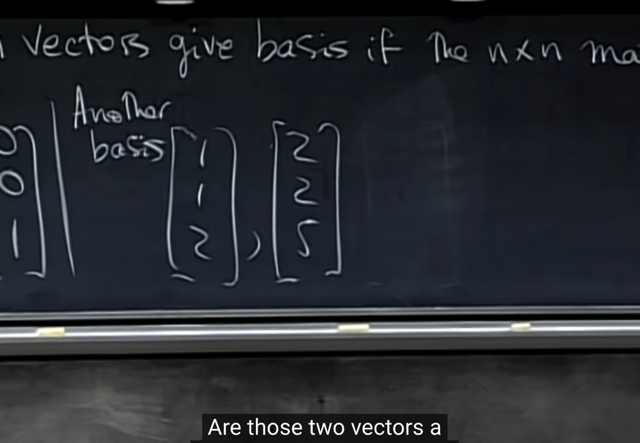</kbd>

<kbd></kbd>

<kbd></kbd>

<kbd></kbd>

<kbd></kbd>

> [!NOTE]
> thế thì gs hỏi rằng, nếu tôi x**óa đi một vector**, (3 3 8)ᵀ thì
> **hai vector còn lại** này **có là basis của một space nào ko**?

📹 [Xem video trên YouTube](https://www.youtube.com/watch?v=m3w2ZyvA8X8)

> [!TIP]
> 🤖 **AI Check** — 🟢 Pass — ✅ **100/100** · ✓ Move on
>
> Ghi chú nắm bắt rất chính xác câu hỏi gợi mở trọng tâm của giáo sư trong bài giảng.
>
> **✓ Strengths**
> - Nắm bắt chính xác câu hỏi tư duy của giáo sư về việc liệu tập con các vector độc lập tuyến tính có tạo thành một cơ sở hay không.
>
> **💡 Deeper notes**
> - Hai vector độc lập tuyến tính này không thể là cơ sở của toàn bộ không gian R³, nhưng chúng luôn là cơ sở cho không gian con 2 chiều (mặt phẳng đi qua gốc tọa độ) do chính chúng sinh ra (span).

 

###### Basis and Spanning Vectors

<kbd>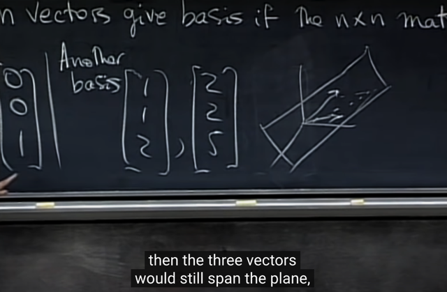</kbd>

> [!NOTE]
> có, **hai vector này độc lập tuyến tính**, vậy nó đã **thỏa  điều
> kiện thứ nhất**. Vậy nó sẽ là **basis của cái vector space mà
> chúng span** - là mọi linear combination của chúng. Và đó là
> **một 2D plane trong R3** (chú ý lại rằng ko phải là R2 nhé, vì
> vector có 3 phần tử, nó nằm trong R3)
>
>
>
> Vậy thì, gs nói rằng, nếu tôi **vẽ lại vector (3,3,8)** vì nó là một
> linear combination của hai vector kia nên **đương nhiên ta sẽ
> thấy nó trong plane này.**
>
>
>
> Tóm lại, **CHỈ XÉT 2 VECTOR**, thì nó **LÀ MỘT BASIS** một
> basis, của một plane trong R3. Nhưng nếu **XÉT CẢ 3** vector
> thì chúng lại **KHÔNG PHẢI LÀ MỘT BASIS**, bởi chúng **không
> independence.**

> [!TIP]
> 🤖 **AI Check** — 🟢 Pass — ✅ **100/100** · ✓ Move on
>
> Ghi chú nắm rất vững và chính xác bản chất: hai vector độc lập tuyến tính tạo thành cơ sở cho một mặt phẳng trong không gian 3 chiều; thêm vector thứ ba nằm trong mặt phẳng đó thì vẫn span mặt phẳng nhưng không còn độc lập nên không phải là cơ sở.
>
> **✓ Strengths**
> - Phân biệt chính xác giữa không gian R^3 và không gian con 2 chiều (mặt phẳng 2D nằm trong R^3).
> - Kiểm tra và hiểu đúng việc vector (3, 3, 8) là tổ hợp tuyến tính của hai vector trước (-1*[1,1,2] + 2*[2,2,5]) nên cùng nằm trên mặt phẳng.
> - Nắm chắc định nghĩa cơ sở (basis): phải vừa sinh ra không gian (span) vừa độc lập tuyến tính (linearly independent).
>
> **💡 Deeper notes**
> - 3 vector này dù không tạo thành cơ sở cho mặt phẳng (vì thừa/phụ thuộc tuyến tính) và cũng không thể tạo thành cơ sở cho R^3 (vì chỉ span ra không gian 2 chiều), nhưng chúng vẫn là một tập sinh (spanning set) của mặt phẳng đó.

 

###### Basis of Column Space

<kbd></kbd>

> [!NOTE]
> Gs nhắc lại lần nữa về một case mà ta có các **columns
> vector span the columns space**, mà chúng lại
> **independence**, cho nên các columns vector này là
> **basis của columns space**

> [!TIP]
> 🤖 **AI Check** — 🟢 Pass — ✅ **100/100** · ✓ Move on
>
> Ghi chú rất chính xác, nắm đúng bản chất định nghĩa của một cơ sở (basis): hệ vector vừa sinh ra không gian vừa độc lập tuyến tính.
>
> **✓ Strengths**
> - Hiểu chính xác điều kiện để các vector cột tạo thành cơ sở của không gian cột (vừa span, vừa độc lập tuyến tính).
>
> **💡 Deeper notes**
> - Theo định nghĩa, các cột của ma trận hiển nhiên luôn sinh ra (span) không gian cột; do đó chỉ cần các cột này độc lập tuyến tính là chúng lập tức trở thành một cơ sở.

 

###### Cơ sở không gian R³

<kbd></kbd>

> [!NOTE]
> kết luận đầu tiên đó là **CÓ RẤT NHIỀU BASIS**, bất kể
> khi nào ta lấy một **Invertible matrix 3x3**, thì **3 columns
> của nó sẽ tạo một basis của R³**  Vì sao phải 3x3, 4x3
> được không? Không vì lúc này các cols trong R⁴ rồi,
> đang nói R³ mà.
>
>
>
> Thế 3**x4** được không? Không, vì khi đó matrix A có các
> cột tạo bởi 4 cột của matrix này sẽ chắc chắn có free
> columns/variable, vì sao, vì ngay cả khi mỗi hàng có một
> pivot, thì nó c**ũng chỉ có 3 pivot**, cùng **đồng nghĩa là
> chỉ có 3 pivot columns** → **dư một columns** là **free**
> columns ⇒ Ax=0 **có specials solution** cũng là **basis của
> nullspace** ⇒ nullspace không chỉ chứa zero vector ⇒ **có
> bộ non-zero coefficient tạo linear combination giữa các
> columns bằng 0** ⇒ c**ác cols không independence.**

> [!TIP]
> 🤖 **AI Check** — 🟢 Pass — ✅ **95/100** · ✓ Move on
>
> Ghi chú thể hiện sự hiểu bài rất sâu sắc và lập luận logic chặt chẽ về điều kiện để các cột tạo thành một cơ sở trong không gian R³.
>
> **🟡 Minor issues**
>
> **1.** *"các cols không independence"*
>
> Lỗi nhỏ về mặt từ vựng (dùng danh từ 'independence' thay vì tính từ 'independent' - độc lập tuyến tính).
>
>
> **✓ Strengths**
> - Hiểu chính xác điều kiện ma trận vuông khả nghịch n x n để các cột tạo thành một cơ sở của R^n.
> - Lập luận rất chuẩn xác chuỗi logic: m < n dẫn đến tối đa 3 pivot, chắc chắn có biến tự do (free variable), nghiệm đặc biệt (special solution), nullspace khác {0}, dẫn đến các cột phụ thuộc tuyến tính.
>
> **💡 Deeper notes**
> - Một cơ sở đòi hỏi vừa độc lập tuyến tính vừa sinh ra toàn bộ không gian (span). Với trường hợp ma trận 4x3, ngoài việc các vector thuộc R⁴ chứ không phải R³, nếu xét trong không gian con do chúng sinh ra thì tối đa chúng chỉ span được một không gian 3 chiều bên trong R⁴.

 

###### Số lượng vector cơ sở

<kbd></kbd>

> [!NOTE]
> gs nói rằng, thế thì ta có vô số basis, nhưng chúng
> đều có chung một điểm, mà hồi nãy tôi xóa đi một
> vector thì các bạn đã đúng khi bảo rằng đây không
> còn là basis của R3 nữa. Vì khi đó không đủ vector
>
>
>
> Vậy thì **điểm chung của các basis chính là chúng đều
> CÓ CHUNG SỐ LƯỢNG VECTOR**

> [!TIP]
> 🤖 **AI Check** — 🟢 Pass — ✅ **100/100** · ✓ Move on
>
> Ghi chú nắm bắt rất chính xác trực giác và thông điệp cốt lõi của giáo sư: một không gian vectơ có vô số cơ sở (basis), nhưng tất cả các cơ sở đó đều có chung một số lượng vectơ.
>
> **✓ Strengths**
> - Hiểu chính xác tính chất cốt lõi: mọi cơ sở của cùng một không gian vectơ đều có cùng số lượng vectơ.
> - Liên hệ đúng phản ví dụ trong bài giảng: việc thiếu vectơ sẽ không đủ để sinh (span) toàn bộ không gian.
>
> **💡 Deeper notes**
> - Số lượng vectơ chung trong mọi cơ sở của một không gian vectơ chính là định nghĩa chính thức của 'số chiều' (dimension) của không gian đó.

 

###### Definition of Vector Space Dimension

<kbd></kbd>

> [!NOTE]
> Và số lượng vector của basis cuả một space
> chính là **DIMENSION CỦA SPACE đó**

> [!TIP]
> 🤖 **AI Check** — 🟢 Pass — ✅ **100/100** · ✓ Move on
>
> Ghi chú đã nắm bắt hoàn toàn chính xác định nghĩa về số chiều (dimension) của một không gian vector từ bài giảng.
>
> **✓ Strengths**
> - Định nghĩa chính xác số chiều (dimension) chính là số lượng vector trong một cơ sở (basis) của không gian đó.
>
> **💡 Deeper notes**
> - Định nghĩa số chiều mang tính nhất quán (well-defined) nhờ tính chất nền tảng được ghi trên bảng: mọi cơ sở của cùng một không gian vector đều có cùng số lượng vector.
> - Khái niệm đếm số lượng vector này áp dụng cho các không gian vector hữu hạn chiều (finite-dimensional).

 

###### Cơ sở và số chiều

<kbd>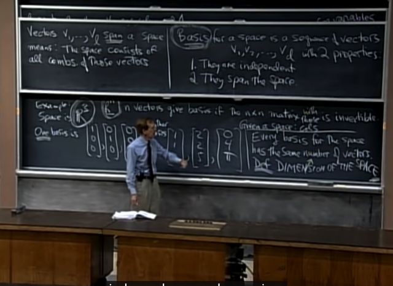</kbd>

> [!NOTE]
> lướt lại 4 định nghĩa trong bài này:
>
>
>
> Các **vector independent**: là khi **không có linear combination nào của chúng ra zero** (trừ khi mọi coeff bằng 0)
>
>
>
> **Span**: là một space tạo bởi **mọi linear combination của đám vector** (**không care** chúng **có độc lập hay không**)
>
>
>
> **Basis**, là bộ vector **independence** và **span** một space thì chúng là basis của space
>
>
>
> Và giờ là **Dimension**: là **số vector trong basis** của một space

> [!TIP]
> 🤖 **AI Check** — 🟢 Pass — ✅ **100/100** · ✓ Move on
>
> Ghi chú tóm tắt rất chính xác và súc tích 4 khái niệm nền tảng trong bài giảng: Độc lập tuyến tính, Span, Cơ sở (Basis), và Số chiều (Dimension).
>
> **✓ Strengths**
> - Nắm chuẩn định nghĩa độc lập tuyến tính thông qua tổ hợp tuyến tính triệt tiêu.
> - Hiểu rõ span là không gian sinh bởi mọi tổ hợp tuyến tính mà không cần điều kiện độc lập.
> - Nắm vững định nghĩa cơ sở và số chiều không gian vector.
>
> **💡 Deeper notes**
> - Để định nghĩa Dimension ('số vector trong một basis') có nghĩa và nhất quán, nền tảng cốt lõi là định lý: mọi cơ sở của cùng một không gian vector đều có cùng số lượng vector.

 

###### Tập sinh không gian cột

<kbd></kbd>

> [!NOTE]
> rồi, gs cho ví dụ xét C(A) là columns space của matrix A
> như sau, thế thì các c**olumns này có span columns space
> không?**
>
>
>
> Thử trả lời: Có, vì **dù chúng không independence**, thì **mọi linear 
> combination của chúng vẫn tạo nên columns space** của A,
> đơn giản vì **đó là định nghĩa của columns space**, và định
> nghĩa của span (space tạo bởi mọi linear combination)
>
>
>
> Correct, đơn giản vì **đó là định nghĩa của column space.**

> [!TIP]
> 🤖 **AI Check** — 🟢 Pass — ✅ **100/100** · ✓ Move on
>
> Ghi chú hoàn toàn chính xác. Bạn đã nắm rất vững định nghĩa: không gian cột theo định nghĩa luôn là không gian sinh bởi tất cả các cột của ma trận, bất kể các cột đó có độc lập tuyến tính hay không.
>
> **✓ Strengths**
> - Phân biệt rạch ròi giữa việc sinh ra không gian (spanning) và tính độc lập tuyến tính (linear independence).
> - Hiểu đúng bản chất không gian cột C(A) được định nghĩa là tập hợp mọi tổ hợp tuyến tính của các cột.
>
> **💡 Deeper notes**
> - Các cột luôn là tập sinh (spanning set) của C(A), nhưng nếu muốn tạo thành một cơ sở (basis) cho C(A) thì các cột đó mới cần thêm điều kiện độc lập tuyến tính.

 

###### Basis for Column Space

<kbd>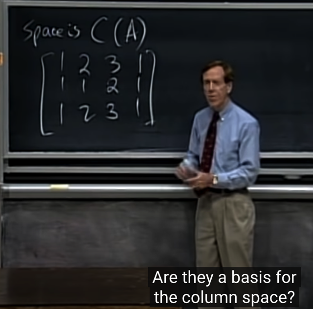</kbd>

> [!NOTE]
> Vậy thì chúng **có phải là basis của columns space
> không**?
>
>
>
> Thử trả lời: **Không**, vì **chúng không independence**, cols 4 =
> cols 1 hay cols 4 là một linear combination của các cols
> khác với hệ số 1 × col1 + 0 × col2 + 0 × col3

> [!TIP]
> 🤖 **AI Check** — 🟢 Pass — ✅ **100/100** · ✓ Move on
>
> Ghi chú hoàn toàn chính xác. Bạn đã trả lời đúng câu hỏi và đưa ra minh chứng rõ ràng: cột 4 bằng cột 1 chứng minh ngay tập hợp các cột phụ thuộc tuyến tính, do đó không thể là cơ sở (basis).
>
> **✓ Strengths**
> - Nhận diện chính xác điều kiện tiên quyết của một cơ sở (basis) là các vector phải độc lập tuyến tính.
> - Chỉ ra được mối quan hệ phụ thuộc tuyến tính cụ thể rất nhanh (cột 4 = cột 1) để kết luận.
>
> **💡 Deeper notes**
> - Ngoài cột 4 = cột 1, ma trận còn có cột 3 = cột 1 + cột 2; do đó không gian cột C(A) chỉ có số chiều là 2 (hạng của ma trận r = 2), và một cơ sở của C(A) chỉ cần đúng 2 cột độc lập (ví dụ cột 1 và cột 2).

 

###### Column Space and Null Space

<kbd>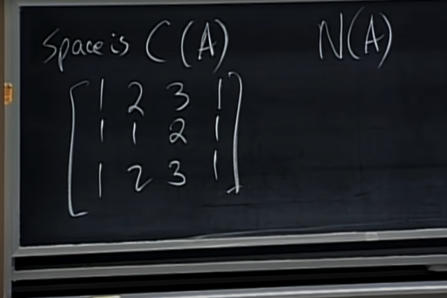</kbd>

> [!NOTE]
> Gs: Đúng vậy, thế thì hãy xét nullspace của A, hãy cho
> một vector khác zero nằm trong nullspace: 
>
>
>
> Thử trả lời: như đã nói col4 = 1 × col1 + 0 × col2 + 0 × col3
> nên **1***col1 + **0***col2 + **0***col3 **- 1***col4 = **0**
>
>
>
> ⇒ một vector khác 0 của nulls-pace: (**1 0 0 -1)**

> [!TIP]
> 🤖 **AI Check** — 🟢 Pass — ✅ **95/100** · ✓ Move on
>
> Ghi chú rất chính xác và lập luận rõ ràng; bạn đã tìm đúng một vector khác 0 thuộc không gian hạch N(A) dựa vào quan hệ phụ thuộc tuyến tính giữa cột 1 và cột 4.
>
> **✓ Strengths**
> - Nhận diện chính xác quan hệ phụ thuộc tuyến tính col 4 = col 1 để suy ra tổ hợp tuyến tính triệt tiêu.
> - Xác định đúng vector (1, 0, 0, -1) nằm trong nullspace của ma trận A.
>
> **💡 Deeper notes**
> - Vector trong nullspace về mặt chuẩn tắc của phép nhân Ax = 0 thường được biểu diễn dưới dạng vector cột (column vector) trong R^4, tức là [1, 0, 0, -1]^T.
> - Ngoài nghiệm này, cột 3 cũng là tổng của cột 1 và cột 2 (col3 = col1 + col2), cho ta thêm một vector độc lập tuyến tính khác trong nullspace là (1, 1, -1, 0)^T.

 

###### Column Space and Nullspace

<kbd>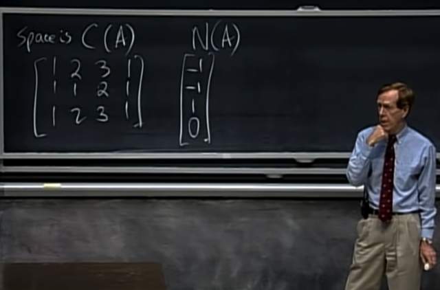</kbd>

> [!NOTE]
> hoặc là vector này cũng được, nó **cũng tạo linear
> combination của các cols ra 0.**
>
>
>
> Nói chung là **chứng tỏ các cols dependence**, nên
> **không phải là basis của columns space**

> [!TIP]
> 🤖 **AI Check** — 🟢 Pass — ✅ **95/100** · ✓ Move on
>
> Ghi chú nắm rất chính xác ý nghĩa của vector trong không gian hạt nhân (nullspace): một tổ hợp tuyến tính phi tầm thường của các cột triệt tiêu về 0 chứng tỏ các cột phụ thuộc tuyến tính và do đó không thể cùng tạo thành cơ sở của không gian cột.
>
> **✓ Strengths**
> - Hiểu đúng bản chất rằng vector trong N(A) đại diện cho hệ số của tổ hợp tuyến tính giữa các cột bằng vector 0.
> - Kết luận chính xác rằng sự tồn tại của vector khác không trong N(A) chứng minh các cột của ma trận phụ thuộc tuyến tính (linearly dependent), do đó tập hợp toàn bộ các cột không thể là một cơ sở (basis) của C(A).
>
> **💡 Deeper notes**
> - Để chính xác tuyệt đối về thuật ngữ, tập 4 cột không phải là cơ sở của C(A), nhưng một tập con gồm các cột độc lập tuyến tính (ở đây là 2 cột độc lập, ví dụ cột 1 và cột 2) vẫn có thể tạo thành một cơ sở cho C(A).

 

###### Basis for Column Space

<kbd></kbd>

> [!NOTE]
> Gs, ok, vậy hãy cho tôi một **basis của column space**?
>
>
>
> Thử trả lời: **tìm các linear independence cols** trong mấy vector đó,
> thì nó là basis

> [!TIP]
> 🤖 **AI Check** — 🟡 Minor issues — ⚠️ **80/100** · ✓ Move on
>
> Ghi chú nắm đúng trực giác cơ bản rằng cơ sở của C(A) được chọn từ các cột độc lập tuyến tính (cột pivot). Tuy nhiên, cần lưu ý phải là tập *cực đại* các cột độc lập tuyến tính để span được toàn bộ không gian, và nên chỉ ra cụ thể 2 cột đầu tiên cho ma trận trên bảng.
>
> **🟡 Minor issues**
>
> **1.** *"tìm các linear independence cols trong mấy vector đó, thì nó là basis"*
>
> Khái niệm hơi thiếu chặt chẽ: cơ sở phải là một tập *cực đại* (maximal set) các cột độc lập tuyến tính (hay tập các cột pivot). Nếu chỉ chọn ra 1 cột độc lập tuyến tính thì nó độc lập nhưng chưa đủ làm cơ sở vì không sinh (span) được toàn bộ C(A).
>
> **2.** *"Gs, ok, vậy hãy cho tôi một basis của column space?"*
>
> Câu hỏi của giáo sư đặt ra cho ma trận cụ thể trên bảng, bạn nên ghi rõ nghiệm cụ thể là cột 1 [1, 1, 1]^T và cột 2 [2, 1, 2]^T để củng cố việc thực hành.
>
>
> **✓ Strengths**
> - Nắm được cốt lõi phương pháp: cơ sở của không gian cột C(A) được rút ra từ các cột độc lập tuyến tính của ma trận A.
>
> **💡 Deeper notes**
> - Trên bảng, cột 3 = cột 1 + cột 2, cột 4 = cột 1, nên hạng của ma trận là 2; vì vậy chiều của C(A) là 2 và chỉ cần đúng 2 cột pivot đầu tiên để tạo thành cơ sở.

 

###### Rank and Column Space

<kbd></kbd>

> [!NOTE]
> Đúng vậy, ta chỉ việc tìm các pivot cols, cái đầu tiên nè,
> cái thứ hai cũng ok vì nó không dependence với cái đầu,
> cái thứ 3 không được, vì nó = col1 + col2, cái col4 cũng ko
> vì nó = col1.
>
>
>
> Vậy là nó có 2 independence cols. vậy rank bằng mấy?
>
>
>
> Thử trả lời: 2
>
>
>
> Gs: correct

 

###### Rank and Column Space Dimension

<kbd></kbd>

> [!NOTE]
> thế thì tới đây ta có một kết luận quan trọng: Đó là
>
>
>
> RANK CỦA = SỐ PIVOT, cũng = SỐ INDEPENDENT
> COLS/ROWS = SỐ VECTOR TRONG BASIS CỦA
> COLUMN SPACE (VÀ CẢ ROW SPACE) = DIMENSION
> CỦA COLUMN SPACE

> [!TIP]
> 🤖 **AI Check** — 🟢 Pass — ✅ **95/100** · ✓ Move on
>
> Ghi chú tóm tắt rất chính xác mối liên hệ cốt lõi giữa rank, số pivot, số cột/hàng độc lập tuyến tính và số chiều của không gian cột (Column Space) cũng như không gian hàng (Row Space).
>
> **✓ Strengths**
> - Nắm bắt trọn vẹn và chuẩn xác định lý cơ bản: rank của ma trận bằng số pivot, bằng số vector độc lập tuyến tính tối đa và bằng số chiều của không gian con sinh bởi các cột/hàng.
> - Mở rộng đúng đắn rằng số chiều của Column Space luôn bằng số chiều của Row Space.
>
> **💡 Deeper notes**
> - Cần lưu ý phân biệt: số chiều (dimension) của Column Space bằng số chiều của Row Space, nhưng bản thân hai không gian này nằm trong các không gian vector khác nhau (Column Space thuộc R^m trong khi Row Space thuộc R^n đối với ma trận m x n).

 

###### Column Space and Matrix Rank

<kbd>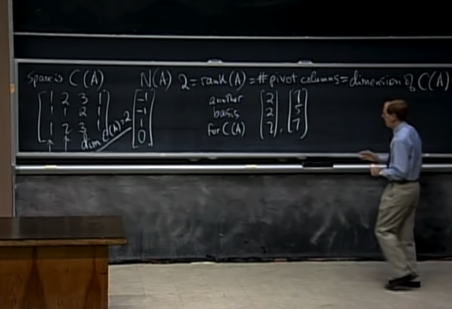</kbd>

> [!NOTE]
> Gs: Hãy cho tôi một basis khác: Thầy lấy \[2 2 2\] và \[1 5 7\] là hai vector trong column space (vì đều bằng linear combination của các cols) và hai vector này independence.
>
>
>
> Thế thì nhận định quan trọng là:
>
>
>
> **Nếu ta biết dimension của Column space C(A) là 2**, thì miễn là **2 vector bất kì trong columns space mà INDEPENDECE**nhau thì sẽ tạo một basis
>
>
>
> Có nghĩa là basis của Column space KHÔNG NHẤT THIẾT PHẢI LÀ TRONG SỐ CÁC COLUMN. MÀ LÀ BẤT KÌ BỘ VECTOR CÓ ĐỦ VECTOR VÀ ĐỘC LẬP

> [!TIP]
> 🤖 **AI Check** — 🟡 Minor issues — ✅ **92/100** · ✓ Move on
>
> Ghi chú nắm rất chính xác bản chất cốt lõi: cơ sở của C(A) không nhất thiết phải là các cột ban đầu của A mà có thể là bất kỳ bộ gồm đúng k vector độc lập tuyến tính nằm trong không gian đó (với k là dimension). Điểm trừ nhỏ duy nhất là bạn chép nhầm vector thứ hai trên bảng thành [1 5 7] thay vì [7 5 7].
>
> **🟡 Minor issues**
>
> **1.** *"[1 5 7]"*
>
> Trên bảng của giáo sư là vector [7 5 7] chứ không phải [1 5 7]. Vì hàng 1 và hàng 3 của ma trận A giống hệt nhau, nên mọi vector thuộc C(A) bắt buộc phải có phần tử thứ nhất bằng phần tử thứ ba (ví dụ [7 5 7] = 3*[1 1 1]^T + 2*[2 1 2]^T).
>
>
> **✓ Strengths**
> - Nắm vững định lý quan trọng: trong không gian k chiều, bất kỳ tập hợp gồm đúng k vector độc lập tuyến tính đều tự động trở thành một cơ sở (basis).
> - Hiểu rõ bản chất cơ sở không bị giới hạn trong các cột ban đầu của ma trận A.
>
> **💡 Deeper notes**
> - Do chiều của không gian con C(A) đã biết là 2 (bằng rank r), ta chỉ cần kiểm tra tính độc lập tuyến tính của 2 vector trong C(A) là đủ để kết luận chúng là cơ sở, không cần phải chứng minh lại điều kiện span (hệ sinh).

 

###### Basis for the Null Space

<kbd></kbd>

> [!NOTE]
> tiếp, gs: Ta đã biết dimension của columns space là rank,
> vậy còn **basis của nullspace**?
>
>
>
> Quay lại nullspace, hồi nãy ta đã tìm được một special
> solution bằng cách đưa nhận định rằng matrix A có col1 và
> col2 independence, còn col3 và col4 dependent col1 và
> col2. Nên nếu dùng elimination để đưa A về Reduced
> Echelon Form ta sẽ có col1 và col2 là pivot cols, và col3, và
> col4 là free cols.
>
>
>
> Tương đương đối với Ax=0 thì ta có thể chọn free variable
> x3, x4 và thế vào tìm pivot variable x1, x2. Ở đây gs chọn
> x3=1, x4=0, thì có x1=-1, x2=-1. Tạo nên một Special
> solution như đã biết. Và bây giờ, tương tự ta chọn x3=0,
> x4=1 để có x1=-1, x2=0 để thêm một special solution nữa.
>
>
>
> Câu hỏi của gs là: Hai vector trong nullspace (again,
> solution của Ax=0 là thuộc nullspace vì nullspace được định
> nghĩa là mọi linear combination, hay subspace tạo bởi mọi
> vector x khiến Ax=0) này có phải là basis của nullspace
> không?
>
>
>
> Cũng chính là hỏi, hai vector này **có independence** không
> và chúng **có span the nullspace không?**

> [!TIP]
> 🤖 **AI Check** — 🟡 Minor issues — ✅ **95/100** · ✓ Move on
>
> Ghi chép rất tốt và nắm bắt chính xác logic bài giảng về việc tìm special solutions cũng như đặt câu hỏi cốt lõi để kiểm tra một cơ sở (basis) của nullspace.
>
> **🟡 Minor issues**
>
> **1.** *"nullspace được định nghĩa là mọi linear combination, hay subspace tạo bởi mọi vector x khiến Ax=0"*
>
> Định nghĩa chuẩn xác của nullspace là tập hợp tất cả các vector x thỏa mãn Ax = 0. Bản thân tập nghiệm này đã tự động đóng kín dưới các tổ hợp tuyến tính để tạo thành một không gian con (subspace), không cần định nghĩa gián tiếp qua 'tổ hợp tuyến tính của các vector x'.
>
>
> **✓ Strengths**
> - Hiểu rõ quy trình xác định các biến tự do (free variables) x3, x4 và cách chọn giá trị (1, 0) và (0, 1) để tìm các nghiệm đặc biệt (special solutions).
> - Nắm chuẩn hai điều kiện cốt lõi để một tập vector tạo thành cơ sở (basis): độc lập tuyến tính (linearly independent) và sinh ra không gian (span the space).
>
> **💡 Deeper notes**
> - Do các biến tự do được gán tương ứng theo các hàng của ma trận đơn vị (ở đây là [1; 0] và [0; 1]), các vector nghiệm đặc biệt (special solutions) luôn luôn độc lập tuyến tính với nhau một cách tự nhiên.
> - Số lượng nghiệm đặc biệt luôn đúng bằng số biến tự do (n - r), và đây cũng chính là số chiều của nullspace (dim(N(A)) = n - r).

 

###### Dimension of Null Space

<kbd>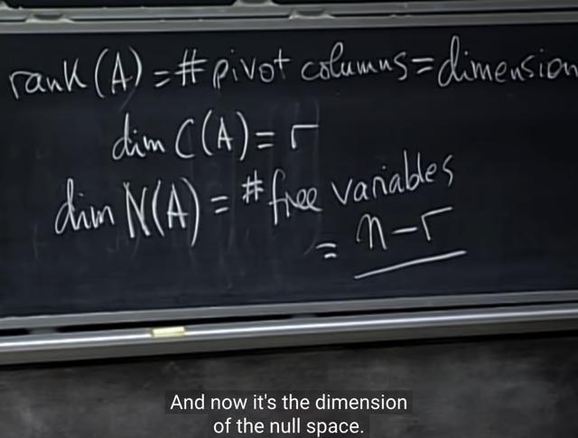</kbd>

> [!NOTE]
> Câu trả lời là: Có. Và kiến thức cuối cùng của bài giảng này
> là:
>
>
>
> **SỐ FREE COLUMN CHÍNH LÀ SỐ DIMENSION CỦA
> NULLSPACE**
>
>
>
> Và như vậy, với **n** columns, trong đó có **r** pivot, cũng
> là rank, cũng là dimension của columns space.
>
>
>
> Thì **số free columns là n - r**. Và đây **chính là dimension
> của nullspace.**

> [!TIP]
> 🤖 **AI Check** — 🟢 Pass — ✅ **95/100** · ✓ Move on
>
> Ghi chú tóm tắt rất chính xác và súc tích mối liên hệ cốt lõi giữa số cột, rank, số biến tự do và số chiều của không gian hạt nhân (nullspace).
>
> **✓ Strengths**
> - Nắm rất vững định lý Rank-Nullity: tổng số chiều của không gian cột (r) và không gian hạt nhân (n - r) bằng tổng số cột (n).
> - Hiểu đúng bản chất số biến tự do (tương ứng với các cột tự do) chính là số chiều của nullspace.
>
> **💡 Deeper notes**
> - Về thuật ngữ chuẩn, ta dùng từ 'chiều' (dimension) thay vì 'số dimension'.
> - Bảng ghi '# free variables' (số biến tự do); việc đồng nhất với 'số cột tự do' (free columns) là hoàn toàn đúng về mặt số lượng vì mỗi cột không có pivot sẽ tương ứng với một biến tự do.

 

