# Lec 5: Parametric Equations For Lines And Curves

📊 **Progress:** `23` Notes | `24` Screenshots | `11` AI Reviews

---

 

## Phương trình tham số đường thẳng

<kbd>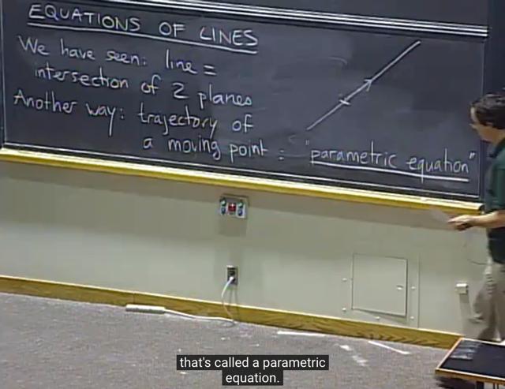</kbd>

> [!NOTE]
> ta đã thấy **line là intersection của 2 plane**. Thì nay ta **coi line như
> quỹ đạo** (trajectory) của **một điểm di chuyển theo một vector**
>
>
>
> Từ đó ta có **PARAMETRIC EQUATION**

> [!TIP]
> 🤖 **AI Check** — 🟢 Pass — ✅ **100/100** · ✓ Move on
>
> Ghi chú tóm tắt rất chính xác và súc tích nội dung bài giảng về hai cách tiếp cận phương trình đường thẳng trong không gian.
>
> **✓ Strengths**
> - Nắm bắt chính xác sự chuyển đổi góc nhìn: từ giao tuyến của hai mặt phẳng sang quỹ đạo của một điểm chuyển động.
> - Liên kết đúng khái niệm quỹ đạo chuyển động với phương trình tham số (parametric equation).
>
> **💡 Deeper notes**
> - Về mặt toán học, điểm chuyển động dọc theo vector chỉ phương được biểu diễn qua tham số thời gian t dưới dạng phương trình vector: r(t) = r₀ + t*v.

 

### Phương trình tham số đường thẳng

<kbd>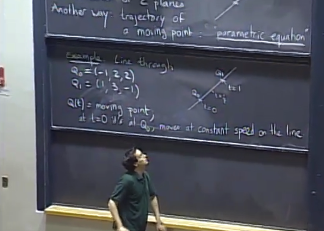</kbd>

> [!NOTE]
> Lấy ví dụ ta có **2 điểm** này, coi như là **vị trí của moving point** tại
> thời điểm **t = 0**, và **t = 1**
>
>
>
> Và cho **Q(t)** là function cho **vị trí của moving point theo t**, với speed
> quy định bởi **constant** sao cho từ Q0 tại t=0 thì khi t=1, moving point
> tới Q1

 

#### Vector vị trí điểm chuyển động

<kbd>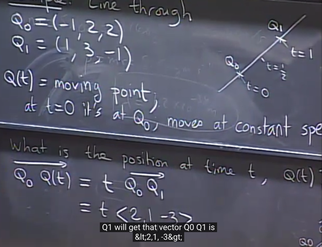</kbd>

> [!NOTE]
> gs đặt vector **Q0Qt** và **Q0Q1**. Câu hỏi là hai vector (cùng phương) này thì Q0Qt = bao nhiêu × Q0Q1?
>
>
>
> → Q0Qt = t × Q0Q1
>
>
>
> Vì đã nói moving point di chuyển với constant speed sao cho trong 1 đơn vị thời gian (từ t=0 đến t=1), điểm di chuyển từ Q0 đến Q1 (tức là trên đoạn Q0Q1). Do đó trong t đơn vị thời gian dĩ nhiên nó sẽ di chuyển một quãng t × Q0Q1

 

##### Phương trình tham số đường thẳng

<kbd>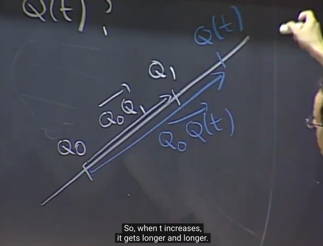</kbd>

 

###### Phương trình tham số đường thẳng

<kbd>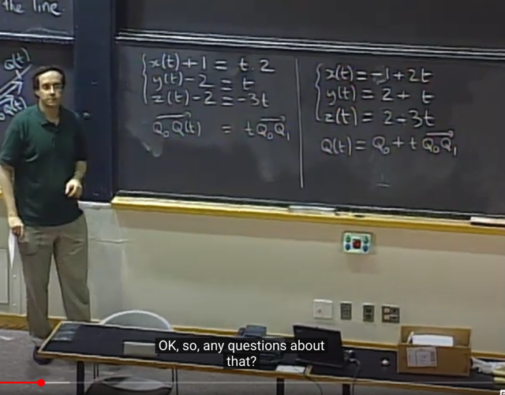</kbd>

> [!NOTE]
> từ đó, với việc ta tham số hóa vector Q / vị trí của moving point thì cũng chính là ta tham số hóa tọa độ của nó:
>
>
>
> Q(t) = \[x(t), y(t), z(t)\]:
>
>
>
> =&gt; Q0Qt = Qt - Q0 = &lt;x(t) - (-1), y(t) - 2, z(t) - 2&gt;
>
>
>
> = &lt;x(t) + 1, y(t) - 2, z(t) - 2&gt;
>
>
>
> Q0Q1 = Q1 - Q0 = &lt;2, 1, -3&gt;
>
>
>
> Từ Q0Qt = t \* Q0Q1 ta có 3 linear function như vầy:
>
>
>
> x(t) + 1 = t × 2
>
>
>
> y(t) - 2 = t
>
>
>
> z(t) - 2 = -3t
>
>
>
> Và đây cũng chính là Q(t) = Q0 + t × Q0Qt

> [!TIP]
> 🤖 **AI Check** — 🟡 Minor issues — ⚠️ **85/100** · ✓ Move on
>
> Ghi chú thể hiện bạn đã hiểu rất tốt cách tham số hóa tọa độ của điểm chuyển động từ phương trình vector. Bạn chỉ cần sửa một lỗi gõ nhầm ký hiệu ở công thức tổng kết cuối cùng.
>
> **🟡 Minor issues**
>
> **1.** *"Và đây cũng chính là Q(t) = Q0 + t × Q0Qt"*
>
> Lỗi gõ nhầm chỉ số: phía vế phải phải là vector chỉ phương cố định Q0Q1 (tức Q(t) = Q0 + t * Q0Q1), chứ không phải Q0Qt. Nếu ghi Q0Qt thì vế phải lại phụ thuộc vào chính vị trí cần tìm Q(t).
>
> **2.** *"t × Q0Qt"*
>
> Ký hiệu '×' dễ gây nhầm lẫn với tích có hướng (cross product) giữa hai vector; ở đây t là một scalar nên đây là phép nhân vô hướng với vector (scalar multiplication).
>
>
> **✓ Strengths**
> - Hiểu chính xác bản chất của việc tham số hóa vị trí chính là tham số hóa từng thành phần tọa độ theo biến thời gian t.
> - Khai triển và thiết lập đúng hệ phương trình tọa độ tuyến tính từ phương trình vector Q0Qt = t * Q0Q1.
>
> **💡 Deeper notes**
> - Biểu thức Q(t) = Q0 + t * Q0Q1 mang ý nghĩa hình học affine: một điểm (Q0) cộng với một vector tịnh tiến (t * Q0Q1) sẽ cho ra một điểm mới Q(t).

 

###### Giao điểm với mặt phẳng

<kbd>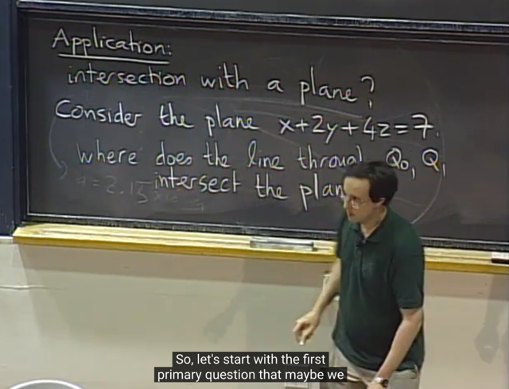</kbd>

> [!NOTE]
> qua phần ứng dụng. Đầu tiên gs cho plane với equation này, câu hỏi là
> **line đi qua Q0, Q1 có intersect với plane không?**

 

###### Điểm đối với mặt phẳng

<kbd>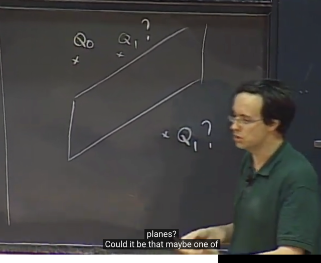</kbd>

> [!NOTE]
> Hay, câu hỏi khác là Q0, Q1 nằm cùng bên của
> plane hay khác bên so với plane?

> [!TIP]
> 🤖 **AI Check** — 🟢 Pass — ✅ **100/100** · ✓ Move on
>
> Ghi chú nắm bắt rất chính xác câu hỏi cốt lõi mà giảng viên đang đặt ra trên bảng: xác định hai điểm Q0 và Q1 nằm cùng phía hay khác phía đối với mặt phẳng.
>
> **✓ Strengths**
> - Nắm bắt đúng bản chất câu hỏi hình học về vị trí tương đối giữa hai điểm và mặt phẳng (same side vs. opposite side).
>
> **💡 Deeper notes**
> - Trong đồ họa máy tính (như thuật toán clipping đường thẳng hoặc kiểm tra giao cắt), việc kiểm tra hai điểm nằm cùng phía hay khác phía của mặt phẳng thường được thực hiện nhanh bằng cách thay tọa độ vào phương trình mặt phẳng f(P) = n · P + d và xét dấu tích f(Q0) * f(Q1).

 

###### Hai phía mặt phẳng

<kbd>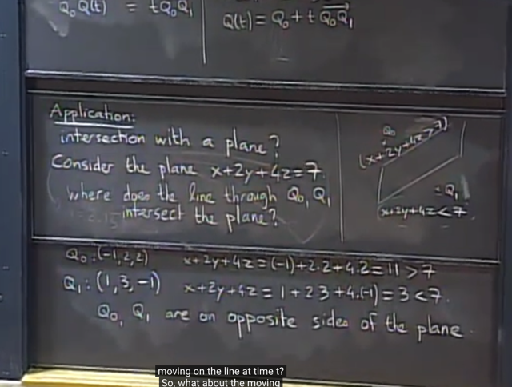</kbd>

> [!NOTE]
> ta sẽ tính **dot product của Q0 và normal vector →** ra lớn hơn 7, và
> giữa **Q1 và normal vector** ra bé hơn 7 → ở **hai bên của plane**
>
>
>
> Lí do là theo định nghĩa phương trình mặt phẳng ax+by+cz=d thì mặt
> phẳng sẽ chia không gian thành 2 phần: tất cả những điểm có ax+by+
> cz > d và nửa còn lại là những điểm có ax+by+cz < d. Còn những
> điểm trên mặt phẳng sẽ có ax+by+cz = 0

 

###### Tích vô hướng của Q(t)

<kbd>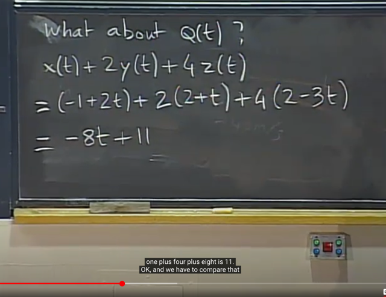</kbd>

> [!NOTE]
> Xét dot product của Q(t) và normal vector cho ra -8 × t + 11

> [!TIP]
> 🤖 **AI Check** — 🟢 Pass — ✅ **95/100** · ✓ Move on
>
> Ghi chú hoàn toàn chính xác về mặt bản chất hình học, nhận diện đúng biểu thức x(t) + 2y(t) + 4z(t) là tích vô hướng giữa vectơ vị trí Q(t) và vectơ pháp tuyến n = (1, 2, 4).
>
> **✓ Strengths**
> - Nhận diện chính xác bản chất tích vô hướng giữa tọa độ điểm Q(t) và vectơ pháp tuyến n = (1, 2, 4) của mặt phẳng.
> - Kết quả tính toán đại số ra -8t + 11 hoàn toàn khớp với bài giảng.
>
> **💡 Deeper notes**
> - Nên ghi rõ tọa độ của vectơ pháp tuyến n = (1, 2, 4) để ghi chú đầy đủ và dễ theo dõi hơn khi xem lại.

 

###### Giao điểm với mặt phẳng

<kbd>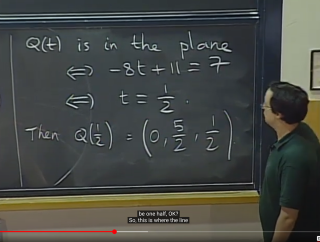</kbd>

> [!NOTE]
> Để Q(t) nằm trong plane thì **-8 × t +11 phải bằng 7** đồng
> nghĩa để t phải bằng 1/2.

 

###### Quỹ đạo Cycloid

<kbd>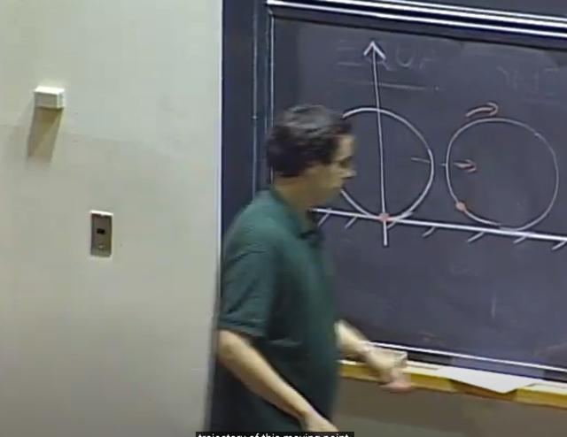</kbd>

> [!NOTE]
> tiếp theo qua bài toán **tìm quỹ đạo của 1 điểm trên bánh xe**
> đang di chuyển - **Cycloid**

 

###### Đường Cycloid

<kbd>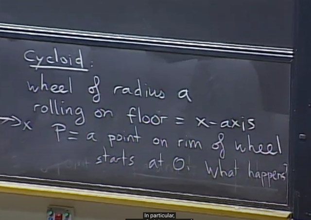</kbd>

> [!NOTE]
> Cho bánh xe **bán kính a**, lăn trên trục x.
> **P là 1 điểm trên vành bánh.**

 

###### Quỹ đạo đường Cycloid

<kbd>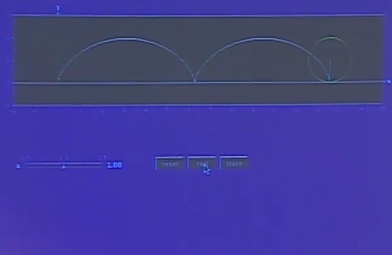</kbd>

> [!NOTE]
> Quỹ đạo của P như vầy.

 

###### Hàm vị trí điểm P

<kbd>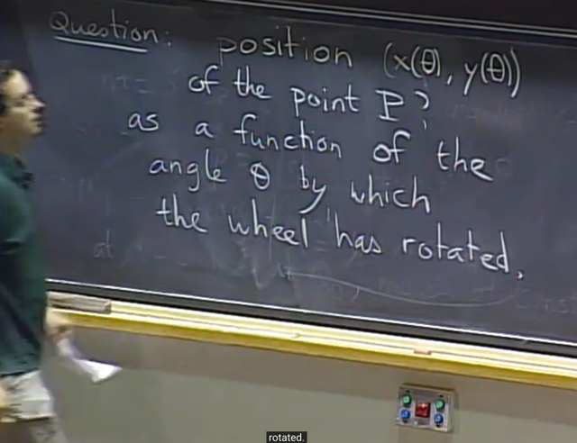</kbd>

> [!NOTE]
> Câu hỏi là **tìm function thể hiện vị trí của P theo
> θ** - là góc mà bánh xe đã xoay

 

###### Phân tích vector vị trí OP

<kbd>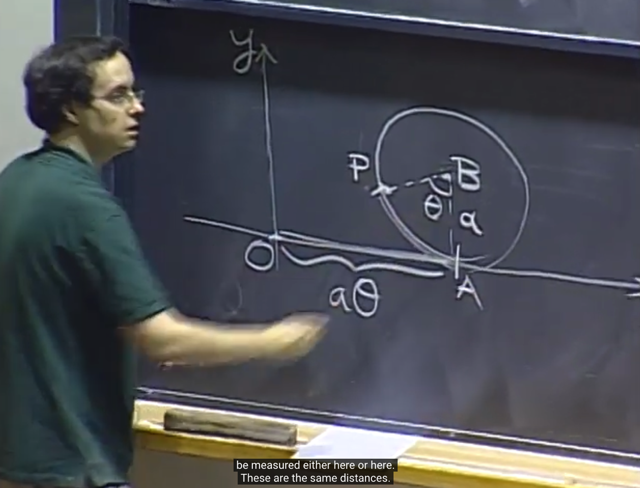</kbd>

> [!NOTE]
> Thế thì, vị trí của P cũng là của vector OP và CÓ VẺ RẤT KHÓ
> ĐỂ "TÍNH" VECTOR NÀY.
>
>
>
> Ta sẽ thể hiện nó bằng **tổng 3 vector (OA, AB, BP) CÓ VẺ DỄ
> TÍNH HƠN**

> [!TIP]
> 🤖 **AI Check** — 🟢 Pass — ✅ **95/100** · ✓ Move on
>
> Ghi chú nắm bắt rất chính xác ý tưởng phân tích vector vị trí của điểm trên đường cycloid thành tổng của 3 vector thành phần dễ xác định hơn.
>
> **✓ Strengths**
> - Học viên nắm đúng tư duy then chốt khi lập phương trình tham số cycloid: biểu diễn vector OP thông qua chuỗi vector nối tiếp OA, AB và BP.
>
> **💡 Deeper notes**
> - Cần lưu ý thứ tự và chiều của vector: vector từ tâm B đến điểm P phải là BP (chứ không phải PB) để quy tắc cộng vector OP = OA + AB + BP giữ đúng dấu tọa độ.

 

###### Tọa độ vector OA

<kbd>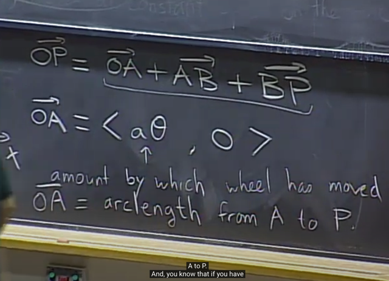</kbd>

> [!NOTE]
> Vector OA có **y = 0 vì nó trùng trục x**, và x = **a*θ** (a là bán kính),
> điều này là vì độ dài **OA chính là độ dài cung AP của đường tròn**.
>
>
>
> Theta có đơn vị radian.

 

###### Tọa độ vector BP

<kbd>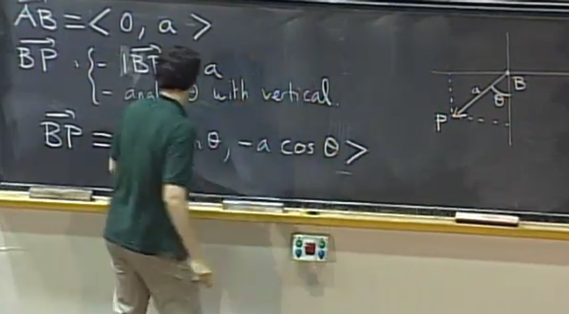</kbd>

> [!NOTE]
> Vector AB thì dễ thấy bằng (0, a)
>
>
>
> Vector BP thì có length bằng a và có góc θ với trục vertical line
>
>
>
> Thế thì dựa vào lượng giác ta có hai tọa độ của BP là -a sin(θ)và -a cos(θ)

> [!TIP]
> 🤖 **AI Check** — 🟢 Pass — ✅ **100/100** · ✓ Move on
>
> Ghi chú hoàn toàn chính xác và thể hiện đúng cách phân tích thành phần tọa độ của vector dựa vào góc hợp với trục thẳng đứng.
>
> **✓ Strengths**
> - Học viên xác định chính xác độ dài và góc của vector theo đúng hình vẽ bài giảng.
> - Học viên suy luận đúng dấu âm và các hàm lượng giác cho từng thành phần tọa độ của vector BP.
>
> **💡 Deeper notes**
> - Vì góc θ được đo so với phương thẳng đứng (trục y) thay vì phương ngang thông thường, nên hình chiếu theo phương ngang (trục x) là đối diện góc θ (dùng hàm sin) và hình chiếu thẳng đứng là kề góc θ (dùng hàm cos).

 

###### Tọa độ điểm P theo θ

<kbd>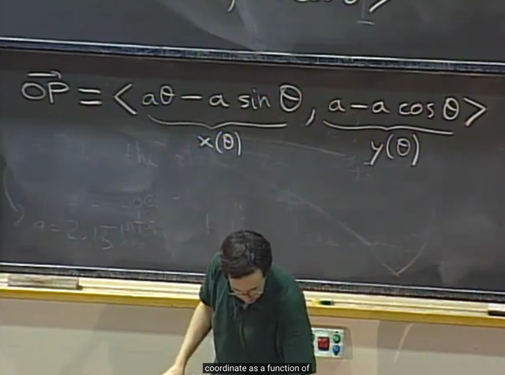</kbd>

> [!NOTE]
> và từ đó ta có vector OP cũng là tọa độ của P theo θ:
>
>
>
> OP = &lt;aθ - a sin(θ), a - a cos(θ)&gt;

> [!TIP]
> 🤖 **AI Check** — 🟢 Pass — ✅ **100/100** · ✓ Move on
>
> Ghi chú ngắn gọn và chính xác, nhận diện đúng bản chất vector vị trí OP xác định tọa độ của điểm P theo tham số θ.
>
> **✓ Strengths**
> - Hiểu đúng mối liên hệ giữa vector vị trí OP (với O là gốc tọa độ) và tọa độ (x, y) của điểm P phụ thuộc vào θ.
>
> **💡 Deeper notes**
> - Về mặt ký hiệu hình thức, vector thường được viết ở dạng thành phần ⟨x(θ), y(θ)⟩, tương ứng trực tiếp với điểm tọa độ P(x(θ), y(θ)) trong mặt phẳng Oxy.

**🔗 See also:** [Vector vị trí đường Cycloid](./lec_6_velocity_acceleration_keplers_second_law.md#node-k44c7aj)

 

###### Quỹ đạo điểm P gần đáy

<kbd>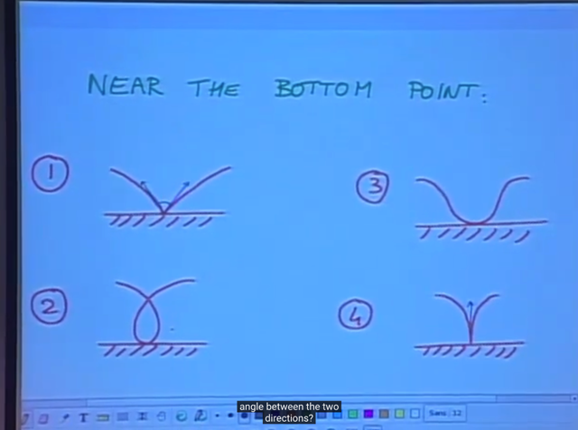</kbd>

> [!NOTE]
> câu hỏi là gần đáy thì quỹ đạo
> chính xác của P như thế nào.

 

###### Xấp xỉ góc nhỏ

<kbd>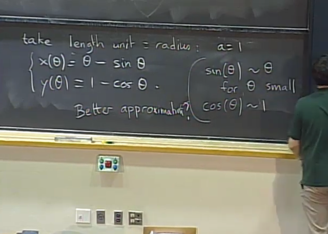</kbd>

> [!NOTE]
> Đại khái là ta xét a = 1 (unit length) để x(θ), y(θ) như vầy.
>
>
>
> Với **θ rất nhỏ thì sin(θ) ≈ θ**, **cos(θ) ≈ 1**
>
>
>
> (Có thể xem lại trong lec 2 của 18.01 (theo link tím), gs nói trong phần chứng minh hai properties A, B thì property B chính là khi θ → 0 thì limit sin(θ)/θ = 1 hay **sin(θ) ≈ θ**
>
>
>
> Và property A đó là lim θ→0 \[(cos(θ) - 1) / θ\] = 0, tức là, khi θ ≈ 0, \[cos(θ) - 1\] /θ ≈ 0 ⇔ cos(θ) - 1 ≈ 0 ⇔ **cos(θ) ≈ 1)**
>
>
>
> Hoặc nói đúng hơn, là đây chính là dùng công thức linear approximation (link đỏ) f(x) = f(0) + f'(0)\*x với f(x) là sin(x) thì công thức này sẽ cho ta sin(x) = x khi x≈0 và f(x) = cos(x) thì ta có cos(x) ≈ 1 khi x≈0
>
>
>
> Quay lại đây, gs nói cách xấp xỉ này, x ≈ 0, y≈1 và không giúp ích gì trong việc trả lời câu hỏi này

> [!TIP]
> 🤖 **AI Check** — 🟡 Minor issues — ⚠️ **82/100** · ✓ Move on
>
> Ghi chú rất tốt khi kết nối xấp xỉ góc nhỏ với các giới hạn cơ bản và khai triển tuyến tính đã học. Tuy nhiên bạn có một nhầm lẫn nhỏ ở cuối: khi cos(theta) ~ 1 thì y = 1 - cos(theta) ~ 0 chứ không phải 1.
>
> **🟡 Minor issues**
>
> **1.** *"x ~= 0, y~=1"*
>
> Với y(theta) = 1 - cos(theta), khi cos(theta) ~ 1 thì y ~ 1 - 1 = 0 chứ không phải 1. Lý do xấp xỉ này không giúp ích là vì cả x ~ 0 và y ~ 0 đều bị triệt tiêu về (0,0), không cung cấp thông tin gì về dạng đường cong y theo x quanh gốc tọa độ.
>
>
> **✓ Strengths**
> - Liên kết chính xác xấp xỉ góc nhỏ với các giới hạn lượng giác cơ bản đã chứng minh ở bài học trước.
> - Hiểu đúng bản chất xấp xỉ tuyến tính f(x) ~ f(0) + f'(0)x áp dụng cho sin(x) và cos(x).
>
> **💡 Deeper notes**
> - Để tìm mối liên hệ giữa y và x tại lân cận theta = 0 (điểm lùi cusp), cần dùng khai triển Taylor bậc cao hơn: sin(theta) ~ theta - theta^3/6 và cos(theta) ~ 1 - theta^2/2, dẫn đến y ~ (9/2 * x^2)^(1/3).

 

###### Khai triển Taylor

<kbd>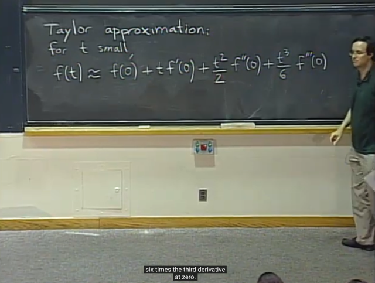</kbd>

> [!NOTE]
> gs nói ta cần dùng kiến thức Taylor expansion học từ 1801.
>
>
>
> Đó là hàm f(t) có thể được ước lượng xấp xỉ như vầy.
>
>
>
> Ta đã biết công thức Taylor series hàm f(x) expand tại a:
>
>
>
> f(x) = Tổng n = 0:N (1/n!)[đạo hàm cấp n của f tại a] (x-a)^n
>
>
>
> Thì ở đây a = 0, (gọi là Maclaurin series):
>
>
>
> f(t) = Tổng n = 0:N (1/n!)[đạo hàm cấp n của f tại a] (x-a)^n
>
>
>
> **= f(0) + f'(0)t + f''(0)t²/2 + ...**
>
>
>
> Chỗ này hình như gs ghi sai f'(0). Phải là f(0)

> [!TIP]
> 🤖 **AI Check** — 🟡 Minor issues — ✅ **95/100** · ✓ Move on
>
> Ghi chú rất tốt và thể hiện sự quan sát sắc bén khi nhận ra giảng viên viết nhầm dấu phẩy đạo hàm f'(0) ở số hạng đầu tiên trên bảng.
>
> **🟡 Minor issues**
>
> **1.** *"f(t) = Tổng n = 0:N (1/n!)[đạo hàm cấp n của f tại a] (x-a)^n"*
>
> Khi đã thay a = 0 cho biến t, công thức tổng nên được viết lại theo t^n và đạo hàm tại 0 thay vì giữ nguyên biến x và tâm a như dòng trên.
>
>
> **✓ Strengths**
> - Quan sát tinh ý và phát hiện chính xác lỗi viết nhầm f'(0) thay vì f(0) của giảng viên trên bảng.
> - Nắm vững định nghĩa chuỗi Taylor quanh 0 (chuỗi Maclaurin) và viết đúng dạng khai triển của các số hạng đầu.
>
> **💡 Deeper notes**
> - Khai triển dừng ở một bậc hữu hạn n là một xấp xỉ đa thức đi kèm với số hạng dư (dạng Peano o(t^n) hoặc Lagrange), đảm bảo độ chính xác khi t tiến gần về 0.

 

###### Xấp xỉ Taylor sin, cos

<kbd>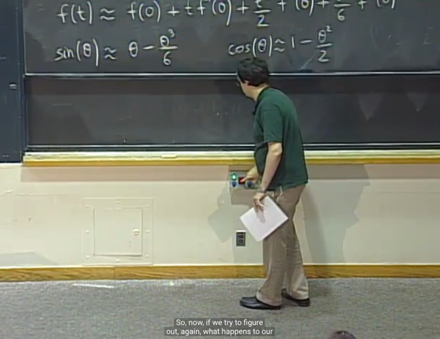</kbd>

> [!NOTE]
> và áp dụng Taylor approximation, ta có better approximation cho sin(θ), cos(θ) tại θ = 0
>
>
>
> f(t) = f(0) + f'(0)t + f''(0)t²/2 + ...
>
>
>
> ⇒ sin(θ) = sin(0) + sin'(0)×θ + sin''(0)×θ²/2 + sin'''(0)\*θ³/3 + ...
>
>
>
> sin(0) = 0, sin'(x) = cos(x) ⇒ sin'(0) = cos(0) = 1
>
>
>
> sin''(x) = cos'(x) = -sin(x) ⇒ sin''(0) = -sin(0) = 0
>
>
>
> sin'''(x) = -sin'(x) = -cos(x) ⇒ sin'''(0) = -cos(0) = -1
>
>
>
> Ta sẽ chỉ dùng tới lũy thừa bậc 3 của θ là được rồi vì θ rất nhỏ.
>
>
>
> → sin(θ) ≈ 0 + 1 × θ + 0 × θ²/2! -1 × θ³/3! = θ - θ³/6
>
>
>
> Làm tương tự ta cũng có cos(θ) ≈ 1 - θ²/2

 

###### Xấp xỉ x(θ) và y(θ)

<kbd>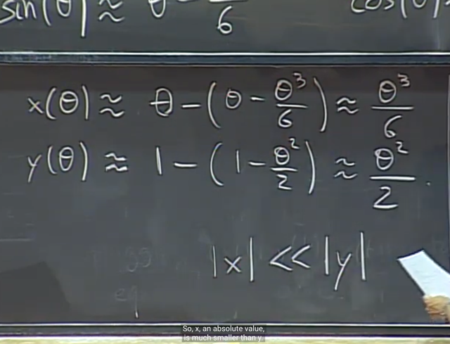</kbd>

> [!NOTE]
> từ đó ta có better approximation của x(θ) y(θ).
>
>
>
> x(θ) = θ - sin(θ) ≈ θ - (θ - θ³/6) = θ³/6
>
>
>
> y(θ) = 1 - cos(θ) ≈ 1 - (1 - θ²/2) = θ²/2
>
>
>
> Và nó có thấy với θ rất nhỏ thì x nhỏ hơn rất nhiều so với y vì x là lũy thừa bậc 3 của θ còn y là bậc 2 (θ rất nhỏ thì bậc lũy thừa càng cao thì nó càng nhỏ)

> [!TIP]
> 🤖 **AI Check** — 🟢 Pass — ✅ **100/100** · ✓ Move on
>
> Ghi chú rất chính xác và nắm bắt trọn vẹn bản chất của việc xấp xỉ Taylor bậc cao cũng như so sánh độ lớn giữa x và y khi θ tiến về 0.
>
> **✓ Strengths**
> - Hiểu và khai triển chính xác xấp xỉ Taylor cho sin(θ) và cos(θ) để tìm xấp xỉ tốt hơn cho x(θ) và y(θ).
> - Giải thích chuẩn xác lý do tại sao x nhỏ hơn rất nhiều so với y khi θ rất nhỏ dựa trên bậc lũy thừa.
>
> **💡 Deeper notes**
> - Về mặt chặt chẽ khi xét cả góc âm (θ < 0), ta so sánh giá trị tuyệt đối |x| << |y|, do lũy thừa bậc 3 của số âm sẽ cho kết quả âm trong khi bậc 2 luôn không âm.

 

###### Độ dốc tại điểm tiếp xúc

<kbd>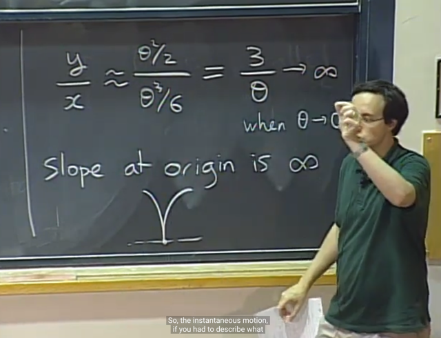</kbd>

> [!NOTE]
> và tỉ lệ y/x sẽ là 3/θ và khi θ nhỏ đến 0 thì y/x → vô cùng.
>
>
>
> Tức là nếu xét đồ thị y = f(x) (thay vì thay vì là x(θ), y(θ)) thì the slope của đồ thị hàm y = f(x) tại θ → 0 sẽ là vô cùng.
>
>
>
> Do đó dạng chính xác của hàm f tại điểm tiếp xúc mặt đường sẽ là như vầy

> [!TIP]
> 🤖 **AI Check** — 🟢 Pass — ✅ **95/100** · ✓ Move on
>
> Ghi chú nắm rất chuẩn xác lập luận trên bảng: tỉ số xấp xỉ y/x tiến tới vô cùng khi θ tiến về 0, dẫn tới độ dốc tại gốc tọa độ (điểm tiếp xúc) là vô cùng và tạo thành dạng điểm lùi (cusp) có tiếp tuyến thẳng đứng.
>
> **🟡 Minor issues**
>
> **1.** *"tỉ lệ y/x sẽ là 3/θ"*
>
> Về mặt thuật ngữ giải tích, y/x là hệ số góc của cát tuyến nối từ gốc tọa độ tới điểm (x, y). Độ dốc tức thời (tiếp tuyến) dy/dx = (dy/dθ)/(dx/dθ) ≈ θ / (θ²/2) = 2/θ. Tuy nhiên cả hai đại lượng đều tiến tới vô cùng khi θ → 0+, nên kết luận độ dốc tại gốc bằng ∞ hoàn toàn chính xác.
>
>
> **✓ Strengths**
> - Hiểu đúng ý nghĩa của việc xét tỉ số y/x khi θ tiến về 0 để suy ra hướng của đồ thị gần gốc tọa độ.
> - Hình dung chính xác hình học của đường cycloid tại điểm tiếp xúc mặt đường (tiếp xúc vuông góc / tiếp tuyến thẳng đứng tạo thành cusp).
>
> **💡 Deeper notes**
> - Cần lưu ý góc θ tiến về 0 từ phía dương (θ → 0⁺). Khi chuyển động qua điểm tiếp xúc từ trái sang phải, đường cong đổi chiều đi lên tạo thành điểm nhọn (cusp) với tiếp tuyến thẳng đứng x = 0.

 

