# Lec 6: Velocity, Acceleration, Kepler's Second Law

📊 **Progress:** `27` Notes | `28` Screenshots | `6` AI Reviews

---

 

## Phương trình tham số chuyển động

<kbd>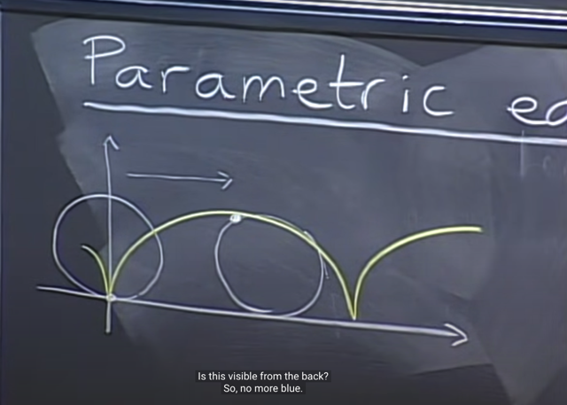</kbd>

> [!NOTE]
> Bài trước ta đã biết về **parametric equation**, giúp **mô tả chuyển
> động của một điểm** theo **biến số thời gian** hoặc biến số nào đó
>
>
>
> Cụ thể là bài trước ta xem xét chuyển động của một điểm trên vành
> bánh xe

 

### Vector vị trí đường Cycloid

<kbd>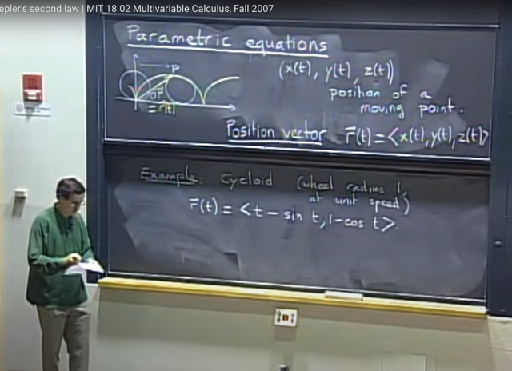</kbd>

> [!NOTE]
> Đại khái là trong bài toán đó ta thể hiện tọa độ của điểm làm các function theo t: \[x(t), y(t), z(t)\], từ đó ta có position vector OP = r(t)(cũng là tọa độ của điểm) theo t
>
>
>
> Và bữa trước ta đã tìm ra r(t) = &lt; t - sin(θ), 1 - cos(θ)&gt;
>
>
>
> Nếu bánh xe quay với unit speed, thì θ = t (θ vốn là hàm theo t, và nếu tốc độ quay là unit tức là bằng 1 thì θ = 1 × t)

> [!TIP]
> 🤖 **AI Check** — 🟡 Minor issues — ✅ **90/100** · ✓ Move on
>
> Ghi chú nắm rất tốt bản chất của vector vị trí và cách tham số hóa cycloid theo thời gian t khi bánh xe lăn với tốc độ đơn vị.
>
> **🟡 Minor issues**
>
> **1.** *"r(t) = < t - sin(θ), 1 - cos(θ)>"*
>
> Có sự lẫn lộn ký hiệu giữa t và θ trong cùng một biểu thức. Công thức gốc theo góc quay θ của cycloid bán kính 1 là <θ - sin(θ), 1 - cos(θ)>, sau đó khi thay θ = t (với unit speed) mới thành <t - sin(t), 1 - cos(t)>.
>
>
> **✓ Strengths**
> - Hiểu đúng khái niệm vector vị trí r(t) xuất phát từ các phương trình tham số của tọa độ điểm.
> - Nắm rõ mối liên hệ giữa thời gian t và góc quay θ khi giả định tốc độ đơn vị (unit speed).
>
> **💡 Deeper notes**
> - Đối với bánh xe lăn không trượt bán kính R = 1, tốc độ tịnh tiến của tâm bánh xe v và tốc độ góc ω bằng nhau (v = ωR = 1), nên cả quãng đường lăn s và góc quay θ đều bằng t.

**🔗 See also:** [linked note](./lec_12_gradient_directional_derivative_tangent_plane.md#node-2y7tc9e) · [Tọa độ điểm P theo θ](./lec_5_parametric_equations_for_lines_and_curves.md#node-iz08e7n)

 

#### Vector vận tốc

<kbd>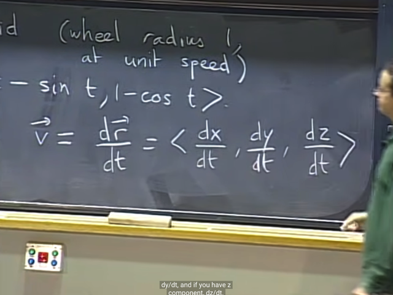</kbd>

> [!NOTE]
> Đại khái là ta có thể có **vector vận tốc (velocity)** vừa chỉ **độ lớn** vừa
> chỉ **hướng của chuyển động.** Và ta sẽ có vector này bằng cách **lấy
> đạo hàm của r đối với t**
>
>
>
> Và component của vector v sẽ có được bằng cách lấy derivative của 
> từng component của r(t) đối với t: dx/dt, dy/dt, dz/dt

> [!TIP]
> 🤖 **AI Check** — 🟢 Pass — ✅ **100/100** · ✓ Move on
>
> Ghi chú nắm rất chính xác và đầy đủ bản chất vật lý cũng như cách tính toán từng thành phần của vector vận tốc từ vector vị trí.
>
> **✓ Strengths**
> - Nắm vững ý nghĩa vật lý của vector vận tốc (thể hiện cả hướng chuyển động và độ lớn).
> - Hiểu chính xác công thức toán học: đạo hàm của vector vị trí theo thời gian bằng cách lấy đạo hàm từng thành phần tọa độ (dx/dt, dy/dt, dz/dt).
>
> **💡 Deeper notes**
> - Độ lớn của vector vận tốc |v| = sqrt((dx/dt)^2 + (dy/dt)^2 + (dz/dt)^2) chính là tốc độ (speed), và vector vận tốc luôn có phương tiếp tuyến với quỹ đạo chuyển động tại mọi thời điểm.

**🔗 See also:** [Xấp xỉ tuyến tính độ dời](#node-uchr2ns)

 

##### Vận tốc đường Cycloid

<kbd>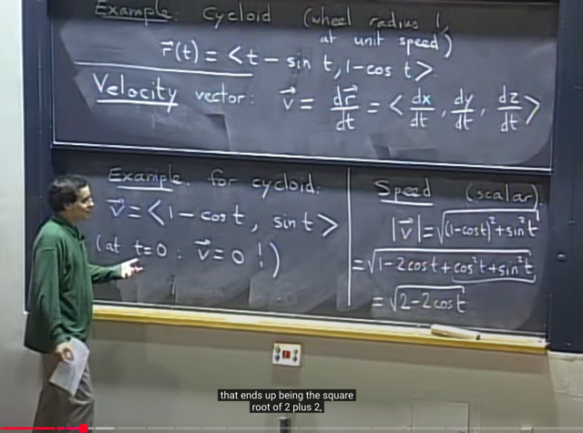</kbd>

> [!NOTE]
> Lấy ví dụ của cycloid thì ta có vector velocity như vầy (dễ dàng tìm được đạo hàm của x(t), y(t) đối với t:
>
>
>
> d \[t - sin(t)\] / dt = 1 - cos(t) và d \[1 - cos(t)\] / dt = -(-sin(t)) = sin(t)
>
>
>
> Để rồi với t = 0 (thời điểm xuất phát) thì v = zero vector (&lt;1 - cos(0), sin(0)&gt; = &lt;1-1, 0&gt; = &lt;0, 0&gt;
>
>
>
> Còn độ lớn của vận tốc, thì ta sẽ lấy l2 norm của vector v, với ví dụ cycloid thì nó là sqrt(2-2cost(t)) (để rồi với t = 0 thì 2-2 × cost(t) = 2-2 = 0
>
>
>
> Khi t = pi, thì vector v sẽ song song với hướng di chuyển, với độ lớn thế t vào sqrt(2-2 × cost(t)) = sqrt(2-2 × cost(pi)) = sqrt(2-(-2)) = sqrt(4) = 2. Cho thấy nó di chuyển nhanh gấp 2 lần tốc độ di chuyển của bánh xe (unit speed)

> [!TIP]
> 🤖 **AI Check** — 🟢 Pass — ✅ **100/100** · ✓ Move on
>
> Ghi chú rất chính xác và đầy đủ, tính toán đạo hàm, độ lớn vận tốc (tốc độ) và bổ sung liên hệ vật lý rất chuẩn xác tại t = 0 và t = pi.
>
> **🟡 Minor issues**
>
> **1.** *"sqrt(2-2cost(t))"*
>
> Lỗi gõ phím nhỏ (viết nhầm 'cost' thay vì 'cos'), không ảnh hưởng đến bản chất toán học hay tư duy vật lý của bài.
>
>
> **✓ Strengths**
> - Tính toán đạo hàm từng thành phần của vector vị trí rất rõ ràng và chuẩn xác.
> - Hiểu rõ việc tính tốc độ thông qua chuẩn Euclidean (L2 norm) của vector vận tốc.
> - Bổ sung suy luận vật lý rất hay và chính xác tại điểm cao nhất t = pi khi điểm trên vành bánh xe di chuyển với tốc độ gấp đôi tâm bánh xe.
>
> **💡 Deeper notes**
> - Biểu thức căn bậc hai của tốc độ có thể rút gọn thêm bằng công thức lượng giác: sqrt(2 - 2cos(t)) = sqrt(4 sin^2(t/2)) = 2|sin(t/2)|.

 

###### Vector gia tốc

<kbd>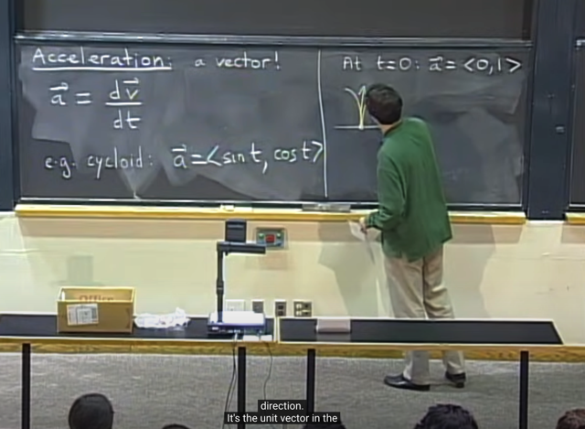</kbd>

> [!NOTE]
> Gia tốc cũng là vector, và là **derivative của vector v** (đương nhiên là đối với t vì v chỉ là hàm theo t).
>
>
>
> Với cycloid example thì vector a là &lt;sin(t), cos(t)&gt; Và **tại t = 0, ta có vector a = &lt;0,1&gt;**
>
>
>
> Điều này cho thấy khi đó dù chưa di chuyển, vận tốc của điểm P bằng 0 nhưng nó có **gia tốc hướng lên với độ lớn sqrt(1²+0) = 1**

> [!TIP]
> 🤖 **AI Check** — 🟡 Minor issues — ✅ **95/100** · ✓ Move on
>
> Ghi chú rất chính xác và nắm bắt trọn vẹn bản chất vật lý lẫn hình học của ví dụ đường cycloid tại điểm uốn (cusp).
>
> **🟡 Minor issues**
>
> **1.** *"cost(t)"*
>
> Lỗi chính tả nhỏ khi viết hàm cosin, nên viết là cos(t).
>
>
> **✓ Strengths**
> - Hiểu chính xác định nghĩa gia tốc là đạo hàm theo thời gian của vector vận tốc.
> - Rút ra được ý nghĩa vật lý trực quan rất tốt: tại đáy chu kỳ (cusp), dù vận tốc tức thời bằng 0 nhưng điểm tiếp xúc vẫn chịu gia tốc hướng thẳng đứng lên trên.
>
> **💡 Deeper notes**
> - Độ lớn gia tốc ở đây luôn là sqrt(sin^2(t) + cos^2(t)) = 1 không đổi ở mọi thời điểm t, tức đây là chuyển động có độ lớn gia tốc bảo toàn, chỉ đổi hướng liên tục.

 

###### Độ lớn vector vận tốc

<kbd>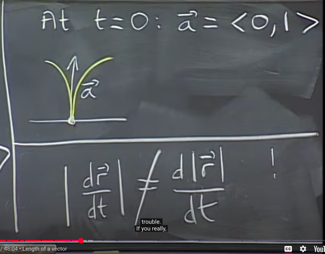</kbd>

> [!NOTE]
> Gs lưu ý là **length của dr/dt mới là length của vector vận tốc**, và
> là độ lớn của vận tốc.
>
>
>
> Còn nó **hoàn toàn khác với d|r|/dt** và **đạo hàm của độ lớn** của r
> đối với t **không phải là khái niệm gì cả**

> [!TIP]
> 🤖 **AI Check** — 🟡 Minor issues — ⚠️ **88/100** · ✓ Move on
>
> Ghi chú nắm rất tốt ý chính của bài giảng rằng độ lớn của vận tốc là $|d\vec{r}/dt|$ chứ không phải $d|\vec{r}|/dt$. Tuy nhiên, cách diễn đạt $d|\vec{r}|/dt$ 'không phải là khái niệm gì cả' là hơi cực đoan vì đây thực chất là tốc độ thay đổi khoảng cách đến gốc tọa độ.
>
> **🟡 Minor issues**
>
> **1.** *"đạo hàm của độ lớn của r đối với t không phải là khái niệm gì cả"*
>
> Về mặt toán học và vật lý, $d|\vec{r}|/dt$ vẫn là một đại lượng có nghĩa: nó biểu diễn tốc độ thay đổi khoảng cách từ chất điểm tới gốc tọa độ (vận tốc xuyên tâm / radial velocity), chỉ là nó không đồng nhất với tốc độ (speed) của chuyển động.
>
>
> **✓ Strengths**
> - Phân biệt chính xác giữa độ lớn của vectơ vận tốc $|d\vec{r}/dt|$ (tốc độ tức thời) và đạo hàm của độ dài vectơ vị trí $d|\vec{r}|/dt$.
>
> **💡 Deeper notes**
> - Một ví dụ trực quan: trong chuyển động tròn đều quanh gốc tọa độ, khoảng cách $|\vec{r}|$ là hằng số nên $d|\vec{r}|/dt = 0$, nhưng tốc độ $|d\vec{r}/dt| > 0$.

 

###### Khái niệm Arc length

<kbd>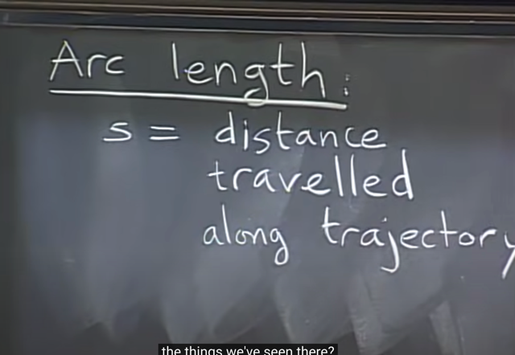</kbd>

> [!NOTE]
> Học qua khái niệm **arc length**, là khoảng cách, **độ lớn của
> quãng đường di chuyển dọc theo quỹ đạo.**

 

###### Tính quãng đường từ vận tốc

<kbd>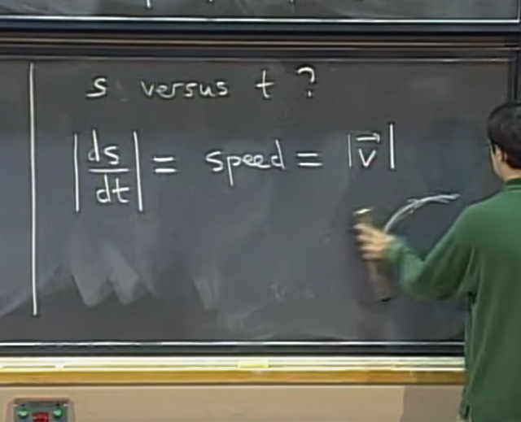</kbd>

> [!NOTE]
> đại khái là **theo định nghĩa**, derivative của s đối với t, **ds/dt
> = speed = |v|**
>
>
>
> Do đó **để tính s**, ta sẽ tính **tích phân vận tốc theo thời gian**

 

###### Độ dài cung cycloid

<kbd>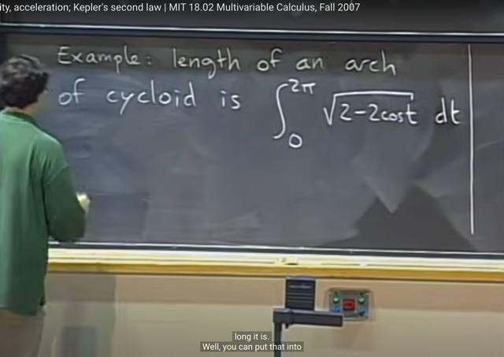</kbd>

> [!NOTE]
> Ví dụ, **chiều dài của một arch** trong ví
> dụ cycloid sẽ là **tích phân từ 0:2π của speed**

 

###### Vector tiếp tuyến đơn vị

<kbd>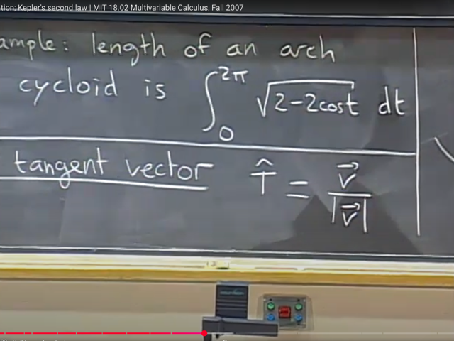</kbd>

<kbd>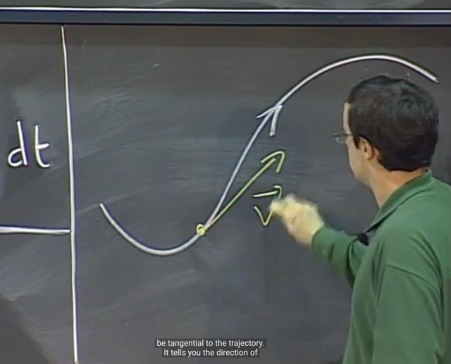</kbd>

> [!NOTE]
> Ta cũng làm quen một kí hiệu mới t^, chỉ **tangent unit vector** -
> vector tiếp tuyến đơn vị.
>
>
>
> Thế thì, ta có **vector v sẽ tiếp tuyến với quỹ đạo**, nên **để có
> vector tiếp tuyến đơn vị** ta chỉ cần **scale vector v về unit length**
> bằng cách **chia vector v cho độ lớn của nó. Nên t^ = v / |v|**

> [!TIP]
> 🤖 **AI Check** — 🟢 Pass — ✅ **98/100** · ✓ Move on
>
> Ghi chú rất chính xác và súc tích, giải thích rõ ràng bản chất hình học và cách chuẩn hóa vector vận tốc thành vector tiếp tuyến đơn vị.
>
> **✓ Strengths**
> - Nắm vững định nghĩa và ý nghĩa hình học của vector tiếp tuyến đơn vị T^.
> - Hiểu đúng bản chất của việc chuẩn hóa (chia vector vận tốc cho độ dài của chính nó để đưa về độ dài bằng 1).
>
> **💡 Deeper notes**
> - Công thức $\hat{T} = \vec{v} / |\vec{v}|$ chỉ xác định khi $|\vec{v}| \neq 0$ (tức là chất điểm chuyển động với vận tốc khác 0, không có điểm dừng/kỳ dị).

 

###### Vector đơn vị tiếp tuyến

<kbd>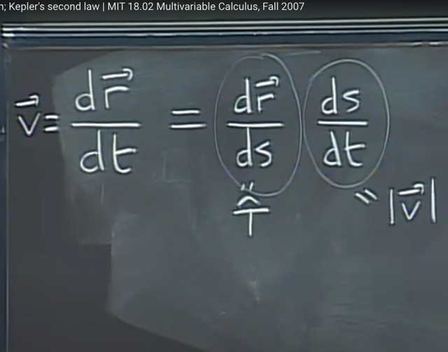</kbd>

> [!NOTE]
> Vậy thì từ việc ta biết khi đạo hàm vector r theo t ta có vector v.
> Áp dụng chain rule (bài 4 1801) ta có dr/ds ds/dt.
>
>
>
> Với ds/dt là độ lớn của vận tốc như đã biế thì dẫn đến:
>
>
>
> v = dr/ds |v|. Chia hai vế cho |v|, ta có dr/ds = v/|v| và như vậy nó
> (tức dr/ds) chính là tangent unit vector t^

 

###### Vector vận tốc

<kbd>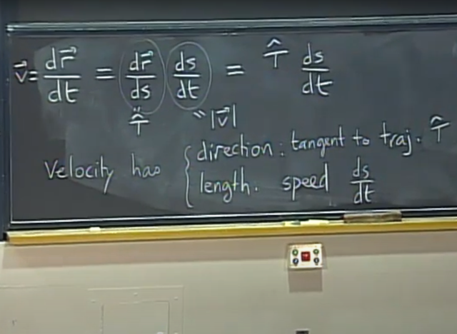</kbd>

> [!NOTE]
> Và cái này thể hiện rằng, vector v có hướng là vector tiếp tuyến đơn
> vị t^, cũng là tiếp tuyến với quỹ đạo. Và độ lớn của nó, chính là tốc
> độ, và là đạo hàm của s đối với t ds/dt

 

###### Vector tiếp tuyến đơn vị T

<kbd>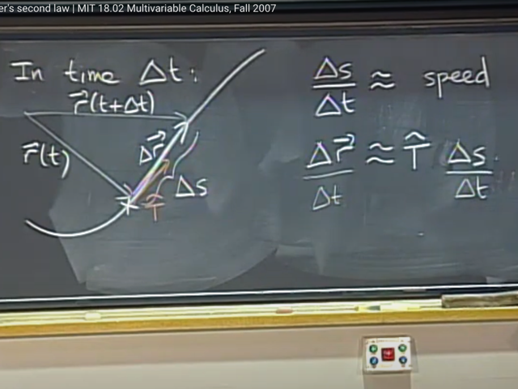</kbd>

> [!NOTE]
> Gs giải thích **vì sao dr/ds chính là T^**
>
>
>
> Thế thì. Khi điểm di chuyển trong khoảng thời gian Δt, nó sẽ từ
> vị trí thể hiện bởi position vector r(t) để trở thành r(t+Δt)
>
>
>
> Và hiệu của hai vector: r(t+Δt) - r(t) = vector Δr.
>
>
>
> Thế thì quãng đường nó di chuyển trong Δt thời gian, là Δs
> nên Δs / Δr sẽ cho ta xấp xỉ (độ lớn) vận tốc. 
>
>
>
> Và vector Δr có thể coi như xấp xỉ Δs * vector T^: 
> Δr ≈ T^ Δs. Để rồi chia hai vế cho Δt, ta có:
>
>
>
> Δr / Δt ≈ T^ Δs / Δt

 

###### Véc-tơ vận tốc

<kbd>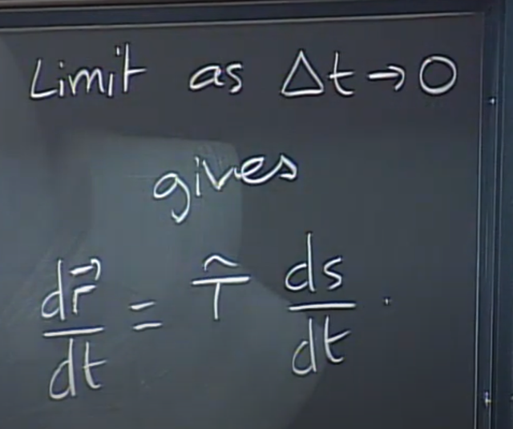</kbd>

> [!NOTE]
> Và tính limit khi Δt → 0, sẽ
> cho ta dr/dt = T^ ds/dt

 

###### Hướng tiếp tuyến của độ dời

<kbd>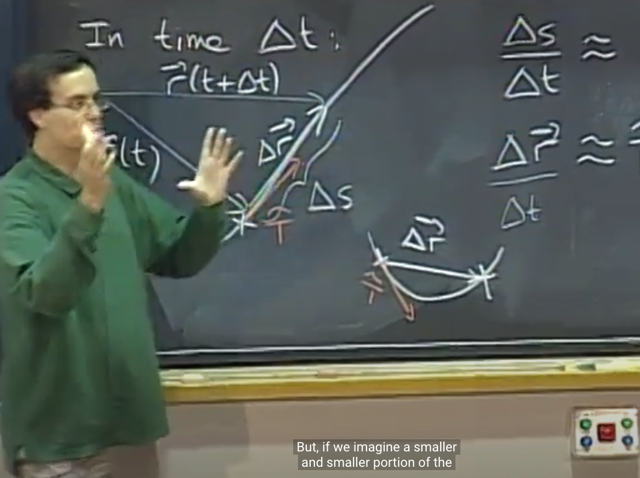</kbd>

> [!NOTE]
> vector Δr ko có hướng tiếp tuyến (vector T^), như hình ảnh này gs
> cho thấy điều đó. Tuy nhiên khi Δt → 0 thì vector Δr và T^ sẽ
> ngày càng trở nên trùng hướng nhau vì khi đó cung (đường cong) sẽ
> ngàg càng trở nên thẳng

 

<kbd>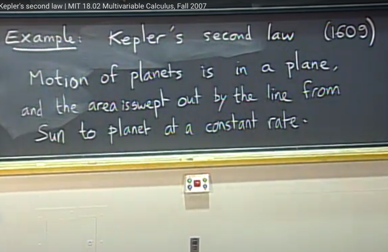</kbd>

> [!NOTE]
> Ta sẽ học qua định luật thứ 2 của Kepler nói rằng: Chuyển động của
> hành tinh quanh mặt trời là trên một mặt phẳng, và diện tích bị quét
> bởi đường nối giữa hàng tinh và mặt trời sẽ theo một tỉ lệ hằng số

 

###### Định luật 2 Kepler

<kbd>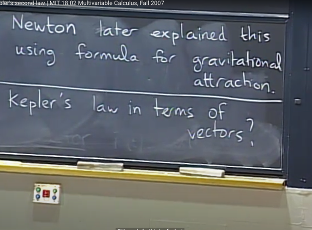</kbd>

> [!NOTE]
> Đại khái gs cho biết cái này có nghĩa hành tinh khi gần mặt trời hơn
> khi nó quanh quanh mật trời theo quỹ đạo elip thì nó sẽ đi nhanh
> hơn và chậm lại khi ra xa. 
>
>
>
> Và sau này Newton giải thích lại dùng công thức của luật hấp dẫn.

 

###### Định luật Kepler thứ hai

<kbd>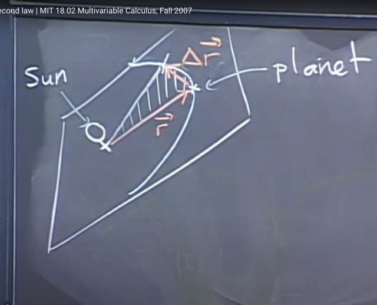</kbd>

> [!NOTE]
> Thế thì hình ảnh là vầy, hành tinh chuỷen động trên quỹ đạo elip.
> Ta có position vector r(t), và trong Δt, nó di duyển đến
> r(t+Δt) từ đó ta có vector Δr

 

###### Công thức diện tích quét

<kbd>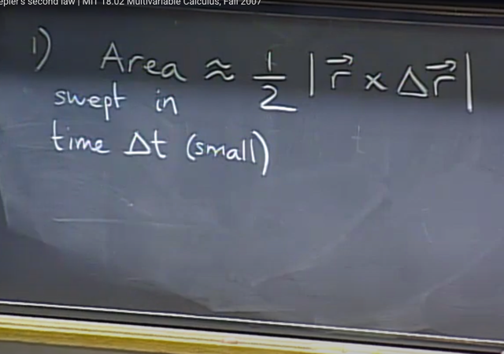</kbd>

> [!NOTE]
> Thế thì gs cho rằng khi Δt vô cùng nhỏ, thì như đã biết, cung
> (đường cong) có thể coi như thẳng để diện tích của vùng giữa hai
> vector r(t) và r(t_Δt) có có thể coi như diện tích tam giác tạo bởi 3
> vector. Và diện tích này có thể được tính bằng 1/2 diện tích hình bình
> hàng tạo bởi hai vector Δr và r.
>
>
>
> Và bài 2 ta đã biết, với 3D vector, ta có thể tính diện tích hình bình hành
> này bằng cách tính độ lớn của vector cross product giữa hai vector.

 

###### Xấp xỉ tuyến tính độ dời

<kbd>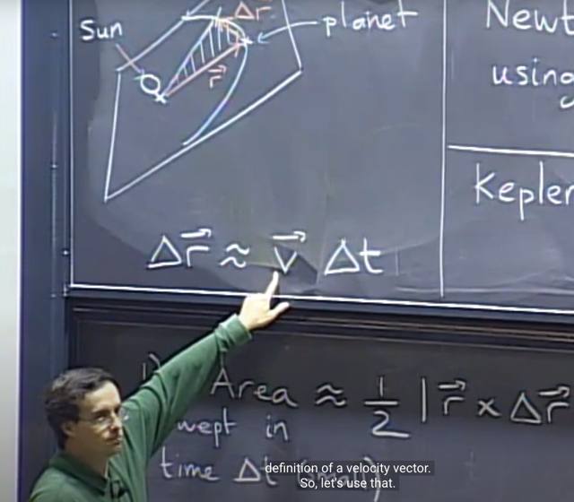</kbd>

> [!NOTE]
> Tiếp theo ta sẽ dùng định nghĩa của velocity vector hồi nãy rằng 
> đạo hàm của vector r đối với t là velocity vector.
>
>
>
> Thế thì dr/dt = v và ta cũng biết, khi **thay các d bằng delta sẽ cho
> ta linear approximation**
>
>
>
> Δr / Δt ≈ v ⇔ **Δr ≈ v * Δt**

**🔗 See also:** [Vector vận tốc](#node-ba19hnw)

 

###### Định luật 2 Kepler

<kbd>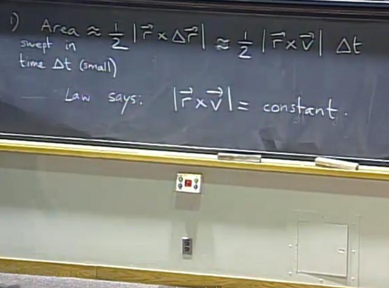</kbd>

> [!NOTE]
> Từ đó, thế vector Δr bằng ~ v * Δt ta có Area ≈ (1/2) | r x
> v| Δt (vì Δt là constant nên có thể đưa ra ngoài)
>
>
>
> Lúc này ý nghĩa của định luật Kepler khi nói diện tích được swept
> theo tỉ lệ hằng số chính là ý nói diện tích sẽ tỉ lệ thuận với thời gian
> Δt (Area / Δt = constant)
>
>
>
> Điều này đồng nghĩa nói rằng độ lớn của cross product vector tạo
> bởi vector và vector v là hằng số

 

###### Vectơ r x v không đổi

<kbd>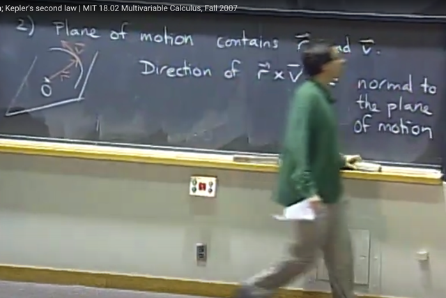</kbd>

> [!NOTE]
> Nhận định tiếp theo là, mặt phẳng chuyển động sẽ chứa cả r, và v.
>
>
>
> Thế thì, vì cross product vector tạo bởi r và v ta đã biết sẽ vuông góc
>  với mặt phẳng tạo bởi r, v. mà, vậy r x v vuông góc với mặt phẳng
> chuyển động
>
>
>
> Và ý (1) đã nói r x v có constant length, và ý (2) này nói hướng của nó
> vuông góc với mặt phẳng chuyển động vốn là cố định. Do đó cả hai
> ý hàm nghĩa (r x v) là constant vector

 

###### Định luật 2 Kepler

<kbd>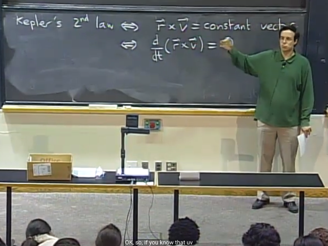</kbd>

> [!NOTE]
> Và điều đó có nghĩa là đạo hàm của vector cross
> product r x v đối với t sẽ là 0

 

###### Quy tắc nhân đạo hàm vector

<kbd>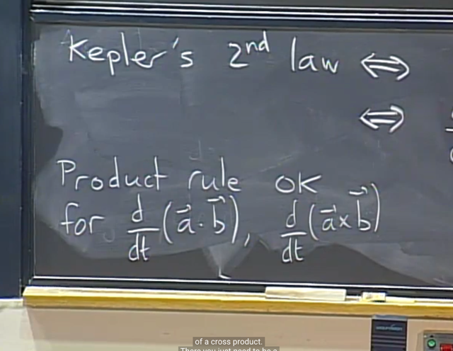</kbd>

> [!NOTE]
> Gs cho biết ta có thể áp dụng product rule đối với dot product
> và cross product chỉ cần chú ý giữ thứ tự của hai vector trong
> cross product  chứ đừng đảo lộn
>
>
>
> Có nghĩa là d(r x v) / dt = (dr / dt) x v + r x (dv / dt)
>
>
>
> (dr / dt) x v có nghĩa là cross product vector tạo bởi vector dr/dt
> với vector v

 

###### Định luật Kepler thứ hai

<kbd>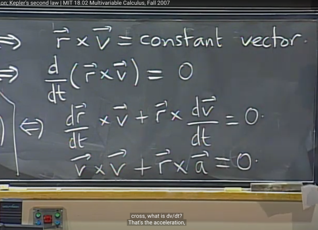</kbd>

> [!NOTE]
> Và dr/dt chính là vector v, và dv/dt
> chính là vector a (vector gia tốc)

 

###### Tích có hướng vector cùng phương

<kbd>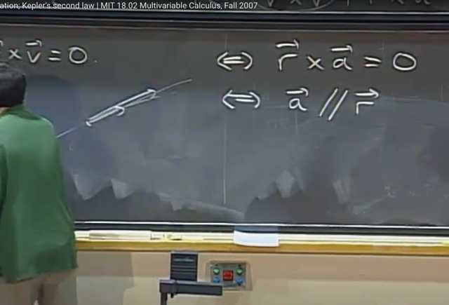</kbd>

> [!NOTE]
> v x v = 0 (ý nghĩa của cross product a x b là vector vuông góc với
> plane  tạo bởi a, b và có độ lớn bằng hình bình hành tạo bởi hai
> vector a, b. mà v, với v tạo hình bình hành có diện tích bằng 0, nên v
> x v = 0)
>
>
>
> Nên điều trên tương đương r x a = 0. và again điều này tương
> đương a và r song song (cùng phương)

 

###### Phương của lực hấp dẫn

<kbd>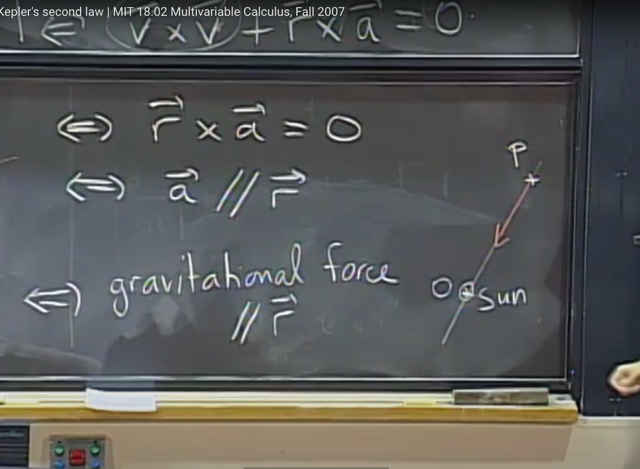</kbd>

> [!NOTE]
> Và dựa theo kiến thức vật lý ta biết gia tốc sẽ có phương
> của lực trọng trường.

 

