# 16.2 Direct solution of KKT system

📊 **Progress:** `4` Notes | `11` Screenshots | `4` AI Reviews

---

 

## Direct Solution of KKT System

<kbd>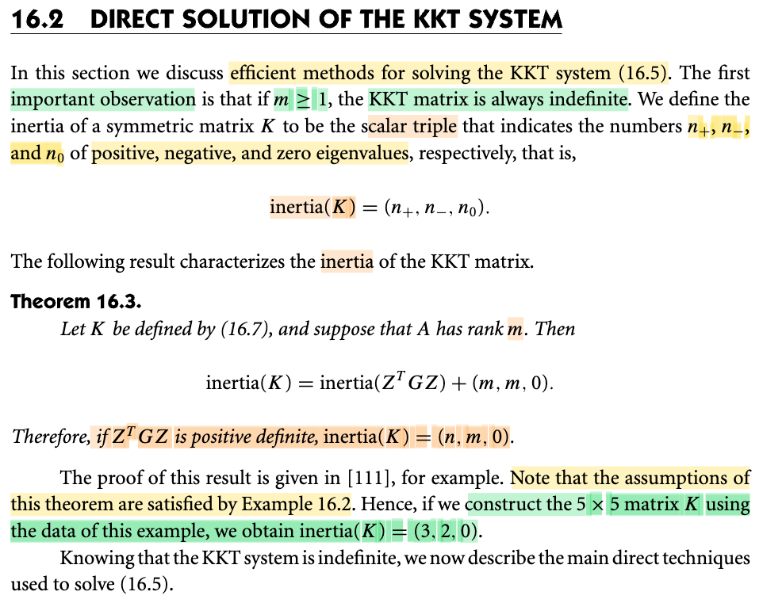</kbd>

<kbd>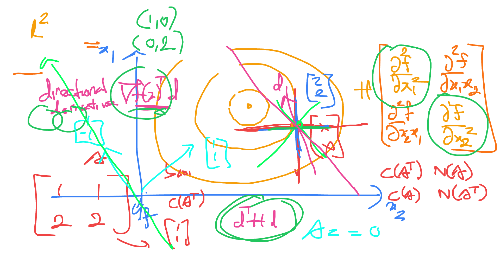</kbd>

> [!NOTE]
> Qua đây ta sẽ học về một phương pháp hiệu quả để giải hệ KKT (nhắc nhanh: Là hệ phản ánh KKT conditions, điều kiện cần bậc nhất, mà nếu có thể yếu tố reduced Hessian ZᵀGZ xác định dương thì nghiệm của hệ cũng là nghiệm duy nhất và cũng sẽ thỏa điều kiện đủ bậc hai để trở thành nghiệm duy nhất của bài toán QP luôn, do đó nếu có các yếu tố đó, giải hệ sẽ có ngay nghiệm bài toán QP).
>
>
>
> Thế thì đầu tiên là một theorem nói rằng: Nếu matrix A (m × n), m ≥ 1 full row rank thì matrix KKT indefinite.
>
>
>
> Theorem đại khái là nói inertia(K) = inertia(reduced Hessian) + (m, m, 0)
>
>
>
> Nên nếu reduced Hessian xác định dương, mà nó là matrix có kích thước n-m × n-m, nên sẽ có n-m trị riêng dương, inertia = (n-m,0,0). Kết quả là K sẽ có inertia = (n, m, 0), mà có trị riêng cả âm cả dương thì tức là K không xác định.
>
>
>
> Nói thêm tí về reduced Hessian: ZᵀGZ:
>
>
>
> Ta biết G là Hessian của objective. Vì sao ZᵀGZ gọi là reduced Hessian?
>
>
>
> QP: minimize f(x) = (1/2) xᵀGx + cᵀx s.t Ax = b (A full rank, rank = m)
>
>
>
> ∇²f(x) = G: Hessian
>
>
>
> Lấy ví dụ x = \[x1, x2\]ᵀ là R² vector:
>
>
>
> ∇f(x) = \[∂f/∂x1, ∂f/∂x2\]ᵀ = \[độ dốc theo phương x1, độ dốc theo phương x2\]
>
>
>
> = \[slop x1, slope x2\]
>
>
>
> ∇²f(x) = \[∂²f/∂x1², ∂²f/∂x1x2; ∂²f/∂x1x2, ∂²f/∂x2²\]
>
>
>
> = \[curvature x1, curvature x1x2; curvature x2x1, curvature x2\]
>
>
>
> Xét dᵀ∇²f(x)d, hay \[d1,d2\]ᵀ\[∂²f/∂x1², ∂²f/∂x1x2; ∂²f/∂x1x2, ∂²f/∂x2²\]\[d1,d2\]
>
>
>
> = \[d1, d2\]\[∂²f/∂x1² d1 + ∂²f/∂x1x2 d2; ∂²f/∂x1x2 d1 + ∂²f/∂x2² d2\]
>
>
>
> = \[d1, d2\]\[cur_x1 d1 + cur_x1x2 d2; cur_x2x1 d1 + cur_x2 d2\]
>
>
>
> = cur_x1 d1² + cur_x1x2 d1d2 + cur_x2x1 d1d2 + cur_x2 d2²
>
>
>
> d = (1,0): dᵀ∇²f(x)d = cur_x1: độ cong tại theo phương x1 tại x
>
>
>
> d = (0,1): dᵀ∇²f(x)d = cur_x2: độ cong tại theo phương x2 tại x
>
>
>
> d = (1,1): dᵀ∇²f(x)d = cur_x1 + 2 curx1x2 + cur_x2: độ cong tại theo phương x1 & x2 tại x.
>
>
>
> ---
>
>
>
> Vậy thì giờ xét matrix G' = ZᵀGZ:
>
>
>
> Vì Z là matrix có các cột là basis của nullspace N(A) nên: d = Zu luôn là vector thuộc N(A) với mọi u bất kì.
>
>
>
> Điều này có nghĩa là, với u bất kì, uᵀ(ZᵀGZ)u sẽ sẽ luôn cho thông tin độ cong theo hướng nullspace vector d = Zu, ta không thể có thông tin độ cong theo hướng khác.
>
>
>
> Ví dụ như ở đây để dễ hình dung, giả sử ta có matrix A = \[1,1; 2,2\]  (chỉ là minh họa để dễ hình dung nullspace, còn theorem thì A phải full row rank) basis C(Aᵀ) = {(1,1)ᵀ}, basis N(A) = {(1,-1)ᵀ}
>
>
>
> Khi đó Z = (1,-1)ᵀ (matrix có 1 cột)
>
>
>
> với mọi d, Zu ví dụ u = 2, 2Z sẽ là vector trong nullspace, và (2Z)ᵀG(2Z) sẽ cho ra thông tin độ cong theo hướng vector (2,-2).
>
>
>
> Chính vì vậy, chữ reduce hiểu như là: Ta giảm từ matrix G cho phép có thông tin độ cong trong không gian biến số ban đầu: R², dimension = 2, xuống còn chỉ cho thông tin độ con trong nullspace: N(A), dimension = 1.

📹 [Xem video trên YouTube](https://www.youtube.com/watch?v=rqNag5i113c)

> [!TIP]
> 🤖 **AI Check** — 🟢 Pass — ✅ **95/100** · ✓ Move on
>
> Ghi chú rất xuất sắc, không chỉ nắm đúng định lý về inertia của ma trận KKT mà còn xây dựng trực giác hình học rất chuẩn xác về reduced Hessian và không gian nullspace.
>
> **✓ Strengths**
> - Hiểu và diễn giải chính xác công thức định lý 16.3: inertia(K) = inertia(ZᵀGZ) + (m, m, 0) và hệ quả khi ZᵀGZ xác định dương thì inertia(K) = (n, m, 0).
> - Trực giác về reduced Hessian rất rõ ràng: giải thích cặn kẽ vì sao phép chiếu ZᵀGZ tương đương với việc thu hẹp thông tin độ cong về các hướng khả dĩ trong nullspace N(A).
> - Có ý thức phản biện tốt khi tự lưu ý rằng ví dụ minh họa nullspace không thỏa điều kiện full row rank của định lý.
>
> **💡 Deeper notes**
> - Về mặt thuật ngữ tối ưu hóa, các vector d = Zu trong N(A) còn được gọi là các hướng khả dĩ (feasible directions) đối với ràng buộc đẳng thức tuyến tính Ax = b, do A(x + d) = Ax + Ad = b + 0 = b.
> - Một lỗi chính tả nhỏ không ảnh hưởng bản chất: 'độ con trong nullspace' (độ cong) và 'slop x1' (slope).

 

### Factoring the Full KKT System

<kbd>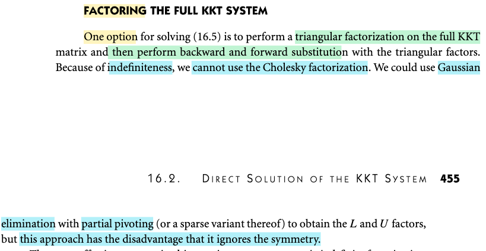</kbd>

> [!NOTE]
> Một cách làm để giả hệ KKT là: factor matrix thành tích matrix tam giác rồi backsub.
>
>
>
> Mà một cách điển hình chính là khử Gauss: Đưa matrix K về dạng U: khi đó hệ KKT sẽ trở thành giải hệ LUx=y: Giải Lu=y rồi giải Ux = u là hai hệ phương trình mà matrix hệ số là tam giác, việc giải chỉ là thế: forwar-substitution và backward-substitution.
>
>
>
> Và đây cũng chính là thuật toán có thể dùng, vì thuật toán factor nổi tiếng khác là Cholesky chỉ work với matrix xác định dương, trong khi K không xác định như theorem vừa rồi đã nói.
>
>
>
> Có điều nếu dùng khử Gauss, ta sẽ bỏ lãng phí việc K là matrix đối xứng, ý nói, có thể dùng cách khử Gauss, nhưng có thể có cách khác tốt hơn

> [!TIP]
> 🤖 **AI Check** — 🟡 Minor issues — ✅ **92/100** · ✓ Move on
>
> Ghi chú nắm rất chuẩn xác các ý cốt lõi từ tài liệu: lý do không dùng được Cholesky (do tính không xác định dấu), cách áp dụng phân rã LU cùng forward/backward substitution, và nhược điểm bỏ phí tính đối xứng của khử Gauss. Cần bổ sung thêm kỹ thuật xoay trục (partial pivoting) để đảm bảo độ ổn định số học.
>
> **🟡 Minor issues**
>
> **1.** *"Mà một cách điển hình chính là khử Gauss: Đưa matrix K về dạng U: khi đó hệ KKT sẽ trở thành giải hệ LUx=y"*
>
> Tài liệu nhấn mạnh cụm 'Gaussian elimination with partial pivoting'. Đối với ma trận không xác định dấu (indefinite), khử Gauss thuần túy không có xoay trục (pivoting) có thể gặp phần tử trụ bằng 0 hoặc mất ổn định số học nghiêm trọng.
>
> **2.** *"việc giải chỉ là thế ngược: forwar-substitution và backward-substitution."*
>
> Trong tiếng Việt, 'forward substitution' là thế tiến (hoặc thế xuôi) và 'backward substitution' là thế ngược. Dùng gộp chung từ 'thế ngược' cho cả hai dễ gây nhầm lẫn về mặt thuật ngữ.
>
>
> **✓ Strengths**
> - Hiểu rất rõ lý do loại trừ phân rã Cholesky vì ma trận KKT không xác định dấu (indefinite).
> - Nắm chuẩn quy trình giải hệ qua hai bước thế tiến và thế ngược từ các thừa số tam giác L và U.
> - Nhận diện chính xác nhược điểm cốt lõi của khử Gauss trong trường hợp này là không tận dụng được tính đối xứng của ma trận KKT.
>
> **💡 Deeper notes**
> - Để tận dụng tính đối xứng mà vẫn xử lý được ma trận không xác định dấu (indefinite), trong thực tế người ta thường dùng phân rã đối xứng bất định như $LDL^T$ với xoay trục theo khối (Bunch-Parlett hoặc Bunch-Kaufman) thay vì LU thông thường.

 

#### Symmetric Indefinite Factorization

<kbd>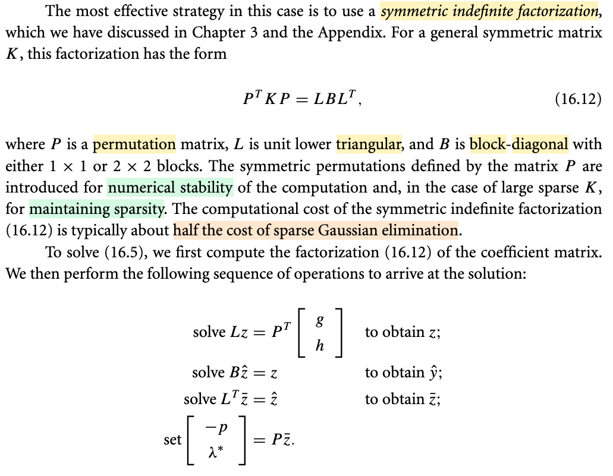</kbd>

<kbd>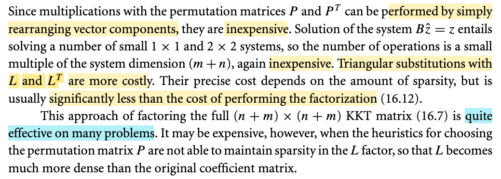</kbd>

> [!NOTE]
> Cách làm hiệu quả hơn là dùng symmetric indefinite factorization.
>
>
>
> Factor K: Pᵀ K P = L B Lᵀ
>
>
>
>
>
>  K\[-p; λ\*\] = \[g; h\] hay Kz = \[g; h\] (1)
>
>
>
> Pᵀ K P = L B Lᵀ
>
>
>
> ⇔ K = P L B Lᵀ Pᵀ
>
>
>
> (1) ⇔ (P L B Lᵀ Pᵀ) x = \[g; h\]
>
>
>
> ⇔ L B Lᵀ Pᵀ z = Pᵀ\[g; h\]
>
>
>
> Giải: Lz = Pᵀ\[g; h\]
>
>
>
> Giải: B ẑ = z
>
>
>
> Giải Lᵀ z̄ = ẑ
>
>
>
> Giải Pᵀ z = z̄  ⇔ z = P z̄
>
>
>
> Trong quá trình trên nhân với P (trong bước Pᵀ\[g; h\], hay P z̄) chỉ là đổi chỗ phần tử vector, nên không tốn gì.
>
>
>
> B ẑ = z với B là block diagonal matrix các block 1 × 1, 2 × 2 nên cũng ko tốn kém lắm.
>
>
>
> Chỉ có bước Lz = Pᵀ\[g; h\], Lᵀ z̄ = ẑ, giải hệ với matrix tam giác dưới, chính là quá trình forward-substitution là tốn kém hơn.
>
>
>
> Nói chung , cách làm này tương đối là hiệu quả với nhiều bài toán.

> [!TIP]
> 🤖 **AI Check** — 🟡 Minor issues — ⚠️ **85/100** · ✓ Move on
>
> Ghi chú nắm rất tốt bản chất của phương pháp phân rã đối xứng không xác định (symmetric indefinite factorization) và các bước giải hệ phương trình. Cần lưu ý tránh trùng lặp ký hiệu biến trung gian và phân biệt rõ giữa thế xuôi (forward) và thế ngược (backward substitution).
>
> **🟡 Minor issues**
>
> **1.** *"K[-p; λ*] = [g; h] hay Kz = [g; h] (1)"*
>
> Có sự xung đột ký hiệu biến: bạn đặt vector nghiệm cần tìm là z, nhưng ở các bước giải sau lại dùng z làm vector trung gian trong Lz = Pᵀ[g; h] và cuối cùng viết z = P z̄. Nên giữ vector nghiệm ban đầu là x hoặc giữ nguyên [-p; λ*] để tránh nhầm lẫn.
>
> **2.** *"Chỉ có bước Lz = Pᵀ[g; h], Lᵀ z̄ = ẑ, giải hệ với matrix tam giác dưới, chính là quá trình forward-substitution là tốn kém hơn."*
>
> L là ma trận tam giác dưới nên bước Lz = ... dùng forward substitution (thế xuôi), nhưng Lᵀ là ma trận tam giác trên nên bước Lᵀ z̄ = ẑ phải dùng back substitution (thế ngược).
>
>
> **✓ Strengths**
> - Hiểu rõ bản chất biến đổi đại số từ PᵀKP = LBLᵀ sang hệ phương trình từng bước.
> - Nắm bắt chính xác chi phí tính toán tương đối của phép nhân ma trận hoán vị P, hệ khối B, và phép thế tam giác.
>
> **💡 Deeper notes**
> - Chi phí của các phép thế tam giác phụ thuộc rất lớn vào độ thưa (sparsity) của ma trận L; nếu ma trận P không kiểm soát tốt hiện tượng fill-in (L bị dày lên), chi phí giải sẽ tăng đáng kể.

**🔗 See also:** [Karush-Kuhn-Tucker Matrix Formulation](./161_equality_constrained_quadratic_programs.md#node-feah6f9)

 

##### Schur-Complement Method

<kbd>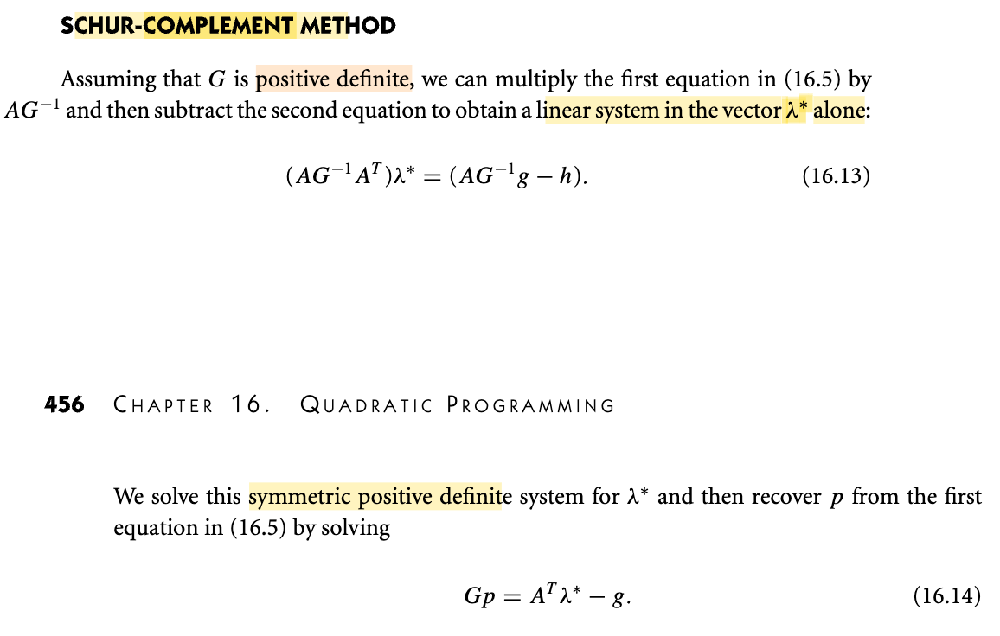</kbd>

<kbd>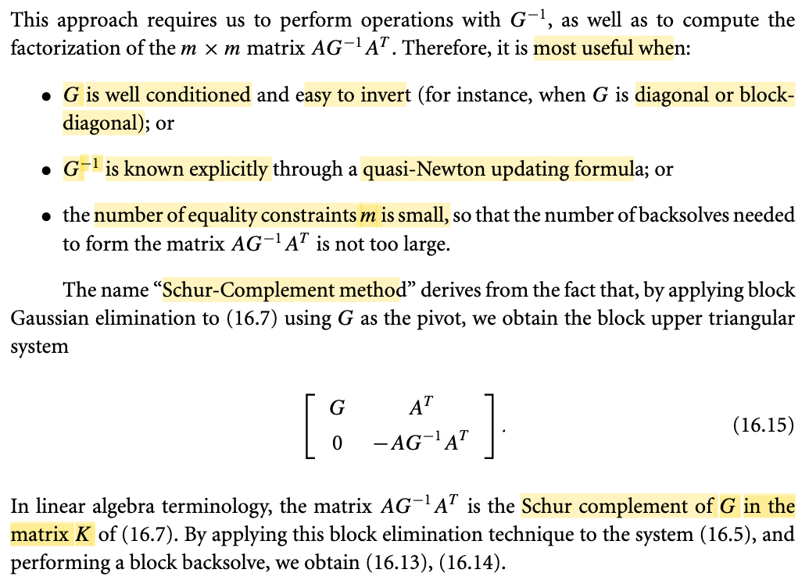</kbd>

<kbd>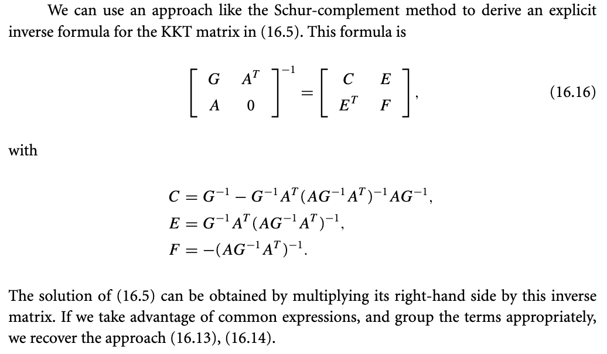</kbd>

<kbd>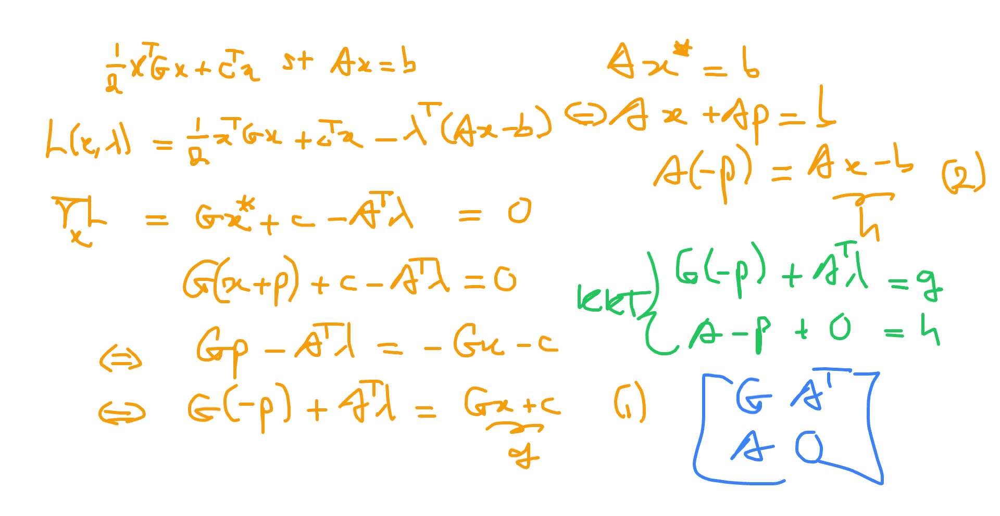</kbd>

<kbd>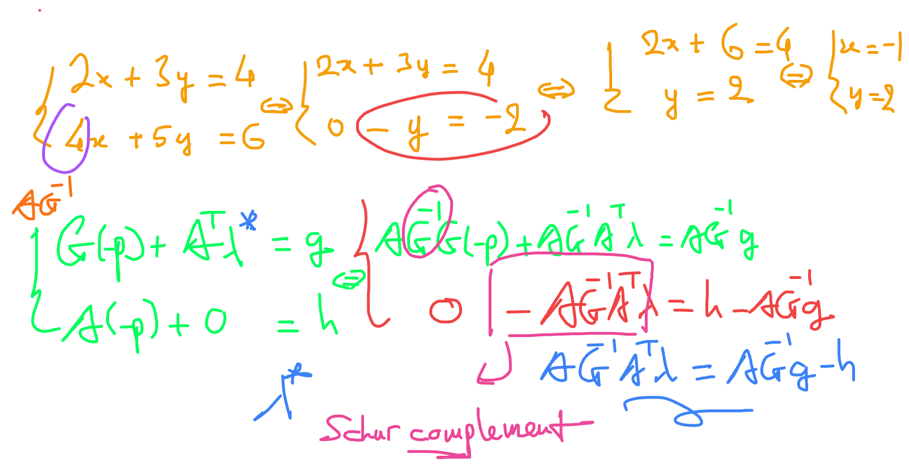</kbd>

> [!NOTE]
> Gặp lại một cái đã thấy trong Boyd:
>
>
>
> Cái này nhìn vậy chứ đơn giản thôi:
>
>
>
> Ta đang muốn giải: \[G, Aᵀ; A, 0\]\[-p; λ\] = \[g, h\]
>
>
>
> ---
>
>
>
> (Ôn nhanh: Objective: (1/2) xᵀGx + cᵀx s.t Ax = b. L(x, λ) = (1/2) xᵀGx + cᵀx - λᵀ(Ax - b).
>
>
>
> Stationary condition:
>
>
>
> ∇\_x L = 0 ⇔ GBx\* + c - Aᵀλ = 0 ⇔ Gx\* - Aᵀλ = -c ⇔ Gx + Gp - Aᵀλ = -c
>
>
>
> ⇔ Gp - Aᵀλ = -c-Gx ⇔ G(-p) + Aᵀλ = Gx+c (1)
>
>
>
> Và Ax\* = b ⇔ Ax + Ap = b ⇔ Ap = b-Ax ⇔ A(-p) = Ax-b (2).
>
>
>
> Từ (1),(2): ta có hệ KKT, với g = Gx + c, h = Ax - b.)
>
>
>
> ---
>
>
>
> Thế thì nếu G xác định dương, có thể giải theo kiểu sau: Về cơ bản ý tưởng chỉ y chang như có hệ hai phương trình hai ẩn, ta khử hệ số để giải, mà cái này cũng chính là khử Gauss, nên có thể nói đây là khử Gauss với matrix khối.
>
>
>
> \[G, Aᵀ; A, 0\]\[-p; λ\] = \[g, h\]
>
>
>
> "Khử K21": Thay hàng 2 bằng: Hàng 2 - AG⁻¹ × Hàng 1 (trở thành \[A, AG⁻¹Aᵀ\]) → trở thành \[0, -AG⁻¹Aᵀ\].
>
>
>
> Và đơn giản là cái -AG⁻¹Aᵀ này được gọi là Schur complement của G.
>
>
>
> Có thể thấy để làm vậy G phải khả nghịch.
>
>
>
> Khi đó về cơ bản ta đã đưa K về dạng "U" (matrix tam giác trên giống như khử Gauss đưa A về row echelon form U vậy)
>
>
>
> Đương nhiên ở "bên kia" cũng trở thành h - AG⁻¹g để hệ phương trình cần giải là:
>
>
>
> \[G, Aᵀ; 0, -AG⁻¹Aᵀ\] \[-p; λ\] = \[g; h - AG⁻¹g\]
>
>
>
> Ta sẽ làm động tác tương tự như back substitution: Tính λ và thế ngược vào phương trình trên để có p (trong sách gọi là backsolve)
>
>
>
> Tức là giải phương trình hai để có λ: -AG⁻¹Aᵀ λ = h - AG⁻¹g
>
> ⇔ AG⁻¹Aᵀλ = AG⁻¹g - h
>
>
>
> Giải ra λ\* thì thế vào tính ra p: G(-p) + Aᵀλ\* = g ⇔ Gp = Aᵀλ\* - g.
>
>
>
> ---
>
>
>
> Nói chung là y như giải hệ bằng khử Gauss.
>
>
>
> Và cái này sẽ hữu ích khi G well condition,hoặc dễ invert (để tính G⁻¹ không tốn kém)
>
>
>
> Hoặc biết G⁻¹ một cách tường minh rồi, giống như chap 6 học quasi Newton đã biết có vụ này.
>
>
>
> Hoặc số ràng buộc đẳng thức nhỏ

📹 [Xem video trên YouTube](https://www.youtube.com/watch?v=4pAJlcx-stw)

> [!TIP]
> 🤖 **AI Check** — 🟢 Pass — ✅ **98/100** · ✓ Move on
>
> Ghi chú rất xuất sắc, hiểu bản chất sâu sắc khi liên hệ phương pháp phần bù Schur với phép khử Gauss trên ma trận khối và kỹ thuật thế ngược (backsolve). Các bước biến đổi KKT đều hoàn toàn chính xác.
>
> **✓ Strengths**
> - Tự dẫn xuất lại hệ KKT từ bài toán QP một cách rất rõ ràng và chuẩn xác theo biến ẩn p.
> - Nắm đúng bản chất đại số tuyến tính: phương pháp Schur-complement chính là phép khử Gauss trên khối ma trận (block Gaussian elimination).
> - Tóm tắt chuẩn xác các trường hợp thực tế mà phương pháp này phát huy hiệu quả cao nhất (G dễ đảo, Quasi-Newton, số ràng buộc m nhỏ).
>
> **💡 Deeper notes**
> - Quy ước dấu của Schur complement: Trong đại số tuyến tính nói chung, phần bù Schur của khối G trong ma trận K là 0 - A G⁻¹ Aᵀ = -A G⁻¹ Aᵀ (đúng như bạn viết). Tuy nhiên trong sách Nocedal & Wright, tác giả gọi trực tiếp ma trận đối xứng xác định dương A G⁻¹ Aᵀ là phần bù Schur (bỏ dấu trừ) để tiện giải hệ đối xứng xác định dương.
> - Điều kiện khả nghịch của hệ Schur: Để ma trận A G⁻¹ Aᵀ thực sự đối xứng xác định dương (và khả nghịch), ngoài điều kiện G xác định dương, cần thêm giả thiết A có đủ hạng hàng (full row rank - các ràng buộc độc lập tuyến tính).

 

###### Null-Space Method

<kbd>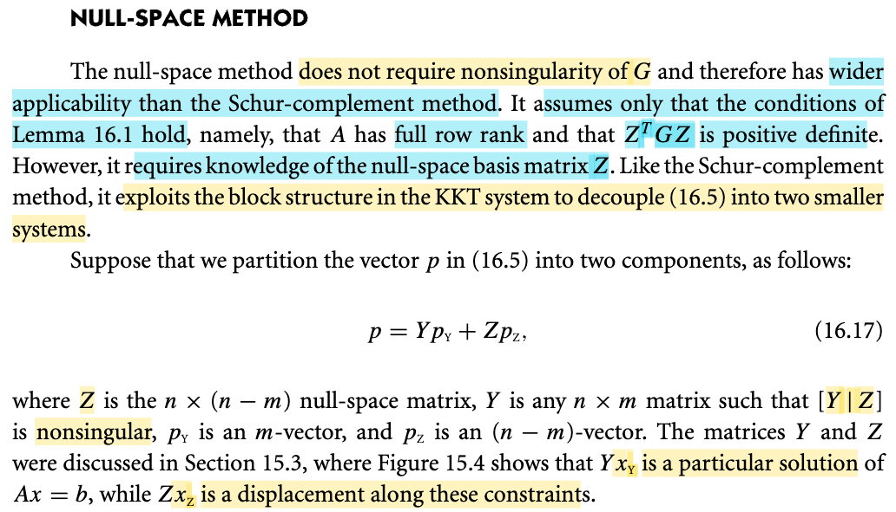</kbd>

 

