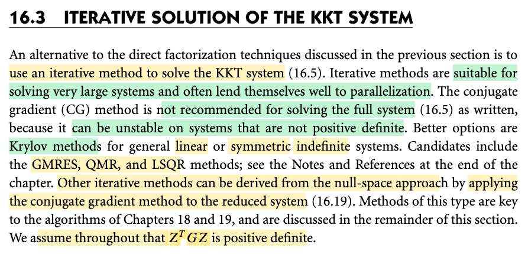
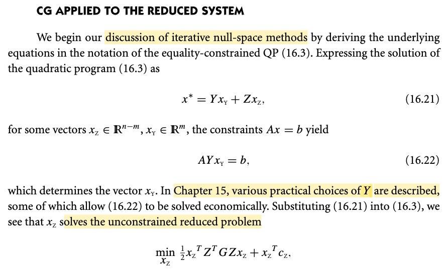
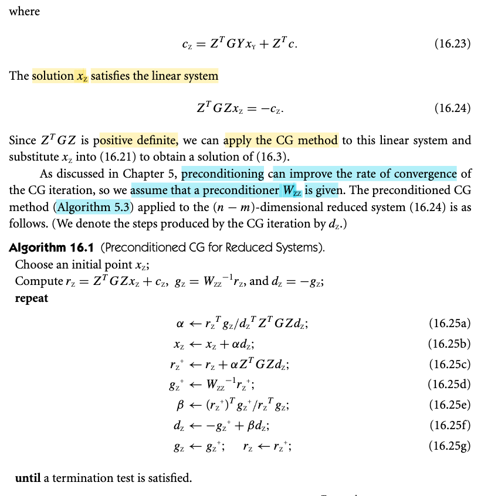
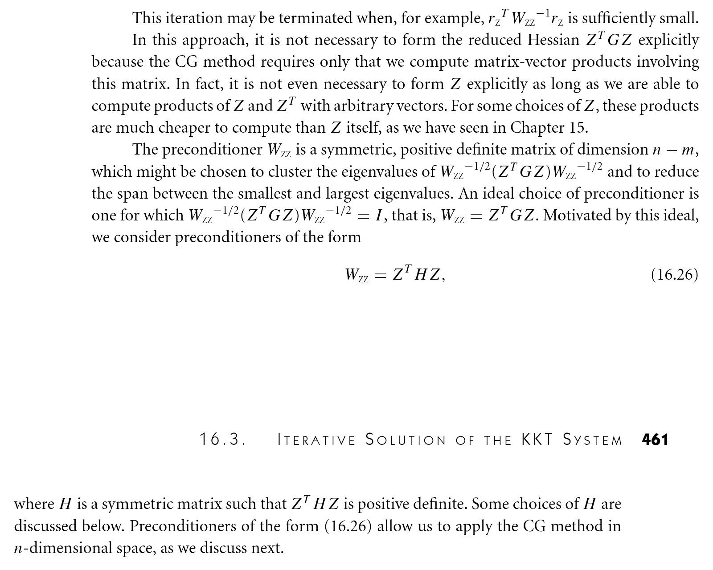
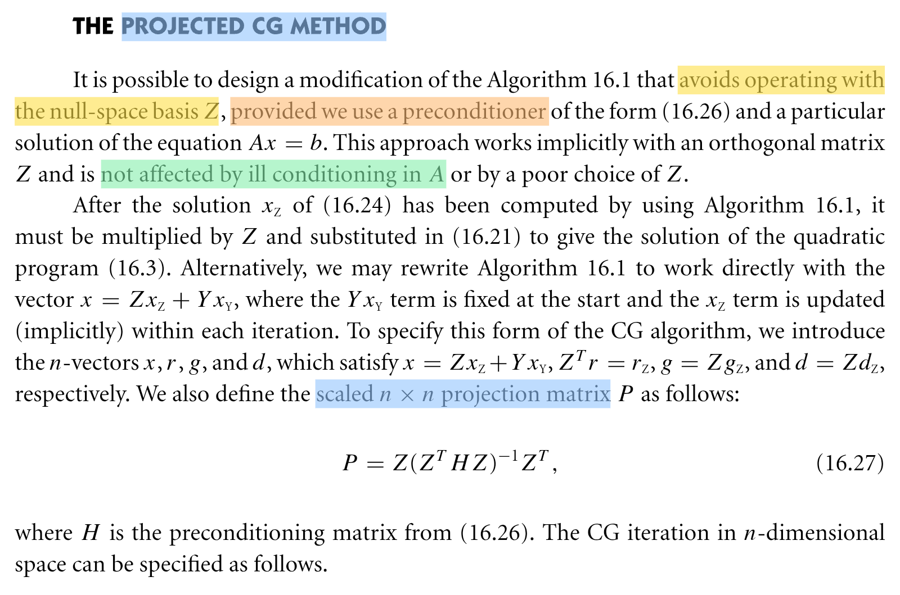

# 16.3 Iterative method solve KKT system

📊 **Progress:** `2` Notes | `5` Screenshots | `2` AI Reviews

---

 

## Section 16.3 Iterative Solution of the KKT System

<kbd></kbd>

 

### CG Applied to Reduced System

<kbd></kbd>

<kbd></kbd>

 

#### Điều kiện dừng, tính toán ma trận và preconditioning cho Reduced CG

<kbd></kbd>

> [!NOTE]
> Đoạn này nói ba ý về thuật toán 16.1:
> 1. Dừng khi r_Zᵀ W_ZZ⁻¹ r_Z đủ nhỏ.
> 2. không cần tạo ma trận ZᵀGZ, CG: v ↦ Zᵀ(G(Zv)).
> 3. lý tưởng là W_ZZ = ZᵀGZ, nhưng tốn kém nên chọn W_ZZ = ZᵀHZ, ZᵀHZ ≻ 0.

> [!TIP]
> 🤖 **AI Check** — 🟢 Pass — ✅ **95/100** · ✓ Move on
>
> Ghi chú tóm tắt rất chính xác, súc tích và nắm trọn vẹn 3 ý cốt lõi từ đoạn sách về điều kiện dừng, cách tính ma trận-vector trong CG và dạng tiền điều kiện.
>
> **✓ Strengths**
> - Hiểu đúng điều kiện dừng của CG có tiền điều kiện dựa trên chuẩn W_ZZ^{-1}.
> - Nhận diện chính xác bản chất tích vô hướng với ma trận rút gọn không cần thành lập tường minh ma trận Z^T G Z hay Z.
> - Tóm tắt đúng dạng tiền điều kiện xấp xỉ Z^T H Z và điều kiện xác định dương.
>
> **💡 Deeper notes**
> - Về mặt điều kiện chặt chẽ, H cần là ma trận đối xứng (symmetric) để đảm bảo W_ZZ đối xứng xác định dương.
> - Đoạn văn còn nhấn mạnh thêm một ưu điểm quan trọng của dạng W_ZZ = Z^T H Z: nó cho phép triển khai CG trên không gian n chiều thay vì trực tiếp trên không gian (n - m) chiều.

 

##### Ý tưởng và ma trận chiếu của Projected CG Method

<kbd></kbd>

> [!NOTE]
> ý tưởng là viết lại thuật toán 16.1 để làm việc thẳng với x = Zx_Z + Yx_Y, không cần tính ma trận Z. 
> chỉ cần ma trận chiếu P = Z(ZᵀHZ)⁻¹Zᵀ.

> [!TIP]
> 🤖 **AI Check** — 🟡 Minor issues — ⚠️ **85/100** · ✓ Move on
>
> Ghi chú nắm rất đúng tư tưởng cốt lõi của phương pháp Projected CG: chuyển sang làm việc trực tiếp với biến gốc x thay vì biến rút gọn và tránh thao tác trực tiếp với Z. Tuy nhiên, cần lưu ý công thức của ma trận chiếu P chỉ mang tính định nghĩa lý thuyết chứ không dùng để tính toán trực tiếp.
>
> **🟡 Minor issues**
>
> **1.** *"chỉ cần ma trận chiếu P = Z(ZᵀHZ)⁻¹Zᵀ"*
>
> Công thức này là định nghĩa giải tích của ma trận chiếu P. Trong tính toán thực tế, ta không dùng trực tiếp công thức chứa Z này để lập ma trận P (vì như vậy vẫn phải tính Z), mà tích P·v sẽ được tính gián tiếp thông qua việc giải một hệ phương trình bổ trợ (liên quan đến ma trận tiền điều kiện 16.26).
>
>
> **✓ Strengths**
> - Hiểu đúng mục tiêu chính của phương pháp: làm việc trực tiếp trên không gian gốc x = Zx_Z + Yx_Y và tránh làm việc tường minh với cơ sở không gian nghiệm Z.
> - Trích xuất chính xác công thức định nghĩa của ma trận chiếu có tỉ lệ P.
>
> **💡 Deeper notes**
> - Ma trận Z trong phương pháp này được giả định ngầm là ma trận trực giao (orthogonal matrix), giúp thuật toán không bị ảnh hưởng bởi độ điều hòa xấu của ma trận ràng buộc A.
> - Thành phần Yx_Y được cố định ngay từ điểm khởi đầu thỏa mãn ràng buộc Ax = b, và các bước lặp CG sau đó chỉ cập nhật ngầm trên thành phần không gian nghiệm Zx_Z.

 

