# 5.1 Linear Conjugate Gradient

📊 **Progress:** `23` Notes | `70` Screenshots | `22` AI Reviews

---

 

## 5.1 Linear Conjugate Gradient

<kbd></kbd>

<kbd>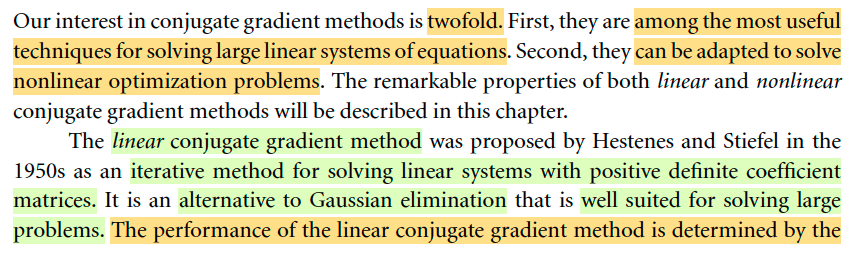</kbd>

<kbd>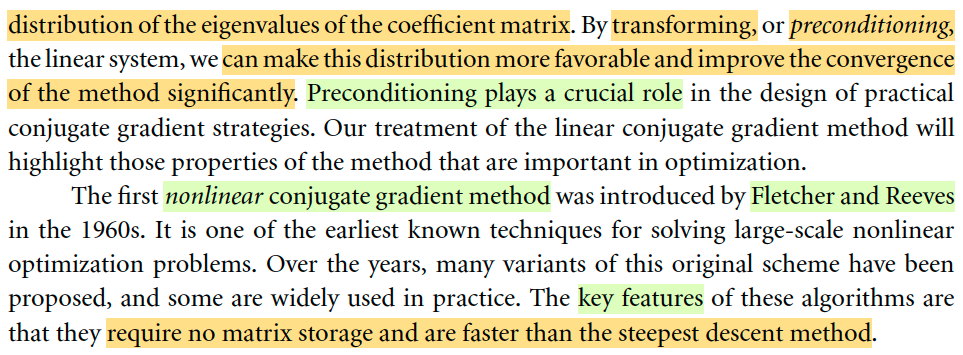</kbd>

> [!NOTE]
> Qua một phương pháp mới: Conjugate gradient method. Đại khái là tác giả nói nó có hai ưu điểm: Thứ nhất đây là một trong nhưng phương pháp tốt nhất để giải một hệ phương trình tuyến tính quy mô lớn. Và thứ hai, nó cũng có thể được điều chỉnh để giải bài toán tối ưu hóa phi tuyến.
>
> Nói sơ, linear conjugate gradient được phát triển năm 1950, là các tiếp cận iterative, để giải hệ tuyến tính với ma trận hệ số xác định dương. Nó phù hợp hơn phép khử Gausse, vốn đã học ở MIT 18.06 cho những bài toán quy mô lớn.
>
> Hiệu quả của phương pháp này chủ yếu là phụ thuộc vào phân bố của trị riêng của matrix hệ số. Bằng cách transforming, còn gọi là pre-conditioning, ta có thể cải thiện sự phân bố của các trị riêng, giúp bài toán hội tụ nhanh hơn.
>
> Nói sơ về non-linear conjugate gradient method, thì key feature của nó là nó ko đòi hỏi phải lưu trữ matrix, và nó nhanh hơn là phương pháp steepest descent.

> [!TIP]
> 🤖 **AI Check** — 🟢 Pass — ✅ **100/100** · ✓ Move on
>
> Ghi chú tóm tắt rất chính xác, đầy đủ và mạch lạc toàn bộ các điểm cốt lõi trong phần mở đầu của chương.
>
> **✓ Strengths**
> - Nắm bắt chính xác hai vai trò cốt lõi của Conjugate Gradient: giải hệ phương trình tuyến tính quy mô lớn và mở rộng sang bài toán tối ưu phi tuyến.
> - Hiểu đúng bản chất lặp (iterative), sự phụ thuộc vào phân bố trị riêng, vai trò của preconditioning, cũng như ưu điểm không tốn bộ nhớ lưu ma trận của non-linear CG so với steepest descent.
>
> **💡 Deeper notes**
> - Trong công thức chuẩn của Linear Conjugate Gradient, ma trận hệ số thông thường cần thỏa mãn cả hai tính chất là đối xứng và xác định dương (Symmetric Positive Definite - SPD).

 

### 5.1 The Linear Conjugate Gradient Method

<kbd>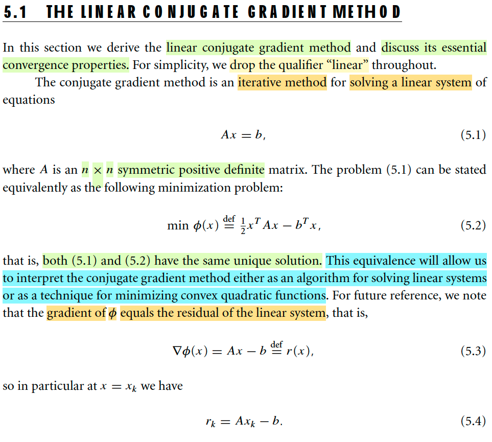</kbd>

> [!NOTE]
> Đại khái là, tác giả nói một điều mà mình đã học / tự nhận ra hồi còn học EE364A: Việc giải hệ f(x) = 0 có thể coi như là đang giải điều kiện cần bậc một của bài toán minimize hàm số F(x) là nguyên hàm của f: ∇F(x) = f(x) = 0. Và đây là nguyên lí của root finding Newton method: Bằng cách xấp xỉ hàm F bằng hàm bậc 2 thì ta cũng xấp xỉ hàm f là hàm bậc 1.
>
>
>
> Và giải bài toán minimize F với Newton method cũng chính là gỉai hệ f(x)=0 bằng root finding Newton method.
>
>
>
> Thế thì ở đây f(x) = Ax - b, thì nguyên hàm của nó, chính là F(x) = (1/2)xᵀAx - bᵀx, ở đây ta sẽ gọi là φ(x) ⇨ ∇φ(x) = Ax - b
>
>
>
> Và như đã nói, cách nhìn này cho ta thấy việc giải hệ Ax = b chính là giải bài toán tối ưu hàm bậc hai F(x), là một convex optimzation problem.
>
>
>
> f(x) = (1/2)xᵀPx + qᵀx + r
>
>
>
> ∇f(x) = (1/2)(P + Pᵀ)x + q
>
>
>
> MIT 18s096 Steve, Allan
>
>
>
> df = f(x+dx) - f(x)
>
>
>
> = (1/2)(x+dx)ᵀP(x+dx) + qᵀ(x+dx) + r - (1/2)xᵀPx - qᵀx - r
>
>
>
> = (1/2)(xᵀPx+dxᵀPx+xᵀPdx+dxᵀPdx) + qᵀdx - (1/2)xᵀPx 
>
>
>
> dxᵀPx = (dxᵀPx)ᵀ = xᵀPᵀdx ((AB)ᵀ = BᵀAᵀ)
>
>
>
> = (1/2)(xᵀPx+xᵀPᵀdx+xᵀPdx+dxᵀPdx) + qᵀdx - (1/2)xᵀPx 
>
>
>
> = (1/2)xᵀ(Pᵀ + P)dx + qᵀdx 
>
>
>
> = \[(1/2)xᵀ(Pᵀ + P) + qᵀ\]dx 
>
>
>
> = \[(1/2)(Pᵀ + P)ᵀx + q\]ᵀdx 
>
>
>
> đã có: linear operator act on dx ⇒ ∇f(x) = (1/2)(Pᵀ + P)ᵀx + q
>
>
>
>
>
> ∇f(x) = Px + q (nếu P đối xứng)
>
>
>
> ∇²f(x) = (1/2)(P + Pᵀ) 
>
>
>
> ∇²f(x) = P (nếu P đối xứng)

> [!TIP]
> 🤖 **AI Check** — 🟡 Minor issues — ✅ **92/100** · ✓ Move on
>
> Ghi chú nắm rất chắc bản chất liên hệ giữa bài toán tìm nghiệm hệ phương trình và bài toán tối ưu lồi, cũng như mối liên hệ giữa phương pháp Newton giải nghiệm và Newton tối ưu hóa.
>
> **🟡 Minor issues**
>
> **1.** *"Việc giải hệ f(x) = 0 có thể coi như là đang giải điều kiện cần bậc một của bài toán minimize hàm số F(x) là nguyên hàm của f: ∇F(x) = f(x) = 0."*
>
> Trong không gian nhiều chiều, không phải hệ $f(x) = 0$ nào cũng tồn tại 'nguyên hàm' (hàm thế vô hướng $F$ sao cho $\nabla F = f$). Điều này chỉ xảy ra khi ma trận Jacobian của $f$ đối xứng (với hệ tuyến tính thì tương ứng $A = A^T$). Ngoài ra, để nghiệm của $\nabla F(x) = 0$ thực sự là điểm cực tiểu (minimize), ma trận $A$ bắt buộc phải là ma trận xác định dương ($A \succ 0$).
>
>
> **✓ Strengths**
> - Liên kết xuất sắc giữa bài toán giải hệ đại số tuyến tính $Ax=b$ và bài toán tối ưu hàm toàn phương lồi $\phi(x)$.
> - Hiểu đúng bản chất của phương pháp Newton: xấp xỉ tuyến tính hàm $f$ trong root-finding tương đương với xấp xỉ bậc hai của hàm mục tiêu trong tối ưu hóa.
>
> **💡 Deeper notes**
> - Sự tương đương giữa việc giải hệ phương trình và tối ưu hàm $\phi(x)$ trong phương pháp Conjugate Gradient phụ thuộc mật thiết vào tính chất đối xứng và xác định dương (Symmetric Positive Definite - SPD) của ma trận $A$; nếu $A$ không đối xứng hoặc không xác định dương thì hàm toàn phương không bị chặn dưới hoặc không lồi.

**🔗 See also:** [Tối ưu hóa tọa độ Hessian chéo](#node-b04ox8f) · [Vài suy nghĩ về bản chất của Conjugate Gradient method](#node-6z4orxx) · [Basic properties of conjugate gradient method](#node-p6jzgvh) · [Rate of Convergence](#node-3zg5huu) · [Local Convergence of Inexact Newtons](./71_inexact_newton_methods.md#node-ts4mvv1)

 

#### Conjugate Direction Method

<kbd>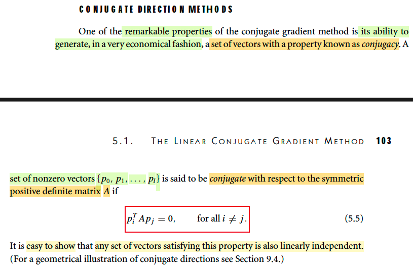</kbd>

<kbd>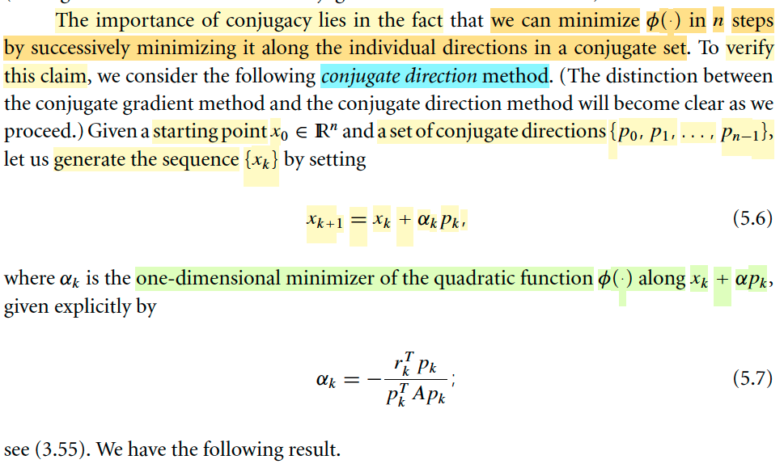</kbd>

<kbd>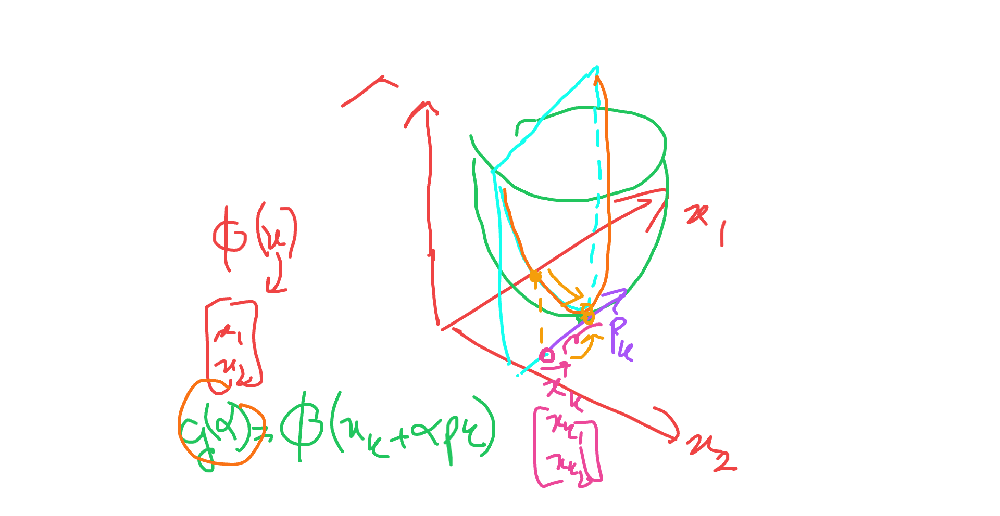</kbd>

<kbd>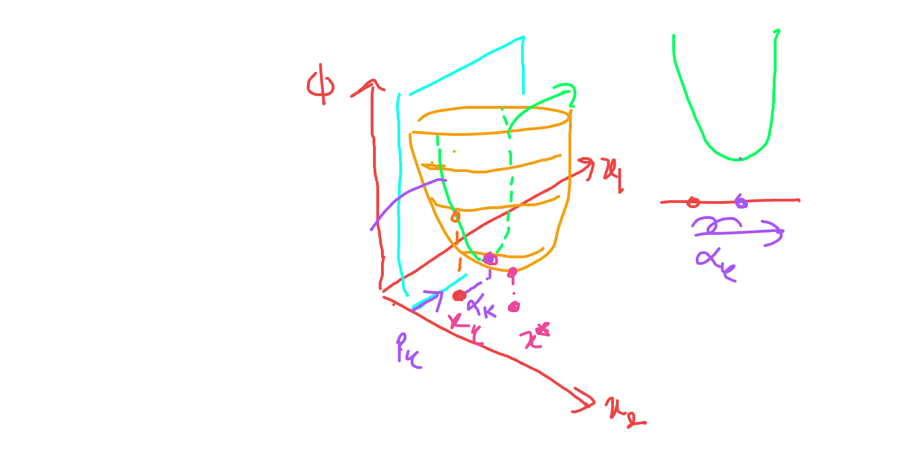</kbd>

> [!NOTE]
> Đầu tiên, tác giả nói đại ý là một đặc điểm rất tốt của phương pháp này là khả năng của nó trong việc tạo ra một bộ vector có tính chất gọi là conjugacy: {p0,...pn-1} được gọi là conjugate wrt matrix đối xứng xác định dương A nếu như piᵀApj = 0 ∀i≠j.
>
>
>
> Tác giả nói cũng dễ cho thấy bộ vector conjugate cũng sẽ **độc lập tuyến tính**. Là sao?
>
>
>
> Xét Σi ci pi = 0, nếu chứng minh ci = 0 với mọi i ta sẽ chứng minh {pi} độc lập tuyến tính.
>
>
>
> Nhân hai vế cho pjᵀA, j bất kì.
>
>
>
> ⇒ pjᵀA Σi ci pi = 0
>
>
>
> ⇔ Σi ci pjᵀApi = 0
>
>
>
> ⇔ c1 pjᵀAp1 + ...+ cj pjᵀApj + ... = 0
>
>
>
> ⇔ cj pjᵀApj = 0
>
>
>
> xᵀAx &gt; 0 với x khác 0, mọi trị riêng &gt; 0
>
>
>
> ⇔ cj = 0 do pjᵀApj &gt; 0 với mọi pj khác 0
>
>
>
> Và điều này đúng với mọi j, tức là Σi ci pi = 0 suy ra ci = 0 ∀i giúp chứng minh được bộ vector conjugate cũng sẽ độc lập tuyến tính.
>
>
>
> ---
>
>
>
> Tiếp theo, tác giả nói về việc, ta có thể chứng minh được rằng, sử dụng bộ vector conjugate, ta có thể minimize hàm φ chỉ trong n bước. Và ta sẽ xét một phương pháp gọi là CONJUGATE DIRECTION method (không phải conjugate gradient method nhé, sự liên hệ giữa chúng sẽ nói sau). Phương pháp này đại khái là như sau:
>
>
>
> Bắt đầu với x0, và một bộ vector conjugate {p0,...pn-1}, ta sẽ generate các điểm xk:
>
>
>
> xk+1 = xk + αkpk trong đó αk là solution của bài toán tối ưu hàm một biến:
>
>
>
> minimize g(α) = φ(xk + αpk)
>
>
>
> Cách 1: viết φ(xk + αpk) ở dạng hàm bậc 2 của α
>
>
>
> = (1/2)(xk + αpk)ᵀA(xk + αpk) - bᵀ(xk + αpk)
>
>
>
> = (1/2)(xkᵀAxk + αpkᵀAxk + xkᵀA αpk+ αpkᵀAαpk) - bᵀ(xk + αpk)
>
>
>
> = (1/2)xkᵀAxk + αpkᵀAxk + (1/2)αpkᵀAαpk - bᵀxk - bᵀαpk
>
>
>
> = (1/2)xkᵀAxk + αpkᵀAxk + (1/2)αpkᵀAαpk - bᵀxk - bᵀαpk
>
>
>
> = (1/2)pkᵀApk α² + (pkᵀAxk - bᵀpk)α + (1/2)xkᵀAxk - bᵀxk
>
>
>
> g'(α) = pkᵀApk α + pkᵀAxk - bᵀpk
>
>
>
> g'(α) = 0
>
>
>
> ⇔ pkᵀApk α + pkᵀAxk - bᵀpk = 0
>
>
>
> ⇔ pkᵀApk α = - pkᵀAxk + pkᵀb
>
>
>
> ⇔ α = -pkᵀ(Axk - b)/pkᵀApk
>
>
>
> ⇔ αk = -pkᵀrk/pkᵀApk → 5.7
>
>
>
>
>
> ---
>
>
>
>  Cách 2 (cứ để g(α) = φ(xk + αpk)
>
>
>
> Để giải tìm αk, dùng điều kiện cần bậc 1 thôi:
>
>
>
> g'(α) = 0 ⇔ d/dα φ(xk + αpk) = 0
>
>
>
> ⇔ d/d(xk + αpk) φ(xk + αpk) . d/dα (xk + αpk) = 0
>
>
>
> ⇔ ∇φ(xk + αpk) . pk = 0
>
>
>
> ⇔ ∇φ(xk + αpk)ᵀ pk = 0
>
>
>
> ---
>
>
>
> (hoặc chuẩn hơn:
>
>
>
> dφ(xk + αpk) = ∇φ(xk + αpk)ᵀd(xk + αpk) (dΦ(u) = ∇Φ(u)ᵀdu)
>
>
>
> = ∇φ(xk + αpk)ᵀd(αpk)
>
>
>
> = ∇φ(xk + αpk)ᵀ(αpk+dαpk - αpk)
>
>
>
> = ∇φ(xk + αpk)ᵀdα pk
>
>
>
> = ∇φ(xk + αpk)ᵀpk dα
>
>
>
> ⇒ g'(α) = ∇φ(xk + αpk)ᵀpk
>
>
>
> ---
>
>
>
> ∇φ(x) = Ax - b ⇒ ∇φ(xk + αpk) = A(xk + αpk) - b
>
>
>
> ---
>
>
>
>
>
> ⇔ \[A(xk + αpk) - b\]ᵀpk = 0
>
>
>
> ⇔ \[Axk - b + Aαpk\]ᵀpk = 0
>
>
>
> gọi r(x) = Ax-b nên Axk - b = r(xk) = rk
>
>
>
> ⇔ (rk + Aαpk)ᵀpk = 0 
>
>
>
> ⇔ rkᵀpk + αpkᵀApk = 0
>
>
>
> ⇔ α = -rkᵀpk/pkᵀApk. Đây chính là 5.7

📹 Video 1: [Tại sao các vectơ liên hợp luôn độc lập tuyến tính?](https://youtu.be/dWWDrFxObGg)

📹 Video 2: [Làm sao tính bước nhảy alpha trong phương pháp hướng liên hợp?](https://www.youtube.com/watch?v=wgdR-pmFiBM)

> [!TIP]
> 🤖 **AI Check** — 🟡 Minor issues — ✅ **95/100** · ✓ Move on
>
> Ghi chú rất xuất sắc, tự chứng minh trọn vẹn tính độc lập tuyến tính và tự suy diễn công thức bước nhảy alpha theo hai cách tiếp cận mạch lạc, chính xác.
>
> **🟡 Minor issues**
>
> **1.** *"d/d(xk + αpk) φ(xk + αpk) . d/dα (xk + αpk) = 0"*
>
> Ký hiệu lấy vi phân/đạo hàm theo vector bằng phép chia vi phân một chiều mang tính trực giác không chính thức trong giải tích đa biến (tuy nhiên bạn đã nhận thức được và bổ sung ngay cách dùng vi phân toàn phần chuẩn xác ở phía dưới).
>
>
> **✓ Strengths**
> - Tự triển khai phép chứng minh tính độc lập tuyến tính của hệ vector liên hợp qua phép nhân vô hướng với pjᵀA rất ngắn gọn và chặt chẽ.
> - Tự dẫn ra công thức tính bước nhảy αk theo 2 cách (khai triển hàm bậc hai thuần túy và dùng đạo hàm theo hướng/gradient) hoàn toàn chính xác.
> - Nắm rõ bản chất hình học của bài toán tối ưu đường thẳng (line search) dọc theo vector liên hợp pk.
>
> **💡 Deeper notes**
> - Trong công thức gradient phi(x) = Ax - b, cần lưu ý giả định A là ma trận đối xứng (A = Aᵀ) để đạo hàm bậc nhất của (1/2)xᵀAx chính xác là Ax.
> - Ở bước biến đổi (rk + Aαpk)ᵀpk = rkᵀpk + αpkᵀApk, đã ngầm sử dụng tính chất đối xứng của ma trận A (pkᵀAᵀ = pkᵀA).

**🔗 See also:** [Chuyển đổi A thành diagonal](#node-tikzhc4) · [Tối ưu hóa tọa độ Hessian chéo](#node-b04ox8f) · [Vài suy nghĩ về bản chất của Conjugate Gradient method](#node-6z4orxx) · [Basic properties of conjugate gradient method](#node-p6jzgvh)

 

##### Theorem 5.1

<kbd>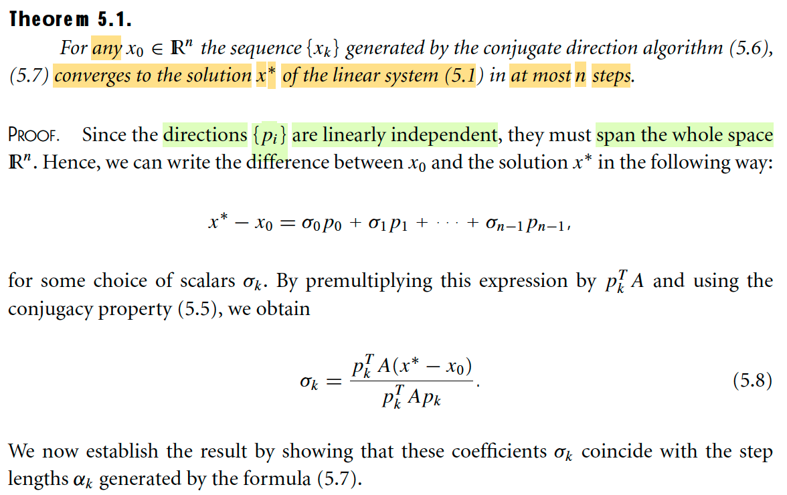</kbd>

<kbd>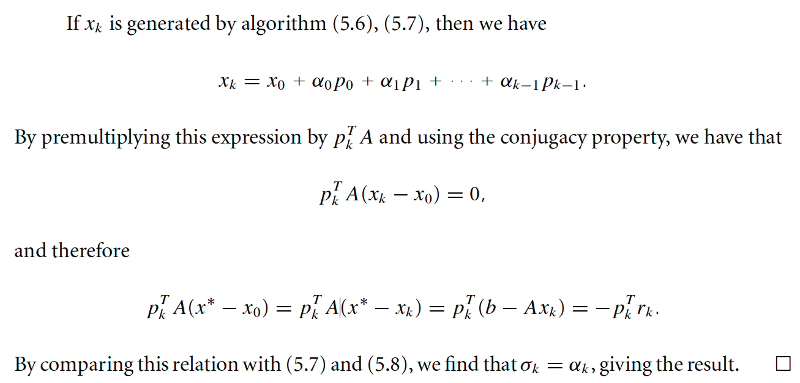</kbd>

<kbd>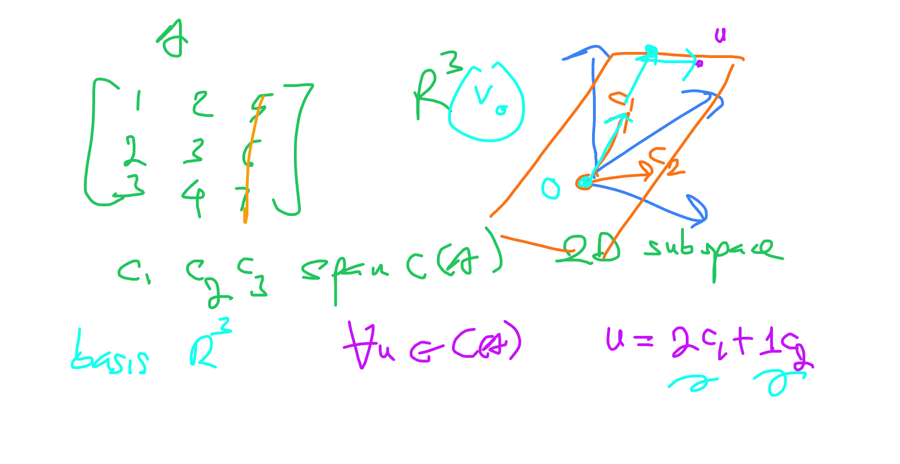</kbd>

<kbd>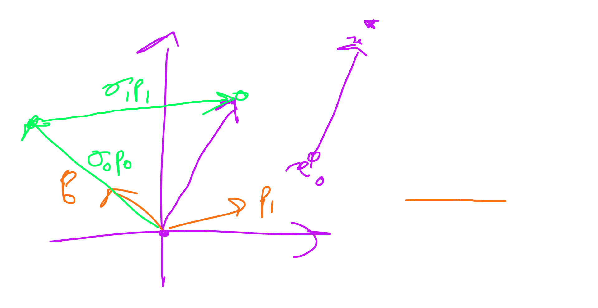</kbd>

> [!NOTE]
> Theorem 5.1: Nói rằng với x0 (initial point) bất kì thì chuỗi {xk} được generate bởi thuật toán 5.6 ở trên sẽ converge về solution x\* của Ax = b trong nhiều nhất là n step.
>
>
>
> Chứng minh như sau: Đầu tiên, vì {pi} độc lập tuyến tính, và đủ số lượng (n) nên dĩ nhiên chúng là một basis của R^n, span {p0,..pn-1} = R^n. Nên mọi vector R^n đều là linear combination của chúng. Do đó gs nói ta có thể thể hiện x\* - x0 (cũng là R^n vector) bởi:
>
>
>
> x\* - x0 = σ0p0 + σ1p1 + ..σn-1 pn-1.
>
>
>
> x\* = x0 + σ0p0 + σ1p1 + ..σn-1 pn-1.
>
>
>
> Nhân hai vế cho pkᵀA ta có:
>
>
>
> pkᵀA(x\* - x0) = pkᵀA(σ0p0 + σ1p1 + ..σn-1 pn-1)
>
>
>
> Xét vế phải, phân phối vô ta có tổng các pkᵀAσipi, vì tính conjugacy nên nếu pi khác pk, kết quả thành 0. Nên chỉ còn pkᵀApk, ta có:
>
>
>
>  pkᵀA(x\*-x0) = σkpkᵀApk
>
>
>
> ⇔ σk = pkᵀA(x\*-x0)/pkᵀApk (5.8)
>
>
>
> Giờ ta sẽ đi chứng minh σk TRÙNG KHỚP với step length αk của công thức 5.7. Là sao?
>
>
>
> ⇨ Thì khi ta chứng minh σk = αk thì cũng đã chứng minh là chuỗi {xk} tạo bởi x1 = x0 + α0p0, x2 = x1 + α1p1,...cũng chính là sẽ là đi từ x0 → x1 = x0 + σ0p0, x2 = x0 + σ0p0 + σ1p1 , ... xn = x0 + σ0p0 + σ1p1 + ...σn-1pn-1 = x0 + x\* - x0 = x\*!
>
>
>
> Có nghĩa là ta cũng đã chứng minh được thuật toán sẽ dẫn ta đến x\* tại iteration thứ n.
>
>
>
> Về mặt hình học hiểu nôm na như sau: Như đã biết về ý nghĩa của x\* - x0 = σ0p0 + σ1p1 + ..σn-1 pn-1: Đó là để đi từ x0 → x\*, ta sẽ đi thep phương p0 một khoảng có độ lớn σ0, rồi từ đó đi theo phương p1 một khoảng có độ lớn σ1,... Vậy thì nếu chứng minh αk = σk thì dĩ nhiên cũng đã chứng minh chuỗi {xk} tạo bởi thuật toán cũng sẽ dẫn ta tới x\* sau n bước.
>
>
>
> Quay lại đây, chuỗi {xk} tạo bởi 5.6, 5.7: xk+1 = xk + αkpk, và αk = -rkᵀpk/pkᵀApk, cụ thể sẽ là:
>
>
>
> x1 = x0 + α0p0
>
>
>
> x2 = x1 + α1p1 = x0 + α0p0 + α1p1
>
>
>
> ...
>
>
>
> xk = xk-1 + αk-1pk-1= x0 + α0p0 + α1p1 + ..αk-1pk-1
>
>
>
> Nhân hai vế cho pkᵀA:
>
>
>
> pkᵀAxk = pkᵀAx0 + pkᵀA(α0p0 + α1p1 + ..αk-1pk-1)
>
>
>
> ⇔ pkᵀAxk - pkᵀAx0 = pkᵀA(α0p0 + α1p1 + ..αk-1pk-1)
>
>
>
> ⇔ pkᵀA(xk - x0) = pkᵀA(α0p0 + α1p1 + ..αk-1pk-1)
>
>
>
> Vế phải, theo tính chất conjugate, dễ hiểu chỉ còn 0, ta có pkᵀA(xk - x0) = 0
>
>
>
> ⇔ pkᵀAxk = pkᵀAx0
>
>
>
> Từ đó cái tử số của σk = pkᵀA(x\*-x0)/pkᵀApk sẽ bằng:
>
>
>
> pkᵀA(x\* - x0) = pkᵀAx\*- pkᵀAx0 = pkᵀAx\*-pkᵀAxk = pkᵀ(Ax\*-Axk)
>
>
>
> = pkᵀ(b-Axk) Và vì rk = Axk-b nên đây chính là -pkᵀrk
>
>
>
> Vậy σk = pkᵀA(x\*-x0)/pkᵀApk = -pkᵀrk/pkᵀApk, chính là αk. Chứng minh xong

📹 [Xem video trên YouTube](https://youtu.be/V3qSJFNY3HM)

> [!TIP]
> 🤖 **AI Check** — 🟢 Pass — ✅ **100/100** · ✓ Move on
>
> Ghi chú rất xuất sắc, trình bày mạch lạc, giải thích chi tiết và trực giác hóa được toàn bộ các bước biến đổi của định lý và chứng minh.
>
> **✓ Strengths**
> - Hiểu rõ và diễn giải trọn vẹn tại sao việc chứng minh sigma_k = alpha_k lại trực tiếp dẫn tới việc x_n = x*.
> - Các bước biến đổi đại số từ khai triển cơ sở, sử dụng tính trực giao liên hợp (conjugacy), cho tới biến đổi số dư rk = Axk - b đều rất chính xác và chi tiết.
>
> **💡 Deeper notes**
> - Định lý phát biểu hội tụ trong 'nhiều nhất n bước' (at most n steps) vì nếu ban đầu x0 đã nằm trong không gian con chứa nghiệm hoặc một số hệ số alpha_k = 0 (tức r_k = 0), thuật toán có thể tìm ra nghiệm x* trước khi chạm mốc n bước.
> - Chứng minh này ngầm định ma trận A là đối xứng xác định dương (SPD), đảm bảo mẫu số p_k^T A p_k > 0 và các hướng liên hợp khác không độc lập tuyến tính.

**🔗 See also:** [Chuyển đổi A thành diagonal](#node-tikzhc4)

 

###### Góc nhìn hình học lí giải tính chất của conjugate direction

<kbd>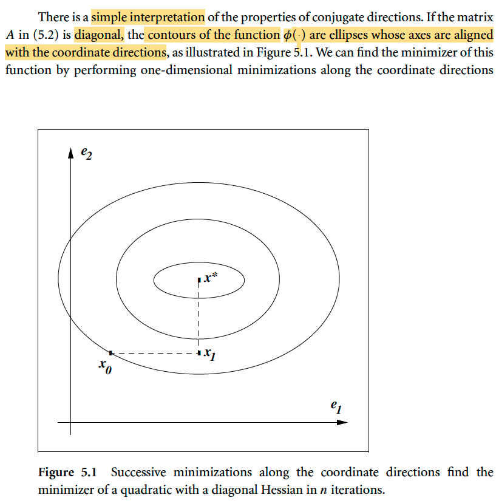</kbd>

<kbd>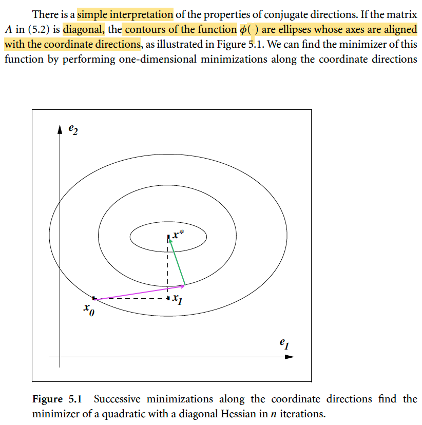</kbd>

<kbd>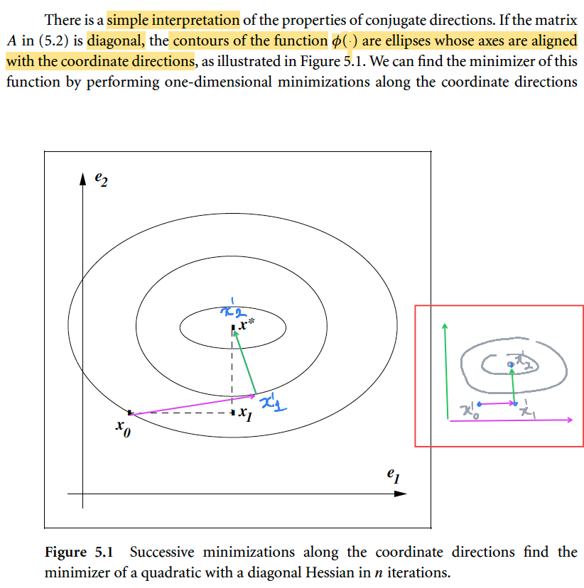</kbd>

<kbd>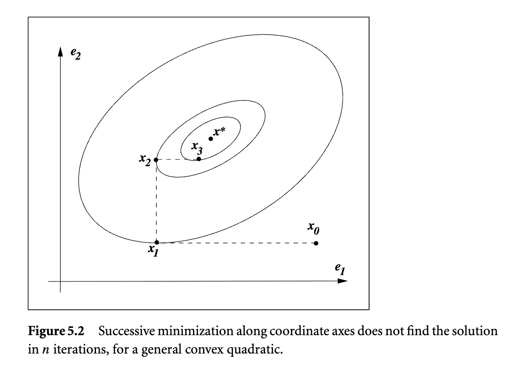</kbd>

<kbd>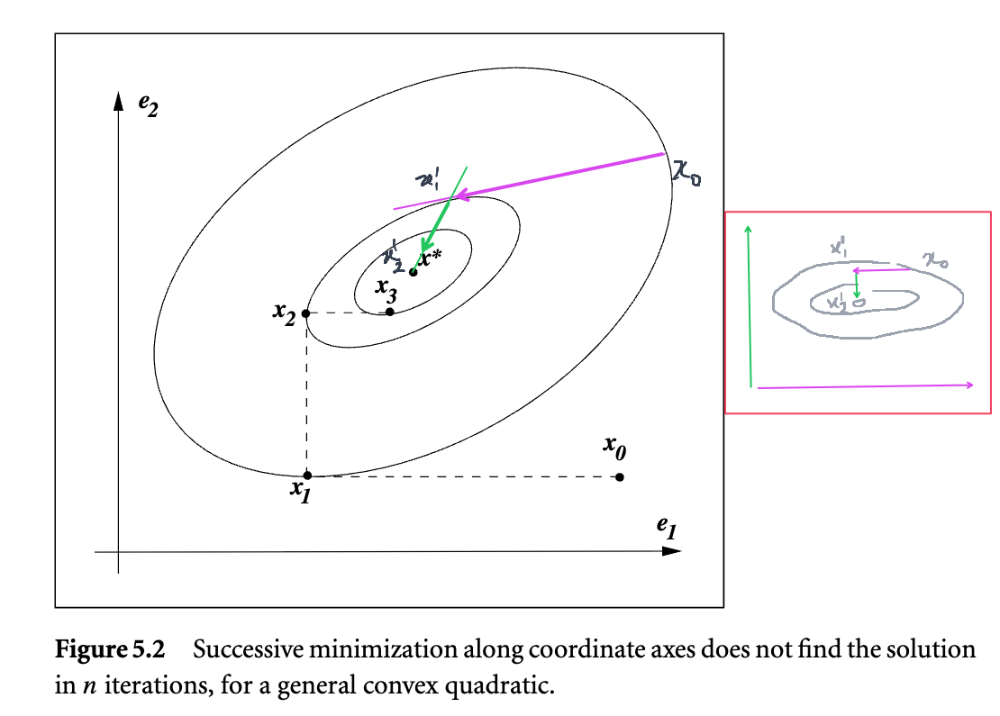</kbd>

<kbd>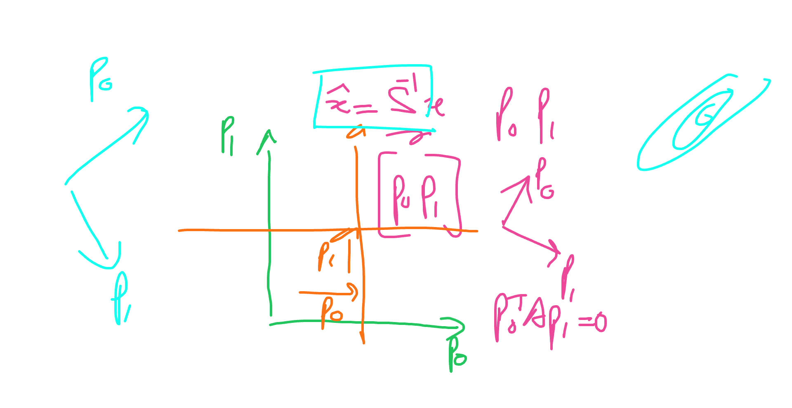</kbd>

> [!NOTE]
> Đại khái là ở đây minh họa hình học để giúp ta hiểu **vì sao conjugate direction method lại giúp converge về x\* trong n bước**.
>
>
>
> Lấy ví dụ trong 2D, khi A là diagonal matrix, thì contour plot sẽ có dạng các hình ellipse.
>
>
>
> Theo phương pháp này, như đã biết ta sẽ đi như sau:
>
>
>
> Di chuyển từ x0, theo e1, với sải bước sao cho minimize hàm f restrict theo hướng e1 để đến x1
>
>
>
> Từ x1 di chuyển theo e2, với sải bước sao cho minimize hàm f restrict theo hướng e2 để đến x2 (cũng là x\*)
>
>
>
> ⇒ Chỉ tốn hai bước (trong không gian nD sẽ tốn n bước)
>
>
>
> Và với A diagonal, e1, e2 cũng chính là một bộ conjugate direction (bên cạnh vô số bộ vector khác)
>
>
>
> Như vậy, rất dễ thấy ở đây, phương pháp sẽ đưa ta từ x0 đến x\* trong nhiều nhất là 2 bước (nếu x0 trùng x1 thì chỉ tốn 1 bước)
>
>
>
> ---
>
>
>
> Như nếu không chọn p0=e1, p1=e2 thì sao, là có chắc là cũng sẽ đưa ta đến x\* trong nhiều nhất 2 bước không? Ví dụ nếu chọn hướng p0 là vector màu tím, thì p1 có phải là vector màu xanh không? Hay, đi theo p0 là vector màu tím, theo công thức sải bước đưa ta đến x1', thì từ x1' có chắc là đi theo p1 sẽ đến x\*, nói cách khác, vector màu xanh có phải là conjugate direction p1 không?
>
>
>
>  Câu trả lời sẽ dùng lập luận y như khi A không diagonal:
>
>
>
> Bằng cách đổi biến x̂ = S⁻¹ x, với S là matrix có các cột là \[p0,p1\], thì như video trước ta đã hiểu, là đây chính là ta chuyển hệ trục tọa độ theo basis p's. Và trong hệ trục đó, matrix Hessian sẽ trở thành SᵀAS, là một matrix chéo.
>
>
>
> (x = S x̂, (mà ta hiểu chính là \[x\]\_e = S \[x\]\_p)
>
>
>
> φ̂(x̂) = (1/2) xᵀAx - bᵀx = (1/2) x̂ ᵀSᵀASx̂ - bᵀSx̂ → Hessian là SᵀAS)
>
>
>
> Từ đó, trong hệ trục đó, contour của f cũng là ellipse có trục song song với hai trục tọa độ p0,p1 y như cái hình này.
>
>
>
> (Ví von như đeo kính vào, ta sẽ thấy hình ảnh một hệ trục có hai vector p0,p1 vuông góc. và ellipse có trục song song với các trục tọa độ giống y như hình này) trong đó:
>
>
>
> đi từ x0 (tọa độ basis e x0 = \[x0\]\_e, tọa độ basis p x̂ 0 = \[x0\]\_p)
>
>
>
> theo p0, xải bước α0
>
>
>
> đến được x'1 (\[x'1\]\_e, \[x'1\]\_p = x̂ '1)
>
>
>
> theo p1, xải bước α1
>
>
>
> đến được x'2 (\[x'2\]\_e, \[x'2\]\_p = x̂ '2) cũng chính là x\*
>
>
>
> Như vậy đeo kính vào sẽ thấy nó đi như cái hình trong ô đỏ: đi theo hướng vuông góc với trục tọa độ, ellipse nằm thẳng trục và ta cũng đến trong 2 bước).
>
>
>
> Mở kính ra, ta sẽ thấy nó đi như hình ở ngoài, dù theo p0,p1 xiên vẹo nhưng cũng đến x\* trong 2 bước.
>
>
>
> ---
>
>
>
> Và xét qua trường hợp A không diagonal cũng vậy, trong e's contour của nó không thẳng trục. Nhưng chọn bộ p0,p1 conjugate bất kì và đổi biến y như trên thì Hessian cũng thành diagonal, và trong hệ trục đó câu chuyện cũng y như trên. Để cho thấy là ta cũng sẽ đến đích trong 2 bước.
>
>
>
> ---
>
>
>
> Vì sao khi A là diagonal thì contour plot là lại ellipse/ellipsoid?
>
>
>
> Nếu matrix A (đối xứng xác định dương) là diagonal A = diag(λ1,...,λn), contour của Φ(x) sẽ có dạng:
>
>
>
> Φ(x) = c (c-level set)
>
>
>
> ⇔ (1/2)xᵀAx - bᵀx = c
>
>
>
> ⇔ (1/2)xᵀdiag(λ1,...,λn)x - bᵀx = c
>
>
>
> ⇔ (1/2)xᵀ(λ1x1, ..λnxn) - bᵀx = c
>
>
>
> ⇔ (1/2)λ1x1² + .. + (1/2)λnxn² - (b1x1+ .. + bnxn) = c
>
>
>
> ⇔ (1/2)λ1x1² + .. + (1/2)λnxn² - b1x1 .. - bnxn = c
>
>
>
> ⇔ (1/2)λ1x1² - b1x1 + .. + (1/2)λnxn² - bnxn = c
>
>
>
> ⇔ (λ1/2)\[x1² - b1x1/(λ1/2)\] + .. + (λn/2)\[xn² - bnxn/(λn/2)\] = c
>
>
>
> ⇔ (λ1/2)\[x1² - 2b1x1/λ1\] + .. + (λn/2)\[xn² - 2bnxn/λn\] = c
>
>
>
> ⇔ (λ1/2)\[x1² - 2x1b1/λ1\] + .. + (λn/2)\[xn² - 2xnbn/λn\] = c
>
>
>
> ⇔ (λ1/2)\[x1² - 2x1b1/λ1 + (b1/λ1)² - (b1/λ1)²\] + .. + (λn/2)\[xn² - 2xnbn/λn + (bn/λn)² - (bn/λn)²\] = c
>
>
>
> ⇔ (λ1/2)\[x1² - 2x1b1/λ1 + (b1/λ1)²\] - (λ1/2)(b1/λ1)² + .. + (λn/2)\[xn² - 2xnbn/λn + (bn/λn)²\] - (λn/2)(bn/λn)² = c
>
>
>
> ⇔ (λ1/2)\[x1² - 2x1b1/λ1 + (b1/λ1)²\] - b1²/2λ1 + .. + (λn/2)\[xn² - 2xnbn/λn + (bn/λn)²\] - bn²/2λn = c
>
>
>
> ⇔ (λ1/2)\[x1² - 2x1b1/λ1 + (b1/λ1)²\] - b1²/2λ1 + .. + (λn/2)\[xn² - 2xnbn/λn + (bn/λn)²\] - bn²/2λn = c
>
>
>
> ⇔ (λ1/2)(x1 - b1/λ1)² - b1²/2λ1 + .. + (λn/2)(xn - bn/λn)² - bn²/2λn = c
>
>
>
> ⇔ Σi (λi/2)(xi - bi/λi)² - Σi bi²/2λi = c
>
>
>
> ⇔ Σi (λi/2)(xi - bi/λi)² = c + Σi bi²/2λi
>
>
>
> Đặt vế phải là C'
>
>
>
> ⇔ Σi (λi/2)(xi - bi/λi)² = C'
>
>
>
> ⇔ Σi (λi/2)(xi - bi/λi)² / C' = 1
>
>
>
> ⇔ Σi (xi - bi/λi)² / \[C'/(λi/2)\] = 1
>
>
>
> ⇔ Σi (xi - bi/λi)² / \[2C'/λi)\] = 1
>
>
>
> Đây chính là phương trình của ellipsoid với center tại (b1/λ1, ...bn/λn)
>
>
>
> Quay lại đây, có thể hiểu trong trường hợp này, bộ vector e1,...en (standard basis) chính là conjugate set của A.
>
>
>
> Thật vậy:
>
>
>
> nếu i khác j: eiᵀAej = eiᵀ(0,0,...λj,..0) = 0×0 + 0×0 + ..1×0 + ..0×λj + ..0×0 = 0.
>
>
>
> Nên di chuyển theo conjugate direction chính là di chuyển theo hướng các trục:
>
>
>
> x0 đi theo hướng / phương e1 đến x1
>
>
>
> x1 đi theo hướng / phương e2 đến x2 (x\*)

> [!TIP]
> 🤖 **AI Check** — 🟢 Pass — ✅ **95/100** · ✓ Move on
>
> Ghi chú thể hiện sự hiểu biết sâu sắc và chính xác về bản chất hình học cũng như đại số của phương pháp phương liên hợp (Conjugate Direction). Phép biến đổi tọa độ và bước khai triển dạng toàn phương đưa về phương trình ellipsoid đều rất chuẩn xác.
>
> **🟡 Minor issues**
>
> **1.** *"Σi (xi - bi/λi)² / [2C'/λi)] = 1. Đây chính là phương trình của ellipsoid với center tại (b1/λ1, ...bn/λn)"*
>
> Để tập mức (level set) thực sự tạo thành một ellipsoid thực (tồn tại nghiệm thực), giá trị hằng số mức c cần thỏa mãn c > -1/2 * b^T A^(-1) b (tức là c > phi(x*)), đảm bảo hằng số C' > 0.
>
>
> **✓ Strengths**
> - Hiểu rất rõ cơ chế tách biệt bài toán n-chiều thành n bài toán 1-chiều độc lập khi Hessian ở dạng ma trận đường chéo.
> - Ý tưởng dùng phép đổi biến tọa độ x = S x̂ với S chứa các vector liên hợp để chéo hóa Hessian (S^T A S) và liên hệ hình học bằng phép ẩn dụ 'đeo kính' rất trực quan và chính xác.
> - Khai triển đại số chi tiết, hoàn thành bình phương đúng đắn để chứng minh tập mức là hình ellipsoid có tâm tại nghiệm x* = A^(-1)b.
>
> **💡 Deeper notes**
> - Trong không gian x̂, các trục tọa độ trực giao theo tích vô hướng Euclid thông thường, tương ứng với việc các hướng tìm kiếm p_i trực giao với nhau theo tích vô hướng có trọng số A (tức p_i^T A p_j = 0). Phép biến đổi này chính là biến ellipsoid xiên thành ellipsoid thẳng trục (hoặc hình cầu nếu chuẩn hóa độ dài theo A).

**🔗 See also:** [Tối ưu hóa tọa độ Hessian chéo](#node-b04ox8f) · [5.2.4 Gradient Descent Optimization *(Pattern Recognition Machine Learning_C.Bishop)*](../pattern_recognition_machine_learning_cbishop/524_gradient_descent_optimization.md#node-n86no7e)

 

###### Chuyển đổi A thành diagonal

<kbd>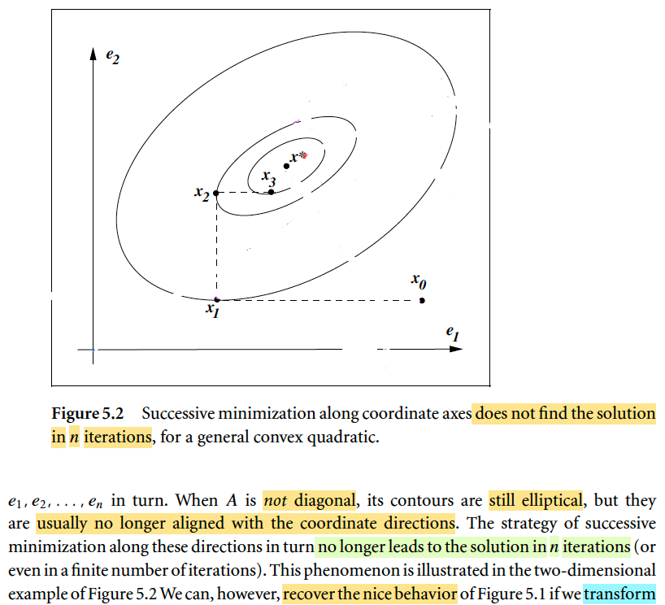</kbd>

<kbd>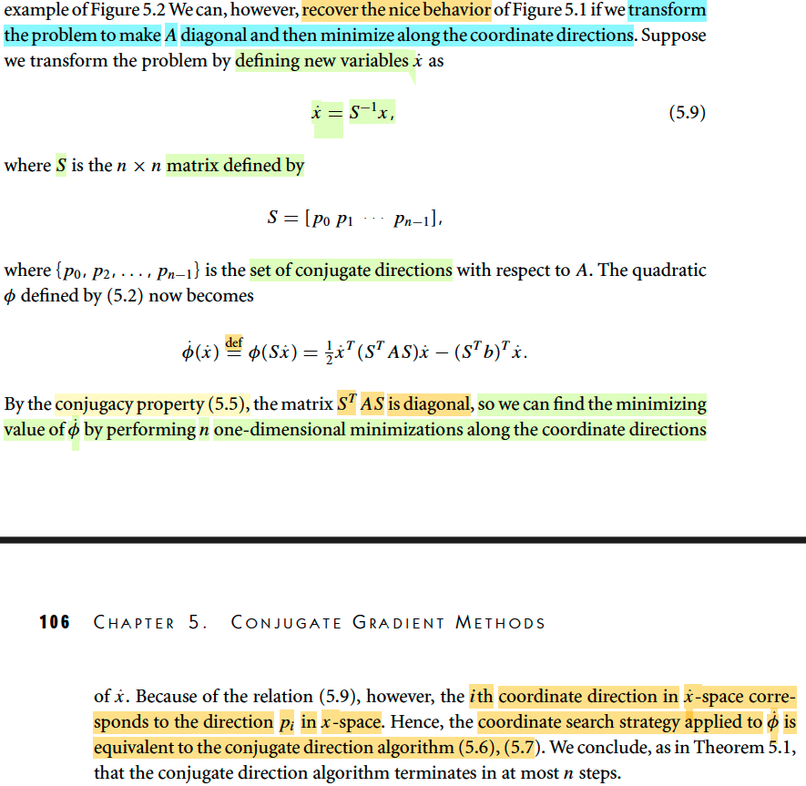</kbd>

<kbd>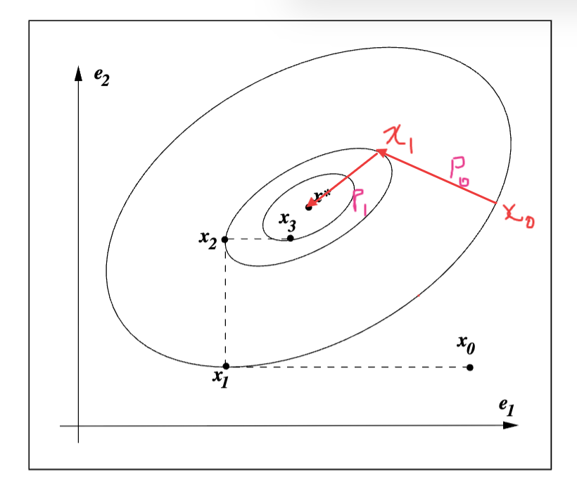</kbd>

<kbd>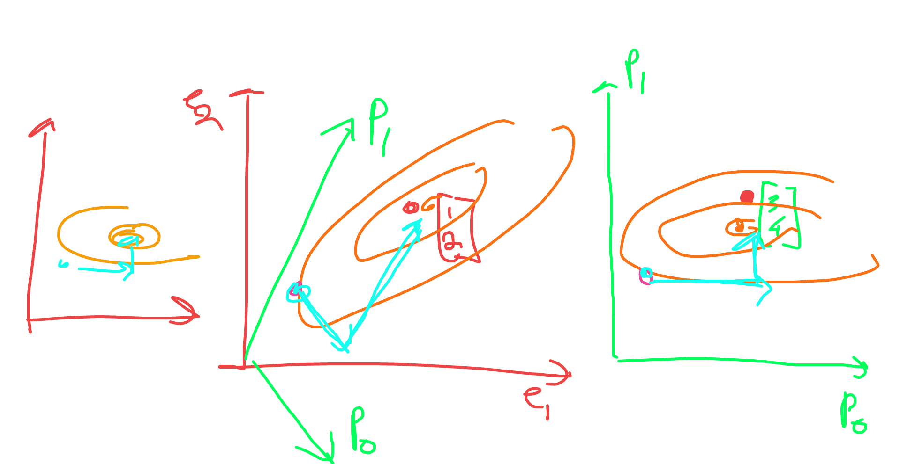</kbd>

<kbd>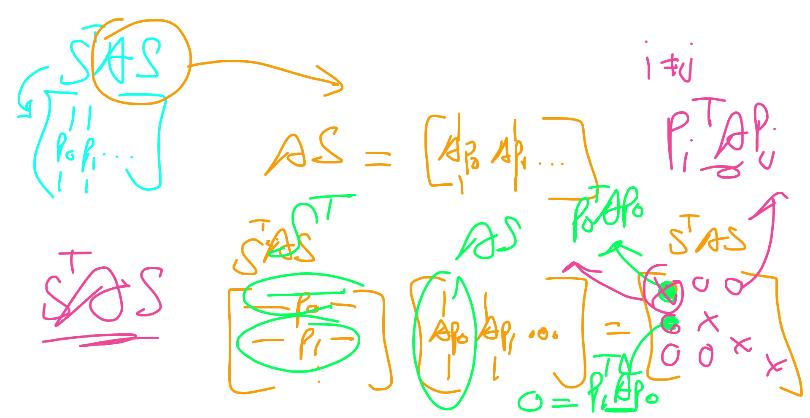</kbd>

> [!NOTE]
> Hiểu chỗ này đại khái như sau: Nếu như A diagonal, thì bộ basis vector {ei} chính là conjugate set, và dùng chúng để đi từ x0 thì ta sẽ đến được x\* trong nhiều nhất là n step như theorem 5.1 đã nói.
>
>
>
> Nhưng nếu A không phải diagonal, thì {ei} không phải là conjugate set, nên theorem 5.1 đương nhiên là không áp dụng, đi theo các hướng đó với thuật toán 5.6 (xk+1 = xk + αkpk) , 5.7 (αk = -rkᵀpk/pkᵀApk) không còn giúp đến đích trong nhiều nhất là n bước nữa.
>
>
>
> Vậy thì đại khái là để thuật toán hội tụ trong n bước theo theorem 5.1, ta phải tìm bộ conjugate set {pi} của A thì thuật toán mới work như theorem vừa rồi đã tuyên bố.
>
>
>
> Nhưng ở đây, đại khái là mình hiểu việc dùng bộ {pi}, thì thật ra cũng chính là ta chuyển bài toán từ ellipse không diagonal thành diagonal. Chỉ vậy thôi.
>
>
>
> Cụ thể là ta sẽ đổi biến, đặt x̂ = S⁻¹ x với S là matrix các cột là conjugate set của A, S = \[p0, ...pn-1\].
>
>
>
> Vậy thì hàm Φ(x) = (1/2)xᵀAx - bᵀx trở thành
>
>
>
> φ̂(x̂) = (1/2)x̂ ᵀ(SᵀAS)x̂ - (Sᵀb)ᵀx̂
>
>
>
> ---
>
>
>
> Phần ghi chú trong video:\
> \
> Linear transformation có tính chất: T(αu + βv) = αT(u) + βT(v)
>
>
>
> Nên phân biệt u là vector, là cái nhà nằm trên đồng trống. Khi đánh địa chỉ nó, người ta chọn hệ trục (cơ sở) thì nó mới có địa chỉ, cơ sở khác nhau thì địa chỉ khác nhau. Ví dụ cơ sở e's (e1, e2), s's (s1,s2), v's (v1,v2)
>
>
>
> \[u\]\_e = (2, 3): u = 2e1 + 3e2
>
>
>
> \[u\]\_s = (3, 4): u = 3s1 + 4s2
>
>
>
> \[u\]\_v = (5, 6): u = 5v1 + 6v2
>
>
>
> Biến đổi tuyến tính u, ta có vector T(u), giống như từ cái nhà u, ta có cái nhà mới T(u). Và dựa theo cơ sở w's thì địa chỉ của nó là \[T(u)\]\_w
>
>
>
> \[T(u)\]\_w = (7,8,9): T(u) = 7w1 + 8w2 + 9w3
>
>
>
> Nhiệm vụ là muốn tìm matrix A đại diện cho T(.) để nhân A cho tọa độ của u trong cơ sở v's được tọa độ của T(u) trong cơ sở w's
>
>
>
> A\[u\]\_v = \[T(u)\]\_w
>
>
>
> Lập luận như sau: Do \[u\]\_v = (5,6) nên u = 5v1 + 6v2
>
>
>
> ⇒ T(u) = T(5v1 + 6v2) = 5T(v1)+ 6T(v2)
>
>
>
> \[T(u)\]\_w = \[T(5v1 + 6v2)\]\_w = \[5T(v1)+ 6T(v2)\]\_w
>
>
>
> = 5\[T(v1)\]\_w + 6\[T(v2)\]\_w
>
>
>
> \[T(u)\]\_w = 5\[T(v1)\]\_w + 6\[T(v2)\]\_w
>
>
>
> A\[u\]\_v = \[T(u)\]\_w
>
>
>
> ⇔ A\[u\]\_v = 5\[T(v1)\]\_w + 6\[T(v2)\]\_w
>
>
>
> A \[5,6\]ᵀ = 5 c1 + 6 c2 = 5\[T(v1)\]\_w + 6\[T(v2)\]\_w
>
>
>
> ⇒ c1 = \[T(v1)\]\_w, c2 = \[T(v2)\]\_w
>
>
>
> Vậy cột 1 của A là tọa độ của T(v1) trong cơ sở w, cột 2 là tọa độ của T(v2) trong cơ sở w
>
>
>
> ---
>
>
>
> Giờ xét phép biến đổi identity: T(u) = u
>
>
>
> A\[u\]\_v = \[u\]\_s
>
>
>
> c1 = \[v1\]\_s, c2 = \[v2\]\_s
>
>
>
> ⇒ matrix A giúp nhân tọa độ của u theo cơ sở v's ra tọa độ u trong cơ sở s's sẽ là: cột j là tọa độ của vj trong cơ sở s.
>
>
>
> Nhưng ta có thể lập luận thêm:
>
>
>
> \[v1\]\_s = (c11, c21)
>
>
>
> ⇒ v1 = c11 s1 + c21 s2
>
>
>
> Hai vector bằng nhau nên tọa độ trong cơ sở e (hay cơ sở nào) cũng bằng nhau:
>
>
>
> ⇒ \[v1\]\_e = \[c11 s1 + c21 s2\]\_e
>
>
>
> ⇔ \[v1\]\_e = c11 \[s1\]\_e + c21 \[s2\]\_e
>
>
>
> \[v2\]\_s = (c12, c22)
>
>
>
> \[v2\]\_e = \[c12 s1 + c22 s2\]\_e
>
>
>
> ⇔ \[v2\]\_e = c12\[s1\]\_e + c22 \[s2\]\_e
>
>
>
> ---
>
>
>
> Vậy từ hai ý này:
>
>
>
> \[v1\]\_e = c11 \[s1\]\_e + c21 \[s2\]\_e
>
>
>
> \[v2\]\_e = c12 \[s1\]\_e + c22 \[s2\]\_e
>
>
>
> Nếu ta đặt matrix V, S có các cột là \[v1\]\_e,\[v2\]\_e, và \[s1\]\_e, \[s2\]\_e thì hai phương trình trên chính là:
>
>
>
> V = SA
>
>
>
> Do S là matrix chứa các cột tọa basis nên S khả nghịch"
>
>
>
> ⇔ S⁻¹ V = A
>
>
>
> Vậy matrix A giúp chuyển tọa độ trong cơ sở v's sang s's là: A = S⁻¹ V
>
>
>
> S⁻¹ V \[u\]\_v = \[u\]\_s
>
>
>
> Theo quy tắc đó, nếu muốn chuyển từ tọa độ cơ sở e's sang s's: A = S⁻¹ E = S⁻¹ I = S⁻¹
>
>
>
> (matrix E có các cột là \[e1\]\_e, \[e2\]\_e, thì cũng chính là e1, e2. Và E chính là Identity matrix I)
>
>
>
> S⁻¹ \[u\]\_e = \[u\]\_s
>
>
>
>  \[u\]\_e = S \[u\]\_s 
>
>
>
> Như vậy, trong sách khi ta thấy x̂ = S⁻¹ x với S là matrix có các cột là p0, p1,...thì ta hiểu đang chuyển tọa độ của x trong cơ sở e's (mà thường thì khi viết x, ta hay đồng nhất là vector x và tọa độ của nó trong cơ sở chuẩn mà ở trên ta phân biệt rạch ròi ra là x và \[x\]\_e) sang tọa độ cơ sở là các vector p0, p1,... này.
>
>
>
> S⁻¹ x = x̂ chính là S⁻¹ \[x\]\_e = \[x\]\_s
>
>
>
> ---
>
>
>
> Quay lại bài này ta thấy rõ: x̂ = S⁻¹ x chính là chuyển tọa độ của x từ basis e's sang tọa độ của nó trong BASIS p's (p0,..pn-1).
>
>
>
> Vậy thì ý tưởng ở đây là:
>
>
>
> Khi A diagonal, ta thấy contour plot là elipsoid ngay ngắn thẳng trục để rồi đi theo các hướng bởi vector ei, theo thuật toán cho kết quả hội tụ trong n bước là vì lúc này {ei} là conjugate set
>
>
>
> Cho dù A không diagonal, để rồi {ei} không phải là conjugate set của nó. Nên đi dùng chúng sẽ không thỏa Theorem 5.1 giúp hội tụ trong n bước. Thì đơn giản là bằng cách đổi biến sang tọa độ của basis p's, là conjugate set của A, thì trong hệ tọa độ đó, cái contour plot nó là CŨNG LÀ một elipsoid ngay ngắn, thẳng trục với basis p's. Và mọi chuyện y hệt case trên.
>
>
>
> Vậy thì ý tưởng là: làm sao đó để trong hệ tọa tọa độ mới, matrix A biến thành diagonal matrix.
>
>
>
> Như trên vừa nói, nếu x là tọa độ trong basis e's, thì S⁻¹ x sẽ là tọa độ trong basis mới tạo bởi các cột của S. Ngược lại nếu x̂ là tọa độ trong basis đó thì x = S x̂ sẽ là tọa độ trong basis e's.
>
>
>
> \[x\]\_p = S⁻¹ \[x\]\_e
>
>
>
> \[x\]\_e = S \[x\]\_p
>
>
>
> Thế thì ta có:
>
>
>
> Φ(x) = (1/2)xᵀAx - bᵀx khi chuyển qua tọa độ mới sẽ là:
>
>
>
> Φ(Sx̂) = (1/2)(Sx̂)ᵀA(Sx̂) - bᵀSx̂
>
>
>
> = (1/2)x̂ ᵀSᵀASx̂ - bᵀSx̂
>
>
>
> Để rồi nếu như ta muốn trong hệ trục này, basis {si} matrix Hessian trở nên diagonal, tức SᵀAS diagonal (để giống như trong hệ trục gốc, basis {ei}, Hessian là A diagonal)
>
>
>
> SᵀAS diagonal, tạm quên p0,p1,..Giả sử các cột của S là s1, s2,... thì để SᵀAS diagonal, ta thấy như sau:
>
>
>
> Các phần tử ngoài đường chéo:
>
>
>
> SᵀAS = Sᵀ (AS), theo góc nhìn thứ 2 khi nhân matrix, = Sᵀ \[As1, As2,...Asn\]
>
>
>
> Thế thì matrix này, đường chéo của nó sẽ là s1ᵀAs1, s2ᵀAs2,...snᵀAsn
>
>
>
> Còn ngòai đường chéo sẽ là siᵀAsj với i ≠ j.
>
>
>
> Như vậy, muốn SᵀAS là diagonal matrix thì ta sẽ phải có siᵀAsj = 0 với i ≠ j
>
>
>
> Do đó, {si} phải là một conjugate set của A.
>
>
>
> từ đó ta hiểu nếu đặt p0,p1,...làm cột của S, thì SᵀAS là diagonal matrix
>
>
>
> ---
>
>
>
>
>
> Và lúc này, ta sẽ hiểu rằng, trong hệ tọa độ mới, theo basis {si} = {pi} = {p0,...pn-1} thì thuật toán cũng làm cái việc y như trong trường hợp A diagonal: Tức là nó cũng sẽ chỉ mất n bước để đi đến x\* mà ở mỗi bước nó sẽ dùng hướng các vector basis.
>
>
>
> Cụ thể:
>
>
>
> Từ x1
>
>
>
> Do đó thầy Nocedal mới nói ở đây rằng: "ith coordinate direction in x̂-space corresponds to th direction pi in x-space" Ý là, trong hệ tọa độ basis p's thì di chuyển theo hướng p1 cũng chính là tương ứng với di chuyển theo hướng e1 trong hệ tọa độ basis e's, di chuyển theo hướng p2 cũng chính là tương ứng với di chuyển theo hướng e2 trong hệ tọa độ basis e's
>
>
>
> Nên coordinate search strategy sẽ apply φ̂ sẽ tương đương với conjugate direction algorithm. Do đó, theorem 5.1 nói rằng, nó sẽ converge trong n step.
>
>
>
> ---

📹 Video 1: [Vì sao ma trận SᵀAS là ma trận đường chéo?](https://youtu.be/zYeJv7A0Hns)

📹 Video 2: [Làm sao xây dựng ma trận chuyển cơ sở S⁻¹V?](https://www.youtube.com/watch?v=LdqakqsyBRY)

> [!TIP]
> 🤖 **AI Check** — 🟢 Pass — ✅ **98/100** · ✓ Move on
>
> Ghi chú xuất sắc! Bạn đã tự chứng minh lại bản chất của phép đổi cơ sở và liên kết hoàn hảo giữa việc chéo hóa ma trận Hessian với tính chất trực giao liên hợp (conjugacy).
>
> **✓ Strengths**
> - Diễn giải cực kỳ trực quan và chuẩn xác bản chất của phép đổi hệ cơ sở từ cơ sở chuẩn sang hệ vector liên hợp.
> - Tự tính toán và chỉ ra được các phần tử ngoài đường chéo của ma trận SᵀAS tương ứng với siᵀAsj = 0, kết nối trực tiếp với định nghĩa tính liên hợp.
> - Hiểu sâu sắc lý do tại sao tìm kiếm theo tọa độ trong không gian x̂ lại tương đương với thuật toán conjugate direction trong không gian x gốc.
>
> **💡 Deeper notes**
> - Để S khả nghịch và các hướng pi tạo thành một cơ sở đầy đủ của không gian n chiều, các vector conjugate này phải độc lập tuyến tính, điều này luôn được đảm bảo khi A là ma trận đối xứng xác định dương (Symmetric Positive Definite - SPD).
> - Hình dạng contour của hàm mục tiêu là elip/elipsoid thực chất dựa trên giả định A là ma trận đối xứng xác định dương (A > 0), đảm bảo hàm lồi ngặt và có cực tiểu toàn cục duy nhất.

**🔗 See also:** [Theorem 5.1](#node-g0algzt) · [Conjugate Direction Method](#node-0lu7h6i)

 

###### Tối ưu hóa tọa độ Hessian chéo

<kbd>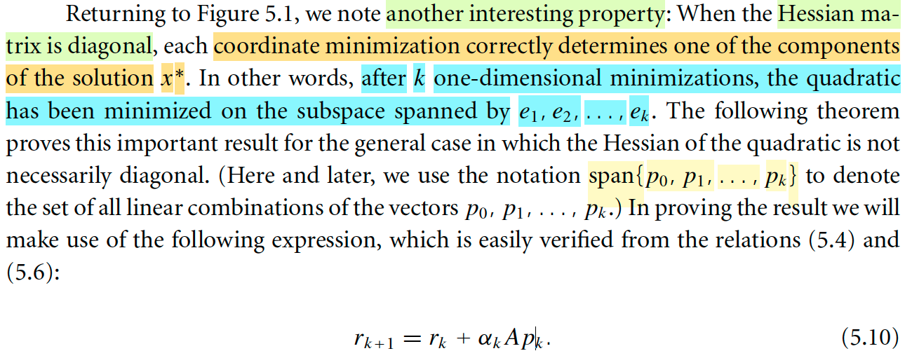</kbd>

> [!NOTE]
> Đại ý là thầy nói rằng, nhìn vào cái hình 5.1 ta có thể dễ nhận ra và hiểu ý sau đây: Khi Hessian diagonal thì cứ sau mỗi một step (ví dụ, từ x0 → x1) thì thật ra ta ĐÃ TÌM THẤY THÊM MỘT TỌA ĐỘ NỮA CỦA x\* RỒI. Ta có thể hoàn toàn đồng tình với ý này. Trong hình 5.1, có hai tọa độ. Thì sau step thứ nhất, thì mình đã có x1_1 chính là x\*\_1. Và sau step thứ 2, x2_2 chính là x\*\_2.
>
>
>
> Do đó, sau 1 step, thì hàm quadratic đã được minimize trên / over trục x1. Nói rõ ý này:
>
>
>
> Có nghĩa là ta sau bước 1 ta đã giải bài toán minimize over {x: x_1 ∈ R, x_2 fix} Φ(x). Và cái này cũng tương đương minimize over x ∈ R² Φ(x0 + t × e1).
>
>
>
> Thì đây chính là minimize quadratic Φ ON THE SUBSPACE SPANED BY e1.
>
>
>
> Vậy thì khái quát lên cho n-D case, thì mình cũng có thể hiểu là sau k step, ta quả thật là đã minimize hàm quadratic Φ on the subspace spanned by e1,e2,...ek.
>
>
>
> Trước khi vào theorem 5.2. Ta có:
>
>
>
> 5.4: rk = Axk - b, ⇨ rk+1 = Axk+1 - b
>
>
>
> ⇨ rk+1 - rk = Axk+1 - Axk - b + b
>
>
>
> ⇔ rk+1 - rk = A(xk+1 - xk)
>
>
>
> Dùng xk+1 = xk + αkpk ⇔xk+1 - xk = αkpk
>
>
>
> ..⇔ rk+1 - rk = Aαkpk = αkApk (5.10)

> [!TIP]
> 🤖 **AI Check** — 🟢 Pass — ✅ **98/100** · ✓ Move on
>
> Ghi chú nắm rất chắc bản chất trực quan từ ma trận Hessian đường chéo đến việc cực tiểu hóa trên không gian con, đồng thời tự diễn giải và chứng minh lại công thức (5.10) một cách mạch lạc.
>
> **✓ Strengths**
> - Giải thích trực quan và chính xác ý nghĩa hình học: khi Hessian là ma trận đường chéo, việc tối ưu từng tọa độ sẽ chốt luôn giá trị thành phần tối ưu tương ứng của nghiệm x*.
> - Chứng minh chi tiết, rõ ràng từng bước cho công thức truy hồi phần dư r_{k+1} = r_k + \alpha_k A p_k (5.10) dựa trên định nghĩa phần dư và bước cập nhật nghiệm.
>
> **💡 Deeper notes**
> - Về mặt chuẩn xác hình học, miền tối ưu sau k bước thực chất là một affine subspace (không gian con afin) dạng x_0 + span{e_1, ..., e_k} chứ không hẳn đi qua gốc tọa độ trừ khi điểm xuất phát x_0 = 0.

**🔗 See also:** [Conjugate Direction Method](#node-0lu7h6i) · [5.1 The Linear Conjugate Gradient Method](#node-hpdy8sw) · [Góc nhìn hình học lí giải tính chất của conjugate direction](#node-aads1j4) · [Theorem 5.3](#node-e7cob1z)

 

###### Vài suy nghĩ về bản chất của Conjugate Gradient method

<kbd>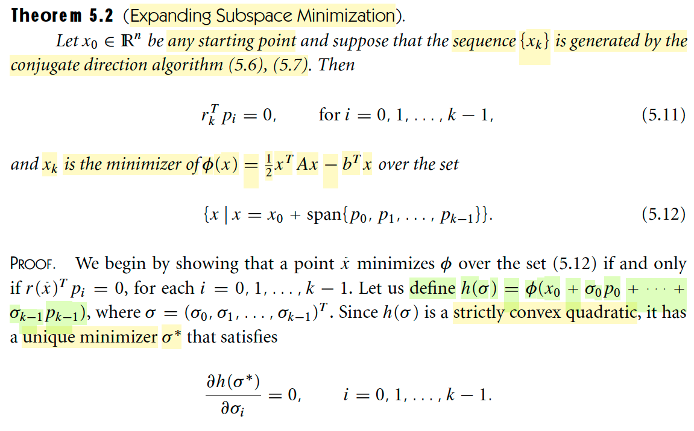</kbd>

<kbd>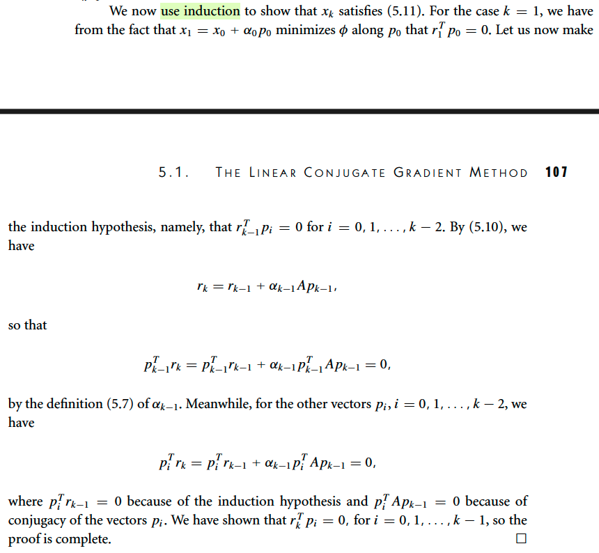</kbd>

> [!NOTE]
> Đại ý theorem này nói rằng cho điểm khởi đầu x0 bất kì. Và chuỗi {xk} sẽ được tạo bởi conjugate direction algorithm (5.6), (5.7). Thì khi đó:
>
>
>
> rkᵀpi = 0 với i = 0,1,...k-1
>
>
>
> Và xk sẽ là minimizer của φ(x) = (1/2)xᵀAx - bᵀx over the set {x | x = x0 + span{p0,...pk-1}}.
>
> Trước khi đi vào chứng minh, ta hiểu cái theorem này nói gì vậy?
>
>
>
> Đầu tiên, nhớ lại conjugate direction algorithm cũng như các tính chất của nó, nói cách khác, ôn lại chút xíu bối cảnh của ta: Đó là chương này bắt đầu với việc nói về bài toán giải hệ phương trình tuyến tính Ax = b ⇔ Ax - b = 0. Thế thì, tìm nghiệm của hệ này cũng chính là, tương đương với việc tìm minimizer của hàm quadratic Φ(x) = (1/2)xᵀAx - bᵀx. Vì điều kiện cần bậc một chính là ∇Φ(x) = 0 ⇔ Ax - b = 0.
>
>
>
> Và từ đó, người ta mới giới thiệu một cách tiếp cận iterative để giải Ax = b. Bắt đầu với x0. Ta sẽ generate chuỗi {xk}: xk+1 = xk + αkpk. Với {p0,p1,...pn-1} là conjugate set của A. Và theorem 5.1 đã chứng minh rằng, trong nhiều nhất là n step thì {xk} sẽ converge về x\* là true solution của Ax = b.
>
>
>
> Rồi, vậy thì đặt rk = Axk - b (r là stand for residual, ý là "phần còn thiếu tại step k") thì theorem này nói rằng:
>
>
>
> rkᵀpi = 0 với mọi i = 0,1,..,k-1.
>
>
>
> ---
>
>
>
> Suy nghĩ chút: Cái này có vẻ rất dễ có liên quan đến least square.
>
>
>
> Nếu rkᵀpi = 0 với mọi i=0,1...k-1. Thì có nghĩa là rk vuông góc với span{p0,...,pk-1}.
>
>
>
> Nhớ lại least square: Lập luận thế này: ta muốn giải Ax = b, chính là muốn tìm linear combination các cột của A để tạo ra b. Từ đó nếu C(A) không chứa b, thì nhiều nhất là ta chỉ tìm được một linear combination của A's columns để tạo ra điểm gần nhất với b: chính là hình chiếu của b lên C(A): Để rồi, residual e = b - Ax̂ sẽ vuông góc với C(A) ⇨ thuộc left nullspace N(Aᵀ) ⇨ Aᵀe = 0 ⇔ Aᵀ(b - Ax̂) = 0 ⇔ Aᵀb = AᵀAx̂, chính là normal equation.
>
>
>
> ---
>
>
>
> Thử lập luận thế này: Mục tiêu là di chuyển x trên x0 + span{p0}, sao cho minimize Φ(x) = (1/2)xᵀAx - bᵀx. Để cho đơn giản ta cho x0 = 0.
>
> Thì nếu được minimizer của Φ(x), tức x\*, là solution của Ax = b, nếu x\* không nằm trong span{p0}, nên cùng lắm là ta chỉ đến được hình chiếu của x\* lên span{p0}, gọi đó là αp0. Ta có residual (x\* - αp0) vuông góc với p0:
>
>
>
> (x\* - αp0)ᵀp0 = 0 (i)
>
> ⇔ x\*Tp0 - αp0ᵀp0 = 0
>
> ⇔ x\*Tp0 = αp0ᵀp0
>
> ⇔ x\*Tp0/p0ᵀp0 = α
>
>
>
> Hay α = xᵀp0 / p0ᵀp0. Vấn đề là, ta đâu có biết x là gì. (iii)
>
>
>
> Để giải quyết, ta làm cách khác: **Chuyển tọa độ sang hệ basis a's** (là cột của A^-1/2), khi x di chuyển trong span {p0}:
>
>
>
> Gọi x = αp0 là hình chiếu của x\* lên span{p0}, đang có tọa độ trong basis e's
>
>
>
> Thì tọa độ của nó trong basis a's sẽ là:
>
>
>
> x̂ = (A^-1/2)⁻¹ x = (A^-1/2)⁻¹ αp0
>
>
>
> Tọa độ của x\* trong basis a's: x̂\* = (A^-1/2)⁻¹ x\* = (A^1/2)x\*
>
>
>
> ⇔ x\* = (A^-1/2) x̂\* 
>
>
>
> và p̂0 là tọa độ của p0 trong basis a's:
>
>
>
> p̂0 = (A^-1/2)⁻¹ p0
>
>
>
> ⇔ p0 = (A^1/2) p̂0
>
>
>
> ⇨ Residual trong basis a's: x̂\* - αp̂0 
>
>
>
> Và thiết lập **phương trình residual vuông góc với subspace trong basis a's**:
>
>
>
> (x̂\* - αp̂0)ᵀp̂0 = 0 (ii)
>
>
>
> Dừng lại đây một chút, nhớ lại phương trình (i): (x\* - αp0)ᵀp0 = 0. Thì đây là phương trình giúp tìm hình chiếu của x\* lên span{p0} trong tọa độ chuẩn (basis e's).
>
>
>
> Còn (ii) là giúp tìm hình chiếu của x̂\* lên span{p̂0} trong tọa độ basis a's.
>
> Kết quả sẽ có thể ra một điểm khác. Hiểu nôm na thế này: Giả sử ta có hai vector u = (1,1) v = (1,2).
>
>
>
> **Trong hệ tọa độ basis e's, dĩ nhiên chúng KHÔNG VUÔNG GÓC** vì 1 × 1 + 1 × 2 khác 0. **Nhưng khi chuyển về tọa độ basis là u, v** (dùng change of basis) thì tọa độ của u trong basis u, v sẽ là (1,0) và của v sẽ là (0,1) ⇨ **TRONG HỆ TỌA ĐỘ ĐÓ U VUÔNG GÓC V**, dù ở tọa độ basis e's chúng hợp nhau góc nhọn.
>
>
>
> Thì câu chuyện cũng tương tự. Trong basis a's, ta tìm hình chiếu của x̂\* lên span{p̂0}, thì cái điểm đó, hay cái đường chiếu đó, **nó vuông góc với p0 trong hệ basis a's nhưng xéo xẹo nếu nhìn trong basis e's**. Nhưng ta sẽ thấy có những lí do để làm vậy.
>
>
>
> Tiếp tục từ (ii):
>
> (x̂\* - αp̂0)ᵀp̂0 = 0
>
> ⇔ x̂\*Tp̂0 - αp̂0Tp̂0 = 0
>
> ⇔ x̂\*Tp̂0 = αp̂0Tp̂0
>
> ⇔ x̂\*Tp̂0 / p̂0Tp̂0 = α
>
> ⇔ α = x̂\*Tp̂0 / p̂0Tp̂0
>
>
>
> Thay x̂\* = (A^-1/2)⁻¹ x\* = Bx\* (đặt B = (A^-1/2)⁻¹ cho gọn)
>
>
>
> p̂0 = (A^-1/2)⁻¹ p0 = Bp0
>
> ⇔ α = (Bx\*)ᵀBp0 / (Bp0)ᵀBp0
>
> ⇔ α = x\*TBᵀBp0 / p0ᵀBᵀBp0
>
> ⇔ α = x\*TB²p0 / p0ᵀB²p0
>
> ⇔ α = x\*TAp0 / p0ᵀAp0
>
>
>
> Tới đây, từ Ax\* = b ⇔ x\*ᵀAᵀ = bᵀ ⇔ xᵀA = bᵀ
>
>
>
> ..⇔ α = bᵀp0 / p0ᵀAp0
>
>
>
> Thì **đây chính là công thức của conjugate gradient**, vì trong thuật toán 5.1
>
>
>
> αk := -rkᵀpk / pkᵀApk
>
>
>
> ⇨ α0 := -r0Tp0 / p0ᵀAp0
>
> = -(Ax0 - b)ᵀp0 / p0ᵀAp0
>
> = -(0 - b)ᵀp0 / p0ᵀAp0 | đang giả sử xuất phát từ x0 = 0
>
> = bᵀp0 / p0ᵀAp0
>
>
>
> Như vậy mình hiểu thuật toán CG có bản chất là:
>
>
>
> Từ x0 = 0, đi theo hướng p0 sao cho tới gần x\* nhất để phần dư vuông góc với p0. Nhưng gần là theo basis a's, để vuông góc cũng là theo basis A, chứ không phải là basis e's. Thế thì nghĩ thêm một chút, trong basis e's, vì sao để tìm điểm gần nhất thì ta tìm điểm mà residual vuông góc với p0: Thì thật ra ta đang giải bài toán gì? → Chính là bài toán minimize distance: ||x\* - αp0||, cũng tương đương minimize ||x\* - αp0||² = (x\* - αp0)ᵀ(x\* - αp0). Mở ngoặc ra gom lại thì đây là hàm quadratic theo α và dùng calculus để giải thì cũng ra α trên công thức (iii) (ở trên khi tìm α từ lập luận residual vuông góc với basis p0 thì là dùng hình học):
>
>
>
> g(α) = (x\* - αp0)ᵀ(x\* - αp0) = (xᵀ - αp0ᵀ)(x - αp0) = xᵀx - αp0ᵀx\* - xᵀαp0 + αp0ᵀαp0 = ||p0||² α² - 2 p0ᵀx α + ||x\*||²
>
>
>
> Giải tìm minimizer bằng điều kiện cần bậc 1: g'(α) = 0
>
> ⇔ 2||p0||² α - 2 p0ᵀx\* = 0
>
> ⇔ ||p0||² α = p0ᵀx\*
>
> ⇔ α = p0ᵀx\* / ||p0||²
>
> ⇔ α = p0ᵀx\* / p0ᵀp0
>
>
>
> Tới đây có thể thấy ta gặp lại công thức (iii), và again, đi vào ngõ cụt vì ta không biết x\*.
>
>
>
> Rồi sau đó, ta sẽ dùng điều kiện vuông góc nhưng trong tọa độ basis a's. Thì ở đây mình sẽ chuyển bài toán về tọa độ basis a's:
>
>
>
> Và trong tọa độ basis a's ta sẽ đi minimize distance, **TÍNH THEO BASIS a's**:
>
>
>
> Tức là minimize hàm h(α) = ||x̂\* - α p̂0||²
>
>
>
> (Chỗ này chú ý nhé, lẽ dĩ nhiên với việc đã chuyển sang tọa độ basis a's thì distance cũng phải là trong basis a's chứ)
>
>
>
> Thay x̂\* = (A^-1/2)⁻¹ x\* = (A^1/2)x\* = B x\*,
>
> Thay p̂0 = (A^-1/2)⁻¹ p0 = (A^1/2) p0 = Bp0
>
> ⇨ h(α) = ||Bx\* - α Bp0||²
>
> = (Bx\* - α Bp0)ᵀ(Bx\* - α Bp0)
>
> = \[B(x\* - αp0)\]ᵀB(x\* - α p0)
>
> = (x\* - αp0)ᵀBᵀB(x\* - α p0)
>
> = (x\* - αp0)ᵀ(A^1/2)ᵀ(A^1/2)(x\* - α p0)
>
> = (x\* - αp0)ᵀA(x\* - αp0)
>
> VÀ CÁI NÀY ĐƯỢC ĐỊNH NGHĨA LÀ NORM-A CỦA VECᵀOR x\* - αp0
>
>
>
> Tất nhiên là tương tự, lấy đạo hàm và cho bằng 0 ta sẽ giải ra α. NHƯNG Ý CHÍNH Ở ĐÂY ĐÓ LÀ:
>
> **HÀNH ĐỘNG CHUYỂN TỌA ĐỘ VỀ BASIS a's VÀ MINIMIZE DISTANCE TRONG BASIS a's CŨNG CHÍNH LÀ HÀNH ĐỘNG CHUYỂN VIỆC MINIMIZE DISTANCE THEO NORM L2 THÔNG THƯỜNG SANG A-NORM**
>
>
>
> Giải tiếp: g'(α) = 0
>
> g(α) = (x\* - αp0)ᵀA(x\* - αp0) = (xᵀA - αp0ᵀA)(x - αp0) = xᵀAx - αp0ᵀAx\* - xᵀAαp0 + αp0ᵀAαp0 = xᵀAx\* - 2p0ᵀAx\* α + α² p0ᵀAp0
>
> g'(α) = 0 ⇔ 2p0ᵀAp0 α - 2p0ᵀAx\* = 0
>
> ⇔ α = p0ᵀAx\* / p0ᵀAp0
>
> ⇔ α = p0ᵀb / p0ᵀAp0 y như hồi nãy, mấu chốt là ta có Ax\*, nên biến nó thành b là cái đã biết, thay vì chỉ có mỗi x\*, là cái không biết → ngõ cụt.
>
>
>
> TÓM LẠI, NHỜ VẬY TA HIỂU SÂU HƠN, BẢN CHẤT CỦA THUẬT TOÁN CG: CHỈ LÀ GIẢI BÀI TOÁN TÌM HÌNH CHIẾU CỦA x LÊN SUBSPACE x0 + span{p0,..pk}, CŨNG LÀ TÌM CÁCH ĐẾN GẦN x NHẤT KHI DI CHUYỂN TRONG x0 + span{p0,..pk}, TỨC MINIMIZE DISTANCE NHƯNG LÀM TRONG TỌA ĐỘ BASIS a's, CŨNG CHÍNH LÀ DÙNG NORM-A ĐỂ ĐO DISTANCE\*\*

> [!TIP]
> 🤖 **AI Check** — 🟢 Pass — ✅ **92/100** · ✓ Move on
>
> Ghi chú thể hiện sự hiểu biết sâu sắc và trực quan hình học xuất sắc khi liên hệ thuật toán Conjugate Gradient với bài toán chiếu vuông góc (Least Squares) trong không gian chuẩn A-norm. Lập luận và các phép biến đổi đại số cho trường hợp 1D hoàn toàn chính xác.
>
> **🟡 Minor issues**
>
> **1.** *"Nhưng khi chuyển về tọa độ basis là u, v (dùng change of basis) thì tọa độ của u trong basis u, v sẽ là (1,0) và của v sẽ là (0,1) ⇨ TRONG HỆ TỌA ĐỘ ĐÓ U VUÔNG GÓC V"*
>
> Cách diễn đạt này hơi lỏng lẻo về mặt toán học: bản thân hai vector không tự nhiên vuông góc khi đổi cơ sở tùy ý, mà là tích vô hướng chuẩn của các vector tọa độ bằng 0 (vì cơ sở mới được gán làm hệ trục tọa độ mới). Với phép đổi biến qua ma trận đối xứng A^(1/2), tích vô hướng chuẩn trong không gian tọa độ mới chính xác là tích vô hướng suy rộng (A-inner product) trong không gian gốc.
>
>
> **✓ Strengths**
> - Nắm bắt chính xác bản chất hình học của Conjugate Gradient là bài toán chiếu trực giao trong không gian trang bị tích vô hướng sinh bởi A (A-norm projection).
> - Thực hiện biến đổi đại số tìm bước nhảy alpha_0 qua điều kiện triệt tiêu đạo hàm của khoảng cách chuẩn A một cách mạch lạc và khớp chính xác với công thức trong tài liệu.
> - Liên hệ tốt giữa nghiệm hệ tuyến tính Ax=b với bài toán tối ưu hàm bậc hai lồi phi(x).
>
> **💡 Deeper notes**
> - Ghi chú mới phân tích trực giác chi tiết cho trường hợp 1 hướng (k=1); khi mở rộng lên không gian con k chiều x0 + span{p0, ..., pk-1}, tính liên hợp p_i^T A p_j = 0 (với i != j) chính là tính trực giao đôi một trong chuẩn A, cho phép tối ưu hóa độc lập trên từng hướng mà không làm hỏng kết quả tối ưu của các hướng trước đó.

**🔗 See also:** [5.1 The Linear Conjugate Gradient Method](#node-hpdy8sw) · [Conjugate Direction Method](#node-0lu7h6i) · [A Practical Form Of The Conjugate Gradient Method.](#node-jdgssae) · [Rate of Convergence](#node-3zg5huu)

 

###### Một lập luận khác, sẽ cho thuật toán khác

> [!NOTE]
> Một lập luận khác, sẽ cho thuật toán khác:
>
> x1 = x0 + α0p0, để rồi r1 = Ax1 - b. Đây chính là bước minimize hàm Φ over / trên subspace span {p0}. 
>
> Điều này mình đoán giống như mình chỉ bị ràng buộc chỉ được lấy x từ một 1D subspace là span {p0} để tương ứng với x, ta có linear combination các cột của A: Ax, và mục đích là: muốn đến được b. 
>
> Thế thì, vì non-zero vector x belong rowspace của A, C(Aᵀ) sẽ được map với non-zero vector Ax ∈ columnspace C(A), nên khi x bị hạn chế chỉ di chuyển trong không gian con 1D span {p0} thì Ax cũng sẽ bị ràng buộc trong một 1D subspace. Và ta muốn đến được b. Nhưng giả sử b không nằm trong subspace này, thì điều tốt nhất có thể làm chỉ là tới gần b nhất có thể: tức là hình chiếu của b lên subspace này. Vậy subspace này, có basis là gì?
>
> x bị  restrict trong span {p0} ⇨ x = αp0, dĩ nhiên basis của subspace này chính là p0.
> Khi đó Ax = Aαp0 = αAp0, khi α thay đổi từ 0 đến α ta sẽ di chuyển từ 0 đến αAp0, tức là theo hướng vector αAp0. Từ đó có thể thấy basis của subspace này là Ap0.
>
> Vậy thử tìm α khiến αAp0 là hình chiếu của b lên span {Ap0}
>
> Ta có nếu αAp0 là hình chiếu thì phần dư sẽ là b - αAp0 và nó sẽ vuông góc với subspace ⇨ (b - αAp0)ᵀ(Ap0) = 0
>
> ⇔ [bᵀ - (αAp0)ᵀ](Ap0) = 0
>
> ⇔ [bᵀ - αp0ᵀAᵀ]Ap0 = 0
>
> ⇔ bᵀAp0 - αp0ᵀAᵀAp0 = 0
>
> ⇔ bᵀAp0 = αp0ᵀAᵀAp0
>
> ⇔ bᵀAp0 / p0ᵀAᵀAp0 = α
>
> Với việc A đối xứng (xác định dương) nên Aᵀ = A ⇨ AᵀA = A²
>
> ⇨ α = bᵀAp0 / p0A²p0.
>
> (Đây chính là một công thức của một thuật toán khác)

> [!TIP]
> 🤖 **AI Check** — 🟡 Minor issues — ⚠️ **88/100** · ✓ Move on
>
> Ghi chú có lập luận trực giác hình học rất tốt và tự biến đổi đạo hàm/hình chiếu chính xác để tìm ra bước nhảy α của thuật toán Minimal Residual / Least Squares. Cần làm rõ thêm việc bỏ qua x₀ (giả định ngầm x₀ = 0) và phân biệt rõ hai hàm mục tiêu khác nhau.
>
> **🟡 Minor issues**
>
> **1.** *"x bị restrict trong span {p0} ⇨ x = αp0, dĩ nhiên basis của subspace này chính là p0."*
>
> Đoạn đầu bạn viết 'x1 = x0 + α0p0' nhưng khi lập luận hình chiếu lại lấy 'x = αp0', tức là đang ngầm giả định điểm xuất phát x₀ = 0. Nếu x₀ ≠ 0, bạn cần chiếu phần dư r₀ = b - Ax₀ lên span{Ap₀}, khi đó tử số sẽ là r₀ᵀAp₀ thay vì bᵀAp₀.
>
> **2.** *"⇨ α = bᵀAp0 / p0A²p0."*
>
> Thiếu ký hiệu chuyển vị ở mẫu số (nên viết chuẩn là p₀ᵀA²p₀ như dòng trước đó bạn đã viết đúng p₀ᵀAᵀAp₀).
>
>
> **✓ Strengths**
> - Trực quan hóa hình học rất rõ ràng: ánh xạ không gian con 1D từ x sang Ax và đưa bài toán về phép chiếu trực giao của b lên span{Ap₀}.
> - Các bước biến đổi đại số tuyến tính từ điều kiện trực giao để giải ra nghiệm α rất mạch lạc và chính xác.
> - Tự nhận thức được việc thay đổi cách nhìn/hàm mục tiêu sẽ dẫn đến một thuật toán khác với công thức bước nhảy khác.
>
> **💡 Deeper notes**
> - Về bản chất, thuật toán Gradient Descent / CG tiêu chuẩn cực tiểu hóa hàm Φ(x) chính là cực tiểu hóa chuẩn sai số theo ma trận A: ‖x - x*‖_A². Còn cách tiếp cận hình chiếu trực giao của bạn chính là cực tiểu hóa chuẩn Euclidean của phần dư ‖Ax - b‖₂² (dẫn đến thuật toán Minimal Residual - MINRES hoặc CGNR).

 

###### Theorem 5.2 (Expanding Subspace Minimization)

<kbd>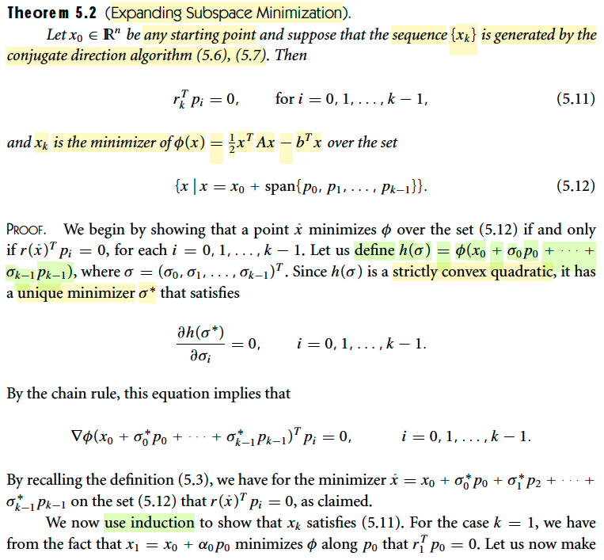</kbd>

<kbd>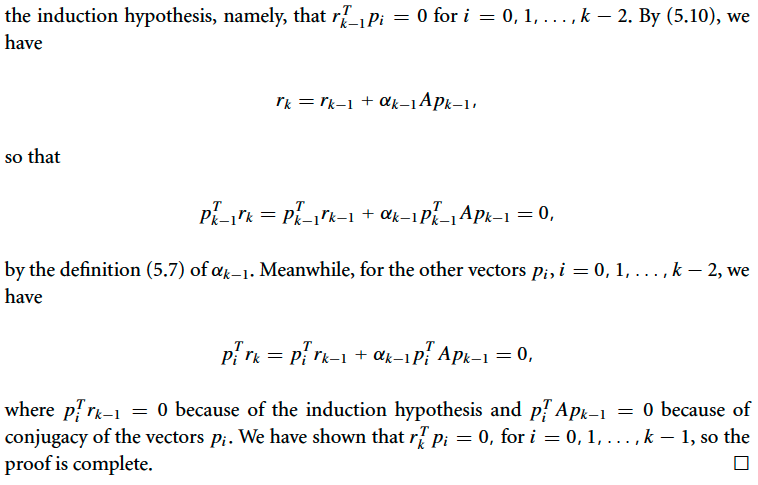</kbd>

<kbd>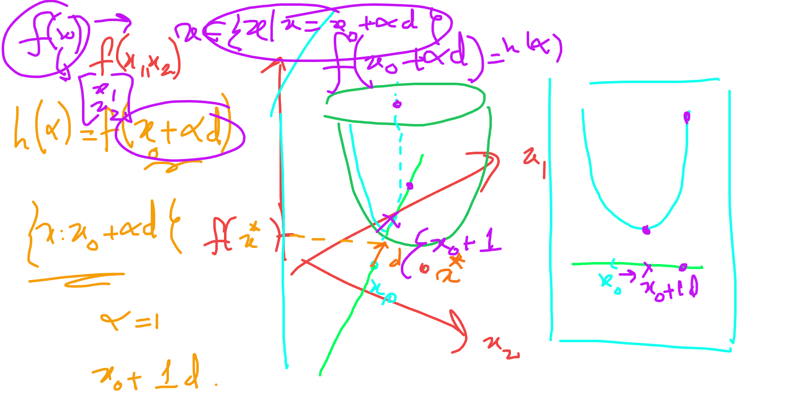</kbd>

<kbd>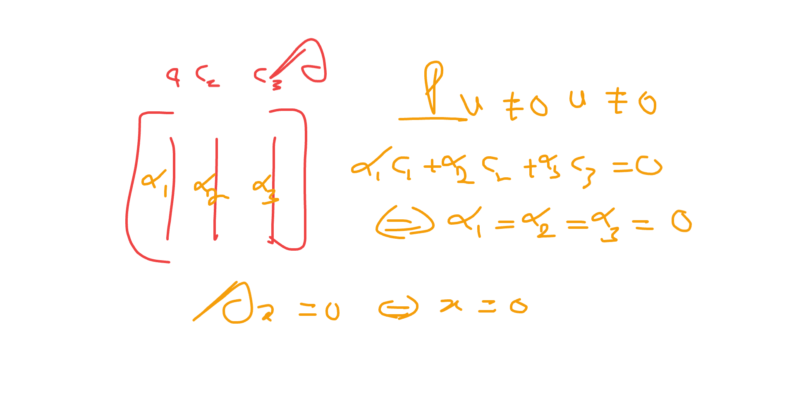</kbd>

> [!NOTE]
> Theorem này nói đại ý rằng: Bắt đầu từ x0 và ta dùng một thuật toán 5.6, 5.7 để tạo ra chuỗi {x_k}. Tức là: α\_k = -r_kᵀp_k / (p_kᵀAp_k) và x_k+1 = x_k + α\_kp_k. Thì khi đó chuỗi này sẽ có tính chất sau:
>
>
>
> minimize Φ(x) over set {x: x = x0 + span{p0}}
>
>
>
> span{a,b}: mọi linear combination của a,b: u = αa + βb, ∀α, β
>
>
>
> (r(x) = Ax - b) 
>
>
>
> r(x1)ᵀp0 = 0
>
>
>
> r(x2)ᵀp0 = 0, r2ᵀp1 = 0
>
>
>
> r(x3)ᵀp0 = 0, r3ᵀp1 = 0, r3ᵀp2 = 0 ....
>
>
>
> r(x_k)ᵀpi = 0 ∀i = 0,1,...,k-1
>
>
>
> Và điều đó cũng đồng nghĩa là:
>
>
>
> x1 minimize φ(x) over the set {x: x = x0 + span{p0}}
>
>
>
> x2 minimize φ(x) over the set {x: x = x0 + span{p0, p1}}
>
> ...
>
> x_k minimize φ(x) over the set {x: x = x0 + span{p0, p1,...p_k-1}}
>
>
>
> ---
>
>
>
> Cách chứng minh đại ý là:
>
>
>
> Đầu tiên ta chứng minh:
>
>
>
> điều kiện **cần và đủ** để x' là minimizer của φ(x) over set {x: x = x0 + span{p0,...p_k-1}}
>
>
>
> là r(x')ᵀpi = 0 với mọi i = 0,1,2,....,k-1
>
>
>
> Lập luận sẽ là:
>
>
>
> xét hàm φ(x) restricted on set {x: x = x0 + span{p0,...p_k-1}} 
>
>
>
> x ∈ {x: x = x0 + span{p0,...p_k-1}}  ⇒ x = x0 + σ0p0 + σ1p1 + ..σ\_k-1p_k-1 (với σ = (σ0, ...σ\_k-1)ᵀ nào đó)
>
>
>
> Φ(x) với x = x0 + σ0p0 + σ1p1 + ..σ\_k-1p_k-1 với (với σ = (σ0, ...σ\_k-1)ᵀ nào đó)
>
>
>
> h(σ) = Φ(x0 + σ0p0 + σ1p1 + ..σ\_k-1p_k-1)
>
>
>
> có nghĩa là xét hàm h(σ) = φ(x0 + σ0p0 + σ1p1 + ..σ\_k-1p_k-1), với σ = (σ0, ...σ\_k-1)ᵀ bất kì
>
>
>
> Do A đối xứng xác định dương nên đây là strictly convex function theo dạng convex function (φ) composition with affine x0 + σ0p0 + σ1p1 + ..σ\_k-1p_k-1, nên hàm này cũng sẽ là strictly convex (ta sẽ chứng minh lại ở dưới)
>
>
>
> Từ đó điều kiện optimality cần và đủ là gradient h'(σ) = 0, triển khai ra ta sẽ có vector gradient = 0 đồng nghĩa r(x)ᵀpi = 0, với i = 0,1..,k-1.
>
>
>
> ---
>
>
>
> Chứng minh h(σ) cũng strictly convex:
>
>
>
> h(σ) = Φ(x0 + Pσ) với P mà matrix ta đặt ra có các cột là p0,...p_k-1
>
>
>
> = (1/2)xᵀAx - bᵀx | x=x0 + Pσ
>
>
>
> = (1/2)(x0 + Pσ)ᵀA(x0 + Pσ) - bᵀ(x0 + Pσ)
>
>
>
> = (1/2)(x0ᵀA + σᵀPᵀA)(x0 + Pσ) - bᵀ(x0 + Pσ)
>
>
>
> = (1/2)(x0ᵀAx0 + σᵀPᵀAx0 + x0ᵀAPσ + σᵀPᵀAPσ) - bᵀ(x0 + Pσ)
>
>
>
> = (1/2)(x0ᵀAx0 + 2x0ᵀAPσ + σᵀPᵀAPσ) - bᵀx0 - bᵀPσ
>
>
>
> = (1/2)σᵀPᵀAPσ + x0ᵀAPσ - bᵀPσ + (1/2)x0ᵀAx0 - bᵀx0
>
>
>
> = (1/2)σᵀPᵀAPσ + (x0ᵀAP - bᵀP)σ + (1/2)x0ᵀAx0 - bᵀx0
>
>
>
> → đây là hàm bậc 2 của σ có Hessian là PᵀAP.
>
>
>
> Xét uᵀPᵀAPu, do P full column rank (vì bộ vector liên hợp thì độc lập đã chứng minh ở các phần trước) nên Pu khác 0 với mọi u khác 0, và vì A xác định dương nên (Pu)ᵀAPu &gt; 0 với mọi Pu khác 0. Vậy với mọi u khác 0, uᵀPᵀAPu &gt; 0. Vậy PᵀAP xác định dương. Vậy với mọi σ, hessian của h(σ) luôn xác định dương nên h(σ) strictly convex.
>
>
>
> và cùng do đó, điểm dừng nơi ∇h(σ) = 0 cũng sẽ là minimizer.
>
>
>
> ---
>
>
>
> Tìm minimizer σ0 của h(σ), để xác nhận rằng x = x0 + σ\*0p0 + σ\*1p1 + ...σ\*\_k-1p_k-1
>
>
>
> sẽ cũng là minimizer của Φ(x0 + σ\*0p0 + σ\*1p1 + ...σ\*\_k-1p_k-1)
>
>
>
> Tìm gradient (đạo hàm của h(σ) đối với vector σ):
>
>
>
> Viết lại hàm h(σ) = Φ(x0 + Pσ)
>
>
>
> u(σ) = x0 + Pσ: vector → vector ⇒ du = J dσ
>
>
>
> h = Φ(u): vector → scalar ⇒ dh = ∇hᵀdu = ∇Φ(u)ᵀdu
>
>
>
> ⇒ dh = ∇Φ(u)ᵀJ dσ = (Jᵀ∇Φ(u))ᵀ dσ
>
>
>
> h(σ): dh(σ) = (∇\_σ h)ᵀ dσ
>
>
>
> ⇒ ∇\_σ h = Jᵀ∇Φ(u) = Pᵀ (Au - b)
>
>
>
> = Pᵀ (A(x0 + Pσ) - b)
>
>
>
> = Pᵀ r(x)
>
>
>
> ∇h(σ) = Pᵀ r(x)
>
>
>
> Điều kiện tối ưu cần bậc nhất (first order necessary condition)
>
>
>
> ∇h(σ) = 0 ⇔ Pᵀ r(x) = 0
>
>
>
> ⇔ p0ᵀr(x) = 0, p1ᵀr(x) = 0,...
>
>
>
> ⇔ piᵀr(x) = 0, i = 0,1,2....k-1
>
>
>
> ---
>
>
>
> Pᵀ (A(x0 + Pσ) - b) = 0
>
>
>
> σ\* minimize h(σ), = Φ(x0 + Pσ)
>
>
>
> f(x): g(α) = f(x0 + αd)
>
>
>
>
>
>
>
>
>
>
>
> ---
>
>
>
> f(x): scalar → scalar: df = f'(x)dx
>
>
>
> f(x): vector → scalar: df = ∇fᵀdx
>
>
>
> f(x): vector → vector: df = J dx
>
>
>
> ---
>
>
>
>
>
>
>
> ---
>
>
>
> Mục tiêu: Đưa về dh(σ) = \[∇\_σ h(σ)\]ᵀ dσ
>
>
>
> dh(σ) = dΦ(x0 + Pσ)
>
>
>
> Đặt u = x0 + Pσ:
>
>
>
> h đối với u là hàm vector - scalar h(u) = Φ(u), và u đối với σ sẽ là hàm vector - vector
>
>
>
> ⇒ dh(u) = (∇\_u h(u))ᵀ du = (∇\_u Φ(u))ᵀ du
>
>
>
> ∇Φ(x) đã biết = Ax - b, nên ∇\_u Φ(u) = Au - b
>
>
>
> = (Au - b)ᵀ du
>
>
>
> du = x0 + P(σ+ dσ) - x0 - Pσ = Pdσ
>
>
>
> ⇒ dh(σ) = (Au - b)ᵀPdσ ⇒ ∇\_σ h(σ) = ((Au - b)ᵀP)ᵀ
>
>
>
> Vậy ∇\_σ h(σ) = Pᵀ(Au - b)
>
>
>
> ---
>
>
>
> Cho gradient = 0:
>
>
>
> Pᵀ(Au - b) = 0 ⇔ Pᵀ(A(x0 + Pσ) - b) = 0
>
>
>
> ⇔ Pᵀ(Ax - b) = 0
>
>
>
> ⇔ Pᵀr(x) = 0
>
>
>
> ⇔ p0ᵀ r(x), p1ᵀ r(x) = 0, p2ᵀ r(x) = 0,...p_k-1ᵀ r(x) = 0
>
>
>
> hay piᵀr(x) = 0 với i = 0,1,2,...k-1
>
>
>
> Vậy điểm σ\* khiến minimize h(σ) là σ khiến ta có piᵀr(x0 + Pσ) = 0 với i = 0,1,2,...k-1
>
>
>
> cũng là σ khiến ta có piᵀr(x) = 0 với i = 0,1,2,...k-1
>
>
>
> Và σ\* khiến minimize h(σ) dĩ nhiên cũng đồng nghĩa x = x0 + Pσ = x0 + σ0 p0 + ...σk-1 p_k-1 (và cũng là điểm mà ta gọi là xk) sẽ là điểm minimize hàm Φ(x0 + Pσ), tức Φ(x) restrict bởi tập {x| x=x0 + span{p0,...,pk-1}}
>
>
>
> ---
>
>
>
> Vấn đề là, ta chỉ mới chứng minh rằng nếu mà có thằng x' thỏa r(x')ᵀpi = 0 ∀i = 0,1,...,k-1 thì nó sẽ là minimizer của φ(x) over subset {x0 + span{p0,...,p_k-1}}.
>
>
>
> Trong khi đó cái cần chứng minh là chuỗi {x_k} sẽ đều thỏa cái này cơ.
>
>
>
> Do đó tiếp theo ta sẽ chứng minh chuỗi {x_k} tạo bởi quy trình trên sẽ thỏa r(x')ᵀpi = 0 ∀i = 0,1,...,k-1. Và vì đây là chứng minh mọi item trong chuỗi đều thỏa, nên ta sẽ dùng phương pháp quy nạp (induction).
>
>
>
> Với phương pháp quy nạp.
>
>
>
> Đầu tiên ta chứng minh nó đúng với k = 1.
>
>
>
> Sau đó giả sử nó đúng với k-1 (đây gọi là induction hypothesis, gỉa thuyết quy nạp), thì ta sẽ chứng minh nó cũng đúng với k. Khi đó là chứng minh xong.
>
>
>
> Thế thì với k = 1, x1 = x0 + α0p0 thì liệu r(x1)ᵀp0 có bằng 0?
>
>
>
> Để trả lời, ta nhớ lại thuật toán 5.7, 5.8 là từ đâu ra.Đó là xuất phát từ ý tưởng của conjugate direction method: Cho bộ conjugate set {p0,...pn-1} của matrix A. Thì α\_k chính là one-dimensional minimizer của Φ along x_k + αp_k. Nói dễ hiểu, ta đặt ra bài toán minimize hàm đơn biến g(α) define bởi Φ giới hạn theo hướng p_k: g(α) = Φ(x_k + αp_k), thì solution của nó sẽ là 5.7.
>
>
>
> Như vậy thì dĩ nhiên với k=1, g'(α)|α=α0 = 0
>
> ⇔ d/dα φ(x0 + αp0) = 0
>
> ⇔ d/d(x0 + αp0) φ(x0 + αp0) . d/dα (x0 + αp0) = 0
>
> ⇔ ∇φ(x0 + αp0) . p0 = 0
>
> ⇔ ∇φ(x0 + αp0)ᵀp0 = 0
>
> ⇔ \[(Aᵀx - b)|x=x0+αp0\]ᵀp0 = 0
>
> ⇔ \[(Aᵀx - b)|x=x1\]ᵀp0 = 0
>
> ⇔ (Aᵀx1 - b)ᵀp0 = 0
>
> ⇔ (Ax1 - b)ᵀp0 = 0
>
> ⇔ r(x1)ᵀp0 = 0 ⇨ Như vậy k = 1 đúng: x_k thỏa r(x_k)ᵀpi = 0 ∀i = 0,..k-1
>
>
>
> ---
>
>
>
> Tiếp theo, như đã bàn, ta sẽ giả sử nó cũng đúng với x_k-1: Tức là ta có
>
>
>
> r(x_k-1)ᵀpi = 0, hay r_k-1ᵀpi = 0 ∀i = 0,..k-2 (a)
>
>
>
> r_k-1ᵀp0 = 0,
>
>
>
> r_k-1ᵀp1 = 0,
>
>
>
> r_k-1ᵀp2 = 0
>
>
>
> ...
>
>
>
> r_k-1ᵀp_k-2 = 0
>
>
>
> ---
>
>
>
> Ta sẽ chứng minh nó đúng với x_k: r_kᵀp_0 = r_kᵀp_1 = .. = r_kᵀp_k-1 = 0
>
>
>
> Thế thì ta dùng 5.10 đã chứng minh ở note trước: r_k+1 = r_k + α\_k A p_k
>
>
>
> ⇨ r_k = r_k-1 + α\_k-1 A p_k-1
>
>
>
> ⇒ r_kᵀp_i = (r_k-1 + α\_k-1 A p_k-1)ᵀp_i
>
>
>
> = r_k-1ᵀp_i + (α\_k-1 A p_k-1)ᵀp_i
>
>
>
> = r_k-1ᵀp_i + α\_k-1 p_k-1ᵀAᵀp_i
>
>
>
> Hạng tử đầu r_k-1ᵀp_i = r_k-1 ᵀ pi = r(x_k-1)ᵀpi = 0 với mọi i = 0,...k-2 do (a)
>
>
>
> Hạng tử sau piᵀα\_k-1Ap_k-1 = 0 với mọi i = 0,...k-2 do {p0,...pn-1} là conjugate set của A.
>
>
>
> Vậy r_kᵀpi = 0 với mọi i = 0,...k-2
>
>
>
> ---
>
>
>
> Chỉ còn phải chứng minh r_kᵀpi = 0 với i = k-1, hay r_kᵀp_k-1:
>
>
>
> = (r_k-1 + α\_k-1 A p_k-1)ᵀp_k-1
>
>
>
> = r_k-1ᵀp_k-1 + (α\_k-1 A p_k-1)ᵀp_k-1
>
>
>
> = r_k-1ᵀp_k-1 + α\_k-1 p_k-1ᵀAᵀp_k-1
>
>
>
> = r_k-1ᵀp_k-1 + \[-r_k-1ᵀp_k-1/(p_k-1ᵀAp_k-1)\] p_k-1ᵀAᵀp_k-1
>
>
>
> = r_k-1ᵀp_k-1 + (-r_k-1ᵀp_k-1)
>
>
>
> = 0
>
>
>
> Vậy r_kᵀpi = 0 với mọi i = 0,1,2,...k-1
>
>
>
> ---
>
>
>
>
>
> ⇨ Kết luận với k, x_k cũng thỏa r(x_k)ᵀpi = 0 với mọi i = 0,...k-1
>
>
>
> ⇨ Chứng minh xong rằng mọi x_k trong chuỗi {x_k} đều thỏa điều kiện này và như vậy x_k sẽ là minimizer của φ over set {x0 + span{p0,..p_k-1}}

📹 [Xem video trên YouTube](https://www.youtube.com/watch?v=QpNTm5otibM)

> [!TIP]
> 🤖 **AI Check** — 🟢 Pass — ✅ **98/100** · ✓ Move on
>
> Ghi chú xuất sắc, hiểu sâu sắc bản chất định lý và trình bày lại từng bước chứng minh thậm chí còn chi tiết, tường minh hơn cả sách giáo trình.
>
> **✓ Strengths**
> - Tự triển khai và chứng minh chặt chẽ tính strictly convex của hàm mục tiêu trên không gian con thông qua ma trận Hessian $P^T A P$ và tính độc lập tuyến tính của các hướng liên hợp.
> - Chứng minh điều kiện tối ưu bậc một thông qua vi phân ma trận một cách chuẩn xác và rõ ràng.
> - Trình bày logic quy nạp hoàn chỉnh, giải thích cặn kẽ cả trường hợp cơ sở lẫn bước chuyển tiếp quy nạp.
>
> **💡 Deeper notes**
> - Trong đoạn biến đổi vi phân cho trường hợp cơ sở $k=1$, việc ghi $(A^T x_1 - b)$ tương đương $(Ax_1 - b)$ dựa trên giả thiết ma trận $A$ đối xứng ($A = A^T$), một giả định nền tảng xuyên suốt phương pháp liên hợp.

 

###### Chứng minh eigenvector conjugate + ôn lại Gram-Smidth

<kbd>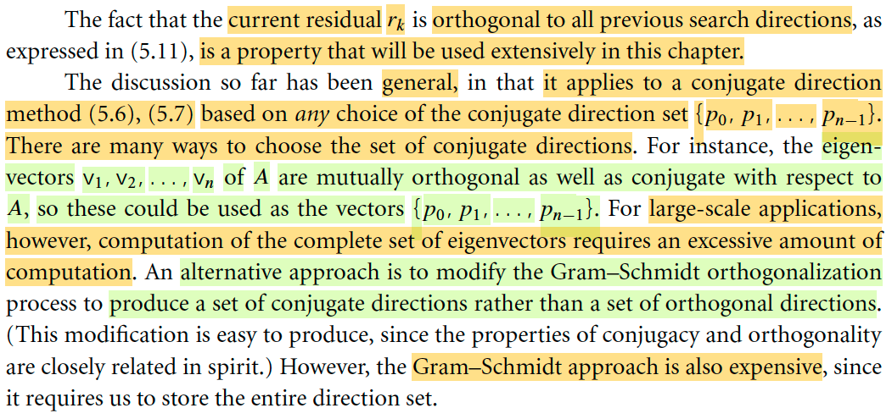</kbd>

<kbd>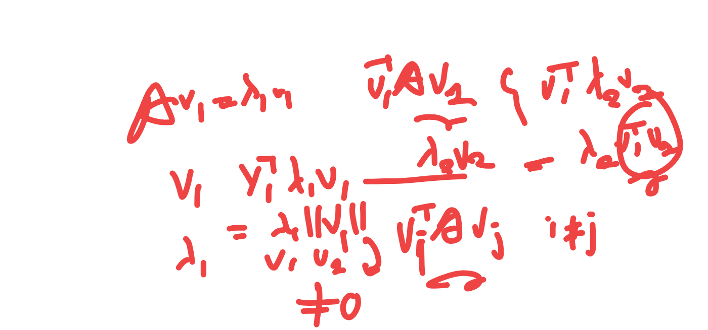</kbd>

> [!NOTE]
> Đại ý nói là thuật toán conjugate direction đòi hỏi ta có một bộ conjugate vector. Và có nhiều cách để tạo ra một bộ như vậy. Ví dụ với A xác định dương thì eigenvectors cũng là conjugate set. Nhưng có điều tìm ra bộ eigenvector thì rất tốn kém với bài toán quy mô lớn. Một đề xuất khác là có thể dùng thuật toán Gram-Schmidt.
>
>
>
> Tuy nhiên, cũng tốn kém nốt. Nói chung là sắp tới sẽ nói giải pháp.
>
>
>
> Dừng ở đây mình thử trả lời xem **vì sao với A ≻ thì eigenvector lại là conjugate set?**
>
>
>
> Là vì với A đối xứng thì ta có thể có bộ eigenvector orthonormal, để tách A thành Q Λ Qᵀ
>
>
>
> với A ≻ 0 thì đường chéo của Λ đều dương.
>
>
>
> Vậy thì: vì sao qiᵀAqj = 0 nếu i ≠ j?
>
>
>
> qiᵀAqj = qiᵀQ Λ Qᵀqj
>
>
>
> Qᵀqj chính là gì? ⇨ chính là ej, vì theo góc nhìn thứ nhất nhân matrix với vector, thì vector phần tử thứ i của vector kết quả là dot product của hàng i của Q (là qi) và vector qj. Mà Q orthogonal nên nếu i khác j thì chúng sẽ vuông góc → dot product = 0. Nên chỉ có row j (cũng chính là qj) dot product với qj là khác 0, mà cái này cụ thể thì là bằng 1 (vì ra ||qj||² = 1)
>
>
>
> Còn qiᵀQ = (Qᵀqi)ᵀ, tương tự, chính là eiᵀ
>
>
>
> Vậy ta có eiᵀ Λ ej = eiᵀ (0,..λj,..0) = 0 × 0 + ..1 × λi + ..+ 0 × λj +..0 ×0,
>
>
>
> Với i khác j thì cái này = 0 là cái chắc.
>
>
>
> Vậy rõ ràng {qi}, các cột của Q, các eigenvector của A chính là một conjugate set.
>
>
>
> ---
>
>
>
> Nhưng có thể chứng minh nhanh hơn nhiều:
>
>
>
> qiᵀAqj = qiᵀ λjqj (vì Aqj = λjqj với λj và qj là trị riêng, vector riêng)
>
>
>
> = λj qiᵀqj (scalar move tùy ý)
>
>
>
> = λj × 0 (do Q orthogonal)
>
>
>
> = 0.
>
>
>
> ---
>
>
>
> Trong sách cũng nhắc đến Gram Smidth: Sẵn ôn lại nhanh, nhờ gs Strang của MiT18.06 nó rất dễ hiểu:
>
>
>
> Ta có một bộ basis a1,...an và muốn tìm một bộ orthogonal basis q1,...qn.
>
>
>
> Cách làm như sau:
>
>
>
> Cho q1 là a1, normalize để có unit norm: q1 = a1/||a1||
>
>
>
> q2 được tạo ra như sau: Lấy a2 chiếu lên span{a1} (cũng là span{q1}) và lấy phần dư, đem normalize để thành q2. Khi đó q2 sẽ orthogonal span{q1}.
>
>
>
> Gọi α1 q1 là hình chiếu của a2 lên span{q1}: residual sẽ vuông góc với span{q1}:
>
>
>
> (a2 - α1q1)ᵀq1 = 0 ⇔ a2Tq1 - (α1q1)ᵀq1 = 0 ⇔ a2Tq1 - α1q1Tq1 = 0 ⇔ a2Tq1 = α1q1Tq1
>
> ⇔ a2Tq1/q1Tq1 = α1
>
> ⇨ q2 = a2 - a2Tq1/(q1Tq1) × q1 = a2 - (a2Tq1) q1
>
> Normalize: q2 = q2 / ||q2||
>
>
>
> q3 được tạo như sau: Lấy a3 chiếu lên span{q1,q2} và lấy phần dư, đem normalize Đây sẽ là bài toán project lên 2D subspace
>
>
>
> Bỏ gọi A là matrix có các cột là q1,q2: thì hình chiếu a3 lên C(A): Ax, phần dư vuông góc với với C(A) → nằm trong left null space N(Aᵀ): Aᵀ(a3 - Ax) = 0 ⇔ Aᵀa3 = AᵀAx
>
>
>
> ⇔ x = (AᵀA)⁻¹Aᵀa3 ⇨ q3 = a3 - A (AᵀA)⁻¹Aᵀa3
>
>
>
> Và vì q1,q2 orthogonal, nên AᵀA = I ⇨ q3 = a3 - AAᵀa3
>
>
>
> Normalize q3.
>
>
>
> Cứ thế.

> [!TIP]
> 🤖 **AI Check** — 🟢 Pass — ✅ **96/100** · ✓ Move on
>
> Ghi chú rất xuất sắc, hiểu sâu sắc bản chất vấn đề. Bạn không chỉ tóm tắt đúng ý sách mà còn tự chứng minh tính liên hợp của eigenvectors theo hai cách và ôn lại bản chất hình học của Gram-Schmidt rất chuẩn xác.
>
> **✓ Strengths**
> - Tóm tắt chính xác nội dung đoạn sách về việc lựa chọn tập hướng liên hợp và lý do vì sao eigenvectors hay Gram-Schmidt bị xem là tốn kém trong bài toán lớn.
> - Tự đặt câu hỏi và tự chứng minh tính A-conjugate của hệ eigenvector rất mạch lạc qua cả hai cách (dùng phân rã phổ và dùng trực tiếp định nghĩa trị riêng).
> - Ôn tập thuật toán Gram-Schmidt theo góc nhìn hình học (chiếu trực giao lên không gian con) rất trực quan và chính xác.
>
> **💡 Deeper notes**
> - Ký hiệu vector sau khi trừ hình chiếu và sau khi chuẩn hóa (normalize) đang dùng chung một tên (ví dụ gán q2 là phần dư rồi lại viết q2 = q2 / ||q2||); trong cài đặt code hoặc ghi chép toán chính quy nên dùng ký hiệu tạm thời như v2 hoặc u2 trước khi chuẩn hóa thành q2.
> - Đối với ma trận đối xứng có trị riêng bội (trùng nhau), định lý phổ (Spectral Theorem) vẫn đảm bảo luôn chọn được một hệ cơ sở trực chuẩn các eigenvector.

 

###### Basic properties of conjugate gradient method

<kbd>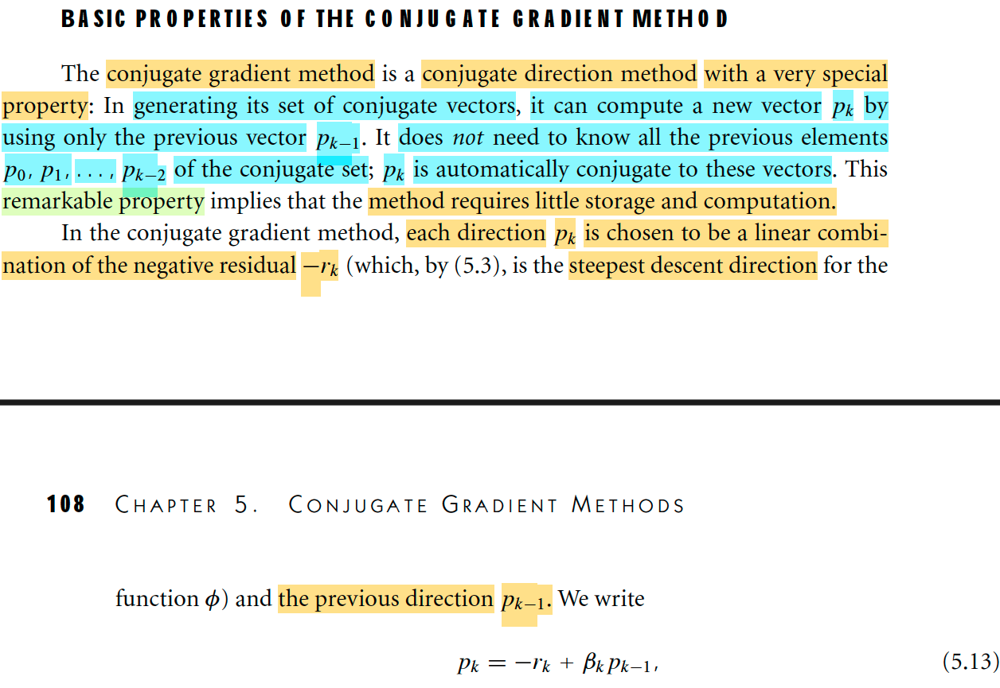</kbd>

<kbd>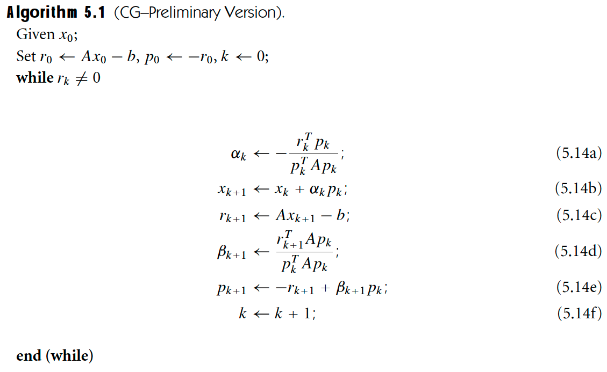</kbd>

> [!NOTE]
> Đại khái là, tác giả nói rằng, phương pháp conjugate gradient THẬT RA chính là conjugate direction nhưng CÓ THÊM MỘT TÍNH CHẤT CỰC KÌ HỮU ÍCH:
>
>
>
> Đó là trong quá trình tính toán, **ta sẽ DÙNG p_k-1 ĐỂ TẠO p_k**, mà vẫn đảm bảo là p_k conjugate với đám p0,...p_k-2 trước đó. Nhờ vậy, không cần tốn nhiều chi phí lưu trữ và tính toán.
>
>
>
> Tiếp theo, tác giả nói p_k sẽ được chọn sao cho nó là linear combination của negative residual -rk và p_k-1:
>
>
>
> p_k = -rk + βk p_k-1 (5.13)
>
>
>
> Vì sao ở đây nói theo 5.3, -rk lại là steepest descent direction nhỉ? → Vì 5.3 nói rằng ∇φ(xk) = Axk - b = r(xk) hay rk. À vậy thì -rk là - ∇φ(xk), dĩ nhiên nó chính là steepest descent direction như đã biết.
>
>
>
> Thế thì, βk phải làm sao để p_k và p_k-1 conjugate wrt matrix A: tức p_kᵀAp_k-1 = 0. Ta sẽ tính ra βk thỏa điều kiện này:
>
>
>
> Nhân hai vế của p_k = -rk + βk p_k-1 với p_k-1ᵀA:
>
>
>
> p_k-1ᵀAp_k = -p_k-1ᵀArk + p_k-1ᵀ A βk p_k-1
>
>
>
> Cho bằng 0: p_k-1ᵀAp_k = 0
>
>
>
> ⇔ -p_k-1ᵀArk + p_k-1ᵀAβkp_k-1 = 0
>
>
>
> ⇔ -p_k-1ᵀArk + βk p_k-1ᵀAp_k-1 = 0
>
>
>
> ⇔ βk p_k-1ᵀAp_k-1 = p_k-1ᵀArk
>
>
>
> ⇔ βk = p_k-1ᵀArk / p_k-1ᵀAp_k-1
>
>
>
> Và từ đó ta có full thuật toán:
>
>
>
> Thuật toán 5.1 **Conjugate Gradient Preliminary Version**
>
>
>
> Bắt đầu ta có intial point x0. Tính r0 = Ax0 - b, đó chính là ∇Φ(x0). Gán p0 cho -∇Φ(x0).
>
>
>
> Tại mỗi iteration:
>
>
>
> Tính αk (theo công thức 5.7, xem link Conjugate Direction Method)
>
>
>
> Update xk+1 = xk + αkp_k (công thức 5.8, xem link Conjugate Direction Method)
>
>
>
> Tính rk+1
>
>
>
> Tính βk+1
>
>
>
> Dùng nó tính conjugate direction tiếp thep p_k+1
>
>
>
> Lặp lại. (Lặp lại cho đến khi residual rk = 0)

📹 [Xem video trên YouTube](https://www.youtube.com/watch?v=rdfTaWa_d8w)

> [!TIP]
> 🤖 **AI Check** — 🟢 Pass — ✅ **95/100** · ✓ Move on
>
> Ghi chú rất tốt, thể hiện sự hiểu bài sâu sắc khi tự suy luận ra biểu thức tính hệ số beta_k từ điều kiện liên hợp và giải thích rõ bản chất của gradient âm.
>
> **✓ Strengths**
> - Hiểu chính xác và làm nổi bật được ưu điểm cốt lõi của Conjugate Gradient so với phương pháp Conjugate Direction tổng quát: chỉ cần vector trước đó mà vẫn đảm bảo tính liên hợp với toàn bộ tập vector cũ.
> - Tự thực hiện biến đổi đại số chính xác để tìm ra công thức tính beta_k từ điều kiện liên hợp p_k^T A p_{k-1} = 0.
> - Nắm rõ mối liên hệ giữa vector thặng dư r_k và gradient của hàm mục tiêu để giải thích tại sao -r_k là hướng dốc nhất (steepest descent).
>
> **💡 Deeper notes**
> - Trong phép biến đổi beta_k = p_{k-1}^T A r_k / (p_{k-1}^T A p_{k-1}), biểu thức ở tử số khớp với công thức (5.14d) là r_k^T A p_{k-1} nhờ vào tính đối xứng của ma trận A (A = A^T trong bài toán CG chuẩn). Nên ghi chú thêm điều kiện A đối xứng xác định dương (SPD).

**🔗 See also:** [5.1 The Linear Conjugate Gradient Method](#node-hpdy8sw) · [Conjugate Direction Method](#node-0lu7h6i) · [A Practical Form Of The Conjugate Gradient Method.](#node-jdgssae)

 

###### Theorem 5.3

<kbd>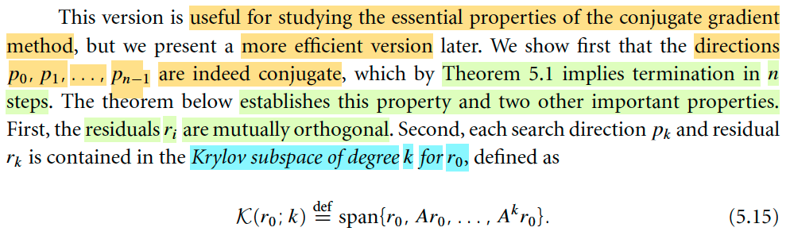</kbd>

<kbd>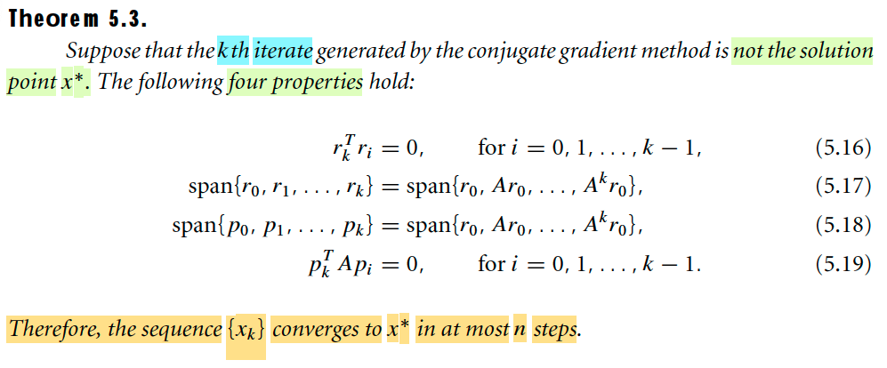</kbd>

<kbd>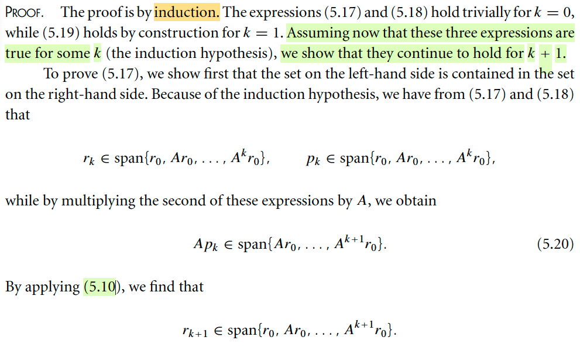</kbd>

<kbd>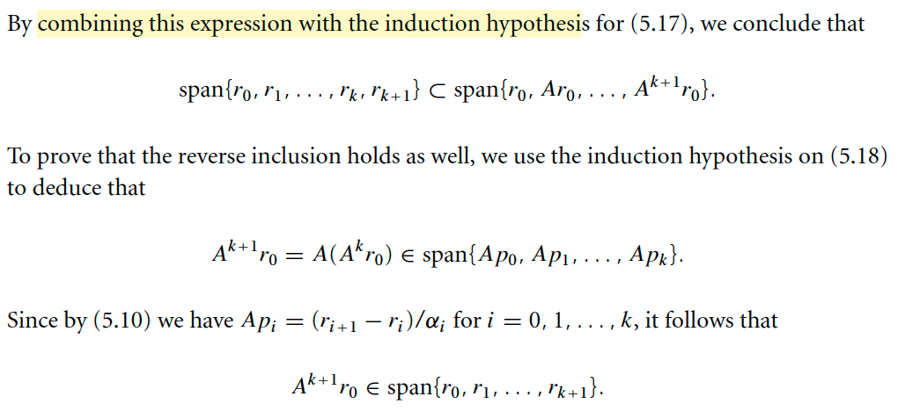</kbd>

<kbd>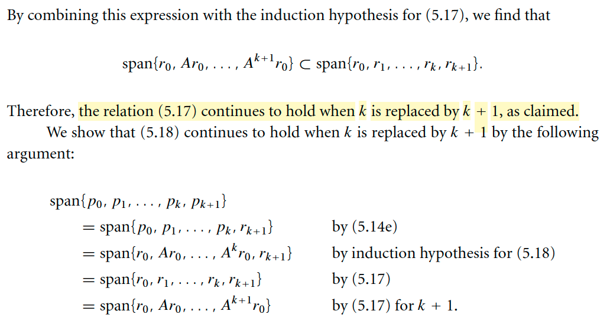</kbd>

<kbd>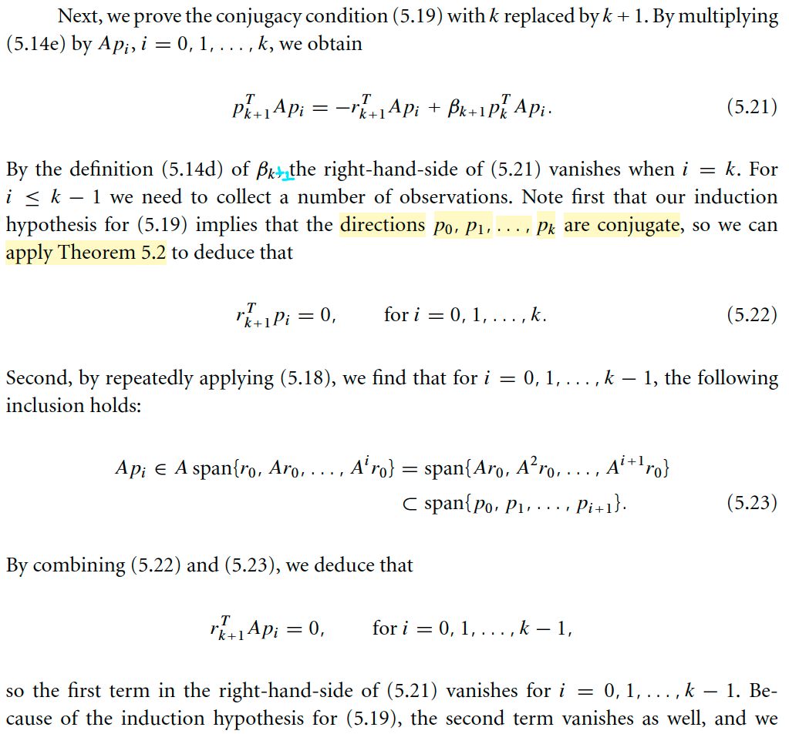</kbd>

<kbd>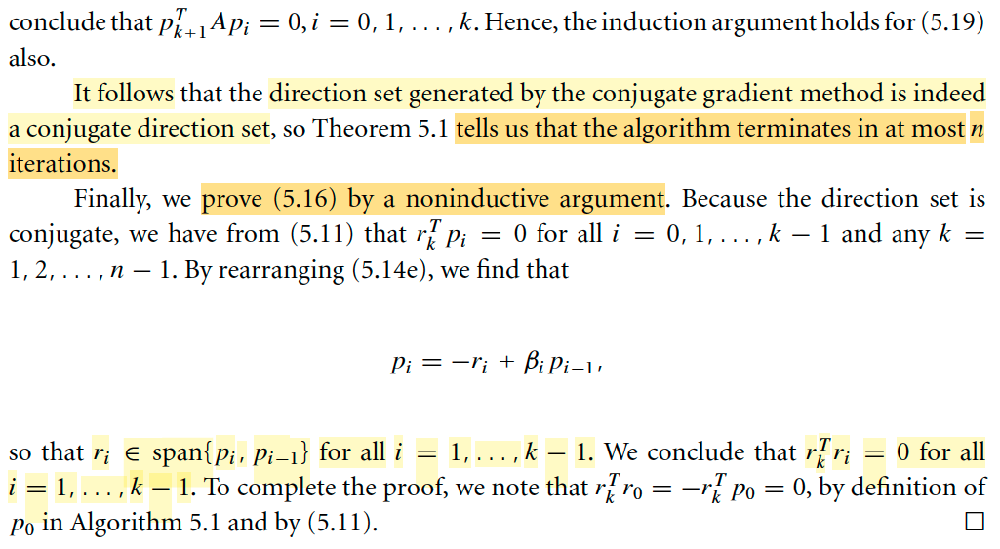</kbd>

> [!NOTE]
> Chứng minh theorem 5.3:
>
>
>
> Vài ý chính:
>
>
>
> ..."5.17, 5.18 đúng với k = 0" là sao?
>
>
>
> → vì k = 0:
>
>
>
> 5.17 là span {r0} = span {r0}, hiển nhiên đúng.
>
>
>
> 5.18 là: span {p0} = span {r0}, cái này đúng vì p0 được chọn = -r0.
>
>
>
> ..."5.19 đúng với k = 1 by construction" là sao?
>
>
>
> → Vì theo thuật toán, pk+1 sinh ra sao cho nó conjugate với pk. Nên dĩ nhiên p1ᵀAp0 = 0.
>
>
>
> Ta giả sử nó đúng với k thì nếu chứng minh nó đúng với k + 1 thì ta sẽ chứng minh xong bởi phép quy nạp.
>
>
>
> ---
>
>
>
> I) Chứng minh 5.17 đúng với k+1: Tức cần chứng minh:
>
>
>
> span {r0, ..rk+1} = span {r0, Ar0,...,A^k+1 r0}
>
>
>
> Chiến lược: Chứng minh tập này là con tập kia, vì cái cần chứng minh là hai tập hợp (span{..} chỉ là tập hợp các linear combination bởi các vector này thôi) bằng nhau.
>
>
>
> Ia) Chứng minh vế trái là tập con vế phải:
>
>
>
> Dùng giả thuyết quy nạp, tức là ta đang cho rằng 5.16 → 5.19 đúng với k, nên có quyền xài.
>
>
>
> Xài cái 5.17: span {r0, ..,rk} = span {r0, Ar0,..A^k r0}. Dĩ nhiên suy ra:
>
>
>
> rk ∈ span {r0, Ar0,..A^k r0}
>
>
>
> Xài 5.18: span {p0, p1,..pk} = span {r0, Ar0, ..A^k r0}. Tương tự, đương nhiên cũng suy ra:
>
>
>
> pk ∈ span {r0, Ar0, ..A^k r0}
>
>
>
> Tiếp, nhân hai vế của pk ∈ span {r0, Ar0, ..A^k r0} cho A, ta có
>
>
>
> Apk = α1 Ar0 + α2 A^2 r0 + .. + αk+1 A^k+1 r0, với α1, α2 ,...nào đó
>
>
>
> Chỗ này là sao?
>
>
>
> → Hiểu thế này: nói pk ∈ span {r0, Ar0, ..A^k r0} thì như đã nói trên, chỉ đơn giản là nói pk nằm trong subspace span bởi các {r0, Ar0,..A^k r0}, đã học MIT 18.06, điều này có nghĩa là pk có thể thể hiện bởi linear combination của các vector đó:
>
>
>
> pk = α r0 + β Ar0 + .. + ω A^k r0
>
>
>
> Nhân hai vế cho A:
>
>
>
> Apk = A α r0 + A β Ar0 + .. + A ω A^k r0
>
>
>
> ⇔ Apk = α A r0 + β A Ar0 + .. + ω A A^k r0
>
>
>
> ⇔ Apk = α A r0 + β A^2r0 + .. + ω A^k+1 r0
>
>
>
> Và điều này chính là thể hiện rằng Apk nằm trong subspace span bởi các {Ar0, A2 r0 + .. ,A^k+1 r0}. Hay:
>
>
>
> Apk ∈ span {Ar0, A2r0 + .. ,A^k+1 r0}
>
>
>
> ---
>
>
>
> Tiếp, áp dụng 5.10, là cái này đây (xem link để coi lại)
>
>
>
> (5.10) rk+1 - rk = Aαkpk = αkApk
>
>
>
> cái chính của 5.10 chính là nói rằng rk+1 - rk cùng phương với Apk (scale bởi αk)
>
>
>
> Mà Apk ∈ span {Ar0, A2r0 + .. ,A^k+1 r0}
>
>
>
> ⇨ rk+1 - rk ∈ span{Ar0,...,A^k+1 r0}
>
>
>
> Tới đây, hiểu thế này kết qủa này, chính là:
>
>
>
> rk+1 - rk = linear combination của Ar0, ...,A^k+1 r0
>
>
>
> ⇔ rk+1 = (linear combination của Ar0, ...,A^k+1 r0) + rk
>
>
>
> Mà rk cũng ∈ span {r0, Ar0,..A^k r0}, thì dĩ nhiên cũng chính là
>
>
>
> rk = (linear combination của r0, Ar0,..A^k r0)
>
>
>
> rk+1 = α1 Ar0 + α2 A^2 r0 + ...+ αk+1 A^k+1 r0 + β1 r0 + β2 Ar0 +.. βk+1 A^k r0
>
>
>
> = β1 r0 + (α1 + β2) Ar0 + ...+ (..) A^k r0 + (...) A^k+1 r0
>
>
>
> Thế vô phương trình rk+1 = .. + rk rồi gom hạng tử lại thì cũng trở thành:
>
>
>
> rk+1 = linear combination của r0, Ar0, ...,A^k+1 r0
>
>
>
> ⇨ rk+1 ∈ span{r0, Ar0,...,A^k+1 r0}
>
>
>
> Đang chứng minh 5.17 đúng với k+1: span {r0,..rk+1} = span{r0, Ar0,...., A^k+1 r0}
>
>
>
> Lập luận thế này: gọi u là vector bất kì ∈ tập vế trái span {r0,..rk+1}.
>
>
>
> u = linear combination các vector r0,..rk+1:
>
>
>
> ⇔ u = α0 r0 + ...αk rk + αk+1 rk+1
>
>
>
> Vì rk+1 ∈ span{r0, Ar0,...,A^k+1 r0}
>
>
>
> ⇨ rk+1 cũng là linear combination các vector r0, Ar0,...,A^k+1 r0:
>
>
>
> rk+1 = α Ar0 + ...ω A^k+1 r0 (for some α, ...ω)
>
>
>
> ⇔ u = α0 r0 + ...αk rk + αk+1 (α Ar0 + ...ω A^k+1 r0)
>
>
>
> Và dùng (induction hypo for 5.17), cũng giúp ta có r0, r1,..rk đều thuộc span {r0, Ar0,..A^k r0}, nên đều là linear combination của {r0, Ar0,..A^k r0}
>
>
>
> Cho nên triển khai và thu gọn equation trên ta sẽ có u = linear combination của {r0, Ar0,..A^k r0, A^k+1 r0}
>
>
>
> ⇨ u ∈ span {r0, Ar0,..A^k r0, A^k+1 r0}
>
>
>
> Và vì u là vector bất kì của span {r0,..rk+1}, nên theo set theory, kết luận span {r0,..rk+1} ⊂ span {r0, Ar0,..A^k r0, A^k+1 r0}.
>
>
>
> Qua đó đã chứng minh xong Ia)
>
>
>
> ---
>
>
>
> Ib) Chứng minh span {r0, Ar0,..A^k r0, A^k+1 r0} ⊂ span {r0,..rk+1}
>
>
>
> Ta dùng induction hypothesis 5.18, tức là đường xài 5.18 với k = k:
>
>
>
> span {p0, p1,..pk} = span {r0, Ar0, ..,A^k r0} (induction hypo for 5.18)
>
>
>
> Từ cái này tương tự như hồi nãy, ta suy ra
>
>
>
> A^k r0 ∈ span {p0, p1,...,pk}
>
>
>
> Again, điều này đồng nghĩa:
>
>
>
> A^k r0 = α0 p0 + α1 p1 +.. αk pk for some α0, α1,...
>
>
>
> ⇔ A A^k r0 = A α0 p0 + A α1 p1 +.. A αk pk
>
>
>
> ⇔ A^k+1 r0 = α0 Ap0 + α1 Ap1 +.. αk Apk
>
>
>
> ⇨ A^k+1 r0 ∈ span {Ap0, Ap1, .. ,Apk}
>
>
>
> Lại lôi 5.10 ra: rk+1 - rk = Aαkpk = αkApk, áp dụng với k = i
>
>
>
> ri+1 - ri = A αi pi
>
>
>
> ⇔ ri+1 - ri = αi Api
>
>
>
> ⇔ Api = (ri+1 - ri) / αi
>
>
>
> Có nghĩa là:
>
>
>
> i = 0, ta có Ap0 = (r1 - r0) / α0, điều này suy ra Ap0 ∈ span {r0,...rk+1}
>
>
>
> i = 1, ta có Ap1 = (r2 - r1) / α1 ⇨ suy ra Ap1 ∈ span {r0,...rk+1}
>
>
>
> ...
>
>
>
> i = k, ta có Apk = (rk+1 - rk) / αk ⇨ suy ra Apk ∈ span {r0,...rk+1}
>
>
>
> Thế thì ta đang có A^k+1 r0 ∈ span {Ap0, Ap1, .. ,Apk}, mà mỗi lại nằm trong span {r0,...rk+1} nên có thể suy ra
>
>
>
> A^k+1 r0 ∈ span {r0,...rk+1}.
>
>
>
> Đến đây dùng lập luận tương tự ở trên:
>
>
>
> span {r0, Ar0, ..A^k r0} = span {p0, p1,..pk} (induction hypo for 5.18)
>
>
>
> và kết hợp với A^k+1 r0 ∈ span {r0,...rk+1}
>
>
>
> giúp kết luận v bất kì nằm trong span {r0, Ar0,..A^k r0, A^k+1 r0} cũng sẽ nằm trong span {r0,..rk+1}
>
>
>
> ⇨ Chứng minh xong hai tập bằng nhau.
>
>
>
> ---
>
> ---
>
>
>
>
>
> II) Tiếp theo là chứng minh 5.18 đúng với k+1: tức là
>
>
>
> span {p0, p1,..pk+1} = span {r0, Ar0, ..,A^k+1 r0, }
>
>
>
> Lập luận như sau:
>
>
>
> Vế trái span {p0, p1,..pk, pk+1} = span {p0, p1,..,pk, rk+1}
>
>
>
> Lí do: 5.14e tức là vì theo thuật toán, pk+1 = -rk+1 + βk+1 pk Thì sao? → Thì điều này có có nghĩa là, bất cứ linear combination của {p0,...pk+1} nào cũng đều thể hiện được bởi linear combination của {p0,...pk, rk+1} và ngược lại. Nên hai subspace này là một.
>
>
>
> ..(tiếp) = span {r0, Ar0, ...,A^k r0, rk+1}
>
>
>
> p0 = α1 r0 + α2 Ar0 + ...αk+1 A^k r0
>
> p1 = β1 r0 + β2 Ar0 + ...βk+1 A^k r0
>
> ...
>
> pk = γ1 r0 + γ2 Ar0 + ...γk+1 A^k r0
>
>
>
> span {p0, p1,..,pk, rk+1} = {ω0 p0 + ω1p1 + ... + ωk pk + ωk+1 rk+1, với mọi ω0,...ωk+1}
>
>
>
> = {(..)r0 + (..)Ar0 + .. (..)A^k r0 + (...)rk+1, với mọi bộ hệ số tổ hợp bất kì}
>
>
>
> = span {r0, Ar0, ...A^k r0, rk+1}
>
>
>
> Lí do? Bởi induction hypothesis cho 5.18, tức là xài 5.18 cho k = k: span {p0, p1,..pk} = span {r0, Ar0, ..A^k r0}. Và cái này có nghĩa là p0,...pk đều thuộc span {r0, Ar0, ..A^k r0}, đều có thể thể hiện bởi linear combination của {r0, Ar0, ..A^k r0}
>
>
>
> Nên span {p0, p1,..,pk, rk+1}, là tập mọi linear combination của {p0, p1,..,pk, rk+1}, thì mọi vector trong đó đều có thể thể hiện bởi linear combination của {r0, Ar0, ..A^k r0, rk+1} Và ngược lại cũng đúng.
>
>
>
> ..(tiếp) = span {r0, r1, ...,rk, rk+1}
>
>
>
> Lí do: Dùng induction hypothesis 5.17 for k: span {r0, ..,rk} = span {r0, Ar0,..A^k r0}. Và cái này có nghĩa là đám r0, Ar0,..A^k r0 đều có thể thể hiện bởi (linear combination) của đám r0, r1, ...,rk. Nên mọi u ∈ span {r0, Ar0, ...,A^k r0, rk+1} đều là linear combination của đám r0, r1, ...,rk, và rk+1. Và ngược lại.
>
> ..(tiếp) = span {r0, Ar0, ...,A^k+1 r0}.
>
>
>
> Cái này là vì ta đã chứng minh 5.17 cho k+1 rồi, nên được quyền xài.
>
>
>
> Như vậy đã chứng minh xong:
>
>
>
> span{p0, ..pk+1} = span {r0, Ar0, ...,A^k+1 r0}, tức 5.18 cho k+1
>
>
>
> ---
>
>
>
> III) Chứng minh 5.19 đúng cho k + 1, tức chứng minh:
>
>
>
> pk+1ᵀApi = 0 với i = 0,1,...k
>
>
>
> Lập luận như sau: Từ công thức 5.14e:
>
>
>
> pk+1 = -rk+1 + βk+1 pk
>
>
>
> Nhân hai vế cho Api với i = 0,1,....k, ta có:
>
>
>
> pk+1ᵀApi = -rk+1ᵀApi + βk+1 pkᵀApi với i = 0,1,....k
>
>
>
> (nhớ là, đây là cái ta có, và ta phải chứng minh vế trái pk+1ᵀApi = 0 với i = 0,1,...k)
>
>
>
> Vậy điều này đồng nghĩa ta phải chứng minh vế phải cũng = 0 với i = 0,1,...k
>
>
>
> Xét i = k: Vế trái pk+1ᵀApi = pk+1ᵀApk đương nhiên bằng 0 do cách chọn β+1 khiến với i = k thì vế phải của 5.21 bằng 0 (cơ bản là do cách tạo pk+1 khiến cho ra pk+1 conjugate pk)
>
>
>
> Nhiệm vụ chỉ cần chứng minh vế phải = 0 cho i = 0,1...k-1.
>
>
>
> Dùng / xài induction hypothesis cho 5.19, tức là được quyền xài 5.19 với k = k: Ta có pkᵀApi = 0 với mọi i = 0,1...k-1
>
>
>
> Như vậy đương nhiên bộ vector p0,p1,..pk là một conjugate set.
>
>
>
> Từ đó cho phép ta dùng theorem 5.2.
>
>
>
> Theorem 5.2 nói gì? (\*)
>
>
>
> Theorem này nói đại ý rằng: Bắt đầu từ x0 và ta dùng một thuật toán 5.6, 5.7 để tạo ra chuỗi {xk}. Tức là: αk = -rkᵀpk / (pkᵀApk) và xk+1 = xk + αkpk. Thì khi đó chuỗi này sẽ có tính chất sau: (với r(x) = Ax - b)
>
>
>
> r(x1)ᵀp0 = 0
>
>
>
> r(x2)ᵀp0 = 0, r2ᵀp1 = 0
>
>
>
> r(x3)ᵀp0 = 0, r3ᵀp1 = 0, r3Tp2 = 0 ....
>
>
>
> r(xk)ᵀpi = 0 ∀i = 0,1,...k-1
>
>
>
> r(xk+1)ᵀpi = 0 ∀i = 0,1,...k
>
>
>
> Vậy thì ở đây dĩ nhiên là ta đang generate {xk} theo thuật toán này. Vì sao? Vì trong thuật toán conjugate gradient thì cơ bản chỉ là ta có cách để tính ra conjugate vector pk ngay trong thuật toán, rồi sau đó dùng cơ chế trên trên generate xk thôi.
>
>
>
> Do đó, theo theorem này ta có:
>
>
>
> rk+1ᵀpi = 0 ∀i = 0,1,...k (đây là 5.22 trong sách)
>
>
>
> Tiếp, áp dụng 5.18 span{p0,...pk+1} = span{r0, Ar0, ..A^k+1 r0}.
>
>
>
> (tới đây thì ta đã chứng minh cho k+1 nên được quyền xài tẹt ga)
>
>
>
> Với i = 0,....k-1 ta đều có
>
>
>
> span{p0,...pi} = span{r0, Ar0, ..A^i r0}
>
>
>
> Dĩ nhiên điều này đồng nghĩa pi ∈ span{r0, Ar0, ..A^i r0}
>
>
>
> ⇔ pi = α r0 + β Ar0 + ... + ω A^i r0 for some α, ...ω
>
>
>
> ⇔ Api = A(α r0 + β Ar0 + ... + ω A^i r0) for some α, ...ω
>
>
>
> ⇔ Api = α Ar0 + β A^2 r0 + ... + ω A^i+1 r0 for some α, ...ω
>
>
>
> ⇔ Api ∈ span{Ar0, A^2r0, ..A^i+1 r0}
>
>
>
> Mà span{Ar0, A^2r0, ..A^i+1 r0} ⊂ span{r0, Ar0, A2r0, ..A^i+1 r0} (vì vế phải nó có thêm 1 vector là r0)
>
>
>
> Và theo 5.18 ở trên thì span{p0,...pi+1} = span{r0, Ar0, A2r0, ..A^i+1 r0}
>
>
>
> ⇨ .. ⇔ Api ∈ span{Ar0, A2r0, ..A^i+1 r0} ⊂ span{p0,...pi+1} (đây là 5.23)
>
>
>
> Rồi, tới đây kết hợp 5.22 và 5.23, viết lại hai cái này:
>
>
>
> (5.23) Với i = 0,....k-1: Api ∈ span{Ar0, A^2r0, ..A^i+1 r0} ⊂ span{p0,...pi+1}
>
>
>
> (5.22) rk+1ᵀαipi = 0 ∀i = 0,1,...k
>
>
>
> rk+1ᵀpi = 0 ∀i = 0,1,...k
>
>
>
> ⇒ rk+1ᵀαipi = 0 ∀i = 0,1,...k, với αi bất kì
>
>
>
> rk+1ᵀ(Σi αipi) = 0  với αi bất kì
>
>
>
> rk+1 vuông góc với vector bất kì trong span{p0,p1,...pk}
>
>
>
> rk+1 vuong góc span{p0,p1,...pk}
>
>
>
> Lập luận như sau: cái thằng 5.22 nói rằng rk+1 vuông góc với mọi p0,p1,..pk. Nên suy ra:
>
> nó vuông góc subspace span{p0,...pk}
>
>
>
> Mà 5.23 ta có với mọi i = 0,....k-1 thì Api nằm trong span{p0,...pi+1}. Tức là:
>
>
>
> Ap0 ∈ span{p0,p1}
>
> Ap1 ∈ span{p0, p1,p2}
>
> ..
>
> Apk-1 ∈ span{p0, p1,...pk}
>
>
>
> mà:
>
>
>
> Ap0 ∈ span{p0,p1} dĩ nhiên ⇨ Ap0 ∈ span{p0,...pk} (vì span{p0,p1} ⊂ span{p0,...pk})
>
>
>
> Ap1 ∈ span{p0, p1,p2} ⇨ Ap1 ∈ span{p0,...pk}
>
>
>
> ..tương tự
>
>
>
> Apk-1 ∈ span{p0, p1,...pk} ⇨ Apk-1 ∈ span{p0,...pk}
>
>
>
> vậy là, đám Ap0,...Apk-1 đều ∈ span{p0,...pk}, mà rk+1 lại vuông góc với subspace này. như vậy suy ra rk+1 vuông góc với đám vector Ap0,...Apk-1:
>
>
>
> rk+1ᵀApi = 0 với mọi i = 0,....k-1
>
>
>
> nhớ lại ta đang muốn làm cái gì: 
>
>
>
> → Ta đang muốn chứng minh pk+1ᵀApi = 0 với i = 0,1,....k-1
>
>
>
> Và đang có kết quả:
>
>
>
> pk+1ᵀApi = -rk+1ᵀApi + βk+1 pkᵀApi với i = 0,1,....k-1
>
>
>
> Và vừa rồi vừa chứng minh xong rk+1ᵀApi = 0 với mọi i = 0,....k-1
>
>
>
> Có nghĩa là hạng tử thứ nhất đã bay màu (với i = 0,1,....k-1)
>
>
>
> Còn hạng tử còn lại βk+1 pkApi với i = 0,1,....k-1. Thì đơn giản là vì ta có thể dùng induction hypothesis cho 5.19, tức xài 5.19 với k = k. Nên ta có: pkApi = 0 với i = 0,1,....k-1
>
>
>
> Vậy là hạng tử thứ 2 cũng bằng 0 với mọi i = 0,1,....k-1
>
>
>
> Từ đó kết luận pk+1ᵀApi = 0 với mọi i = 0,1,....k-1.
>
>
>
> Nhớ rằng lúc nãy ta đã nói với k thì pk+1ᵀApk dĩ nhiên = 0.
>
>
>
> Vậy là đã chứng minh xong 5.19 đúng với k + 1.
>
>
>
> ---
>
>
>
> IV) Chứng minh 5.16 tức là rkᵀri = 0 ∀ i = 0,1...k-1 và ∀k = 1,2,...n-1.
>
>
>
> Cái này thì ko dùng quy nạp mà lập luận như sau:
>
>
>
> Với việc đã chứng minh xong 5.19, nên có quyền xài: pkᵀApi = 0 ∀i = 0,1,...k-1. Do đó bộ p0,...pk là conjugate set.
>
>
>
> Lại theo theorem 5.2 (vì sao xài được thì xem lại (\*)): nói rằng rkᵀpi = 0 ∀ i=0,1...k-1
>
>
>
> Dùng 5.14e: 
>
>
>
> pk+1 = -rk+1 + βk+1 pk
>
>
>
> ⇨ pi = -ri + βi pi-1
>
>
>
> ⇔ ri = -pi + βi pi-1
>
>
>
> ⇨ ri ∈ span {pi, pi-1} ∀ i = 1,2...k-1 (cái này dễ hiểu)
>
>
>
> Vậy thì rkᵀpi ∀ i=0,1...k-1 ⇨ rk vuông góc span {p0,p1,...pk-1}
>
>
>
> nên dĩ nhiên vuông góc với mọi vector trong đó (\*\*)
>
>
>
> Mà ri ∈ span {pi, pi-1} ∀ i = 1,2...k-1
>
>
>
> ⇨ ri ∈ span {p0, p1,...pk-1} ∀ i = 1,2...k-1
>
>
>
> Vậy từ \*\* → rkᵀri = 0 ∀ i = 1,2...k-1
>
>
>
> Tới đây là đã chưng minh 5.16 với mọi i = 1,2...k-1
>
>
>
> Nhưng ta còn 1 cái i = 0 nữa (xem lại 5.16)
>
>
>
> Vậy thì rkᵀr0 có bằng 0 không?
>
>
>
> ⇨ r0 chính là gì, Ax0 - b, chính là ∇Φ(x0), và p0 còn nhớ, được chọn = negative gradient. Vậy r0 = -p0
>
>
>
> ⇨ rkᵀr0 = -rkᵀp0, cái này thì đích thị là bằng 0 do 5.11: rkᵀpi = 0 ∀ i=0,1...k-1
>
>
>
> Vậy là đã chứng minh xong.

📹 [Xem video trên YouTube](https://www.youtube.com/watch?v=LqnLjjuFg2k)

> [!TIP]
> 🤖 **AI Check** — 🟢 Pass — ✅ **98/100** · ✓ Move on
>
> Ghi chú xuất sắc, bám sát và giải thích cặn kẽ từng bước logic trong phép chứng minh quy nạp của Định lý 5.3. Mọi biến đổi về không gian span, tính trực giao và liên hợp đều được giải thích tường minh, chính xác.
>
> **✓ Strengths**
> - Làm rõ bản chất của các bước bao hàm tập hợp (span) bằng cách diễn giải chi tiết dưới dạng tổ hợp tuyến tính.
> - Hiểu rất rõ và giải thích trọn vẹn cách kết hợp Định lý 5.2 cùng bước phụ (5.23) để triệt tiêu số hạng đầu trong công thức (5.21).
> - Phần chứng minh tính trực giao của các phần dư (5.16) không dùng quy nạp được lập luận gãy gọn và chính xác.
>
> **💡 Deeper notes**
> - Định lý 5.3 có giả thiết quan trọng ở đầu: 'iterate thứ k chưa phải là nghiệm x*'. Điều này đảm bảo r_k ≠ 0 và mẫu số α_k ≠ 0, nhờ đó các phép chia cho α_i trong bước chứng minh không bị suy biến.

**🔗 See also:** [Tối ưu hóa tọa độ Hessian chéo](#node-b04ox8f) · [A Practical Form Of The Conjugate Gradient Method.](#node-jdgssae) · [Rate of Convergence](#node-3zg5huu)

 

###### Cái tên Conjugate Gradient Method gây hiểu sai, gradient không conjugate

<kbd>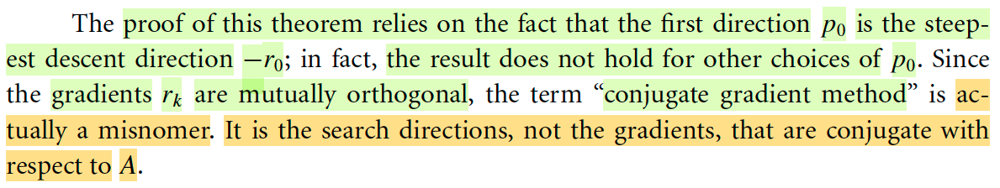</kbd>

> [!NOTE]
> Đại khái là nói rằng phần chứng minh của theorem này dựa trên sự thật rằng p0 là negative gradient (p0 = - r0, Ax0 - b, tức ∇(1/2xᵀAx - bx)|x=x0). Và nếu p0 không không phải -r0 thì theorem này sẽ không work.
>
>
>
> Một điểm nữa, thực ra ta thấy trong theorem đã nói (5.16): rkᵀri 0 với i=0,1,...k-1. Có nghĩa là, các gradient vector (nhắc lại lần nữa, residual Ax-b, chính là gradient của hàm Φ(x) = 1/2xᵀAx - bx) thực ra là ORTHOGONAL nhau, chứ KHÔNG PHẢI LÀ CONJUGATE NHAU.
>
>
>
> Do đó giáo sư mới nói tên gọi Conjugate Gradient Method thực ra là hiểu sai, gây hiểu lầm (misnormer) vì như đã nói gradient, không conjugate, mà cái conjugate là các direction pi

> [!TIP]
> 🤖 **AI Check** — 🟡 Minor issues — ✅ **92/100** · ✓ Move on
>
> Ghi chú nắm rất chính xác bản chất tại sao tên gọi 'Conjugate Gradient' là một misnomer và vai trò then chốt của hướng khởi tạo $p_0 = -r_0$. Có một vài lỗi chính tả và gõ thiếu ký hiệu nhỏ cần lưu ý.
>
> **🟡 Minor issues**
>
> **1.** *"p0 = - r0, Ax0 - b, tức ∇(1/2xᵀAx - bx)|x=x0"*
>
> Cách viết dấu phẩy dễ gây hiểu nhầm $p_0 = Ax_0 - b$. Cần viết rõ $r_0 = Ax_0 - b$ (gradient) và hướng dốc nhất là $p_0 = -r_0 = b - Ax_0$.
>
> **2.** *"rkᵀri 0"*
>
> Gõ thiếu dấu bằng, công thức đúng của tính trực giao là $r_k^T r_i = 0$ với mọi $i < k$.
>
>
> **✓ Strengths**
> - Hiểu rất rõ và giải thích chuẩn xác tại sao phương pháp mang tên 'Conjugate Gradient' lại là một misnomer (gradient thì trực giao, còn các hướng tìm kiếm mới liên hợp).
> - Nắm đúng điều kiện tiên quyết của định lý là hướng đầu tiên bắt buộc phải chọn $p_0 = -r_0$.
>
> **💡 Deeper notes**
> - Khi nói đến tính liên hợp của các hướng tìm kiếm $p_i$, nên nêu rõ là 'liên hợp đối với ma trận $A$' ($A$-conjugate hay $p_i^T A p_j = 0$ với $i \neq j$) để phân biệt với trực giao thông thường ($p_i^T p_j = 0$).

 

###### A Practical Form Of The Conjugate Gradient Method.

<kbd>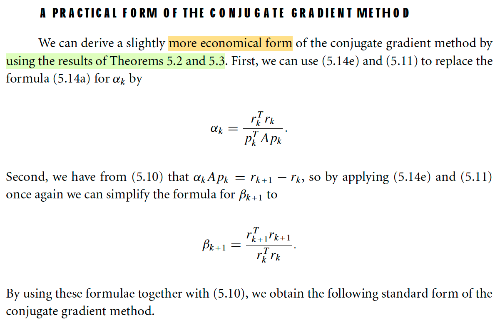</kbd>

<kbd>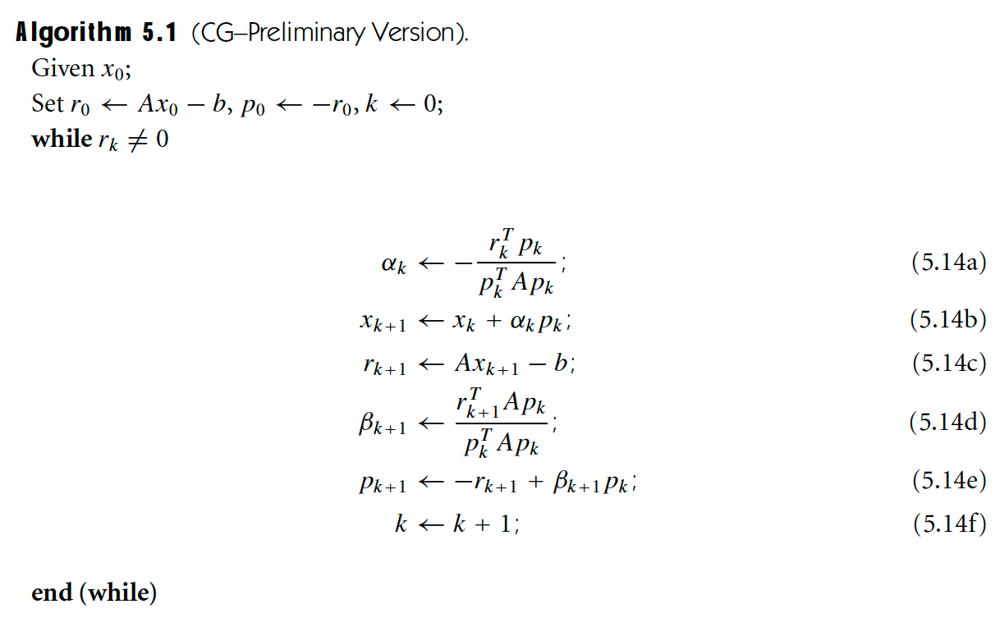</kbd>

<kbd>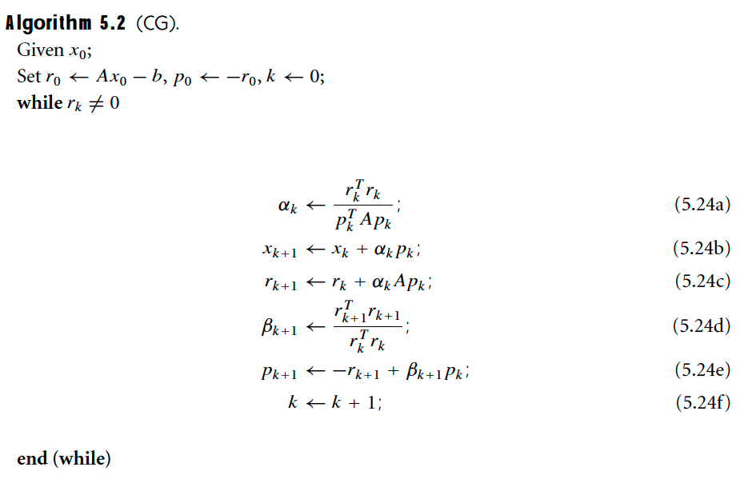</kbd>

<kbd>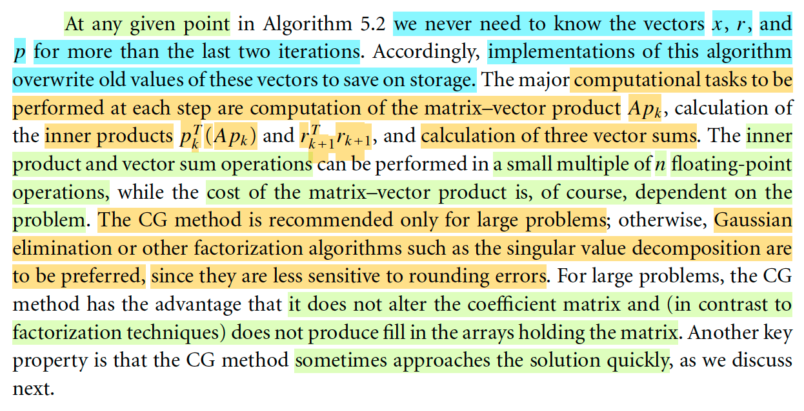</kbd>

> [!NOTE]
> Đại ý là ta sẽ derive phiên bản "kinh tế" hơn của thuật toán vừa rồi
>
>
>
> Xem lại thuật toán 5.1 có các bước sau trong mỗi iteration, cũng là ôn lại toàn bộ từ đầu đến giờ
>
>
>
> Bắt đầu với starting point x0. Gán r0 = Ax0 - b (đây là residual tại x0, mang ý nghĩa mức error của việc giảm tìm x thỏa Ax = b tại initial step, và đây cũng là ∇φ(x0))
>
>
>
> Chọn p0 = -r0: hướng đi đầu tiên từ x0 chính là steepest descent.
>
>
>
> Lặp lại cho đến khi rk = 0:
>
>
>
> i) αk := -rkᵀpk / pkᵀApk (5.14a)
>
>
>
> Đây là gì? Đây chính là solution của bài toán minimize hàm g(α) = φ(xk + α × pk), tức là hàm φ(x) giới hạn bởi phương vector pk. Y như trong line search. Ý nghĩa: Từ xk nếu đi theo phương pk thì step đến đâu là xuống được thấp nhất.
>
>
>
> ii) xk+1 := xk + αkpk (5.14b): Đây là update vị trí từ xk đến xk+1 thôi
>
>
>
> iii) rk+1 := Axk+1 - b (5.14c): Đây chỉ là tính lại residual mới nhất
>
>
>
> iv) βk+1 := rk+1ᵀApk / pkᵀApk (5.14d)
>
>
>
> Đây chính là bước tính ra βk+1 dựa theo điều kiện pk+1 conjugate pk, để sau bước này, dùng βk+1 để tính pk+1 thì ta sẽ có direction pk+1 conjugate (wrt A) với pk.
>
>
>
> v) pk+1 = -rk+1 + βk+1 pk
>
>
>
> k = k + 1.
>
>
>
> ---
>
>
>
> Thế thì gs nói có thể dùng 5.14e, 5.11 để:
>
>
>
> Thay 5.14a:
>
>
>
> αk := -rkᵀpk / pkᵀApk
>
>
>
> bằng
>
>
>
> αk = rkᵀrk/ pkᵀApk.
>
>
>
> Là sao?
>
>
>
> Hiểu như sau:
>
>
>
> 5.14e: pk+1 = -rk+1 + βk+1 pk.
>
>
>
> 5.11: rkᵀpi = 0, i = 0,1,....k-1
>
>
>
> 5.14a: αk = -rkᵀpk / pkᵀApk
>
>
>
> Vậy, từ 5.14e ⇨ pk = -rk + βk pk-1
>
>
>
> ⇨ -rkᵀpk = -rkᵀ(-rk + βk pk-1) = rkᵀrk - rkᵀ βk pk-1 = rkᵀrk - βk rkᵀpk-1
>
>
>
> Mà 5.11 nói rkᵀpk-1 = 0
>
>
>
> ⇨ -rkᵀpk = rkᵀrk
>
>
>
> ⇨ αk = -rkᵀpk / pkᵀApk = rkᵀrk/ pkᵀApk
>
>
>
> Vậy là từ cách tính cũ:
>
>
>
> αk = -rkᵀpk / pkᵀApk
>
>
>
> nay trở thành:
>
>
>
> αk = rkᵀrk/ pkᵀApk
>
>
>
> khác nhau ở cái tử số, cơ bản đều là dot product của hai vector.
>
>
>
> ---
>
>
>
> Tiếp, từ 5.10: rk+1 = rk + αkApk ⇨ Apk = (rk+1 - rk)/ αk
>
>
>
> Áp dụng 5.14e (pk+1 = -rk+1 + βk+1 pk) và 5.11 (rkᵀpi = 0, i = 0,1,....k-1) lần nữa ta đơn giản hóa βk+1:
>
>
>
> βk+1 = rk+1ᵀrk+1 / rkᵀrk. Là sao?
>
>
>
> Công thức 5.14d nói βk+1 = rk+1ᵀApk / pkᵀApk
>
>
>
> = rk+1ᵀ(rk+1 - rk) / αkpkᵀApk (thay Apk ở tử số = (rk+1 - rk)/ αk )
>
>
>
> = rk+1ᵀrk+1 / αkpkᵀApk - rk+1ᵀrk / αkpkᵀApk
>
>
>
> = rk+1ᵀrk+1 / αkpkᵀApk - 0 (do 5.16 nên rk+1ᵀrk = 0)
>
>
>
> = rk+1ᵀrk+1 / αkpkᵀApk
>
>
>
> Thay αk = rkᵀrk/ pkᵀApk.
>
>
>
> .. = rk+1ᵀrk+1 / \[(rkᵀrk/ pkᵀApk) pkᵀApk\]
>
>
>
> hai cái pkᵀApk khử nhau
>
>
>
> = rk+1ᵀrk+1 / rkᵀrk
>
>
>
> Viết lại: βk+1 = rk+1ᵀrk+1 / rkᵀrk→ Đây là công thức trong sách.
>
>
>
> So sánh cách cũ và mới:
>
>
>
> Cách cũ của Algo 5.1: βk+1 := rk+1ᵀApk / pkᵀApk.
>
>
>
> Thì trong kiểu cũ, ta **phải tính Apk, rồi dot product với rk+1 và pk**.
>
>
>
> Còn kiểu mới chỉ **tính dot product** rk+1ᵀrk+1, và rkᵀrk **không nhân matrix vector**.
>
>
>
>
>
> ---
>
> Và từ đó ta có thuật toán 5.2: CONJUGATE GRADIENT chính thức:
>
>
>
> Bắt đầu với r0 = Ax0 - b, p0 = -r0, k = 0
>
>
>
> Lặp lại cho đến khi rk = 0:
>
>
>
> i) αk = rkᵀrk / pkᵀApk (cách cũ: αk = -rkᵀpk / pkᵀApk)
>
>
>
> ii) xk+1 := xk + αkpk (5.24b) (cái này ko có gì thay đổi)
>
>
>
> iii) rk+1 := rk + αkApk (5.24c)
>
>
>
> Trong Algo 5.1 thì bước này là rk+1 := Axk+1 - b,
>
>
>
> thay xk+1 = xk + αkpk thì cũng có rk+1 = Axk + A αkpk - b = Axk - b + A αkpk = rk + αkApk.
>
>
>
> Có nghĩa là cũng ko có gì mới cả, nhưng cái khác là:
>
>
>
> Cách cũ, ta phải tính Apk trong bước i) và Axk trong bước iii), tốn **2** lần nhân matrix vector
>
>
>
> Còn cách mới, ta chỉ tính Apk ở bước i) và xài lại ở bước iii), tốn **1** lần nhân matrix vector
>
>
>
> iv) βk+1 := rk+1Trk+1 / rkᵀrk (5.24d)
>
>
>
> v) pk+1 := -rk+1 + βk+1 pk (5.24e) (Cái này thì vẫn vậy)
>
>
>
> k := k + 1
>
>
>
> ---
>
>
>
> Thế thì, gs nói "như vậy với thuật toán này ta ko cần phải biết x, r và p của nhiều hơn 2 iteration trước": Ý ông là cả Algo 5.1 và 5.2. Ý này dễ hiểu, vì rõ ràng trong mỗi iteration, ta chỉ xài xk,pk,rk để tính xk+1, rk+1, pk+1.
>
>
>
> Ông nói "Phần lớn tính toán sẽ là tính Apk, tính pkᵀ(Apk) và rk+1ᵀrk+1 cũng như là 3 cái sum vectors": Cái này dễ hiểu, nhìn thuật toán là thấy.
>
>
>
> Tiếp, đại ý là inner product (dot product) cũng như vector sum thì chỉ tốn một con số nhỏ nào đó của n floating point operation. Là sao?
>
>
>
> Sẵn ôn lại, đã học từ EE364a. Một phép cộng, trừ, nhân, chỉ được tính là một floating point operation (flop). Vậy một dot product giữa hai n-D vector u,v: Sẽ tốn n phép nhân hai phần tử với nhau, và n-1 phép cộng, coi như tốn 2n-1 phép (nhân + cộng scalar vs scalar) → tốn 2n-1 flops ≈ 2n flops Và trong thuật toán thì ta sẽ dot product vài lần, ví dụ 4 lần → tốn 4n flops. Và ý chính là, đây chỉ là bậc 1 của n, n tăng, thì chi phí cũng chỉ tăng tuyến tính O(n)
>
>
>
> Còn chi phí của nhân matrix với vector thì giáo sư nói tùy vào bài toán. Còn tiêu chuẩn thì nó tốn O(n²)
>
>
>
> Vì sao? → Ta biết nhân matrix A với vector x là tính n phép dot product giữa các row của A và x. Mỗi cái thì tốn n flops ⇨ Tốn 2n² flops. O(n²)
>
>
>
> ---
>
>
>
> Gs nói thêm cái Conjugate Gradient method này chỉ nên dùng cho LARGE PROBLEM. Còn nhỏ hơn thì nên dùng Gaussian elimination (khử Gausse) hay svd vì chúng ít nhạy với rounding error hơn.
>
>
>
> Với large problem, CG có lợi điểm là nó không thay đổi matrix hệ số (còn factorization thì có) và nó cũng có thể đôi khi giúp tìm ra solution nhanh hơn, đây sẽ là điểm tiếp theo ta bàn.

📹 [Xem video trên YouTube](https://www.youtube.com/watch?v=fuxN3Abpx2M)

> [!TIP]
> 🤖 **AI Check** — 🟢 Pass — ✅ **95/100** · ✓ Move on
>
> Ghi chú rất xuất sắc! Bạn đã tự triển khai chi tiết các bước biến đổi đại số từ công thức cũ sang công thức mới của αk và βk+1 rất rõ ràng và chuẩn xác.
>
> **✓ Strengths**
> - Tự diễn giải và biến đổi đại số tường minh cho cả hai công thức αk và βk+1 dựa trên tính trực giao của residual và công thức cập nhật p_k, hoàn thiện tốt phần sách viết vắn tắt.
> - Hiểu đúng bản chất tiết kiệm chi phí tính toán: chỉ cần duy nhất 1 phép nhân ma trận - vector (A p_k) cho mỗi vòng lặp thay vì 2 lần như ở thuật toán 5.1.
> - Phân tích chính xác độ phức tạp tính toán (FLOPs) của tích vô hướng O(n) và nhân ma trận - vector đầy đủ O(n²).
>
> **💡 Deeper notes**
> - Về chi phí nhân ma trận - vector: CG đặc biệt vượt trội với 'large problems' khi ma trận A là ma trận thưa (sparse matrix). Khi đó, phép nhân A p_k chỉ tốn O(nnz) (số phần tử khác 0, thường xấp xỉ O(n)) thay vì O(n²).
> - Hiện tượng 'fill-in': Đoạn trích có nhắc tới ưu điểm 'does not produce fill in the arrays'. Khi dùng phân rã ma trận (như Cholesky hay LU) trên ma trận thưa, các vị trí số 0 ban đầu có thể bị điền đầy bởi các giá trị khác 0 ('fill-in'), làm bùng nổ bộ nhớ; CG khắc phục triệt để điều này vì ma trận A được giữ nguyên.

**🔗 See also:** [Theorem 5.3](#node-e7cob1z) · [Vài suy nghĩ về bản chất của Conjugate Gradient method](#node-6z4orxx) · [Basic properties of conjugate gradient method](#node-p6jzgvh) · [Thuật toán Newton-CG](./71_inexact_newton_methods.md#node-rwy213p) · [Conjugate Gradient Method Iterations](./102_linear_least_square_problem.md#node-x7aktmm)

 

###### Rate of Convergence

<kbd>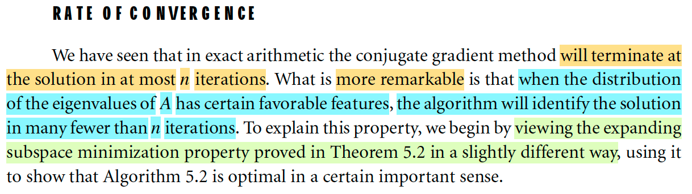</kbd>

<kbd>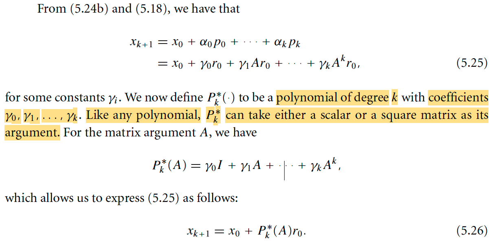</kbd>

<kbd>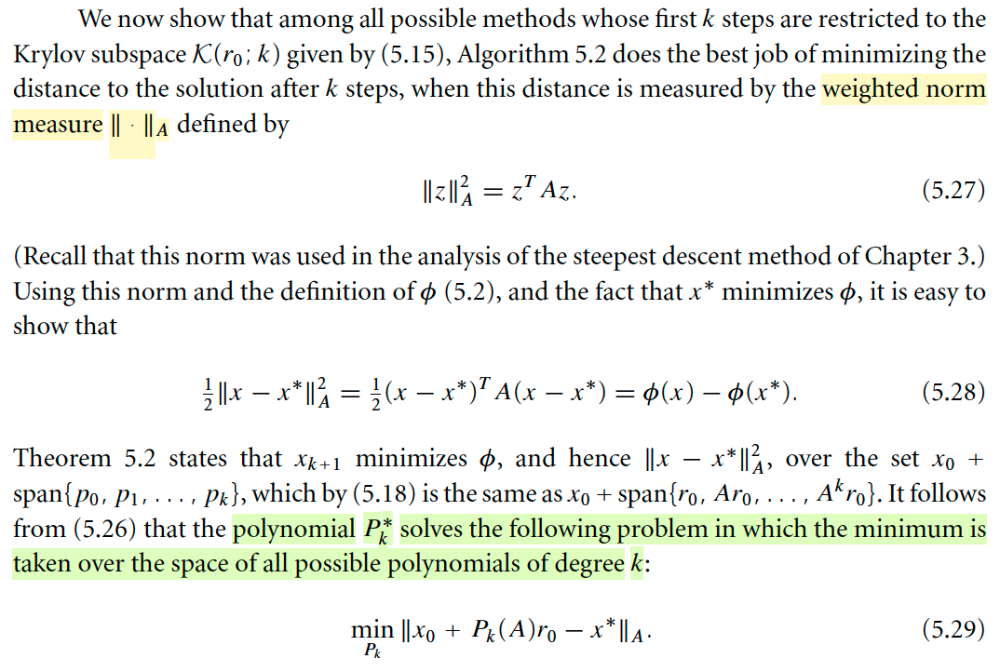</kbd>

<kbd>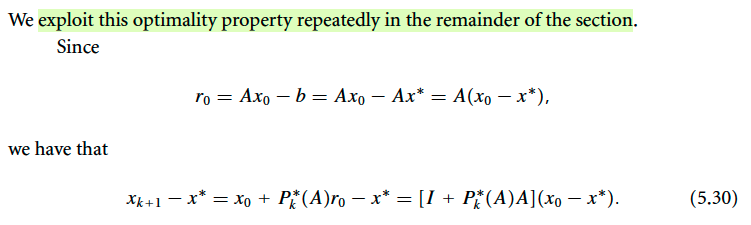</kbd>

<kbd>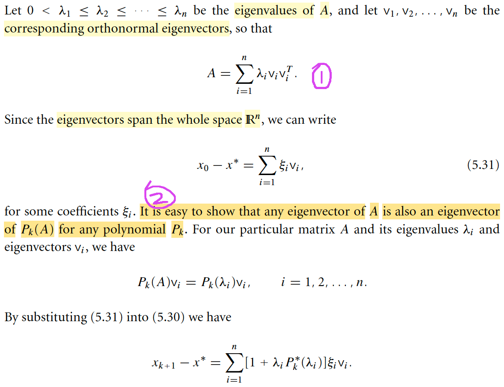</kbd>

<kbd></kbd>

<kbd></kbd>

<kbd></kbd>

<kbd></kbd>

<kbd></kbd>

> [!NOTE]
> Đại khái là ta đã biết phương pháp conjugat gradient có thể hội tụ chỉ trong nhiều nhất là n iteration. Nhưng, thậm chí, nếu eigenvalues của matrix A có một phân bố đặc biệt nào đó, thì thuật toán có thể còn hội tụ sớm hơn nữa.
>
>
>
> Từ (5.24b): xk+1 := xk + αkpk
>
>
>
> Và (5.18): **span {p0, p1,..pk} = span {r0, Ar0, ..A^k r0}**, cái này như đã biết, cho thấy **pk ∈ span {r0, Ar0, ..A^k r0}**, cũng đồng nghĩa pk có thể thể hiện bởi một linear combination các vector r0, Ar0, ..A^k r0: pk = ε0 r0 + ..εk A^k r0. Nên: xk+1 = xk + αk (γ0 r0 + ..γk A^kr0) Mà xk thì cũng = xk-1 + αk-1 pk-1, làm tương tự vậy, và truy đến x0 rồi gom thừa số chung lại, có thể hiểu vì sao nói: **xk+1 = x0 + γ0 r0 + .. + γk A^k r0** (5.25)
>
>
>
> Rồi, bằng cách đặt ra hàm P_k(.) là một hàm đa thức bậc k với bộ hệ số {γ0,...γk}, nó là hàm **nhận matrix A, và output: γ0A^0 +...γk A^k**. Khi đó cũng dễ hiểu xk+1 = x0 + P_k(A) r0 (5.26)
>
>
>
> Tiếp gs nói ta sẽ chứng minh rằng trong mọi phương pháp mà k bước đầu tiên bị giới hạn trong Krylov subspace, thì thuật toán 5.2 là cái làm tốt nhất cái việc minimizing khoảng cách đến solution (x đến x\*) với khoảng cách được đo bởi weighted norm ||.||\_A, có công thức là: (||z||\_A)² = zᵀAz. Và dùng norm này, cũng như sự thật là x\* minimize φ(x), ta dễ có: (1/2)(||x - x\*||\_A)² = (1/2)(x - x\*)ᵀA(x - x\*) = Φ(x) - Φ(x\*). Chỗ này là sao?
>
>
>
> Cái vụ minimize khoảng cách đo bởi weighted norm ||.||\_A là sao? → Còn nhớ bữa trước khi lập luận để tìm hiểu bản chất của CG, mình đã tự derive cái này: Cơ bản thuật toán CG chỉ là: tại k's iteration, ta di chuyển trên subspace x0 + span{p0,..pk} và muốn đến gần x\* nhất có thể. Thì đây chính là bài toán tìm hình chiếu của x\* lên subspace này, hoặc cũng là minimize distance từ điểm trong subspace đến x\* NHƯNG VỚI ĐIỀU KIỆN LÀ TA LÀM TRONG TỌA ĐỘ BASIS l's (CỘT CỦA Lᵀ (vì A = L Lᵀ), VÀ ĐIỀU ĐÓ CŨNG ĐỒNG NGHĨA LÀ TA DÙNG NORM-A ĐỂ TÍNH DISTANCE THAY VÌ NORM THƯỜNG (xem lại note Vài suy nghĩ về bản chất CG).
>
>
>
> Còn vì sao nó bằng φ(x) - φ(x\*)? → Đơn giản là khai triển: 
>
>
>
> (1/2) \[||x - x\*||²\_A\]  = (1/2)(x - x\*)ᵀA(x - x\*) ra:
>
>
>
> (1/2)(x - x\*)ᵀA(x - x\*) = (1/2)(xᵀA- x\*ᵀA)(x - x\*) = (1/2)(xᵀAx - x\*ᵀAx - xᵀAx\* + x\*ᵀAx\*)
>
>
>
> (x\*ᵀAx)ᵀ = (Ax)ᵀ(x\*ᵀ)ᵀ = xᵀAᵀx\* = xᵀAx\*
>
>
>
> = (1/2)(xᵀAx - 2xᵀAx\* + x\*ᵀAx\*)
>
>
>
> = (1/2) xᵀAx - xᵀAx\* + (1/2) x\*ᵀAx\*
>
>
>
> Dùng Ax\* = b (a)
>
>
>
> = (1/2)xᵀAx - xᵀb + (1/2) x\*ᵀAx\*
>
>
>
> = φ(x) + (1/2) x\*ᵀAx\* (b)
>
>
>
> (1/2) \[||x - x\*||²\_A\] = φ(x) + (1/2) x\*ᵀAx\*
>
>
>
> ---
>
>
>
> Tiếp, thử tính φ(x\*) = (1/2) x\*ᵀAx\* - bᵀx\*, mà (a) ⇔ x\*ᵀAᵀ = bᵀ ⇔ x\*ᵀA = bᵀ (A đối xứng)
>
>
>
> ⇨ φ(x\*) = (1/2) x\*ᵀAx\* - bᵀx\* = (1/2) x\*ᵀAx\* - x\*ᵀAx\* = -(1/2) x\*ᵀAx\*
>
>
>
> ⇔ (1/2) x\*ᵀAx\* = - φ(x\*)
>
>
>
> Vậy (b) = φ(x) - φ(x\*) (5.28)
>
>
>
> Viết lại (1/2)(||x - x\*||\_A)² = φ(x) - φ(x\*)
>
>
>
> ---
>
>
>
> Tiếp, theorem 5.2 nói rằng:
>
>
>
> xk minimize φ(x) over the set {x: x = x0 + span{p0, p1,...pk-1}}, hay cũng là
>
>
>
> xk+1 minimize φ(x) over the set {x: x = x0 + span{p0, p1,...pk}}.
>
>
>
> Nên với quan hệ ở trên suy ra φ(x) = (1/2)(||x - x\*||\_A)² + φ(x\*), dĩ nhiên ta có:
>
>
>
> xk+1 cũng sẽ minimize (1/2)(||x - x\*||\_A)² + φ(x\*),
>
>
>
> cũng là
>
>
>
> xk+1 minimize (||x - x\*||\_A)² (vì 1/2 scale factor dương và φ(x\*) là constant)
>
>
>
> Viết lại: xk+1 minimize (||x - x\*||\_A)² over the set {x: x = x0 + span{p0, p1,...pk}}\*
>
>
>
> và theo 5.18 (span {p0, p1,..pk} = span {r0, Ar0, ..A^k r0})
>
>
>
> → xk+1 cũng minimize (||x - x||\_A)² over the set: x0 + span {r0, Ar0, ..A^k r0}\*
>
>
>
> Mà hồi nãy ta đã kết luận xk+1 = x0 + P\*\_k(A) r0, nên kết luận trên tương đương:
>
>
>
> x0 + P_k(A) r0 minimize (||x0 + P_k(A) r0 - x\*||\_A)² over the set: x0 + span {r0, Ar0, ..A^k r0}
>
>
>
> và x0, r0 là constant nên điều này cơ bản là:
>
>
>
> P_k(A) minimize (||x0 + P_k(A) r0 - x\*||\_A)² over the set: x0 + span {r0, Ar0, ..A^k r0}
>
>
>
> Do đó gs mới nói ta dẫn đến kết luận polynomial P\*k giải bài toán, tức là solution của bài toán:
>
>
>
> minimize_Pk ||x0 + Pk(A)r0 - x\*||\_A (5.29)
>
>
>
> Có nghĩa là, trong không gian mọi hàm đa thức bậc k thì P\*\_k(.) là cái khiến giá trị của ||x0 + Pk(A)r0 - x\*||\_A nhỏ nhất.
>
>
>
> Và cũng có nghĩa là:
>
>
>
> Nếu về mặt hình học, thuật toán tìm cách đến được điểm gần nhất với x\* trong subspace x0 + span{p0,..pk}, với distance tính theo norm-A như đã nói ở trên, thì...
>
>
>
> Về mặt ĐẠI SỐ, thuật toán tìm cách TÌM RA MỘT HÀM ĐA THỨC BẬC K P_k(A) = γ0 𝐈 + γ1 A + ..γk A^k
>
>
>
> (mà về cơ bản là tìm bộ hệ số γ0,...γk) ĐỂ CHO TỐI THIỂU HÓA GIÁ TRỊ CỦA ||x0 + Pk(A)r0 - x\*||\_A.
>
>
>
> ---
>
>
>
> Tiếp, xét xk+1 - x\* = x0 + P\*\_k(A) r0 - x\*
>
>
>
> mà r0 = Ax0 - b = Ax0 - Ax\* = A(x0 - x\*)
>
>
>
> ⇨ .. = x0 + Pk(A)A(x0 - x\*) - x\*
>
>
>
> = x0 - x\* + Pk(A)A(x0 - x\*)
>
>
>
> = 𝐈 (x0 - x\*) + Pk(A)A(x0 - x\*)
>
>
>
> = \[𝐈 + Pk(A)A\](x0 - x\*)
>
>
>
> Viết lại xk+1 - x\* = \[I + Pk(A)A\](x0 - x\*) (5.30)
>
>
>
> ---
>
>
>
> Chỗ này cần hiểu: Nếu coi xk+1 là KẾT QUẢ, LÀ ĐIỂM tạo bởi thuật toán từ xk, thì equation 5.30 ở trên sẽ dùng P\*k(.) là đa thức tối ưu thuật toán tìm được:
>
>
>
> xk+1 (kết quả tối ưu) - x\* = \[I + P\*k(A)A\](x0 - x\*)
>
>
>
> Nhưng nếu chỉ coi xk+1 là CHƯA PHẢI KẾT QUẢ, tức là trong quá trình tìm kiếm, thì trong equation trên dùng biến tối ưu Pk(.):
>
>
>
> xk+1 (chưa tối ưu) - x\* = \[I + Pk(A)A\](x0 - x\*)
>
>
>
> Mục đích là để tí nữa, nếu ta coi xk+1 như kết quả từ thuật toán thì ta xài equation này với P\*k(.), còn nếu coi nó như biến, thì ta xài với Pk(.) (iv)
>
>
>
> ---
>
>
>
> Tiếp, gọi 0 &lt; λ1 ≤ λ2 ≤ ...≤ λn là eigenvalues của A và v1,...vn là eigenvectors tương ứng ta có A = Σi λi viviᵀ. (giải thích ở cuối note)
>
>
>
> Gs Nocedal nói "bởi eigenvector span toàn bộ Rⁿ,.." Cái này là đương nhiên, vì bộ eigenvector vi độc lập và có đủ n cái thì dĩ nhiên là một basis của Rⁿ → span tòan bộ Rⁿ. Do đó mọi vector trong R^n đều là một linear combination của các basis này, nên với x0 - x\*, cũng là R^n vector: x0 - x\* = Σi ξi vi (5.31)
>
>
>
> ---
>
>
>
> Tiếp, gs nói không khó để cho thấy eigenvector của A cũng là của Pk(A) với mọi Pk. Ta sẽ sẽ quay lại chứng minh ý này ở cuối note để khỏi loãng mạch suy luận:
>
>
>
> và đại ý kết quả sẽ cho thấy là A và Pk(A) có chung bộ eigenvector với eigenvalue tương ứng là λi và Pk(λi)
>
>
>
> Pk(A) vi = Pk(λi) vi, ∀i = 1,2...n
>
>
>
> ---
>
>
>
> Thế (5.31) x0 - x\* = Σi ξi vi
>
>
>
> vào (5.30) xk+1 - x\* = \[I + Pk(A)A\](x0 - x\*):
>
>
>
> ta có: xk+1 - x\* = \[I + P\*k(A)A\] Σi ξi vi
>
>
>
> = Σi \[I + P\*k(A)A\] ξi vi (đưa \[I + Pk(A)A\] vô tổng)
>
>
>
> = Σi \[I + P\*k(A)A\] vi ξi
>
>
>
> = Σi \[vi + P\*k(A)Avi\] ξi (phân phối vi vô ngoặc)
>
>
>
> = Σi \[vi + P\*k(A)λivi\] ξi (dùng Avi = λivi)
>
>
>
> = Σi \[vi + λi P\*k(A)vi\] ξi (đổi vị trí scalar λi, scalar di chuyển tùy ý)
>
>
>
> = Σi \[vi + λi P\*k(λi)vi\] ξi (dùng kết quả P\*k(A)vi = P\*k(λi)vi ở trên)
>
>
>
> = Σi \[1 + λi P\*k(λi)\] ξi vi (đưa vi ra lại, lúc này ở trong là scalar nên là số 1 chứ ko phải identity matrix I nữa, đây là kết quả trong sách)
>
>
>
> ---
>
>
>
> Tiếp, xét (||z||\_A)² = zᵀAz, thay A = Σi λi viviᵀ
>
>
>
> → zᵀAz = zᵀ(Σi λi viviᵀ)z = zᵀ(Σi λi viviᵀz) 
>
>
>
> = zᵀ(λ1 v1v1ᵀz + λ2 v2v2ᵀz + ...) 
>
>
>
> = zᵀλ1 v1v1ᵀz + zᵀλ2 v2v2ᵀz + ... 
>
>
>
> = Σi zᵀλi viviᵀz = Σi λi zᵀvi viᵀz = Σi λi (zᵀvi)²
>
>
>
> Áp dụng cho (||xk+1 - x\*||\_A)²:
>
>
>
> = Σi λi ((xk+1 - x\*)ᵀvi)² (thay xk+1 - x\* cho z)
>
>
>
> ---
>
>
>
> Xét (xk+1 - x\*)ᵀvi, ở cuối note, ta sẽ chứng minh (xk+1 - x\*)ᵀvi = \[1 + λi P\*k(λi)\] ξi
>
>
>
> ---
>
>
>
> Vậy ta có kết quả là:
>
>
>
> \[xk+1 - x\*\]ᵀvi = \[1 + λi P\*k(λi)\] ξi
>
>
>
> Nên tiếp nối kết quả ở trên ta đã có: (||xk+1 - x\*||\_A)² = Σi λi ((xk+1 - x\*)ᵀvi)²
>
>
>
> thay \[xk+1 - x\*\]ᵀvi = \[1 + λi P\*k(λi)\] ξi, ta có:
>
>
>
> (||xk+1 - x\*||\_A)² = Σi λi (\[1 + λi P\*k(λi)\] ξi)²
>
>
>
> ⇔ (||xk+1 - x\*||\_A)² = Σi λi \[1 + λi P\*k(λi)\]² ξi² → Đây là 5.32 trong sách.
>
>
>
> ---
>
>
>
> Tiếp, như đã nói trên, thuật toán CG giúp tìm ra Pk giúp tối thiểu hóa ||xk+1 - x\*||\_A nên:
>
>
>
> ||xk+1 - x\*||²\_A = min_Pk {Σi λi \[1 + λi Pk(λi)\]² ξi²}
>
>
>
> = Σi λi \[1 + λi P\*k(λi)\]² ξi²
>
>
>
> và xk+1 của vế trái cũng là solution của bài toán:
>
>
>
> minimize_xk+1 ∈ x0 + span {p0,..pk-1,pk} {(||xk+1 - x\*||\_A)²}
>
>
>
> (tìm xk+1 trong tập x0 + span {p0,..pk-1,pk} sao cho minimize (||xk+1 - x\*||\_A)²)
>
>
>
> Và bài toán minimize (||xk+1 - x\*||\_A)² over xk+1 ∈ x0 + span {p0,..pk-1,pk} cũng là bài toán minimize Σi λi \[1 + λi P\*k(λi)\]² ξi² over xk+1 ∈ x0 + span {p0,..pk-1, pk}
>
>
>
> Vậy nên hãy hiểu khi nói ||xk+1 - x\*||²\_A = min_Pk {Σi λi \[1 + λi Pk(λi)\]² ξi²} thì xk+1 ở bên vế trái là thể hiện kết quả, mà tại đó, thì hàm ||u - x\*||\_A là nhỏ nhất.
>
>
>
> ---
>
>
>
> Tiếp, xét min_Pk {Σi λi \[1 + λi Pk(λi)\]² ξi²},
>
>
>
> Xét riêng objective: Σi λi \[1 + λi Pk(λi)\]² ξi² = Σi λiξi² \[1 + λi Pk(λi)\]²
>
>
>
> vì λiξi² không âm nên lẽ dĩ nhiên dễ thấy:
>
>
>
> Σi {λiξi² \[1 + λi Pk(λi)\]²} ≤ Σi {λiξi² (max_i∈{1,..,n} \[1 + λi Pk(λi)\]²)}
>
>
>
> (ví dụ giả sử (1 + λ1 Pk(λ1)) là cái lớn nhất trong hai cái 1 + λ1 Pk(λ1)), (1 + λ2 Pk(λ2)) thì
>
>
>
> λ1ξ1² (1 + λ1 Pk(λ1))² + λ2ξ2² (1 + λ2 Pk(λ2))² đương nhiên ≤ λ1ξ1² (1 + λ1 Pk(λ1))² + λ2ξ2² (1 + λ1 Pk(λ1))²)
>
>
>
> và Σi {λiξi² (max_i∈{1,..,n} \[1 + λi Pk(λi)\]²)} = (max_i∈{1,..,n} \[1 + λi Pk(λi)\]²) Σi λiξi² (do cái max ko còn phụ thuộc i)
>
>
>
> và cái này đúng với nọi Pk nên khi đi minimize theo Pk vế trái, ta sẽ luôn ra kết quả nhỏ hơn hoặc bằng minimize theo Pk vế phải
>
>
>
>
>
> ---
>
>
>
> min_Pk {Σi λiξi² \[1 + λi Pk(λi)\]²} ≤ min_Pk {\[max_1≤i≤n \[1 + λi Pk(λi)\]²\] Σi λiξi²}
>
>
>
> Sẽ chứng minh ở cuối note: Σi λiξi² chính là (||x0 - x\*||\_A)², hay (||e0||\_A)², e0 là error, sai số tại x0
>
>
>
> (||xk+1 - x\*||\_A)² ≤ min_Pk \[max_1≤i≤n \[1 + λi Pk(λi)\]²\] (||x0 - x\*||\_A)² (5.33)
>
>
>
> nên hiểu là (||x0 - x\*||\_A)² là constant, nên đưa nó ra ngoài min max, kết quả coi như là:
>
>
>
> (||xk+1 - x\*||\_A)² ≤ min_Pk \[max_1≤i≤n \[1 + λi Pk(λi)\]²\] × (||x0 - x\*||\_A)²
>
>
>
> Tác gỉa cho biết 5.33 cho phép ta định lượng tốc độ hội tụ của phương phápp CG bằng cách ta ước lượng giá trị của scalar min_Pk \[max_1≤i≤n \[1 + λi Pk(λi)\]²\], và ta sẽ tìm Pk sao cho cái này càng nhỏ càng tốt.
>
>
>
> ---
>
>
>
> Ý đồ của việc nãy giờ ta làm là thế này:
>
>
>
> Đầu tiên nhớ lại ta có Σi λiξi² chính là (||x0 - x\*||\_A)², hay (||error_0||\_A)², nôm na là:
>
>
>
> Σi λiξi² chính là (bình phương) sai số (theo chuẩn A) tại x0 là
>
>
>
> Sau đó ta có ||xk+1 - x\*||²\_A = min_Pk {Σi λi \[1 + λi Pk(λi)\]² ξi²}.
>
>
>
> Tạm thay lại \[1 + λi Pk(λi)\]² = a(i) cho gọn: ||xk+1 - x\*||²\_A = min_Pk {Σi λi a(i) ξi²}.
>
>
>
> Thế thì mình hiểu rằng, cái equation này có nghĩa là, error (bình phương norm A của error) tại xk sẽ là giá trị có được khi thuật toán tìm cách minimize Σi λi a(i) ξi² bằng cách tìm kiếm trên toàn bộ không gian đa thức bậc k.
>
>
>
> Nếu coi xk+1 là biến, hay giá trị xk+1 chưa phải kết quả tối ưu thì error tại đó đương nhiên sẽ là Σi λi a(i) ξi² (vì chưa phải là kết quả tối ưu mà, nên bỏ cái vụ min)
>
>
>
> Do đó ta viết: (||ek+1||\_A)² = Σi λi a(i) ξi²
>
>
>
> Rồi, vậy thì ta có: (nói sai số tự hiểu là bình phương của norm A)
>
>
>
> Sai số tại x0 = Σi λi ξi²
>
>
>
> Sai số tại xk+1 = Σi λi a(i) ξi²
>
>
>
> Như vậy ta sẽ có nhận xét là: Sai số ban đầu là tổng hợp bởi n cục / cấu phần λi ξi². Trong quá trình thuật toán CG chạy, nó sẽ tìm cách giảm sai số bằng cách nhân vào các cấu phần này bởi a(i). Do đó, dễ hiểu là nếu a(i) nhỏ, ví dụ bằng 0 với mọi i, thì sai số tại xk sẽ bằng 0 → Chính là ta đã converge về x\*.
>
>
>
> Lập luận như sau
>
>
>
> Phương án của CG: tìm được P\* sao cho có được x\*k+1 khiến ||xk+1 - x\*||²\_A, hay square norm error theo chuẩn A tại xk+1 là nhỏ nhất.
>
>
>
> ||xk+1 - x\*||²\_A = min_Pk Σi λi a(i) ξi² = min_Pk Σi λi \[1 + λi Pk(λi)\]² ξi²
>
>
>
> Lấy ví dụ có i=1,2,3:
>
>
>
> ||xk+1 - x\*||²\_A = min_Pk Σi λi a(i) ξi²
>
>
>
> = min_Pk {λ1 \[1 + λ1 Pk(λ1)\]² ξ1² + λ2 \[1 + λ2 Pk(λ2)\]² ξ2² + λ3 \[1 + λ3 Pk(λ3)\]² ξ3²}
>
>
>
> Có nghĩa là, CG sẽ tìm Pk sao cho tổng của ba hạng tử Σi λi \[1 + λi Pk(λi)\]² ξi² nhỏ nhất
>
>
>
> Nhưng nếu ta chỉ tìm cách minimize \[1 + λ1 Pk(λ1)\]² ξ1², ví dụ nó là cái lớn nhất trong 3 cái thì logic sẽ là với cái Pk đó thì Σi λi a(i) ξi² sẽ luôn lớn hơn hoặc bằng ||xk+1 - x\*||²\_A
>
>
>
> Do đó
>
>
>
> min_Pk Σi λi \[1 + λi Pk(λi)\]² ξi² = ||xk+1 - x\*||²\_A ≤ min_Pk \[max_i \[1 + λi Pk(λi)\]²\] (||e0||\_A)²
>
>
>
> Và như nãy đã nói, vì (||e0||\_A)² là constant, ta đưa ra ngoài min max:
>
>
>
> (||xk+1 - x\*||\_A)² ≤ {min_Pk \[max_1≤i≤n \[1 + λi Pk(λi)\]²\]} × (||x0 - x\*||\_A)².
>
>
>
>
>
>
>
> ---
>
>
>
> Bổ sung vài ý:
>
>
>
> ---
>
>
>
> (1): Vì sao A = Σi λiviviᵀ:
>
>
>
> Đầu tiên để ý, gs ghi mọi λ đều dương là vì A từ đầu đến giờ là matrix xác định dương nên mọi eigenvalue đều dương.
>
>
>
> Rồi, với với việc A mà matrix đối xứng nên luôn có đủ n eigenvector độc lập cho phép phân rã A thành dạng Q Λ Qᵀ với Q là orthogonal matrix các cột là v1,..vn, Λ là diagonal matrix các entries đường chéo là λi:
>
>
>
> A = Q Λ Qᵀ = Q (Λ Qᵀ). Xét ΛQᵀ, theo góc nhìn thứ 3 của gs Strang khi nhân hai matrix: hàng i của ΛQᵀ là linear combination các hàng của Qᵀ bởi bộ hệ số là hàng i của Λ, dễ thấy, sẽ ra kết quả là λi viᵀ. Xét Q (ΛQᵀ), theo góc nhìn thứ 4 của thầy Strang khi nhân hai matrix, sẽ là tổng các rank 1 matrix tạo bởi outer product của cột i của Q và hàng i của ΛQᵀ (tức λi viᵀ) Do đó Q (ΛQᵀ) = Σi vi λi viᵀ = Σi λiviviᵀ ⇨ A = Σi λiviviᵀ là vậy.
>
>
>
> ---
>
>
>
> (2): Vì sao Eigenvector của A cũng là của Pk(A) với mọi Pk?
>
>
>
> Ta nhớ Pk(A) = γ0 𝐈 + γ1 A + ...γk A^k với bộ hệ số γi nào đó.
>
>
>
> Nhân hai vế cho vi:
>
>
>
> Pk(A)vi = (γ0 𝐈 + γ1 A + ...γk A^k)vi = γ0vi + γ1 Avi + ...γk A^k vi
>
> = γ0vi + γ1 λivi + ...γk A^k-1 λi vi
>
> = γ0vi + γ1 λivi + ...γk λi A^k-1 vi
>
> = γ0vi + γ1 λivi + ...γk λi A^k-2 λi vi
>
> = γ0vi + γ1 λivi + ...γk λi² A^k-2 vi
>
> = ...
>
> = γ0vi + γ1 λivi + ...γk λi^k-1 A^k-k λi vi
>
> = γ0vi + γ1 λivi + ...γk λi^k A^0 vi
>
> = (γ0 + γ1 λi + ...γk λi^k) vi. Đây có dạng là một scalar nhân vi
>
>
>
> Viết lại Pk(A) vi = \[scalar\] vi ⇨ vi chính là eigenvector của Pk(A)
>
>
>
> với eigenvalue tương ứng là scalar = γ0 + γ1 λi + ...γk λi^k, mà cái này thì lại chính là Pk(λi) (nhớ hàm đa thức bậc k có thể take input là matrix, scalar)
>
>
>
> Vậy Pk(A) vi = Pk(λi) vi, ∀i = 1,2...n
>
>
>
> ---
>
>
>
>
>
> Vì sao: (xk+1 - x\*)ᵀvi = \[1 + λi P\*k(λi)\] ξi
>
>
>
> xk+1 - x\* = Σi \[1 + λi P\*k(λi)\] ξi vi,
>
>
>
> hay đổi qua dùng index j:
>
>
>
> xk+1 - x\* = Σj \[1 + λj P\*k(λj)\] ξj vj
>
>
>
> ⇨ \[xk+1 - x\*\]ᵀvi = \[Σj \[1 + λj P\*k(λj)\] ξj vj\]ᵀvi
>
>
>
> (Cái này nhìn vậy thôi chứ chỉ là (Σj (scalar τj) × vj)ᵀvi, với τi = \[1 + λi P\*k(λi)\] ξi)
>
>
>
> = Σj (scalar τj) × vjᵀvi)
>
>
>
> = Σi≠j (scalar τj) × vjᵀvi) + (scalar τi) × viᵀvi
>
>
>
> = Σj≠i (scalar τj) × 0) + (scalar τi) × 1
>
>
>
> (Khi phân tách A = Q Λ Qᵀ, thì Q là orthogonal matrix tạo bởi các cột là orthonormal eigenvector vi của A, mà orthonormal dĩ nhiên là unit norm vector → ||vi|| = 1, và vi orthogonal vj → viᵀvj = 0)
>
>
>
> ..= scalar τi
>
>
>
> = \[1 + λi P\*k(λi)\] ξi
>
>
>
> Viết lại: (xk+1 - x\*)ᵀvi = \[1 + λi P\*k(λi)\] ξi
>
>
>
> ---
>
>
>
> Chứng minh (4): Σi λiξi² chính là (||x0 - x\*||\_A)²:
>
>
>
> Dùng (5.31) x0 - x\* = Σi ξi vi
>
>
>
> ⇨ (||x0 - x\*||\_A)² = (x0 - x\*)ᵀA(x0 - x\*) = (Σi ξi vi)ᵀA(Σi ξi vi)
>
>
>
> = (Σi ξi viᵀ)A(Σi ξi vi)
>
>
>
> = (Σi ξi viᵀA)(Σi ξi vi)
>
>
>
> Đây là tích của hai cái tổng, phân phối vô thôi
>
>
>
> = Σi ξi² viᵀAvi + ΣiΣj≠i ξiξj viᵀAvj
>
>
>
> = Σi ξi² viᵀλivi + ΣiΣj≠i ξiξj viᵀλjvj (Dùng Avi = λivi)
>
>
>
> = Σi ξi² λi viᵀvi + ΣiΣj≠i ξiξj λj viᵀvj (di chuyển scalar λ)
>
>
>
> = Σi ξi² λi × 1 + ΣiΣj≠i ξiξj λj × 0 (Dùng tính orthonormal của vi)
>
>
>
> = Σi ξi² λi
>
>
>
> Chứng minh Σi λiξi² chính là (||x0 - x\*||\_A)², hay (||e0||\_A)², e0 là error, sai số tại x0

📹 [Xem video trên YouTube](https://youtu.be/VXaK6UqTQqg)

> [!TIP]
> 🤖 **AI Check** — 🟢 Pass — ✅ **96/100** · ✓ Move on
>
> Ghi chép xuất sắc, người học tự khai triển chi tiết và chính xác toàn bộ các bước biến đổi trung gian từ công thức (5.25) đến (5.34) mà sách giáo khoa lược giản.
>
> **✓ Strengths**
> - Tự chứng minh chi tiết đẳng thức (1/2)||x - x*||_A^2 = phi(x) - phi(x*) bằng định nghĩa hàm mục tiêu phi và điều kiện nghiệm Ax* = b.
> - Chứng minh chặt chẽ tính chất phổ P_k(A)v_i = P_k(lambda_i)v_i thông qua quy nạp trực quan trên từng lũy thừa của ma trận.
> - Khai triển mạch lạc việc trực giao hóa để chứng minh (x_{k+1} - x*)^T v_i = [1 + lambda_i P*_k(lambda_i)] xi_i và ||x_0 - x*||_A^2 = sum lambda_i xi_i^2.
> - Hiểu đúng bản chất của bất đẳng thức min-max (5.33): bất đẳng thức đúng với mọi đa thức P_k nên giá trị cực tiểu hóa hai vế cũng bảo toàn bất đẳng thức.
>
> **💡 Deeper notes**
> - Việc ma trận có đủ n vector riêng trực chuẩn tạo thành cơ sở cho R^n là nhờ định lý phổ áp dụng cho ma trận đối xứng thực A, chứ không phải ma trận vuông nào trong R^n cũng mặc nhiên có n vector riêng độc lập.
> - Đa thức tổng thể tác động lên sai số ban đầu e_0 là R_{k+1}(lambda) = 1 + lambda P_k(lambda), đây là một đa thức bậc k+1 thỏa mãn ràng buộc chuẩn hóa tại gốc tọa độ R_{k+1}(0) = 1.

**🔗 See also:** [Theorem 5.3](#node-e7cob1z) · [5.1 The Linear Conjugate Gradient Method](#node-hpdy8sw) · [Vài suy nghĩ về bản chất của Conjugate Gradient method](#node-6z4orxx) · [Theorem 5.5](#node-66uzm1b)

 

###### Theorem 5.4

<kbd></kbd>

> [!NOTE]
> Theorem 5.4 này đại ý nói là nếu như matrix A có r eigenvalues khác nhau (ví dụ matrix 10x10, có 10 eigenvalues dương nhưng nhiều cái bị lặp lại, chỉ có 5 giá trị khác nhau thôi) thì khi đó thuật toán CG sẽ hội tụ trong nhiều nhất là r bước thôi.
>
> Ý là sao, theorem này có ý nghĩa gì? → Ta nhớ có một theorem nói rằng thuật toán CG sẽ hội tụ trong tối đa là n bước (tức là matrix A nxn thì chỉ cần n iteration là converge từ x0 → x*). Thế thì theorem này nói rằng nếu ông A mà lại chỉ có r < n trị riêng khác nhau, nhiều  trị riêng bị lặp, thì thuật toán con hội tụ lẹ hơn nữa.
>
> Và ý tưởng của cách chứng minh đại khái là vầy: Trong phần trước, tác giả đã chỉ ra và ta đều đã hiểu rằng CÁI VIỆC MÀ CG ĐÃ LÀM TẠI BƯỚC K (ĐỂ TÌM ĐƯỢC xk+1 TỐI ƯU) CHÍNH LÀ TÌM RA CÁI ĐA THỨC BẬC K, Pk, TỐT NHẤT, GIÚP CHO SAI SỐ xk+1 - x* (theo chuẩn A) GIẢM XUỐNG NHỎ NHẤT. VÀ TA GỌI NÓ LÀ P*k(.). Thể hiện bằng toán học bởi:
>
> Sai số sau bước k, (||xk+1 - x*||_A)² ≤ {min_Pk [max_1≤i≤n [1 + λi Pk(λi)]²]} × (||x0 - x*||_A)².
>
> Điều đó cũng có nghĩa là tại bước k = r-1, thì thuật toán sẽ tìm ra cái đa thức bậc r-1 tốt nhất, giúp xr - x* nhỏ nhất. 
>
> Vậy thì nếu ta CÓ THỂ CHỈ RA CÓ MỘT ĐA THỨC BẬC r-1 NÀO ĐÓ, CÓ THỂ KHIẾN CHO TẠI ĐÓ xr - x* = 0, THÌ SUY RA ĐA THỨC BẬC r-1 TỐT NHẤT P*r-1 CỦA THUẬT TOÁN ĐƯƠNG NHIÊN CŨNG PHẢI LÀM ĐƯỢC NHƯ VẬY. Điều này đồng nghĩa thuật toán CG hội tụ sau r bước. (Đi từ x0 → x1 là 1 bước, đi từ x0 → xr là r bước)
>
> Rồi, với chiến lược đó, chứng minh như sau:
>
> Cho k = r-1 ta có bất đẳng thức thể hiện rằng kết quả của thuật toán sau bước k = r-1 sẽ tìm ra cái đa thức bậc r-1 tốt nhất. 
>
> Gọi sai số sau bước r-1, tức (||xr - x*||_A)² là er, sai số ban đầu là (||x0 - x*||_A)² là e0
>
> Ta có các quan hệ đã biết ở note trước như sau
>
> er = Σi λi [1 + λi P*r-1(λi)]² ξi² 
>
> = min_Pr-1 Σi λi [1 + λi Pr-1(λi)]² ξi² (error bởi cái Pr-1 xịn nhất, P*r-1, do CG tìm ra...)
>
> ≤ {min_Pr-1 [max_1≤i≤n [1 + λi Pr-1(λi)]²]} × e0 (..sẽ có thể nhỏ hơn error của cái Pr-1 tìm ra bởi thuật quy trình min-max, vì sao ≤ thì đã hiểu rồi, việc cho rằng mọi cái lọc đều có mắt to bằng cái to nhất, đem siết, thì khi siết xong, thật sự kết quả sẽ có thể còn tốt hơn vì có nhiều cái vốn đã có mắt nhỏ sẵn, nay còn nhỏ hơn)
>
> ≤ {[max_1≤i≤n [1 + λi Pr-1(λi)]²]} × e0 
>
> (...và bỏ cái min_Pr-1 thì dĩ nhiên ta phải có cái lớn hơn, và cái này max_1≤i≤n [1 + λi Pr-1(λi)]²] × e0 mang ý nghĩa là sai số khi coi như mọi cái lọc đều có cái mắt lọc to nhất khi chưa siết (ta đã bỏ min rồi). Đương nhiên nó đúng với mọi Pr-1, nên có quyền thay P^r-1 vào. Và nếu như thay P^r-1 mà ta chỉ định vào mà cho ra kết quả = 0 thì điều này đồng nghĩa là: Thậm chí chưa cần siết, thêm mà tại bước r dùng cái lọc chỉ định đã cho ra 0 rồi, suy ra cái tốt nhất chắc chắn phải cũng ra 0 tại bước r.)
>
> Thật vậy dùng P^r-1(λ) có công thức là [Qr(λ) - 1] / λ, với Qr(λ) có công thức như trong sách, (được đặt ra với mục đích là: nó sẽ cho ra 0 với bất kì λ nào đưa vô, và = 1 nếu input là 0)
>
> [max_1≤i≤n [1 + λi P^r-1(λi)]²] × e0
>
> = [max_1≤i≤n [1 + λi [Qr(λi) - 1] / λi]²] × e0
>
> = [max_1≤i≤n [1 + [Qr(λi) - 1] ]²] × e0
>
> = [max_1≤i≤n Qr(λi)²] × e0
>
> = [max_1≤i≤n 0] × e0
>
> = [0] × e0
>
> = 0
>
> Như vậy là viết lại chuỗi kết quả ta có:
>
> er = Σi λi [1 + λi P*r-1(λi)]² ξi² = min_Pr-1 Σi λi [1 + λi Pr-1(λi)]² ξi² (i)
>
> ≤  {min_Pr-1 [max_1≤i≤n [1 + λi Pr-1(λi)]²]} × e0 (ii)
>
> ≤ {[max_1≤i≤n [1 + λi P^r-1(λi)]²]} × e0 (iii)
>
> = 0
>
> Hay er ≤ 0. Mà er dĩ nhiên ≥ 0 ⇨ er = 0.
>
> Và như vậy chứng minh xong.
>
> Nói lại ý nghĩa một lần nữa:  
>
> Dấu bằng (i) thể hiện: Thuật toán CG tìm ra xr tối ưu thì chính là nó tìm thấy cái P*r-1 nhỏ nhất,  tốt nhất.
>
> Dấu (ii) thể hiện: Đây là sai số tại xr nếu tìm ra bằng cách: Coi các bộ lọc đều có mắt to bằng cái to nhất, và đem siết hết, hay cũng có thể hiểu là tìm trong hết các bộ lọc có mắt to bằng nhau và tìm cái có mắt nhỏ nhất. Thì dĩ nhiên là cái bộ lọc tối ưu phải xịn hơn cái này, Ví dụ như khi mình tìm cái bộ lọc có đường kính bằng nhau (ví dụ tìm trong đám {(3,3,3), (4,4,4), (5,5,5)} nhỏ nhất thì thấy cái (3,3,3) là tốt nhất, thì cái P* là cái (1,2,3) dĩ nhiên phải có thể tốt hơn rồi.
>
> Cái dấu (iii) thể hiện: lấy cái mắt lọc to nhất ra. Và thấy rằng nó đã đủ tốt.
>
> Như vậy, với một cái bộ lọc P^r thì với cái mắt to nhất của nó mà nó đã đủ tốt, thì cái xịn hơn nữa chắc chắn cũng phải chỉ có tốt hơn trở lên. Tức là error tại xr của thuật toán CG cũng phải bằng 0 → thuật toán hội tụ sau r step.

> [!TIP]
> 🤖 **AI Check** — 🟢 Pass — ✅ **95/100** · ✓ Move on
>
> Ghi chú thể hiện sự thấu hiểu rất sâu sắc về bản chất tối ưu hóa đa thức của thuật toán CG và logic chứng minh của Định lý 5.4. Các bước lập luận và trực giác hình tượng đều rất chính xác.
>
> **🟡 Minor issues**
>
> **1.** *"(được đặt ra với mục đích là: nó sẽ cho ra 0 với bất kì λ nào đưa vô, và = 1 nếu input là 0)"*
>
> Câu chữ hơi lỏng: $Q_r(\lambda)$ triệt tiêu tại các trị riêng $\lambda_i \in \{\tau_1, \dots, \tau_r\}$ (các nghiệm của nó), chứ không phải bằng 0 với 'bất kì $\lambda$ nào đưa vô' (nếu với mọi $\lambda$ đều bằng 0 thì nó là đa thức không, mâu thuẫn với $Q_r(0) = 1$).
>
> **2.** *"Như vậy, với một cái bộ lọc P^r thì với cái mắt to nhất của nó mà nó đã đủ tốt"*
>
> Lỗi gõ nhầm chỉ số: đa thức đang xét ở bước này là bậc $r-1$ (tức $\bar{P}_{r-1}$ chứ không phải $P^r$).
>
>
> **✓ Strengths**
> - Nắm rất vững logic chứng minh: dùng tính chất cận trên (min $\le$ một giá trị cụ thể) để chỉ ra rằng chỉ cần tồn tại một đa thức triệt tiêu tại toàn bộ các trị riêng thì sai số tối ưu của CG chắc chắn bằng 0.
> - Hình tượng hóa trực quan rất tốt ý nghĩa của phép lấy chặn trên (min-max) qua hình ảnh kích thước 'mắt lọc'.
> - Kết nối mạch lạc giữa bài toán xấp xỉ đại số với số bước lặp hội tụ $r$ của CG.
>
> **💡 Deeper notes**
> - Điều kiện ngầm định của CG cổ điển là ma trận $A$ đối xứng xác định dương (SPD), do đó các trị riêng $\lambda_i$ đều là số thực dương (khác 0), đảm bảo phép chia cho $\lambda$ khi định nghĩa $\bar{P}_{r-1}(\lambda) = (Q_r(\lambda) - 1)/\lambda$ luôn xác định và không bị chia cho 0 tại các trị riêng.

 

###### Theorem 5.5

<kbd></kbd>

<kbd></kbd>

> [!NOTE]
> Đại khái là theorem này nói rằng: Nếu như A có các eigenvalues λ1 ≤ λ2 ≤ ....≤ λn, ta sẽ có: 
>
> (||xk+1 - x*||_A)² ≤ [(λn-k - λ1)/(λn-k + λ1)]² (||x0 - x*||_A)²
>
> Gs sẽ không chứng minh theorem này, nhưng gs cho rằng có thể mô tả làm sao ta có kết quả này từ kết quả 5.33:
>
> (||xk+1 - x*||_A)² ≤ {min_Pk [max_1≤i≤n [1 + λi Pk(λi)]²]} × (||x0 - x*||_A)².
>
> Mình viết lại cho gọn bằng cách gọi e_k là sai số tại step k = (||xk+1 - x*||_A)²:
>
> e_k ≤ {min_Pk [max_1≤i≤n [1 + λi Pk(λi)]²]} × e_0
>
> Có dạng: e_k = [scalar] × e_0
>
> Thì đại ý gs nói là, nếu ta chọn một hàm đa thức bậc k, Pk sao cho [1 + λi Pk(λi)] (đặt là Qk+1(λ)) bằng giá trị 0 tại k λi lớn nhất, tức Qk+1(λn) = Qk+1(λn-1) = ... = Qk+1(λn-k+1) = 0, cũng như tại điểm nào đó nằm giữa λ1 và λn-l, thì khi đó dựa vào theorem 5.5 ta có thể chứng minh rằng giá trị lớn nhất đạt được của Qk+1 trong các giá trị eigenvalue còn lại λ1,...λn-k sẽ chính xác là (λn-k - λ1) / (λn-k + λ1) (i)
>
> Tiếp, ông nói ta sẽ minh họa việc có thể dùng Theorem 5.5 để dự đoán hành vi của CG method trong một bài toán cụ thể. Ví dụ ta ở trong hoàn cảnh như hình 5.3. trong đó trong n trị riêng của ma trận A thì m trị riêng lớn λn-m+1 → λn, còn lại n-m cái còn lại từ λ1 → λn-m thì nhỏ, và tập trung quanh mốc 1.
>
> Thế thì nếu ta đặt ε = λn-m - λ1, thì theorem 5.5 nói rằng, sau m+1 bước của thuật toán CG thì ta sẽ có:
>
> ||xm+1 - x*||_A ≈ ε||x0 - x*||_A
>
> Để rồi nếu như ε nhỏ, thì coi như ta có ||xm+1 - x*||_A ≈ 0, đồng nghĩa xm+1 đã là một gía trị ước lượng đủ tốt cho x* rồi.
>
> ====
>
> Để hiểu được cần ôn lại chút xíu từ bài trước, ta đã có cái này: 
>
> (||xk+1 - x*||_A)² = min_Pk Σi λi[1 + λiPk(λi)]² ξi² = min_Pk Σi [1 + λiPk(λi)]² λiξi²
>
> Ý nghĩa là, ta có n cục rác λiξi² cấu thành nên cục rác to và ta muốn tạo ra n bộ lọc giúp bắt giữ được n cục rác này. Và nói bắt giữ, tức là nó phải có mắt lưới nhỏ đủ để bắt được cục rác. Mắt lưới to → tỉ lệ rác lọt qua 100%, mắt lưới nhỏ → tỉ lệ rác lọt qua 0%. 
>
> Thuật toán CG sẽ tìm cách giảm nó xuống tối thiểu bằng cách tìm Pk tốt nhất tức P*k: 
>
> (||xk+1 - x*||_A)² = min_Pk Σi λi[1 + λiPk(λi)]² ξi² = Σi [1 + λiP*k(λi)]² λiξi²
>
> Nhớ rằng P*k là là solution tốt nhất mà CG sẽ tìm ra. Ta có thể ví von điều này giống như tại bước thứ k, CG sẽ tìm kiếm / thiết kế ra n bộ lọc có mắt lưới nhỏ tối ưu, tuy có thể chưa chặn hết được rác nhưng nó có tỉ lệ lọt rác là (p*1,..,p*n) ví dụ n = 3, (10%, 20%, 50%)
>
> Thế thì tiếp theo, mình mới hình dung là có một phương pháp khác làm theo cách khác, không tối ưu được như CG, nhưng cũng có thể có ích, bằng cách làm sau đây: Nó tiếp cận theo cách không tối ưu như CG (tìm ra đúng kích thước cần thiết để bắt mỗi cụ rác) nhưng tìm sẽ xem xét / thiết kế trong các bộ [bộ lọc] có dạng n bộ lọc đều có mắt lưới bằng nhau, hay cũng là siết lại các mắt lưới.
>
> Và cái tốt nhất nó tìm ra được sẽ có tỉ lệ lọt rác là (10%, 10%, 10%). vì nó xài 3 bộ lọc có mắt lướt bằng nhau nên tỉ lệ lọc rác cũng như nhau, và nó cũng đạt tỉ lệ lọt chỉ ở 10% ở loại rác thứ nhất cũng như hai loại kia.  
>
> Và thể hiện toán học cho phương pháp X này là: 
>
> ek bởi phương pháp X = {min_Pk [max_1≤i≤n [1 + λi Pk(λi)]²]} × e_0
>
> Hành động chọn trong các bộ lọc có size như nhau thì cũng giống như coi mọi bộ lọc trong bộ đều có size bằng cái có size lớn nhất, ví dụ coi cái có size (1,2,3) như một cái có size (3,3,3) và coi cái có size (2,4,6) như cái có size (6,6,6), nên đây chính là tương ứng với cái chữ max 
>
> Và tìm cách siết nó lại / tìm cái có size nhỏ nhất chính là chữ min (bỏ qua (6,6,6) để chọn (3,3,3) ví dụ vậy)
>
> Và dễ thấy là vì ông X dùng bộ lọc size như nhau, nên khi ổng đạt được tỉ lệ lọt 10% trong việc lọc loại rác thứ 1 để bằng với ông CG, thì ổng cũng đã CHẠM GIỚI HẠN. VÌ CÁI 10% trong việc lọc loại rác thứ nhất là kết quả tốt nhất CÓ THỂ ĐƯỢC RỒI, vì ngay cả CG cũng chỉ làm được 10%. Và vì ÔNG X DÙNG LỌC SIZE BẰNG NHAU, nên ổng cũng đạt tỉ lệ lọt 10% ở các loại rác khác. DO ĐÓ, mức tỉ lệ lọc rác tổng cộng của ông CG PHẢI NHỎ HƠN ông X
>
> Do đó mới có bất đẳng thức: 
>
> e_k bởi CG = ≤ e_k bởi X = {min_Pk [max_1≤i≤n [1 + λi Pk(λi)]²]} × e_0
>
> Từ đó chính cái này giúp chứng minh theorem vừa rồi rằng khi trong n trị riêng của A thì chỉ có r cái có giá trị khác nhau thì CG sẽ hội tụ tại nhiều nhất là trong r bước. Cách chứng minh có thể ôn lại đại khái là ta chỉ ra rằng bằng cách chọn đa thức bậc k, Qk sao cho tại mọi λi thì nó bằng 0 thì ngay lập tức ta sẽ thấy với Qk này (và Pk-1 tương ứng) thì vế phải đã bằng 0, đồng nghĩa tồn tại một đa thức Pk-1 khiến bài toán có thể hội tụ trong r bước, thì chắc chắc P*k của CG cũng phải làm được vậy. Ôn lại luôn cho nhớ lập luận tóan học:
>
> er = Σi λi [1 + λi P*r-1(λi)]² ξi² = min_Pr-1 Σi λi [1 + λi Pr-1(λi)]² ξi² 
>
> ≤  {min_Pr-1 [max_1≤i≤n [1 + λi Pr-1(λi)]²]} × e0 
>
> Vì bất đẳng thức này đúng với mọi Pr-1 nên nó đúng với P^r-1 mà ta chủ đích chọn:
>
> er ≤ {[max_1≤i≤n [1 + λi P^r-1(λi)]²]} × e0 
>
> ≤ {[max_1≤i≤n [Qr(λi)]²]} × e0 
>
> = {[max_1≤i≤n 0]} × e0 
>
> = 0 × e0 
>
> = 0
>
> Hay er ≤ 0. Mà er dĩ nhiên ≥ 0 ⇨ er = 0.
>
> ====
>
> Như vậy thì quay lại theorem này, đại khái là người ta cũng dùng lối tương tự, bằng cách chỉ ra rằng trong bài toán mà trong n trị riêng của A xếp từ nhỏ đến lớn λ1 → λn với CÁCH PHÂN BỐ (về giá trị và vị trí) đặc biệt đó là [đám gồm n-m cái từ λ1,..λn-m có giá trị nhỏ quây quanh mốc 1, và sau đó là m trị riêng giá trị lớn: λn-m+1 → λn). Thì khi đó, bằng cách chỉ ra, dựng nên một đa thức Qk(λ) sao cho nó bằng 0 tại các trị riêng lớn (λn-m+1 → λn) cũng như tại một giá trị nào đó giữa đám trị riêng nhỏ (λ1,..λn-m) thì ta sẽ có chuỗi lập luận sau:
>
>  Viết lại
>
> ek = Σi λi [1 + λi P*k-1(λi)]² ξi² = min_Pk-1 Σi λi [1 + λi Pk-1(λi)]² ξi² 
>
> ≤  {min_Pk-1 [max_1≤i≤n [1 + λi Pk-1(λi)]²]} × e0 
>
> Đặt Q(λi) = 1 + λi Pk-1(λi)
>
> ≤ {[max_1≤i≤n Qk(λi)²]} × e0
>
> = max {Qk(λ1)², ...,Qk(λn-m)², Qk(λn-m+1)²,...,Qk(λn)²}  × e0 (1)
>
> Rồi, tới đây dừng lại chút để ôn lại Qk, hay Pk, là cái quái gì. 
>
> Câu trả lời: nó là hàm đa thức (polynomial) bậc k: Qk(α) = γ0 α^0 + γ1 α^1 + ... + γk α^k với bộ hệ số γ0,..γk nào đó. Và hàm đa thức bậc 1 thì có 1 nghiệm, đa thức bậc 2 thì có 2 nghiệm,...đa thức bậc k thì có k nghiệm. Nghiệm, tức là root, là giá trị khiến đa thức bằng 0. Vậy nếu là đa thức bậc 4 thì sẽ có có thể có 4 giá trị khiến tại đó nó bằng 0. Tương tự, đang thức Qk(α) bậc k thì có thể có k giá trị α khiến Qk(α) = 0.
>
> Vậy thì giả sử người ta muốn xây dựng đa thức Q^ (bậc chưa biết), sao cho tại đám m cái các trị riêng lớn {λn-m+1, ...,λn} và một giá trị nữa giữa đám trị riêng nhỏ bằng 0, thì dĩ nhiên bậc của Q^ phải là k = m+1: Qm+1. 
>
> Vậy thì trước khi gắn Q^ vô, ta cứ viết lại cái chuỗi ở trên với k=m+1 cái đã. Nên nhớ cái chuỗi này luôn đúng với k bằng bao nhiêu cũng được chả liên quan gì. Và cũng lưu ý luôn là ta chưa 
>
> em+1 ≤ {[max_1≤i≤n [1 + λi Pm(λi)]²]} × e0
>
> ≤ {[max_1≤i≤n Qm+1(λi)²]} × e0
>
> = max {Qk(λ1)², ...,Qk(λn-m)², Qk(λn-m+1)²,...,Qk(λn)²}  × e0 
>
> Rồi, giờ ta mới gắn Q^m+1 đặc biệt trên vào (dĩ nhiên Qm+1 có hàng vạn cái, những ta chọn cái có nghiệm là đám trị riêng lớn, còn vì sao phải là bậc m+1 thì hiểu rồi)
>
> em+1 ≤ {[max_1≤i≤n [1 + λi P^m(λi)]²]} × e0
>
> ≤ {[max_1≤i≤n Q^m+1(λi)²]} × e0
>
> = max {Q^m+1(λ1)², ...,Q^m+1(λn-m)², Q^m+1(λn-m+1)²,..., Q^m+1(λn)²}  × e0 
>
> = max {Q^m+1(λ1)², ...,Q^m+1(λn-m)², 0,..., 0} × e0  (tại các λ là nghiệm của nó, Q^m+1(λ) = 0)
>
> = max {Q^m+1(λ1)², ...,Q^m+1(λn-m)²} × e0
>
> = max_1≤i≤n-m {Q^m+1(λ1)², ...,Q^m+1(λn-m)²} × e0 (ii)
>
> Và như ông giáo sư Nocedal nói, theorem 5.5 nói rằng, giả sử ta có bài toán mà A có n eigenvalues phân bố theo kiểu từ λ1 → λn-k là giá trị nhỏ, còn từ λn-k+1 → λn là giá trị lớn thì ta có thể chứng minh rằng có thể chọn ra Qk+1 sao cho giá trị lớn nhất đạt được của Qk+1 trong các giá trị eigenvalue còn lại λ1,...λn-k sẽ chính xác là (λn-k - λ1) / (λn-k + λ1).
>
> Áp dụng vào đây, tương tự, mình sẽ có thể nói rằng: THEOREM 5.5 CHO PHÉP TA CHẮC CHẮN LÀ CÓ THỂ CHỌN Qm+1 SAO CHO GIÁ TRỊ LỚN NHẤT CỦA QM+1 TẠI CÁC GIÁ TRỊ RIÊNG CÒN LẠI λ1,...λn-m SẼ BẰNG CHÍNH XÁC LÀ (λn-m - λ1) / (λn-m + λ1).
>
> Như vậy tiếp nối (ii)
>
> = [(λn-m - λ1) / (λn-m + λ1)]² × e0
>
> Viết lại:
>
> em+1 ≤ [(λn-m - λ1) / (λn-m + λ1)]² × e0
>
> Và từ đó, nếu đám trị riêng CÓ GIÁ TRỊ NHỎ λ1 → λn-m  PHÂN BỐ TỤ LẠI TRONG MỘT PHẠM VI NHỎ NỮA, thì đồng nghĩa (λn-m - λ1) sẽ nhỏ → (λn-m - λ1) / (λn-m + λ1), đặt là ε sẽ nhỏ. Gíúp kết luận 
>
> em+1 ≤ ε² × e0 ≈ 0 với eps nhỏ
>
> ⇨ thuật toán hội tụ trong m+1 step (sau khi tính xm+1)
>
> Đây chính là giúp ta hiểu chỗ giáo sư Nocedal viết là nếu define ε = λn-m - λ1, Theorem 5.5 cho ta biết sau m+1 step thì ||xm+1 - x*||_A (chính là √em+1, vì mình đặt em+1 = (||xm+1 - x*||_A)²) ≈ ε ||x0 - x*||_A.

> [!TIP]
> 🤖 **AI Check** — 🟡 Minor issues — ✅ **92/100** · ✓ Move on
>
> Ghi chú thể hiện sự hiểu bài rất sâu sắc về bản chất của Theorem 5.5 và cơ chế khử các trị riêng biệt lập bằng đa thức trong phương pháp CG. Một vài chỗ ký hiệu chỉ số (index) và định nghĩa chính xác của epsilon còn hơi lỏng lẻo nhưng không ảnh hưởng tới bản chất suy luận.
>
> **🟡 Minor issues**
>
> **1.** *"Mình viết lại cho gọn bằng cách gọi e_k là sai số tại step k = (||xk+1 - x*||_A)²"*
>
> Có sự lệch chỉ số (offset) nhẹ: ban đầu bạn đặt e_k tương ứng với bước k+1 (||x_{k+1} - x*||_A^2), nhưng ở phần sau lại dùng e_{m+1} = (||x_{m+1} - x*||_A)^2 tương ứng với bậc đa thức Q_{m+1}. Nên thống nhất ký hiệu để tránh nhầm lẫn giữa bước lặp thứ k và thứ k+1.
>
> **2.** *"(λn-m - λ1) sẽ nhỏ → (λn-m - λ1) / (λn-m + λ1), đặt là ε sẽ nhỏ."*
>
> Trong sách, tác giả định nghĩa chính xác ε = λ_{n-m} - λ_1. Do cụm trị riêng nhỏ tập trung quanh mốc 1 (clustered around 1) nên mẫu số λ_{n-m} + λ_1 ≈ 2, dẫn đến tỉ số xấp xỉ ε/2 ≤ ε. Bạn gộp luôn cả phân thức thành ε tuy không làm sai lệch bản chất hội tụ nhưng bỏ qua chi tiết giả thiết cụm trị riêng quanh 1.
>
>
> **✓ Strengths**
> - Nắm rất vững tư duy xấp xỉ bằng đa thức của CG: dùng m nghiệm của đa thức bậc m+1 để triệt tiêu m trị riêng lớn và 1 nghiệm tại trung điểm để ép giá trị trên cụm trị riêng còn lại.
> - Hình dung và diễn giải trực quan rất tốt về việc chặn trên qua bài toán min-max đa thức (phương pháp X và phép so sánh qua bộ lọc).
> - Kết nối mạch lạc từ công thức tổng quát (5.33), qua Theorem 5.5, đến trường hợp cụ thể minh họa ở Hình 5.3.
>
> **💡 Deeper notes**
> - Đa thức Q_{k+1}(λ) = 1 + λ P_k(λ) bị ràng buộc điều kiện chuẩn hóa Q_{k+1}(0) = 1, đây là lý do ta không thể tùy ý chọn đa thức bằng 0 ở mọi nơi mà phải 'tiết kiệm' bậc đa thức để đặt nghiệm vào các trị riêng quan trọng.
> - Tỉ số (λ_{n-k} - λ_1) / (λ_{n-k} + λ_1) đạt được chính là giá trị cực trị của đa thức Chebyshev bậc 1 trên đoạn [λ_1, λ_{n-k}] sau khi đã khử k trị riêng lớn.

**🔗 See also:** [Rate of Convergence](#node-3zg5huu)

 

###### Hội tụ CG: Trị riêng cụm

<kbd></kbd>

<kbd></kbd>

<kbd></kbd>

<kbd></kbd>

> [!NOTE]
> Hình ảnh minh họa một bài toán cụ thể nơi có 5 trị riêng lớn, và đám trị riêng nhỏ tụ quanh mức 0.95-1.05 (quanh 1), đồ thị của error (chính xác hơn là log error) cho thấy nó giảm mạnh sau iteration thứ 6 còn đường chấm chấm là của bài toán mà trị riêng phân bố đều (uniform)
>
> Một ý nữa, đại khái là liên hệ với theorem 5.4 nói khi A chỉ có r distict eigenvalues thì thuật toán CG sẽ hội tụ trong at most là r step. Thì ở đây, với cái kiểu phân bố như vậy, tác giả cho rằng ta có thẻ coi như A chỉ có 6 distinct eigenvalues (5 cái lớn, và cụm nhỏ tập trung quanh mốc 1 có thể coi như là một cái thứ 6). Từ đó ta thấy tình hình phù hợp với theorem 5.4, vì thêm một iteration nữa (iteration 7) thì error đã giảm mạnh ≈ 0. (Với 6 iteration, error giảm đã nhỏ rồi, nhưng cần thêm một iteration nữa thì nó mới ≈ 0).
>
> Đoạn sau hiểu đại ý là có thể có thêm hiện tượng này: khi phân bố của n eigenvalues tập trung tại r cụm (cluster) (mà trong đoạn trên vừa nói, có thể coi như có 6 cluster, với cụm từ 1 đến 5 là các cụm chỉ có một cái, nhưng là cái to, còn cụm còn lại là đám có giá trị nhỏ tụ lại) thì khi đó có thể chứng minh là thuật toán sẽ gần như (approximatelly) converge tại r step.
>
> Để chứng minh thì đại khái là, ta chỉ cần dùng cách thức tương tự như trên để chứng minh bằng cách chỉ ra một đa thức P^r sao cho có r nghiệm (tại các điểm trong các cụm này). Khi đó, ví dụ như c1, nằm trong cụm 1, là nghiệm của đa thức, tức là tại đó đa thức bằng 0, thì vì các λ trong cụm 1 nằm gần c1 nên tại các λ đó, giá trị đa thức cũng sẽ nhỏ. Và như vậy, với bất đẳng thức:
>
> e_k ≤ {min_Pk [max_1≤i≤n [1 + λiPk(λi)]²]} × e_0
>
> ⇨ e_k ≤ {max_1≤i≤n [1 + λiPk(λi)]²]} × e_0
>
> thì thay k bằng r (chỉ là thay index, vì cái này đúng với mọi k)
>
> e_r ≤ {max_1≤i≤n [1 + λiPr(λi)]²]} × e_0
>
>  và áp dụng với P^r là đa thức đặc biệt vừa nói
>
> e_r ≤ {max_1≤i≤n [1 + λiP^r(λi)]²]} × e_0
>
> e_r ≤ {ε²} × e_0 với ε là số nhỏ ⇨ ² trở nên rất nhỏ. và điều này coi như xr đã ≈ x*. 
>
> Giáo sư minh họa với hình 5.5, khi bài toán có matrix A coi như có 4 cụm eigenvalues: {một cái tại 140}, {một cái tại 120}, {đám 10 cái tập trung quanh giá trị 10}, {một đám tại 0.95}, {một đám tại 1.05}. Và biểu đồ cho thấy sau sau 4 iterations là error đã giảm rất đáng kể rồi.

> [!TIP]
> 🤖 **AI Check** — 🟡 Minor issues — ✅ **90/100** · ✓ Move on
>
> Ghi chú nắm rất tốt bản chất việc các cụm trị riêng (eigenvalue clusters) giúp phương pháp CG hội tụ nhanh thông qua góc nhìn đa thức triệt tiêu sai số. Có một lỗi nhỏ khi liệt kê 4 cụm ở Hình 5.5 thành 5 nhóm riêng biệt.
>
> **🟡 Minor issues**
>
> **1.** *"{một cái tại 140}, {một cái tại 120}, {đám 10 cái tập trung quanh giá trị 10}, {một đám tại 0.95}, {một đám tại 1.05}"*
>
> Trong sách ghi ma trận n = 14 có 4 cụm gồm: (1) trị riêng tại 140, (2) trị riêng tại 120, (3) cụm 10 trị riêng rất gần 10, và (4) các trị riêng còn lại (2 trị riêng) nằm rải trong khoảng từ 0.95 đến 1.05. Khoảng [0.95, 1.05] là một cụm duy nhất chứ không phải tách thành hai cụm riêng {0.95} và {1.05}.
>
> **2.** *"chỉ ra một đa thức P^r sao cho có r nghiệm (tại các điểm trong các cụm này)"*
>
> Về mặt ký hiệu và bậc đa thức, sách định nghĩa đa thức $\bar{P}_{r-1}$ có bậc $r-1$, để đa thức sai số tổng quát $Q_r(\lambda) = 1 + \lambda \bar{P}_{r-1}(\lambda)$ đạt bậc $r$ và có đúng $r$ nghiệm nằm trong $r$ cụm. Ký hiệu của bạn hơi lẫn giữa bậc của đa thức nhân với $\lambda$ và bậc của đa thức tổng.
>
>
> **✓ Strengths**
> - Hiểu rất chính xác trực giác của Định lý 5.4 khi mở rộng sang các cụm trị riêng: mỗi cụm hoạt động gần như một trị riêng phân biệt đơn lẻ.
> - Nắm được cốt lõi phép chứng minh tốc độ hội tụ của CG thông qua bài toán xấp xỉ đa thức triệt tiêu gần 0 trên phổ trị riêng.
> - Đọc và đối chiếu chính xác diễn biến giảm sai số trên các đồ thị 5.4 và 5.5 theo từng bước lặp.
>
> **💡 Deeper notes**
> - Đa thức phụ thuộc vào ràng buộc chuẩn hóa tại gốc tọa độ $Q(0) = 1$ (do dạng $1 + \lambda P(\lambda)$), vì vậy nó không thể nhận giá trị 0 tại gốc mà chỉ có thể đặt các nghiệm tại các cụm $\lambda_i > 0$.

 

###### Thể hiện tính hội tụ theo condition number, và ôn lại condition number một chút.

<kbd></kbd>

<kbd></kbd>

> [!NOTE]
> đại ý là. ông nói có một biểu thức nữa thể hiện tính chất hội tụ của thuật toán CG và cái này thì dự vào condition number của matrix A:
>
> ||xk - x*||_A ≤ 2[(√κ(A) - 1)/(√κ(A) + 1)] ||x0 - x*||_A
>
> Và ông nói cái này nó giống với steepest descent method, cũng có một biểu thức thể hiện sự hội tụ của phương pháp đó, nhưng là dùng κ(A) thay vì √κ(A).
>
> Một ý nữa là tuy biểu thức này thường cho ra kết quả overestimate của error nhưng có thể hữu ích trong một số tình huống.
>
> Nhân tiện ôn lại condition number κ(A) là gì:
>
> Còn nhớ đã học trong MIT 18.06, nó được định nghĩa là: Tỉ số giữa stretch factor lớn nhất và nhỏ nhất bởi matrix A.
>
> = max_x ||Ax|| / ||x|| / min_x ||Ax|| / ||x||
>
> Xét max_x ||Ax|| / ||x||:
>
> Xét bài toán maximize ||Ax|| / ||x||.
>
> Vì f(x) = ||Ax|| / ||x|| là hàm không âm, nên f(x)² monotone increasing cho phép ta chuyển thành bài toán equivalent:
>
> maximize (||Ax|| / ||x||)² = (Ax)ᵀ(Ax) / (xᵀx) = xᵀAᵀAx / xᵀx
>
> Đây là bài toán tối ưu không ràng buộc.
>
> Xét xᵀAᵀAx = xᵀ(QΛQᵀ)x. 
>
> Đặt y = Qᵀx → yTΛy = yT(λ1y1, ...λnyn) = Σi λi yi²
>
> Mà λi ≤  λmax(A) ⇨ yi² ≤ λmax(A) yi² (vì yi² không âm)
>
> Cộng vế theo vế các bất đẳng thức ta có: 
>
> Σi λi yi² ≤ Σi λmax(AᵀA) yi² = λmax(AᵀA) Σi yi² = λmax(AᵀA) yTy = λmax(AᵀA) ||y||² = λmax(AᵀA) ||x||² (vì  Q là orthogonal matrix, ||y||= ||Qx|| = ||x||)
>
> Viết lại: xᵀ(QΛQᵀ)x ≤ λmax(AᵀA) ||x||²
>
> Vì 1 / ||x||² không âm nên nhân hai vế (chú ý đừng ngáo, kể cả ||x||² có lớn hay bé hơn 1 đều không đổi chiều bđt):
>
> xᵀ(QΛQᵀ)x / ||x||² ≤ λmax(AᵀA) 
>
> ⇔ ||Ax||² / ||x||² ≤ λmax(AᵀA)
>
> ⇔ ||Ax|| / ||x|| ≤ √λmax(AᵀA) 
>
> ⇨ max_x ||Ax|| / ||x|| = √λmax(AᵀA)
>
> Thế còn mẫu số: min_x ||Ax|| / ||x||. Lập luận hoàn tương tự ta sẽ có kết qủa là: √λmin(AᵀA)
>
> ⇨ κ(A) = √λmax(AᵀA) / √λmin(AᵀA) 
>
> Có thể làm tiếp: Trong bối cảnh A xác định dương thì AᵀA cũng vậy λi(AᵀA) > 0 với mọi i (tức là mọi trị riêng của nó đều dương). Và ta cũng biết trị riêng của A⁻¹ là nghịch đảo của trị riêng của A. Chứng minh rất dễ: gọi λ, u là trị riêng của A: Au = λu. Nhân hai vế cho A⁻¹: A⁻¹Au = A⁻¹ λu ⇔ u = A⁻¹ λ u ⇔ (1/λ) u = A⁻¹ u, và cái này cho thấy u cũng là vector riêng của A với trị riêng là 1/λ: λ(A) = 1/λ(A⁻¹)
>
> ⇨ λmax(AᵀA) = 1/λmin(AᵀA⁻¹) và λmin(AᵀA) = 1/λmax(AᵀA⁻¹)
>
> ⇨ κ(A) = √λmax(AᵀA) / √λmin(AᵀA) 
>
> = √λmax(AᵀA) / [1/√λmax(AᵀA⁻¹)] 
>
> = √λmax(AᵀA) √λmax(AᵀA⁻¹) 
>
> Tiếp, cái stretching factor lớn nhất ở trên: max_x ||Ax|| / ||x|| có cái tên cho nó: norm of A: ||A||. Nên ta có:
>
> max_x ||Ax|| / ||x|| = (theo kết quả trên) √λmax(AᵀA) 
>
> ⇨ ||A|| = √λmax(AᵀA) 
>
> Và tương tự ||A⁻¹|| = √λmax(AᵀA⁻¹) 
>
> ⇨ κ(A) = √λmax(AᵀA) √λmax(AᵀA⁻¹) =  ||A|| ||A⁻¹|| → Đây là công thức trong sách
>
> -----
>
> Tiếp, A là matrix xác định dương nó có một tính chất đặc biệt nữa.
>
> Nhờ 1806 ta đã biết: Ngay cả khi A là matrix thường, thì AᵀA luôn là matrix đối xứng, và cả xác định bán dương (Vì chỉ cần xét quadratic form xᵀAᵀAx = ||Ax||² sẽ luôn không âm 0). Và với matrix đối xứng, luôn tồn tại n eigenvector độc lập giúp cho phép phân tách eigendecomposition: AᵀA = F L FT với F là orthogonal matrix có các cột là vector riêng của AᵀA, là L là diagonal matrix các trị riêng của AᵀA (đáng lẽ dùng Q Λ nhưng để tránh confuse với việc đã dùng ở trên).
>
> Viết lại AᵀA = F L FT, nhớ rằng đây là A thường.
>
> Còn nếu quay lại xét A là xác định dương như bữa giờ, thì A =  Q Λ Qᵀ, Q là orthogonal matrix tạo bởi các cột là eigenvector của A, Λ là diagonal matrix tạo bởi chứa các eigenvalues của A trên đường chéo như ở trên:
>
> Vậy ta có (Q Λ Qᵀ)ᵀ(Q Λ Qᵀ) = F L FT
>
> ⇔ Q ΛT Qᵀ Q Λ Qᵀ = F L FT
>
> ⇔ Q ΛTΛ Qᵀ = F L FT
>
> ⇔ Q Λ² Qᵀ = F L FT (i)
>
> ====
>
> Tiếp, lại qua lại xét A thường, và phép SVD của nó: Ta biết SVD tồn tại ở mọi matrix: Bản chất là tìm một bộ orthogonal basis của rowspace R^n: vi để map với một orthogonal basis của columnspace ui:
>
> Av1 = σ1u1, ...Avr = σrur  
>
> Đương nhiên, số basis của rowspace, hay số vector vi, cũng bằng số basis của columnspace ui, và bằng rank A.
>
> Đặt vi vào các cột của Vr, ui vào các cột của Ur, ta có:
>
> AVr = UrΣr
>
> Vì Vr có các cột orthogonal (Vr chưa phải là orthogonal matrix vì đang xét Vr chỉ là basis của rowspace, với A ko full rank thì rowspace chưa span hết Rn, nên các cột của Vr chưa có đủ số lượng để tạo thành n basis của R^n) nên VrTVr = Ir (matrix đơn vị size r × r)  
>
> Còn VrVrT? Đây chính là projection matrix lên rowspace C(Aᵀ), vì sao? 
>
> → Ôn lại vụ projection: Muốn project b lên C(A): gọi p^ là projection, residual là e = b - p^. Vì là projection nên e phải vuông góc với C(A) ⇨ nó nằm trong N(Aᵀ): Aᵀe = 0, ⇨ Aᵀ(b - p^) = 0. Vì p^ là projection, nên đương nhiên ∈ C(A) ⇨ p^ = Ax̂: Ta có Aᵀ(b - Ax̂) = 0 ⇨ Aᵀb = AᵀAx̂, đây là normal equation. Nếu A full column rank thì AᵀA full rank ⇨ x̂ = (AᵀA)⁻¹ Aᵀb ⇨ p^ = Ax̂ = A(AᵀA)⁻¹ Aᵀb = Pb ⇨ projection matrix lên C(A) là P = A(AᵀA)⁻¹ Aᵀ. 
>
> Chú ý, trong công thức trên, đang assume A full column rank, tức là nó chứa các basis của C(A).
>
> Vậy tương tự giờ nếu ta muốn chiếu lên rowspace, thì có thể nghĩ đến việc thay Aᵀ vào, tuy nhiên để làm vậy ta phải assump là A full row rank, hay, nó chứa các basis của rowspace. Thế thì, ta đã có Vr là matrix chứa các basis của rowspace, nên chỉ việc dùng nó, từ đó ta có matrix chiếu lên rowspace C(Aᵀ):
>
> P = Vr(VrTVr)⁻¹ VrT = Vr (IR⁻¹) VrT 
>
> = Vr VrT (vì Vr Ir = Vr)
>
> Vậy VrVrT chính là projection onto C(Aᵀ)
>
> Và ta sẽ chứng minh AVrVrT = A.
>
> Với một vector x bất kì trong R^n, nó sẽ được tách thành hai orthogonal vector x_row + x_null. ⇨ Ax = A(x_row + x_null) = Ax_row + Ax_null = Ax_row.
>
> Thế thì xét VrVrTx, = VrVrT(x_row + x_null) = VrVrTx_row + VrVrTx_null
>
> = VrVrTx_row + 0 (vì x_null vuông góc rowspace, nên projection của nó lên rowpscpace là 0)
>
> = VrVrTx_row
>
> Mà cái này thì sao, với x_row đã nằm trong rowspace thì chiếu nó lên rowspace sẽ ra chính nó
>
> ⇨ VrVrTx_row = xrow
>
> ⇨ AVrVrTx_row = Axrow 
>
> Vậy Ax = AVrVrTx ∀x ∈ R^n ⇨ A = AVrVrT
>
> Quay lại đây, ta đang có AVr = UrΣr:
>
> Nhân hai vế với VrT: 
>
> AVr = UrΣr ⇔ AVrVrT = UrΣrVrT ⇔ A = UrΣrVrT đây chính là công thức phân rã SVD thu gọn.
>
> ====
>
> Bây giờ, nếu xét A là matrix xác định dương thì Vr có thể mở rộng thành V, là full rank matrix chứa basis của R^n và Ur cũng trở thành full rank matrix chứa basis của column space, cũng là R^n nốt (tức là rowspace và columnspace đều là R^n) Ta có: A = U Σ Vᵀ. Σ lúc này là diagonal matrix với các  entries trên đường chéo đều là singular value khác 0 của A. 
>
> Lúc này đối chiếu với phép phân rã trị riêng A = Q Λ Qᵀ, ta có:
>
> U Σ Vᵀ = Q Λ Qᵀ (ii)
>
> Còn nếu A không xác định dương thì vẫn có thể mở rộng V ra bằng cách thêm vào các basis của nullspace và mở rộng U bằng cách basis của left null space. Áp dụng cho AᵀA:
>
> AᵀA = U' Σ' V'T  (dùng U', Σ', V' để phân biệt với SVD của A) 
>
> ====
>
> Tổng hợp: 
>
> (i) AᵀA = Q Λ² Qᵀ = F L FT 
>
> (ii) U Σ Vᵀ = Q Λ Qᵀ 
>
> (iii) AᵀA = U' Σ' V'T
>
> (i) ⇨ Eigenvector của A cũng là eigenvector của AᵀA, eigenvalue của A, λ(A) là căn bậc hai của eigenvalue của AᵀA:  λ(A) = √λ(AᵀA)
>
> (ii) ⇨ Eigenvector của A cũng chính là left & right singular vector của A, eigenvalue λ(A) cũng chính là singular value của A, σ(A): λ(A) = σ(A)
>
> (iii) ⇨ AᵀA = F L FT = U' Σ' V'T ⇨ eigenvector của AᵀA cũng là left/right singular vector của nó. Và eigenvalue của AᵀA cũng là singular vector của nó: λ(AᵀA) = σ(AᵀA)
>
> Rồi đây là cái nhìn toàn cảnh. còn quay lại công thức κ(A) ở trên ta có đang là:
>
>  κ(A) =  κ(A) = √λmax(AᵀA) / √λmin(AᵀA)  = √λmax(AᵀA) / √λmax(AᵀA⁻¹) =  ||A|| ||A⁻¹||
>
> với kết quả của (i) λ(A) = √λ(AᵀA) hay λ(AᵀA) = λ²(A)ở trên
>
> ⇨ κ(A) =  √λmax(AᵀA) / √λmin(AᵀA) = √(λmax(A))² / √(λmin(A))²
>
> = λmax(A) / λmin(A) chính là λn(A) / λ1(A) như ghi trong sách

> [!TIP]
> 🤖 **AI Check** — 🟡 Minor issues — ✅ **90/100** · ✓ Move on
>
> Ghi chú thể hiện sự đào sâu và liên kết kiến thức đại số tuyến tính rất tốt khi tự chứng minh nguồn gốc của condition number qua chuẩn toán tử, thương số Rayleigh và SVD. Có một vài lỗi gõ nhỏ ở công thức hội tụ và thuật ngữ nhưng không ảnh hưởng đến mạch tư duy chính.
>
> **🟡 Minor issues**
>
> **1.** *"||xk - x*||_A ≤ 2[(√κ(A) - 1)/(√κ(A) + 1)] ||x0 - x*||_A"*
>
> Chép thiếu số mũ k ở cụm ((√κ(A) - 1)/(√κ(A) + 1))^k. Số mũ k là thành phần cốt lõi thể hiện sai số co dần theo từng bước lặp.
>
> **2.** *"λmax(AᵀA) = 1/λmin(AᵀA⁻¹)"*
>
> Thiếu ngoặc đơn khi biểu diễn nghịch đảo của tích ma trận: đúng ra phải viết là (AᵀA)⁻¹ thay vì AᵀA⁻¹, vì viết như trong ghi chú dễ bị hiểu nhầm thành Aᵀ nhân với A⁻¹.
>
> **3.** *"Và eigenvalue của AᵀA cũng là singular vector của nó: λ(AᵀA) = σ(AᵀA)"*
>
> Nhầm lẫn thuật ngữ chữ viết: phải là 'singular value' (giá trị kỳ dị) chứ không phải 'singular vector' (vector kỳ dị).
>
>
> **✓ Strengths**
> - Hiểu đúng và so sánh chuẩn xác bản chất chặn hội tụ của CG (phụ thuộc căn bậc hai của condition number) so với Steepest Descent.
> - Chứng minh chuẩn toán tử 2 và condition number rất chi tiết từ bài toán tối ưu hóa Rayleigh quotient trên mặt cầu đơn vị.
> - Tự liên kết và giải thích bản chất hình học của phép chiếu lên row space để dẫn dắt ra dạng SVD rút gọn một cách mạch lạc.
>
> **💡 Deeper notes**
> - Đồng nhất A = QΛQᵀ với SVD UΣVᵀ (tức U = V = Q và Σ = Λ) chỉ đúng khi A là ma trận đối xứng xác định dương (mọi λi > 0). Nếu A đối xứng nhưng có trị riêng âm, thì giá trị kỳ dị là σi = |λi| và vector riêng tương ứng phải đổi dấu ở một trong hai ma trận U hoặc V.
> - Chặn (5.36) được thiết lập thông qua đa thức Chebyshev xấp xỉ trên toàn bộ đoạn [λ1, λn], do đó nó là chặn worst-case; nếu các trị riêng của A phân bố theo cụm (clustered), CG thực tế sẽ hội tụ nhanh hơn nhiều so với dự báo của chặn này.

 

###### Preconditioning

<kbd></kbd>

<kbd></kbd>

> [!NOTE]
> Đại ý là, ở đây nói là ta có thể tăng tốc quá trình hội tụ của phương pháp conjugate gradient bằng cách biến đổi linear system để cải thiện phân phối của matrix A.
>
> Để hiểu ý này, ôn lại một chút mấy bài vừa rồi cũng như bối cảnh bài toán đang xét trong chapter này.
>
> Mình nhớ chương này đặt ra bài toán lớn cần giải là tìm nghiệm của hệ phương trình tuyến tính Ax = b với matrix A ≻ 0. Bằng cách xem nó là điều kiện tối ưu cần và đủ bậc một của hàm φ(x) = (1/2)xᵀAx - bᵀx, ta sẽ chuyển việc tìm nghiệm của hệ phương trình tuyến tính thành bài toán tối ưu hàm quadratic không ràng buộc, để áp dụng cách tiếp cận iterative vào. Từ đó, thuật toán conjugate gradient (CG) đã chứng minh được hiệu quả của nó trong việc có thể giúp tạo ra chuỗi {xk} từ x0 → x* chỉ trong nhiều nhất là n vòng lặp. Hơn nữa, thậm chí là với việc matrix A có thể có những phân phối giá trị riêng đặc biệt hơn thì sự hội tụ có thể còn nhanh hơn nữa. Ví dụ như ta đã chứng minh được rằng khi trong n trị riêng của A thì chỉ có r distinct values, thì CG sẽ giúp hội tụ trong nhiều nhất là r bước thay vì n. Hoặc trong trường hợp trị riêng khác nhau hết, nhưng lại co cụm lại thành m cụm, thì ta cũng đã chứng minh rằng sau m + 1 bước, CG sẽ đưa ta đến một điểm có thể xấp xỉ rất tốt solution rồi.
>
> Do đó, qua phần này, ý tưởng đó là, nếu bằng cách nào đó, ta có thể đưa bài toán về một không gian khác, nơi matrix Hessian của hàm Φ (tức là A) có phân phối trị riêng lí tưởng, hay tốt hơn, thì có thể giúp ta lợi dụng được những tính chất vừa nói của CG. Và đó là kĩ thuật gọi là Preconditioning
>
> -----
>
> Thế thì, chìa khóa của kĩ thuật này là "đổi biến", dùng một matrix full rank C:
>
> x̂ = Cx 
>
> ⇔ C⁻¹ x̂ = x (C full rank mà, nên invertible)
>
> Khi đó hàm quadratic Φ(x) = (1/2)xᵀAx - bᵀx trở thành:
>
> = (1/2)(C⁻¹ x̂)ᵀ A (C⁻¹ x̂) - bᵀ (C⁻¹ x̂), dĩ nhiên giờ nó là hàm theo x̂, đặt là φ(x̂)
>
> = (1/2)x̂T (C⁻¹ᵀ A C⁻¹) x̂ - bᵀ C⁻¹ x̂ 
>
> = (1/2)x̂T (C⁻¹ᵀ A C⁻¹) x̂ - (C⁻¹ᵀb)ᵀ x̂ (trong sách kí hiệu (C⁻¹)ᵀ là C^-T)
>
> Và việc minimize hàm Φ^(x̂) thay vì Φ(x) dễ hiểu là cũng tương đương ta đang giải hệ phương trình tuyến tính:
>
> (C⁻¹ᵀ A C⁻¹) x̂ = C⁻¹ᵀb
>
> Dừng lại chút: Vậy hai phương trình này có tương đương không, vì cuối cùng thì ta đang muốn giải Ax = b cơ mà.
>
> Dễ thấy dĩ nhiên là chúng tương đương, vì việc đổi biến x = C⁻¹ x̂ sẽ cho ra phương trình sau: Ax = b ⇔ AC⁻¹ x̂ = b ⇔ C⁻¹ᵀAC⁻¹ x̂ = C⁻¹ᵀb. Do đó ta minimize hàm φ^(x̂) để tìm được x̂* thì khi đó C⁻¹ x̂* chính là x*. (Cái này là kiến thức equivalent optimization problem đã nghe gs S. Boyd nói trong EE364A, tất nhiên điều kiện phải là hàm số dùng để đổi biến phải là hàm one-to-one)
>
> Rồi, nói thêm chút. bữa trước đã ôn lại cái vụ change of basis. Nên còn nhớ C⁻¹ x̂ hay C⁻¹ chính là chuyển tọa độ vector trong basis e's sang tọa độ basis c's, và trong hệ tọa độ basis c's thì Hessian matrix là C⁻¹ᵀAC⁻¹, và nó có thể có phân phối trị riêng tốt hơn A.
>
> Thế thì đường hướng chính là vậy, và ta có thể có nhiều cách để chọn C khiến cho phân phối trị riêng của C⁻¹ᵀAC⁻¹ trở nên thuận lợi: ví dụ nó khiến cho C⁻¹ᵀAC⁻¹ có condition number nhỏ hoặc khiến trị riêng của C⁻¹ᵀAC⁻¹ tụ lại thành vài cụm để hưởng lợi từ mấy điều hồi nãy đã nói.
>
> Tiện đây ôn lại vụ condition number, ý là note trước ta đã thấy tác giả nhắc đến cái bất đẳng thức ||xk - x*||_A ≤ 2[(√κ(A) - 1)/(√κ(A) + 1)]^k ||x0 - x*||_A, để rồi thể hiện một cái chặn trên (upper bound) của sai số tại step k. Từ đó dễ thấy nếu k(A) mà càng gần 1 (gọi là good condition) thì ta sẽ có cái chặn trên nhỏ → sai số nhỏ tại step k nhỏ → hội tụ nhanh.
>
> Vậy thử nghĩ xem C thế nào thì κ(C⁻¹ᵀAC⁻¹) = 1. Như đã biết. condition number có bản chất là tỉ lệ giữa stretching factor lớn nhất và nhỏ nhất bởi matrix. Nên bằng condition number 1 là khi nó chính là I. Vậy ta muốn C⁻¹ᵀAC⁻¹ = I, và nếu chọn A phân tách Cholesky thành LLᵀ thì bằng cách chọn C = Lᵀ ⇨  C⁻¹ᵀAC⁻¹ = L⁻¹(LLᵀ)Lᵀ⁻¹ = I

> [!TIP]
> 🤖 **AI Check** — 🟢 Pass — ✅ **95/100** · ✓ Move on
>
> Bài phân tích thể hiện sự nắm vững vượt trội về kỹ thuật Preconditioning, từ bối cảnh đến chứng minh toán học và mục tiêu tối ưu hóa. Sự liên hệ với các tính chất hội tụ của CG và khả năng giải thích chi tiết quá trình biến đổi hàm bậc hai là rất đáng khen ngợi. Tuy nhiên, hãy luôn đảm bảo độ chính xác tuyệt đối trong các diễn giải về đại số tuyến tính, đặc biệt khi đề cập đến khái niệm đổi cơ sở, dù đây chỉ là một điểm nhỏ trong một bài làm xuất sắc.

 

###### Thuật toán PCG

<kbd></kbd>

<kbd></kbd>

> [!NOTE]
> Đại ý là, tác giả nói ta thật ra không cần phải tiến hành cái bước đổi biến một cách explicitly. Là sao ta? 
>
> → Đại khái là, nếu làm **EXPLICITLY**, thì mình sẽ dùng C, C⁻¹ để đổi biến như vừa nói, và chuyển qua giải bài toán minimize hàm φ^(x̂) = (1/2)x̂T(C⁻¹ᵀAC⁻¹)x̂- (C⁻¹ᵀb)ᵀx̂. Rồi áp dụng thuật toán CG vào bài toán này.
>
> ----
>
> Dừng lại chút để ôn lại thuật toán CG:
>
> Đầu tiên là với điểm khởi đầu x0, ta sẽ chọn p0 là steepest descent tại x0: p0 = -∇Φ(x0), gán k = 0, r0 = Ax0 - b0. Bắt đầu vòng lặp:
>
> Đi theo hướng pk sao cho hàm Φ giảm xuống thấp nhất. Dĩ nhiên đây là bài toán exact line search thôi. Giới hạn theo hướng pk, thì hàm g(α) = φ(xk + αpk) chỉ là hàm bậc hai. Dùng điều kiện tối ưu cần và đủ bậc một, cho đạo hàm bằng 0 thì ta sẽ giải ra α tối ưu
>
> αk = rkᵀrk / pkᵀApk 
>
> Dùng optimal stepsize để đến xk+1:
>
> xk+1 := xk + αk pk
>
> Update residual:
>
> rk+1 = rk + αkApk
>
> Tìm conjugate direction pk+1 (sao cho pkᵀApk+1 = 0):
>
> βk+1 := rk+1Trk+1 / rkᵀrk
>
> pk+1 := -rk+1 + βk+1pk
>
> Update chỉ số k := k + 1
>
> ----
>
> Quay lại đây, để áp dụng CG vào bài toán minimize φ^(x̂) thì ta sẽ thay A bằng A^ = C⁻¹ᵀAC⁻¹, b^ = C⁻¹ᵀb,...
>
> Bắt đầu với x̂0 = C x0
>
> Gán k = 0, r^0 = A^x̂0 - b^, p^0 = - r^0. Bắt đầu vòng lặp cho đến khi r^0 = 0
>
> α^k := r^kTr^k / p^kTA^p^k 
>
> x̂k+1 := x̂k + α^k p^k
>
> r^k+1 = r^k + α^kC⁻¹ᵀAC⁻¹p^k
>
> β^k+1 := r^k+1Tr^k+1 / r^kTr^k
>
> p^k+1 := -r^k+1 + β^k+1p^k
>
> Update chỉ số k := k + 1  
>
> Và cái này sẽ hội tụ về x̂* rất nhanh vì ta đã cố tình chọn C khiến matrix A^ có phân bố trị riêng tốt như đã nói.
>
> Vấn đề mà tác giả Nocedal không nói, hoặc chỉ nói ngắn gọn là "không cần thiết phải tính toán một cách tường minh (explicitly)..." đó là:
>
> **TA SẼ PHẢI ĐI TÍNH C⁻¹ ĐỂ MÀ CÓ C⁻¹ᵀb0, RỒI PHẢI TÍNH A^ = C⁻¹ᵀAC⁻¹, C⁻¹ᵀb0,...**
>
> Làm vậy sẽ **RẤT TỐN KÉM VỀ CHI PHÍ TÍNH TOÁN**.
>
> -----
>
> Do đó cách làm khác gs nói trong sách đại khái là dùng các quan hệ: 
>
> x̂ = Cx cũng là x̂k = Cxk
>
> p^k = Cpk (vì tương tự như tọa độ của xk theo basis c's là Cxk thì tạo độ của pk theo basis c's là Cpk)
>
> A^ = C⁻¹ᵀAC⁻¹
>
> b^ = C⁻¹ᵀb 
>
> r^k = A^x̂k - b^ = C⁻¹ᵀAC⁻¹Cxk - C⁻¹ᵀb = C⁻¹ᵀ(Axk - b) = C⁻¹ᵀrk
>
> Từ đó:
>
> ⇨ α^k = r^kTr^k / p^kTC⁻¹ᵀAC⁻¹p^k 
>
> = [C⁻¹ᵀrk]ᵀC⁻¹ᵀrk / (Cpk)ᵀC⁻¹ᵀAC⁻¹Cpk
>
> = rkᵀC⁻¹C⁻¹ᵀrk / pkᵀCᵀC⁻¹ᵀAC⁻¹Cpk
>
> Dùng identity (AB)⁻¹ = B⁻¹A⁻¹ ⇨ C⁻¹C⁻¹ᵀ = (CᵀC)⁻¹
>
> = rkᵀ(CᵀC)⁻¹rk / pkᵀApk
>
> Đặt M = CᵀC
>
> = rkᵀM⁻¹rk / pkᵀApk
>
> → α^k = rkᵀM⁻¹rk / pkᵀApk
>
> Sau đó, khi đã có α^k thì tính x̂k+1:
>
> x̂k+1 = x̂k + α^k p^k
>
> Vấn đề là: nếu ta có x̂* thì để dịch ra lại x*, ta sẽ lại cần C⁻¹: x* = C⁻¹ x̂*. 
>
> Do đó, phải nghĩ ra một cách nào đó để ta sinh ra chuỗi {x0,...x*} ngay trong thuật toán mà không cần phải đợi về x*^ rồi mới nhờ C⁻¹ để dịch lại thành x*.
>
> Vậy làm bằng cách nào?
>
> Hãy xem xét cái này:
>
> x̂k+1 = x̂k + α^k p^k
>
> ⇔ Cxk+1 = Cxk + α^k Cpk
>
> nhân hai vế cho C⁻¹ ta sẽ có:
>
> xk+1 = xk + α^k pk (*)
>
> Nên dĩ nhiên khi chuỗi {x̂k} converge về x̂* thì chuỗi {xk} converge về x*. Bên cạnh đó, cần hiểu là chuỗi {xk} ở đây sẽ đi một con đường khác so với thuật toán CG, vì mỗi điểm của {xk} sẽ tương ứng với một điểm của {x̂k} và vì chuỗi {x̂k} sẽ hội tụ nhanh hơn nên chuỗi kia cũng vậy.
>
> NHƯ VẬY, TA CHỈ CẦN DÙNG CÁCH THỨC NÀY ĐỂ TẠO CHUỖI {xk (=C⁻¹ x̂k)} NGAY TRONG THUẬT TOÁN MÀ KHÔNG CẦN TÍNH C⁻¹
>
> Thế thì, như vậy với việc đã có công thức của α^k, ta cần thêm pk. Chú ý lần nữa pk này là tọa độ của p^k trong basis e's, VỐN DĨ SẼ LÀ CÁI HƯỚNG HOÀN TOÀN KHÁC SO VỚI pk TRONG CG. (Y NHƯ NÓI CÁI CHUỖI {xk} MÀ MỖI ĐIỂM TƯƠNG ỨNG VỚI MỘT ĐIỂM x̂k ở ĐÂY SẼ HOÀN TOÀN KHÁC VỚI CHUỖI {xk} CỦA CG, VÌ NÓ SẼ ÍT ĐIỂM HƠN} 
>
> Để có pk (tức là bước tính pk+1, vì pk ở đây là kết quả pk+1 ở vòng lặp trước đó) thì theo thuật toán tường minh ta sẽ tính p^k+1 theo các bước của thuật toán thôi:
>
> βk+1 := r^k+1Tr^k+1 / r^kTr^k
>
> p^k+1 := -r^k+1 + β^k+1p^k
>
> Nhận xét, ta cần tính r^k+1, r^k, tính hai cái dot product, đem chia nhau, sau đó nhân scalar β^k+1 với p^k và cộng với -r^k+1. Mà để có r^k+1, và r^k thì như đã nói ta sẽ phải có cái nùi C⁻¹ᵀAC⁻¹, rất tốn kém. Và nếu xong hết để có p^k+1 thì lại phải dịch ra pk+1 = C⁻¹ p^k+1 để phục vụ cho (*) ở vòng sau.
>
> Vậy phải làm sao đó để có thể có pk+1 luôn, và đồng thời phải đảm bảo việc tính pk+1 rẻ.
>
> Để có công thức tính pk+1 ngay trong thuật toán, mình bắt đầu bằng cái này:
>
> p^k+1 := -r^k+1 + β^k+1p^k
>
> ⇔ C pk+1 = -C⁻¹ᵀrk+1 + β^k+1 C pk (thay các quan hệ vào)
>
> ⇔ C⁻¹C pk+1 = -C⁻¹C⁻¹ᵀrk+1 + C β^k+1 C⁻¹ pk (nhân C vào hai vế)
>
> ⇔ pk+1 = -C⁻¹C⁻¹ᵀrk+1 + β^k+1 pk
>
> ⇔ pk+1 = -(CᵀC)⁻¹ rk+1 + β^k+1 pk
>
> À, như vậy là ta sẽ cần (CᵀC)⁻¹ rk+1 bên cạnh β^k+1 sao cho tính toán rẻ thì ta sẽ có pk+1.
>
> Xét cái β^k+1 trước:
>
> β^k+1 := r^k+1Tr^k+1 / r^kTr^k
>
> Thì ta cần có r^k+1, r^k, nhưng như đã nói, ta ko có hai cái này, nên tiếp tục mấy cái quan hệ trên, cụ thể là r^k = C⁻¹ᵀrk ta có:
>
> Nếu xét r^k+1Tr^k+1 = (C⁻¹ᵀrk+1)ᵀ(C⁻¹ᵀrk+1)
>
> = rk+1TC⁻¹C⁻¹ᵀrk+1
>
> = rk+1T(CᵀC)⁻¹rk+1
>
> = rk+1TM⁻¹rk+1
>
> Tương tự, r^kTr^k = r^kTM⁻¹r^k
>
> Do đó β^k+1 = r^k+1Tr^k+1 / r^kTr^k 
>
> = rk+1TM⁻¹rk+1 / rkᵀM⁻¹rk 
>
> Như vậy có thể tổng kết lại bức tranh sẽ là như sau:
>
> Ta cần tính: 
>
> 1) α^k = rkᵀM⁻¹rk / pkᵀApk
>
> 2) β^k+1 = rk+1TM⁻¹rk+1 / rkᵀM⁻¹rk 
>
> 3) -(CᵀC)⁻¹ rk+1 = -M⁻¹ rk+1 để rồi có pk+1 = -(CᵀC)⁻¹ rk+1 + β^k+1 pk đóng vai pk ở vòng sau.
>
> khi đó dựa vào (*) xk+1 = xk + α^k pk, ta sẽ về cơ bản là TẠO CHUỖI {xk} TƯƠNG ỨNG CHUỖI {x̂k} (là chuỗi hội tụ nhanh) NGAY TRONG THUẬN TOÁN PCG
>
> Vậy vấn đề là làm sao để chi phí tính 3 cái trên rẻ.
>
> Đặt yk = M⁻¹ rk ⇔ M yk = rk 
>
> Nếu có thể chọn M = CᵀC sao cho vừa giúp thỏa yêu cầu **C khiến phân phối trị riêng của C⁻¹ᵀAC⁻¹ tốt** mà vừa **giúp giải yk = M⁻¹ rk nhanh**, thì việc tính α^k sẽ cơ bản là nhanh (nhanh hơn nhiều so với tính bằng r^kTr^k / p^kTC⁻¹ᵀAC⁻¹p^k)
>
> Tương tự, đặt yk+1 = M⁻¹ rk+1 ⇨ M yk+1 = rk+1
>
> ⇨ βk+1 = rk+1TM⁻¹rk+1 / rkᵀM⁻¹rk = rk+1Tyk+1 / rkᵀyk, nếu giải ra yk+1 nhanh thì tính βk+1 cũng nhanh (vì chỉ là tính hai cái dot product với rk và rk+1, dĩ nhiên trước đó ta phải có rk, rk+1)
>
> Và với yk+1 = M⁻¹ rk+1 thì 3) cũng trở thành pk+1 = -M⁻¹ rk+1 + β^k+1 pk
>
> = -yk+1 + β^k+1 pk và tới đây thì đã có hết rồi (đã có yk+1, β^k+1, pk)
>
> -----
>
> Vẫn còn một vấn đề: Cần rk+1, tức là ta cần công thức update rk+1:
>
> r^k+1 = r^k + α^kC⁻¹ᵀAC⁻¹p^k
>
> ⇔ C⁻¹ᵀrk+1 = C⁻¹ᵀrk + α^kC⁻¹ᵀAC⁻¹Cpk
>
> ⇔ C⁻¹ᵀrk+1 = C⁻¹ᵀrk + C⁻¹ᵀ α^k Apk
>
> ⇔ CᵀC⁻¹ᵀrk+1 = CᵀC⁻¹ᵀrk + CᵀC⁻¹ᵀ α^k Apk
>
> ⇔ rk+1 = rk + α^k Apk
>
> -----
>
> NHƯ VẬY THUẬT TOÁN PCG SẼ LÀ NHƯ SAU:
>
> Chạy vòng lặp k cho đến khi rk = 0:
>
> Giải M yk = rk để có yk
>
> α^k = rkᵀyk / pkᵀApk
>
> xk+1 := xk + α^k pk
>
> rk+1 = rk + α^k Apk
>
> Giải M yk+1 = rk+1 để có yk+1
>
> βk+1 := rk+1Tyk+1 / rkᵀyk
>
> pk+1 := -yk+1 + β^k+1 pk
>
> k := k + 1
>
> ĐÂY CHÍNH LÀ THUẬT TOÁN PCG TRONG SÁCH

> [!TIP]
> 🤖 **AI Check** — 🟢 Pass — ✅ **95/100** · ✓ Move on
>
> Bài giải thể hiện sự hiểu biết sâu sắc về thuật toán PCG, từ việc nhận diện vấn đề của tính toán tường minh đến việc thiết lập các mối quan hệ chuyển đổi để dẫn đến thuật toán PCG tiêu chuẩn. Các công thức và thuật toán cuối cùng đều chính xác và khớp với tài liệu. Tuy nhiên, để đảm bảo tính chặt chẽ toán học tuyệt đối, các bước suy luận về mối quan hệ giữa `p^k` và `pk` cũng như định nghĩa `A^ = CinvTACinv` (đặc biệt là việc giả định `CinvT = Cinv` hay `C` đối xứng) cần được làm rõ và biện minh một cách tường minh hơn.

 

###### Practical Preconditioners

<kbd></kbd>

> [!NOTE]
> QUAY LẠI SAU

 

