# 1.5 Decision Theory

📊 **Progress:** `30` Notes | `50` Screenshots | `26` AI Reviews

---

 

## Lý thuyết Quyết định và Bất định

<kbd>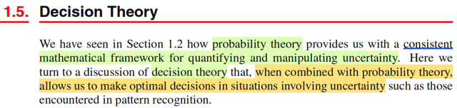</kbd>

> [!NOTE]
> Mở đầu gs cho biết ta đã thấy trong những phần trước lí thuyết xác suất đã
> cung cấp cho ta một framework để định lượng và thao tác với tính
> uncertainty. Thì nay, kết hợp với decision theory, sẽ cho ta một công cụ để
> giúp đưa ra  những quyết định hợp lí trong bối cảnh uncertainty

> [!TIP]
> 🤖 **AI Check** — 🟡 Minor issues — ✅ **90/100** · ✓ Move on
>
> Ghi chú tóm tắt rất tốt và chuẩn xác ý chính mở đầu của phần Decision Theory.
>
> **🟡 Minor issues**
>
> **1.** *"những quyết định hợp lí"*
>
> Nguyên văn là 'optimal decisions' (quyết định tối ưu), có ý nghĩa toán học chính xác (thường là tối thiểu hóa rủi ro kỳ vọng hoặc tối đa hóa hàm ích lợi), dùng từ 'hợp lí' thì hơi mang tính định tính và chưa phản ánh đúng tính tối ưu.
>
>
> **✓ Strengths**
> - Nắm bắt chính xác vai trò kết hợp giữa lý thuyết xác suất (định lượng sự không chắc chắn) và lý thuyết quyết định.
>
> **💡 Deeper notes**
> - Khái niệm 'optimal' trong decision theory chỉ có nghĩa cụ thể khi đi kèm một hàm mục tiêu rõ ràng (chẳng hạn như loss function hay utility function).

 

### Suy diễn thống kê

<kbd>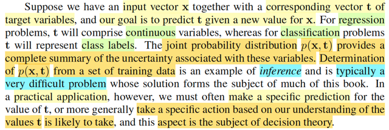</kbd>

<kbd></kbd>

> [!NOTE]
> Đại khái là, giả sử ta có input vector 𝐱, tương ứng là vector 𝐭, và mục đích là dự đoán t từ new value x. Thì với bài toán regression, t sẽ là biến liên tục. còn classification, t sẽ là class label.
>
>
>
> Khi đó joint probability của 𝐗,𝐓 (ở đây mình cứ theo quy tắc Casella, biến thì viết hoa, cũng như xài chữ f cho quen thuộc) f(𝐱,𝐭) sẽ phản ánh toàn diện mọi tính uncertainty gắn với các random variables này. Và bài toán đi xác định phân phối xác suất của 𝐗,𝐓 được gọi là **INFERENCE**.
>
>
>
> Có thể hiểu ý này, vì xuyên suốt cuốn Statistical Inference của Casella, mình chính là deal với bài toán này: cho random sample 𝐗 = (X1,...Xn) \~ f(𝐱|θ) thì mục tiêu của ta là suy đoán giá trị của θ, tham số chi phối phân phối xác suất của 𝐗, và 3 bài toán lớn là
>
>
>
> i) point estimation - tìm cách đưa ra một function của sample W(𝐗) sao cho với giá trị quan sát 𝐗 = 𝐱 thì ta có một estimate W(𝐱) cho θ.
>
>
>
> ii) hypothesis testing - tìm cách đưa ra một nhận định rằng θ ∈ Θ0 hoặc θ ∈ Θ0c, và cụ thể là đi xây dựng một rejection region R = {𝐱: reject H0} cũng chính là một hypothesis test, có bản chất là một decision rule: nhận vào 𝐱, tính toán giá trị của test statistic và dùng nó để quyết định xem nên tuyên bố θ ∈ Θ0 hay Θ0c.
>
>
>
> iii) interval estimation - tìm cách xây dựng một random interval hay khái quát hơn là random set C(𝐗) để khi quan sát 𝐗 = 𝐱 ta sẽ đưa ra một nhận định là θ ∈ C(𝐗)
>
>
>
> Quay lại đây, gs Bishop cho rằng đây vốn là bài toán rất khó, và sẽ là chủ đề xuyên suốt của cuốn sách này. Tuy nhiên, trong những bài toán thực tế, ta thường muốn dự đoán t dựa trên giá trị của x hoặc rộng hơn, mục đích của ta thường là đưa ra một hành động tốt nhất dựa trên giá trị mà t có khả năng cao nhất dựa trên input x

📹 [Xem video trên YouTube](https://www.youtube.com/watch?v=DW22LgJKcKM)

> [!TIP]
> 🤖 **AI Check** — 🟡 Minor issues — ✅ **92/100** · ✓ Move on
>
> Ghi chú thể hiện khả năng liên hệ khái niệm rất tốt giữa giáo trình PRML của Bishop và thống kê suy luận cổ điển (Casella & Berger). Điểm duy nhất cần lưu ý là lý thuyết quyết định (decision theory) không chỉ dựa vào giá trị có khả năng cao nhất mà xét trên toàn bộ phân phối hậu nghiệm kết hợp với hàm tổn thất.
>
> **🟡 Minor issues**
>
> **1.** *"đưa ra một hành động tốt nhất dựa trên giá trị mà t có khả năng cao nhất dựa trên input x"*
>
> Cách diễn đạt này vô tình thu hẹp lý thuyết quyết định (Decision Theory) về bài toán chọn giá trị có xác suất lớn nhất (như MAP). Trong thực tế, decision theory tối ưu hóa hành động dựa trên việc cực tiểu hóa kỳ vọng của hàm mất mát (expected loss) đối với toàn bộ phân phối điều kiện p(t|x), chứ không chỉ dựa riêng vào một giá trị t có khả năng xảy ra cao nhất.
>
>
> **✓ Strengths**
> - Hiểu chính xác sự phân biệt giữa bài toán hồi quy (continuous variables) và phân loại (class labels).
> - Kết nối rất sáng tạo và chính xác định nghĩa 'inference' trong Machine Learning với các bài toán suy diễn thống kê chuẩn mực (point estimation, hypothesis testing, interval estimation) trong Casella & Berger.
>
> **💡 Deeper notes**
> - Bishop chia quá trình giải quyết bài toán thành 2 bước rõ rệt: Inference stage (ước lượng phân phối p(x, t) hoặc p(t|x)) và Decision stage (chọn hành động tối ưu theo loss function). Sau này Bishop sẽ giới thiệu các hướng tiếp cận khác như mô hình phân biệt (học trực tiếp p(t|x)) hoặc hàm phân biệt (discriminant function - map thẳng từ x sang t bỏ qua bước tính xác suất).

 

#### Lý thuyết quyết định y khoa

<kbd>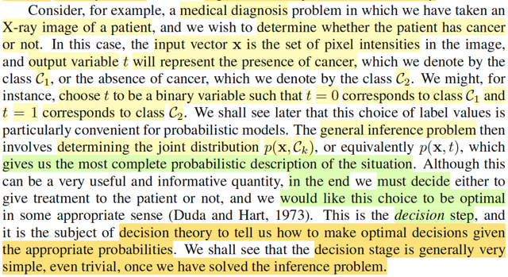</kbd>

<kbd></kbd>

<kbd></kbd>

> [!NOTE]
> Lấy ví dụ bài toán y khoa, ta muốn dựa trên input x là vector các giá trị điểm
> ảnh của ảnh chụp x quang, để dự đoán t mang một trong hai giá trị 0 hoặc 1
> để đại diện là C1 và C2 là tên hai class: có bị ung thư hay không bị. Thì ở
> đây nếu ta tìm được phân phối xác suất f(𝐱, t) hay f(𝐱, Ck)
>
>
>
> (chỗ này mình nghĩ ông gs Bishop làm cho rách việc ra thêm bằng cách
> dùng kí hiệu Ck, mình cho là cứ dùng t cũng được, chỉ cần biết nó là
> discrete mang hai  possible value 0 hoặc 1 thôi. Vốn dĩ việc ổng thoát li khỏi
> quy ước kí hiệu bên toán như xài chữ p thay cho f, viết thường cho tên biến
> thay vì viết hoa vốn đã gây dễ lú rồi. Nên ở đây mình sẽ cứ dùng t, f, và tuân
> theo quy ước viết hoa cho tên biến)
>
>
>
> thì đó chính là bài toán inference, tuy nhiên sau hết, mục đích vẫn là đưa ra
> quyết định là làm gì tiếp theo, thì đây chính là địa hạt của decision theory, nó
> sẽ giúp ta đưa ra quyết định tối ưu dựa trên xác suất tính toán được.
>
>
>
> Và gs cho biết thường thì bước make decision sẽ tương đối đơn giản một
> khi ta đã giải được bài toán inference.

📹 [Xem video trên YouTube](https://www.youtube.com/watch?v=Y4YG0TJQ-tA)

> [!TIP]
> 🤖 **AI Check** — 🟢 Pass — ✅ **95/100** · ✓ Move on
>
> Ghi chú nắm rất chính xác và đầy đủ hai giai đoạn cốt lõi: suy diễn xác suất (inference) và ra quyết định (decision theory). Phần thắc mắc về ký hiệu C_k hoàn toàn dễ hiểu và sẽ được làm sáng tỏ khi mở rộng sang bài toán nhiều lớp.
>
> **✓ Strengths**
> - Phân biệt rạch ròi giữa bài toán suy diễn (ước lượng phân phối xác suất chung) và bài toán ra quyết định dựa trên xác suất đó.
> - Tóm tắt đúng bản chất ví dụ chẩn đoán y khoa với đầu vào là vector điểm ảnh và đầu ra nhị phân.
>
> **💡 Deeper notes**
> - Việc tác giả Bishop phân biệt C_k (tên lớp / class label) và t (biến mục tiêu mã hóa nhị phân) không hẳn là 'rách việc', mà là để thuận tiện mở rộng sang bài toán phân loại nhiều lớp (K > 2) sau này, khi t có thể được biểu diễn dưới dạng vector one-hot thay vì chỉ là một số vô hướng {0, 1}.
> - Trong cộng đồng Machine Learning, ký hiệu p(·) được chuẩn hóa để chỉ chung cho cả hàm mật độ xác suất (pdf) lẫn hàm khối xác suất (pmf), giúp biểu thức tổng quát hơn so với việc phân chia f(x) và P(X=x) như trong toán thống kê cổ điển.

 

##### Quyết định dựa trên Xác suất

<kbd>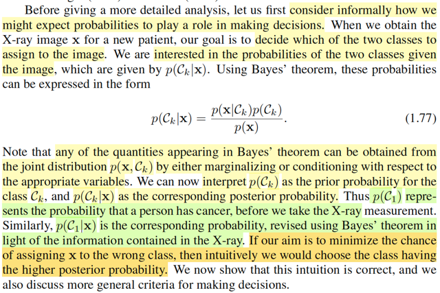</kbd>

> [!NOTE]
> Trước đi đi vào phân tích chi tiết, ta sẽ xem xét một cách không chính thức
> làm cách nào để ta thấy rằng xác suất sẽ đóng vai trò giúp ta quyết định
> thông qua ví dụ dễ hiểu.
>
>
>
> Như nãy đã nói, trong bối cảnh bài toán ta muốn dựa trên tấm ảnh chụp 
> x quang để đưa ra dự đoán bệnh hay không bệnh. Thì ta sẽ muốn xem
> xét f(t|𝐱) 
>
>
>
> Theo Bayes theorem: f(t|𝐱) = f(𝐱|t) f(t) / f(𝐱)
>
>
>
> Y như trong Bayesian approach ta coi θ là random variable để gán cho nó
> prior distribution π(θ), và dựa vào Bayes theorem để cập nhật xác suất
> của θ dựa trên 𝐗 = 𝐱, để có posterior distribution π(θ|𝐱). Thì ở đây, f(t)
> (trong sách là p(Ck) cũng sẽ là prior distribution của T, và f(t|𝐱) là posterior
> distribution, với ý nghĩa là:
>
>
>
> Khi chưa biết kết quả x-ray thì xác suất một người mắc bệnh (T mang giá
> trị gì) sẽ được quy định bởi prior distribution f(t).
>
>
>
> Nhưng sau khi có x-ray thì xác suất của T sẽ do f(t|𝐱) quyết định.
>
>
>
> Như vậy, để giảm thiểu khả năng phán bệnh sai, lẽ thường ta sẽ dùng
> kết quả của posterior distribution, là trong hai giá trị khả dĩ của T, thì cái
> nào có posterior probability cao hơn.
>
>
>
> Vậy thì ở đây, tính được f(t, 𝐱) coi như là bài toán inference, khi đó, ta
> sẽ tính được f(t|𝐱) và việc lấy giá trị nào có posterior cao hơn để gán / báo 
> cho bệnh nhân chính là bước dựa vào decision theory để take action

📹 [Xem video trên YouTube](https://www.youtube.com/watch?v=cs2g9gIdUpU)

> [!TIP]
> 🤖 **AI Check** — 🟢 Pass — ✅ **95/100** · ✓ Move on
>
> Ghi chú nắm rất chắc và diễn giải trực quan vai trò của định lý Bayes trong bài toán quyết định. Bạn còn nhìn nhận sớm và chính xác sự phân tách giữa hai giai đoạn inference (suy luận xác suất) và decision (ra quyết định).
>
> **✓ Strengths**
> - Hiểu chính xác vai trò và ý nghĩa trực giác của xác suất tiên nghiệm (prior) và xác suất hậu nghiệm (posterior) trong bài toán chẩn đoán y tế.
> - Liên hệ và phân biệt chuẩn xác giữa bài toán inference (mô hình hóa phân phối/tính posterior) và decision theory (chọn hành động tối ưu dựa trên posterior).
>
> **💡 Deeper notes**
> - Về mặt bản chất: ở bài toán phân loại, nhãn lớp $T$ (hay $\mathcal{C}_k$) là một biến ngẫu nhiên rời rạc (discrete target variable) của từng mẫu dữ liệu, khác với tham số $\theta$ trong Bayesian inference vốn là tham số cố định chưa biết của toàn bộ mô hình được gán phân phối niềm tin.

 

###### Giảm thiểu tỉ lệ phân loại nhầm

<kbd>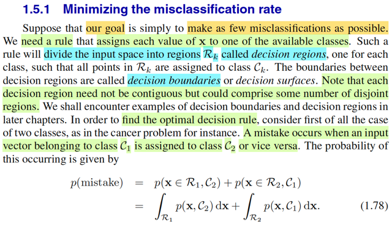</kbd>

<kbd></kbd>

<kbd></kbd>

> [!NOTE]
> Thế thì đại ý là nếu như mục tiêu của ta là giảm thiểu tỉ lệ phân loại nhầm (misclassification rate) thì ta sẽ cần một bộ quy tắc để gán giá trị cho của 𝐱 cho một trong các class đang xét.
>
>
>
> Trước khi nói tiếp, mình tranh thủ recall lại kiến thức trong Casella: Hypothesis testing:
>
>
>
> Như lúc nãy cũng đã review lại sơ sơ: Bài toán hypothesis testing là bài toán suy luận thống kê mà trong đó ta muốn xây dựng một cái hypothesis test - có bản chất chỉ là một decision rule: dựa vào gía trị quan sát của 𝐗, tính toán ra test stastisic λ(𝐗) và theo một cái rule nào đó để đưa ra kết luận rằng H0: θ ∈ Θ0, gọi là accept null hypothesis, hay kết luận H1: θ ∈ Θ0c gọi là reject null hypothesis.
>
>
>
> Thế thì, như vậy việc định ra một cái test, cũng chính là định ra cái rule, để rồi áp dụng cái rule này với mọi 𝐱 ∈ range 𝐗, nó sẽ chia range 𝐗 thành hai phần, Rejection region R = {𝐱 ∈ range 𝐗: reject H0} và Rc = {𝐱 ∈ range 𝐗: accept H0}, gọi là Acceptance region.
>
>
>
> Để rồi, khi đó, khi bàn tới việc đánh giá một hypothesis test, ta sẽ muốn giảm thiểu hai loại sai sót: Type I error, là khi θ ∈ Θ0 nhưng lại reject H0 (𝐗 ∈ R), và Type II error, là khi θ ∈ Θ0c nhưng lại accept H0 (𝐗 ∈ Rc).
>
>
>
> Để rồi từ đó ta có các khái niệm như power function: β(θ) = P\_θ(𝐗 ∈ R), với định nghĩa này, ta sẽ muốn một cái test có Type I error thấp thì có nghĩa là với θ ∈ Θ0 β(θ) nên thấp, từ đó ta có định nghĩa level α test là test mà:
>
>
>
> sup\_θ∈Θ0 P\_θ(𝐗 ∈ R) ≤ α.
>
>
>
> Và định nghĩa size α test, là test có sup\_θ∈Θ0 P\_θ(𝐗 ∈ R) = α.
>
>
>
> Và khi đã xét một đám có xác suất Type I error thấp, ví dụ leve α test.
>
>
>
> Ta sẽ muốn tìm thằng có xác suất mắc Type II error thấp nhất trong đó, cũng là thằng mà khi θ ∈ Θ0c thì xác suất reject H0 là cao nhất mọi thằng khác, đó chính là most powerful level α test, với power function chính là định nghĩa bởi β(θ) = P\_θ(𝐗 ∈ R): một test gọi là most power trong các test level α là khi với mọi θ ∈ Θ0c, thì β(θ) của nó luôn ≥ β'(θ) của mọi test khác trong đám đó.
>
>
>
> Review chút xíu cho nhớ, giờ quay lại bài toán này.
>
>
>
> ---
>
>
>
> Để thực hiện bước phân loại, ta cũng sẽ muốn một cái decision rule, cũng giống như hypothesis test, ta cũng sẽ cần một cái function, để nhận vào x, và trả ra kết quả là predict là class nào. Khi đó nó cũng sẽ chia range X thành các vùng, gọi là **DECISION REGIONS**
>
>
>
> (không nhất thiết phải là 2 vùng rejection region R và decision region R, mà tùy vào số possible class / cũng là số possible values của T, nhưng ở đây thì đúng là có 2 vùng, vì T có 2 possible values, gọi là R1, và R2)
>
>
>
> Và biên giới phân tách các decision regions gọi là DECISION BOUNDARY.
>
>
>
> Thế thì khi nói về event "mắc sai lầm / phân loại sai", nếu trong bối cảnh bài toán Hypothesis testing, thì nó sẽ là:
>
>
>
> (θ ∈ Θ0, reject H0) hoặc (θ ∈ Θ0c, accept H0)
>
>
>
> cũng là (θ ∈ Θ0, 𝐗 ∈ R) hoặc (θ ∈ Θ0c, 𝐗 ∈ Rc)
>
>
>
> Tương tự, ở đây, một event "phân loại sai" sẽ là:
>
>
>
> (T = C1, phân loại C2) hoặc (T = C2, phân loại C1)
>
>
>
> cũng là (T = C1, 𝐗 ∈ R2) hoặc T = C2, 𝐗 ∈ R1)
>
>
>
> Thế thì xét xác suất của event "mắc sai lầm" này, ta sẽ thấy.
>
>
>
> Với bài toán hypothesis testing, phải chú ý rằng, vì theo Frequentist approach, ta không coi θ như random variable, cho nên xác suất mắc Type 1 Error không phải là P\_θ(θ ∈ Θ0, 𝐗 ∈ R) mà phải define là P\_θ(𝐗 ∈ R) khi θ ∈ Θ0, mang ý nghĩa: Khi giá trị của θ, vốn là fixed và unknown, thật sự là ∈ Θ0 thì P\_θ(𝐗 ∈ R) chính là xác suất mắc Type I error. (vì sao có chữ θ ở dưới P: P\_θ(...) thì là vì 𝐗 \~ f(𝐱|θ) nên dĩ nhiên xác suất này phụ thuộc θ)
>
>
>
> Tương tự, xác suất mắc Type II error sẽ được định nghĩa là:
>
>
>
> P\_θ(𝐗 ∈ Rc) khi θ ∈ Θ0c.
>
>
>
> Nhưng với bài toán này, vì 𝐗 và T đều là random variable / random vectors,
>
>
>
> (Chú ý, 𝐗 là random vectors, nên trong sách gs Bishop dùng bold font, nhưng như đã nói ông ko theo convention nữa, nên viết chữ thường (vẫn in đậm, nhưng chữ thường 𝐱) còn mình thì theo convention của Casella, nên in đậm, chữ hoa 𝐗)
>
>
>
> nên xác suất của event mắc sai lầm sẽ là:
>
>
>
> P\[(T = C1, 𝐗 ∈ R2) or (T = C2, 𝐗 ∈ R1)\]
>
>
>
> = P\[(T = C1, 𝐗 ∈ R2) U (T = C2, 𝐗 ∈ R1)\]
>
>
>
> Đây là union của hai disjoint event, nên theo axiom 3 của lí thuyết xác suất, ta tách nó thành tổng của:
>
>
>
> = P(T = C1, 𝐗 ∈ R2) + P(T = C2, 𝐗 ∈ R1)
>
>
>
> Và đây là xác suất của joint event liên quan đến T, và 𝐗, nên ta sẽ dùng thể hiện nó / tính toán nó bởi joint distribution của T và 𝐗:
>
>
>
> f(t,𝐱) | t=C1, 𝐱∈R2 + f(t,𝐱) | t=C2, 𝐱∈R1
>
>
>
> Để thấy bước tiếp theo quen thuộc ta nhớ trong Casella hay Stat110, khi xét joint distribution của X,Y f(x,y), và xét xác suát của event X ∈ A, Y ∈ B, ta sẽ lấy tích phân ∫A∫B f(x,y)dxdy.
>
>
>
> P(X ∈ A, Y ∈ B) = ∫\_A ∫\_B f(x,y)dxdy
>
>
>
> Với X, Y là discrete, công thức tương đương sẽ là:
>
>
>
> P(X ∈ A, Y ∈ B) = Σ\_{x ∈ A} Σ\_{y ∈ B} P(X=x, Y=y)
>
>
>
> Nếu X discrete và Y continuous thì công thức sẽ là
>
>
>
> P(X ∈ A, Y ∈ B) = Σ\_{x ∈ A} ∫\_B f(x,y)dx
>
>
>
> Áp dụng ở đây là joint distribution của T là discrete, 𝐗 là continuous. Và T = C1 tương đương T ∈ {C1} (tức tập chỉ có một điểm C1)
>
>
>
> P(T = C1, 𝐗 ∈ R2) = Σ\_{t ∈ {C1}} ∫\_R2 f(t, 𝐱) d𝐱
>
>
>
> = Σ\_{t ∈ {C1,C2}} ∫\_R2 f(t, 𝐱) d𝐱
>
>
>
> = ∫\_R2 f(C1, 𝐱) d𝐱 (vì {C1} chỉ có 1 điểm)
>
>
>
> ---
>
>
>
> Tương tự:
>
>
>
> P(T = C2, 𝐗 ∈ R1) = ∫\_R1 f(C2, 𝐱) d𝐱
>
>
>
> ⇒ p(mistake) = ∫R2 f(C1,𝐱)d𝐱 + ∫R1 f(C2,𝐱)d𝐱

📹 [Xem video trên YouTube](https://www.youtube.com/watch?v=EdO4zFFBwpI)

> [!TIP]
> 🤖 **AI Check** — 🟢 Pass — ✅ **98/100** · ✓ Move on
>
> Ghi chú rất xuất sắc, kết nối trực giác sâu sắc và chính xác giữa kiểm định giả thuyết (Casella-Berger) với bài toán phân loại thống kê (PRML), đồng thời diễn giải chặt chẽ công thức xác suất phân loại nhầm.
>
> **✓ Strengths**
> - So sánh rất chuẩn xác giữa kiểm định giả thuyết (nơi tham số θ là cố định, kiểm soát Type I/Type II error) và phân loại học máy (nơi nhãn lớp T là biến ngẫu nhiên có phân phối đồng thời cùng vector đặc trưng X).
> - Diễn giải toán học từ tiên đề xác suất (disjoint union) đến tích phân hàm mật độ đồng thời giữa biến rời rạc và biến liên tục rất mạch lạc và đúng đắn.
>
> **💡 Deeper notes**
> - Trong kiểm định giả thuyết cổ điển (Neyman-Pearson), ta thường cố định mức sai lầm loại I (size/level α) rồi cực tiểu sai lầm loại II; còn trong bài toán cực tiểu misclassification rate này, hai loại sai lầm được gộp chung lại và tính trọng số thông qua xác suất tiên nghiệm (prior probability) $p(\mathcal{C}_k)$.
> - Sách gốc có lưu ý thêm rằng mỗi decision region $\mathcal{R}_k$ không nhất thiết phải liên tục (contiguous) mà có thể bao gồm nhiều vùng rời nhau (disjoint sub-regions).

**🔗 See also:** [Generalized Linear Model for K Classes](./421_continuous_inputs.md#node-q8w0jnb)

 

###### Tối ưu hóa vùng quyết định

<kbd>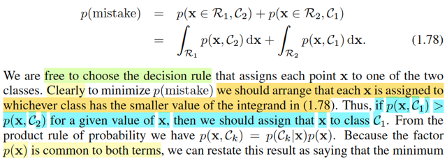</kbd>

<kbd>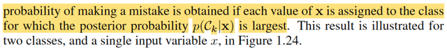</kbd>

<kbd></kbd>

> [!NOTE]
> Tiếp, cùng tìm hiểu sao ông Bishop nói dễ thấy là **cái rule mà sẽ giúp ta giảm thiểu xác suất mistake này sẽ là cái rule sau đây**: gán C2 cho 𝐱 nếu f(𝐱, C1) &lt; f(𝐱, C2) , ngược lại thì kết luận C1.
>
>
>
> Mình sẽ nhìn bài toán này theo góc nhìn bài toán tối ưu hóa:
>
>
>
> nói bằng lời là:
>
>
>
> **tìm cái decision rule** sao cho **dưới cái rule đó, xác suất sai lầm là nhỏ nhất**.
>
>
>
> Vấn đề là, với bài toán tối ưu, thì phải xác định biến tối ưu (optimization variable) là gì. Thế thì ở đây, cái cần tìm là một decision rule, ko phải tìm x, y gì cả.
>
>
>
> Vậy thì cái biến tối ưu ở đây, là decision rule. Mà decision rule thì làm sao mà thể hiện theo toán học đây.
>
>
>
> À, như đã biết trong bài toán Hypothesis testing, nói về một cái test, hay test rule, thì **bản chất cũng chính là nói về cái rejection region** hay acceptance region. Vì **một cái rule, sẽ gắn với cái rejection region** có được khi áp cái rule đó để mà chia không gian 𝐗 thành R và Rc.
>
>
>
> Nên ở đây cũng vậy, bản chất một cái decision rule, chính là thể hiện qua các decision region R1, R2. Vì tương tự như trên, mỗi một cái decision rule khác nhau sẽ tạo ra một bộ decision region {R1,R2} khác nhau.
>
>
>
> Do đó bài toán tối ưu sẽ được thể hiện như sau:
>
>
>
> minimize\_{R1,R2} {∫R2 f(C1,𝐱)d𝐱 + ∫R1 f(C2,𝐱)d𝐱}
>
>
>
> (chỗ này vì 𝐗 là vector nên ta phải hiểu đây là tích phân đa biến ∫...∫ nếu ghi chặt chẽ theo toán học, chỉ là ghi ∫ cho gọn, cũng như range 𝐗 đây là subset của Rⁿ chứ ko phải R)
>
>
>
> Tuy nhiên, R1,R2 sẽ có ràng buộc: R1 U R2 = 𝓧 ⇒ R1 = 𝓧 \\ R2, và R1, R2 disjoint: R1 ∩ R2 = ∅
>
>
>
> ∫\_R1 f(C2,𝐱)d𝐱 = ∫\_{𝓧\\R2} f(C2,𝐱)d𝐱 = ∫\_𝓧 f(C2,𝐱)d𝐱  - ∫\_R2 f(C2,𝐱)d𝐱
>
>
>
> (giống như ∫1:10 f(x)dx = ∫1:5 f(x)dx + ∫5:10 f(x)dx ⇔ ∫5:10 f(x)dx = ∫1:10 f(x)dx - ∫1:5 f(x)dx
>
>
>
> ⇒ ∫5:10 f(x)dx =  ∫{\[1:10\]\\\[1:5\]} f(x)dx )
>
>
>
> Nhưng tích phân trên miền R2, có thể được tách thành tích phân trên toàn miền trừ tích phân trên miền R1:
>
>
>
> ∫R2 f(C1,𝐱)d𝐱 = ∫\_𝓧 f(C1,𝐱)d𝐱 - ∫\_R1 f(C1,𝐱)d𝐱
>
>
>
> Objective trở thành: ∫\_𝓧 f(C1,𝐱)d𝐱 - ∫\_R1 f(C1,𝐱)d𝐱 + ∫R1 f(C2,𝐱)d𝐱
>
>
>
> ---
>
>
>
> Và xét cái này ∫\_𝓧 f(C1,𝐱)d𝐱:
>
>
>
> X,Y f(x,y): ∫f(x,y)dx = f(y)
>
>
>
> Ta biết là marginalizing joint pdf/pmf của 𝐗, T trên toàn miền xác định của 𝐗 ta sẽ được marginal pdf/pmf của T.
>
>
>
> Do đó ∫\_𝓧 f(C1,𝐱)d𝐱 chính là f(t)|t=C1
>
>
>
> (f(t) nên hiểu là pmf P(T=t)
>
>
>
> nên cái ta có chính là P(T=C1) chính prior distribution của T, evaluate tại t = C1 mang ý nghĩa: xác suất "bắt được một datapoint thuộc class C1 ngoài tự nhiên"
>
>
>
> ---
>
>
>
> Vậy bài toán tối ưu lúc này là:
>
>
>
> minimize_R1 {f(C1) - ∫\_R1 f(C1,𝐱)d𝐱 + ∫\_R1 f(C2,𝐱)d𝐱}
>
>
>
> = {f(C1) + ∫\_R1 \[f(C2, 𝐱) - f(C1,𝐱)\]d𝐱 }
>
>
>
> Và f(C1) thì ko phụ thuộc R1, nên ta chuyển thành bài toán tương đương:
>
>
>
> minimize_R1 { ∫\_R1 \[f(C2,𝐱) - f(C1,𝐱)\]d𝐱 }
>
>
>
> ("nói bằng lời": ta muốn tìm R1, sao cho minimize cái tích phân này)
>
>
>
> Nếu là bối cảnh bài toán tối ưu với biến 𝐱 thông thường, có lẽ tới đây mình sẽ dùng first order necessary condition để tìm 𝐱 khiến gradient = 0, để ra critical point rồi xét phép thử bậc hai các kiểu.
>
>
>
> Còn ở đây, biến tối ưu lại là một cái region, vậy phải làm sao?
>
>
>
> Ta sẽ dựa vào lập luận sau:
>
>
>
> Hiểu đơn giản ∫\_R1 \[f(C2,𝐱) - f(C1,𝐱)\]d𝐱 sẽ tính tổng các hàm g(𝐱) = f(C2,𝐱) - f(C1,𝐱) trên miền R1.
>
>
>
> Hình dung ta thay đổi decision boundary để thay đổi miền R1, khi bất cứ khi nào nó chứa thêm một điểm mà g(𝐱) dương thì giá trị tích phân tăng lên và ngược lại khi nó chứa thêm một điểm có g(𝐱) âm thì giá trị tích phân sẽ nhỏ xuống. Do đó, cái này sẽ nhỏ nhất khi R1 chứa mọi 𝐱 ∈ 𝓧 sao cho g(𝐱) &lt; 0 
>
>
>
> Kết luận R1 tối ưu nên là tập các 𝐱 ∈ 𝓧 sao cho \[f(C2,𝐱) - f(C1,𝐱)\] &lt; 0 ⇔ f(C2,𝐱) &lt; f(C1,𝐱).
>
>
>
> Nhờ vậy giúp ta hiểu vì sao gs Bishop nói vậy trong đoạn này. (ông nói clearly nhưng mình thấy chả clearly chút nào nếu ko phân tích như trên).
>
>
>
> Vậy **optimal decision rule** (theo tiêu chí minimize misclassification rate) là:
>
>
>
> Assign class C1 nếu f(C2,𝐱) &lt; f(C1,𝐱) và ngược lại.
>
>
>
> Và cũng dễ hiểu rằng vì f(t,𝐱) = f(t|𝐱)f(𝐱) **⇨** f(C2,𝐱) = f(C2|𝐱)f(𝐱)
>
>
>
> và f(C1,𝐱) = f(C1|𝐱)f(𝐱)
>
>
>
> nên decision rule tối ưu cũng là: Assign class C1 nếu f(C2|𝐱) (tức posterior pmf tại C2) &lt; f(C1|𝐱)

📹 [Xem video trên YouTube](https://www.youtube.com/watch?v=L_0FU59P6Ts)

> [!TIP]
> 🤖 **AI Check** — 🟢 Pass — ✅ **98/100** · ✓ Move on
>
> Ghi chú xuất sắc! Bạn đã biến nhận định mang tính trực giác của Bishop thành một bài toán tối ưu miền quyết định (decision region) rất chặt chẽ và chuẩn xác.
>
> **✓ Strengths**
> - Biểu diễn bài toán dưới dạng tối ưu hóa phân hoạch không gian (partition) R1, R2 rất sáng tạo và chuẩn xác.
> - Khai triển tách tích phân qua biến lề và chuyển về dạng tối ưu một tích phân duy nhất rất mạch lạc.
> - Lập luận chọn điểm thuộc miền R1 dựa trên dấu của integrand để cực tiểu hóa giá trị tích phân hoàn toàn chính xác.
>
> **💡 Deeper notes**
> - Trường hợp biên g(x) = 0 (tức f(C1, x) = f(C2, x)): việc gán x vào R1 hay R2 không làm thay đổi giá trị tích phân (trong phân phối liên tục, tập này thường có độ đo Lebesgue bằng 0), nên quy tắc gán tại biên có thể chọn tùy ý (tie-breaking).

**🔗 See also:** [Generalized Linear Model for K Classes](./421_continuous_inputs.md#node-q8w0jnb)

 

###### Giảm thiểu lỗi phân loại

<kbd>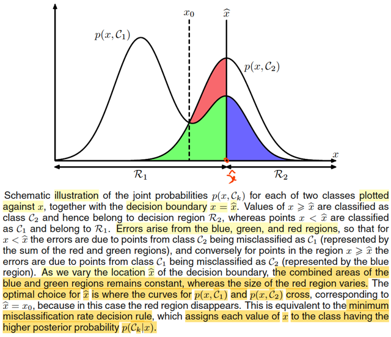</kbd>

> [!NOTE]
> Minh họa bằng hình ảnh này. Vẽ đồ thị của hàm f(C1, 𝐱) và f(C2, 𝐱) theo 𝐱.
>
>
>
> Mình phải nói trước: hình ảnh chỉ nên hiểu mang tính minh họa, vì 𝐱 vốn đang là vector, ko thể thể hiện nó trên 1 trục như vậy được, hay nói cách khác, ở đây coi như 𝐱 chỉ là vector 1-D, do nên ta thấy gs Bishop dùng kí hiệu x thường (ko phải x bold: 𝐱 như trong phần trước)
>
>
>
> ---
>
>
>
> Nói tí xíu về decision boundary
>
>
>
> ví dụ trong 2D: và để dễ hình dung ta lấy hàm logistic regression, có decision rule là: Gán C1 nếu σ(𝐰ᵀ𝐱) &gt; 1/2 và ngược lại.
>
>
>
> σ(𝐰ᵀ𝐱) = 1/2 ⇔ 𝐰ᵀ𝐱 = 0 ⇔ w0+w1x1+w2x2 = 0. Nên decision boundary là đường thẳng {𝐱: w0+w1x1+w2x2 = 0} trong mặt phẳng, chia không gian 2D làm 2, 𝐰ᵀ𝐱 &lt; 0 (R1) và 𝐰ᵀ𝐱 &gt; 0 (R2).
>
>
>
> Ở đây trong 1D:
>
>
>
> σ(𝐰ᵀ𝐱) = 1/2 ⇔ 𝐰ᵀ𝐱 = 0 ⇔ w0 + wx = 0. Nên phương trình decision boundary ở đây là 1 điểm {x: w0 + wx = 0} (chính là x̂ ) trên trục R, chia không gian 1D làm 2: w0 + wx &lt; 0 (R1) và w0 + wx &gt; 0 (R2)
>
>
>
> ---
>
>
>
>
>
> Xác suất của event "phân loại" sai, như vừa phân tích được tính bởi
>
>
>
> P(Mistake) = ∫R1 f(C2,x) dx + ∫R2 f(C1,x)dx
>
>
>
> Và dĩ nhiên như đã học trong MIT 1801, ý nghĩa của tích phần ∫a:b f(t)dt là diện tích của phần đồ thị bên dưới hàm f(t) từ a đến b.
>
>
>
> Nên (Mistake) là tổng diện tích của phần đồ thị hàm f(C2,x) với x ∈ R1 và diện tích của phần đồ thị hàm f(C1,x) với x trong R2. chính là phần đỏ + xanh dương và xanh lá
>
>
>
> Và bài toán đặt ra là tìm R1, R2 giúp minimize cái tổng diện tích này, và điều này đồng nghĩa nhích cái decision boundary x̂ qua lại.
>
>
>
> Thế thì đại ý rất dễ thấy đó là, khi dịch chuyển cái x̂ , thì tổng diện tích vùng xanh lá, xanh dương ko đổi. Nó chỉ thay đổi diện tích vùng đỏ. Và tại x̂ = x0 thì diện tích vùng đỏ là nhỏ nhất (= 0), đó chính là nơi mà từ tại đó, ta có optimal decision rule:
>
>
>
> x0 chính là nghiệm của f(C1|x0) = f(C2|x0)
>
>
>
> (nếu lấy ví dụ logistic regression model thì nó là σ(w0+wx) = 1-σ(w0+wx) ⇔ w0+wx = 0 ⇔ x = -w0/w → x0
>
>
>
> nên optimal rule là: assign C1 nếu x &lt; x0 và assign C2 nếu x &gt; x0
>
>
>
> Assign C1 nếu f(C2|x) &lt; f(C1|x) và ngược lại.
>
>
>
> Có nghĩa là cái optimal rule sẽ là: Assign C1 nếu x &lt; x0 và ngược lại.

📹 [Xem video trên YouTube](https://www.youtube.com/watch?v=w2H10rAb_XM)

> [!TIP]
> 🤖 **AI Check** — 🟢 Pass — ✅ **95/100** · ✓ Move on
>
> Ghi chú thể hiện sự hiểu bài rất tốt, nắm bắt chính xác bản chất hình học của việc tối thiểu hóa xác suất phân loại sai và liên hệ trực quan tốt với mô hình Logistic Regression.
>
> **✓ Strengths**
> - Hiểu chính xác bản chất vì sao tổng diện tích xanh dương và xanh lá không đổi khi x̂ dịch chuyển, và việc tối ưu tương đương với triệt tiêu diện tích vùng đỏ.
> - Liên hệ tốt giữa việc so sánh phân phối đồng thời p(x, C_k) và phân phối hậu nghiệm p(C_k|x) để tìm ngưỡng quyết định x0.
> - Quan sát tinh tế về mặt ký hiệu 1-D (scalar x) so với vector x tổng quát.
>
> **💡 Deeper notes**
> - Điều kiện p(x, C1) = p(x, C2) tương đương p(C1|x) = p(C2|x) dựa trên công thức Bayes p(x, C_k) = p(C_k|x)p(x) (với điều kiện mật độ lề p(x) > 0).
> - Mô hình Logistic Regression giả định log-odds tuyến tính dẫn đến ranh giới phẳng (hoặc 1 điểm trong 1D), trong khi ranh giới Bayes tối ưu tổng quát có thể phi tuyến hoặc gồm nhiều khoảng nếu phân phối p(x, C_k) phức tạp (chẳng hạn như đường cong p(x, C1) có nhiều đỉnh).

 

###### Phân loại Bayes K lớp

<kbd>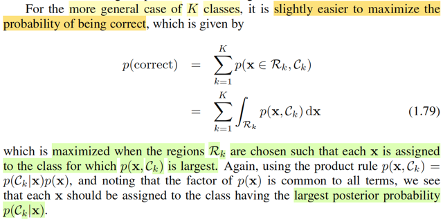</kbd>

> [!NOTE]
> Nói qua khái quát bài toán lên K classes thay vì 2 classes, ông cho rằng sẽ dễ hơn nếu ta đặt objective cho việc tìm rule tối ưu là **maximize xác suất phân loại đúng** thay vì **minimize xác suất phân loại sai**.
>
>
>
> Là sao? À đơn giản là vì đây là hai event disjoint và bù nhau, nên P("mistake" ) = 1 - P(" correct"). Mà với bài toán tối ưu thì ta biết rồi, minimize hàm f(x) thì cũng là maximize hàm -f(x). Đo đó, minimize P("mistake") tương đương maximize -P("mistake"), và cũng tương đương maximize 1 - P("mistake") (cộng hằng số vào objective thì cũng được bài toán tương đương), và đây chính là maximize P("correct")
>
>
>
> Như vậy minimize P("mistake") cũng chính là maximize P("correct")
>
>
>
> Nhưng vì sao maximize P("correct") lại dễ hơn.
>
>
>
> Là vì, event "correct" **dễ định nghĩa hơn** event "mistake" trong trường hợp có nhiều classes.
>
>
>
> Ví dụ có K classes, dĩ nhiên event correct sẽ là:
>
>
>
> (\[T = C1, decision rule phán là C1\] hoặc \[T = C2, decision rule phán là C2\] ..
>
>
>
> .. hoặc \[T = CK, decision rule phán là CK\])
>
>
>
> viết theo toán học gọn hơn thì sẽ là:
>
>
>
> "Correct" = (T = C1, 𝐗 ∈ R1) hoặc (T = C2, 𝐗 ∈ R2) ,...(T = CK, 𝐗 ∈ Rk)
>
>
>
> ⇨ P("Correct") = P\[(T = C1, 𝐗 ∈ R1) U (T = C2, 𝐗 ∈ R2) U...U( T = CK, 𝐗 ∈ Rk)\]
>
>
>
> tương tự, đây là union của các **disjoint** events nên theo axiom 2 (hay 3 nếu theo sách Casella)
>
>
>
> .. = P(T = C1, 𝐗 ∈ R1) + P(T = C2, 𝐗 ∈ R2) +...+ P(T = CK, 𝐗 ∈ Rk)
>
>
>
> và tương tự như hồi nãy, nó chính là ∫R1 f(C1,𝐱)d𝐱 + ...+ ∫RK f(CK, 𝐱)d𝐱
>
>
>
> = Σk=1:K ∫Rk f(Ck,𝐱)d𝐱
>
>
>
> Và tương tự như khi K = 2, cái **decision rule khiến maximize** P("correct") có thể đoán được cũng sẽ chính là cái rule này: Assign class Ck nếu joint pdf f(Ck, 𝐱) và cũng là posterior f(Ck|𝐱) là cao nhất trong các k = 1,..K
>
>
>
> ---
>
>
>
>  Vậy ở đây giúp ta hiểu sâu hơn như sau: Nếu tiêu chí của ta, mục tiêu của ta là **giảm thiểu tỉ lệ sai xót tổng thể**, thì cách **phân loại tốt nhất chính là dựa trên posterior probability**

📹 [Xem video trên YouTube](https://www.youtube.com/watch?v=0DIv7EViwmk)

> [!TIP]
> 🤖 **AI Check** — 🟢 Pass — ✅ **98/100** · ✓ Move on
>
> Ghi chú rất xuất sắc, giải thích cặn kẽ và trực quan lý do tại sao tối đa hóa xác suất đúng lại tương đương và dễ làm hơn tối thiểu hóa sai số trong bài toán $K$ lớp.
>
> **✓ Strengths**
> - Lập luận chặt chẽ về mặt tối ưu: tối thiểu hóa hàm mục tiêu tương đương tối đa hóa số bù khi hai biến cố là bù nhau.
> - Chỉ ra được bản chất trực giác: biến cố 'đoán đúng' gồm các biến cố rời nhau nên chỉ cần lấy tổng các thành phần đường chéo, đơn giản hơn nhiều so với việc liệt kê mọi trường hợp đoán sai của $K$ lớp.
> - Trình bày chuẩn xác bước chuyển từ xác suất hợp các biến cố rời nhau sang tích phân hàm mật độ đồng thời trên từng vùng quyết định.
>
> **💡 Deeper notes**
> - Về mặt ký hiệu, $T$ là nhãn rời rạc còn $\mathbf{x}$ là biến ngẫu nhiên liên tục, do đó $p(\mathbf{x}, \mathcal{C}_k)$ thường được hiểu là hàm mật độ hỗn hợp (joint density-mass) thay vì ký hiệu thuần túy $f(\mathcal{C}_k, \mathbf{x})$.

 

###### Phân loại và ưu tiên lỗi

<kbd>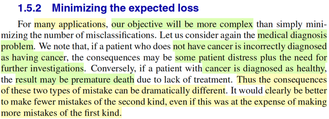</kbd>

> [!NOTE]
> Qua đây, đại ý là, trong nhiều trường hợp, mục tiêu không đơn giản chỉ là giảm tỉ lệ sai sót nói chung.
>
>
>
> Quay lại ví dụ việc xác định bệnh nhân có bệnh hay không, đôi khi **hai loại lỗi nó có mức độ hậu qủa** khác nhau. Ví dụ như **không có ung thư mà phán là có**, thì có thể cùng lắm là khiến bệnh nhân lo lắng và xét nghiệm thêm các kiểu tốn tìền. Nhưng nếu có ung thư mà chẩn đoán là không thì người ta có thể sẽ chết vì không được chữa trị.
>
>
>
> Lúc này, mục tiêu của ta có thể là **ưu tiên loại error thứ hai**, chấp nhận error thứ nhất (ý là nếu so sánh performance của các quy trình chẩn đoán thì có thể ưu tiện chọn cái có tỉ lệ error thứ hai nhỏ nhất, dù error thứ nhất nó ko phải là nhỏ nhất)
>
>
>
> ---
>
>
>
> Lại liên hệ nó với hypothesis testing cho vui. Mình đã review lại một ít trong các note trước, rằng trong bài toán này, ta cũng sẽ có hai loại error: Type I error, là khi θ thật sự thuộc Θ0, nhưng lại kết luận là reject H0, hay 𝐗 ∈ R và Type II error là khi θ ∈ Θ0c mà lại kết luận là accept H0: 𝐗 ∈ Rc.
>
>
>
> Thì còn nhớ, trong sách Casella, ta đã nghe là, trong thực tế, người ta sẽ dành **Type I error** để chỉ **loại sai lầm mà ta muốn tránh bằng mọi giá**, ưu tiên tránh, vì mang lại hậu quả lớn. Ví dụ như trong nghiên cứu thuốc mới, nếu thuốc gây tác dụng phụ nguy hiểm mà kết quả test lại kết luận thuốc không có tác dụng phụ gì, thì hậu quả sẽ rất lớn. Do đó, ta sẽ đặt H0: θ ∈ Θ0 ứng với: Thuốc có tác dụng phụ. Để rồi Type I error sẽ là: thuốc có tác dụng phụ mà lại công bố là không.
>
>
>
> Khi đó, bằng cách định nghĩa như vầy, ta sẽ tập trung xây dựng **level α test**, ví dụ level 0.001 test, theo định nghĩa, là các test có **xác suất mắc lỗi loại I cao nhất cũng không bao giờ vượt quá 0.001**.
>
>
>
> Sau đó, ta mới **đi tìm trong các level 0.001 test, cái nào có xác suất mắc Type II error thấp nhất**.
>
>
>
> Đây là một cách tiếp cận của việc đánh giá (evaluating) hypothesis test
>
>
>
> ---
>
>
>
> Thế thì vừa rồi mình đã ôn lại cách tiếp cận vấn đề đánh giá một hypothesis testing trong Casella, dĩ nhiên còn vài vấn đề khác, ví dụ như khi không tồn tại Uniformly Most Powerful test, rồi p-values.
>
>
>
> Recall thêm chút nữa:
>
>
>
> Trong thống kê cổ điển như cuốn Casella, mình nhớ là với Point estimator, Hypothesis testing, Interval estimator đều nói đến cách tiếp cận của decision theory để đánh giá (7.3.4, 8.3.5, 9.3.4)
>
>
>
> ---
>
>
>
> Ôn lại vài khái niệm liên quan đến decision theory đã học trong phần Point estimation và Interval estimation Casella: Đầu tiên, đối với point estimator thì khi dẫn dắt ta về cái này, gs Casella nói rằng, trong decision theory, **action space là không gian những action**, mà áp vào bối cảnh point estimation thì action đó là "(đưa ra) một estimation của θ", để rồi action space, là tập hợp mọi estimation của θ. Thế thì, theo decision theory, một action sẽ tạo ra một loss, và hàm loss sẽ là hàm được định nghĩa để phản ánh mức độ nghiêm trọng của action. Với bài toán estimation, thì loss có thể dùng **squared error loss** L(θ, δ(𝐱)) = (δ(𝐱)-θ)² hoặc **absolute error loss** L(θ,δ(𝐱)) = |δ(𝐱) - θ|
>
>
>
> Và như vậy thì, với loss function, ta sẽ có một hàm số phụ thuộc θ phản ánh chất lượng của estimator δ(𝐗) ứng với θ cụ thể nào đó.
>
>
>
> Và để có một con số duy nhất, không phụ thuộc 𝐗, phản ánh chất lượng của estimator δ(𝐗) nói chung, ta sẽ định nghĩa cái gọi là risk function:
>
>
>
> R(δ(𝐗), θ) = E\_θ\[L(δ(𝐗), θ)\], với phân tích ý nghĩa như sau:
>
>
>
> L(δ(𝐗), θ) sẽ là một random variable, vì nó là kết quả do áp một function lên δ(𝐗) nên phụ thuộc δ(𝐗), nên phụ thuộc 𝐗.
>
>
>
> Lấy kì vọng cái random variable này, thì tính cái này, thì ta sẽ dùng distribution của L(δ(𝐗),θ), mang ý nghĩa là marginalizing mọi giá trị khả dĩ của L, nên kết quả sẽ là fix, không còn là random variable nữa, không phụ thuộc 𝐗 nữa. nhưng nó vẫn là hàm theo θ.
>
>
>
> Và bằng cách tìm cái δ(𝐗) có risk nhỏ nhất với mọi θ thì ta sẽ có cái estimator tốt nhất, tức là **minimum risk estimator.**
>
>
>
> Và có thể thấy, nếu loss là squared error loss thì:
>
>
>
> R(δ(𝐗), θ) = E\_θ\[(δ(𝐗) - θ)²\] thì đây chính là định nghĩa của hàm MSE:
>
>
>
> MSE củan estimator W(𝐗), define bởi: MSE(W(𝐗),θ) = E\_θ\[(W(𝐗) - θ)²\].
>
>
>
> Từ đó, ta mới liên hệ với việc tìm estimator **minimize MSE cũng chính là tìm estimator minimize square error loss risk function**.
>
>
>
> Và triển khai thêm tí nữa:
>
>
>
> Dùng VarX = EX² - (EX)² ⇨ Var\[W(𝐗) - θ\] = E\[(W(𝐗) - θ)²\] - (E\[W(𝐗) - θ\])²
>
>
>
> Do đó MSE(W(𝐗), θ) = R(W(𝐗), θ)\_squared error loss = E\_θ\[(W(𝐗) - θ)²\]
>
>
>
> = Var\[W(𝐗) - θ\] + (E\[W(𝐗) - θ\])²
>
>
>
> = Var\[W(𝐗)\] + (E\[W(𝐗) - θ\])²
>
>
>
> Và E\[W(𝐗) - θ\] lại chính là definition của Bias(W(𝐗), θ)
>
>
>
> ⇨ MSE(W(𝐗), θ) = Var\[W(𝐗)\] + \[Bias(W(𝐗), θ)\]²
>
>
>
> ---
>
>
>
> Nếu là theo trường phái Bayesian với Bayes estimator, thì từ risk function R(δ(𝐗), θ) người ta sẽ lấy **trung bình trên mọi possible value của θ**:
>
>
>
> ∫R(δ(𝐗), θ) π(θ) dθ, đây gọi là Bayes risk
>
>
>
> Thay R(δ(𝐗), θ) = E\_θ\[L(δ(𝐗), θ)\] = ∫\_𝓧 L(δ(𝐱), θ) f(𝐱|θ) d𝐱 vào:
>
>
>
> Bayes risk = ∫*Θ* ∫\_𝓧 L(δ(𝐱), θ) f(𝐱|θ) d𝐱 π(θ) dθ
>
>
>
> = ∫Θ ∫\_𝓧 L(δ(𝐱), θ) \[f(θ|𝐱) f(𝐱)/π(θ)\] d𝐱 π(θ) dθ
>
>
>
> = ∫\_Θ ∫\_𝓧 L(δ(𝐱), θ) f(θ|𝐱) f(𝐱) d𝐱 dθ
>
>
>
> = ∫\_𝐗 \[ ∫\_Θ L(δ(𝐱), θ) f(θ|𝐱) dθ \] f(𝐱) d𝐱
>
>
>
> Thì cái ∫\_Θ L(δ(𝐱), θ) f(θ|𝐱) dθ = E\[L(δ, θ)|𝐗=𝐱\] được gọi là **posterior expected loss**
>
>
>
> ---
>
>
>
> Sang tới interval estimator, thì lúc này loss function cần phản ánh hai thứ: độ chính xác (C(𝐗) chứa θ và kích thước C(𝐗). Do đó, loss sẽ là kết hợp của một indicator function I\_{C(𝐗) chứa θ} (= 0 khi C(𝐗) chứa và bằng 1 khi C(𝐗) không chứa θ) và Size(C(𝐗)) với một tham số b giúp điều chỉnh tương quan giữa hai sub-objective này:
>
>
>
> L(C(𝐗), θ) = I\_{θ ∉ C(𝐗)} + b Size(C(𝐗)), thể hiện: nếu C(𝐗) chứa θ và có size nhỏ thì loss sẽ nhỏ.
>
>
>
> Và ta cũng sẽ đặt ra risk function của interval estimator là kì vọng của loss này. Để rồi tìm cách tìm estimator mà giảm thiểu risk:
>
>
>
> R(C(𝐗), θ) = E\_θ\[L(C(𝐗), θ)\].
>
>
>
> ---
>
>
>
> Còn với bài toán Hypothesis testing, trong 8.3.5 Casella ta được biết rằng, với bài toán này, action sẽ chỉ là một trong hai: a0, a1 biểu diễn kết luận của test rule là accept H0 hay reject H0. Và ta cũng sẽ define loss function, gọi là 1-0 loss để phản ảnh hậu quả:
>
>
>
> L(θ, a0) = 0 nếu θ ∈ Θ0, = 1 nếu θ ∈ Θ0c
>
>
>
> L(θ, a1) = 0 nếu θ ∈ Θ0c, = 1 nếu θ ∈ Θ0,
>
>
>
> Và risk cũng sẽ là function lấy trung bình loss:
>
>
>
> Chỗ này cần nói rõ cho dễ hiểu: Định nghĩa của loss, luôn gắn với một action. Với point estimator, loss kí hiệu là L(δ(𝐗), θ), để rồi nó là một random variable, mà khi nhận giá trị 𝐗 = 𝐱, kéo theo δ(𝐗) mang giá trị estimate cho θ: δ(𝐱) (là một action), kéo theo phát sinh loss L(δ(𝐱), **θ**) từ action này. Và vì L(δ(𝐗), θ) là random variable, nên risk = lấy kì vọng, chính là dựa trên distribution của cái thằng L này, và truy nguyên nguòn gốc thì c**ũng chỉ là xuất phát từ distribution của X**: f(𝐱|θ), do đó risk mới là hàm phụ thuộc θ.
>
>
>
> Tương tự, với interval estimator, thì action là một interval C(𝐱), loss L(C(𝐗), θ) cũng là random variable, mà yếu tố random của nó đến từ C(𝐗). Khi quan sát 𝐗 = 𝐱, C(𝐗) mang giá trị C(𝐱), thì nó mang ý nghĩa là một action được đưa ra: một interval được dự đoán sẽ chứa θ, và với action đó, phát sinh loss: L(C(𝐱), θ). Nên lấy kì vọng cái này để có risk, thì ta sẽ dựa trên **distribution của C(X)**, tất nhiên, C(𝐗), nếu là random interval, thì cũng sẽ được cấu thành bởi hai random variable L(𝐗), U(𝐗), nên tương tự, cũng chỉ là xuất phát từ distribution của 𝐗
>
>
>
> Còn trong hypothesis testing, action là một **kết luận mang một trong hai giá trị a0 hoặc a1**, nên ta có thể thể hiện nó bởi λ(𝐗) nào đó, là một Bernoulli random variable, để rồi khi quan sát 𝐗 = 𝐱, λ(𝐗) ghi nhận giá trị cụ thể λ(𝐱) (= a0 hoặc a1), loss ghi nhận giá trị cụ thể L(θ, λ(𝐱)) (là L(θ, a0) hoặc L(θ, a1)).
>
>
>
> Nhờ vậy, ta hiểu trong hypothesis testing, loss L(θ, λ(𝐗)) là một Bernoulli random variable
>
>
>
> nên khi lấy trung bình, dĩ nhiên ta sẽ dựa trên distribution của Bernoulli:
>
>
>
> R(θ, λ(𝐗)) = E\_θ\[L(θ, λ(𝐗)\]
>
>
>
> = L(θ, a0) × P\_θ\[L(θ, λ(𝐗)) = L(θ, a0)\] + L\_θ(θ, a1) × P\[L(θ, λ(𝐗) = L(θ, a1)\]
>
>
>
> = L(θ, a0) × P\_θ(λ(𝐗) = a0) + L\_θ(θ, a1) × P(λ(𝐗) = a1)
>
>
>
> = L(θ, a0) × P\_θ(𝐗 ∈ Acceptance region Rc) + L(θ, a1) × P\_θ(𝐗 ∈ Rejection region R)
>
>
>
> Và tùy vào θ ở đâu:
>
>
>
> θ ∈ Θ0 ⇨ R = 0 × P\_θ(𝐗 ∈ Rc) + 1 × P\_θ(𝐗 ∈ R) = β(θ)
>
>
>
> θ ∈ Θ0c = R = 1 × P\_θ(𝐗 ∈ Rc) + 0 × P\_θ(𝐗 ∈ R) = P\_θ(𝐗 ∈ Rc) = 1 - β(θ)
>
>
>
> Cuối cùng, nếu muốn thay đổi tương quan giữa hậu quả của hai loại Type I và II error, ta có thể thay đổi định nghĩa của loss, gọi là **generalized 1-0 loss**
>
>
>
> L(θ, a0) = 0 nếu θ ∈ Θ0, = cII nếu θ ∈ Θ0c
>
>
>
> L(θ, a1) = 0 nếu θ ∈ Θ0c, = cI nếu θ ∈ Θ0,
>
>
>
> Khi đó R(θ, λ(𝐗)):
>
>
>
> Khi θ ∈ Θ0: R = cI × P\_θ(𝐗 ∈ R) + 0 × P\_θ(X ∈ Rc) = cI × β(θ)
>
>
>
> Khi θ ∈ Θ0c: R = 0 × P\_θ(𝐗 ∈ R) + cII × P\_θ(X ∈ Rc) = cII × (1 - β(θ))

> [!TIP]
> 🤖 **AI Check** — 🟢 Pass — ✅ **100/100** · ✓ Move on
>
> Ghi chú xuất sắc! Bạn không chỉ nắm vững ý nghĩa thực tế của việc bất cân xứng giữa các loại lỗi (asymmetric loss) trong phân loại y tế từ giáo trình Bishop, mà còn liên hệ và tổng hợp rất bài bản, chính xác toàn bộ bức tranh Decision Theory trong thống kê cổ điển (Casella & Berger).
>
> **✓ Strengths**
> - Hiểu rất đúng và trực quan về việc phân bổ trọng số/hậu quả khác nhau giữa False Positive và False Negative trong chẩn đoán y tế.
> - Liên hệ chuẩn xác giữa kiểm định giả thuyết (Type I, Type II error) và cách tiếp cận Neyman-Pearson khi cố định mức ý nghĩa alpha rồi tối thiểu hóa beta.
> - Khai triển toán học rất chuẩn xác và mạch lạc về Decision Theory qua 3 bài toán lớn: Point Estimation (Risk, MSE decomposition, Bayes Risk/Posterior Loss), Interval Estimation (độ phủ kết hợp độ dài), và Hypothesis Testing (0-1 loss và generalized 0-1 loss liên hệ với power function β(θ)).
>
> **💡 Deeper notes**
> - Trong Bishop 1.5.2, việc tối thiểu hóa expected loss với generalized 0-1 loss (gọi là loss matrix L_{kj}) sẽ dẫn đến việc dịch chuyển ranh giới quyết định (decision boundary): thay vì chọn class có posterior probability lớn nhất p(C_k|x), ta sẽ chọn class k tối thiểu hóa ∑_j L_{kj} p(C_j|x). Điều này hoàn toàn tương thích với việc chọn decision rule tối thiểu hóa posterior expected loss mà bạn đã viết ở mục Bayesian.

 

###### Hàm mất mát và rủi ro Bayes

<kbd>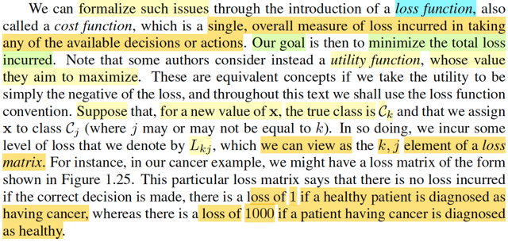</kbd>

<kbd>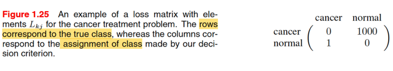</kbd>

> [!NOTE]
> Quay lại đây, trong bối cảnh machine learning, gs Bishop giới thiệu về cách tiếp cận decision theory: Ta sẽ dùng loss function (hay cost function) để phản ánh những hậu quả do các quyết định tạo ra.
>
>
>
> Thì có thể thấy nó **y chang những gì đã học trong Casella**. Chỉ khác là ta **mở rộng lên K class**, tức là decision rule không còn chỉ đưa ra một trong hai action a0 a1 nữa. Mà là a1,...aK, hay như trong sách, là C1,...Ck
>
>
>
> Và định nghĩa của loss, phải thể hiện bằng môt loss matrix:
>
>
>
> phần từ Lkj sẽ mang ý nghĩa là: \[sự thật: T = k, decision rule gán cho class j\], nên:
>
>
>
> khi k = j, tức là phần từ Lkk **trên đường chéo, thì ta cho giá trị bằng 0**: vì lúc này decision rule đoán đúng.
>
>
>
> còn k khác j, thì ta cho nó **một giá trị dương ckj phản ảnh mức độ nghiêm trọng** của việc "đoán sai là class j trong khi thật sự là class k" này.
>
>
>
> ---
>
>
>
> Tất nhiên với K = 2, thì cái matrix loss này cũng chỉ cách thể hiện matrix cái hàm generalized loss mà ta vừa ôn trong Casella, đây nhé:
>
>
>
> Vừa nãy mới nói, ta define **generalized loss**:
>
>
>
> L(θ, a0) = 0 khi θ ∈ Θ0 và L(θ, a0) = cII khi θ ∈ Θ0c
>
>
>
> L(θ, a1) = 0 nếu θ ∈ Θ0c, L(θ, a1) = cI nếu θ ∈ Θ0,
>
>
>
> Thì loss matrix sẽ là:
>
>
>
> L11 = 0: phân loại đúng: θ ∈ Θ0, dự đoán a0: θ ∈ Θ0
>
>
>
> L12 = cI, thể hiện loss khi θ ∈ Θ0 và dự đoán lại là a1: θ ∈ Θ0c, đây là Type I error
>
>
>
> L22 = 0: phân loại đúng: θ ∈ Θ0c, dự đoán a1: θ ∈ Θ0c
>
>
>
> L21 = cII, thể hiện loss khi θ ∈ Θ0c mà dự đoán là a0: θ ∈ Θ0, đây là Type II error
>
>
>
> Nhưng lưu ý, θ **tuy đóng vai trò của** T **ở đây** nhưng **trong bối cảnh Casella, nó là fixed but unknown**. Do đó mới có vụ phải chia công thức của Risk function ra làm hai trường hợp ứng với θ nằm ở đâu.
>
>
>
> Còn **trong bối cảnh Bishop**, T **cũng là random variable**. Nên **ứng với mỗi ô trong loss matrix, là một joint event** của T và 𝐗.
>
>
>
> Ví dụ, ô Lkj sẽ là loss của event: T = k (class thật là k) và "mô hình phân lại là class j" , cũng là 𝐗 ∈ Rj
>
>
>
> Vậy thì ở đây gs Bishop **chính là đang tính Bayes risk**: Trong Casella, khi ta xét Bayes estimator, thì ngoài risk function R(δ(𝐗), θ), người ta còn average nó, theo prior distribution của θ: Nghĩa là, hàm risk function, vốn dĩ đã chỉ còn phụ thuộc θ, vì theo trường phái Bayes, lúc này θ là random variable, nên risk function cũng thành random variable nốt, ta mới đi average nó, đặt là Bayes risk:
>
>
>
> Bayes risk của δ(𝐗): E\[R(θ, δ(𝐗)\] = ∫\_Θ R(θ, δ(𝐗)) π(θ) dθ
>
>
>
> Lắp R(θ, δ(𝐗)) = E\_θ\[L(δ(𝐗), θ)\] = ∫\_𝓧 L(δ(𝐱), θ) f(𝐱|θ) d𝐱 vào.
>
>
>
> Bayes risk của δ(𝐗): = ∫\_Θ ∫\_𝓧 L(δ(𝐱), θ) f(𝐱|θ) d𝐱 π(θ) dθ
>
>
>
> Tới đây biến đổi chút xíu (thay f(𝐱|θ) = π(θ|𝐱) f(𝐱) / π(θ), ta sẽ thấy nó trở thành ∫\_𝓧 ∫\_Θ L(δ(𝐱), θ) π(θ|𝐱) dθ\] f(𝐱) d𝐱, trong đó ∫\_Θ L(δ(𝐱), θ) π(θ|𝐱) dθ chính là E\[L(δ(𝐗),θ)|𝐗=𝐱\], là kì vọng của loss dưới phân phối posterior: posterior expected loss. (hiểu nó thế này: với 𝐗 = 𝐱, L(δ(𝐗), θ) là random variable tạo bởi θ, và θ \~ posterior π(θ|𝐱) ⇨ lấy kì vọng, theo lotus)
>
>
>
> Nhưng nếu làm tiếp từ ∫\_Θ ∫\_𝓧 L(δ(𝐱), θ) f(𝐱|θ) d𝐱 π(θ) dθ, nhập f(𝐱|θ) π(θ) lại = f(𝐱, θ), ta sẽ có:
>
>
>
> ∫Θ ∫\_𝓧 L(δ(𝐱), θ) f(𝐱, θ) d𝐱 dθ
>
>
>
> Đây chính là gì? **CHÍNH LÀ** **LẤY TRUNG BÌNH CỦA LOSS DỰA TRÊN JOINT DISTRIBUTION CỦA** 𝐗 và θ
>
>
>
> Để rồi ta sẽ thấy **CHÍNH XÁC LÀ** **NGÀI BISHOP ĐANG TÍNH BAYES RISK** (tính **kì vọng của loss (tổng loss) trên joint distribution của** T **và** 𝐗)

> [!TIP]
> 🤖 **AI Check** — 🟢 Pass — ✅ **98/100** · ✓ Move on
>
> Ghi chú xuất sắc! Bạn đã liên hệ rất sâu sắc và chính xác giữa lý thuyết quyết định thống kê (Casella & Berger) với lý thuyết quyết định trong Machine Learning của Bishop, đặc biệt là nhận diện đúng bản chất việc cực tiểu hóa expected loss của Bishop chính là Bayes risk.
>
> **✓ Strengths**
> - Hiểu rất rõ và ánh xạ chuẩn xác ma trận tổn thất L_kj (hàng là true class k, cột là quyết định j) với Generalized 0-c Loss trong kiểm định giả thuyết (Type I và Type II errors).
> - Phân biệt sắc bén bản chất giữa quan điểm Frequentist (theta là tham số cố định) và Bayesian/Bishop (nhãn lớp T là biến ngẫu nhiên tuân theo phân phối xác suất đồng thời p(x, C_k)).
> - Biến đổi và chứng minh chính xác công thức Bayes risk theo hai hướng: trung bình trên posterior expected loss E[L|X=x] và trung bình trực tiếp trên phân phối đồng thời f(x, theta).
>
> **💡 Deeper notes**
> - Về ma trận tổn thất tổng quát, các phần tử trên đường chéo L_kk thường được chuẩn hóa về 0 nếu đoán đúng không gây tổn thất phát sinh, tuy nhiên trong một số bài toán quyết định kinh tế/y tế tổng quát, các quyết định đúng vẫn có thể gắn kèm một chi phí thực hiện nhất định (cost of action).

 

###### Cấu trúc hàm mất mát

<kbd>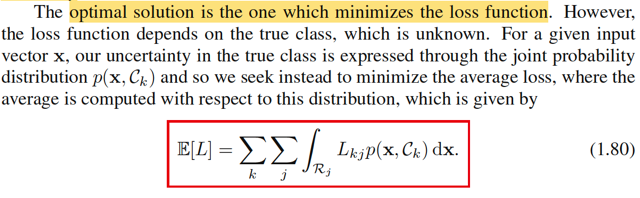</kbd>

<kbd></kbd>

> [!NOTE]
> Từ đó giúp ta hiểu bản chất của cái công thức 1.80: chỉ là Bayes risk trong Casella mà thôi,
>
>
>
> Còn cụ thể **vì sao dạng công thức của 1.80 là như vậy?**
>
>
>
> Phải hiểu thế này: Ta đang tính kì vọng của Loss, hàm nghĩa Loss là một random variable.
>
>
>
> Mà giá trị khả dĩ (possible value) của nó, sẽ dùng cái loss matrix để liệt kê các possible value này. Ví dụ,
>
>
>
> Loss = L12 khi "class thật là 1, phân loại của decision rule là 2", thể hiện toán học của event này: (T = 1, 𝐗 ∈ R2).
>
>
>
> Tượng tự,
>
>
>
> Loss = Lkj khi (T = k, 𝐗 ∈ Rj)
>
>
>
> Nên Loss, là một **DISCRETE** random variable mà được **tạo ra bởi việc áp một hàm số sau đây** lên T, và 𝐗:
>
>
>
> g(t,𝐱) = Lkj (giá trị của matrix loss tại hàng k, cột j) khi T = t, 𝐗 = 𝐱.
>
>
>
> Nói cách khác, ta hãy nhìn loss matrix chính là định nghĩa một hàm số g(t,𝐱):
>
>
>
> i) nhận vào input là t, và 𝐱, nó sẽ hỏi xem:
>
>
>
> t bằng mấy (C1 hay ...CK), ví dụ là Ck
>
>
>
> 𝐱 thuộc R mấy (R1, R2 hay RK), ví dụ bằng Rj
>
>
>
> ii) output ra giá trị hàng Lkj
>
>
>
> Nên hiểu g(t,𝐱) = Lkj là như vậy.
>
>
>
> Khái quát: g(t,𝐱) = Lkj với k là index từ 1,..K sao cho t = Ck, j là index từ 1,..K sao cho 𝐱 ∈ Rj
>
>
>
> Thể hiện theo toán học dùng **indicator function:**
>
>
>
> 𝐈\_(A) = 1 nếu A xảy ra vs 0 nếu A không xảy ra. Bern()
>
>
>
>  𝐈\_(t = Ck), có giá trị = 1 khi t = Ck, = 0 kh t ≠ Ck
>
>
>
> 𝐈\_(𝐱 ∈ Rj), có giá trị = 1 khi 𝐱 ∈ Rj, = 0 khi x không thuộc Rj
>
>
>
> g(t, 𝐱) = Σk=1:K Σj=1:K Lkj 𝐈\_(t = Ck) 𝐈\_(𝐱 ∈ Rj)
>
>
>
> ---
>
>
>
> E\[Loss\] = E\[g(T,𝐗)\]
>
>
>
> E\[X\] = weighted average. x1, x2, x3. E\[X\] = ∫xfX(x)dx
>
>
>
> Y = g(X), EY = ∫g(x)fX(x)dx (theo LOTUS)
>
>
>
> Từ đó giúp ta thấy rõ, việc tính cái kì vọng của cái biến ngẫu nhiên Loss này, đơn giản là dùng LOTUS (2D LOTUS: Z=g(X,Y), EZ = ∫∫g(x,y)f(x,y)dxdy)
>
>
>
> LOSS = g(T,𝐗)
>
>
>
> Vậy thì đây, ta có LOSS, là **biến ngẫu nhiên có được bằng cách áp hàm** g(t,𝐱) lên hai biến ngẫu nhiên T, 𝐗, thì việc tính E\[LOSS\] **cũng theo LOTUS**:
>
>
>
> E\[LOSS\] =∫∫g(t,𝐱)f(t,𝐱)dtd𝐱, nhưng vì T discrete, ta sẽ có công thức tương tự:
>
>
>
> Σ\_{i=1,..,K} ∫g(Ci,𝐱) p(T=Ci,𝐱)d𝐱
>
>
>
> Với g(t, 𝐱) = Σk Σj Lkj 𝐈\_(t = Ck) 𝐈\_(𝐱 ∈ Rj)
>
>
>
> = Σ\_{i=1,..,K} ∫ \[Σk Σj Lkj 𝐈\_(Ci = Ck) 𝐈\_(𝐱 ∈ Rj)\] p(T=Ci, 𝐱) d𝐱
>
>
>
> ---
>
>
>
> Xét Σk Σj Lkj 𝐈\_(Ci = Ck) 𝐈\_(𝐱 ∈ Rj), viết tường minh vài cái cho dễ hiểu:
>
>
>
> Σj L1j 𝐈\_(Ci = C1) 𝐈\_(𝐱 ∈ Rj) + Σj L2j 𝐈\_(Ci = C2) 𝐈\_(𝐱 ∈ Rj) + ... + Σj Lij 𝐈\_(Ci = Ci) 𝐈\_(𝐱 ∈ Rj) + ...
>
>
>
> = 0 + 0 + ..+ Σj Lij 1 × 𝐈\_(𝐱 ∈ Rj) + 0 +..
>
>
>
> = Σj Lij 𝐈\_(𝐱 ∈ Rj)
>
>
>
> Nên Σk Σj Lkj 𝐈\_(Ci = Ck) 𝐈\_(𝐱 ∈ Rj) = Σj Lij 𝐈\_(𝐱 ∈ Rj)
>
>
>
> ---
>
>
>
> Do đó Σ\_{i=1,..,K} ∫ \[Σk Σj Lkj 𝐈\_(Ci = Ck) 𝐈\_(𝐱 ∈ Rj)\] p(T=Ci, 𝐱) d𝐱
>
>
>
> = Σ\_{i=1,..,K} ∫ \[Σj Lij 𝐈\_(𝐱 ∈ Rj)\] p(T=Ci, 𝐱) d𝐱 (1)
>
>
>
> ---
>
>
>
> Tách cái tích phân trên toàn miền thành tổng tích phân các vùng R1,... RK (do decision rule ngầm hiểu sẽ chia không gian thành các partition)
>
>
>
> ∫ \[Σj Lij 𝐈\_(𝐱 ∈ Rj)\] p(T=Ci, 𝐱) d𝐱 = Σn ∫\_Rn \[Σj Lij 𝐈\_(𝐱 ∈ Rj)\] p(T=Ci, 𝐱) d𝐱 (2)
>
>
>
> Viết tường minh vài term cho dễ thấy:
>
>
>
> ∫\_R1 \[Σj Lij 𝐈\_(𝐱 ∈ Rj)\] p(T=Ci, 𝐱) d𝐱 + ∫\_R2 \[Σj Lij 𝐈\_(𝐱 ∈ Rj)\] p(T=Ci, 𝐱) d𝐱  + ..
>
>
>
> term thứ nhất, vì đã xét trong R1, nên cái tổng Σj Lij 𝐈\_(𝐱 ∈ Rj)\] p(T=Ci, 𝐱) sẽ là:
>
>
>
> Li1 𝐈\_(𝐱 ∈ R1)\] p(T=Ci, 𝐱) + Li2 𝐈\_(𝐱 ∈ R2)\] p(T=Ci, 𝐱) + ..
>
>
>
> = Li1 p(T=Ci, 𝐱) + Li2 × 0 × p(T=Ci, 𝐱) + ..
>
>
>
> = Li1 p(T=Ci, 𝐱)
>
>
>
> tương tự term thứ hai chỉ còn Li2 p(T=Ci, 𝐱)
>
>
>
> nên ta có: (2) = Σn ∫\_Rn Lin p(T=Ci, 𝐱) d𝐱
>
>
>
> Và (1) = Σ\_{i=1,..,K} Σn ∫\_Rn Lin p(T=Ci, 𝐱) d𝐱
>
>
>
> ---
>
>
>
> Và và vì i, n chỉ là dummy name, đặt lại tên biến là k, j ta có
>
>
>
> Σ\_{k=1,..,K} Σj ∫\_Rj Lkj p(T=Ck, 𝐱) d𝐱
>
>
>
> Đây chính là 1.80
>
>
>
> Nhờ việc hiểu bản chất Loss là biến ngẫu nhiên define bởi hàm g, thì áp dụng kiến thức LOTUS, giúp ta hiểu vì sao công thức E\[Loss\] lại là như vậy.
>
>
>
> Còn nhờ học Casella, ta hiểu thấu bản chất đây chỉ là Bayes risk mà thôi.

📹 [Xem video trên YouTube](https://www.youtube.com/watch?v=Rdn5CyR1QgI)

> [!TIP]
> 🤖 **AI Check** — 🟢 Pass — ✅ **100/100** · ✓ Move on
>
> Ghi chú xuất sắc! Bạn đã giải thích rất trực quan và chặt chẽ bản chất của công thức 1.80 thông qua LOTUS, hàm chỉ thị (indicator function) và việc phân hoạch không gian quyết định.
>
> **✓ Strengths**
> - Mô hình hóa hàm Loss rất chính xác dưới dạng hàm ngẫu nhiên g(t, x) dùng hàm chỉ thị (indicator function).
> - Áp dụng định lý LOTUS cho biến hỗn hợp (T rời rạc, x liên tục) và chứng minh tường minh từng bước rút gọn tổng kép.
> - Liên hệ sâu sắc và chính xác với khái niệm Bayes risk trong thống kê cổ điển (Casella & Berger).
>
> **💡 Deeper notes**
> - Ký hiệu p(x, Ck) trong Bishop thực chất là hàm mật độ kết hợp (joint density-mass): p(x, Ck) = p(x | Ck) P(Ck). Việc xử lý tích phân theo x và tổng theo Ck như bạn làm là hoàn toàn chính xác theo lý thuyết độ đo.

 

###### Bayes risk và ước lượng Bayes

<kbd>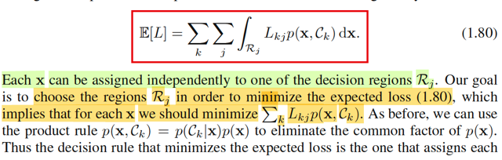</kbd>

> [!NOTE]
> Rồi, thế thì, tiếp theo, mục tiêu sẽ làm giảm cái E[L] này, mà vừa rồi ta đã hiểu bản chất của nó chính là Bayes risks, cũng như vì sao nó có công thức như
> vậy.
>
>
>
> Lại recall liên kết với Casella chút xíu:
>
>
>
> Trong Casella, mình được nghe về khái niệm Bayes risk khi nói về việc đánh giá (evaluate) Bayes estimator của θ: δ^B(𝐗). Như đã ôn lại ở các note
> trước, risk function là function được định nghĩa bằng trung bình của loss function. R(δ(𝐗), θ) = E_θ[L(δ(𝐗), θ], nên với risk function, trước tiên ta cần
> biết đang dùng loss gì (ví dụ squared error hay absolute error). Thế thì, ta cũng nhớ, khi nói về Bayes estimator, điểm quan trọng là hiểu rằng ta đang theo
> trường phái Bayesian, nên coi θ như biến ngẫu nhiên và từ đó đi xây dựng posterior distribution của θ. Và với distribution này, khi cần một point estimator
> cho θ, ta có thể nghĩ đến mean của nó: E[θ|𝐗] Tuy nhiên, chưa chắc nó luôn là mean của posterior. Mà sự thật là: E[θ|𝐗] chỉ là Bayes estimator khiến
> minimize Bayes risk ∫_Θ E_θ[L(δ(𝐗), θ)] π(θ) dθ  với L(δ(𝐗), θ) đang dùng là squared error loss. Còn nếu loss là absolute error thì Bayes estimator khiến minimize
> Bayes risk sẽ là median của posterior.
>
>
>
> Vậy thì ở đây, việc ta đi minimize cái Bayes risk này, hoàn toàn tương ứng với việc ta đi tìm Bayes estimator giúp minimize risk function trong bối cảnh
> Casella. Nói vậy để thấy có sự liên kết giữa Casella và Bishop.
>
>
>
> Rồi, vậy thì như đã nói, khi đặt vấn đề minimize E[L] với công thức 1.80, biến số tối ưu ở đây là: **Cách chia range** 𝐗 ra **thành một phân hoạch**
> (partition): R1,....RK.
>
>
>
> Có nghĩa là, không giống như trong bài toán tối ưu quen thuộc, trong đó ta đi tìm trong các giá trị cho phép của x để có được giá trị x* khiến hàm f(x*) là nhỏ
> nhất
>
>
>
> Thì ở đây ta lại đi tìm trong số các phân hoạch [R1,...RK] (định nghĩa phân hoạch: R1 U R2 U ...Rk = range X và intersection của chúng là tập rỗng) sao cho
> E[L] có giá trị nhỏ nhất
>
>
>
> Mà điều này cũng là vì bản chất là cũng vì, ta đang làm việc với bài toán classification, nơi mà mục tiêu của nó, là tìm được một quy tắc phân loại sao cho
> chính xác nhất, gỉam thiểu được sai lầm phân loại sai. Để rồi cũng y như trong bài toán Hypothesis testing, nơi mà thứ chúng ta tìm kiếm, cũng là một cái
> rule - giúp đưa ra quyết định rằng nên reject hay accept H0 tốt nhất, và cái rule này, cũng được thể hiện bởi việc nó sẽ phân chia range X thành rejection
> region R và acceptance region Rc.
>
>
>
> Nói vậy để thấy, việc ta đụng bài toán tối ưu mà trong đó thứ cần tìm (biến số tối ưu) là một phân hoạch không phải nay mới gặp.
>
>
>
> Quay lại đây ta có bài toán:
>
>
>
> minimize_{phân hoạch R1,...RK} Σk=1:K Σj=1,..K ∫_Rj Lkj f(Ck,𝐱) d𝐱
>
>
>
> Biến đổi objective chút xíu:
>
>
>
> Σk=1:K Σj=1,..K ∫_Rj Lkj f(Ck,𝐱) d𝐱
>
>
>
> Tích phân của tổng = tổng tích phân, bản chất tích phân chỉ là cái tổng, và  với các kí hiệu các tổng của tổng thì cứ thay đổi vị trí thoải mái:
>
>
>
> = Σj=1,..K ∫_Rj Σk=1:K Lkj f(Ck,𝐱) d𝐱
>
>
>
> = Σj=1,..K ∫_Rj  [Σk=1:K Lkj f(Ck,𝐱)] d𝐱
>
>
>
> Đặt hàm gj(𝐱) = Σk=1:K Lkj f(Ck,𝐱), ta sẽ xem xét ý nghĩa của cái cụm này sau.
>
>
>
> = Σj=1,..K ∫_Rj  gj(𝐱) d𝐱
>
>
>
> Dùng **indicator** **function** để chuyển tổng tích phân trên các vùng Rj thành tích phân trên toàn range 𝐗: Ij(𝐱) = I_(𝐱 ∈ Rj), mang giá trị 1 hoặc 0
> tùy vào 𝐱 ∈ Rj hay không
>
>
>
> ⇨..= Σj=1,..K ∫_range_𝐗  Ij(𝐱) gj(𝐱) d𝐱 Đưa nốt tổng j vào tích phân:=  ∫_range_𝐗 Σj=1,..K Ij(x) gj(x) dx  Đến đây viết lại bài toán:Tìm kiếm bộ phân hoạch R1,..RK / cũng là cái decision rule để gán class cho các data point 𝐱 ∈ range 𝐗  sao cho minimize ∫_range_𝐗 Σj=1,..K
> Ij(𝐱) gj(𝐱) d𝐱
>
>
>
> Để dễ hiểu, ta sẽ xem xét ý nghĩa của từng thành phần trong cái objective này:
>
>
>
> i) gj(𝐱) = Σk=1:K Lkj f(𝐱, Ck) là cái gì, ý nghĩa là gì?
>
>
>
> Để thấy cái này là gì, hãy nhớ về định nghĩa của kì vọng, trong Stat110, gs Joe Blizstein dạy ta rằng, bản chất của kì vọng của random variable X, chỉ là GIÁ
> TRỊ TRUNG BÌNH của nó. Ví dụ như nó là một biến rời rạc, có các giá trị khả dĩ x1,x2,...xn với xác suất mà nó (X) mang các giá trị đó quy định bởi P(X=x1),
> P(X=x),...Thì EX chỉ là weighted average - trung bình của X có gắn trọng số bởi xác suất tương ứng: Σi xi P(X=xi)
>
>
>
> Vậy thì ở đây trong công thức trên Lkj là mức phạt quy định khi gán 𝐱 có T = k vào class j
>
>
>
> Và f(𝐱, Ck) về cơ bản cũng có thể tương đương với xác suất mà T = Ck xảy ra.
>
>
>
> Nên Σk=1:K Lkj f(𝐱, Ck) = Σk=1:K [mức phạt khi gán một data point thuộc class Ck vào class j] * [Xác xuất data point thuộc class Ck]
>
>
>
> và nó mang ý nghĩa là **Trung bình mức phạt khi gán data point x vào class Cj**
>
>
>
> Vậy gj(𝐱): mức phạt trung bình khi gán data point x vào class Cj
>
>
>
> -------
>
>
>
> ii) Σj=1:K Ij(𝐱)gj(𝐱) là cái gì:
>
>
>
> triển khai ra, = I1(𝐱)g1(𝐱) + I2(𝐱)g2(𝐱) + ..IK(𝐱)gK(𝐱)
>
>
>
> và nó sẽ có kết quả chỉ là một hạng tử trong đám này. Cái nào thì tùy vào **CÁCH PHÂN LOẠI ĐANG GÁN** 𝐱 **CHO RỔ NÀO TRONG R1,..RK**, ví dụ
> gán x cho R2, thì I2(x) = 1, mấy cái khác = 0 ⇨ tổng này = 1*g2(𝐱) = g2(𝐱)
>
>
>
> Như vậy, nếu gj(𝐱) là **mức phạt trung bình khi gán x vào class Cj**, mang ý nghĩa là: Mức phạt được **QUY ĐỊNH TRONG LUẬT**
>
>
>
> thì Σj=1:K Ij(𝐱) gj(𝐱) là **mức phạt THỰC TẾ, ghi nhận được khi mô hình THỰC HIỆN PHÂN LOẠI MỘT DATA POINT x.**
>
>
>
> iii) Vậy ∫_range_𝐗 Σj=1:K Ij(𝐱)gj(𝐱) là gì?
>
>
>
> Nó CHÍNH LÀ **TỔNG MỨC PHẠT THỰC TẾ**, ghi nhận được khi mô hình **THỰC HIỆN PHÂN LOẠI TOÀN BỘ x TRONG RANGE X**
>
>
>
> VẬY THÌ TỪ ĐÓ DỄ HIỂU RẰNG, **CÁI TỔNG MỨC PHẠT THỰC TẾ TRÊN TOÀN BỘ DỮ LIỆU SẼ NHỎ NHẤT** NẾU **MỨC PHẠT THỰC TẾ TRÊN
> TỪNG ÔNG x LÀ NHỎ NHẤT.**
>
>
>
> Ví dụ tổng mức phạt trên tập range X = {x1, x2, x3} sẽ dĩ nhiên là nhỏ nhất khi mức phạt trên từng ông là nhỏ nhất. Vì mấy ông này đâu có liên quan mẹ gì
> nhau. Nó sẽ chỉ không đúng nếu như: giảm mức phạt của ông x1 lại khiến tăng mức phạt của ông x2 chẳng hạn, thì khi đó, việc giảm mức phạt của từng
> ông mới khiến chưa chắc tổng mức phạt cả đám giảm. Nhưng ở đây thì chúng không liên quan gì nhau.
>
>
>
> Đó là lí do mà ta có thể chuyển bài toán tối ưu minimize ∫rangeX Σj=1:K Ij(𝐱)gj(𝐱) thành minimize Σj=1:K Ij(𝐱)gj(𝐱)
>
>
>
> Và như vậy, kiểu như ta sẽ có vô số bài toán tối ưu, mỗi cái ứng với với mỗi 𝐱:
>
>
>
> minimize Σj=1:K Ij(𝐱)gj(𝐱)
>
>
>
> ⇔ minimize Σj=1:K Ij(𝐱)gj(𝐱)
>
>
>
> = I1(𝐱) g1(𝐱) + ... + IK(𝐱) gK(𝐱)
>
>
>
> Và nên nhớ biến tối ưu là phân hoạch R1,...RK, hay cũng là bộ các hàm I1(𝐱), I2(𝐱),...Ik(𝐱),
>
>
>
> Vì là một phân hoạch nên ràng buộc của chúng là: Chỉ một trong số các indicator function được  phép bằng 1. Ví dụ I1(𝐱) = 1, thì I2(𝐱) = ...IK(𝐱) = 0,
> thể hiện rằng decision rule assign data point x cho class 1.
>
>
>
> Như vậy, đến đây **bài toán trở thành y như đặt vấn đề là**: 
>
>
>
> **TRONG SỐ CÁC HÀM INDICATOR** Ij(𝐱) j = 1...K thì **CHO CÁI NÀO BẰNG 1 ĐỂ RA KẾT QUẢ NHỎ NHẤT**.
>
>
>
> Thì cũng chính là đồng nghĩa với: 
>
>
>
> **CHỌN CÁI NÀO ĐỂ CÓ KẾT QUẢ NHỎ NHẤT TRONG ĐÁM {g1(x),...gK(x)**
>
>
>
> cũng là
>
>
>
> **CHỌN RA CÁI NÀO NHỎ NHẤT TRONG ĐÁM:** **{Σk=1:K Lk1 f(x, Ck), Σk=1:K Lk2 f(x, Ck), ..Σk=1:K LkK f(x, Ck)}**
>
>
>
> **VÀ ĐÓ CHÍNH LÀ Ý CỦA GS BISHOP KHI NÓI WE SHOULD MINIMIZE Σk Lkj p(x, Ck)**
>
>
>
> **trong câu nói "...which implies that for each x we should minimize Σk Lkj p(x, Ck)"**

> [!TIP]
> 🤖 **AI Check** — 🟡 Minor issues — ✅ **92/100** · ✓ Move on
>
> Ghi chú giải thích rất trực quan và chính xác bản chất vì sao bài toán tìm phân hoạch lại quy về bài toán cực tiểu hóa rời rạc tại từng điểm x độc lập.
>
> **🟡 Minor issues**
>
> **1.** *"Và f(𝐱, Ck) về cơ bản cũng có thể tương đương với xác suất mà T = Ck xảy ra. Nên Σk=1:K Lkj f(𝐱, Ck) = Σk=1:K [mức phạt khi gán một data point thuộc class Ck vào class j] * [Xác xuất data point thuộc class Ck] và nó mang ý nghĩa là Trung bình mức phạt khi gán data point x vào class Cj"*
>
> Về mặt toán học, f(x, Ck) (hay p(x, Ck)) là hàm mật độ đồng thời (joint density), không phải xác suất tiên nghiệm p(Ck) hay hậu nghiệm p(Ck|x). Do đó gj(x) thực chất là mức phạt trung bình có điều kiện nhân với p(x), tức gj(x) = p(x) * E[L|x, assign j]. Dù vậy, với mỗi x cố định, p(x) là hằng số dương nên việc cực tiểu hóa gj(x) hoàn toàn tương đương với cực tiểu hóa kỳ vọng tổn thất tại điểm đó.
>
>
> **✓ Strengths**
> - Liên kết xuất sắc khái niệm Bayes risk và decision rule giữa giáo trình Bishop và nền tảng lý thuyết ước lượng/kiểm định trong Casella & Berger.
> - Sử dụng công cụ hàm chỉ thị (indicator function) để chuyển bài toán tích phân trên các miền phân hoạch về dạng tích phân trên toàn không gian rất rõ ràng và mạch lạc.
> - Lập luận thuyết phục vì sao có thể tối ưu điểm (pointwise optimization) độc lập cho từng x để tối ưu hóa tích phân tổng thể.
>
> **💡 Deeper notes**
> - Đoạn tiếp theo trong giáo trình Bishop dùng công thức tích p(x, Ck) = p(Ck|x)p(x) nhằm triệt tiêu thừa số chung p(x), đưa gj(x) về đúng nghĩa là kỳ vọng tổn thất có điều kiện (conditional expected loss) sum_k L_{kj} p(Ck|x).

 

###### Luật quyết định Bayes tối ưu

<kbd>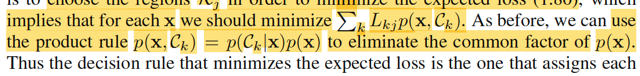</kbd>

<kbd>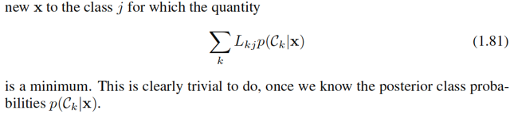</kbd>

> [!NOTE]
> Như vậy đến đây ta đã hiểu là cái optimal decision rule đó là:
>
>
>
> **CHỌN RA CÁI NÀO NHỎ NHẤT TRONG ĐÁM**: {Σk=1:K Lk1 f(x, Ck), Σk=1:K
> Lk2 f(x, Ck), ..Σk=1:K LkK f(x, Ck)} sau đó **LẤY INDEX** ĐỂ GÁN CLASS cho
> data point 𝐱.
>
>
>
> Gọi là j = argmin_{Σk=1:K Lkj f(𝐱, Ck)}, mang ý nghĩa là **trong K cục** Σk=1:K
> Lkj f(x, Ck) j = 1,2..K thì **cục nhỏ nhất ứng với j bằng mấy**
>
>
>
> **Gán data point x cho Cj**, và **làm vậy với mọi x**.
>
>
>
> (ví dụ trong K cục trên, cái thứ 2 là nhỏ nhất, thì j = 2, decision rule tối ưu sẽ
> gán data point vào class 2)
>
>
>
> Thì đó **chính là một phân hoạch / decision rule tạo ra Bayes risk nhỏ nhất**.
>
>
>
> Và vì f(𝐱, Ck) = f(Ck|𝐱)f(𝐱) nên f(x) là như nhau và không âm
>
>
>
> xem trong đám {Σk=1:K Lkj f(𝐱, Ck)} j =1,...K cái nào nhỏ nhất
>
>
>
> thì cũng là xem trong đám {Σk=1:K Lkj f(Ck|𝐱)} j =1,...K cái nào nhỏ nhất
>
>
>
> Tóm lại cái optimal (minimize Bayes risk) decision rule là:
>
>
>
> Với mỗi 𝐱, gán cho nó class Cj với j = argmin Σk=1:K Lkj f(Ck|𝐱)

> [!TIP]
> 🤖 **AI Check** — 🟢 Pass — ✅ **95/100** · ✓ Move on
>
> Ghi chú nắm rất chắc và diễn giải trực quan, chính xác quy tắc quyết định Bayes để tối thiểu hóa tổn thất kỳ vọng (Bayes risk).
>
> **🟡 Minor issues**
>
> **1.** *"j = argmin_{Σk=1:K Lkj f(𝐱, Ck)}"*
>
> Ký hiệu toán học viết dưới argmin nên là biến tối ưu hóa j (tức là argmin_j) thay vì viết toàn bộ biểu thức vào subscript.
>
>
> **✓ Strengths**
> - Hiểu rất rõ bản chất của hàm argmin là tìm chỉ số j tương ứng với tổn thất nhỏ nhất để phân lớp.
> - Giải thích chính xác lý do có thể loại bỏ thành phần chung f(x) (hoặc p(x)) do nó không phụ thuộc vào j và luôn không âm.
>
> **💡 Deeper notes**
> - Trong trường hợp có nhiều hơn một chỉ số j cùng đạt giá trị cực tiểu (tie), về mặt lý thuyết ta có thể chọn ngẫu nhiên một trong các nhãn đó mà không làm thay đổi rủi ro Bayes.

**🔗 See also:** [K-Nearest Neighbor Classification](./252_nearest_neighbour_methods.md#node-mtmr0qc)

 

###### Tuỳ chọn từ chối

<kbd>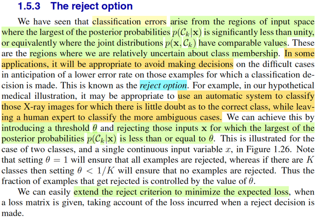</kbd>

<kbd>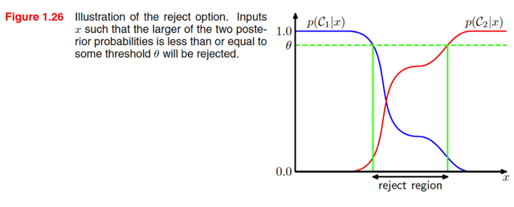</kbd>

> [!NOTE]
> Đại ý là, như ta đã thấy vừa rồi, cái decision rule / hay classifier tối ưu xét theo
> tiêu chí giảm thiểu Bayes risk là cái mà ta assign class Ck cho data point 𝐱
> với k = argmin_j [trung bình loss khi assign class j cho **x,** = Σk Lkj f(Ck|𝐱)]
>
>
>
> Nếu các mức penalty cho các loại error đều cho bằng nhau = 1 Lkj = 1 với mọi k
> khác j và bằng 0 khi k = j thì decision rule nói trên trở thành:
>
>
>
> Khi đó, gj(x) = Σk=1:K Lkj f(Ck|𝐱) = Σk≠j f(Ck|𝐱) = 1 - f(Cj|𝐱) (do Σk
> f(Ck|𝐱) = 1)
>
>
>
> ⇨ rule trở thành:
>
>
>
> Assign Ck cho 𝐱, với k = argmin_j [1 - f(Cj|𝐱)]
>
>
>
> cũng là k = argmax_j [f(Cj|𝐱) - 1]
>
>
>
> = argmax_j f(Cj|𝐱)
>
>
>
> có ngghĩa là trở thành cái rule mà giúp giảm misclassification error (không coi
> trọng loại error nào hơn cái nào): gán class nào thì dựa vào posterior f(t|x) nào
> lớn nhất
>
>
>
> Tuy vậy, không có gì chắc đây là rule tuyệt đối đúng.
>
>
>
> Có nghĩa là, cái Ck với k = argmax_j f(Cj|𝐱) không có gì đảm bảo chính là
> class thật sự của 𝐱.
>
>
>
> Do đó, vẫn có thể có misclassification error.
>
>
>
> Và nó xảy ra khi: ví dụ với **x1,** posterior f(C2|𝐱) là cao nhất, nhưng nó
> không vượt trội, để rồi, f(C1|𝐱) cũng ko nhỏ. Và sự thật thì C1 mới là class
> đúng.
>
>
>
> Nên lúc này, khi f(C2|𝐱) và f(C1|𝐱) xem xem nhau, tuy f(C2|𝐱) là lớn nhất. Và
> cũng đồng nghĩa là f(C2|𝐱) cách khá xa mức tuyệt đối (=1, gs Bishop gọi là
> unity).
>
>
>
> Và đây là khi misclassification error có thể xảy ra.
>
>
>
> Nói chung là, ta chỉ có thể đảm bảo misclassification error không xảy ra khi
> f(C2|𝐱) = 1, để rồi assign class C2 cho data point x thì sẽ đảm bảo chính xác.
> Tuy nhiên chỉ cần f(C2|𝐱) < 1, thì đồng nghĩa vẫn có xác suất class đúng là class
> khác chứ ko phải C2.
>
>
>
> Thành ra, ta có thể đưa ra option thứ 3: (giả sử đang dự đoán giữa hai class C1
> vs C2) là: Không biết - Từ chối đoán - bằng cách sau khi tính posterior của các
> class thì không dựa vào việc cái nào có lớn nhất để đưa ra phân loại ngay lập
> tức, mà xem posterior có lớn hơn một cái threshold (α, hay trong sách là θ) hay
> không, ví dụ, chỉ kết luận nếu posterior lớn nhất lớn hơn 80%. Còn không thì
> đưa ra option: Từ chối phân loại, ko biết, mời bạn đoán.
>
>
>
> Tương tự, ta cũng có thể làm vậy bài toán có loss matrix (ý là có ưu tiên loại
> error này hơn error kia)

 

###### Lựa chọn từ chối phân loại

<kbd>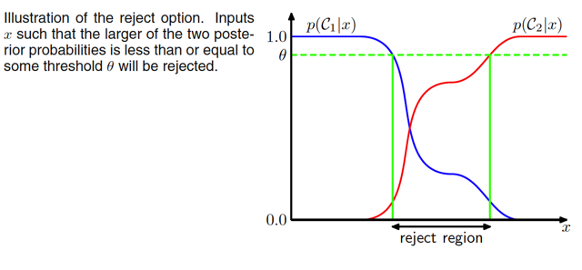</kbd>

> [!NOTE]
> HÌnh minh họa cho thấy vùng giữa hai đường xanh lá, nơi đó posterior tại  hai class
> (ý là f(t|x)|t=C1 và f(t|x)|t=C2)  có giá trị khác biệt không lớn. Và ta sẽ từ chối đưa ra
> quyết định phân loại

> [!TIP]
> 🤖 **AI Check** — 🟢 Pass — ✅ **90/100** · ✓ Move on
>
> Ghi chú nắm rất đúng trực quan của vùng từ chối (reject region) trong bài toán phân loại 2 lớp. Để chặt chẽ hơn và tổng quát cho nhiều lớp, nên diễn đạt theo điều kiện xác suất hậu nghiệm lớn nhất nhỏ hơn hoặc bằng ngưỡng theta.
>
> **🟡 Minor issues**
>
> **1.** *"nơi đó posterior tại  hai class (ý là f(t|x)|t=C1 và f(t|x)|t=C2)  có giá trị khác biệt không lớn"*
>
> Định nghĩa chuẩn của reject option là max_k p(C_k|x) <= theta. Trong bài toán 2 lớp thì điều này tương đương với việc hai xác suất chênh lệch không nhiều, nhưng khi mở rộng ra K > 2 lớp thì tiêu chuẩn so sánh trực tiếp max posterior với ngưỡng theta là cách biểu diễn chuẩn xác nhất.
>
>
> **✓ Strengths**
> - Hiểu đúng bản chất của reject option: từ chối phân loại khi mô hình không đủ tự tin (các xác suất hậu nghiệm gần nhau).
> - Xác định chính xác vùng từ chối nằm giữa hai đường giới hạn màu xanh lá trên đồ thị.
>
> **💡 Deeper notes**
> - Với bài toán 2 lớp, do tổng hai xác suất hậu nghiệm bằng 1, điều kiện max(p(C1|x), p(C2|x)) <= theta (với theta >= 0.5) tương đương với |p(C1|x) - p(C2|x)| <= 2*theta - 1. Nếu đặt theta = 1 thì toàn bộ không gian bị từ chối; nếu theta = 0.5 thì không có điểm nào bị từ chối.
> - Ký hiệu chuẩn trong sách thường là p(C_k|x) thay vì viết điều kiện hóa dạng f(t|x)|t=C_k.

 

###### Inference và Decision

<kbd>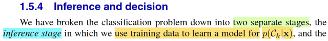</kbd>

<kbd>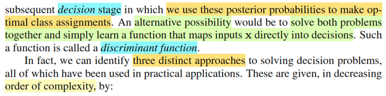</kbd>

> [!NOTE]
> Đại khái gs nói là bữa giờ ta đang tiếp cận bài toán classification theo hai
> bước: bước một là dựa trên data, đi xây dựng posterior distribution f(t|𝐱)
> (trong sách là p(Ck|𝐱)), đây chính là bước gọi là inference state
>
>
>
> (liên hệ với Statistical Inference - Casella,  bài toán inference là bài toán đi
> xây dựng một suy đoán về tham số của population distribution, có thể là một
> point estimator W(𝐗) để estimate giá trị của θ, hypothesis test  để đưa ra
> suy đoán về θ nằm ở Θ0 hay Θ0c, hoặc một interval estimator C(𝐗) để
> estimate một khoảng / một set mà có thể chứa θ, thì nói chung, ta hiểu
> inference là việc ta muốn suy đoán về sự thật của phân phối xác suất chi
> phối dữ liệu quan sát thấy)
>
>
>
> Sau đó, ta mới dựa trên posterior để thông qua decision theory giúp đưa ra
> prediction, đây gọi là decision stage.
>
>
>
> Thế thì, ông cho biết, có một cách làm khác, không cần chia ra hai bước,
> mà làm luôn trong một lần: vừa "học" ra / suy luận / inference posterior
> và vừa đưa ra dự đoán luôn, thông qua hình thức là học một function map
> giữa input và decision, gọi là DISCRIMINANT function**.**
>
>
>
> Dừng lại chút, mình vừa hiểu ra một việc: Lấy ví dụ một neural network,
> hay deep learning model, thì bằng cách training một mapping function
> giữa ảnh đầu vào và phân loại ảnh đầu ra, mình có thể hiểu bên trong nó
> đang làm hai việc cùng lúc: học ra posterior distribution và thực hiện
> decision. Nhưng có những loại khác, nó ko tìm cách học posterior, mà
> chỉ học luôn cái mapping function, gọi là discriminant function nói trên.
> Hay, ví dụ như mình đã từng học về VAE trong cs231n cũng vậy, encoder
> là cái khúc nó sẽ học ra posterior distribution, và decoder là một mô hình
> đóng vai trò sampling từ posterior distribution đó.

> [!TIP]
> 🤖 **AI Check** — 🟡 Minor issues — ⚠️ **85/100** · ✓ Move on
>
> Ghi chú nắm rất tốt bản chất của hai giai đoạn (inference và decision) cũng như liên hệ sâu sắc với thống kê cổ điển. Có một vài điểm chưa hoàn toàn chuẩn xác khi mô tả cách hoạt động của discriminant function và ví dụ về Neural Network/VAE, nhưng tư duy tổng thể rất đúng hướng.
>
> **🟡 Minor issues**
>
> **1.** *"vừa "học" ra / suy luận / inference posterior và vừa đưa ra dự đoán luôn, thông qua hình thức là học một function map giữa input và decision, gọi là DISCRIMINANT function"*
>
> Cụm 'solve both problems together' của Bishop không có nghĩa là hàm này vừa suy ra posterior vừa ra quyết định, mà là nó bỏ qua hoàn toàn bước tính xác suất posterior (probabilities play no role) để đi thẳng từ x sang quyết định/nhãn (dù bạn đã phần nào tự chỉnh lại ý này ở đoạn sau).
>
> **2.** *"Lấy ví dụ một neural network, hay deep learning model, thì bằng cách training một mapping function giữa ảnh đầu vào và phân loại ảnh đầu ra, mình có thể hiểu bên trong nó đang làm hai việc cùng lúc: học ra posterior distribution và thực hiện decision."*
>
> Mạng nơ-ron phân loại thông thường (với tầng cuối là softmax và tối ưu cross-entropy) thực chất thuộc hướng tiếp cận số 2: mô hình hóa trực tiếp xác suất hậu nghiệm p(Ck|x), sau đó bước chọn argmax mới là decision stage; chứ bản thân mạng không phải là thuần discriminant function không qua xác suất (như SVM hay Perceptron).
>
>
> **✓ Strengths**
> - Phân biệt rất rõ ràng hai giai đoạn inference (học phân phối posterior) và decision (ra quyết định tối ưu dựa trên posterior).
> - Có liên hệ rất hay và chính xác với lý thuyết suy diễn thống kê (Statistical Inference của Casella) về bản chất của bước inference.
> - Tự phát hiện và phân biệt được sự khác nhau giữa mô hình có ước lượng posterior và mô hình map trực tiếp sang quyết định (discriminant function).
>
> **💡 Deeper notes**
> - Bishop chia thành 3 hướng tiếp cận cụ thể ở phần sau: (1) Generative models: mô hình hóa p(x|Ck) và p(Ck) rồi dùng Bayes để tìm p(Ck|x); (2) Discriminative models: mô hình hóa trực tiếp p(Ck|x); (3) Discriminant function: map trực tiếp x ra nhãn không dùng xác suất.
> - Ví dụ về VAE ở cuối note thuộc về mô hình sinh có biến ẩn (latent variable model), trong đó encoder xấp xỉ posterior q(z|x) của biến ẩn z, hơi khác ngữ cảnh bài toán phân lớp (classification posterior p(Ck|x)) đang xét trong mục 1.5.4.

 

###### Mô hình Generative

<kbd>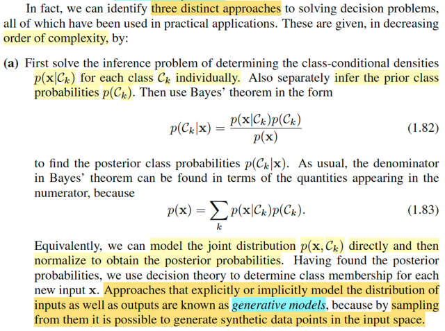</kbd>

> [!NOTE]
> Có ba cách tiếp cận cho bài toán decision (tạm hiểu là classification). 
>
>
>
> Loại thứ nhất: Đầu tiên, ta giải bài toán inference: 
>
>
>
> Học / xây dựng f(𝐱|t) với từng possible value của t: C1,...CK. (tức là
> theo kí hiệu của gs Bishop: p(𝐱|Ck).
>
>
>
> Học / xây dựng f(𝐭).
>
>
>
> Dùng Bayes theorem, chuyển nó thành posterior của T:
>
>
>
> f(t|𝐱) = f(𝐱|t) f(t) / f(𝐱).
>
>
>
> Với f(𝐱) có thể dùng LOTP để tách thành:
>
>
>
> Σ{mọi possible value của t} f(𝐱, t)
>
>
>
> = Σ{mọi possible value của t} f(𝐱|t)f(t)
>
>
>
> Từ đó, ta có giá trị của f(t|x) với mỗi giá trị của {C1,...CK} của t
>
>
>
> Và cho phép ta dùng decision theory như đã biết để make decision.
>
>
>
> Mình có thể nhận ra đây chính là Naive Bayes
>
>
>
> Gs cho biết những cách tiếp cận mà trong đó ta thực hiện bước suy luận về
> **distribution của input và** output, tức là học ra f(t, 𝐱) thì gọi là **generative** model.
> Vì, nếu ta có distribution của input, ta có thể thực hiện sampling từ đó,
> để có thể có một dạng dữ liệu synthetic (ý là ví dụ như ảnh do ta tạo ra, 
> không phải ảnh chụp ở ngoài đời thật, ví dụ mấy mô hình tảo ảnh hiện nay
> như diffusion model)

> [!TIP]
> 🤖 **AI Check** — 🟡 Minor issues — ✅ **90/100** · ✓ Move on
>
> Ghi chú nắm rất tốt bản chất của mô hình sinh (generative model) từ việc mô hình hóa phân phối đồng thời, áp dụng định lý Bayes đến khả năng sinh dữ liệu mẫu. Điểm cần lưu ý duy nhất là việc đồng nhất toàn bộ cách tiếp cận này với Naive Bayes.
>
> **🟡 Minor issues**
>
> **1.** *"Mình có thể nhận ra đây chính là Naive Bayes"*
>
> Naive Bayes chỉ là một trường hợp đặc biệt cụ thể của mô hình sinh (với giả định độc lập có điều kiện giữa các đặc trưng: $p(\mathbf{x}|C_k) = \prod p(x_i|C_k)$). Khung lý thuyết mà GS. Bishop mô tả ở đây là cách tiếp cận tổng quát của toàn bộ họ mô hình sinh (Generative Models/Generative Classifiers), bao gồm cả LDA, QDA, Gaussian Mixture Models,... chứ không chỉ riêng Naive Bayes.
>
>
> **✓ Strengths**
> - Hiểu chính xác quy trình suy diễn (inference) và ra quyết định (decision) thông qua định lý Bayes và luật xác suất toàn phần (LOTP).
> - Nắm bắt chuẩn xác trực giác vì sao gọi là mô hình sinh: mô hình hóa cả phân phối của input giúp ta có thể lấy mẫu (sampling) để tạo dữ liệu nhân tạo (synthetic data).
>
> **💡 Deeper notes**
> - Để sinh dữ liệu tổng hợp $(\mathbf{x}, t)$ từ mô hình sinh, quy trình lấy mẫu cụ thể là: đầu tiên lấy mẫu nhãn lớp $C_k \sim p(C_k)$, sau đó lấy mẫu vector đặc trưng $\mathbf{x} \sim p(\mathbf{x}|C_k)$.

 

###### Mô hình phân biệt

<kbd>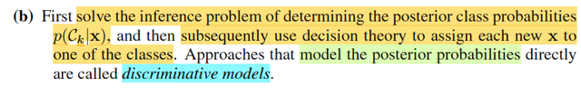</kbd>

> [!NOTE]
> Cách tiếp cận thứ hai, là inference ra trực tiếp posterior f(t|𝐱) và sau đó thì
> dùng nó để make decision. 
>
>
>
> Nó khác cái trước ở chỗ, ta không cần học ra f(𝐱|t) f(t). Mà chỉ học thẳng
> ra f(t|𝐱) thôi.
>
>
>
> Cái này như bữa giờ đang làm, gọi là discriminative models

> [!TIP]
> 🤖 **AI Check** — 🟢 Pass — ✅ **100/100** · ✓ Move on
>
> Ghi chú nắm rất chính xác và súc tích bản chất của mô hình phân biệt (discriminative models): mô hình hóa trực tiếp xác suất hậu nghiệm mà không cần thông qua phân phối tiên nghiệm và khả năng (likelihood), sau đó áp dụng lý thuyết quyết định.
>
> **✓ Strengths**
> - Hiểu đúng quy trình hai giai đoạn: giải bài toán suy diễn tìm xác suất hậu nghiệm trước, sau đó dùng nó để ra quyết định.
> - Phân biệt chuẩn xác sự khác biệt giữa discriminative model (học trực tiếp posterior) và generative model (học thông qua likelihood và prior).
>
> **💡 Deeper notes**
> - Thuật ngữ 'inference' trong giáo trình (PRML) dùng để chỉ giai đoạn tính toán xác suất hậu nghiệm cho mẫu mới sau khi đã học xong mô hình; việc học trực tiếp hàm tham số cho xác suất hậu nghiệm được gọi là mô hình hóa trực tiếp (modeling directly).

 

###### Hàm phân biệt

<kbd>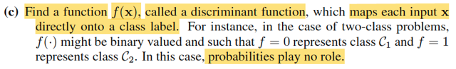</kbd>

> [!NOTE]
> Và cuốn cùng là discriminant function như nãy nói. Cái này nó ko cần học
> phân phối xác suất gì hết, nó chỉ là tìm ra cái mapping function giữa t và x.
> t = f(x). Xác suất ko có vai trò gì hết

> [!TIP]
> 🤖 **AI Check** — 🟢 Pass — ✅ **100/100** · ✓ Move on
>
> Ghi chú đã tóm tắt rất chính xác và súc tích bản chất của hàm phân biệt (discriminant function) theo đúng tài liệu tham khảo.
>
> **✓ Strengths**
> - Hiểu chính xác bản chất hàm phân biệt là ánh xạ trực tiếp từ đầu vào x sang nhãn lớp t mà không cần mô hình hóa hay tính toán xác suất.
> - Bám sát đúng ý cốt lõi 'probabilities play no role' trong tài liệu tham khảo.
>
> **💡 Deeper notes**
> - Dù phương pháp này trực tiếp và không dùng xác suất, nhưng nhược điểm của nó là không cung cấp độ tin cậy (uncertainty/posterior probabilities) cho dự đoán và khó kết hợp chi phí rủi ro (loss matrix) linh hoạt như các phương pháp sinh (generative) hay phân biệt dựa trên xác suất (probabilistic discriminative).

 

###### Ưu điểm Cách 1: Phát hiện bất thường

<kbd>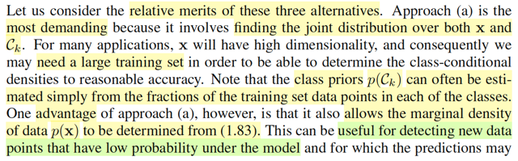</kbd>

<kbd>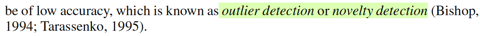</kbd>

> [!NOTE]
> Bàn một chút về ưu nhược diểm của 3 cách làm này.
>
>
>
> Cách đầu tiên, đại khái là vì ta dù implicitly hay explicitly (tường minh hoặc
> ngầm định) xây dựng joint distribution f(t,𝐱) (vì infer f(𝐱|t), f(t) thì cũng là
> xây f(𝐱,t)) thì đều cần nhiều data.
>
>
>
> Ưu điểm là, ta có thể có f(𝐱) (bằng cách marginalizing f(𝐱, t) over range T
> và cái này, là prior distribution của x. Do đó có thể dùng nó để tính  xác suất
> của một input. Và áp dụng vào bài toán phát hiện bất thường.
>
>
>
> Nói rõ hơn tí, thì đại ý là: ví dụ trong bài toán phân loại ảnh, thì input x, là
> ảnh, t là phân loại (class), thì ý nghĩa của f(𝐱) là hàm xác suất của ảnh,
> công dụng là, bỏ vào một 𝐱 - vector đại diện của một ảnh, nó sẽ cho biết xác
> suất là cao hay thấp. Vậy ta có thể dùng nó như một hàm check để phát
> hiện khi nào thì ta có một x có xác suất thấp → thì đó chính là một tấm ảnh
> có sự bất thường gọi là outlier

> [!TIP]
> 🤖 **AI Check** — 🟡 Minor issues — ✅ **90/100** · ✓ Move on
>
> Ghi chú nắm rất tốt ý cốt lõi về ưu/nhược điểm của mô hình sinh (generative approach) và ứng dụng của phân phối biên duyên trong việc phát hiện dị biệt (outlier detection). Có một chút nhầm lẫn nhỏ về thuật ngữ khi gọi p(x) là 'prior distribution'.
>
> **🟡 Minor issues**
>
> **1.** *"và cái này, là prior distribution của x"*
>
> Trong ngữ cảnh này, p(x) là 'marginal density' (mật độ biên duyên) hoặc 'evidence', không nên gọi là prior distribution của x. Thuật ngữ 'prior' thường dùng để chỉ phân phối tiên nghiệm của nhãn/lớp p(C_k) hoặc tham số.
>
> **2.** *"ý nghĩa của f(𝐱) là hàm xác suất của ảnh"*
>
> Với biến liên tục nhiều chiều x (như vector ảnh), f(x) là hàm mật độ xác suất (probability density function), giá trị f(x) là mật độ xác suất chứ không phải xác suất trực tiếp.
>
>
> **✓ Strengths**
> - Hiểu chính xác lý do phương pháp mô hình hóa phân phối đồng thời yêu cầu nhiều dữ liệu huấn luyện do số chiều của x lớn.
> - Nắm bắt rất trực quan và chính xác cơ chế dùng p(x) biên duyên để phát hiện điểm dị biệt (outlier/novelty detection).
>
> **💡 Deeper notes**
> - Công thức xác định p(x) từ phân phối đồng thời trong bài toán phân loại rời rạc là tổng biên duyên trên các lớp: p(x) = sum_k p(x, C_k) = sum_k p(x|C_k)p(C_k).
> - Khi p(x) rất thấp, không chỉ điểm dữ liệu đó là bất thường/mới lạ mà các dự đoán phân loại (predictions) đối với điểm đó thường cũng sẽ có độ tin cậy và độ chính xác thấp.

 

###### Hiệu quả phương pháp phân loại

<kbd>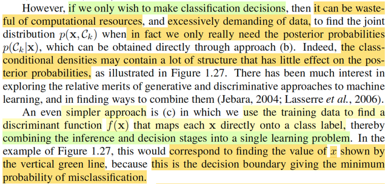</kbd>

<kbd>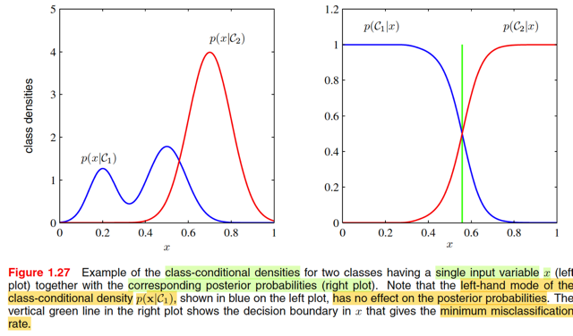</kbd>

> [!NOTE]
> Tuy nhiên, nếu như ta chỉ muốn làm bài toán classification thì việc học ra joint 
> distribution f(𝐱, t) là quá lãng phí. Vì như đã biết, cũng như trong cách b, 
> để phân loại, ta chỉ cần dựa trên posterior f(t|𝐱). 
>
>
>
> Nên sẽ ít tốn kém hơn nếu ta học trực tiếp hàm posterior thay vì đi tìm f(𝐱, t)
> rồi mới dùng để có posterior.
>
>
>
> Ông nó nói cái ý, f(𝐱|t) với t = C1,...CK có những cấu trúc ít ảnh hưởng đến 
> posterior, thì ý là do đó việc làm theo cách a) để tiếp cận bài toán classification
> là không mang lại lợi ích gì cả.
>
>
>
> Ví dụ như trong minh họa bài toán có 2 class C1, C2 và input 1D x này.
>
>
>
> Đồ thị của f(x|C1) và f(x|C2) ở bên trái cho thấy có các đỉnh.
>
>
>
> Nhưng đồ thị của posterior f(C1|x), f(C2|x) thì lại chẳng phản ánh gì tương
> ứng tại các đỉnh này. Đó là ý gs Bishop nói những structure của class
> conditional density chả có đóng góp gì cho posterior cả.
>
>
>
> Còn cái cách (c), thì chả cần posterior gì, chỉ là học cái mapping function
> nhận vào x, nhả ra C1 hay C2...
>
>
>
> MInh họa trong hình gs nói, nó sẽ tương ứng với việc ta tìm cách học ra
> function: f(x) sau đây: f(x) = C1 nếu x < c, và C2 nếu x > c với c là cái điểm
> ứng với đường màu xanh lá, chính là nơi mà nếu dùng nó để assign class,
> ta sẽ minimize misclassification rate

 

###### Lợi ích của Posterior

<kbd>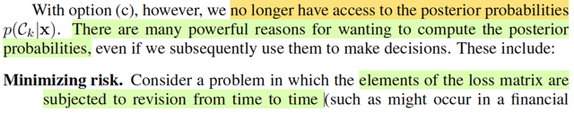</kbd>

<kbd>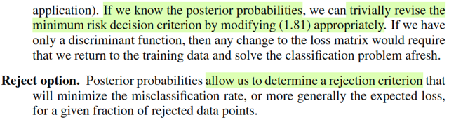</kbd>

> [!NOTE]
> Với c, tuy vậy, ta sẽ ko có posterior,  mà cái này thì rất hữu dụng.
>
>
>
> Ví dụ, ví dụ như bài toán mấy bữa nay làm, khi ta define ra cái loss matrix
> quy định mức phạt khác nhau cho các loại error khác nhau. Nếu ta làm
> theo cách làm bữa trước, thì khi muốn thay đổi loss matrix, thì chỉ việc thay
> đổi, cái posterior sẽ được cập nhật theo rất đơn giản (trivially). Còn nếu ta
> làm theo cách c, ta phải train lại từ đầu (afresh)
>
>
>
> Hơn nữa, posterior sẽ giúp ta có thể reject, ko đưa ra quyết định khi cảm
> thấy ko chắc

> [!TIP]
> 🤖 **AI Check** — 🟡 Minor issues — ⚠️ **88/100** · ✓ Move on
>
> Ghi chú nắm rất tốt ý nghĩa cốt lõi của việc tính xác suất hậu nghiệm (posterior) so với hàm phân biệt (discriminant function). Tuy nhiên, cần lưu ý chính xác rằng khi ma trận tổn thất thay đổi, bản thân posterior không thay đổi mà là tiêu chí ra quyết định được cập nhật lại.
>
> **🟡 Minor issues**
>
> **1.** *"cái posterior sẽ được cập nhật theo rất đơn giản (trivially)"*
>
> Về mặt bản chất, xác suất hậu nghiệm p(C_k|x) không phụ thuộc vào ma trận tổn thất (loss matrix) nên không bị thay đổi hay cần cập nhật. Thứ được cập nhật một cách đơn giản (trivially) chính là tiêu chí/quy tắc ra quyết định giảm thiểu rủi ro (decision criterion/minimum risk rule) dựa trên công thức tổn thất kỳ vọng.
>
>
> **✓ Strengths**
> - Hiểu đúng sự tương phản cốt lõi: dùng posterior cho phép linh hoạt đổi ma trận tổn thất mà không phải huấn luyện lại từ đầu (afresh) như cách dùng hàm phân biệt (option c).
> - Nêu chính xác vai trò của posterior trong việc xác định ngưỡng từ chối (reject option) khi độ tin cậy thấp.
>
> **💡 Deeper notes**
> - Lợi ích cốt lõi ở đây xuất phát từ việc tách rời hai giai đoạn: suy diễn (inference - tính posterior) và ra quyết định (decision - kết hợp posterior với loss matrix). Do hai giai đoạn độc lập, sự thay đổi của hàm mất mát/ma trận phạt ở giai đoạn quyết định hoàn toàn không ảnh hưởng đến kết quả suy diễn đã học trước đó.

 

###### Điều chỉnh phân phối hậu nghiệm

<kbd>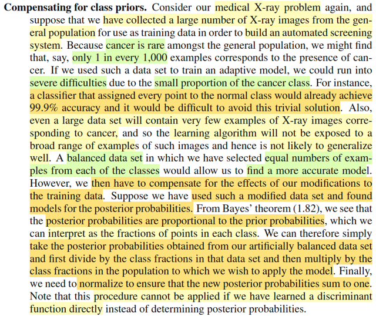</kbd>

> [!NOTE]
> Rồi đoạn này nói về một ý nữa mà việc dùng posterior sẽ mang lại lợi ích
> mà  cách làm (c) ko có:
>
>
>
> Ví dụ như trong bài toán phân loại cancer hay ko cancer từ ảnh chụp X
> quang mà ta đang làm bữa giờ. thì có có vấn đề này (là cái mà mr Andrew
> Ng đã nói trong MLSpec: **Skewed dataset**). Trong thực tế, số ca cancer là ít
> hơn nhiều so với không cancer (này nói ở đâu chứ ko phải Việt Nam). Nên
> dễ hiểu là giả sử tỉ lệ cancel trong dân số chỉ là 0.1%, thì một cái mô hình
> tào lao nhận vào input x và luôn trả ra là ko cancer, sẽ vẫn có thể có kết
> quả chính xác rất cao.
>
>
>
> Rồi, và vì số ca cancer ít, nên x-ray cancer cũng ít hơn x-ray ko cancer,
> nên nếu dùng chúng để training mô hình thì có thể sẽ không hiệu quả. Khi
> đó ta có thể tạo một dataset cân bằng hơn giữa có và không cancer.
>
>
>
> Nhưng vấn đề là, posterior, f(t|𝐱) theo bayes rule = f(𝐱|t)f(t)/f(𝐱), nên dễ thấy
> nó sẽ tỉ lệ thuận với f(t) - tức priori.
>
>
>
> Thành ra, một khi mà ta đã "chỉnh sửa": bằng cách tạo dataset cân bằng
> hơn, ta đã thay đởi prior distribution.
>
>
>
> Do đó, cách làm là, sau khi dùng data cân bằng để học ra posterior, ta  sẽ
> lấy cái posterior scale lại với tỉ lệ của prior, và normalizing lại. Vầy nè:
>
>
>
> Giải sử có C1, C2, Trong đó f(C1) = 0.9 f(C2) = 0.1 (tức hàm ý, 10 người
> thì 9 ca ko cancer, 1 người có cancer)
>
>
>
> sau khi dùng một dataset cân bằng (50% là hình có cancer, 50% là hình
> không cancer) để train ra posterior f(t|𝐱)
>
>
>
> Ta sẽ điều chỉnh lại:
>
>
>
> f^(C1|𝐱) = f(C1|𝐱) * 0.9/c
>
>
>
> và
>
>
>
> f^(C2|𝐱) =  f(C2|𝐱) * 0.1/c
>
>
>
> với c là normalizing constant giúp f^(C1|𝐱) + f^(C2|𝐱) = 1
>
>
>
> như vậy lúc này posterior sau điều chỉnh đã phản ánh lại được tỉ lệ mắc
> bệnh / không mắc bệnh của prior.
>
>
>
> Nên cái này gọi là Đền bù (compensate) lại class prior
>
>
>
> Mấu chốt là, nếu làm theo (c) ta sẽ ko làm vậy được

 

###### Naive Bayes và độc lập điều kiện

<kbd>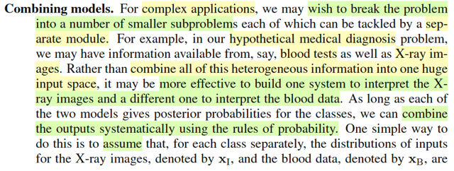</kbd>

<kbd>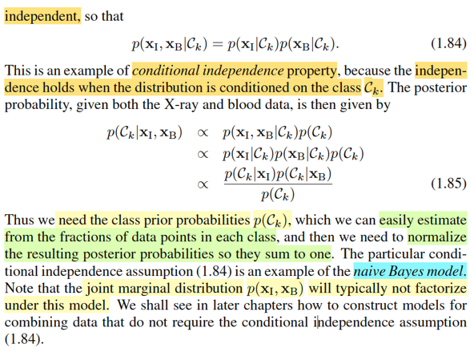</kbd>

> [!NOTE]
> Đại ý là, một công dụng nữa của cách tiếp cận posterior là ta giải quyết một bài
> toán phức tạp bằng cách tách nó ra thành các bài toán đơn  gỉan hơn.
>
>
>
> Ví dụ: Dự đoán bệnh cancer hay không dựa trên ảnh X-quang và kết  quả xét
> nghiệm máu. Khi đó ta muốn xây dựng posterior: f(t|𝐱I, 𝐱B)  distribution
> của T dựa trên vector X-ray image 𝐱I, và kết quả xét nghiệm máu 𝐱B
>
>
>
> thì đại khái là, bằng cách đặt assumption rằng f(𝐱I,𝐱B|Ck) =
> f(𝐱I|Ck)f(𝐱B|Ck) ta sẽ dựa trên Bayes rule như thường lệ để xây dựng
> posterior:
>
>
>
> f(t|**xI**,**xB**) = f(**xI**,**xB**|Ck)f(Ck)/f(**xI**,**xB**)
>
>
>
> ∝ f(**xI**,**xB**|Ck)f(Ck)
>
>
>
> ∝ f(**xI**|Ck)f(**xB**|Ck)f(Ck)
>
>
>
> ∝ [f(Ck|**xI**)f**(xI**)/f(Ck)] [f(Ck|**xB**)f(**xB**)/f(Ck)] f(Ck) | dùng Bayes rule với f(xI|Ck),
> f(xB|Ck)
>
>
>
> ∝ f(Ck|**xI**) f(**xI**) f(Ck|**xB**) f(**xB**) / f(Ck)
>
>
>
> ∝ f(Ck|**xI**) f(Ck|**xB**) / f(Ck) | bỏ f(**xI**), f(**xB**) là constant
>
>
>
> f(Ck), prior của T thì có thể xấp xỉ bằng cách dùng tỉ lệ class Ck trong data.
>
>
>
> Như vậy là ta đã có thể có f(t|**xB**,**xI**). Đây chính là Naive Bayes. 
>
>
>
> Nói nó Naive
> (ngây thơ) là vì, ta đang giả định là dựa trên T = Ck thì 𝐗_image và 𝐗_blood
> độc lập. Nhưng sự thật đâu phải vậy, ví dụ, nếu đã biết là Ck rồi, thì việc biết
> ảnh **X_image** có thể đoán được chỉ số máu **X_blood**

 

###### Loss functions for regression

<kbd>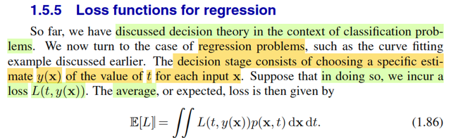</kbd>

> [!NOTE]
> Chuyển qua bài toán decision theory trong regression. Trong đó, ta đưa ra dự đóan t = y(𝐱) cho mỗi input 𝐱, mỗi một dự đoán như vậy, tạo ra loss L(t, y(𝐱)). Và average loss E\[L\] theo công thức 1.86. Vì sao?
>
>
>
> Đơn giản, L(𝐭, y(𝐱)) là hàm, nên Loss = L(𝐓, y(𝐗)) là random variable tạo ra bởi việc áp một hàm số lên hai random variable T, 𝐗. Và như đã học ở Stat110, Casella, 2D LOTUS cho phép ta tính EZ = g(X, Y) dựa theo joint pdf/pmf f(x,y) của X, Y:
>
>
>
> EZ = Eg(X,Y) = ∫∫g(x,y)f(x,y)dxdy
>
>
>
> Vậy thì đây cũng vậy, LOTUS cho phép tính EL dựa theo joint distribution của T, 𝐗
>
>
>
> E\[L\] = ∫∫L(t, y(𝐱)) f(t,𝐱) d𝐱 dt

> [!TIP]
> 🤖 **AI Check** — 🟢 Pass — ✅ **98/100** · ✓ Move on
>
> Ghi chú giải thích rất xuất sắc và chính xác bản chất xác suất của công thức kỳ vọng hàm mất mát thông qua định lý LOTUS.
>
> **✓ Strengths**
> - Liên hệ chính xác việc tính kỳ vọng hàm mất mát E[L] với định lý LOTUS (Law of the Unconscious Statistician) từ xác suất thống kê.
> - Hiểu rõ loss là một biến ngẫu nhiên được tạo thành từ hàm số áp lên hai biến ngẫu nhiên đầu vào và nhãn (X, T).
>
> **💡 Deeper notes**
> - Trong thiết lập hồi quy chuẩn của mục này, t thường là biến vô hướng (scalar target), trong khi x là vector (dù LOTUS vẫn hoàn toàn tổng quát cho vector t đa chiều).

 

###### Loss Functions for Regression

<kbd></kbd>

> [!NOTE]
> (Nội dung này mình nhờ GPT tổng hợp những gì nói trong video với những ghi chú ngắn mà bạn thấy trong video, thành ra cái note dưới đây cơ bản có bàn tay của AI)
>
>
>
> Mục đích của video này là dùng kiến thức đã học trong cuốn *Statistical Inference* của Casella & Berger để hiểu rõ hơn phần 1.5.5 của Bishop PRML.
>
>
>
> Cụ thể, trong bài toán Regression, giả sử chúng ta đã infer được conditional distribution của target T given X. Vậy thì chúng ta nên lấy giá trị nào từ phân phối này để đưa ra prediction là tối ưu?
>
>
>
> Ở Chapter 3 về Linear Regression, chúng ta đã giả định:
>
> T₁|X₁=x₁ \~ Normal(wᵀx₁, β⁻¹)
>
> T₂|X₂=x₂ \~ Normal(wᵀx₂, β⁻¹)
>
> ...
>
> Tₙ|Xₙ=xₙ \~ Normal(wᵀxₙ, β⁻¹)
>
>
>
> Tức là chúng ta đang giả định các conditional distributions này có chung variance, chỉ khác nhau mean.
>
> Bước đầu tiên là giải bài toán inference: dựa trên observed data để estimate các parameters của phân phối, cụ thể ở đây là w và β. Nhưng sau khi đã infer được conditional distribution, tại sao chúng ta lại dùng mean của phân phối này, tức là wᵀx, để làm prediction?
>
>
>
> Tại sao không dùng một giá trị khác? Khi nào dùng mean, khi nào dùng median? Và dựa trên cơ sở nào để đưa ra quyết định đó?
>
>
>
> Đây chính là chỗ mà kiến thức Statistical Inference, đặc biệt là Decision Theory, giúp chúng ta hiểu rõ hơn bản chất của bài toán.
>
>
>
> Trước hết, active recall lại bài toán **Point Estimation**.
>
>
>
> Trong Statistical Inference, chúng ta đã học ba bài toán lớn: Point Estimation, Hypothesis Testing và Interval Estimation.
>
>
>
> Ở đây chúng ta chỉ tập trung vào Point Estimation.
>
>
>
> Cho 𝐗 là một random sample gồm n random variables độc lập và cùng phân phối (i.i.d.), có chung population distribution được đặc trưng bởi parameter θ.
>
>
>
> 𝐗 = (X1, X2,.....,Xn), Xi, i=1,2,.... \~ f(x|θ) (ví dụ normal(μ, σ²))
>
>
>
> 𝐱 = x1, x2,....xn: Đây là những giá trị cụ thể mà chúng ta quan sát được sau khi thu thập sample.
>
>
>
> Bài toán Point Estimation là đi tìm một hàm số W của random sample 𝐗 để khi áp hàm số đó lên dữ liệu quan sát được 𝐱, chúng ta có được một point estimate cho θ.
>
>
>
> W(𝐱) = point estimate cho θ
>
>
>
> Cần phân biệt: W(𝐗) là một statistic, tức là một random variable bởi vì nó là hàm số của random sample 𝐗. Còn W(𝐱) là một giá trị cụ thể sau khi đã quan sát được dữ liệu.
>
>
>
> Ví dụ, giả sử population distribution là Normal với variance đã biết nhưng mean μ chưa biết. Khi đó θ chính là μ, và nhiệm vụ của chúng ta là tìm một estimator để estimate μ.
>
>
>
> Vậy tìm một estimator tốt bằng cách nào?
>
>
>
> Trong sách Casella, chúng ta đã học các phương pháp như Method of Moments, Maximum Likelihood và Bayes Estimation.
>
>
>
> ---
>
>
>
> ### Maximum likelihood (estimator)
>
>
>
> W(𝐱) = argmax\_θ L(θ|𝐱)
>
> likelihood function: "mức độ hợp lí"
>
> Để hiểu cái likelihood function này, xét ví dụ:
>
> 𝐱 = 1,2,3,4,5,6,7,8 n(μ, 5)
>
>
>
> Giả sử chúng ta quan sát được sample gồm các giá trị 1,2,3,4,5,6,7,8 và biết rằng population distribution là Normal, với variance đã biết, nhưng không biết μ bằng bao nhiêu.
>
>
>
> Chúng ta muốn tìm một giá trị μ sao cho nó giải thích dữ liệu đã quan sát được một cách hợp lý nhất.
>
> Ví dụ, thử đưa những giá trị μ khác nhau vào likelihood function:
>
> L(μ|𝐱 = 1,2,3,4,5,6,7,8)|μ=10 → 0.4
>
> L(μ|𝐱 = 1,2,3,4,5,6,7,8)|μ=12 → 0.2
>
> L(μ|𝐱 = 1,2,3,4,5,6,7,8)|μ=2 → 0.7
>
>
>
> (Các giá trị 0.4, 0.2, 0.7 chỉ là những con số được lấy đại để minh họa cách hiểu likelihood, không phải kết quả tính toán thực tế.)
>
>
>
> Những giá trị μ = 10, μ = 12, μ = 2 này giống như những **ứng cử viên** cho giá trị μ thật sự mà chúng ta không biết.
>
>
>
> Likelihood function sẽ giúp đánh giá rằng, với observed data như vậy, ứng cử viên nào có mức độ hợp lý cao hơn.
>
>
>
> Ví von: Những bức tranh và người họa sĩ
>
>
>
> Để hiểu likelihood một cách trực quan, thử tưởng tượng rằng chúng ta đi ngoài đường và nhìn thấy rất nhiều bức tranh rất đẹp, nhưng không biết ai đã vẽ những bức tranh đó.
>
>
>
> Chúng ta biết có một nhóm vài chục ông họa sĩ, nhưng không biết ông nào là tác giả.
>
>
>
> Vậy bây giờ nhiệm vụ là đi tìm xem ông họa sĩ nào có khả năng đã vẽ những bức tranh này.
>
>
>
> Những bức tranh mà chúng ta đang nhìn thấy giống như **observed data**. Còn những ông họa sĩ khác nhau giống như những **ứng cử viên cho parameter μ**.
>
>
>
> Giả sử chúng ta có một cách để đánh giá mức độ hợp lý của giả thuyết rằng một ông họa sĩ cụ thể đã vẽ những bức tranh đó, dựa trên những gì chúng ta biết về khả năng và phong cách của ông ta.
>
>
>
> Ví dụ, có một ông họa sĩ mà chúng ta biết trình độ của ông ấy rất kém. Trong khi những bức tranh quan sát được lại rất đẹp.
>
> Vậy thì giả thuyết rằng ông này đã vẽ những bức tranh đó có mức độ hợp lý thấp.
>
>
>
> Giả sử đây là ông số 12, tương ứng với μ = 12, có likelihood bằng 0.2.
>
>
>
> Còn ông số 10, chúng ta biết trình độ của ông ấy cao hơn. Vì vậy, giả thuyết rằng ông ấy đã vẽ những bức tranh này có mức độ hợp lý cao hơn, chẳng hạn 0.4.
>
>
>
> Tiếp tục xét những ứng cử viên khác, cuối cùng chúng ta gặp ông số 2. Qua việc xem trình độ, kho tranh và những tác phẩm của ông ấy, chúng ta thấy rằng giả thuyết ông này là tác giả của những bức tranh kia rất hợp lý.
>
>
>
> Chẳng hạn likelihood của ông này là 0.7.
>
>
>
> Như vậy, ông số 2 là ứng cử viên có mức độ hợp lý cao nhất trong ví dụ.
>
>
>
> Đó chính là cách hình dung ý nghĩa của likelihood function: với mỗi giá trị parameter được đề xuất, chúng ta đánh giá mức độ hợp lý của giá trị đó trong việc giải thích dữ liệu đã quan sát được.
>
>
>
> Và Maximum Likelihood Estimation chính là đi tìm giá trị parameter làm cho likelihood đạt lớn nhất.
>
>
>
> Tuy nhiên, cần để ý: **Ông họa sĩ có likelihood cao nhất chưa chắc đã thực sự là người vẽ những bức tranh đó.**
>
>
>
> Tương tự, giá trị μ làm cho likelihood đạt lớn nhất cũng không nhất thiết trùng với giá trị μ thật của population.
>
> Ví dụ, estimate có thể là μ = 2, nhưng giá trị thật có thể là μ = 1.9.
>
>
>
> Chúng ta chỉ đang chọn giá trị giải thích observed data hợp lý nhất theo mô hình đã giả định.
>
>
>
> θ̂\_ml = argmax\_θ L(θ|𝐗)
>
>
>
> Ở đây, khi sử dụng random sample 𝐗 thay cho observed data 𝐱, chúng ta đang nói về Maximum Likelihood Estimator — một statistic, tức là một hàm của random sample.
>
>
>
> Khi có observed data cụ thể và thay 𝐱 vào, chúng ta nhận được Maximum Likelihood Estimate.
>
>
>
> Frequentist: Chỉ coi θ, μ là cố định nhưng không biết.
>
>
>
> Trong cách tiếp cận Frequentist, parameter θ là một giá trị cố định nhưng chưa biết. Cái mang yếu tố ngẫu nhiên chính là random sample 𝐗, và do đó estimator W(𝐗) cũng là random variable.
>
>
>
> ---
>
>
>
> ## Bayes estimator
>
>
>
> Bây giờ chuyển qua cách tiếp cận của trường phái Bayesian.
>
>
>
> Khác với Frequentist, Bayesian coi parameter θ, hay trong ví dụ cụ thể là μ, như một random variable.
>
>
>
> θ, μ là random variable: có phân phối xác suất: π(θ) prior distribution (ví dụ μ \~ n(0, 1))
>
>
>
> Prior distribution là phân phối tiên nghiệm của θ, chưa dựa trên observed data. Chúng ta có thể lựa chọn prior dựa trên kinh nghiệm, những thông tin đã có hoặc những lý do thuận lợi cho tính toán.
>
>
>
> Ví dụ, μ là mean của population Normal mà chúng ta đang muốn estimate. Trong Bayesian approach, chúng ta có thể đặt prior distribution cho chính μ cũng là một Normal.
>
>
>
> Sau đó dùng Bayes rule để xây dựng posterior distribution, tức là phân phối của μ sau khi đã xét đến dữ liệu quan sát được.
>
>
>
> Bayes rule: π(μ|𝐱) = f(𝐱|μ)π(μ)/f(𝐱) posterior distribution
>
>
>
> π(μ|𝐱) cũng là một normal(2,8)
>
>
>
> Giả sử sau khi áp dụng Bayes rule, chúng ta xác định được posterior distribution của μ cũng là một Normal với các parameters như trong ví dụ.
>
>
>
> Đến đây, về cơ bản chúng ta đã giải được một bài toán inference khác: tìm phân phối hậu nghiệm của μ.
>
>
>
> Nhưng cần để ý rằng chúng ta mới chỉ tìm được **một probability distribution**, chứ chưa có một point estimate cụ thể cho μ.
>
>
>
> Ví dụ, posterior là Normal(2,8). Nó cho chúng ta biết mật độ xác suất của μ tại những giá trị khác nhau, nhưng câu hỏi vẫn là:
>
>
>
> Bayes estimator W(𝐱)?
>
>
>
> Tức là, với observed data 𝐱, chúng ta nên sử dụng giá trị nào để estimate μ?
>
>
>
> Với một phân phối Normal thì một cách trực quan, chúng ta có thể nghĩ nên lấy cái tâm của phân phối để estimate.
>
>
>
> Nhưng tại sao? Dựa trên cơ sở gì mà chọn cái tâm? Nếu posterior distribution không phải Normal thì chúng ta nên lấy giá trị nào?
>
>
>
> Đó chính là vấn đề mà Decision Theory giúp chúng ta giải quyết.
>
>
>
> ---
>
>
>
> ## Decision theory
>
>
>
> Khi đã có một probability distribution và muốn đưa ra một point estimate, trước hết chúng ta cần xác định một tiêu chí để đánh giá thế nào là tốt, thế nào là tối ưu.
>
>
>
> Từ đó người ta mới xây dựng các loss functions khác nhau.
>
>
>
> Loss function: L(W(𝐗), θ) =
>
>
>
> Loss function nhận vào giá trị ước lượng của estimator và giá trị θ thật, rồi đo sự sai khác theo một tiêu chí cụ thể.
>
>
>
> Squared error loss: \[W(𝐗) - θ\]²
>
>
>
> Absolute error loss: |W(𝐗) - θ|
>
>
>
> Ngoài ra còn có nhiều loss functions khác.
>
>
>
> Điểm quan trọng là: tùy theo loss function mà chúng ta sử dụng, estimator tối ưu có thể khác nhau.
>
>
>
> Bây giờ xét squared error loss.
>
>
>
> ### 3.1 Risk function
>
>
>
> Tạm thời chúng ta quay lại cách nhìn Frequentist, tức là coi θ là một giá trị cố định nhưng không biết. Trong khi đó, 𝐗 vẫn là random sample và W(𝐗) vẫn là một statistic, do đó W(𝐗) là random variable.
>
>
>
> Vì vậy: \[W(𝐗) - θ\]² cũng là một random variable.
>
>
>
> Tại sao cứ phải nhắc đi nhắc lại rằng nó là random variable?
>
>
>
> Bởi vì khi nói tới expectation, chúng ta phải hiểu rằng mình đang lấy kỳ vọng của biến ngẫu nhiên nào, và **nguồn gốc của randomness đến từ đâu**.
>
>
>
> Trong trường hợp này, θ đang được coi là cố định. Nguồn ngẫu nhiên đến từ 𝐗. W(𝐗) là hàm số của 𝐗 nên nó cũng là random variable. Và khi áp squared error loss lên W(𝐗), kết quả cũng là random variable.
>
>
>
> Do đó chúng ta có thể xét expected loss:
>
>
>
> E\[(W(𝐗) - θ)²\] = ∫(W(𝐱) - θ)²f(𝐱|θ) d𝐱
>
>
>
> Tại sao expectation này lại được biểu diễn bằng tích phân như trên? Để hiểu, chúng ta active recall lại LOTUS.
>
>
>
> Giả sử:
>
>
>
> Y = (W(𝐗) - θ)² = g(𝐗)
>
>
>
> Định nghĩa hàm g: g(𝐮) = (W(𝐮) - θ)²
>
>
>
> Khi áp hàm g lên random vector 𝐗:
>
>
>
> g(𝐗) = (W(𝐗) - θ)²
>
>
>
> Chúng ta có được random variable Y.
>
>
>
> Nhớ lại, nếu muốn tính expectation của một random variable theo định nghĩa, chúng ta cần biết probability distribution của nó.
>
>
>
> E\[𝐗\] = ∫𝐱f(𝐱|θ)d𝐱
>
>
>
> Nhưng nếu Y = g(𝐗), chúng ta có thể chưa biết PDF của Y. Chúng ta chỉ biết distribution của 𝐗 và biết hàm g.
>
>
>
> LOTUS cho phép chúng ta tính expectation của Y trực tiếp thông qua distribution của 𝐗, mà không cần tìm PDF của Y.
>
>
>
> E\[Y\] = ∫g(𝐱)f(𝐱|θ)d𝐱
>
>
>
> Ở đây, Y chính là (W(𝐗) - θ)², tức là g(𝐗).
>
>
>
> Do đó chúng ta chỉ cần thay g(𝐱) vào công thức LOTUS:
>
>
>
> E\_θ\[(W(𝐗) - θ)²\] = ∫(W(𝐱) - θ)²f(𝐱|θ)d𝐱 = r(θ)
>
>
>
> Risk function
>
>
>
> LOTUS: X \~ fX(x): EX = ∫xfX(x)dx. Y = g(X), EY = ∫g(x)fX(x)dx
>
>
>
> LOTUS rất hữu ích bởi vì nhiều khi chúng ta cần tính expectation của một random variable được tạo ra bằng cách áp một hàm số lên một random variable khác mà chúng ta đã biết distribution.
>
>
>
> Bây giờ cần để ý một điều.
>
>
>
> Ban đầu, squared error loss là một random variable bởi vì nó phụ thuộc vào random sample 𝐗.
>
>
>
> Nhưng sau khi lấy expectation theo distribution của 𝐗, chúng ta đã lấy trung bình qua mọi giá trị khả dĩ của random sample. Kết quả không còn ngẫu nhiên theo 𝐗 nữa. Tuy nhiên, nó vẫn phụ thuộc vào θ bởi vì distribution f(𝐱|θ) phụ thuộc θ.
>
>
>
> Ví dụ:
>
>
>
> X \~ n(t, 1) EX = h(t)
>
>
>
> Trong trường hợp này, E\[X\] = t. Sau khi lấy expectation, kết quả không còn ngẫu nhiên nữa, nhưng nó vẫn là một biểu thức phụ thuộc vào parameter t.
>
>
>
> Tương tự, expected squared error loss sau khi tính toán sẽ là một hàm số theo θ.
>
>
>
> Đó là lý do chúng ta viết r(θ), và gọi nó là **Risk Function**.
>
>
>
> Về ý nghĩa, loss function đo sai số khi estimator W(𝐗) cho một giá trị cụ thể so với θ thật.
>
>
>
> Nhưng bởi vì 𝐗 có thể nhận nhiều giá trị khác nhau, nên W(𝐗) cũng có thể cho những estimates khác nhau.
>
>
>
> Khi lấy expectation của loss function theo 𝐗, chúng ta đang lấy trung bình sai số qua tất cả các possible values của random sample.
>
> Vì vậy risk function phản ánh expected loss của estimator khi sử dụng nó để estimate θ, với θ được cố định tại một giá trị cụ thể.
>
>
>
> ---
>
>
>
> Bayes risk:
>
>
>
> Bây giờ chúng ta chuyển lại sang Bayesian approach.
>
>
>
> Hồi nãy, khi tính risk function, θ được coi là cố định nhưng không biết. Do đó r(θ) là một hàm số của θ. Nhưng bây giờ theo Bayesian approach, θ được coi là random variable có prior distribution π(θ).
>
>
>
> Vì r(θ) là một hàm số của θ, nên khi θ là random variable thì r(θ) cũng trở thành random variable.
>
>
>
> Chúng ta lại tiếp tục lấy expectation, nhưng lần này là **expectation theo distribution của θ**, chứ không phải theo distribution của 𝐗 nữa.
>
>
>
> E{E\_θ\[(W(𝐗) - θ)²\]} = ∫r(θ)π(θ)dθ
>
>
>
> Đây gọi là Bayes risk
>
>
>
> Để ý có hai lần lấy expectation:
>
>
>
> Lần đầu, lấy expectation của loss theo random sample 𝐗, với θ cố định. Kết quả là risk function r(θ).
>
>
>
> Lần thứ hai, lấy expectation của risk function theo prior distribution của θ. Kết quả là Bayes risk.
>
>
>
> Sau khi lấy expectation theo θ, kết quả không còn ngẫu nhiên theo θ nữa. Nhưng nó vẫn phụ thuộc vào estimator W mà chúng ta lựa chọn. Đó là lý do dù Bayes risk là một giá trị không ngẫu nhiên đối với một estimator đã cho, chúng ta vẫn phải tìm W sao cho Bayes risk nhỏ nhất.
>
>
>
> ---
>
>
>
> ### Minimize Bayes Risk
>
>
>
> Tìm W để minimize Bayes risk: minimize ∫E\_θ\[(W(𝐗) - θ)²\]π(θ)dθ
>
>
>
> Thay công thức expected squared error loss đã tính ở trên:
>
>
>
> = ∫∫(W(𝐱) - θ)²f(𝐱|θ) d𝐱 π(θ)dθ
>
>
>
> Bây giờ chúng ta đưa π(θ) vào trong tích phân theo 𝐱, vì π(θ) không phụ thuộc vào 𝐱.
>
>
>
> = ∫∫(W(𝐱) - θ)² f(𝐱|θ)π(θ) d𝐱 dθ
>
>
>
> Nhớ lại Bayes rule:
>
>
>
> f(𝐱|θ)π(θ) = π(θ|𝐱)f(𝐱)
>
>
>
> Do đó:
>
>
>
> = ∫∫(W(𝐱) - θ)² π(θ|𝐱)f(𝐱) d𝐱 dθ
>
>
>
> Tiếp theo, hoán đổi thứ tự tích phân theo θ và 𝐱:
>
>
>
> = ∫∫(W(𝐱) - θ)² π(θ|𝐱)f(𝐱) dθ d𝐱
>
>
>
> Bởi vì f(𝐱) không phụ thuộc θ, chúng ta đưa nó ra ngoài tích phân theo θ:
>
>
>
> = ∫f(𝐱) ∫(W(𝐱) - θ)² π(θ|𝐱)dθ d𝐱
>
>
>
> Bây giờ xét riêng phần tích phân bên trong:
>
>
>
> ∫(W(𝐱) - θ)² π(θ|𝐱)dθ
>
>
>
> Đây là cái gì?
>
>
>
> Để ý rằng ở đây chúng ta đang xét một giá trị observed data 𝐱 cụ thể.
>
>
>
> Do đó W(𝐱) là một giá trị cố định. Yếu tố ngẫu nhiên lúc này không còn đến từ 𝐗 nữa, mà đến từ θ.
>
>
>
> Vì θ là random variable theo posterior distribution π(θ|𝐱), nên (W(𝐱) - θ)² là một random variable được tạo ra bởi một hàm số của θ.
>
>
>
> Và chúng ta lại đang sử dụng LOTUS để lấy expectation của random variable này theo posterior distribution của θ.
>
>
>
> E\[(W(𝐱) - θ)²\]
>
>
>
> posterior expected loss
>
>
>
> Tại sao gọi là posterior expected loss?
>
>
>
> Bởi vì đây là expectation của loss function, nhưng expectation được tính theo **posterior distribution của θ given 𝐱**.
>
>
>
> Bây giờ quay lại toàn bộ biểu thức Bayes risk.
>
>
>
> Vì f(𝐱) không âm, để minimize Bayes risk, chúng ta có thể tìm W sao cho posterior expected loss nhỏ nhất đối với từng 𝐱.
>
>
>
> minimize E\[(W - θ)²\] ∀𝐱
>
>
>
> Ở đây, để viết cho gọn, tạm bỏ phần phụ thuộc 𝐱 trong W(𝐱), nhưng phải nhớ W là giá trị cố định ứng với observed data 𝐱 đang xét.
>
>
>
> Và expectation ở đây là expectation theo posterior distribution của θ.
>
>
>
> ### Tìm Bayes Estimator tối ưu
>
>
>
> Bây giờ chỉ còn giải bài toán optimization này.
>
>
>
> minimize E\[(W - θ)²\] ∀𝐱
>
>
>
> Mở bình phương:
>
>
>
> = E\[W² -2Wθ + θ²\]
>
>
>
> Dùng tính tuyến tính của expectation:
>
>
>
> = E\[W²\] -2E\[Wθ\] + E\[θ²\]
>
>
>
> Như đã giải thích, ở đây W là một giá trị cố định, chỉ có θ là random variable theo posterior distribution.
>
>
>
> Do đó:
>
>
>
> ..= W² -2WE\[θ\] + E\[θ²\]
>
>
>
> Bây giờ chúng ta cần tìm W để minimize biểu thức này.
>
>
>
> Đây là một quadratic function theo W, có hệ số của W² dương. Do đó, stationary point tìm được bằng first-order condition cũng chính là minimum.
>
>
>
> Lấy đạo hàm theo W và cho bằng 0:
>
> d/dW \[W² -2WE\[θ\] + E\[θ²\]\] = 0
>
> ⇔ 2W -2E\[θ\] = 0
>
> ⇔ W = E\[θ|𝐱\]
>
>
>
> Lưu ý, E\[θ\] ở các bước biến đổi trên là expectation theo posterior distribution π(θ|𝐱), chứ không phải prior distribution π(θ).
>
>
>
> Vì vậy chúng ta ghi rõ: W(𝐱)\* = E\[θ|𝐱\]
>
>
>
> Đây chính là kết quả muốn chứng minh. Nếu sử dụng squared error loss, Bayes estimator giúp minimize Bayes risk chính là **posterior mean**.
>
>
>
> ---
>
>
>
> ## So sánh MLE và Bayes Estimator
>
>
>
> ML Estimator: W(𝐗) = argmax L(θ|𝐗) = ml estimate θ
>
>
>
> Bayes Estimator: W(𝐗) = E\[θ|𝐱\] Bayes estinate cho θ
>
>
>
> Với MLE, chúng ta đi tìm parameter θ làm cho likelihood đạt maximum, tức là giá trị parameter giải thích observed data hợp lý nhất theo mô hình.
>
> Còn với Bayesian approach, chúng ta coi θ là random variable, xây dựng posterior distribution của θ given 𝐱, rồi sử dụng Decision Theory để lựa chọn point estimate.
>
>
>
> Nếu loss function là squared error loss thì Bayes estimator tối ưu là posterior mean.
>
>
>
> Điều cần nhớ là kết quả này phụ thuộc vào loss function. Nếu chúng ta chọn một loss function khác thì estimator tối ưu có thể khác.
>
>
>
> ## Quay lại bài toán Prediction trong Bishop PRML
>
>
>
> Bây giờ quay lại câu hỏi mà chúng ta đã đặt ra ở đầu video.
>
>
>
> Trong bài toán Regression, chúng ta muốn xây dựng một prediction function nhận feature vector x và đưa ra một target prediction.
>
>
>
> Theo probabilistic approach của Bishop, chúng ta giả định một conditional distribution của target T given X.
>
>
>
> Ví dụ, trong Linear Regression:
>
>
>
> T|X=x \~ Normal(wᵀx, β⁻¹)
>
>
>
> Thông qua inference, chúng ta estimate parameters w và β của mô hình.
>
>
>
> Nhưng sau khi đã infer được phân phối xác suất, chúng ta vẫn cần phải quyết định sử dụng giá trị nào để làm prediction cho T.
>
>
>
> Đây là vấn đề tương tự với bài toán Bayes estimator mà chúng ta vừa giải.
>
>
>
> Ở trên, chúng ta có posterior distribution của θ given 𝐱. Sau đó dựa trên Decision Theory, với squared error loss, chúng ta chứng minh rằng optimal point estimate chính là:
>
>
>
> W(𝐱)\* = E\[θ|𝐱\]
>
>
>
> Còn trong bài toán Regression, chúng ta có conditional distribution của T given X=x.
>
>
>
> Nếu sử dụng squared error loss, optimal point prediction chính là:
>
>
>
> y\*(x) = E\[T|X=x\]
>
>
>
> Trong trường hợp Linear Regression với Gaussian conditional distribution:
>
>
>
> T|X=x \~ Normal(wᵀx, β⁻¹)
>
>
>
> Thì conditional mean chính là wᵀx.
>
>
>
> Do đó:
>
>
>
> y(x) = E\[T|X=x\] = wᵀx\*
>
>
>
> Đây chính là cơ sở để giải thích tại sao chúng ta sử dụng wᵀx để prediction.
>
>
>
> Không phải vì tự nhiên người ta quyết định lấy mean của phân phối hay vì chúng ta đơn giản thấy cái tâm của Normal có vẻ hợp lý.
>
>
>
> Mà bởi vì **theo Decision Theory, nếu sử dụng squared error loss thì conditional mean chính là optimal prediction**.
>
>
>
> Nếu sử dụng absolute error loss thì conditional median mới là optimal prediction.
>
>
>
> Đối với Normal distribution, mean và median trùng nhau. Nhưng đối với những phân phối khác, chúng có thể khác nhau.
>
>
>
> Vì vậy, nếu chúng ta không đặt câu hỏi tại sao lại dùng y(x) = wᵀx, thì có thể chúng ta vẫn sử dụng công thức đó mà không thấy có gì cần thắc mắc.
>
>
>
> Nhưng khi đặt câu hỏi và chất vấn sự hiểu của mình, chúng ta mới thấy rằng việc lựa chọn prediction function có một cơ sở lý thuyết chặt chẽ.
>
>
>
> Đó là điều mà phần 1.5.5 của Bishop giúp chúng ta hiểu rõ hơn.
>
>
>
> Machine Learning không phải tự nhiên mọc từ dưới đất lên. Nó được xây dựng trên nền tảng của Statistics, Decision Theory và Optimization.
>
>
>
>
>
> ---
>
>
>
> π(θ|𝐱)
>
> \
> W(𝐱) point estimate cho θ
>
>
>
> Frequentist: θ̂(𝐗)
>
>
>
> Bayesian: π(θ|𝐱) W(𝐗) = E\[θ|𝐗\]
>
>
>
> f(t|𝐱)
>
>
>
> y(𝐱) estimate t
>
>
>
> Loss = L(y(𝐗), T) = (y(𝐗) - T)²
>
>
>
> E\[L\] = ∫ \[∫(y(𝐱) - t)² f(𝐱, t) d𝐱\] dt
>
>
>
> LOTUS: X \~ fX(x), EX = ∫xfX(x)dx. Y = g(X), LOTUS cho EY = ∫g(x)fX(x)dx
>
>
>
> E\[L\] = ∫ ∫(y(𝐱) - t)² f(t|𝐱) dt d𝐱 
>
>
>
> = ∫ ∫(y(𝐱) - t)² f(t|𝐱)f(𝐱) d𝐱 dt
>
>
>
> = ∫ f(𝐱) \[∫(y(𝐱) - t)² f(t|𝐱)d𝐱\] dt
>
>
>
> minimize ∫(y(𝐱) - t)² f(t|𝐱)d𝐱 với mọi 𝐱
>
>
>
> y(𝐱) = ∫tf(t|𝐱)dt = E\[t|𝐱\]
>
>
>
> minimize over y E\[(y-T)²\] với T\~f(t|𝐱)
>
>
>
> E\[(y-T)²\] = E\[y² -2yT + T²\]
>
>
>
> = E\[y²\] -2E\[yT\] + E\[T²\]
>
>
>
> = y² -2yE\[T\] + E\[T²\]
>
>
>
> d/dy {y² -2yE\[T\] + E\[T²\]} = 2y - 2E\[T\] = 0
>
>
>
> ⇔ y = E_t\[T|𝐱\] với T\~f(t|𝐱)

📹 Video 1: [Loss Functions for Regression — Pattern Recognition Machine Learning_C.Bishop](https://www.youtube.com/watch?v=bn50Fk9l3-8)

📹 Video 2: [Tại sao lại dùng wᵀx làm prediction trong Linear Regression?](https://www.youtube.com/watch?v=qpbXwm7Wsy8)

📹 Video 3: [Tại sao Linear Regression lại dùng wᵀx làm prediction? (cont)](https://www.youtube.com/watch?v=9RZ7m6mqCDc)

> [!TIP]
> 🤖 **AI Check** — 🟡 Minor issues — ✅ **92/100** · ✓ Move on
>
> Ghi chú rất xuất sắc khi liên hệ sâu sắc giữa Decision Theory (từ Casella & Berger) và bài toán Regression trong Bishop PRML, giải thích rõ ràng tại sao conditional mean lại là lựa chọn tối ưu dưới hàm squared loss. Có một vài lỗi gõ nhầm vi phân ở phần nháp cuối cùng.
>
> **🟡 Minor issues**
>
> **1.** *"= ∫ f(𝐱) [∫(y(𝐱) - t)² f(t|𝐱)d𝐱] dt"*
>
> Lỗi gõ nhầm ký hiệu vi phân ở phần nháp: tích phân trong theo biến t nên phải là f(t|𝐱)dt, còn tích phân ngoài theo biến 𝐱 tương ứng với f(𝐱)d𝐱.
>
> **2.** *"minimize ∫(y(𝐱) - t)² f(t|𝐱)d𝐱 với mọi 𝐱"*
>
> Tương tự, biến lấy tích phân đối với conditional distribution của T là t, do đó vi phân phải là dt thay vì d𝐱.
>
> **3.** *"Bayes Estimator: W(𝐗) = E[θ|𝐱]"*
>
> Ký hiệu chưa hoàn toàn đồng nhất giữa estimator ngẫu nhiên W(𝐗) và giá trị ước lượng cụ thể W(𝐱). Nếu vế phải điều kiện hóa trên dữ liệu quan sát 𝐱 thì vế trái nên viết là W(𝐱).
>
>
> **✓ Strengths**
> - Hiểu sâu sắc bản chất nguồn gốc ngẫu nhiên (randomness) khi chuyển từ Frequentist risk function sang Bayes risk.
> - Sử dụng định lý LOTUS và tính chất tuyến tính của kỳ vọng để giải bài toán tối ưu cực kỳ trực quan và chuẩn xác.
> - Kết nối mạch lạc lý thuyết ước lượng điểm của Casella & Berger với bài toán Regression trong PRML, làm sáng tỏ lý do tại sao conditional mean lại xuất hiện.
>
> **💡 Deeper notes**
> - Trong sách Bishop (công thức 1.88), tác giả dùng Calculus of Variations (đạo hàm hàm/functional derivative) để tìm cực trị của phiếm hàm E[L]. Cách tiếp cận của bạn (đưa kỳ vọng vào bên trong điều kiện hóa theo x rồi cực tiểu hóa pointwise) là một góc nhìn tương đương, rất trực quan và chuẩn xác trong Decision Theory.
> - Giả định quan trọng để cực tiểu hóa pointwise với từng x là hàm dự đoán y(x) hoàn toàn linh hoạt (completely flexible function). Nếu y(x) bị ràng buộc dạng tham số (chẳng hạn tuyến tính w^T x), ta phải tối ưu hàm mất mát trung bình trên toàn bộ dữ liệu thay vì tối ưu độc lập từng điểm.

 

###### Minimizing Squared Loss Function

<kbd>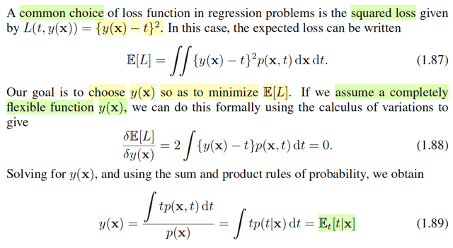</kbd>

<kbd>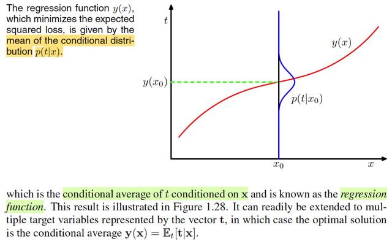</kbd>

<kbd>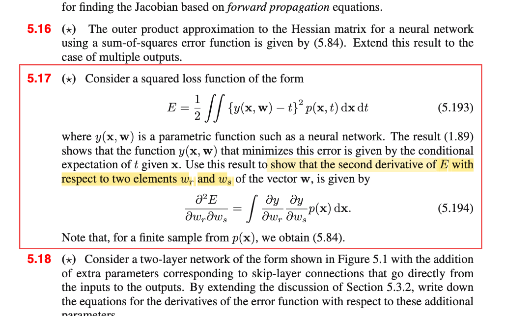</kbd>

> [!NOTE]
> Một lựa chọn phổ biến cho loss trong regression problem là **squared loss**, L(t, y(𝐱)) = (y(𝐱) - t)²
>
>
>
> khi đó E\[L\] = ∫∫\[y(𝐱) - t\]² f(𝐱, t) d𝐱 dt
>
>
>
> Đến đây, mình hiểu là ta sẽ coi E\[L\], như một hàm g(y, t) để thử derive y khiến minimize g(y, t).
>
>
>
> Dùng đạo hàm, điều kiện cần tối ưu bậc nhất: đạo hàm đối y của g = 0 để tìm critical point:
>
>
>
> δ/δy g(t,y) = 0
>
>
>
> ⇔ δ/δy ∫∫\[y(x) - t\]² f(𝐱, t) d𝐱 dt = 0
>
>
>
> Đạo hàm của tích phân, mình còn nhớ trong Casella có nói đến theorem nói rằng trong một số điều kiện, có thể đổi chỗ hai cái này, (trường hợp này là khi cận tích phân ko phụ thuộc y(𝐱))
>
>
>
> Ở đây có lẽ là thỏa điều kiện đó.
>
>
>
> ⇔ ∫∫ ∂/∂y(𝐱) {\[y(𝐱) - t\]² f(𝐱, t)} d𝐱 dt = 0
>
>
>
> ⇔ ∫∫ \[∂/∂y(𝐱) \[y(𝐱) - t\]²\] f(𝐱, t) d𝐱 dt = 0
>
>
>
> Xét ∂/∂y(x) \[y(x) - t\]²
>
>
>
> = ∂/∂\[y(𝐱)-t\] \[y(𝐱) - t\]² . d/dy(𝐱) \[y(𝐱) - t\]
>
>
>
> = 2\[y(𝐱) - t\]
>
>
>
> .. ⇔ ∫∫ 2\[y(𝐱) - t\] f(𝐱, t) d𝐱 dt = 0
>
>
>
> ⇔ 2 ∫∫ \[y(𝐱) - t\] f(𝐱, t) dx dt = 0
>
>
>
> ⇔ ∫∫ y(𝐱) f(𝐱, t) d𝐱 dt - ∫∫ t f(𝐱, t) d𝐱 dt = 0
>
>
>
> ⇔ ∫∫ y(𝐱) f(𝐱, t) d𝐱 dt = ∫∫ t f(𝐱, t) d𝐱 dt
>
>
>
> Xét vế trái:
>
>
>
> ∫∫ y(𝐱) f(𝐱, t) d𝐱 dt = ∫\_𝓧 ∫\_𝒯 y(𝐱) f(𝐱, t) dt d𝐱
>
>
>
> = ∫\_𝓧 y(x) {∫\_𝒯 f(𝐱, t) dt} d𝐱
>
>
>
> ∫\_𝒯 f(𝐱, t) dt chính là marginalizing joint pdf của 𝐗, T với mọi mọi T, sẽ được marginal pdf của 𝐗
>
>
>
> .. = ∫\_𝓧 y(𝐱) f(𝐱) d𝐱
>
>
>
> Xét vế phải:
>
>
>
> ∫∫ t f(𝐱, t) d𝐱 dt = ∫\_𝓧 \[∫\_range 𝐓 t f(𝐱, t) dt \] d𝐱 Vậy phương trình trở thành ∫\_𝓧 y(𝐱) f(𝐱) d𝐱 = ∫\_𝓧 \[∫\_𝒯 t f(𝐱, t) dt \] d𝐱
>
>
>
> Vì tính chất complete flexible của y(𝐱), cho phép:
>
>
>
> ⇔ y(𝐱) f(𝐱)= ∫\_𝒯 t f(𝐱, t) dt
>
>
>
> ⇔ y(𝐱) = \[∫\_𝒯 t f(𝐱, t) dt\] / f(𝐱)
>
>
>
> = \[∫\_𝒯 t f(t|𝐱) f(𝐱) dt\] / f(𝐱)
>
>
>
> = \[∫\_𝒯 t f(t|𝐱) dt\] f(𝐱) / f(𝐱)
>
>
>
> = ∫\_𝒯 t f(t|𝐱) dt
>
>
>
> Đây chính là E(T|𝐱), trung bình của T \~ f(t|𝐱)
>
>
>
> Như vậy, khi dùng squared loss thì cái hàm y(𝐱) giúp minimize trung bình loss E\[L\] chính là cái hàm y(𝐱) dùng mean của f(t|𝐱) để dự đoán.
>
>
>
> ---
>
>
>
> Thật ra cái này trong Casella đã học rồi cụ thể là khi ta học về Bayes estimator cho θ, thì ta đi tìm posterior π(θ|𝐱).
>
>
>
> Lúc này nếu muốn có point estimator cho θ, ta có thể lấy mean, hoặc median, và chúng đều là Bayes estimator.
>
>
>
> Nhưng mean, E\[θ|𝐱\] sẽ là cái Bayes estimator giúp **minimize Bayes risk khi loss là square error loss**. Còn median của posterior sẽ là Bayes estimator giúp **giảm Bayes risk là absolute error loss**.
>
>
>
> Ôn lại chút loss function, risk function, Bayes risk trong Casella:
>
>
>
> Loss function, là hàm của estimator L\_θ(δ(𝐗), θ), có thể là square error loss: \[δ(𝐗) - θ\]² hoặc absolute error loss: |δ(𝐗) - θ|.
>
>
>
> Risk function: E\_θ\[L(δ(𝐗), θ)\], mang ý nghĩa: Average loss over mọi 𝐗, để còn lại là hàm theo θ, để so với nhau giúp evaluate δ(𝐗).
>
>
>
> Bayes risk = ∫\_Θ R(δ(𝐗), θ) π(θ) dθ = ∫\_Θ ∫𝐗 L(δ(𝐱), θ) f(θ, 𝐱) d𝐱 dθ
>
>
>
> Vậy ở đây cũng y chang, cái E\[L\] mà gs Bishop nói ở đây chính là tương đương với Bayes risk (lấy kì vọng của Loss dưới joint distribution của T và 𝐗 f(𝐱, t))
>
>
>
> Do đó kết quả cũng là: khi ta muốn từ f(t|𝐱) để đưa ra một point estimator cho T thì mean E\[T|𝐱\] sẽ là cái giúp giảm thiểu E\[L\], y như E\[θ|𝐱\] là point estimator cho θ giúp giảm thiểu Bayes risk khi loss là squared error vậy
>
>
>
> và ở trong sách Bishop đoạn này, dù ko nói, ta cũng đoán được, nếu muốn giảm thiểu average absolute loss, thì nên dùng median của posterior.
>
>
>
> Và từ đây cũng giúp mình nhớ lại để hiểu vì sao trong bài revising curve fitting, ta thấy gs Bishop assume Ti \~ Normal(y(xi,𝐰), 1/β), hành động này chính là dùng mean của f(ti|xi), tức E\[Ti|xi\] để làm point estimate cho t, và theo decision theory, nó là tối ưu. Nếu ông dùng median của để point estimate cho T thì nó sẽ cũng là tối ưu nhưng theo tiêu chí giảm thiểu average absolute error loss.
>
>
>
> Sẵn tiện đang nói bài toán linear regression, sẽ có ích nếu ta ôn lại chút.
>
>
>
> Nhớ lại một nhận định khi ta làm bài toán curve-fitting theo Bayesian approach và cũng đã thấy rằng maximize likelihood chính là giải bài toán curve fitting với error function là sum squared error. Để thấy rằng vì sao khi đó:
>
>
>
> Còn nhớ, trong bài toán đó, cụ thể là phần Revisiting curve fitting problem, nơi mà gs Bishop dắt ta quay lại xem xét bài toán polynomial curve fitting theo góc nhìn xác suất thì ông đưa ra những thay đổi sau: đầu tiên, ứng với mỗi xi, coi Ti là một random varible, để phản ánh tính uncertainty của nó.
>
>
>
> Và assume distribution của nó là Ti \~ Normal(y(xi, 𝐰), 1/β)
>
>
>
> và cái assumption này cũng chính là assume Ei = Ti - y(xi, 𝐰), tức sai số của dự đoán và giá trị thật sẽ là một Normal(0, 1/β).
>
>
>
> Chú ý, cho tới đây, 𝐰, tham số của polynomial function, vẫn đang được coi như fixed & unknown, nên y(xi, 𝐰) cũng vậy, fixed & unknown, báo hiệu rằng ta vẫn đang ở trong trường phái cổ điển.
>
>
>
> Rồi, từ đó, ta mới xây dựng joint distribution của T1,...TM f𝐓(𝐭). Nhờ tính chất độc lập của các cặp (xi, Ti) ta mới phân tách joint probability bằng tích marginal probability
>
>
>
> fT(𝐭) = Πi=1:N f(ti)
>
>
>
> Thể hiện sự phụ thuộc với xi, 𝐰, β ta sẽ có:
>
>
>
> f𝐓(𝐭|𝐱, 𝐰, β) = Πi=1:N f(ti|𝐰, xi, β)Tới đây sao nữa? Nhớ lại các cách tiếp cận trong Casella trong bài toán point estimator cụ thể là maximum likelihood estimator.
>
>
>
> Theo định nghĩa θ^\_ml(𝐗) = argmax\_θ L(θ|𝐗), là θ giúp giải thích hợp lí nhất cho gía trị quan sát được của 𝐗. Với hàm likelihood được định nghĩa là L(θ|𝐱) = f(𝐱|θ) Do đó θ^\_ml(X) = argmax\_θ f(𝐱|θ).
>
>
>
> Vậy thì ở đây, để đi tìm 𝐰 (cũng chính là tìm y(xi,𝐰), ta cũng có thể đi theo hướng này, đó là, tìm 𝐰 giúp giải thích hợp lí nhất cho giá trị quan sát được t1,t2..tNứng với x1,..xN (chú ý, chỉ có T là random variable, chứ 𝐗 thì không, nên vector 𝐱 không phải là giá trị quan sát được của vector random variable 𝐗 nào cả.
>
>
>
> 𝐰ML = argmax over 𝐰 {L(𝐰|𝐭)}
>
>
>
> và likelihood L(𝐰|𝐭) cũng define bởi f(𝐭|**x,w**,β) = Πi=1:N f(ti|xi,𝐰,β) với f là pdf của Normal(y(xi, 𝐰), 1/β)
>
>
>
> nên bài toán là: maximize Πi=1:N f(ti|xi,𝐰,β)
>
>
>
> và cũng dùng các trick để đưa về bài toán tối ưu tương đương, như thay maximize objective likelihood bằng minimize - log likelihood,..ta sẽ giải ra 𝐰\_ML. và tương tự (1/β)\_ML
>
>
>
> Và khi làm vậy ta sẽ thấy, bài toán tối ưu tương đương giúp tìm w_ML chính là đi minimize error function là sum squared error Σi (y(𝐰,xi) - ti)² mà trong phần đầu tiên, khi làm quen với bài toán polynomial curve fitting ta đã làm (lúc đó chưa theo góc nhìn xác suất gì cả)
>
>
>
> ---
>
>
>
> Trước khi recall tiếp phần Bayesian inference, ta nhắc lại nhận định rút ra được trong note liền trước (khi có f(t|x) thì dùng mean của nó để point estimator cho T chính là cách để minimize average squared error loss)
>
>
>
> Khi gs Bishop giả định Ti \~ Normal(y(xi,𝐰), 1/β) thì chính là dùng mean của f(ti|xi): E\[Ti|xi\] để làm point estimate cho T thì **theo decision theory**:
>
>
>
> Nếu theo tiêu chí giảm thiểu **average square error loss** của decision theory: lấy E\[Ti|xi\], tức **mean** của f(ti|xi)
>
>
>
> Nếu theo tiêu chí giảm thiểu **average absolute error** **loss** thì ta cần lấy **median** của f(ti|xi)
>
>
>
> Nhưng việc nhắc đến square loss của decision theory vừa rồi không liên quan gì đến việc khi ta maximize likelihood dưới giả định Ti \~ normal(y(xi,𝐰),1/β) ta thấy nó hóa ra cũng là minimize sum squared error, cái này chỉ là trùng hợp.
>
>
>
> Vì giả sử ta assume Ti là expo(y(xi,𝐰)), hay distribution nào khác: tức cũng là mean của f(ti|xi), để rồi đi maximize likelihood, khi đó, ta sẽ thấy nó chưa chắc đã là minimize sum squared error. Tuy nhiên, miễn là ta lấy mean của f(ti|xi) để làm point estimator cho T thì theo decision theory, đó vẫn là tốt nhất theo tiêu chí giảm average squared error loss.
>
>
>
> ---
>
>
>
> Sẵn trớn recall lại luôn: Sau đó, qua phần Bayesian inference, gs Bishop bắt đầu mới nói về việc trong Bayesian, ta sẽ coi tham số **w, cũng là random variable nốt**, từ đó viết hoa 𝐖 để chỉ random variable vector. Mà cái này như mình đã biết ở Casella, khi ta bước sang trường phái Bayesian, thì ta cũng coi θ là random quantity. Để rồi nó sẽ có prior distribution π(θ), thường được chọn do kinh nghiệm của experimenter, sau đó dùng Bayes theorem, ta tìm distribution của θ khi đã biết 𝐗 = 𝐱: π(θ|𝐱) = f(𝐱|θ) π(θ) / f(𝐱). Áp dụng vài bài toán curve fitting. Ta sẽ chọn Normal(0, (1/α)𝐈) làm priori.
>
>
>
> Áp dụng Bayes theorem, xây dựng posterior:
>
>
>
> π(𝐰|𝐭,𝐱,β,α) = f(𝐭|𝐱,𝐰,β) π(𝐰|α) / f(𝐭|𝐱)
>
>
>
> Với f(𝐭|𝐱,𝐰,β) là joint distribution của T1,..Ti, = Πi=1:N f(ti|xi,𝐰,β) = Πi=1:N Normal(ti|y(xi,𝐰),1/β)
>
>
>
> Còn π(𝐰|α) là priori = Normal(𝐰|0,(1/α)\*𝐈)
>
>
>
> Đến đây, nếu trong Casella, khi nói về Bayes estimator, sau khi xây dựng posterior xong, ta sẽ lấy mean hay median của nó để làm point estimator cho θ. Cụ thể, E\[θ|𝐱\] chính là Bayes estimator giúp minimize Bayes risk function khi loss dùng squared error loss. Còn khi loss dùng absolute error thì Bayes estimator giúp minimize Bayes risk sẽ là median của posterior distribution.
>
>
>
> Còn trong Bishop, một hướng đi, là ta đi tìm 𝐰 giúp maximize cái posterior π(𝐰|t,x) này. Mà thực ra, trong bài toán này **posterior hóa ra cũng là Gaussian**, nên tìm w có posterior lớn nhất **cũng là lấy mean của posterior** thôi
>
>
>
> Và khi đó ta sẽ thấy cách làm này cũng sẽ chính là tương đương với giải bài toán regularized least square: tức là minimize sum squared error với regularization term là hàm bậc hai của 𝐰.
>
>
>
> Và khi có 𝐰\* maximize posterior rồi thì ta có thể dùng nó để dự đoán cho new x: y(x, 𝐰\*)
>
>
>
> Cũng đồng nghĩa là lấy mean của f(t|x,𝐰\*) là Normal(y(x, 𝐰\*), 1/β) để dự đoán cho t.
>
>
>
> Nhưng cách làm Bayesian toàn diện hơn: là bằng cách marginalizing over 𝐰 của f(t,𝐰|x,**x,t**) ta sẽ có f(t|x, 𝐱,𝐭) không phụ thuộc 𝐰, tức là predictive distribution:
>
>
>
> f(t|x,𝐱,𝐭) = ∫f(t,𝐰|x,𝐱,𝐭)d𝐰 = ∫f(t|x, 𝐰) π(𝐰|𝐱,𝐭) d𝐰 với π(𝐰|𝐱,𝐭) là posterior của 𝐰.

> [!TIP]
> 🤖 **AI Check** — 🟡 Minor issues — ✅ **92/100** · ✓ Move on
>
> Ghi chú thể hiện sự hiểu biết rất sâu sắc khi kết nối mượt mà bài toán Decision Theory trong Bishop với kiến thức Thống kê trong Casella & Berger (Bayes risk, posterior mean/median, MLE, MAP). Điểm cần lưu ý duy nhất là bước đạo hàm biến phân còn hơi lỏng tay về mặt toán học.
>
> **🟡 Minor issues**
>
> **1.** *"⇔ ∫∫ [∂/∂y(𝐱) [y(𝐱) - t]²] f(𝐱, t) d𝐱 dt = 0 ... Vậy phương trình trở thành ∫_𝓧 y(𝐱) f(𝐱) d𝐱 = ∫_𝓧 [∫_𝒯 t f(𝐱, t) dt ] d𝐱. Vì tính chất complete flexible của y(𝐱), cho phép: ⇔ y(𝐱) f(𝐱)= ∫_𝒯 t f(𝐱, t) dt"*
>
> Về mặt giải tích toán học, việc đưa đạo hàm vào trong cả hai tích phân rồi suy ra hai hàm dưới tích phân bằng nhau vì 'complete flexible' là lập luận không chặt chẽ. Đạo hàm biến phân (calculus of variations) δE[L]/δy(x) vốn tác động cục bộ tại điểm x và trực tiếp triệt tiêu tích phân theo dx (như công thức 1.88 trong sách), chỉ còn lại tích phân theo t.
>
>
> **✓ Strengths**
> - Nắm chắc và giải thích đúng bản chất hàm hồi quy tối ưu dưới hàm mất mát bình phương là kỳ vọng có điều kiện E[t|x].
> - Kết nối xuất sắc với lý thuyết quyết định (Decision Theory) và ước lượng Bayes trong Casella & Berger (squared error loss ứng với mean, absolute error loss ứng với median).
> - Phân biệt rạch ròi giữa việc giả định mô hình nhiễu Gaussian dẫn đến nghiệm bình phương tối thiểu (MLE) với nguyên lý tối ưu của hàm quyết định trong Decision Theory.
> - Khái quát chuẩn xác từ góc nhìn MLE sang MAP (với prior Gaussian dẫn đến L2 regularization) và phân phối dự báo (predictive distribution) thuần Bayesian.
>
> **💡 Deeper notes**
> - Một cách biến đổi tương đương chặt chẽ mà không cần dùng calculus of variations là áp dụng luật kỳ vọng lặp (tower property): viết E[L] = E_x[E_{t|x}[(y(x) - t)^2 | x]]. Do p(x) >= 0 và y(x) hoàn toàn linh hoạt (không bị ràng buộc dạng hàm), việc cực tiểu hóa tích phân toàn phần tương đương với cực tiểu hóa E_{t|x}[(y(x) - t)^2 | x] độc lập tại từng điểm x.

**🔗 See also:** [Bản chất hàm dự đoán](./542_outer_product_approximation.md#node-zkz6gsj)

 

###### Optimal Least Squares Predictor

<kbd>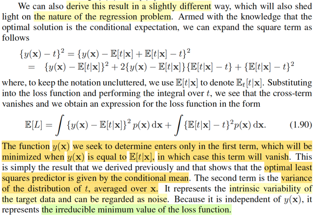</kbd>

> [!NOTE]
> Vì ta đang deal với những công thức rất phức tạp, cảm thấy cần thiết phải liên tục liên kết các kiến thức Bishop với Casella nên mình nên tóm tắt bối cảnh chút xíu: Phần này đang nói về decision theory apply cho bài toán regression. Như đã biết, quá trình giải bài toán học máy thường sẽ bao gồm giai đoạn inference, và dựa trên đó, kết hợp với decision theory để đưa ra quyết định sao cho tối ưu.
>
>
>
> Giai đoạn inference, đối với bài toán regression, có thể coi như là đi tìm predictive distribution, f(t|𝐱), là posterior distribution của t (vs prior distribution là f(t) - phân phối marginal của t).
>
>
>
> Và dựa trên đây, decision theory sẽ cho ta biết sẽ nên dự đoán T là gì.
>
>
>
> Thế thì giống như trong Casella, khi nói về Bayes estimator cho θ, ta bắt đầu coi θ là random variable, để rồi đi tìm posterior của nó π(θ|𝐱). Khi đó, câu hỏi là, vậy ta nên point estimate cho θ thế nào, vì yêu cầu vẫn là point estimate. Câu trả lời là, mình mới nói về loss và risk function trước: Loss function L(δ(𝐱), θ) được định nghĩa là hàm phản ánh sai số giữa estimate δ(𝐱) và θ, có thể dùng squared difference \[δ(𝐱) - θ\]² hoặc absolute difference |δ(𝐱) - θ|. Và ý nghĩa của L(δ(𝐱), θ) là: với observed 𝐗= 𝐱 như vậy, và θ như vậy, thì theo quy trình của δ(**.**) để tính ra δ(𝐱) estimate cho θ, thì sai số là bao nhiêu.
>
>
>
> Để rồi sau đó, ta muốn đánh giá khả năng của δ(𝐗) một cách tổng quát,xét trên mọi giá trị khả dĩ 𝐱 của 𝐗 luôn, bằng cách tính trung bình của loss trên mọi 𝐱: E\_θ\[L(δ(𝐗), θ\], đây chính là risk function, và nó chỉ còn là một hàm theo θ. Từ đó, ta có thể so sánh risk function của δ(𝐗) này với risk function của δ(𝐗) khác, xem với θ cụ thể thì cái nào nhỏ hơn (có nghĩa là estimator đó tốt hơn), và từ đó, bằng cách minimize cái risk, ta sẽ có được cái tốt nhất.
>
>
>
> Nhưng nếu tiếp cận theo Bayesian, θ cũng là biến, khi đó R(δ(X), θ) cũng là biến ngẫu nhiên tạo bởi θ, nên ta có thể tính kì vọng của nó, dưới phân phối prior của θ, E\[R(δ(𝐗), θ)\] = ∫\_Θ R(δ(𝐗), θ)) π(θ) dθ, đây là Bayes risk biến đổi chút nó sẽ bằng
>
>
>
> i) ∫\_X \[ ∫\_Θ L(θ, δ(𝐱)) π(θ|𝐱) dθ \] f(𝐱) d𝐱, thì ∫\_Θ L(θ, δ(𝐱)) π(θ|𝐱) dθ là E\[L(θ, δ(𝐱)|𝐗=𝐱\] là posterior expected loss (kì vọng của loss, là hàm theo θ, với θ \~ posterior)
>
>
>
> ii) ∫\_X ∫\_Θ L(θ, δ(𝐱) f(𝐱, θ) d𝐱 dθ, đây là kì vọng của loss, dưới joint distribution của X và θ.
>
>
>
> Và khi ta giải bài toán minimize Bayes risk với loss là squared error thì δ(x) tìm được sẽ chính là mean của posterior E\[θ|𝐱\].
>
>
>
> Vậy thì ở phần này trong sách Bishop, ông đang đặt vấn đề tương tự: Ta có posterior distribution f(t|𝐱) thì nên predict T bằng mấy thì sẽ tối ưu theo decision theory? (cũng chính là y chang trong Casella rằng ta đã có posterior π(θ|𝐱) thì nên point estimate cho θ bằng bao nhiêu để tối ưu)
>
>
>
> Để trả lời, ông Bishop mới tính kì vọng của loss với loss tính bằng squared error dưới joint distribution của 𝐗, T f(𝐱, t). Dưới ánh sáng của cuốn Casella, mình thấy rõ đây chính là tương ứng với Bayes risk.
>
>
>
> Và ta mới đi minimize cái E\[L\] này bằng giải tích, kết quả cho ra y như trong Casella: Là mean của posterior E\[T|𝐱\]
>
>
>
> Trong Casella, khi mininize Bayes risk để chứng minh kết quả tương tự, ta làm hơi khác: là xem xét Bayes risk theo công thức i) để rồi, thứ cần minimize là cái posterior expected loss E\[L(θ, δ(𝐱)|𝐗=𝐱\] (vì nó mới dính tới δ)
>
>
>
> minimize E\[(δ(𝐱) - θ)²\] |𝐗=𝐱\], và ví dụ 2.2.6 Chap 2 của Casella nói rằng b khiến minimize E\[(X - b)²\] chính là b = EX nên sẽ cho phép kết luận δ(x) khiến minimize E\[(δ(𝐱) - θ)²\] |𝐗=𝐱\] chính là E\[θ|𝐱\].
>
>
>
> (Trong ví dụ đó, mình cũng chứng minh bằng 2 cách, calculus và cách thứ hai sẽ cũng chính là cách mà phần này gs Bishop nói tới)
>
>
>
> Do đó, để có thể hiểu là gs Bishop làm gì ở đây, mình sẽ viết lại cách chứng minh thứ hai:
>
>
>
> Chứng minh minimize_b E\[(X - b)²\]
>
>
>
> Xét hàm mục tiêu E\[(X - b)²\] = E\[(X - EX + EX - b)²\]
>
>
>
> = E\[(X - EX)² + (EX - b)² +2(X - EX)(EX - b)\]
>
>
>
> = E\[(X - EX)²\] + E\[(EX - b)²\] +2E\[(X - EX)(EX - b)\]
>
>
>
> Xét: E\[(X - EX)(EX - b)\]
>
>
>
> Với phép tính này, thì EX-b coi như constant, nên dùng tính linearity của expectation: E\[cX\] = cEX ⇨ E\[(X - EX)(EX - b)\] = (EX - b) E\[(X - EX)\] = (EX - b)(EX- E\[EX\]) = (EX - b)(EX - EX) = (EX - b)\*(0) = 0
>
>
>
> ⇨ .. = E\[(X - EX)²\] + E\[(EX - b)²\]
>
>
>
> Bài toán trở thành minimize_b E\[(X - EX)²\] + E\[(EX - b)²\]
>
>
>
> tương đương minimize_b E\[(EX - b)²\] (bỏ term ko liên quan biến tối ưu b đi)
>
>
>
> và cái này là kì vọng của một hàm không âm, nên cũng không âm, do đó, giá trị nhỏ nhất của nó là = 0, xảy ra khi b = EX. Chứng minh xong.
>
>
>
> Áp dụng y chang để chứng minh E\[θ|𝐱\] cũng là minimizer của Bayes risk:
>
>
>
> minimize\_δ(𝐱) ∫\_𝐗 \[ ∫\_Θ L(θ, δ(𝐱)) π(θ|𝐱) dθ \] f(𝐱) d𝐱
>
>
>
> dĩ nhiên tương đương minimize\_δ(𝐱) ∫\_Θ L(θ, δ(𝐱)) π(θ|𝐱) dθ, vì chỉ có cái nhân này mới phụ thuộc biến tối ưu δ(𝐱), nếu nó nhỏ nhất, thì tích phân trên toàn miền range X cũng sẽ nhỏ nhất.
>
>
>
> Và again, cũng là minimize E\[L(δ(𝐱), θ)|𝐗=𝐱\], tức posterior expected loss.
>
>
>
> Với L(δ(𝐱), θ) = \[δ(𝐱) - θ\]² thì bài toán có thể chứng minh y chang theo cách trên:
>
>
>
> E\[L(δ(𝐱), θ)|𝐗=𝐱\] = E\[\[δ(𝐱) - θ\]²|𝐗=𝐱\]
>
>
>
> = E\[\[δ(𝐱) - E(θ|𝐗=𝐱) + E(θ|𝐗=𝐱) - θ\]²|𝐗=𝐱\]
>
>
>
> = E\[\[δ(𝐱) - E(θ|𝐗=𝐱)\]² + \[E(θ|𝐗=𝐱) - θ\]² + 2(δ(𝐱) - E(θ|𝐗=𝐱))(E(θ|𝐗=𝐱) - θ) |𝐗=𝐱\]
>
>
>
> = E{\[δ(𝐱) - E(θ|𝐗=𝐱)\]² |𝐗=𝐱} + E{\[E(θ|𝐗=𝐱) - θ\]²|𝐗=𝐱} + 2E{(δ(x) - E(θ|𝐗=𝐱))(E(θ|𝐗=𝐱) - θ) |𝐗=𝐱}
>
>
>
> Xét 2E{(δ(𝐱) - E(θ|𝐗=𝐱))(E(θ|𝐗=𝐱) - θ) |𝐗=𝐱}
>
>
>
> = 2(δ(𝐱) - E(θ|𝐗=𝐱) E{E(θ|𝐗=𝐱) - θ |𝐗=𝐱}
>
>
>
> = 2(δ(𝐱) - E(θ|𝐗=𝐱) {E\[E(θ|𝐗=𝐱)\] - E\[θ|𝐗=𝐱\]}
>
>
>
> = 2(δ(𝐱) - E(θ|𝐗=𝐱) {E(θ|𝐗=𝐱) - E\[θ|𝐗=𝐱\]}
>
>
>
> = 2(δ(x) - E(θ|X=x) {0}
>
>
>
> = 0
>
>
>
> Và bài toán cũng trở thành minimize\_δ(𝐱) = E{\[δ(𝐱) - E(θ|𝐗=𝐱)\]² |𝐗=𝐱} + E{\[E(θ|𝐗=𝐱) - θ\]²|𝐗=𝐱}
>
>
>
> tương đương minimize\_δ(x) E{\[δ(𝐱) - E(θ|𝐗=𝐱)\]² |𝐗=𝐱}
>
>
>
> kết qủa là δ(𝐱) = E(θ|𝐗=𝐱), là mean của posterior π(θ|𝐱).
>
>
>
> nói chung chỉ là nhìn nó rắc rối là do nó đeo thêm cái đuôi conditional on 𝐗=𝐱 để nhắc nhở rằng θ là biến ngẫu nhiên đang tuân theo distribution là posterior π(θ|𝐱) thôi.
>
>
>
> Và giờ mình xét qua phần trình bày của giáo sư Bishop để chỉ ra hoàn toàn y hệt:
>
>
>
> ---
>
>
>
> Giải bài toán tìm y(x) giúp minimize E\[L(y(x), t)\] dưới phân phối joint f(t,x)
>
>
>
> PHẦN DƯỚI ĐÂY XIN QUY ƯỚC TẤT CẢ CHỮ x ĐỀU TỰ HIỂU LÀ VIẾT ĐẬM (𝐱) ĐỂ ĐỠ MẤT THỜI GIAN GÕ,
>
>
>
> Hàm mục tiêu E\[L(y(x), t)\] = ∫∫ L(y(x),t) f(x,t)dxdt (tự hiểu hai cái tích phân là theo range T và 𝐗, y như tích phân ∫\_X ∫\_Θ ở trên vậy)
>
>
>
> Thay squared error loss vào:
>
>
>
> Hàm mục tiêu = ∫∫ {y(x) - t}² f(x,t)dxdt
>
>
>
> = ∫∫ {y(x) - t}² f(t|x)f(x)dxdt
>
>
>
> = ∫∫ {y(x) - t}² f(t|x)f(x)dtdx
>
>
>
> = ∫ \[ ∫ {y(x) - t}² f(t|x)dt \] f(x)dx
>
>
>
> Bài toán minimize hàm mục tiêu ∫ \[ ∫ {y(x) - t}² f(t|x)dt \] f(x)dx
>
>
>
> trở thành tương đương minimize cái cụm này, minimize ∫ {y(x) - t}² f(t|x)dt
>
>
>
> Và cái cụm này, chính là kì vọng của (y(x) - T)² dưới posterior distribution f(t|x): E\[(y(x) - T)²|X=x\]
>
>
>
> (Cái cụm ∫ {y(x) - t}² f(t|x)dt cũng chính là tương đương với ∫\_Θ L(δ(𝐱), θ) π(θ|𝐱) dθ = E\[L(δ(𝐱), θ)|𝐗=𝐱\], posterior expected loss ở trên)
>
>
>
> Và như để nhắc ta nhớ đây là tính kì vọng dưới posterior distribution của t, chứ ko phải là joint distribution T, X nữa, nên ông Bishop mới nói trong sách "we use E\[t|x\] to denote E_t\[t|x\]" nhằm nhấn mạnh chỗ này, vì kí hiệu nó đã trở nên quá phức tạp nhưng nhờ đối chiếu với Casella nên mình hiểu bản chất.
>
>
>
> Rồi, thế thì bài toán là minimize_y(x) {E\[(y(x) - T)²|X=x\]}, để bớt phải đeo cái đuôi X=x nhằm nhắc nhớ T \~ f(t|x), khiến công thức trở nên phức tạp như trên đã thấy ta cứ tạm bỏ cái đuôi này, với chú thích T \~ f(t|x) ở cuối là được.
>
>
>
> Ta cũng làm tương tự, biến đổi hàm mục tiêu:
>
>
>
> E\[(y(x) - T)²\] = E\[(y(x) - ET + ET - T)²\]
>
>
>
> = E\[(y(x) - ET)² + E\[(ET - T)²\] + 2E\[(y(x) - ET)(ET - T)\]
>
>
>
> Xét cái hạng tử cross term: 2E\[(y(x) - ET)(ET - T)\]
>
>
>
> Vì đây là đang tính kì vọng theo posterior f(t|x), nên y(x) - ET là constant, đưa ra ngoài, theo tính linearity:
>
>
>
> 2E\[(y(x) - ET)(ET - T)\] = 2(y(x) - ET) E\[(ET - T)\]
>
>
>
> = 2(y(x) - ET) \[E(ET) - ET\]
>
>
>
> = 2(y(x) - ET) \[ET - ET\]
>
>
>
> = 2(y(x) - ET) . 0
>
>
>
> = 0
>
>
>
> Đây chính là ứng với câu "Substituting into the loss function and performing the integral over t, we see that the cross-term vanishes" của gs Bishop.
>
>
>
> Kết quả còn lại: E\[(y(x) - ET)² + E\[(ET - T)²\] (T \~ f(t|x))
>
>
>
> Nếu tại đây ta lắp E\[(y(x) - ET)² + E\[(ET - T)²\] (T \~ f(t|x)) = ∫ \[y(x) - E(T|X=x\]² f(t|x) dt + ∫ \[E(T|X=x) - t\]² f(t|x) dt
>
>
>
> vô lại ∫ \[ hàm mục tiêu \] f(x)dx thì ta sẽ có công thức 1.90 trong sách:
>
>
>
> ∫ \[ ∫ \[y(x) - E(T|X=x\]² f(t|x) dt + ∫ \[E(T|X=x) - t\]² f(t|x) dt \] f(x)dx
>
>
>
> ∫∫ \[y(x) - E(T|X=x\]² f(t|x) f(x) dt dx + ∫∫ \[E(T|X=x) - t\]² f(t|x) f(x) dt dx
>
>
>
> ∫∫ \[y(x) - E(T|X=x\]² f(t, x) dt dx + ∫∫ \[E(T|X=x) - t\]² f(t|x) f(x) dt dx
>
>
>
> Xét cụm thứ nhất, cái cụm \[y(x) - E(T|X=x\]² ko phụ thuộc t, nên khi tính tích phân theo t, ta đưa ra
>
>
>
> Cụm thứ nhất = ∫\_X \[y(x) - E(T|X=x\]² ∫\_T f(t, x) dt dx
>
>
>
> Và ∫\_T f(t, x) dt, là marginalizing joint pdf của T, X over range T, sẽ được marginal pdf f(x)
>
>
>
> ⇨ Cụm thứ nhất = ∫\_X \[y(x) - E(T|X=x\]² f(x) dx
>
>
>
> .. = ∫\_X \[y(x) - E(T|X=x\]² f(x) dx + ∫∫ \[E(T|X=x) - t\]² f(t|x) f(x) dt dx ⇨ Đây chính là 1.90
>
>
>
> ---
>
>
>
> Trong sách, term thứ hai của 1.90 là ∫ {E\[T|X=x\] - t}² f(x) dx. Mình cho rằng: **term thứ hai có vẻ bị viết tắt** hoặc **thiếu phần tích phân theo t**.
>
>
>
> Dạng đầy đủ về mặt toán học nên là ∫∫ \[E(T|X=x) - t\]² f(t|x) f(x) dt dx,
>
>
>
> và nhờ vậy mới giúp giải thích khúc dưới.
>
>
>
> ---
>
>
>
> Còn nếu giải tiếp bài tóan tối ưu đang làm thì kết quả như đã biết, sẽ ra y(x) giúp minimize cái này, là E(T|X=x)
>
>
>
> (Ứng với câu trong sách "The function y(x) we seek to determine enters only in the first term, which will be minimized when y(x) is equal to E\[t|x\], in which case this term will vanish", nhắc lại, mình luôn theo notation của chuẩn toán, viết hoa với tên biến ngẫu nhiên, viết thường với giá trị biến, còn ông Bishop thì viết thường hết ráo khiến gây lú)
>
>
>
> Để rồi trong 1.90, ∫\_X \[y(x) - E(T|X=x\]² f(x) dx sẽ = 0,
>
>
>
> chỉ còn lại ∫∫ \[E(T|X=x) - t\]² f(t|x) f(x) dt dx
>
>
>
> Và đây chính là gì? Để nhìn ra nó là cái gì, hãy phân tích từng cái:
>
>
>
> E(T|X=x) chính là mean của posterior f(t|x)
>
>
>
> Vậy đây là \[E(T|X=x) - t\]² hàm tính ra bình phương của difference giữa T, \~ f(t|x) và mean E\[T|X=x)
>
>
>
> Nên ∫∫ \[E(T|X=x) - t\]² f(t|x) f(x) dt dx
>
>
>
> = ∫*{range x} \[ ∫*{range t} \[E(T|X=x) - t\]² f(t|x) dt \] f(x) dx
>
>
>
> Cụm ∫\_{range t} \[E(T|X=x) - t\]² f(t|x) dt chính là Variance của T dưới phân phối posterior f(t|x): Var(T|X=x)
>
>
>
> Và ta mới lấy trung bình trên mọi x, ∫\_{range x} \[Var(T|X=x) \] f(x) dx
>
>
>
> Thì cái này, gs Bishop gọi nó Variance của distribution của T lấy trung bình trên mọi x. ("The second term is the variance of the distribution of t, averaged over x.")
>
>
>
> Và theo gs Bishop, cái này nó phản ảnh độ nhiễu động nội tại của target data, và có thể coi như nhiễu (noise).
>
>
>
> Và vì cái này nó HOÀN TOÀN KHÔNG DÍNH GÌ / PHỤ THUỘC y(x), NÊN NÓ ĐẠI DIỆN GIÁ TRỊ NHỎ NHẤT, LÀ PHẦN KHÔNG THỂ GIẢM HƠN NỮA CỦA LOSS FUNCTION.

> [!TIP]
> 🤖 **AI Check** — 🟢 Pass — ✅ **98/100** · ✓ Move on
>
> Ghi chú xuất sắc, tư duy liên kết kiến thức giữa Bishop (Machine Learning) và Casella & Berger (Thống kê toán) rất sâu sắc và mạch lạc. Bạn đã tự diễn giải và chứng minh lại toàn bộ các bước, đồng thời phát hiện chuẩn xác lỗi in ấn/viết tắt trong phương trình (1.90) của sách Bishop.
>
> **🟡 Minor issues**
>
> **1.** *"f(t|𝐱), là posterior distribution của t (vs prior distribution là f(t) - phân phối marginal của t)"*
>
> Trong quy ước Machine Learning chuẩn, $t$ là biến mục tiêu (target), $p(t|\mathbf{x})$ thường được gọi là conditional distribution hoặc predictive distribution. Thuật ngữ prior/posterior chuẩn thường dành cho phân phối của tham số mô hình (như $\mathbf{w}$ hoặc $\theta$). Việc gọi $p(t|\mathbf{x})$ là 'posterior của $t$' chỉ đúng về mặt tương tự hình thức toán học (Bayes' rule) chứ không hoàn toàn khớp với thuật ngữ chuẩn.
>
>
> **✓ Strengths**
> - Khả năng kết nối mô hình Decision Theory trong Thống kê toán (Casella & Berger) với bài toán Regression trong Machine Learning (Bishop) rất chuẩn xác và sâu sắc.
> - Chứng minh chi tiết việc triệt tiêu cross-term và tối ưu hàm mất mát bình phương bằng kỹ thuật phân rã kỳ vọng điều kiện thay vì chỉ phụ thuộc vào giải tích biến phân.
> - Phát hiện cực kỳ sắc bén về lỗi ký hiệu trong công thức (1.90) của Bishop: số hạng thứ hai thiếu tích phân theo $t$ (hoặc chưa viết rõ $p(\mathbf{x}, t)$ / $\text{var}[t|\mathbf{x}]$).
> - Hiểu đúng bản chất của số hạng thứ hai là nhiễu nội tại không thể giảm thiểu (irreducible noise) thông qua kỳ vọng của phương sai điều kiện $\mathbb{E}_\mathbf{x}[\text{Var}(t|\mathbf{x})]$.
>
> **💡 Deeper notes**
> - Trong công thức (1.90) của các bản in đầu sách PRML (Bishop), số hạng thứ hai đúng là có lỗi in ấn errata nổi tiếng: phải là $\iint \{\mathbb{E}[t|\mathbf{x}] - t\}^2 p(\mathbf{x}, t) \mathrm{d}\mathbf{x}\mathrm{d}t$ hoặc viết gọn thành $\int \text{var}[t|\mathbf{x}] p(\mathbf{x}) \mathrm{d}\mathbf{x}$. Nhận định của bạn hoàn toàn khớp với đính chính chính thức của tác giả.

**🔗 See also:** [Expected Squared Loss Decomposition](./320_the_bias_variance_decomposition.md#node-s3i1j2i)

 

###### Các Phương Pháp Ước Lượng

<kbd>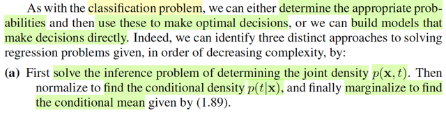</kbd>

<kbd>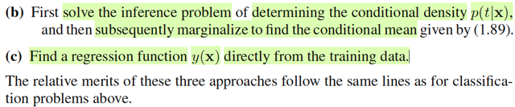</kbd>

> [!NOTE]
> Cũng tương tự như classification problem, cũng có các approaches:
>
>
>
> a) Inference joint pdf f(t,x). Rồi normalizing f(t,x)/f(x) để có f(t|x). Và make decision: lấy mean E(T|x)
>
>
>
> b) Inference trực tiếp ra f(t|x). Và make decision: lấy mean E(T|x)
>
>
>
> c) Học trực tiếp hàm mapping y(x), không cần inference

> [!TIP]
> 🤖 **AI Check** — 🟢 Pass — ✅ **95/100** · ✓ Move on
>
> Ghi chú tóm tắt rất chính xác và cô đọng 3 hướng tiếp cận bài toán hồi quy (regression) từ văn bản gốc, làm rõ được cả bước suy diễn xác suất và bước ra quyết định.
>
> **✓ Strengths**
> - Hiểu rõ và phân biệt chính xác 3 cấp độ tiếp cận: mô hình hóa phân phối đồng thời (generative), phân phối có điều kiện (discriminative), và học trực tiếp hàm hồi quy (discriminant function/direct regression).
> - Nắm đúng bản chất của bước ra quyết định tối ưu theo hàm mất mát bình phương sai số là tính kỳ vọng có điều kiện E[T|x].
>
> **💡 Deeper notes**
> - Thứ tự từ (a) đến (c) được sách xếp theo mức độ phức tạp tính toán giảm dần (decreasing complexity) và dữ liệu cần thiết cũng giảm dần theo.

 

###### Hàm mất mát Minkowski và q

<kbd>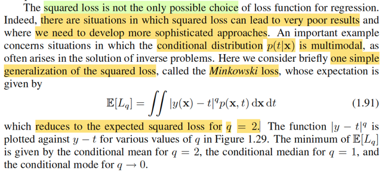</kbd>

<kbd>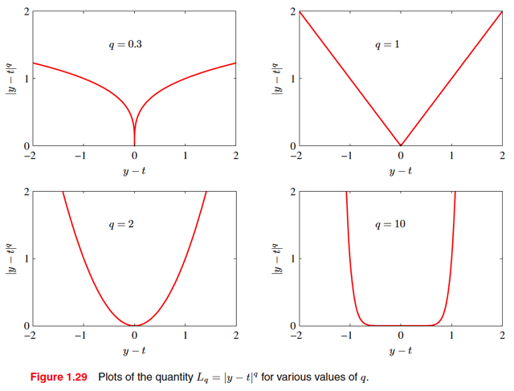</kbd>

> [!NOTE]
> Cuối cùng, đại ý là, có những tình huống hàm squared loss sẽ cho ra kết quả tệ. Ta phải design hàm loss khác. Một ví dụ là Minkowski loss
>
>
>
> L(y(x), t) = |y(x) - t|^q mà với q = 2 thì nó là squared loss.
>
>
>
> Nhận xét, là với q khác nhau thì hình phạt đối với sai số sẽ khác nhau. Với q = 0.3, có thể thấy loss chỉ nhỉ khi y(x) ≈ t, còn lại thì đều cao. q = 1 thì loss sẽ tăng tuyến tính theo sai số. q = 2 thì loss tăng quadratic theo sai số. q = 10 thì thì loss nhỏ khi y(x) nằm trong lân cận nào đó quanh t, nhưng xa hơn thì tăng rất nhanh.

> [!TIP]
> 🤖 **AI Check** — 🟡 Minor issues — ⚠️ **88/100** · ✓ Move on
>
> Ghi chú nắm rất tốt bản chất trực quan của hàm Minkowski loss và sự thay đổi hình dạng theo tham số q. Bạn nên bổ sung thêm ý nghĩa của nghiệm tối ưu (mean, median, mode) và đặc tính chịu lỗi ngoại lai (outliers) khi q < 1.
>
> **🟡 Minor issues**
>
> **1.** *"Vói q = 0.3, có thể thấy loss chỉ nhỉ khi y(x) ≈ t, còn lại thì đều cao."*
>
> Có lỗi chính tả ('Vói', 'nhỉ' thay vì 'Với', 'nhỏ'). Ngoài ra, nhận xét này chưa làm nổi bật đặc tính quan trọng nhất của q < 1: hàm số tăng rất chậm (dưới tuyến tính) khi sai số lớn, giúp mô hình ít bị ảnh hưởng bởi nhiễu/outliers so với q = 1 hay q = 2.
>
>
> **✓ Strengths**
> - Hiểu đúng mục đích tổng quát hóa của Minkowski loss đối với squared loss khi squared loss thất bại.
> - Mô tả chính xác hình dạng hàm mất mát và tốc độ tăng phạt sai số cho các trường hợp q = 1, q = 2 và q = 10.
>
> **💡 Deeper notes**
> - Văn bản gốc nhấn mạnh giá trị cực tiểu của kỳ vọng Minkowski loss tương ứng với các đại lượng thống kê: conditional mean (q = 2), conditional median (q = 1), và conditional mode (khi q -> 0).
> - Trường hợp phân phối điều kiện p(t|x) đa đỉnh (multimodal, thường gặp trong bài toán nghịch đảo) là lý do quan trọng khiến squared loss cho kết quả kém, vì trung bình điều kiện có thể rơi vào vùng có xác suất rất thấp giữa các đỉnh.

 

