# 2.1 Binary Variables

📊 **Progress:** `16` Notes | `24` Screenshots | `14` AI Reviews

---

 

## Phân phối Bernoulli và tính chất

<kbd>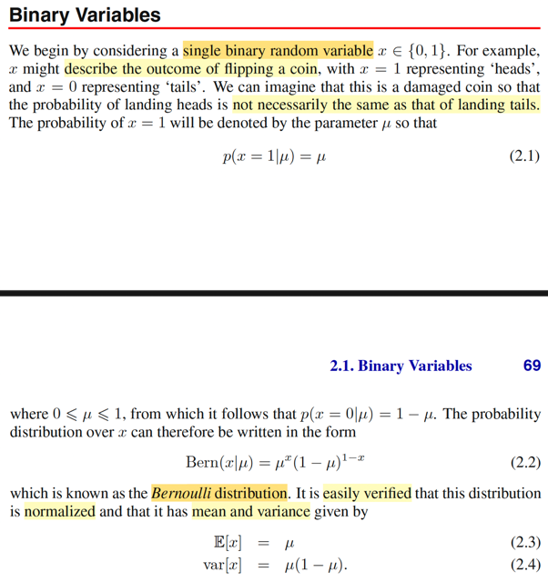</kbd>

> [!NOTE]
> Rồi, đầu tiên gặp lại (cái mà trong Stat110 hay Casella gọi là Bern(p): Phân phối Bernoulli.
>
>
>
> Dĩ nhiên gs Bishop ở đây ko nói gì mới cả, nó là một discrete distribution với hai possible value 0, 1.
>
>
>
> pmf của X \~ Bern(μ) thì như đã biết f(1) = P(X=1) = μ và f(0) = p(X=0) = 1 - μ.
>
>
>
> và thể hiện theo cách kết hợp f(x) = μ^x(1-μ)^(1-x),
>
>
>
> Ông nói chứng minh nó normalized tức là chứng minh tính valid của f(x) bằng cách chứng minh Σ{x=0,1} f(x) = 1, cái này thì quá rõ rồi:
>
>
>
> μ^1(1-μ)^0 + μ^0(1-μ)^1 = μ + 1 - μ = 1
>
>
>
> Làm lại vụ tính EX, VarX đã làm trong Stat110, Casella:
>
>
>
> EX, theo định nghĩa, là weighted sum các possible value của X, với weighted là xác suất tương ứng: EX = 1 × f(1) + 0 × f(0) = 1 × μ = μ.
>
>
>
> Giả sử X có 3 possible x1,x2,x3
>
>
>
> E\[X\] = P(X=x1) x1 + P(X=x2) x2 + P(X=x3) x3
>
>
>
> E\[X\] = ∫x f(x)dx
>
>
>
> (Trong sách dùng p, mình dùng f cho quen thuộc. Trong sách toán, f(x) vẫn có thể được dùng cho PMF)
>
>
>
> VarX, theo công thức thứ nhất: E\[(X-EX)²\] = E\[X²\] - (EX)²
>
>
>
> dispersion X
>
>
>
> X x1 = 1 tỷ, x2 = - 1 tỷ, EX = 0,
>
>
>
> = E\[(X - EX)²\], = E\[(X - μ)²\],
>
>
>
> áp dụng LOTUS = Σ{x=1,0} (x-μ)²f(x)
>
>
>
> LOTUS: 
>
>
>
> EX = Σi=1,2,3 P(X=xi) xi, EX = ∫xfX(x)dx
>
>
>
> EY = E\[g(X)\] = Σi=1,2,3 P(X=xi) g(xi), ∫g(x)fX(x)dx
>
>
>
> EX = μ × 1 + (1-μ) × 0
>
>
>
> EY, Y=(X - EX)², g(u) = (u - EX)² = (u - μ)²
>
>
>
> THeo LOTUS, EY = μ × g(1) + (1-μ) × g(0)
>
>
>
> = μ × (1-μ)² + (1-μ) × μ²
>
>
>
> = μ (1- 2μ + μ²) + μ² - μ³
>
>
>
> = μ - 2μ² + μ³ + μ² - μ³
>
>
>
> = μ - 2μ²  + μ² 
>
>
>
> = μ - μ²  = μ(1-μ)
>
>
>
>
>
>
>
>
>
> = (1-μ)² μ + (0-μ)² (1-μ)
>
>
>
> = (1-μ)² μ + μ²(1-μ)
>
>
>
> = (1-2μ+μ²)μ + μ² - μ³
>
>
>
> = μ - 2μ² + μ³ + μ² - μ³ = μ - μ² = μ(1-μ)

🌐 English translation of the original note

> *This is an AI-translated version of the original note.*
>
> Alright, first encounter again (what in Stat110 or Casella is called Bern(p): Bernoulli distribution.
>
>
>
> Of course prof Bishop here doesn't say anything new at all, it is a discrete distribution with two possible value 0, 1.
>
>
>
> pmf of X \~ Bern(μ) then as already known f(1) = P(X=1) = μ and f(0) = p(X=0) = 1 - μ.
>
>
>
> and expressed in a combined way f(x) = μ^x(1-μ)^(1-x),
>
>
>
> He said proving it normalized means proving the validity of f(x) by proving Σ{x=0,1} f(x) = 1, this thing is already too obvious:
>
>
>
> μ^1(1-μ)^0 + μ^0(1-μ)^1 = μ + 1 - μ = 1
>
>
>
> Redoing the calculating EX, VarX thing already done in Stat110, Casella:
>
>
>
> EX, by definition, is the weighted sum of the possible value of X, with weighted being the corresponding probability: EX = 1 × f(1) + 0  × f(0) = 1 × μ = μ.
>
>
>
> (In the book they use p, I use f for familiarity. In math books, f(x) can still be used for PMF)
>
>
>
> VarX, according to the first formula:
>
>
>
> = E\[(X - EX)²\], = E\[(X - μ)²\],
>
>
>
> applying LOTUS = Σ{x=1,0} (x-μ)²f(x)
>
>
>
> = (1-μ)² μ + (0-μ)² (1-μ)
>
>
>
> = (1-μ)² μ + μ²(1-μ)
>
>
>
> = (1-2μ+μ²)μ + μ² - μ³
>
>
>
> = μ - 2μ² + μ³ + μ² - μ³ = μ - μ² = μ(1-μ)

---

**🤖 AI Check (English)**

Summary: Very accurate notes, independently carried out all steps to check normalization as well as deriving expectation and variance that the Bishop textbook only states results.

Strengths:
• Clearly understands the nature of the compact form of the probability mass function (pmf) f(x) = μ^x(1-μ)^(1-x) of the Bernoulli distribution.
• Independently interpreted in detail and accurately the normalization condition (total probability equals 1) which the book only writes 'easily verified'.
• Independently calculated in detail the expectation and variance via definition and the LOTUS theorem with explicit algebraic transformation steps.

Deeper notes:
• For the binary random variable x ∈ {0, 1}, there is a useful property that x² = x, therefore E[X²] = E[X] = μ. Then calculating the variance via the formula Var(X) = E[X²] - (E[X])² = μ - μ² = μ(1-μ) will be faster than expanding directly according to the definition E[(X-μ)²].

📹 [Xem video trên YouTube](https://www.youtube.com/watch?v=92V18SjUb00)

> [!TIP]
> 🤖 **AI Check** — 🟢 Pass — ✅ **100/100** · ✓ Move on
>
> Ghi chú rất chuẩn xác, tự triển khai đầy đủ các bước kiểm tra tính chuẩn hóa (normalization) cũng như suy dẫn kỳ vọng và phương sai mà giáo trình Bishop chỉ nêu kết quả.
>
> **✓ Strengths**
> - Hiểu rõ bản chất hàm khối xác suất (pmf) dạng rút gọn f(x) = μ^x(1-μ)^(1-x) của phân phối Bernoulli.
> - Tự diễn giải chi tiết và chính xác điều kiện chuẩn hóa (tổng xác suất bằng 1) mà sách chỉ ghi 'easily verified'.
> - Tự tính toán chi tiết kỳ vọng và phương sai qua định nghĩa và định lý LOTUS với các bước biến đổi đại số tường minh.
>
> **💡 Deeper notes**
> - Đối với biến ngẫu nhiên nhị phân x ∈ {0, 1}, có một tính chất hữu ích là x² = x, do đó E[X²] = E[X] = μ. Khi đó tính phương sai qua công thức Var(X) = E[X²] - (E[X])² = μ - μ² = μ(1-μ) sẽ nhanh hơn cách khai triển trực tiếp theo định nghĩa E[(X-μ)²].

 

### Ước lượng Maximum Likelihood Bayes

<kbd>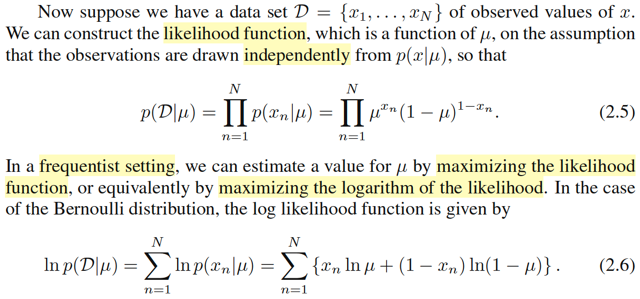</kbd>

> [!NOTE]
> Rồi, đoạn này đại ý là nếu ta có dataset 𝒟 (hay 𝐱) = {x1,....xN} là các giá trị quan sát được của 𝐗 và công thức likelihood function 
>
>
>
> Ôn lại chút, trong Casella, định nghiã của một random sample size n, là khi ta muốn quan sát giá trị của một đại lượng mang tính chất uncertainty n lần, mỗi lần đại diện bởi một random variable: X1,X2,....Xn, và được tiến hành sao cho các rvs này mutually independent và chúng có cùng distribution population distribution kí hiệu là f(x|θ).
>
>
>
> (phần ghi chú mình gõ trong lúc làm clip nằm ở dưới cùng)
>
>
>
> Khi đó, nếu xét joint pdf/pmf của X1,...Xn thì nhờ tính chất independent, ta có thể tách thành tích các marginal pdf: f(𝐱|θ) = Πi=1:n f(xi|θ)
>
>
>
> Và ta trong các bài trước nhiều lần nhắc đến likelihood function, được định nghĩa là hàm của θ: L(θ|𝐱) = f(𝐱|θ) mang ý nghĩa độ hợp lí của θ khi giá trị quan sát được của 𝐗 là 𝐱.
>
>
>
> và đi giải bài toán maximize\_θ ∈ Θ L(θ|𝐱) ta sẽ tìm được Maximum Likelihood estimator của θ: θ^\_ml(𝐗)
>
>
>
> Quay lại đây, cái mà ta có cũng chính là một observed value của một random sample 𝐗 =(X1,...XN) iid: chúng mutually independent và indicator distributed Xi \~ Bern(μ).
>
>
>
> Nên likelihood function L(μ|𝐱), như định nghĩa = f(𝐱|μ), nhờ tính iid,...
>
>
>
> = Πn=1:N f(xn|μ) = Πn=1:N μ^xn(1-μ)^(1-xn). là công thức 2.5 trong sách.
>
>
>
> ---
>
>
>
> Rồi, như vừa nói xong, gs Bishop cũng nhắc lại, trong trường phái Frequetist ta thường đi tìm μ khiến maximize likelihood function.
>
>
>
> Và bài toán tối ưu này như đã biết, ta có thể chuyển thành bài toán tương đương dùng hàm ln: maximize ln likelihood:
>
>
>
> ln {Πn=1:N μ^xn(1-μ)^(1-xn)}
>
>
>
> = Σn=1:N ln {μ^xn(1-μ)^(1-xn)}
>
>
>
> = Σn=1:N ln {μ^xn} + ln {(1-μ)^(1-xn)}
>
>
>
> = Σn=1:N ln {μ^xn} + Σn=1:N ln {(1-μ)^(1-xn)}
>
>
>
> = Σn=1:N \[xn ln μ\] + Σn=1:N \[(1-xn) ln (1-μ)\] → 2.6
>
>
>
> ---
>
>
>
> **Vì sao phải nhắc đến Frequentist** (hay trong Casella gọi là Classical, trường phái thống kê cổ điển) là vì trong cách tiếp cận này, ta coi θ (hay ở đây là μ) là fixed và unknown, chứ không phải là biến ngẫu nhiên). Trong Casella, ngay sau khi học về ML estimator ta học về Bayes estimator, thì chính là làm theo trường phái Bayesian, nơi ta coi θ là random variables. Từ đó ta chọn prior distribution cho θ, kí hiệu là π(θ). Và dùng Bayes rule để xây dựng distribution của θ conditioned on 𝐗 = 𝐱: π(θ|𝐱) = f(𝐱|θ)π(θ)/f(𝐱). Khi đó, ta sẽ làm theo optimality theory để xây dựng Bayes estimator:
>
>
>
> Chọn **loss function** L(W(𝐗), θ), ví dụ squared error loss hay absolute error loss,
>
>
>
> từ đó có **risk function** là lấy trung bình của loss trên mọi 𝐱:
>
>
>
> R(W(𝐗), θ) = E\_θ\[L(W(𝐗), θ\] = ∫L(W(𝐱),θ)f(𝐱|θ) d𝐱 là hàm số theo θ.
>
>
>
> Và vì θ là random variable, nên risk function vẫn là random variable.
>
>
>
> Người ta sẽ lấy **trung bình trên prior π(θ)**:
>
>
>
> E\_θ\~π(θ) \[R(W(𝐗),θ)\] để được một fixed value không còn phụ thuộc θ, gọi là Bayes risk.
>
>
>
> = ∫\[∫L(W(𝐱),θ)f(𝐱|θ)d𝐱\]π(θ)dθ
>
>
>
> = ∫∫L(W(𝐱),θ)\[π(θ|𝐱)f(𝐱)/π(θ)\]π(θ)dθd𝐱
>
>
>
> = ∫∫L(W(𝐱),θ)π(θ|𝐱)f(𝐱)dθd𝐱
>
>
>
> = ∫ {∫L(W(𝐱),θ)π(θ|𝐱)dθ} f(𝐱)d𝐱
>
>
>
> Thì cái này ∫L(W(𝐱),θ)π(θ|𝐱)dθ gọi là **posterior expected loss**
>
>
>
> Từ đó, đi minimize_W(𝐗) E\_θ\~π(θ) \[R(W(𝐗), θ)\] cũng là minimize posterior expected loss (∫L(W(𝐱),θ)π(θ|𝐱)dθ) ta sẽ có "Bayes estimator that minimize Bayes risk" cho θ.
>
>
>
> ---
>
>
>
> Phần ghi chú trong clip:
>
>
>
> 𝐱 = (x1,x2,..) = (1,2,3,4,5,6,7), random sample 𝐗 = (X1,X2,...X7) independent identically distributed, iid, \~ f(x|θ), n(μ,1) 
>
>
>
> w(x1,x2,..) point estimate cho μ (vs interval estimate \[l(x1,x2,...), u(x1,x2,...)\])
>
>
>
> W(𝐗) point estimator của μ
>
>
>
> Maximum likelihood
>
>
>
> 𝐱 = (x1,x2,..) = (1,2,3,4,5,6,7)
>
>
>
> Likelihood(μ|𝐱=1,2,3,4,5,6,7)|μ=μ1 = 5
>
>
>
> Πi (1/√2π) exp(-(xi-μ1)²/2) = 5
>
>
>
> Likelihood(μ|𝐱=1,2,3,4,5,6,7)|μ=μ2 = 10
>
>
>
> Πi (1/√2π) exp(-(xi-μ2)²/2) = 10
>
>
>
> Likelihood(μ|𝐱=1,2,3,4,5,6,7)|μ=μ3 = 100
>
>
>
> μ3 là maximum likelihood estimate của μ
>
>
>
> (minh họa 5, 10, 15 là vì đây là joint pdf, mà pdf không bị ràng buộc phải ≤ 1, tất nhiên nếu xét yếu tố đây là pdf của normal(μ,1) thì 1/√2π khiến cho pdf chắc chắn &lt; 1)
>
>
>
> L(μ|𝐱) = f(𝐱|μ) = joint pmf/pdf của X1,....X7 evaluate tại observed data
>
>
>
> P(X1=x1, X2=x2,...X7=x7)|x1=1,x2=2,...x7=7
>
>
>
> f(x1,x2,x3..x7|μ)|x1=1,x2=2,...x7=7
>
>
>
> vì independent: f(x1,x2,x3..x7|μ) = f(x1|μ)f(x2|μ)..f(x7|μ) = Πi f(xi|μ)
>
>
>
> = Πi (1/√2π) exp(-(xi-μ)²/2)
>
>
>
> X1,X2,....XN có giá trị quan sát x1,x2...xN, Xi \~ Bern(μ), PMF P(X=x) = μ^x (1-μ)^(1-x)
>
>
>
> Likelihood L(μ|𝒟) = joint pmf của X1,...XN, evaluate tại observer data 𝒟
>
>
>
> = P(X1=x1, X2=x2,....XN=xn|μ)
>
>
>
> = P(X1=x1|μ)P(X2=x2|μ),....P(XN=xn|μ)
>
>
>
> = Πi P(Xi=xi|μ)
>
>
>
> = Πn μ^xn (1-μ)^(1-xn)
>
>
>
> μ\_ML maximum likelihood estimate của μ
>
>
>
> maximize\_μ L(μ|𝒟) = Πn μ^xn (1-μ)^(1-xn)
>
>
>
> monotone 
>
>
>
> maximize\_μ log L(μ|𝒟) = ln Πn μ^xn (1-μ)^(1-xn)
>
>
>
> =Σn ln \[μ^xn (1-μ)^(1-xn)\]
>
>
>
> =Σn \[ ln μ^xn + ln (1-μ)^(1-xn)\]
>
>
>
> =Σn \[ xn ln μ + (1-xn) ln (1-μ)\]

📹 [Xem video trên YouTube](https://www.youtube.com/watch?v=LyNb3hLs4Rg)

> [!TIP]
> 🤖 **AI Check** — 🟢 Pass — ✅ **95/100** · ✓ Move on
>
> Ghi chú rất xuất sắc, hiểu sâu sắc bản chất khái niệm từ giáo trình Casella & Berger và kết nối liền mạch với Bishop; việc đối chiếu giữa Frequentist và Bayesian thông qua lý thuyết quyết định (loss, risk, Bayes risk) hoàn toàn chính xác.
>
> **🟡 Minor issues**
>
> **1.** *"Và vì θ là random variable, nên risk function vẫn là random variable."*
>
> Về mặt chuẩn tắc, hàm rủi ro (risk function) R(W, θ) được định nghĩa là một hàm tất định của tham số θ (đã lấy kỳ vọng trên X). Trong góc nhìn Bayesian, khi gán cho θ một phân phối tiên nghiệm π(θ) thì R(W, θ) mới được xem như một biến đổi của biến ngẫu nhiên θ để lấy kỳ vọng ra Bayes risk.
>
>
> **✓ Strengths**
> - Khái niệm mẫu ngẫu nhiên (random sample), likelihood và biến đổi sang log-likelihood cho phân phối Bernoulli được trình bày chi tiết và hoàn toàn chính xác.
> - Kết nối kiến thức rất tốt khi giải thích vì sao tác giả dùng thuật ngữ Frequentist bằng cách dẫn chứng sang trường phái Bayesian và biến đổi tối thiểu hóa posterior expected loss.
>
> **💡 Deeper notes**
> - Khi chuyển bài toán tối ưu từ hàm hợp lý sang log-hợp lý, cần lưu ý giả định ln là hàm đơn điệu tăng ngặt (strictly increasing) và likelihood phải strictly positive (0 < μ < 1 với bài toán Bernoulli để ln xác định).

**🔗 See also:** [Ưu tiên liên hợp Beta-Nhị thức](#node-ixw17hk)

 

#### Thống kê đủ và MLE

<kbd>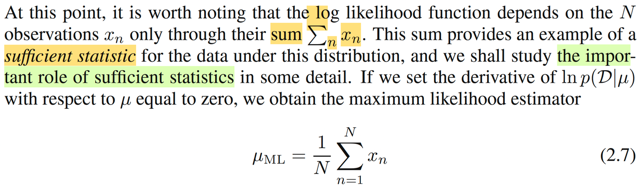</kbd>

<kbd>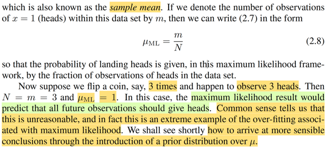</kbd>

<kbd>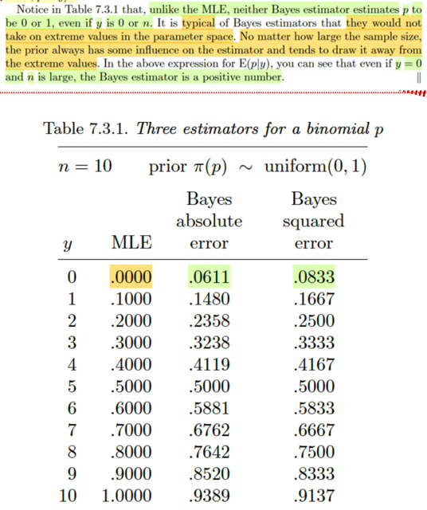</kbd>

> [!NOTE]
> Tiếp theo gs Bishop nói về việc hàm ln likelihood phụ thuộc vào x1,...xN thông
> qua Σn xn Cái này dễ thấy, vì ln likelihood = Σn=1:N [xn ln μ] + Σn=1:N [(1-xn) ln
> (1-μ)]
>
>
>
> = ln μ [Σn=1:N xn] + ln (1-μ) Σn=1:N [1-xn]
>
>
>
> = ln μ [Σn=1:N xn] + ln (1-μ) [N - Σn=1:N xn]
>
>
>
> Và ông nói đây là một sufficient statistic.
>
>
>
> Dừng lại chút, chap 6, phần 1 của Casella mình đã được học về Sufficient
> principle, cũng như sufficient statistic, nói ngắn gọn, đây là loại statistic  chứa
> đủ thông tin về θ mà sample 𝐗 mang lại rồi. Để rồi, giả sử ta ko biết  giá trị
> của 𝐗, nhưng thay vào đó, chỉ cần biết giá trị của t của T(𝐗), với T(𝐗)
> là một sufficient statistic, thì từ t ta vẫn có thể inference ra giá trị của θ một cách
> đầy đủ giống như ta có 𝐱 vậy.
>
>
>
> Hiểu theo cách trực giác là như vậy, nhưng định nghĩa chính thức là nếu
> T(𝐗) có tính chất đó là khiến f(𝐱|T(𝐗) = T(𝐱)) không còn là hàm phụ
> thuộc θ, thì nó chính là sufficient statistic. Trong sách Casella, với định nghĩa
> này, ta mới đi chứng minh cho thấy rằng, giả sử có hai ông A, và B, ông A biết
> 𝐗 = 𝐱, và T(𝐗) = T(𝐱), còn ông B chỉ biết T(𝐗) = T(𝐱). Sau đó
> ông A dựa vào T(𝐗) = T(𝐱), generate các giá trị của 𝐘 sao cho P(𝐘 =
> 𝐲 | T(𝐗) = T(𝐱)) = P(𝐗 = 𝐲 | T(𝐗) = T(𝐱)) thì ta chứng minh
> được cái random variable 𝐘 này qủa thật chính là ~ marginal pmf của 𝐗:
> f(𝐱|θ) (hay P(𝐗=𝐲) = P(𝐘=𝐲) ∀𝐲) Điều này giúp kết luận là chỉ
> cần dựa trên T(𝐱) cũng đủ để xây dựng hiểu biết của ta về θ
>
>
>
> Sau đó ta được học một theorem quan trọng giúp chứng minh sufficient
> statistic: **Factorization**, nói rằng, miễn f(𝐱|θ) có thể được factor thành
> g(T(𝐱)|θ)h(𝐱) tức là tích của hàm h(𝐱) chỉ phụ thuộc 𝐱 và hàm g phụ
> thuộc  cả 𝐱 lẫn θ nhưng chỉ phụ thuộc 𝐱 thông qua T(𝐱), thì khi đó T
> **chính là  sufficient statistic**.
>
>
>
> Nhờ theorem này, ta có cách tìm sufficient statistic: tìm các factor f(𝐱|θ)
> thành dạng trên thì cái cụm nào chứa 𝐱 trong g(T(𝐱)|θ) chính là sufficient
> statistic function.
>
>
>
> Vậy ở đây mình có thể chứng minh nhanh là với X1,...Xn ~ Bern(μ) thì  Σi Xi là
> sufficient:
>
>
>
> f(𝐱|μ), như vừa làm = Πn=1:N μ^xn(1-μ)^(1-xn)
>
>
>
> xét Pμ(𝐗=𝐱|T(𝐗)=T(𝐱)), trước khi chứng minh nó ko phụ thuộc θ, ta
> biến đổi chút xíu:
>
>
>
> Pμ(𝐗=𝐱|T(𝐗)=T(𝐱)) = Pμ(𝐗=𝐱, T(𝐗)=T(𝐱)) /
> P(T(𝐗)=T(𝐱))
>
>
>
> Vì 𝐗=𝐱 ⇨ T(𝐗)=T(𝐱) ⇨ (𝐗=𝐱) ⊂ T(𝐗)=T(𝐱) ⇨
> (𝐗=𝐱, T(𝐗)=T(𝐱) = (𝐗=𝐱)
>
>
>
> (do A ⊂ B ⇨ A ∩ B = A)
>
>
>
> ⇨ Pμ(𝐗=𝐱, T(𝐗)=T(𝐱)) / P(T(𝐗)=T(𝐱))
>
>
>
> = Pμ(𝐗=𝐱) / P(T(𝐗)=T(𝐱))
>
>
>
> Thay vào:
>
>
>
> Từ số Pμ(𝐗=𝐱) = f(𝐱|μ) = Πn=1:N μ^xn(1-μ)^(1-xn)
>
>
>
> Còn mẫu số, với T(𝐗) = ΣXi với Xi iid Bern(μ) thì ΣXi chính là binomial(n, μ)
>
>
>
> (còn nhớ trong Stat110, hay Casella, story của Binomial(n,p) là tổng các
> success event của chuỗi n Bern(p) trials. có pmf là P(X=k) = (n choose
> k)p^k(1-p)^(n-k)
>
>
>
> Nên P(T(𝐗)=T(𝐱)) = (n choose T(𝐱)) μ^T(𝐱) (1-μ)^[n-T(𝐱)] ,với
> T(𝐱) = Σnxn.
>
>
>
> Thay kết qủa này vào mẫu số ta có:
>
>
>
> Πn=1:N μ^xn(1-μ)^(1-xn)  / (n choose Σn xn) μ^(Σn xn) (1-μ)^(n-Σn xn)
>
>
>
> = μ^(Σn xn) (1-μ)^(Σn (1-xn))  / (n choose Σn xn) μ^(Σn xn) (1-μ)^(n-Σn xn)
>
>
>
> = μ^(Σn xn) (1-μ)^(n-Σn xn)  / (n choose Σn xn) μ^(Σn xn) (1-μ)^(n-Σn xn)
>
>
>
> =  1  / (n choose Σn xn)
>
>
>
> kết quả ko còn phụ thuộc μ nên theo định nghĩa Σn xn chính là sufficient
> statistic
>
>
>
> Có thể làm còn nhanh hơn bằng factorization theorem:
>
>
>
> f(𝐱|μ) =  Πn=1:N μ^xn(1-μ)^(1-xn) =
>
>
>
> = μ^(Σn xn) (1-μ)^[Σn(1-xn)]
>
>
>
> = μ^(Σn xn) (1-μ)^[N-Σn xn)]
>
>
>
> bằng cách chọn h(x) = 1, g(T(x)|μ) = μ^(Σn xn) (1-μ)^[N-Σn xn)] ta suy ra ngay
> T(x) = Σx xn chính là sufficient statistic
>
>
>
> -------
>
>
>
> Còn quay lại bài toán tìm μ khiến maximum likelihood, thì cũng đơn giản, đây là
> bài toán tối ưu ko ràng buộc, dùng điều kiện cần tối ưu bậc nhất ta cho đạo
> hàm bằng 0 tìm critical point:
>
>
>
> d/dμ [Σn=1:N [xn ln μ] + Σn=1:N [(1-xn) ln (1-μ)]] = 0
>
>
>
> ⇔ Σn=1:N d/dμ [xn ln μ] + Σn=1:N d/dμ [(1-xn) ln (1-μ)] = 0
>
>
>
> ⇔ Σn=1:N [xn/μ] + Σn=1:N (1-xn) d/dμ [ln(1-μ)] = 0
>
>
>
> ⇔ Σn xn / μ - (N-Σn xn) / (1-μ) = 0
>
>
>
> ⇔ Σn xn / μ = (N-Σn xn) / (1-μ)
>
>
>
> ⇔ (1-μ) Σn xn = μ (N-Σn xn)
>
>
>
> ⇔ Σn xn - μ Σn xn  = μ (N-Σn xn)
>
>
>
> ⇔ Σn xn = μ (N-Σn xn) + μ Σn xn
>
>
>
> ⇔ Σn xn = μ N
>
>
>
> ⇔ (Σn xn) / N = μ,
>
>
>
> Tất nhiên để kết luận đây là maximizer của objective thì còn cần check đạo
> hàm bậc hai (lấy đạo hàm bậc hai tại critical point và coi thử nó có âm ko)
>
>
>
> nhưng cũng có thể dùng nhận định hàm này là tổng các hàm ln vốn là concave
> function nên cũng là concave function, từ đó khiến cho ta có thể kết luận ngay
> maximizer.
>
>
>
> Như vậy μ^_ML = (Σn xn) / N, dĩ nhiên ta biết đây chính là sample mean.
>
>
>
> Như vậy, giả sử ta trong bài toán cụ thể là tung đồng xu N lần, ra được m lần
> ngửa thì m/N chính là cách ta estimate xác suất ra ngửa của đồng xu đó (μ)
> theo cách tối đa hóa độ hợp lí dựa trên kết quả quan sát được. Ví dụ tung
> N=100, m = 10 thì dựa trên kết quả thử nghiệm dự đoán population param hợp
> lí nhất là μ = 0.1, tức xác suất xu ra ngửa là 10%.
>
>
>
> Hoặc nếu N = 3, m = 3, thì μ^_ML = 1, đồng nghĩa là theo đó, mô hình (theo
> cách estimate μ bằng maximum likelihood approach) sẽ dự đoán là nếu tiếp tục
> tung xu thì sẽ luôn luôn ra ngửa. Điều này rõ ràng là ko đúng. Theo gs Bishop,
> đây chính là một ví dụ của overfit. Và cách tiếp cận Bayesian với prior
> distribution của μ sẽ giúp khắc phục chuyện này.
>
>
>
> Nói thêm chút xíu, trong sách Casella đã nói về vụ này rồi, khi trong phần cuối
> của Bayes estimator ông có in một cái bảng (7.3.1) so sánh hai phương pháp
> MLE và Bayes. Cho thấy Bayes ít cho các extreme (thái quá) estimate hơn.
> Nguyên nhân cũng là nhờ prior distribution.

> [!TIP]
> 🤖 **AI Check** — 🟡 Minor issues — ✅ **95/100** · ✓ Move on
>
> Ghi chú rất xuất sắc, hiểu sâu sắc bản chất của thống kê đủ (sufficient statistic), định lý Factorization và cách giải bài toán MLE kết hợp góc nhìn Bayesian. Chỉ có một nhầm lẫn nhỏ về danh xưng nhân vật trong câu chuyện trực giác của Casella & Berger.
>
> **🟡 Minor issues**
>
> **1.** *"ông A dựa vào T(𝐗) = T(𝐱), generate các giá trị của 𝐘 sao cho P(𝐘 = 𝐲 | T(𝐗) = T(𝐱)) = P(𝐗 = 𝐲 | T(𝐗) = T(𝐱))"*
>
> Trong thí nghiệm tưởng tượng của Casella & Berger, chính ông B (người chỉ biết giá trị T(X) chứ không biết toàn bộ mẫu X) mới là người dùng một cơ chế ngẫu nhiên độc lập với θ để generate ra mẫu Y có cùng phân phối với X, từ đó chứng minh B sở hữu đầy đủ thông tin về θ ngang với A.
>
>
> **✓ Strengths**
> - Tự thực hiện đầy đủ hai cách chứng minh tính thống kê đủ (bằng định nghĩa điều kiện và bằng định lý Factorization) rất chuẩn xác.
> - Đạo hàm tìm nghiệm MLE chi tiết và có lập luận chặt chẽ về tính lõm (concavity) của hàm mục tiêu để xác nhận điểm cực đại toàn cục.
> - Liên kết xuất sắc giữa ví dụ over-fitting của Bishop với bảng so sánh ước lượng Bayes trong sách Casella & Berger.
>
> **💡 Deeper notes**
> - Về mặt tối ưu hóa: Khi m = 0 hoặc m = N, nghiệm MLE μ nằm ở biên của đoạn [0, 1]. Khi đó đạo hàm không triệt tiêu bên trong khoảng mở (0, 1) mà nghiệm tối ưu đạt được trực tiếp tại biên.

 

##### Phân phối nhị thức và chứng minh

<kbd>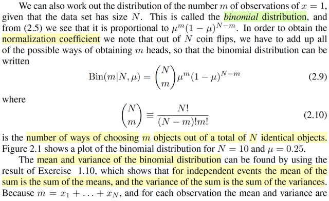</kbd>

<kbd>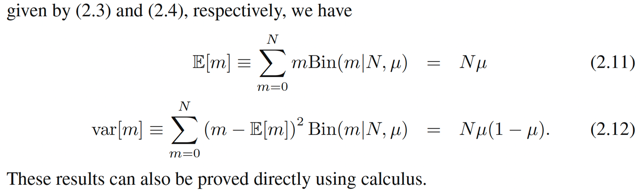</kbd>

> [!NOTE]
> Rồi, thế thì binomial là gì thì stat110, Casella đã quá rành rồi, cái quan trọng nhất là story của nó: X \~ binomial(n, p) thì nó chính là số trial success trong n iid Bern(p) trial. có pmf: P(X=k) = (n choose k) p^k (1-p)^(n-k).
>
>
>
> ---
>
>
>
> X \~ Binomial(n, p), X số lần thành công trong chuỗi n Bern(p) trials độc lập
>
>
>
> {0,1,...n}
>
>
>
> P(X=3)
>
>
>
> n=5, k=3
>
>
>
> P(X=3) ⇔ P(FFSSS ∪ FSFSS ∪ SSSFF,....)
>
>
>
> Axiom: P(FFSSS ∪ FSFSS ∪ SSSFF,....) = P(FFSSS) + P(FSFSS) + P(SSSFF) + ... (1)
>
>
>
> (FFSSS) = (trial 1: F, trial 2: F, trial 3: S, trial 4: S, trial 5: S)
>
>
>
> Joint event
>
>
>
> P(FFSSS) = P(trial 1: F, trial 2: F, trial 3: S, trial 4: S, trial 5: S)
>
>
>
> P(A,B): Nếu A,B độc lập: P(A,B) = P(A)P(B)
>
>
>
> ⇒ P(trial 1: F, trial 2: F, trial 3: S, trial 4: S, trial 5: S) = P(trial 1: F)P(trial 2: F)P(trial 3: S)P(trial 4: S)P(trial 5: S)
>
>
>
> = (1-p)(1-p)ppp = (1-p)²p³
>
>
>
> ---
>
>
>
> FSFSS = (trial 1: F, trial 2: S, trial 3: F, trial 4: S, trial 5: S)
>
>
>
> P(FSFSS) = P(trial 1: F, trial 2: S, trial 3: F, trial 4: S, trial 5: S)
>
>
>
> = P(trial 1: F)P(trial 2: s)P(trial 3: F)P(trial 4: S)P(trial 5: S)
>
>
>
> = (1-p)p(1-p)pp = (1-p)²p³
>
>
>
> ---
>
>
>
> Mấy thằng khác trong tổng (1): Đều có xác xuất = (1-p)²p³
>
>
>
> Câu chuyện bây giờ là đếm xem có bao nhiêu event như vậy:
>
>
>
> ---
>
>
>
> FFSSS ∪ FSFSS ∪ SSSFF,....
>
>
>
> F1,F2,S1,S2,S3
>
>
>
> S S S F F
>
>
>
> S F S S F
>
>
>
> S F F S S
>
>
>
> Bài toán trở thành đếm số cách chọn: khi cho 5 chỗ trống, chọn 3
>
>
>
> Đây chính là ý nghĩa của (5 choose 3) = 5!/3!(5-3)!, (n choose k) = n!/k!(n-k)!
>
>
>
> PMF Bin(n,p): P(X=k) = (n choose k) (1-p)^(n-k) p^k
>
>
>
> Bin(N, μ) P(X=m) = (N choose m) (1-μ)^(N-m) μ^m
>
>
>
> (N choose m) = N!/m!(N-m)!
>
>
>
> ---
>
>
>
> Thử giải thích lại công thức của (n choose k), đây là cái đã học từ những bài đầu của Stat110:
>
>
>
> Chứng minh (n choose k) có công thức như vậy (Stat110 đã học, ôn lại)
>
>
>
> Bài toán là đếm số cách chọn m object từ N object ko care thứ tự:
>
>
>
> n object có n! hoán vị.
>
>
>
> Với mỗi hoán vị ta lấy k object đầu tiên thì ta sẽ có n! cách chọn k object
>
>
>
> Tuy nhiên vì không care thứ tự các object nên ta đã đếm thừa với mỗi cách chọn k! lần, nên để adjust ta sẽ chia cho k!
>
>
>
> Ngoài ra, với mỗi một cách chọn này ta cũng đã đếm thừ (n-k)! lần số cách chọn n-k quả banh ở cuối → nên cũng phải adjust bằng cách chia (n-k)!.
>
>
>
> Nên (n choose k) = n! / k!(n-k)!
>
>
>
> ---
>
>
>
> Derive công thức EX cực nhanh: dùng story của nó, thì bên cạnh story trên, binomial còn có story khác: nó là tổng có n iid indicator random variable I\_{Aj} với Aj là trial thứ j, và I\_{Aj} j=1,2....n có hai possible value là 1 hoặc 0 nếu kết quả của trial là success hoặc failure, dễ thấy I\_{Aj} chính là Bern(μ)
>
>
>
> Khi đó EX = E\[Σi I\_{Ai}\]
>
>
>
> dựa trên tính linearity của kì vọng
>
>
>
> ...= Σi E\[I\_{Aj}\]
>
>
>
> = Σi \[μ\] = nμ (hay trong sách là Nμ)
>
>
>
> ---
>
>
>
> VarX: Trong Stat110 gs Joe đã trình bày 3 cách để tìm Var của binomial trong đó cách dễ nhất chính là dựa trên tính chất của Variance: Nếu X1,... Xn độc lập thì Var(Σi Xi) = Σi VarXi
>
>
>
> ở đây, dựa trên story binomial random variable X là tổng các iid Bern I_Aj
>
>
>
> ⇨ Var X = Σi Var(I_Aj)
>
>
>
> Mà với Bern(μ) mình đã chứng minh Var = μ(1-μ) rồi
>
>
>
> ⇨ Var X = Σi μ(1-μ) = nμ(1-μ) (hay trong sách là Nμ(1-μ))
>
>
>
> ---
>
>
>
> Nói thêm chút xíu hai công thức gs Bishop trong sách thật ra chỉ là ông dùng định nghĩa thôi, nhưng cách derive nhanh là như gs Joe đã dạy ở trên),
>
>
>
> theo định nghĩa EX = Σ{mọi possible value x của X} xP(X=x)
>
>
>
> ở đây ông Bishop dùng chữ m, để chỉ random variable binomial, (một lần nữa phải complain rằng việc ông dùng chữ thường để chỉ tên biến đi ngược lại quy ước của toán khiến ta rất dễ lú), mình cũng dùng lại chữ m nhưng viết hoa cho nó theo chuẩn:
>
>
>
> E\[M\] = Σ{mọi possible value m của M} mP(M = m)
>
>
>
> Và pmf của M \~ binomial(N,μ) thì ông kí hiệu nó là Bin(m|N, μ) (giống như pdf của Normal(μ, σ²) thì thay vì như sách toán người ta ghi f(x|μ, σ²) thì ổng chơi luôn N(x|μ, σ²), thật hay.
>
>
>
> = Σ{m=0,1,...N} m Bin(m|N,μ)
>
>
>
> Var\[M\], thì theo định nghĩa gốc của variance thôi: E\[(M - EM)²\], và dùng LOTUS, ta có Σ{mọi possible value m của M} (m -EM)² P(M=m)
>
>
>
> = Σ{m=0,1,...N} (m - EM)² Bin(m|N,μ)

📹 [Xem video trên YouTube](https://www.youtube.com/watch?v=hY_5sPoMfWE)

> [!TIP]
> 🤖 **AI Check** — 🟢 Pass — ✅ **100/100** · ✓ Move on
>
> Ghi chú xuất sắc, hiểu rất sâu sắc bản chất xác suất ('story' của phân phối nhị thức) và diễn giải trọn vẹn từ hàm PMF, tổ hợp đến kỳ vọng và phương sai.
>
> **✓ Strengths**
> - Nắm vững và vận dụng xuất sắc tư duy 'story proof' từ Stat 110 để giải thích bản chất phân phối nhị thức thay vì chỉ áp dụng công thức thuần túy.
> - Chứng minh trực quan công thức hàm khối xác suất (PMF) thông qua các biến cố xung khắc và tính độc lập của các phép thử Bernoulli.
> - Derive kỳ vọng và phương sai bằng biến chỉ thị (indicator variables) kết hợp tính tuyến tính của kỳ vọng rất gãy gọn, chuẩn xác.
> - Liên hệ và so sánh sắc bén giữa cách trình bày định nghĩa hình thức của Bishop và bản chất toán học từ Stat 110.
>
> **💡 Deeper notes**
> - Sách giáo trình Bishop ghi chú thêm 'These results can also be proved directly using calculus': ta có thể chứng minh kỳ vọng và phương sai bằng giải tích thông qua vi phân nhị thức Newton $(p + q)^N$ theo $p$ hoặc hàm sinh mô-men (MGF).

 

###### Ưu tiên liên hợp Beta-Nhị thức

<kbd>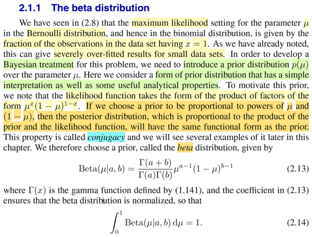</kbd>

> [!NOTE]
> Đại khái là gs nói rằng mình đã thấy trong ví dụ mà ta đi xây dựng maximum likelihood estimator cho μ của binomial(N, μ) và cho thấy kết quả là μ^\_ML là tỉ lệ của số lượng các observer value = 1 so với tổng số observed value. Để rồi giúp ta nhận thấy rằng nếu số lượng data mà nhỏ, thì cách làm này có thể dẫn tới những kết quả thái quá ví dụ như μ̂ \_ML = 1.
>
>
>
> So với cách tiếp cận này, thì Bayesian approach sẽ khắc phục được nhược điểm này. Và theo cách làm này, như đã nói nhiều lần, mình sẽ coi μ như random variable, và chọn cho nó một distribution, gọi là prior distribution, để rồi dùng Bayes theorem để xây dựng posterior distribution.
>
>
>
> Và khi làm vậy, ta sẽ chọn prior sao cho đơn giản hóa việc tính toán.
>
>
>
> Thế thì ông nói khi ta nhìn vào hàm likelihood, ta thấy nó có dạng là tích của các cụm μ^x(1-μ)^(1-x). Từ đó nếu ta chọn prior distribution sao cho công thức của nó cũng có dạng μ lũy thừa gì đó nhân với (1-μ) lũy thừa gì đó thì ta sẽ thấy posterior cũng hóa ra sẽ là distribution cùng loại với prior. Và tính chất này gọi là CONJUGACY.
>
>
>
> Thế thì trong trường hợp này, cái distribution có tính chất đó, chính là beta distribution, có pdf:
>
>
>
> μ \~ β(a, b) thì pdf f(μ|a,b), hay Beta(μ|a,b) = \[Γ(a+b)/Γ(a)Γ(b)\] μ^(a-1)(1-μ)^(b-1).
>
>
>
> Nhờ các class stat110, casella, mình đã quen với distribution này. và trong Casella đã nhiều lần làm các ví dụ đi xây dựng Bayes estimator của θ, với sample X1,X2,... là iid Bern(θ). Để rồi khi ta chọn prior là β, tính ra posterior, ta sẽ thấy cái kernel có dạng kernel của môt β có tham số khác, từ đó giúp kết luận posterior là β, và ta cũng ko cần care các hằng số vì nó sẽ cùng nhau tạo thành normalizing constant. Do đó β distribution ngọi là binomial conjugate.
>
>
>
> Có thể làm lướt qua rất nhanh cho vui:
>
>
>
> Đây nhé, mình có hàm joint pdf của data (observation) f(𝐱|μ) của random sample iid X1,..Xn \~ Bern(μ) → f(𝐱|μ) = Πi f(xi|μ). Theo định nghĩa hàm likelihood thì L(μ|𝐱) = f(𝐱|μ).
>
>
>
> Tiếp, giả sử chọn β(a,b) là prior distribution của μ: π(μ) là pdf của beta(a,b). (trong sách Casella, ta kí hiệu prior/posterior của tham số với π)
>
>
>
> DÙng Bayes theorem để derive posterior:
>
>
>
> π(μ|𝐱) = f(𝐱|μ) π(μ) / f(𝐱)
>
>
>
> vì f(𝐱) chỉ là marginal pdf của 𝐗 tại 𝐱, ta biết nó chỉ là một constant,dù không biết f(𝐱) là gì nhưng theo lí thuyết chắc chắc nó phải tham gia vào normalizing constant của π(μ|𝐱), vì cái này là một valid pdf (giúp đảm bảo ∫π(μ|𝐱)dμ = 1)
>
>
>
> Thành ra người ta sẽ chỉ quan tâm các term có dính μ, và chuyển sang dùng kí hiệu tỉ lệ thuận (vì normalizing constant phải dương)
>
>
>
> π(μ|𝐱) ∝ f(𝐱|μ) π(μ) và đây cũng là L(μ|𝐱) π(μ), đó là lí do mà gs nhắc đến likelihood ở đây, nhưng cái chính ta hiểu nó là joint distribution của 𝐗: f(𝐱|μ)
>
>
>
> Rồi, thế vô:
>
>
>
> π(μ|x) ∝ Πi f(xi|μ) β(μ|a,b)
>
>
>
> = Πi μ^xi(1-μ)^(1-xi) C μ^(a-1)(1-μ)^(b-1) với C là constant = \[Γ(a+b)/Γ(a)Γ(b)\]
>
>
>
> tiếp tục, ta lại ko cần care cái constant, vì nó sẽ nhập với cái constant f(𝐱) tạo thành normalizing constant của π(μ|x), giúp đảm bảo ∫π(μ|𝐱)dμ = 1
>
>
>
> ⇨ π(μ|x) ∝ Πi μ^xi(1-μ)^(1-xi) μ^(a-1)(1-μ)^(b-1)
>
>
>
> ⇔ π(μ|x) ∝ μ^Σxi(1-μ)^\[Σ(1-xi)\] μ^(a-1)(1-μ)^(b-1)
>
>
>
> ⇔ π(μ|x) ∝ μ^(Σxi+a-1)(1-μ)^\[Σ(1-xi)+b-1\]
>
>
>
> ⇔ π(μ|x) ∝ μ^(Σxi+a-1)(1-μ)^\[N-Σxi+b-1\]
>
>
>
> từ đây ta nhận định đây là kernel (hạt nhân) của một pdf của β(Σxi+a, N-Σxi+b)
>
>
>
> nên suy ra luôn posterior chính là β(Σxi+a, N-Σxi+b)
>
>
>
> và cũng giúp ta hiểu vì sao β gọi là conjugate prior của binomial.
>
>
>
> Nếu joint pdf f(x|μ) mà là distribution khác, ví dụ Xi \~ normal, thì prior phải chọn normal thì posterior mới cũng ra normal, nên normal là prior conjugate của normal
>
>
>
> Tất nhiên việc chọn prior như vậy chỉ là để đơn giản hóa việc tính toán,giống như gs Bishop nói đến trong câu "**form of prior distribution that has a simple interpretation as well as some useful analytical properties**"

📹 [Xem video trên YouTube](https://www.youtube.com/watch?v=3p7bkNSwRJc)

> [!TIP]
> 🤖 **AI Check** — 🟢 Pass — ✅ **98/100** · ✓ Move on
>
> Ghi chú rất xuất sắc, hiểu sâu sắc bản chất của conjugate prior và cách dùng kernel để xác định posterior mà không cần tính tích phân phức tạp. Phần tự biến đổi toán học hoàn toàn chính xác và bám sát nội dung bài học.
>
> **✓ Strengths**
> - Nắm rất vững tư duy Bayes: bỏ qua hằng số chuẩn hóa (normalizing constant) và chỉ tập trung vào kernel chứa tham số để suy ra phân phối hậu nghiệm.
> - Tự thực hiện biến đổi toán học đầy đủ, chính xác từng bước từ likelihood Bernoulli đến phân phối hậu nghiệm Beta(Σxi + a, N - Σxi + b).
> - Hiểu rõ động lực dẫn đến tính liên hợp (conjugacy) và lý do tại sao phương pháp Bayesian giải quyết được vấn đề over-fitting của MLE trên tập dữ liệu nhỏ.
>
> **💡 Deeper notes**
> - Ở ví dụ mở rộng về phân phối chuẩn (Normal), việc prior Normal dẫn đến posterior Normal chỉ đúng trực tiếp khi tham số cần ước lượng là kỳ vọng (mean) và phương sai (variance) đã biết. Nếu phương sai cũng là biến ngẫu nhiên thì conjugate prior sẽ là phân phối Normal-Inverse-Gamma (hoặc Normal-Gamma).

**🔗 See also:** [Ước lượng Maximum Likelihood Bayes](#node-6ibllcz)

 

###### Kỳ vọng phân phối Beta

<kbd>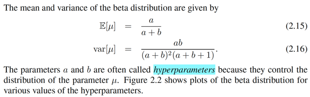</kbd>

> [!NOTE]
> Việc chứng minh mean và variance của β thì trong stat110 và casella đã làm
> rồi, làm lại cho nhớ (cũng là bài tập 2.6 của sách Bishop)
>
>
>
> Cho X ~ β(a,b). tính EX
>
>
>
> Để cho dễ ta sẽ đi tính EXⁿ luôn, gọi là n'th moment:
>
>
>
> Theo LOTUS để tính EY với Y = g(X), ta có thể dùng pdf/pmf f(x) của X: Eg(X)
> = ∫g(x)f(x)dx
>
>
>
> ⇨ EXⁿ = ∫xⁿ f(x)dx = ∫xⁿ [Γ(a+b)/Γ(a)Γ(b)] x^(a-1)(1-x)^(b-1) dx
>
>
>
> = [Γ(a+b)/Γ(a)Γ(b)] ∫x^(n+a-1)(1-x)^(b-1) dx  (đưa constant ra, nhập mũ x lại)
>
>
>
> Rồi, cái trong tích phân dễ thấy nó sẽ là kernel của β pdf có tham số n+a và b,
> tức β(n+a, b) nên ta sẽ nhân và chia cho normalizing constant của β(n+a, b):
> Γ(n+a+b) / Γ(n+a) Γ(b)
>
>
>
> → .. = [Γ(a+b)/Γ(a)Γ(b)] ∫ [Γ(n+a+b)/Γ(n+a) Γ(b)] / [Γ(n+a+b)/Γ(n+a) Γ(b)]
> x^(n+a-1)(1-x)^(b-1) dx
>
>
>
> đưa / [Γ(n+a+b) / Γ(n+a) Γ(b)] ra ngoài, bên trong tích phân bây giờ là tích
> phân từ trên toàn miền support set của β [0:1] của pdf của β(n+a, b), theo tính
> valid của pdf, cái này phải = 1
>
>
>
> = [Γ(a+b)/Γ(a)Γ(b)] / [Γ(n+a+b)/Γ(n+a)Γ(b)] ∫ [Γ(n+a+b)/Γ(n+a)Γ(b)]
> x^(n+a-1)(1-x)^(b-1) dx
>
>
>
> = [Γ(a+b)/Γ(a)Γ(b)] / [Γ(n+a+b)/Γ(n+a)Γ(b)]
>
>
>
> = Γ(a+b)Γ(n+a)/Γ(a)Γ(n+a+b)
>
>
>
> Áp dụng với n = 1: và dùng công thức Γ(a+1) = aΓ(a)
>
>
>
> EX = Γ(a+b)Γ(1+a)/Γ(a)Γ(1+a+b)
>
>
>
> = Γ(a+b)aΓ(a)/Γ(a)(a+b)Γ(a+b)
>
>
>
> = a/(a+b)
>
>
>
> Áp dụng với n = 2:
>
>
>
> EX² = Γ(a+b)Γ(2+a)/Γ(a)Γ(2+a+b)
>
>
>
> = Γ(a+b)(1+a)Γ(1+a)/Γ(a)(1+a+b)Γ(1+a+b)
>
>
>
> = Γ(a+b)(1+a)aΓ(a)/Γ(a)(1+a+b)(a+b)Γ(a+b)
>
>
>
> = (1+a)a/(1+a+b)(a+b)
>
>
>
> Từ đó, áp dụng công thức thứ 2 của VarX = EX² - (EX)²
>
>
>
> và biến đổi đại số thì sẽ ra công thức trong sách
>
>
>
> ------
>
>
>
> a, b theo gs Bishop gọi là hyperparam, vì nó sẽ quyết định hình dạng của 
> distribution

> [!TIP]
> 🤖 **AI Check** — 🟡 Minor issues — ✅ **92/100** · ✓ Move on
>
> Ghi chú rất tốt, bạn đã tự thiết lập và chứng minh thành công công thức moment tổng quát E[Xⁿ] của phân phối Beta để suy ra kỳ vọng và moment bậc hai. Điểm trừ nhỏ là bạn chưa hoàn thành nốt bước rút gọn đại số cuối cùng cho phương sai.
>
> **🟡 Minor issues**
>
> **1.** *"Từ đó, áp dụng công thức thứ 2 của VarX = EX² - (EX)² và biến đổi đại số thì sẽ ra công thức trong sách"*
>
> Ghi chú bỏ qua bước quy đồng và rút gọn đại số cụ thể từ E[X²] - (E[X])² về dạng ab / ((a+b)²(a+b+1)). Dù đây chỉ là thao tác đại số cơ bản nhưng nên viết ra để hoàn tất trọn vẹn chứng minh cho Var[X].
>
>
> **✓ Strengths**
> - Cách tiếp cận tổng quát hóa bằng cách tính moment bậc n (E[Xⁿ]) thông qua kỹ thuật nhận diện kernel của phân phối Beta rất chuẩn xác và thanh lịch.
> - Nắm vững tính chất của hàm Gamma: Γ(z+1) = zΓ(z) để triệt tiêu các thừa số trong E[X] và E[X²].
> - Ghi nhớ đúng vai trò của a và b là hyperparameters (siêu tham số) vì chúng tham số hóa phân phối của chính tham số μ.
>
> **💡 Deeper notes**
> - Điều kiện để các tích phân và moment bậc n hội tụ là các tham số hình dạng phải thỏa mãn a > 0, b > 0 và n > -a.
> - Bước biến đổi đại số cụ thể cho Var(X): E[X²] - (E[X])² = [a(a+1) / ((a+b)(a+b+1))] - [a² / (a+b)²] = [a / (a+b)] * [(a+1)/(a+b+1) - a/(a+b)] = [a / (a+b)] * [b / ((a+b)(a+b+1))] = ab / ((a+b)²(a+b+1)).

 

###### Các dạng phân phối Beta

<kbd>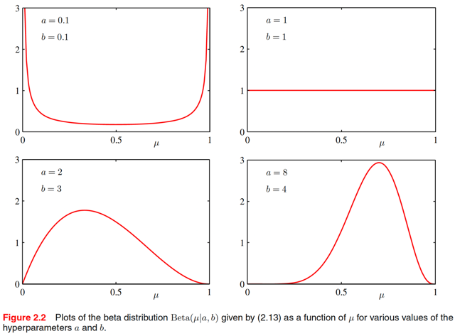</kbd>

> [!NOTE]
> β(1,1) chính là uniform(0,1).
>
>
>
> còn với các giá trị tham số khác, nó có các hình dạng khác nhau.

> [!TIP]
> 🤖 **AI Check** — 🟢 Pass — ✅ **90/100** · ✓ Move on
>
> Ghi chú hoàn toàn chính xác khi nhận diện Beta(1,1) chính là phân phối đều Uniform(0,1) và phân phối Beta có thể biến đổi rất linh hoạt theo các tham số.
>
> **✓ Strengths**
> - Nhận diện chính xác trường hợp đặc biệt quan trọng Beta(1,1) tương đương với Uniform(0,1).
> - Nắm được tính linh hoạt của phân phối Beta đối với các bộ siêu tham số khác nhau.
>
> **💡 Deeper notes**
> - Khi a < 1 và b < 1, phân phối có dạng chữ U với mật độ tiến ra vô cùng tại hai biên 0 và 1.
> - Khi a > 1 và b > 1, đồ thị có cực đại đơn trị (unimodal) tại mode = (a - 1) / (a + b - 2), đồng thời nếu a > b thì phân phối lệch trái và ngược lại.

 

###### Hậu nghiệm Beta

<kbd>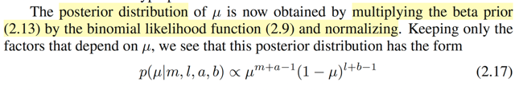</kbd>

<kbd>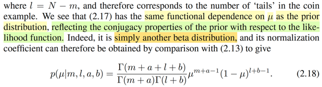</kbd>

> [!NOTE]
> kết quả này nãy mình đã hiểu rồi khi đã cho thấy posterior chính là β(Σxi+a,
> N-Σxi+b), với m = Σixi, cũng là số observed data = 1, và l = N - Σxi = N - m thì
> ta có kết qủa 2.17 trong sách.
>
>
>
> Và cũng như mình đã làm, gs Bishop cũng nói rằng nó có dạng kernel của
> β(m+a,l+b), nên ta có quyền suy ra giá trị constant (lúc nãy ta làm thì trên tử có
> constant C = [Γ(a+b)/Γ(a)Γ(b)], và chia cho f(𝐱) ở dưới) còn lại phải là
> normalizing constant của β(m+a,l+b)

> [!TIP]
> 🤖 **AI Check** — 🟢 Pass — ✅ **95/100** · ✓ Move on
>
> Ghi chú thể hiện sự thấu hiểu rất tốt về tính liên hợp (conjugacy) và cách suy ra hằng số chuẩn hóa từ kernel của phân phối Beta mà không cần tính tích phân phức tạp.
>
> **✓ Strengths**
> - Nắm vững tính chất liên hợp (conjugate prior) giữa Beta prior và Binomial likelihood để xác định trực tiếp posterior.
> - Hiểu chính xác kỹ thuật so khớp kernel để suy ra hằng số chuẩn hóa thay vì phải tính tích phân mẫu số f(x) một cách thủ công.
>
> **💡 Deeper notes**
> - Ký hiệu 'm = Σixi' là cách viết tắt của tổng các biến chỉ thị $\sum_i x_i$ (với $x_i \in \{0, 1\}$), tương ứng số lần thành công (heads) trong chuỗi phép thử Bernoulli.

 

###### Tham số Beta: Quan sát hiệu quả

<kbd>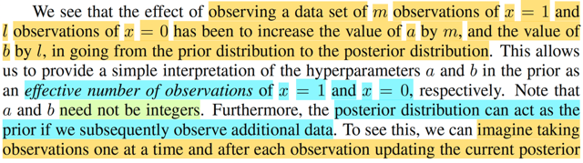</kbd>

<kbd>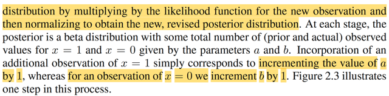</kbd>

<kbd>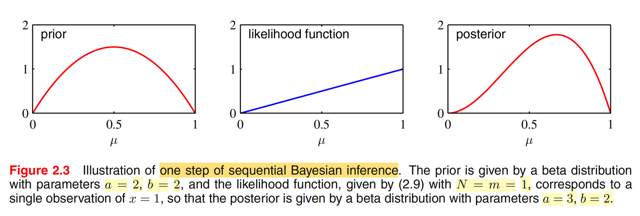</kbd>

> [!NOTE]
> Đại ý là, bắt đầu với prior là β(a,b) để rồi posterior là β(a+số observed success (x=1), b+số observed failure (x=0))
>
>
>
> thế thì ta có thể hình dung một chuỗi suy luận về μ trong đó với mỗi lần, ta dùng posterior đang có làm priori, để update với giá trị quan sát mới để có posterior
>
>
>
> khi đó, dễ hiểu là ta sẽ thấy việc cập nhật sẽ có hiệu quả là: cứ mỗi lần quan sát được success (x=1) thì posterior sẽ tăng thêm 1 ở giá trị tham số đầu tiên (a) và nếu quan sát được failure (x=0) thì sẽ tăng thêm 1 ở giá trị tham số thứ hai (b)
>
>
>
> Minh họa bởi hình 2.3, bắt đầu với β(2,2) (là cái chuông "cân xứng"), sau khi quan sát thấy một observed data x=1, posterior trở thành β(3,2), cái chuông nghiêng về μ=1
>
>
>
> Và theo gs Bishop, điều này giúp ta có thể HIỂU / DIỄN GIẢI a, b LÀ GIÁ TRỊ HIỆU QỦA CỦA SỐ QUAN SÁT CỦA SUCCESS (x=1) HAY FAILURE (x=0)

> [!TIP]
> 🤖 **AI Check** — 🟢 Pass — ✅ **95/100** · ✓ Move on
>
> Ghi chú tóm tắt rất chính xác bản chất của suy luận Bayes tuần tự (sequential Bayesian inference) và cách diễn giải siêu tham số $a, b$ như số lần quan sát hiệu dụng.
>
> **✓ Strengths**
> - Nắm vững cơ chế cập nhật tham số của phân phối Beta khi có thêm dữ liệu quan sát dạng Bernoulli/nhị thức.
> - Mô tả chính xác quy trình suy luận Bayes tuần tự (posterior của bước trước trở thành prior của bước sau).
> - Hiểu đúng ý nghĩa trực quan của Hình 2.3 và diễn giải chuẩn xác khái niệm 'effective number of observations' của Bishop.
>
> **💡 Deeper notes**
> - Cụm từ 'effective number of observations' thường được dịch chuẩn xác là 'số lượng quan sát hiệu dụng' (hoặc số quan sát ảo/tiền định), và giáo trình có lưu ý thêm rằng $a$ và $b$ không nhất thiết phải là số nguyên.

 

###### Học tuần tự Bayesian

<kbd>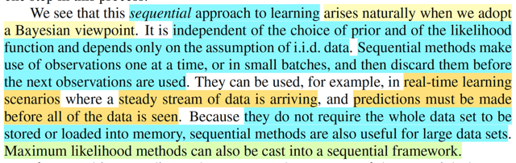</kbd>

> [!NOTE]
> Đại khái là cái ta vừa nói, gọi là sequential approach to learning (ý là việc học (học ra giá trị tham số của distribution) theo chuỗi) nó là cách tiếp cận rất tự nhiên khi ta theo trường phái / góc nhìn Bayesian. Vì nó ko phụ thuộc cách chọn prior, điều này là rõ ràng, mà chỉ phụ thuộc vào giả định iid của data, vì sao?
>
>
>
> HIểu đơn giản. Còn **nhớ chính nhờ iid**, nên **joint pdf** f(𝐱|θ) **mới tách thành tích các** f(xi|θ). Ví dụ ta có x1,x2. Thì nhờ iid mà f(x1,x2|θ) = f(x1|θ)f(x2|θ).
>
>
>
> Từ đó với prior π(θ), posterior π(θ|x1,x2) ∝ f(x1,x2|θ)π(θ) thì cái này cũng bằng f(x2|θ)f(x1|θ)π(θ), và π(θ|x1) thì ∝ f(x1|θ)π(θ) thì
>
>
>
> Thành ra ta có thể coi như quá trình học ra π(θ|x1,x2) gồm 2 bước:
>
>
>
> π(θ|x1) ∝ f(x1|θ)π(θ)
>
>
>
> π(θ|x1,x2) ∝ f(x2|θ)π(θ|x1)
>
>
>
> Và để bảo đảm tính valid của việc này thì c**hỉ cần tính iid của data**, chứ prior distribution là gì, hay likelihood là gì thì đều ko care
>
>
>
> Để rồi ta có thể mỗi lần, dùng data quan sát được, (một hoặc một vài observed data) để update posterior, sau đó thì vứt chúng đi, không cần lưu làm gì.
>
>
>
> Nhờ vậy, với bài toán có data nhiều hoặc bài toán mà ta cần đưa ra dự đoán khi data ở dạng stream, ta có thể làm kiểu này, để không phải lưu trữ data. (Cái này gọi là real-time learning)

> [!TIP]
> 🤖 **AI Check** — 🟢 Pass — ✅ **100/100** · ✓ Move on
>
> Ghi chú rất xuất sắc, giải thích cặn kẽ và chính xác bằng toán học tại sao tính chất i.i.d. cho phép cập nhật Bayesian tuần tự (sequential learning). Đồng thời, bạn cũng nắm rõ ứng dụng thực tế cho dữ liệu lớn và xử lý luồng thời gian thực.
>
> **✓ Strengths**
> - Diễn giải toán học cụ thể và chính xác cách posterior của bước trước trở thành prior của bước sau nhờ vào giả định i.i.d.
> - Nắm bắt trọn vẹn và đúng đắn các ưu điểm thực tế như tiết kiệm bộ nhớ và phục vụ học thời gian thực (real-time/online learning).
>
> **💡 Deeper notes**
> - Về mặt lý thuyết xác suất chặt chẽ, tính chất độc lập ở đây là độc lập có điều kiện theo tham số (conditionally independent given θ), cho phép phân rã hàm likelihood chung thành tích các likelihood thành phần.
> - Đoạn cuối của tài liệu gốc có nhắc thêm rằng phương pháp Maximum Likelihood (cực đại hợp lý) cũng có thể áp dụng theo khuôn khổ tuần tự (thông qua các thuật toán xấp xỉ ngẫu nhiên như Robbins-Monro hoặc SGD).

 

###### Phân phối dự đoán Bayesian

<kbd>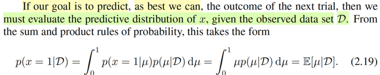</kbd>

> [!NOTE]
> Tiếp theo, đại khái là gs nói nếu ta phải đưa ra dự đoán cho thử nghiệm tiếp theo dựa trên những gì đã quan sát thấy, ta sẽ cần evaluate predictive distribution của x, dựa trên D. Là sao ta?
>
>
>
> Thì thật ra mình đã học cái này trong chap 1 rồi, predictive distribution, lập luận là, với cách tiếp cận Bayesian, ta coi θ (hay ở đây là μ) như random variable, để rồi ta chọn prior distribution cho nó, kí hiệu π(θ) (ví dụ như ta chọn β(a,b) cho làm prior distribution của μ vậy), rồi dùng Bayes rule để xây dựng posterior π(θ|𝐱) ∝ f(𝐱|θ) π(θ) (ví dụ như ta vừa tìm ra posterior của μ là β(a+m,b+l) đó). Thế thì giờ đặt vấn đề muốn dùng kết quả này để đưa ra dự đoán cho lần thử tiếp theo, cũng đồng nghĩa là dựa trên đó, ta muốn tính xác suất của hai giá trị khả dĩ x=1 và x=0.
>
>
>
> Thế thì thế này, X \~ f(x|θ), hay ở đây là X \~ Bern(μ).
>
>
>
> Nên f(x|μ)|x=1 = P\_μ(X=1) = μ.
>
>
>
> Nhưng ta đâu có biết μ, ta chỉ vừa mới có posterior của μ: β(a+m,b+l) tức là ta có f(μ|a,b,m,l) = β(μ|a,b,m,l) thôi.
>
>
>
> Thế thì, nếu nhớ lại trong sách Casella, khi nói về Bayes estimator, sau khi đã có posterior, thì tùy vào việc ta muốn dùng loss là gì thì ta sẽ dùng mean hoặc median của posterior distribution để làm point estimator cho param θ. Ví dụ, nếu dùng square error loss, thì mean E\[θ|𝐗\] θ \~ π(θ|𝐱) chính là Bayes estimator mà minimize Bayes risk, cũng là minimize posterior expected loss, ngược lại nếu dùng absolute error loss, thì Bayes estimator là median của posterior.
>
>
>
> Như vậy, theo cách cách làm này, giả sử ta dùng squared error loss, thì E\[μ|𝐱\] với μ \~ β(a+m,b+l), = (a+m)/(a+m+b+l) sẽ chính là Bayes estimator minimize Bayes risk, và từ đó ta đưa ra dự đoán xác suất trial tiếp theo ra x=1 sẽ là (a+m)/(a+m+b+l).
>
>
>
> Nhưng mà trong sách này, như đã thấy trong chap 1 (xem link), gs Bishop không làm kiểu đó. Mà thay vào đó, ông nói rằng vì trong bài toán machine learning, ta care nhiều hơn đến nhiệm vụ prediction, thay vì inference, tức là ta ko cần biết tham số của population distribution, mà chủ yếu là đưa ra dự đoán dựa trên tham số đó. Chính vì vậy, ví dụ như trong bài toán này, ta ko cần biết population parameter μ là bao nhiêu, mà ta cần dự đoán kết quả cho lần trial tiếp theo, thông qua việc tính xác suất của việc ra X = 1 hay X = 0. Do đó, thay vì dùng một point estimator của μ (ví dụ dùng posterior mean, hay median) ta sẽ lấy trung bình f(x|μ) over mọi possible value của μ với μ \~ posterior π(μ|𝐱), để có P(X=x|𝐱) gọi là **predictive distribution**
>
>
>
> Và hành động này cũng chính marginalizing joint pdf của x, μ: f(x, μ) với mọi giá trị khả dĩ của μ \~ posterior:α
>
>
>
> ∫f(x, μ|𝐱) dμ = ∫f(x|μ) π(μ|𝐱) dμ (f(x|μ,𝐱) = f(x|μ) do gỉa định độc lập của các data point) 
>
>
>
> f(x|𝐱) hay p(x|𝐱) = P(X=x|𝐱) = E\[f(x|μ)|𝐱\] với μ \~ π(μ|𝐱), = ∫f(x|μ) π(μ|𝐱)dμ
>
>
>
> và với Bern(μ) thì f(x|μ) = \[μ^x\]\[(1-μ)^(1-x)\]
>
>
>
> ⇨ E\[f(x|μ)|𝐱\] = ∫\[μ^x\]\[(1-μ)^(1-x)\] β(μ|a+m,b+l) dμ
>
>
>
> Để rồi P(X=1|𝐱) = E\[f(x|μ)|𝐱\]|x=1 
>
>
>
> = ∫μ^1(1-μ)^(1-1) β(μ|a+m,b+l) dμ
>
>
>
> = ∫ μ β(μ|a+m,b+l) dμ
>
>
>
> và cái này cũng lại chính là E\[μ|𝐱\] (hay E\[μ|/D/\] tức mean của posterior distribution.
>
>
>
> (chữ D in hoa trong sách Bishop cũng chính là observed data 𝐱 thôi)
>
>
>
> ---
>
>
>
> Nói thêm chút, vì sao ∫f(x|μ)π(μ|𝐱)dμ lại là E\[f(x|μ)\] với μ \~ π(μ|𝐱)?
>
>
>
> Nhìn thế này sẽ hiểu: f(x|μ) là gì, nó là P(X=x|μ), tức là pmf của X, một random variable có distribution là Bern(μ), và evaluate tại x, mang ý nghĩa với xác suất của event X=x xảy ra là bao nhiêu nếu X \~ Bern(μ). Dĩ nhiên, theo định nghĩa của Bernoulli distribution thì P(X=x|μ) = \[μ^x\]\[(1-μ)^(1-x)\]
>
>
>
> nhưng ở đây ta sẽ nhìn nó dưới góc độ là hàm của μ: f(x|μ) = g(μ) 
>
>
>
> Mà μ là random variable (đây là cái mà trường phái Bayesian khác với Frequentist), nên f(x|μ) là gì: một hàm số của random variable, thì cũng là random variable! Đây là điều mà gs Joe Blizstein đã nhắc lại nhiều lần trong Stat110.
>
>
>
> À, như vậy f(x|μ) là một random variable, THÌ DO ĐÓ TA CÓ THỂ NÓI VỀ KÌ VỌNG CỦA NÓ: E\[f(x|μ)\] (vì chỉ có random variable mới có quyền có kì vọng)
>
>
>
> (hoặc chặt chẽ hơn thì ghi E\[f(x|μ)|𝐱\])
>
>
>
> Rồi, tính kì vọng của cái random variable này thế nào?
>
>
>
> → LOTUS: Vì nó là hàm của μ, là random variable có distribution posterior π(μ|𝐱) nên theo LOTUS, khi một biến Y được tạo thành bởi áp hàm g lên biến X, thì EY = ∫g(x)f(x)dx.
>
>
>
> Vậy E\[f(x|μ)|𝐱\] = ∫f(x|μ) π(μ|𝐱)dμ
>
>
>
> và trong trường hợp đặc biệt này (trường hợp khác thì chưa chắc) là khi f(x|μ) = μ thì E\[f(x|μ)|𝐱\] = ∫μ π(μ|𝐱)dμ và cái này chính là E\[μ|𝐱\], tức mean của posterior, như đã nói, cũng chính là Bayes esimator của μ khiến minimize Bayes risk với squared error loss function.

> [!TIP]
> 🤖 **AI Check** — 🟡 Minor issues — ✅ **95/100** · ✓ Move on
>
> Ghi chú xuất sắc, thể hiện sự hiểu biết sâu sắc và kết nối chặt chẽ giữa lý thuyết ước lượng Bayes (Casella-Berger) với phân phối dự đoán (Bishop), đồng thời giải thích bản chất LOTUS rất trực quan.
>
> **🟡 Minor issues**
>
> **1.** *"∫f(x, μ|𝐱) dμ = ∫f(x|μ) π(μ|𝐱) dμ"*
>
> Bước khai triển tích phân ngầm ẩn giả định tính độc lập có điều kiện: $p(x|\mu, \mathbf{x}) = p(x|\mu)$ (khi đã biết tham số $\mu$, kết quả của lần thử mới $x$ độc lập với dữ liệu quá khứ $\mathbf{x}$). Nên nêu rõ giả định này để lập luận toán học hoàn chỉnh.
>
>
> **✓ Strengths**
> - So sánh rất sâu sắc giữa việc chọn point estimator (như posterior mean dưới squared error loss) và việc lấy tích phân toàn phần (marginalization) để thu được predictive distribution.
> - Giải thích chính xác và trực quan việc áp dụng định lý LOTUS khi coi $f(x|\mu)$ là một hàm ngẫu nhiên của $\mu$.
> - Tự diễn giải và chứng minh lại công thức (2.19) mạch lạc từ các tiên đề xác suất thay vì chỉ chép lại.
>
> **💡 Deeper notes**
> - Trong trường hợp Bernoulli với $x=1$, phân phối dự đoán vô tình trùng với posterior mean $\mathbb{E}[\mu|\mathcal{D}]$. Tuy nhiên với các phân phối khác (ví dụ Gaussian dự đoán $x$ mới), predictive distribution $p(x|\mathcal{D})$ sẽ có độ biến thiên (variance) lớn hơn variance của posterior do cộng dồn cả độ bất định của tham số lẫn độ nhiễu nội tại của dữ liệu mới.

 

###### Hội tụ Ước lượng Bayes và ML

<kbd>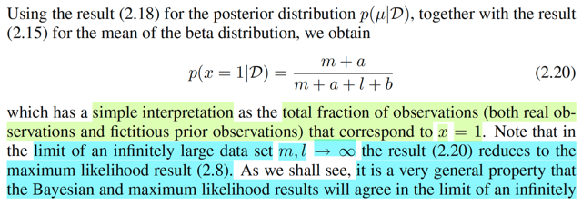</kbd>

<kbd>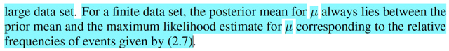</kbd>

> [!NOTE]
> kết quả 2.20 chính là mean của posterior, là một β(a+m, b+l) như mình vừa nói
> trong note trước. Và với công thức mean của β(a,b) = a/a+b thì mean của 
> posterior là (a+m)/(a+m+b+l)
>
>
>
> Điểm đáng suy nghĩ là, gs cho biết khi m và l → inf, thì kết quả này nó sẽ
> converge về kết quả của dự đoán nếu ta dùng maximum likelihood μ^_ML
>
>
>
> Vì sao nhỉ? 
>
>
>
> À là vì ta đã derive μ^_ml rồi, cho ra kết quả chính là m / N, hay m / (m + l)
> (cũng chính là sample mean).
>
>
>
> thì khi m, l càng lớn ảnh hưởng của a, và b trong (a+m)/(a+m+b+l) sẽ nhỏ
> dần, (a+m)/(a+m+b+l) → m/(m+l)
>
>
>
> và gs nói, đây là tính chất mang tính khái quát, khi dataset càng lớn thì kết quả
> của Bayesian và maximum likelihood sẽ trở nên giống nhau
>
>
>
> Còn trong một bộ data hữu hạn, thì posterior mean của μ sẽ **luôn nằm đâu đó
> giữa prior mean và μ_ML**
>
>
>
> Đây là một nhận định mà có vẻ trong sách Casella đã nói, thông qua việc 
> ông nói rằng Bayes estimator, nhờ có prior, nó sẽ khiến kết luận của Bayes
> estimator luôn ít extreme hơn là của maximum likelihood, kiểu như nhờ có 
> prior nên nó sẽ luôn có vai trò kìm hãm, kéo lại giúp tránh các estimate
> quá extreme.
>
>
>
> Với cách hiểu này, mình thấy nó y như vai trò của regularization, mà trong 
> chap 1 quả thật ta đã thấy việc giải bài toán curve fitting có regularization 
> theo Bayesian cũng chính là maximize posteriori

> [!TIP]
> 🤖 **AI Check** — 🟢 Pass — ✅ **98/100** · ✓ Move on
>
> Ghi chú xuất sắc! Bạn đã hiểu cặn kẽ bản chất toán học của phân phối hậu kỳ, sự hội tụ về Maximum Likelihood khi mẫu tiến ra vô cùng, và có sự liên hệ sâu sắc với hiệu ứng co (shrinkage) cũng như regularization.
>
> **✓ Strengths**
> - Giải thích chuẩn xác lý do vì sao khi m, l tiến ra vô cùng thì ảnh hưởng của prior (a, b) bị triệt tiêu và nghiệm Bayes hội tụ về Maximum Likelihood.
> - Liên hệ trực giác rất tốt giữa việc posterior mean nằm giữa prior mean và MLE với cơ chế regularization / shrinkage nhằm giảm thiểu các ước lượng cực đoan (extreme estimates).
>
> **💡 Deeper notes**
> - Về mặt đại số, posterior mean thực chất là một tổ hợp lồi (weighted average / convex combination) giữa prior mean và MLE: E[μ|D] = λ * (a/(a+b)) + (1 - λ) * (m/N), với trọng số λ = (a+b)/(a+b+N). Điều này chứng minh chặt chẽ vì sao nó luôn nằm giữa hai giá trị này.

 

###### Giảm phương sai hậu nghiệm

<kbd>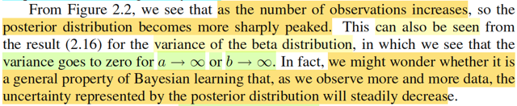</kbd>

<kbd>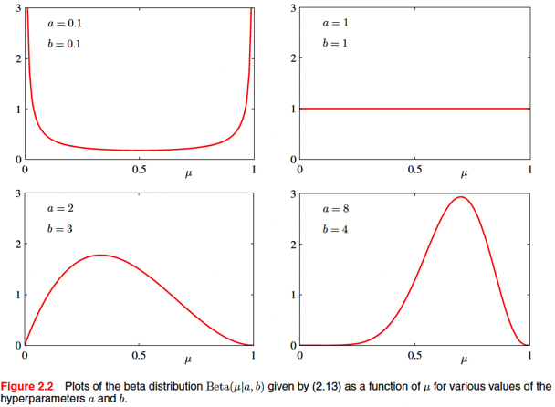</kbd>

> [!NOTE]
> Đại khái là, dựa vào hình 2.2, ta có thể thấy khi số lượng quan sát tăng lên,
> thì distribution ngày càng "nhọn" hơn. Là sao?
>
>
>
> ví dụ với β(1,1), tương đương uniform(0,1), distribution hoàn toàn phẳng.
>
>
>
> Khi có thêm 3 observed data  với 1 success, 2 failure, thì posterior trở thành
> β(2,3), bắt đầu có hình quả đồi.
>
>
>
> (ta nhớ lập luận theo chuỗi (sequential Bayesian) lúc nãy: tại mỗi mắt xích,
> posterior đóng vai prior, để rồi cùng với likelihood để update lại posterior mới
> ví dụ prior đang là β(a,b) quan sát thấy m+l observation với m success (X=1)
> và l failure (X=0) thì posterior mới sẽ là β(a+m, b+l)
>
>
>
> khi có thêm 7 observation với 6 success, 1 failure thì posterior trở thành β(8,
> 4), có đỉnh nhọn hơn nữa.
>
>
>
> Bên cạnh đó công thức variance của β(a,b) (2.16) cũng cho thấy nếu a,b
> càng lớn thì variance càng nhỏ, cũng giải thích hiện tượng nói trên (đồ thị pdf
> càng nhọn, thì nó càng ốm → chính là variance càng nhỏ)
>
>
>
> -----
>
>
>
> Thế thì, gs Bishop mới đặt vấn đề là, liệu đây có phải là tính chất khái quát
> không, **rằng càng có nhiều data thì posteriori** sẽ **ngày càng có variance
> nhỏ** **lại**, (variance cũng là thể hiện tính uncertainty) hay không?

> [!TIP]
> 🤖 **AI Check** — 🟢 Pass — ✅ **98/100** · ✓ Move on
>
> Ghi chú rất xuất sắc, hiểu đúng và sâu sắc nội dung sách khi tự liên hệ các đồ thị trong Hình 2.2 với quá trình cập nhật tuần tự (sequential updating) từ prior đều Beta(1,1).
>
> **✓ Strengths**
> - Minh họa rất trực quan sự thay đổi hình dạng của phân phối qua các bước quan sát tuần tự từ Beta(1,1) lên Beta(2,3) và Beta(8,4).
> - Nắm chuẩn quy tắc conjugate update của Beta-Binomial: cộng dồn số lần thành công và thất bại vào tham số a và b.
> - Liên hệ chính xác giữa độ nhọn của đồ thị hàm mật độ, phương sai (variance) và mức độ bất định (uncertainty).
> - Đặt đúng câu hỏi mở đầu mang tính khái quát mà tác giả Bishop nêu ra về bản chất của suy diễn Bayesian.
>
> **💡 Deeper notes**
> - Theo công thức phương sai của Beta, chỉ cần ít nhất một trong hai tham số a hoặc b tiến tới vô cùng (hoặc tổng a + b tiến tới vô cùng) thì phương sai đã tiến về 0, không nhất thiết cả hai đều phải đồng thời rất lớn.

 

###### Luật Adam và Bayes

<kbd>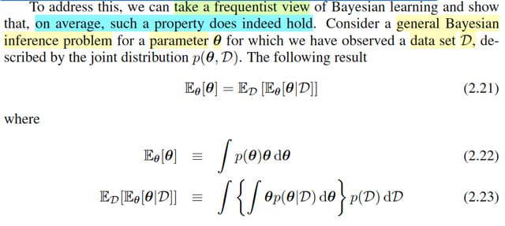</kbd>

> [!NOTE]
> Thế thì để chứng minh rằng, tính chất vừa nói: khi càng có nhiều data thì độ
> không chắc chắn (uncertainty) của param μ thể hiện bởi posterior  distribution
> càng giảm sẽ càng, ta xét bài toán inference khái quát với  θ là population
> parameter và D là dữ liệu quan sát được (y như trong Casella là 𝐗 - random
> sample lấy từ distribution).
>
>
>
> Thế thì trước tiên, mình nhớ lại Stat110 đã học công thức này: Adam's Law:
>
>
>
> EX = E[E(X|Y)], thử chứng minh lại:
>
>
>
> E(X|Y) là cái gì, hay nên nhìn nhận nó như thế nào? và vì sao lại lấy kì vọng
> của cái này, và vì sao khi làm vậy lại ra EX.
>
>
>
> Đầu tiên, để có thể lấy kì vọng của nó E[E(X|Y)], thì nó phải là một random
> variable. Vậy thì có phải nó là random variable?
>
>
>
> Xét E(X|Y), bản chất của cái này là gì, thì trước tiên xét bản chất của EX là gì
> trước.
>
>
>
> EX, theo định nghĩa mà thầy Joe trong Stat110 dạy rằng, nó chỉ là giá trị trung
> bình. Vì X là random variable, vốn có bản chất là một hàm số map từ một
> possible outcome trong original sample space sang một con số thực. Nên  với
> các possible outcome khác nhau, ta có các possible value khác nhau của X. Và
> EX chỉ là trung bình của đám này. Chấm hết. Có điều, khi tính trung bình, ta sẽ
> gán trọng  số vào các giá trị, sao cho cái nào xuất hiện nhiều thì trọng số lớn,
> và ngược lại. Và trọng số đó chính là xác suất possible value đó xảy ra, hay
> pmf của X: P(X=x) Nên EX = Σ{mọi possible value x của X} P(X=x) x, hay viết
> vầy cho gọn Σi xi f(xi) Với biến liên tục thì nó trở thành ∫xf(x)dx với f(x) là pdf của
> X
>
>
>
> Vậy quay lại nói về E(X|Y). Thì hãy cho Y = một possible value y nào đó trước
> rồi nói tiếp: E(X|Y=y), hay viết gọn là E(X|y), hoàn toàn tương tự theo định
> nghĩa trên cũng chỉ là giá trị trung bình của X, chấm hết. Chỉ có điều ta cũng
> gán trọng số, và lần này, trọng số là xác suất mà một possible value x nào đó
> của X xuất hiện khi đã biết Y=10. Nên:
>
>
>
> E(X|Y=10) = Σ{mọi possible value x của X} x P(X=x|Y=10), hay viết gọn là Σi xi
> f(xi|y)
>
>
>
> Thế thì, kết quả này (E(X|10)) vì mình đã trung bình mọi possible value của X
> rồi NÊN NÓ KHÔNG PHỤ THUỘC X NỮA, HAY NÓI CÁCH KHÁC, NÓ LÀ
> MỘT CON SỐ CỐ ĐỊNH.
>
>
>
> Tuy nhiên, nên nhớ là ta đang tính với Y=10, tức là đã biết giá trị của Y, nên kết
> quả E(X|10) ra một con số cố định.
>
>
>
> Chứ nếu thay 10 bằng y, thì bản thân E(X|y) dĩ nhiên sẽ là một  hàm theo y.
>
>
>
> Vậy thì dừng lại đây, để nhớ một lời dạy khác của gs Joe trong Stat110: Bất kì
> khi nào ta có hàm g(x), ví dụ g(x) = x² + 1. Và ta đem áp vào random variable
> X: Để có g(X) = X² + 1, thì ta sẽ có MỘT RANDOM VARIABLE MỚI. Tức là
> g(X) là một random variable.
>
>
>
> Quay lại ý trên, ta đã nói E(X|y) là một hàm số theo biến y, ví dụ gọi là g(y)
>
>
>
> Ta đem áp hàm số này vào random variable Y, để có g(Y) = E(X|Y), thì như vừa
> nói, ta sẽ được một random variable mới.
>
>
>
> Vậy, E(X|Y) chính là random variable có được khi áp hàm g(t) = E(X|y) vào
> random variable Y. Và vì vậy, dĩ nhiên ta có thể bàn về kì vọng của nó:
> E[E(X|Y)]
>
>
>
> Và việc hiểu bản chất này cũng sẽ giúp ta chứng minh vì sao E[E(X|Y)] = EX
>
>
>
> Cụ thể là: ta vừa kết luận E(X|Y) có bản chất chỉ là g(Y) với g(y) = E[X|y]. và
> mình muốn tính kì vọng của g(Y). Thì trong Stat110, đã học LOTUS  tức Law Of
> Unconscious Statistician cho phép ta tính kì vọng của một biến ngẫu nhiên
> nhiên có được từ việc áp một hàm số lên biến ngẫu nhiên khác như sau:
>
>
>
> Eg(Y) = Σ{mọi possible value y của Y} g(y)P(Y=y)
>
>
>
> = Σ{mọi possible value y của Y} E[X|y] P(Y=y)
>
>
>
> viết gọn lại Σ{mọi y} E[X|y] P(Y=y)
>
>
>
> Đến đây thay E[X|y] ở trên vào, = Σ{mọi possible value x của X} xP(X=x|Y=y)
>
>
>
> viết gọn Σ{mọi x} xP(X=x|Y=y)
>
>
>
> ta có Eg(Y) = E[E[X|Y]] = Σ{mọi y} [Σ{mọi x} xP(X=x|Y=y)] P(Y=y)
>
>
>
> = Σ{mọi y} P(Y=y) [Σ{mọi x} xP(X=x|Y=y)]
>
>
>
> Đưa P(Y=y) đang đứng ngoài cái tổng ở trong vào trong cái tổng đó:
>
>
>
> .. = Σ{mọi y} [ Σ{mọi x} xP(X=x|Y=y)P(Y=y) ]
>
>
>
> Thay P(X=x|Y=y)P(Y=y) = P(X=x,Y=y), đây là định nghĩa của conditional
> probability
>
>
>
> = Σ{mọi y} [ Σ{mọi x} xP(X=x,Y=y)]
>
>
>
> Đây là tổng của tổng, ta có thể đổi chỗ hai tổng:
>
>
>
> = Σ{mọi x} [Σ{mọi y}xP(X=x,Y=y)]
>
>
>
> x ở trong tổng y không phụ thuộc y, đưa ra
>
>
>
> = Σ{mọi x} x [Σ{mọi y}P(X=x,Y=y)]
>
>
>
> đến đây, cái tổng ở trong: Σ{mọi y}P(X=x,Y=y) chính là marginalizing joint pmf
> của X,Y over mọi possible value của Y, ta biết một theorem nói rằng, nó chính là
> marginal pmf của X, tức P(X=x). Cái này có thể chứng minh dễ dàng bằng
> LOTP (Định lí xác suất toàn phần)
>
>
>
> Vậy ta có Σ{mọi x} x P(X=x) và cái này chính là EX theo định nghĩa
>
>
>
> -------
>
>
>
> Như vậy ta đã tự chứng minh lại công thức mà trong Stat110 gs Jow gọi là
> Adam's Law, áp dụng cho **θ** và D (D tương đương với 𝐗, tức random
> sample lấy (draw) từ population distribution trong bối cảnh thống kê dĩ nhiên
> cũng  là random variable (vector)):
>
>
>
> E[θ] = E[E[θ|D]] chính là công thức 2.21, mà gs Bishop ghi rõ với chữ D hay θ
> dưới chân là vì:
>
>
>
> vì khi tính E[θ|D], dĩ nhiên ta coi θ là random variable cần tính trung bình, nên ta
> sẽ dùng trọng số là phân phối của θ conditioned on observed  value của D, nên
> gs Bishop kí hiệu θ dưới chân chữ E thứ 2
>
>
>
> (y như ở trên ta tính E[X|y] = Σ{x} P(X=x|Y=y)
>
>
>
> còn với E[E[θ|D]], ta tự hiểu E[θ|D] là random variable cần tính trung bình, nên
> ta sẽ thông qua LOTUS, tính trung bình các giá trị của nó với phân phối của D,
> nên  gs Bishop có kí hiệu chữ D ở dưới chữ E thứ nhất là vậy.
>
>
>
> Và và phân tích bản chất ở trên cũng giúp ta hiểu 2.22 và 2.23:
>
>
>
> i) 2.22: Y như E(X) = Σ{mọi x} xP(X=x) với biến discrete và ∫xf(x)dx với biến liên
> tục có pdf f(x), thì ở đây cũng vậy, **θ** là random variable liên tục:
>
>
>
> E[**θ**] = ∫**θ**f(**θ**)d**θ** 
>
>
>
> Đúng hơn phải hiểu thêm đây là tích phân đa, vì θ đang kí hiệu chữ đậm, là random
> vector.
>
>
>
> ii) 2.23:
>
>
>
> E[θ|D] thì y như E[X|Y=y] ở trên đã nói = Σ{mọi x} xP(X=x|Y=y)
>
>
>
> với biến liên tục thì E[X|Y=y] = ∫xf(x|y)dx
>
>
>
> ⇨ E[**θ**|D] = ∫**θ**f(**θ**|D)d**θ**
>
>
>
> Và E[E[X|Y]] = Σ{mọi y} P(Y=y) [Σ{mọi x} xP(X=x|Y=y)]
>
>
>
> với biến liên tục sẽ là ∫ [∫ xf(x|y)dx] f(y) dy
>
>
>
> ⇨ E[E[**θ**|D]] = ∫ [∫**θ**f(**θ**|D)d**θ**] f(D) dD

 

###### Định luật Adam

<kbd>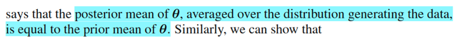</kbd>

> [!NOTE]
> Và mục đích của viện dẫn Adam's Law, là gs Bishop muốn nói rằng, nếu ta
> có posterior mean. (E(**θ**|D=một observed value của D) rồi đem trung bình
> ở mọi D  thì kết qủa sẽ chính là prior mean E[θ].

 

###### Mối quan hệ phương sai Bayes

<kbd>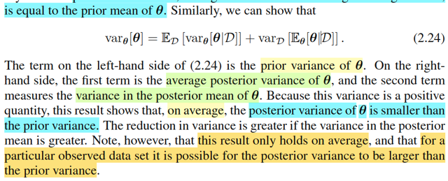</kbd>

> [!NOTE]
> Tính chất thứ hai liên quan đến một tính chất của variance đã học trong Stat110: Eve's Law
>
>
>
> Var(Y) = E\[Var(Y|X)\] + Var\[E(Y|X)\]
>
>
>
> Var(Y) = E\[(Y - EY)²\] (định nghiã của variance)
>
>
>
> = E\[(Y - E\[Y|X\] + E\[Y|X\] - EY)²\]
>
>
>
> = E\[(Y - E\[Y|X\])² + 2(Y - E\[Y|X\])(E\[Y|X\] - EY) + (E\[Y|X\] - EY)²\]
>
>
>
> = E\[(Y - E\[Y|X\])² + 2E\[(Y - E\[Y|X\])(E\[Y|X\] - EY)\] + E\[(E\[Y|X\] - EY)²\]
>
>
>
> Xét hạng tử đầu tiên: E\[(Y - E\[Y|X\])²\], đặt Z = (Y - E\[Y|X\])²
>
>
>
> Áp dụng Adam's Law: E\[Z\] = E\[E\[Z|X\]\]
>
>
>
> = E\[E\[(Y - E\[Y|X\])²|X\]\]
>
>
>
> cái này chính là E\[Var(Y|X)\]. vì sao?
>
>
>
> Vì theo định nghĩa của variance của Y, Var(Y) = E\[(Y - EY)²\]
>
>
>
> thì variance của Y conditioned on X sẽ là Var(Y|X) = E\[(Y - E(Y|X)²|X\]
>
>
>
> Xét hạng tử thứ ba: E\[(E\[Y|X\] - EY)²\]
>
>
>
> E\[Y|X\] là random variable có được bởi việc áp hàm E\[Y|X=x\] lên X.
>
>
>
> Xét mean của nó E\[E\[Y|X\]\], theo Adam's law, chính là bằng EY.
>
>
>
> vậy E\[(E\[Y|X\] - EY)²\] = E\[(E\[Y|X\] - E\[E\[Y|X\]\])²\] nhìn thì rối, nhưng nếu đặt cái random variable E\[Y|X\] là Z ta sẽ thấy nó là E\[(Z - EZ)²\] nên đây chính là Var(Z).
>
>
>
> Vậy term thứ ba chính là Var\[E(Y|X)\]
>
>
>
> Xét term thứ hai: 2E\[(Y - E\[Y|X\])(E\[Y|X\] - EY)\]
>
>
>
> Coi nguyên cục trong kì vọng là U, thì term thứ 2 là 2E(U). Áp dụng Adam's law: EU = E\[E(U|X)\]
>
>
>
> E\[U|X\] là random variable có được bởi việc áp hàm E\[U|X=x\] lên x.
>
>
>
> ⇨ E\[E\[U|X\]\] = ∫ E\[U|X=x\] fX(x) dx
>
>
>
> E\[U|X=x\] = E\[(Y - E\[Y|X\])(E\[Y|X\] - EY)|X=x\]
>
>
>
> vì đã condition on X=x, nên E\[Y|X\] không còn là random variable, mà là fixed value E\[Y|X=x\]
>
>
>
> = E\[(Y - E\[Y|X=x\])(E\[Y|X=x\] - EY)|X=x\]
>
>
>
> dẫn đến E\[Y|X=x\] - EY trở thành fixed value, đưa ra ngoài kì vọng theo tính linearity
>
>
>
> = (E\[Y|X=x\] - EY) E\[(Y - E\[Y|X=x\])|X=x\]
>
>
>
> tới đây thừa số E\[(Y - E\[Y|X=x\])|X=x\], theo linearity = E(Y|X=x) - E\[E(Y|X=x)|X=x\]
>
>
>
> = E(Y|X=x) - E(Y|X=x) = 0 (Do E(Y|X=x) là constant, nên E\[E(Y|X=x)|X=x\] = E(Y|X=x)
>
>
>
> Như vậy term thứ hai = (E\[Y|X=x\] - EY) . 0 = 0
>
>
>
> Kết luận Var(Y) = E\[Var(Y|X)\] + Var\[E(Y|X)\]
>
>
>
> ---
>
>
>
> Áp dụng vào đây giúp ta hiểu:
>
>
>
> ⇨ Var(θ) = E\[Var(θ|D)\] + Var\[E(θ|D)\]
>
>
>
> Và xét Var\[E(θ|D)\]:
>
>
>
> Nếu với D = một observed value d của D, ta có E\[θ|D=d\] là kì vọng của θ với θ \~ π(θ|D=d) dĩ nhiên chính là mean của posterior.
>
>
>
> ⇨ E(θ|D) là random variable khi áp hàm E\[θ|D=d\] lên D, giá trị của nó mang ý nghĩa, với mean của posterior ứng với các possible value khác nhau của D,
>
>
>
> Và Var(E(θ|D)) sẽ là variance của random variable này, do đó nó mang ý nghĩa là độ biến động của giá trị posterior mean khi giá trị của D thay đổi, do đó gs Bishop gọi nó là "variance in posterior mean", variance của posterior mean
>
>
>
> Chú ý, nó hoàn toàn không phải là variance của posterior distribution. Hiểu thế này: E\[θ|D=d\] là một point estimator của θ với θ \~ π(θ|D=d), tức là, một ước lượng điểm của θ, được tính bởi cách thức dùng mean của posterior distribution để ước lượng. Và vì tùy vào giá trị của D, ta có các posterior khác nhau, nên cái sự ước lượng ) này là một hàm số, hay, E\[θ|D\] cũng là một biến ngẫu nhiên. Tóm lại E\[θ|D\] là posterior mean, là một biến ngẫu nhiên và Var của nó là variance của posterior mean.
>
>
>
> Còn variance của posterior distribution thì phải kí hiệu là Var(θ|D=d), mang ý nghĩa là variance của θ với θ \~ π(θ|D=d).
>
>
>
> Như vậy thì đây cũng là một hàm số phụ thuộc d, nên Var(θ|D) cũng là một random variable có được do áp hàm Var(θ|D=d) lên D.
>
>
>
> Và E\[Var(θ|D)\] chính là lấy mean của random variable này, nên nó mang ý nghĩa là trung bình của \[variance của posterior distribution\]
>
>
>
> Chốt lại,
>
>
>
> term thứ nhất, mang ý nghĩa: **trung bình / kì vọng của \[variance của posterior distribution\]**
>
>
>
> term thứ hai mang ý nghĩa: **variance / độ biến động của \[posterior mean\]**
>
>
>
> Còn bên trái, Var(θ) dĩ nhiên là **\[variance / độ biến động của prior distribution\]**
>
>
>
> mà term thứ hai, (variance / độ biến động của \[posterior mean\]) dĩ nhiên không âm do variance thì luôn không âm
>
>
>
> suy ra:
>
>
>
> variance / độ biến động của prior distribution = số k0 âm + trung bình / kì vọng của \[variance của posterior distribution\]
>
>
>
> ⇨ **variance / độ biến động của prior distribution** ≥ **trung bình / kì vọng của \[variance của posterior distribution\]**
>
>
>
> ---
>
>
>
> Vậy thì cái kết luận vừa rồi cũng chính là (nói bằng lời): nói chung (lấy trung bình trên các bộ dataset D=d khác nhau) thì variance của posterior sẽ nhỏ hơn so với variance của prior. Cũng chính là nói: Khi ta chưa biết gì về D, chưa quan sát thấy data, lúc này chỉ dựa vào prior distribution, thì ta có variance của θ là nhiêu đó, ví dụ = a, thì sau khi có dữ liệu để rồi ta cập nhật lại distribution của θ, để có posterior distribution, thì variance của θ lúc này, ví dụ b, thì b sẽ NHỎ HƠN a Và độ giảm của variance, a - b, dĩ nhiên theo phương trình trên, chính là độ lớn của cái term thứ hai: variance / độ biến động của \[posterior mean\]
>
>
>
> Do đó gs Bishop mới nói trong sách rằng, mức độ giảm của variance sẽ càng lớn nếu như variance của posterior mean càng lớn ("The reduction in variance is greater if the variance in the posterior mean is greater").
>
>
>
> Và điều này nhằm chứng minh cho nhận định mà gs Bishop đặt vấn đề lúc nãy: liệu đây có phải là tính chất khái quát không, rằng càng có nhiều data thì posteriori sẽ ngày càng có variance nhỏ lại, (variance cũng là thể hiện tính uncertainty) hay không?

> [!TIP]
> 🤖 **AI Check** — 🟡 Minor issues — ✅ **90/100** · ✓ Move on
>
> Ghi chú rất xuất sắc khi tự chứng minh chi tiết Eve's Law và phân biệt rõ ràng giữa biến ngẫu nhiên và giá trị cụ thể khi condition. Tuy nhiên, ở phần diễn giải trực giác cuối bài, cần làm rõ rằng phương sai chỉ chắc chắn giảm 'trung bình trên mọi bộ dữ liệu', còn với một bộ dữ liệu cụ thể thì phương sai posterior hoàn toàn có thể tăng so với prior.
>
> **🟡 Minor issues**
>
> **1.** *"Cũng chính là nói: Khi ta chưa biết gì về D, chưa quan sát thấy data, lúc này chỉ dựa vào prior distribution, thì ta có variance của θ là nhiêu đó, ví dụ = a, thì sau khi có dữ liệu để rồi ta cập nhật lại distribution của θ, để có posterior distribution, thì variance của θ lúc này, ví dụ b, thì b sẽ NHỎ HƠN a"*
>
> Cách diễn giải ví dụ này dễ gây ngộ nhận rằng cứ mỗi lần thu thập được một bộ dữ liệu cụ thể thì phương sai posterior b luôn nhỏ hơn prior a. Thực tế, như Bishop đã nhấn mạnh ở câu cuối ('for a particular observed data set it is possible for the posterior variance to be larger than the prior variance'), b chỉ nhỏ hơn hoặc bằng a khi b là 'phương sai posterior trung bình' E_D[Var(θ|D)], chứ không phải cho mọi bộ dữ liệu cụ thể D=d.
>
> **2.** *"thì variance của Y conditioned on X sẽ là Var(Y|X) = E[(Y - E(Y|X)²|X]"*
>
> Lỗi gõ dấu ngoặc trong biểu thức: thiếu đóng ngoặc vuông sau E(Y|X) và trước lũy thừa 2, đúng ra là E[(Y - E[Y|X])² | X].
>
>
> **✓ Strengths**
> - Tự triển khai và chứng minh đầy đủ, chính xác định lý phân rã phương sai (Eve's Law / Law of Total Variance) từ định nghĩa và Adam's Law.
> - Phân biệt rất chuẩn xác bản chất của E[θ|D=d] (ước lượng điểm, giá trị cố định) với E[θ|D] (biến ngẫu nhiên là hàm của D), cũng như Var(θ|D=d) với Var(θ|D).
>
> **💡 Deeper notes**
> - Một trực giác thú vị về việc tại sao một dataset cụ thể có thể làm tăng phương sai: nếu dữ liệu quan sát được mâu thuẫn mạnh mẽ với niềm tin tiên nghiệm (hoặc dữ liệu bất ngờ làm phát sinh tính đa cực - multimodal posterior), sự không chắc chắn (uncertainty/variance) sau khi thấy dữ liệu đó có thể tạm thời cao hơn so với prior tập trung ban đầu.

 

