# 3.5.3 Effective number of parameters

📊 **Progress:** `5` Notes | `17` Screenshots | `5` AI Reviews

---

 

## Section 3.5.3 Effective Number of Parameters

<kbd>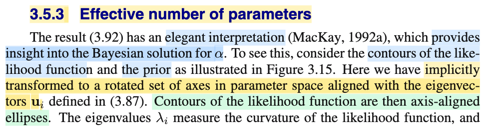</kbd>

<kbd>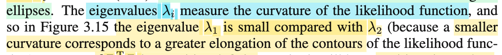</kbd>

<kbd>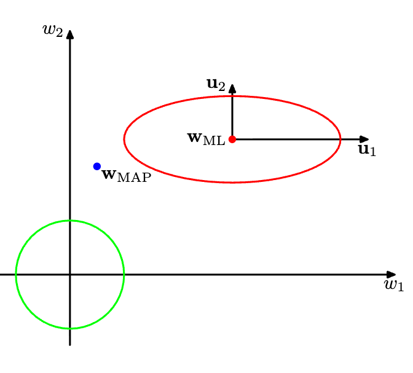</kbd>

<kbd>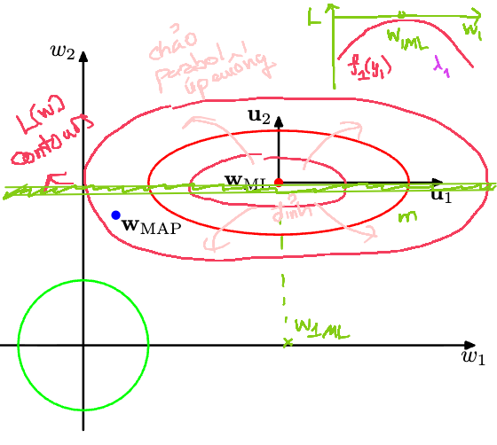</kbd>

<kbd>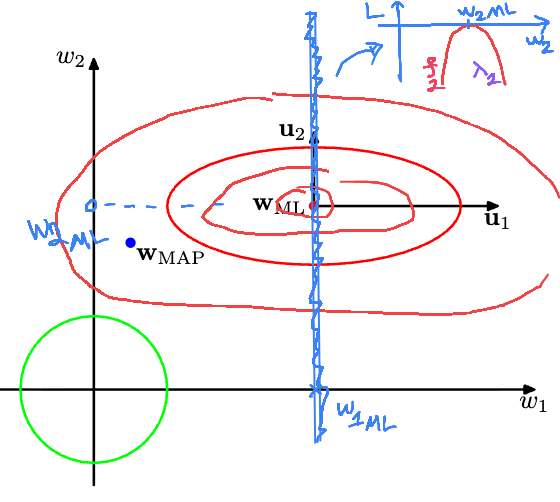</kbd>

<kbd>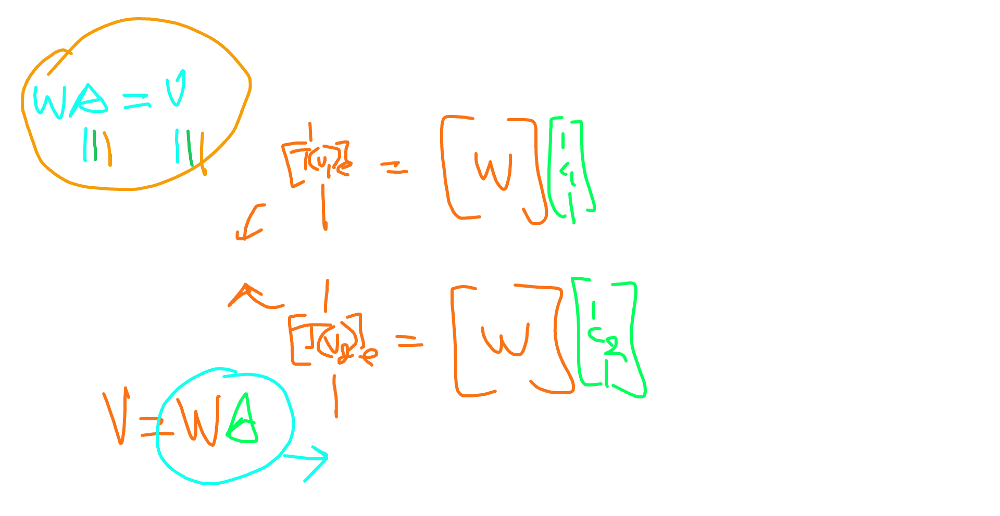</kbd>

> [!NOTE]
> Ok, tiếp theo gs nói kết quả 3.92 sẽ cho ta một góc nhìn hay ho. Đầu tiên ta sẽ xem xét contours (tức level set) của hàm likelihood.
>
>
>
> Rồi ông nói ta đã thầm (implicitly) xoay trục để thẳng góc với các 𝐮i là các eigenvector của β𝚽ᵀ𝚽, và contours này có dạng là hình ellipse thẳng trục.
>
>
>
> Có nghĩa là, mình phải hiểu rằng w1, w2 của vector 𝐰 trong hình thật ra là tọa độ của vector 𝐰 trong hệ trục đã chuyển sang cơ sở 𝐮1, 𝐮2 (eigenvector)
>
>
>
> Là sao?
>
>
>
> Likelihood function là hàm L(𝐰|𝐱1,𝐱2,..t1,t2,..) = L(𝐰|𝒟), theo định nghĩa, nó bằng f(𝒟|𝐰). Có nghĩa là, nó chính là f(𝒟|𝐰) với tư cách là hàm theo 𝐰.
>
>
>
> Ta đang trong mô hình ℳi: (Mô hình chỉ là một giả định về phân phối của dữ liệu)
>
>
>
> t1,t2,...là gía trị quan sát được của T1,T2,...độc lập với Ti\~ n(𝐰ᵀΦ(𝐱i), 1/β).
>
>
>
> Từ đó:
>
>
>
> f(𝒟|𝐰) = f(𝐭|𝐰, β, 𝐱1, 𝐱2,..)
>
>
>
> = Πi=1:N 𝒩(ti|𝐰ᵀΦ(𝐱i),1/β)
>
>
>
> (chính là pdf của 𝒩(𝚽𝐰, (1/β)𝐈))
>
>
>
> = \[(2π)^(-N/2)\] \[1/|((1/β)𝐈)|^(1/2)\] exp\[-(𝐭 - 𝚽𝐰)ᵀ ((1/β)𝐈)⁻¹ (𝐭 - 𝚽𝐰)/2\]
>
>
>
> = c1 exp\[-(𝐭 - 𝚽𝐰)ᵀ ((1/β)𝐈)⁻¹) (𝐭 - 𝚽𝐰)/2\]
>
>
>
> = c1 exp\[-(β/2)(𝐭 - 𝚽𝐰)ᵀ(𝐭 - 𝚽𝐰)\] | (1/β)𝐈)⁻¹ = β𝐈
>
>
>
> ---
>
>
>
> ln likelihood = ln {c1 exp\[-(β/2)(𝐭 - 𝚽𝐰)ᵀ(𝐭 - 𝚽𝐰)\]}
>
>
>
> = ln c1 - ln exp \[(β/2)(𝐭 - 𝚽𝐰)ᵀ(𝐭 - 𝚽𝐰)\]
>
>
>
> = c2 - (β/2)(𝐭 - 𝚽𝐰)ᵀ(𝐭 - 𝚽𝐰)
>
>
>
> = c2 - (β/2)(𝐭ᵀ - 𝐰ᵀ𝚽ᵀ)(𝐭 - 𝚽𝐰)
>
>
>
> = c2 - (β/2)(𝐭ᵀ𝐭 - 𝐰ᵀ𝚽ᵀ𝐭 - 𝐭ᵀ𝚽𝐰 + 𝐰ᵀ𝚽ᵀ𝚽𝐰)
>
>
>
> = c2 - (β/2)(𝐭ᵀ𝐭 - 𝐭ᵀ𝚽𝐰 - 𝐭ᵀ𝚽𝐰 + 𝐰ᵀ𝚽ᵀ𝚽𝐰) (do 𝐰ᵀ𝚽ᵀ𝐭 = (𝐰ᵀ𝚽ᵀ𝐭)ᵀ = 𝐭ᵀ𝚽𝐰)
>
>
>
> = c2 - (β/2)𝐭ᵀ𝐭 + β𝐭ᵀ𝚽𝐰 - (β/2)𝐰ᵀ𝚽ᵀ𝚽𝐰
>
>
>
> = - (β/2)𝐰ᵀ𝚽ᵀ𝚽𝐰 + β𝐭ᵀ𝚽𝐰 + c2 - (β/2)𝐭ᵀ𝐭
>
>
>
> = (1/2)𝐰ᵀ(-β𝚽ᵀ𝚽)𝐰 + (β𝚽ᵀ𝐭)ᵀ𝐰 + c3 (đặt c2 - (β/2)𝐭ᵀ𝐭 = c3)
>
>
>
> Viết lại hàm ln likelihood: ln L(𝐰|𝒟) = (1/2)𝐰ᵀ(-β𝚽ᵀ𝚽)𝐰 + (β𝚽ᵀ𝐭)ᵀ𝐰 + c3
>
>
>
> Hessian chính là -β𝚽ᵀ𝚽, gradient chính là (-β𝚽ᵀ𝚽)𝐰 + β𝚽ᵀ𝐭
>
>
>
> ta có (-β𝚽ᵀ𝚽)𝐰ML + β𝚽ᵀ𝐭 = 0 (do 𝐰ML là nghiệm bài toán maximize hàm likelihood)
>
>
>
> ---
>
>
>
> Dời trục tọa độ về 𝐰ML, tức đặt 𝐰' = 𝐰 - 𝐰ML (\[𝐰'\]\_e = \[𝐰\]\_e - \[𝐰ML\]\_e)
>
>
>
> ln L(𝐰'|𝒟) = (1/2)(𝐰' + 𝐰ML)ᵀ(-β𝚽ᵀ𝚽)(𝐰' + 𝐰ML) + (β𝚽ᵀ𝐭)ᵀ(𝐰' + 𝐰ML) + c3
>
>
>
> = (1/2)(𝐰'ᵀ(-β𝚽ᵀ𝚽) + 𝐰MLᵀ(-β𝚽ᵀ𝚽))(𝐰' + 𝐰ML) + (β𝚽ᵀ𝐭)ᵀ(𝐰' + 𝐰ML) + c3
>
>
>
> = (1/2)(𝐰'ᵀ(-β𝚽ᵀ𝚽)𝐰' + 𝐰MLᵀ(-β𝚽ᵀ𝚽)𝐰' + 𝐰'ᵀ(-β𝚽ᵀ𝚽)𝐰ML + 𝐰MLᵀ(-β𝚽ᵀ𝚽)𝐰ML) + (β𝚽ᵀ𝐭)ᵀ𝐰' + (β𝚽ᵀ𝐭)ᵀ𝐰ML + c3
>
>
>
> = (1/2)(𝐰'ᵀ(-β𝚽ᵀ𝚽)𝐰' + 2𝐰MLᵀ(-β𝚽ᵀ𝚽)𝐰' + 𝐰MLᵀ(-β𝚽ᵀ𝚽)𝐰ML) + (β𝚽ᵀ𝐭)ᵀ𝐰' + (β𝚽ᵀ𝐭)ᵀ𝐰ML + c3
>
>
>
> = (1/2)𝐰'ᵀ(-β𝚽ᵀ𝚽)𝐰' + 𝐰MLᵀ(-β𝚽ᵀ𝚽)𝐰' + (1/2)𝐰MLᵀ(-β𝚽ᵀ𝚽)𝐰ML + (β𝚽ᵀ𝐭)ᵀ𝐰' + (β𝚽ᵀ𝐭)ᵀ𝐰ML + c3
>
>
>
> = (1/2)𝐰'ᵀ(-β𝚽ᵀ𝚽)𝐰' + 𝐰MLᵀ(-β𝚽ᵀ𝚽)𝐰' + (β𝚽ᵀ𝐭)ᵀ𝐰' + c3 + (1/2)𝐰MLᵀ(-β𝚽ᵀ𝚽)𝐰ML + (β𝚽ᵀ𝐭)ᵀ𝐰ML
>
>
>
> = (1/2)𝐰'ᵀ(-β𝚽ᵀ𝚽)𝐰' + \[(-β𝚽ᵀ𝚽)ᵀ𝐰ML + β𝚽ᵀ𝐭\]ᵀ𝐰' + c4
>
>
>
> = (1/2)𝐰'ᵀ(-β𝚽ᵀ𝚽)𝐰' + \[(-β𝚽ᵀ𝚽)𝐰ML + β𝚽ᵀ𝐭\]ᵀ𝐰' + c4
>
>
>
> Mà (-β𝚽ᵀ𝚽)𝐰ML + β𝚽ᵀ𝐭 = 0
>
>
>
> .. = (1/2)𝐰'ᵀ(-β𝚽ᵀ𝚽)𝐰' + c4
>
>
>
> Viết lại ln likelihood L(𝐰'|𝒟) = (1/2)𝐰'ᵀ(-β𝚽ᵀ𝚽)𝐰' + c4 (1)
>
>
>
> ---
>
>
>
> Xét level curve (contour), hay đường đồng mức L(𝐰'|𝒟) = c: (1/2)𝐰'ᵀ(-β𝚽ᵀ𝚽)𝐰' + c4 = c
>
>
>
> ⇔ 𝐰'ᵀ𝚽ᵀ𝚽𝐰' = c5 (nhập c4 với c và nhân 2 chia β, thành c5)
>
>
>
> vì 𝚽ᵀ𝚽 đối xứng, và nếu giả định 𝚽 full column rank thì 𝚽ᵀ𝚽 full rank (do hai cái này chung nullspace).
>
>
>
> Với matrix đối xứng, luôn có thể phân rã thành 𝐐𝚲𝐐ᵀ (𝐐𝚲𝐐⁻¹ nhưng vì 𝐐 orthogonal nên 𝐐⁻¹ = 𝐐ᵀ)
>
>
>
> (𝐐⁻¹ = 𝐐ᵀ: 𝐐ᵀ𝐐 = 𝐈 = 𝐐𝐐ᵀ ⇒ 𝐐ᵀ = 𝐐⁻¹)
>
>
>
> Ta có 𝐰'ᵀ𝐐𝚲𝐐ᵀ𝐰' = c5
>
>
>
> Nếu đặt 𝐲 = 𝐐ᵀ𝐰' = 𝐐⁻¹𝐰' thì đây chính là \[𝐰'\]\_u = 𝐐ᵀ \[𝐰'\]\_e: động tác chuyển từ tọa độ cơ sở 𝐞's (đã gốc hệ trục về \[𝐰ML\]\_e)
>
>
>
> và nay ta chuyển sang hệ trục cơ sở 𝐮's: là các eigenvector của 𝚽ᵀ𝚽
>
>
>
> Trong hệ trục đó, phương trình của level set là:
>
>
>
> 𝐲ᵀ𝚲𝐲 = c5
>
>
>
> ⇔ λ1y1² + λ2y2² +... = c5
>
>
>
> ⇔ λ1y1²/c5 + λ2y2²/c5 +... = 1
>
>
>
> ⇔ y1²/(c5/λ1) + y2²/(c5/λ2) +... = 1
>
>
>
> Đây chính là phương trình ellipsoid.
>
>
>
> Nếu 2D thì đây là phương trình đường ellipse: ⇔ y1²/a² + y2²/b² = 1 với a = √(c5/λ1), b = √(c5/λ2)
>
>
>
> Nên hiểu thế này: 𝐲 chỉ là tọa độ của 𝐰 trong hệ trục mới: gốc đã dời về 𝐰ML, và dùng hệ trục có cơ sở là 𝐮1, 𝐮2,...(sẽ ôn lại change of basis ở dưới)
>
>
>
> và trong hệ trục này, contour là ellipse có trục song song với trục tọa độ 𝐮1, 𝐮2,...
>
>
>
> ---
>
>
>
> Vậy hàm log likelihood trong hệ trục tâm 𝐰ML, basis 𝐮's là:
>
>
>
> f(𝐲) = (1/2)𝐰'ᵀ(-β𝚽ᵀ𝚽)𝐰' + c4 (tiếp tục (1) ở trên, thay 𝐲 = 𝐐ᵀ𝐰')
>
>
>
> = (-β/2)𝐲ᵀ𝚲𝐲 + c4
>
>
>
> (tiếp tục giả sử đang trong 2D)
>
>
>
> = (-β/2)(λ1y1² + λ2y2²) + c4
>
>
>
> Rất dễ thấy, ∂f/∂y1 = -βλ1y1 và ∂²f/∂y1² = -βλ1 và ∂f/∂y2 = -βλ2y2 và ∂²f/∂y2² = -βλ2
>
>
>
>
>
> nên λ càng lớn thì độ cong theo phương đó càng lớn
>
>
>
> mà trong phương trình ellipse: ⇔ y1²/(c5/λ1) + y2²/(c5/λ2) = 1 thì λ1 &gt; λ2 thì c5/λ1 &lt; c5/λ2 khiến ellipse sẽ bị giãn theo phương y2 lớn hơn.
>
>
>
> Vậy nên ở phương nào mà độ cong nhỏ hơn (|λ| nhỏ hơn, thì hình ellipse contour plot sẽ kéo dãn nhiều hơn theo phương đó.
>
>
>
> ---
>
>
>
> Ôn lại change of basis matrix để hiểu 𝐲 = 𝐐ᵀ𝐰' là chuyển tọa độ của 𝐰' từ cơ sở 𝐞's sang cơ sở 𝐮's.
>
>
>
> Cũng là dịp để ôn kiến thức đã học trong MIT 18.06: Linear transformation. Sẽ giúp ta hiểu rõ vì sao nói **cái ellipse nói trên nó axis aligned với eigenvector ui** (eigenvectorcủa **Φ**ᵀ**Φ**):
>
>
>
> Cụ thể đây chính là lúc mình áp dụng kiến thức về Change of basis matrix:
>
>
>
> 𝐱, \[𝐱\]\_e, \[𝐱\]\_v, \[𝐱\]\_w
>
>
>
> T(𝐱), \[T(𝐱)\]\_e, \[T(𝐱)\]\_v, \[T(𝐱)\]\_w
>
>
>
> 𝐀 \[𝐱\]\_v = \[T(𝐱)\]\_w
>
>
>
> \[𝐱\]\_v = (2,3) là tọa độ của 𝐱 trong hệ trục cơ sở v's (𝐯1, 𝐯2)
>
>
>
> 𝐱 = 2 𝐯1 + 3 𝐯2
>
>
>
> ⇒ T(𝐱) = T(2 𝐯1 + 3 𝐯2) = 2T(𝐯1) + 3T(𝐯2)
>
>
>
> \[T(𝐱)\]\_w = \[2T(𝐯1) + 3T(𝐯2)\]\_w = 2 \[T(𝐯1)\]\_w + 3 \[T(𝐯2)\]\_w
>
>
>
> ---
>
>
>
> 𝐀 \[𝐱\]\_v = \[T(𝐱)\]\_w = 2 \[T(𝐯1)\]\_w + 3 \[T(𝐯2)\]\_w
>
>
>
> 𝐀 \[𝐱\]\_v = 2 \[T(𝐯1)\]\_w + 3 \[T(𝐯2)\]\_w
>
>
>
> 𝐀 (2,3)ᵀ = 2𝐜1 + 3𝐜2
>
>
>
> 2𝐜1 + 3𝐜2 = 2 \[T(𝐯1)\]\_w + 3 \[T(𝐯2)\]\_w
>
>
>
> ⇒ 𝐜1 = \[T(𝐯1)\]\_w,  𝐜2 = \[T(𝐯2)\]\_w
>
>
>
> 𝐜1 = (A11, A21): 
>
>
>
> ⇒ T(𝐯1) = A11 𝐰1 + A21 𝐰2
>
>
>
> \[T(𝐯1)\]\_e = \[A11 𝐰1 + A21 𝐰2\]\_e  = A11\[𝐰1\]\_e + A21 \[𝐰2\]\_e
>
>
>
> 𝐜2 = (A12, A22): T(𝐯2) = A12 𝐰1 + A22 𝐰2
>
>
>
> \[T(𝐯2)\]\_e = \[ A12 𝐰1 + A22 𝐰2\]\_e = A12\[𝐰1\]\_e + A22\[𝐰2\]\_e
>
>
>
> Ghi lại:
>
>
>
> \[T(𝐯1)\]\_e = A11\[𝐰1\]\_e + A21 \[𝐰2\]\_e
>
>
>
> 𝐖  là matrix có hai cột là \[𝐰1\]\_e; \[𝐰2\]\_e
>
>
>
> \[T(𝐯1)\]\_e = 𝐖 𝐜1
>
>
>
> \[T(𝐯2)\]\_e = A12\[𝐰1\]\_e + A22\[𝐰2\]\_e
>
>
>
> \[T(𝐯2)\]\_e = 𝐖 𝐜2
>
>
>
> Đặt 𝐕 là matrix có hai cột \[T(𝐯1)\]\_e, \[T(𝐯2)\]\_e
>
>
>
> 𝐕 = 𝐖 𝐀
>
>
>
> 𝐀 = 𝐖⁻¹ 𝐕
>
> \
> ----
>
> Change of basis matrix:
>
>
>
> 𝐀 \[𝐱\]\_v = \[𝐱\]\_w
>
>
>
> T(𝐱) = 𝐱
>
>
>
> 𝐀 = 𝐖⁻¹ 𝐕
>
>
>
> 𝐖  là matrix có hai cột là \[𝐰1\]\_e; \[𝐰2\]\_e, 𝐕 là matrix có hai cột \[𝐯1\]\_e, \[𝐯2\]\_e
>
>
>
> 𝐀 \[𝐱\]\_e = \[𝐱\]\_u
>
>
>
> 𝐀 = 𝐖⁻¹ 𝐕
>
>
>
> 𝐕 là matrix có hai cột \[𝐞1\]\_e = (1,0), \[𝐞2\]\_e (0,1): 𝐕 = 𝐈
>
>
>
> 𝐖  là matrix có hai cột là \[𝐮1\]\_e; \[𝐮2\]\_e: 𝐐
>
>
>
> 𝐀 = 𝐐⁻¹ 𝐈 = 𝐐⁻¹ = 𝐐ᵀ
>
>
>
> Đầu tiên, ta đã được biết, thế nào gọi là phép biến đổi tuyến tính (linear transformation): Là phép biến đổi thỏa mãn tính chất T(c𝐮 + d𝐯) = cT(𝐮) + dT(𝐯) (c, d ở đây là scalar, 𝐮, 𝐯 là vector).
>
>
>
> Thế thì câu hỏi là, giả sử ta có matrix 𝐀, . Nhưng nếu ta có phép biến đổi tuyến tính, và muốn biết matrix 𝐀 đứng sau nó là gì thì sao. Ví dụ, phép xoay một góc α, ta biết nó là phép biến đổi tuyến tính, vậy matrix 𝐀 của nó là gì?
>
>
>
> Hiểu cái này rất quan trọng: Tức là giả sử ta có vector 𝐱 có tọa độ trong basis v's là \[𝐱\]\_v. Sau đó biến đổi bởi T(.), để thành T(𝐱). Và ta lấy tọa độ của kết qủa này theo basis w's của output space: \[T(𝐱)\]\_w. Thì nói ta sẽ tìm 𝐀 đại diện cho phép biến đổi này tức là tìm 𝐀 sao cho: A \[𝐱\]\_v = \[T(𝐱)\]\_w
>
>
>
> Và ta sẽ có cách lập luận để tìm 𝐀 đại diện cho / đứng sau phép biến đổi tuyến tính T(.) như sau:
>
>
>
> Gọi 𝐯1,...𝐯n và 𝐰1,...𝐰m là basis của input space và output space
>
>
>
> Xét vector 𝐱 có tọa độ (a1,...an) trong input space, kí hiệu \[𝐱\]\_v's. Ta có:
>
>
>
> 𝐱 = a1 𝐯1 + a2 𝐯2 + ...an 𝐯n.
>
>
>
> Biến đổi 𝐱 bởi T(.), ta có T(𝐱), Vì T(.) là phép biến đổi tuyến tính, nên:
>
>
>
> T(𝐱) = T(a1 𝐯1 + a2 𝐯2 + ...an 𝐯n) = a1 T(𝐯1) + a2 T(𝐯2) + ... + an T(𝐯n)
>
>
>
> Ở đây ta có vector T(𝐱) của vế trái = vector (là tổng của các vector a1 T(𝐯1) + a2 T(𝐯2) + ... + an T(𝐯n)) bên vế phải. Mà hai vector bằng nhau, thì tọa độ của chúng trong một hệ tọa độ phải bằng nhau. **Nên tọa độ trong basis w's của chúng bằng nhau**, ta có:
>
>
>
> ⇒ \[T(𝐱)\]\_w's = \[a1 T(𝐯1) + a2 T(𝐯2) + ... + an T(𝐯n)\]\_w's
>
>
>
> mà vế phải là **tọa độ của một tổng các vector**, sẽ là **tổng các tọa độ** (tính tuyến tính của phép lấy tọa độ) Ví dụ α\[u1, u2\]ᵀ + β\[v1, v2\]ᵀ = \[αu1 + βv1, αu2 + βv2\]ᵀ. Nên ta có:
>
>
>
> \[T(𝐱)\]\_w's = \[a1 T(𝐯1)\]\_w's + \[a2 T(𝐯2)\]\_w's + ... + \[an T(𝐯n)\]\_w's
>
>
>
> ⇔ \[T(𝐱)\]\_w's = a1 × \[T(𝐯1)\]\_w's + a2 × \[T(𝐯2)\]\_w's + ... + an × \[T(𝐯n)\]\_w's
>
>
>
> ---
>
>
>
> Rồi, lại xét 𝐀𝐱, như đã nói ở trên bản chất chính là 𝐀 \[𝐱\]\_v's, tức là matrix A nhân vector cột là vector tọa độ của 𝐱 trong basis v's. Theo góc nhìn nhân matrix với vector, chính là linear combination các **vector cột** của matrix A (đặt là các vector 𝐜1, 𝐜2,..) bởi hệ số là các phần tử của 𝐱 (cũng là tọa độ a1, a2,...của vector 𝐱 trong basis v's)
>
>
>
> 𝐀\[𝐱\]\_v's = a1 𝐜1 + a2 𝐜2 + ... an 𝐜n
>
>
>
> Và kết qủa của việc linear combination này, sẽ là một column vector.
>
>
>
> Mà giá trị của column vector này chính là tọa độ của T(𝐱) trong basis w's vì ta đang đi xây dựng matrix 𝐀 đại diện cho phép biến đổi tuýến tính T(), nên theo định nghĩa nó sẽ giúp tính ra tọa độ của T(𝐱) trong basis w's
>
>
>
> 𝐀\[𝐱\]\_v's = \[T(𝐱)\]\_w's
>
>
>
> Do đó:
>
>
>
> a1 × 𝐜1 + a2 × 𝐜2 + ... an × 𝐜n
>
>
>
> = a1 × \[T(𝐯1)\]\_w's + a2 × \[T(𝐯2)\]\_w's + ... + an × \[T(𝐯n)\]\_w's
>
>
>
> Vậy 𝐜1 của 𝐀 chính là \[T(𝐯1)\]\_w's, 𝐜2 của 𝐀 chính là \[T(𝐯2)\]\_w's....
>
>
>
> Từ đó ta có cái rule như sau:
>
>
>
> Chuẩn bị input basis 𝐯1,𝐯2.... Biến đổi 𝐯1,𝐯2... bởi T(.), và lấy tọa độ của chúng trong basis 𝐰's.
>
>
>
> Thì **cột j của A** chính là tọa độ của T(𝐯j) trong basis 𝐰's.
>
>
>
> \[Cột j của A\] = \[T(𝐯j)\]\_w's
>
>
>
> Suy ra tiếp:
>
>
>
> T(𝐯j) = A1j 𝐰1 + A2j 𝐰2 + ..
>
>
>
> ⇔ \[T(𝐯j)\]\_e = A1j \[𝐰1\]\_e + A2j \[𝐰2\]\_e + ..
>
>
>
> ⇔ \[T(𝐯j)\]\_e = 𝐖 Aj
>
>
>
> ⇒ 𝐕 = 𝐖 𝐀
>
>
>
> với 𝐖 có các cột là \[𝐰1\]\_e, \[𝐰2\]\_e...
>
>
>
> và 𝐕 có các cột là \[T(𝐯1)\]\_e, \[T(𝐯2)\]\_e
>
>
>
> nhân hai vế cho 𝐖⁻¹ (do các vector cột của 𝐖 tạo một cơ sở, nên 𝐖 non-singular): 𝐕 = 𝐖 𝐀 ⇔ 𝐖⁻¹ 𝐕 = 𝐀
>
>
>
> Ta có 𝐀 = 𝐖⁻¹ 𝐕 : Đây là matrix đại diện cho phép biến đổi tuyến tính T(.)
>
>
>
> Nếu xét T(.) là phép biến đổi identity thì T(𝐯) = 𝐯.
>
>
>
> Nên \[T(𝐯1)\]\_e = \[𝐯1\]\_e, \[T(𝐯2)\]\_e = \[𝐯2\]\_e,...
>
>
>
> Khi đó 𝐀 = 𝐖⁻¹ 𝐕 với 𝐕 là matrix có các cột là \[𝐯1\]\_e, \[𝐯2\]\_e,...và 𝐖 cũng như trên, sẽ là matrix đổi tọa độ từ cơ sở v's sang w's: 𝐀 \[𝐱\]\_v = \[𝐱\]\_w
>
>
>
> Áp dụng để đổi từ cơ sở e's sang cơ sở u's: Lúc này 𝐕 chính là 𝐈. Và 𝐖 là 𝐐. Ta có 𝐀 = 𝐐⁻¹ 𝐈 = 𝐐⁻¹ = 𝐐ᵀ
>
>
>
> Từ đó ta hiểu việc đặt 𝐲 = 𝐐ᵀ𝐰' bản chất chính là 𝐐ᵀ \[𝐰'\]\_e = \[𝐰'\]\_u, chuyển tọa độ của 𝐰' từ cơ sở 𝐞's sang cơ sở 𝐮's.

📹 Video 1: [Tại sao ma trận chuyển cơ sở là A = W^-1 V và Q^T giúp chuyển tọa độ cơ sở e's sang u's](https://www.youtube.com/watch?v=nL-1X9-G1rk)

📹 Video 2: [Tại sao đường đồng mức Likelihood là elip và trị riêng λ đo độ cong?](https://www.youtube.com/watch?v=xjTMaLGPvWY)

> [!TIP]
> 🤖 **AI Check** — 🟢 Pass — ✅ **98/100** · ✓ Move on
>
> Ghi chú xuất sắc! Bạn đã tự chứng minh chi tiết từ hàm likelihood Gaussian, khai triển Taylor quanh w_ML, cho tới phép đổi cơ sở trực giao qua eigenvector để làm rõ hình dạng ellipse và ý nghĩa của độ cong (curvature).
>
> **✓ Strengths**
> - Khai triển đại số ma trận cho hàm log-likelihood và dời gốc tọa độ về w_ML rất mạch lạc, chính xác.
> - Liên hệ chuẩn xác giữa đạo hàm bậc hai (độ cong -βλ_i) và độ dài bán trục ellipse (càng cong mạnh thì trục càng ngắn/bị bóp hẹp).
> - Phần ôn tập phép biến đổi tuyến tính và ma trận đổi cơ sở (change of basis) từ MIT 18.06 giải thích tường minh bản chất vì sao y = Q^T w'.
>
> **💡 Deeper notes**
> - Trong sách của Bishop (công thức 3.87), tác giả định nghĩa eigenvector và eigenvalue trực tiếp cho ma trận Hessian của likelihood bao gồm cả hệ số precision: (β Φ^T Φ) u_i = λ_i u_i. Trong ghi chú, bạn tách riêng β và đặt λ_i là trị riêng của Φ^T Φ; cách làm này hoàn toàn nhất quán về mặt toán học nhưng cần lưu ý khi đối chiếu trực tiếp với các công thức sau đó trong sách.

**🔗 See also:** [PDF Gaussian Đa Biến](./124_the_gaussian_distribution.md#node-40ke7sj) · [Chuyển tọa độ eigenvector](./230_gaussian_distribution.md#node-c9cpfzj) · [Early Stopping and Weight Decay](./552_early_stopping.md#node-wipwskt)

 

### Số lượng tham số hiệu dụng

<kbd>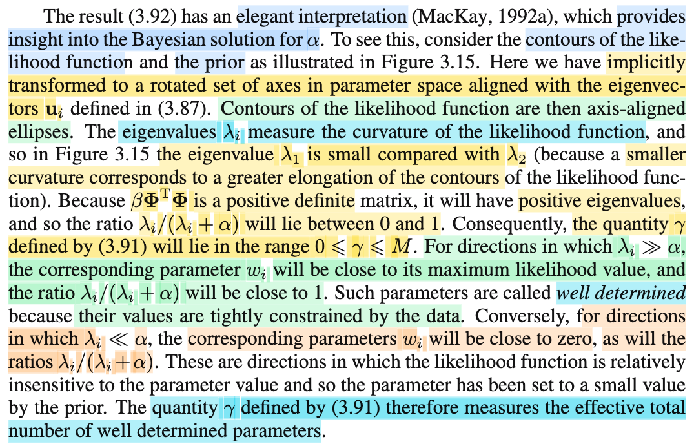</kbd>

<kbd>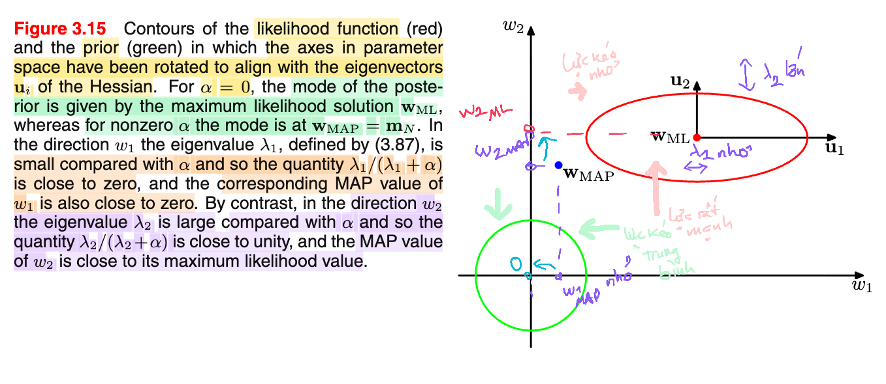</kbd>

> [!NOTE]
> Rồi, khi đã hiểu vì sao λ (eigenvalue của β𝚽ᵀ𝚽) cũng như cái vụ contours của L(𝐰|𝐭) có hình ellipses. Ta sẽ có thể nói về cái interpretation của kết quả 3.92:
>
>
>
> α = γ / (𝐦N)ᵀ𝐦N
>
>
>
> với γ = Σi λi / (α + λi)
>
>
>
> Như sau: Dễ hiểu thôi ví dụ λ1 và λ2 là eigenvalue, với λ1 nhỏ hơn nhiều so với α và λ2 thì ngược lại (nhắc lại cho nhớ: α là tham số của prior distribution của 𝐰, nơi ta assume nó là 𝒩(0, (1/α)𝐈)
>
>
>
> Vậy thì hiện tượng xảy ra sẽ là như sau:
>
>
>
> Vì λ1 ≪ α, nên λ1 / (α + λ1) sẽ rất nhỏ, ≈ 0. Và hình vẽ minh họa cho thấy w1 của 𝐰MAP cũng bị đẩy về gần 0.
>
>
>
> Còn λ2 ≫ α, nên λ2 / (α + λ2) sẽ gần 1. HÌnh vẽ cho thấy w2 của 𝐰MAP bị đẩy về gần 𝐰ML.
>
>
>
> (w1, w2 của 𝐰MAP, nên hiểu là \[𝐰MAP\]\_u tức tọa độ của 𝐰MAP trong hệ trục đã đổi sang eigenbasis 𝐮1, 𝐮2 của β𝚽ᵀ𝚽)
>
>
>
> Vậy có nghĩa là gì:
>
>
>
> Ở cái hướng eigenvector u1 của 𝚽ᵀ𝚽 mà eigenvalue nhỏ (ví dụ λ1), chính là cái hướng mà cái contour hình ellipse bị kéo giãn nhiều, và λ1 nhỏ tức độ cong theo hướng này nhỏ để bề mặt cái chuông Gaussian này sẽ dốc xuống thoai thoải. Thì 𝐰MAP_1 sẽ gần với 0.
>
>
>
> Ngược lại, ở hướng eigenvector u2, ứng với λ2 lớn, chính là cái hướng ellipse contour bị giãn ít, bề mặt khối Gaussian cong mạnh. Thì 𝐰MAP_2 sẽ gần với 𝐰ML_2.
>
>
>
> Mà 𝐰MAP_1 bị bóp về gần 0 có nghĩa là sao mà 𝐰MAP_2 sẽ gần với 𝐰ML_2 thì có nghĩa là sao?
>
>
>
> Ta hình dung có hai thứ kéo 𝐰MAP: Prior và Likelihood. Prior là cái chuông Gaussian có tâm tại (0,0) còn likelihood cũng là cái chuông Gaussian có tâm tại 𝐰ML.
>
>
>
> Độ cong của Prior thì như nhau ở mọi hướng, nhưng của likelihood thì mạnh hơn ở hướng u2 (λ2 lớn) và nhẹ hơn ở u1.
>
>
>
> Ở cái hướng mà likelihood có mức thay đổi chậm (dốc thoai thoải theo phương u1) thì kiểu như lực kéo về 𝐰ML yếu, do đó lực kéo về prior lấn át, khiến cho w1 của 𝐰MAP tiến về w1 của prior mean (=0)
>
>
>
> Còn ở hướng u2, likelihood có mức thay đổi nhanh (dốc cắm đầu theo phương u2) thì lại giống như lực kéo về 𝐰ML lấn át lực kéo về prior mean. Do đó, w2 của 𝐰MAP bị kéo về w2 của 𝐰ML
>
>
>
> Đó là góc nhìn thứ nhất.
>
>
>
> Và insight thứ hai là, γ = Σi λi / (α + λi) = λ1 / (α + λ1) + λ2 / (α + λ2), thì coi như chỉ = λ2 / (α + λ2) (vì cái kia ≈ 0 rồi). Và như vậy trong hai tham số w1, w2 của 𝐰MAP, w1 bị bóp thành 0, coi như bị phế. Thành ra con số γ chính là số lượng param không bị phế, (vì khi ≈ 0 thì coi như ko có), gọi là effective parameters, còn gọi là well-determined parameters.
>
>
>
> Và như vậy, ta có thể hiểu đại khái rằng, prior sẽ khiến cho mô hình phế đi các tọa độ ứng với các trục ko cần thiết (là các parameter w ứng với hướng mà tác động ko mạnh tới likelihood (insensitive).

> [!TIP]
> 🤖 **AI Check** — 🟢 Pass — ✅ **95/100** · ✓ Move on
>
> Ghi chú thể hiện sự thấu hiểu rất sâu sắc và trực quan về bản chất hình học của nghiệm MAP, cơ chế 'giằng co' giữa Prior và Likelihood, cũng như ý nghĩa của số tham số hiệu dụng gamma.
>
> **✓ Strengths**
> - Hiểu rất chính xác bản chất hệ tọa độ: nhận ra w1, w2 ở đây là tọa độ biểu diễn theo cơ sở vector riêng (eigenbasis) của ma trận Hessian thay vì hệ trục gốc ban đầu.
> - Hình tượng hóa xuất sắc sự tương tác giữa Likelihood và Prior như hai 'lực kéo' tỉ lệ với độ cong (curvature) theo từng hướng vector riêng.
> - Nắm trọn vẹn bản chất của đại lượng gamma như số lượng tham số được dữ liệu xác định chặt chẽ (well-determined/effective parameters).
>
> **💡 Deeper notes**
> - Về mặt thuật ngữ chuẩn xác, hàm Likelihood p(t|w) khi xét theo biến w có dạng tỉ lệ với một hàm Gaussian (proportional to a Gaussian), nhưng bản thân nó không phải là một hàm mật độ xác suất chuẩn hóa trên không gian w (tích phân theo w không nhất thiết bằng 1).
> - Mối quan hệ định lượng giữa MAP và ML trong hệ cơ sở riêng được biểu diễn trực tiếp bằng công thức: w_{i, MAP} = [lambda_i / (lambda_i + alpha)] * w_{i, ML}, từ đó thấy ngay khi lambda_i >> alpha thì w_{i, MAP} -> w_{i, ML}, còn khi lambda_i << alpha thì w_{i, MAP} -> 0.

**🔗 See also:** [Early Stopping and Weight Decay](./552_early_stopping.md#node-wipwskt)

 

#### Bayesian and Maximum Likelihood Variance

<kbd></kbd>

<kbd>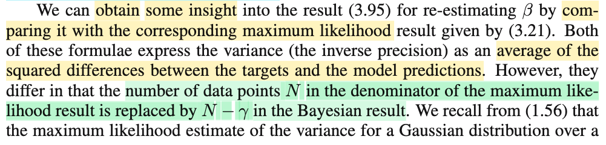</kbd>

<kbd>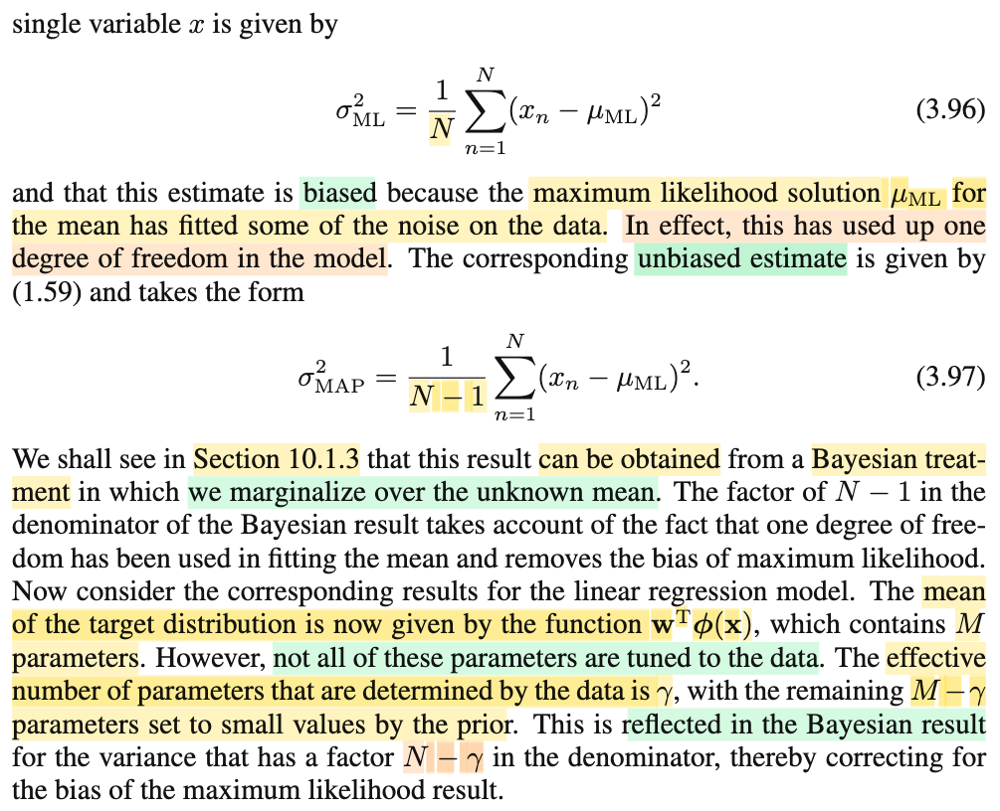</kbd>

<kbd>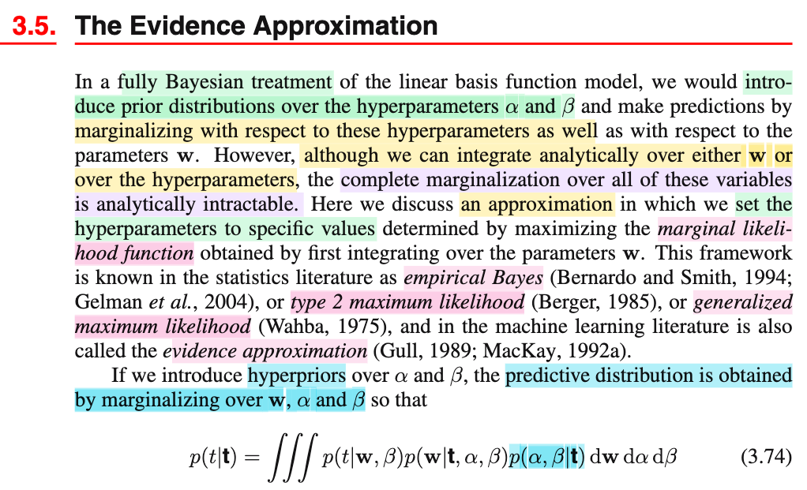</kbd>

> [!NOTE]
> Ở đoạn này, giáo sư Bishop muốn giúp ta có vài góc nhìn để hiểu về kết quả 3.95 trong phần trước, nên có lẽ cần thiết nhắc lại bối cảnh của đoạn này chút xíu, trong phần đó cái mà ta đang làm đó là maximize model evidence theo α, β.
>
>
>
> (model evidence là cái gì, và vì sao phải đi maximize như vậy thì xem lại link)
>
>
>
> Kết quả cho β là: 1/β = 1/(N - γ) Σi=1:N {ti - (𝐦N)ᵀ Φ(𝐱i)}²
>
>
>
> Vậy thì để hiểu về ý nghĩa của kết quả này, gs Bishop muốn ta nhớ lại rằng, khi đi giải bài toán tìm MLE của σ², tức variance của phân phối normal(μ, σ²), thì kết quả ra được là:
>
>
>
> (σ²)\_ML = (1/N) Σi (xi - μML)²
>
>
>
> trong đó μML, là MLE của μ, và ta còn nhớ nó chính là sample mean: (Σi xi)/N.
>
>
>
> Thế thì sao? Liên quan gì?
>
>
>
> Là như vầy: Ở đây có một kiến thức về statistic, mà trong các lớp như Stat110, hay Statistical Inference của Casella đã nói (mình có để link) đó là, sample variance, sách Casella kí hiệu S², có công thức là (1/N-1) Σi (Xi - Xbar)² là một unbiased estimator của sample variance. Còn nếu dùng công thức (1/N) Σi (Xi - Xbar)², thì nó sẽ là biased estimator. Lí do là, khi tính kì vọng E\[(1/N-1) Σi (Xi - Xbar)²\], ta sẽ ra chính xác σ² (và trong 1.58, xem link, tác giả Bishop cũng từng nói vụ này)
>
>
>
> Còn với công thức mà chia cho N, thì không. (và định nghĩa của biased estimator (của θ) W(𝐗) là khi độ bias, tính bởi Bias(W, θ) = E\[W(𝐗)\] - θ khác 0)
>
>
>
> Vậy thì như vậy, ở đây, (σ²)\_ML chính công thức của sample variance với mẫu số là N, nên nó chính là biased estimator của σ². Và trong phần 1.59 ông cũng đã nói rằng nếu ta giải theo Bayesian ta sẽ có (σ²)\_MAP chính là công thức unbiased, E\[(1/N-1) Σi (Xi - Xbar)²\].
>
>
>
> Dừng lại chút để trả lời câu hỏi giải theo Bayesian là sao?
>
>
>
> Đó là, trong MLE approach (giải ra (σ²)\_ML), ta coi μ, và σ², tức tham số của normal, là fixed cứng, nhưng không biết giá trị. Để rồi ta sẽ đặt ra hàm likelihood, đo độ hợp lí của một giá trị input μ, σ² dựa trên data quan sát được 𝐱, kí hiệu L(μ,σ²|𝐱), và hàm này được định nghĩa là, giá trị độ hợp lí của μ, σ² dựa trên data quan sát được 𝐱, sẽ bằng f(𝐱|μ, σ²). Từ đó, ta sẽ đi giải bài toán tối ưu: tìm μ, σ² để hàm độ hợp lí có giá trị cao nhất. Và kết quả của bài toán tối ưu này chính là công thức của maximum likelihood estimator của μ và σ².
>
>
>
> Còn với Bayesian, ta coi μ, σ² như biến ngẫu nhiên. Mà như vậy thì chúng sẽ có probability distribution, gồm hai loại: prior distribution, là f(μ, σ²) và f(μ, σ²|𝐱). Bằng cách chọn prior distribution của μ, và σ² là một distribution nào đó, ta sẽ dùng Bayes rule để có posterior: f(μ, σ²|𝐱) ∝ f(x|μ, σ²)f(μ, σ²). Và sau khi có posterior distribution. Để đưa ra một point estimator của μ, và σ², ta có thể chọn gía trị khiến posterior probability là lớn nhất, đây chính là maximum posterior estimator μ\_MAP và (σ^)\_MAP.
>
>
>
> Và theo lời gs nói ở đây, kết quả bài toán này ta sẽ có (σ^)\_MAP = (1/N-1) Σi (Xi - Xbar)², là cái công thức unbiased estimator của σ² nói trên.
>
>
>
> Như vậy là sao? Như vậy có nghĩa là cách làm của Bayesian tốt hơn, khi cách làm của MLE tạo ra một biased estimator trong khi của Bayesian thì ra unbiased.
>
>
>
> ---
>
>
>
> Ở trên chỉ là ông Bishop đang mượn lại bài toán point estimator tham số của một mô hình normal để nói về sự khác nhau của MLE và MAP.
>
>
>
> Quay lại đây, với việc ta đang tìm insight trong kết quả 3.95, thì cũng y vậy, đại ý là:
>
>
>
> Với cách là MLE, ta cũng là theo quy trình y như trong bài toán point estimator: tìm β giúp maximize likelihood function L(𝐰,β|𝒟)
>
>
>
> và kết qủa ra được 3.21 ta có:
>
>
>
> (1/β)\_ML = (1/N) Σi (ti - Σj=0:M-1 wj × Φj(𝐱i))²
>
>
>
> = (1/N) Σi (ti - (𝐰ᵀ Φ(𝐱i))²
>
>
>
> lắp 𝐰ML vô ta có:
>
>
>
> (1/β)\_ML = (1/N) Σi (ti - (𝐰MLᵀ Φ(𝐱i))²
>
>
>
> Còn là theo lối đi maximize model evidence thì ta ra công thức:
>
>
>
> 1/β = 1/(N - γ) Σi=1:N {ti - (𝐦N)ᵀ Φ(𝐱i)}², với 𝐦N là 𝐰MAP
>
>
>
> Và từ đó đại khái ta hiểu có sự tương tự:
>
>
>
> Trong bài toán point estimate σ², làm theo lối MLE, ta ra công thức chia cho N → biased
>
>
>
> Còn làm theo Bayesian, ta ra công thức chia cho N-1 → unbiased. Và ý nghĩa của số 1 là một bậc tự do đã bị mất khi ta dùng để tính sample mean (chính là 𝐰MAP) để estimate 𝐰 rồi
>
>
>
> ---
>
>
>
> Ở đây, làm theo lối ML, ta ra công thức chia cho N → Biased
>
>
>
> Còn làm theo lối Bayesian, ta ra công thức chia cho N-γ , mà γ là chính là số parameter hiệu dụng (effective) trong M param, nên giống như ta tốn 1 bậc tự do cho wML thì ở đây ta đã tốn γ bậc tự do cho 𝐰MAP rồi, chỉ còn N-γ, và do đó công thức 1/β = 1/(N - γ) Σi=1:N {ti - (𝐦N)ᵀ Φ(𝐱i)}² chính là unbiased.
>
>
>
> ---
>
>
>
> Một ý mà ta có thể thấy khó hiểu, là vì sao đi maximize model evidence lại làm theo Bayesian? Trong khi ta đâu có phải là đi maximize posterior của f(α, β|𝐭), vốn phải ∝ f(t|α, β)f(α,β)) mà đang maximize f(𝐭|α,β) cơ mà.
>
>
>
> Câu trả lời: Là vì đúng là cách làm này là cách làm nửa mùa. Và giáo sư Bishop đã nói ở phần đầu của phần 3.4 (xem hình)
>
>
>
> Là sao?
>
>
>
> Cách làm **hoàn toàn** Bayesian (fully Bayesian) phải là như vầy:
>
>
>
> Ta phải coi 𝐰, α, β đều là random variable.
>
>
>
> Rồi đi xây dựng posterior f(𝐰, α, β|𝒟) ∝ f(𝒟|𝐰, α, β)f(𝐰, α, β). Khi có posterior, ta mới đi lấy trung bình của 𝐰, β, α dựa trên phân phối này. 
>
>
>
> Kết quả sẽ là cái tích phân 3 lớp 3.74.
>
>
>
> Và nếu làm từng bước, thì sẽ là như sau:
>
>
>
> Coi 𝐰 là random variable trước, prior là f(𝐰|α) → posterior f(𝐰|𝒟,α, β).
>
>
>
> Đi marginalizing over 𝐰: ta sẽ có một hàm không còn phụ thuộc 𝐰, chính là model evidence f(𝐭|α, β)
>
>
>
> Tiếp, ta sẽ coi α cũng là random variable, có prior f(α) nào đó.
>
>
>
> Rồi đi derive posterior: f(α|𝒟,β). Và đi marginalizing over α ta sẽ có f(𝒟|β)
>
>
>
> Rồi, cuối cùng, coi β như random variable, có prior f(β), đi derive posterior f(β|𝒟), và đi lấy trung bìng marginalizing over β, ta sẽ có cáo β (hay 1/β) theo kiểu fully Bayesian.
>
>
>
> Vấn đề là, khi marginalizing 𝐰 xong, để có f(𝒟|α,β) (cũng là f(𝐭|α, β)) thì vì hai bước tiếp theo quá phức tạp (cũng như gs Bishop đã nói, để tích phân 3 lớp (đối với w, với α, β) sẽ intractable) do đó, sau khi có f(𝒟|α, β) người ta lại làm theo kiểu nửa mùa, là lại đi tìm MLE của α, β. Để cho ra cái 1/β 3.95
>
>
>
> Như vậy, phải hiểu, kết quả 3.95 là Bayesian nửa mùa, có tên gọi là evidence approximation, type 2 maximum likelihood hay empirical Bayes.

> [!TIP]
> 🤖 **AI Check** — 🟡 Minor issues — ⚠️ **85/100** · ✓ Move on
>
> Ghi chú nắm rất tốt bản chất trực giác của việc trừ đi số bậc tự do hiệu dụng (N - γ) trong công thức tái ước lượng β, cũng như hiểu rõ vì sao Evidence Approximation được xem là 'nửa mùa' (Empirical Bayes). Một vài chi tiết kỹ thuật về cách suy diễn Bayesian ra mẫu số N - 1 và định nghĩa ước lượng cần được chỉnh lại cho chuẩn xác hơn.
>
> **🟡 Minor issues**
>
> **1.** *"Bằng cách chọn prior distribution của μ, và σ² là một distribution nào đó, ta sẽ dùng Bayes rule để có posterior: f(μ, σ²|𝐱) ∝ f(x|μ, σ²)f(μ, σ²). Và sau khi có posterior distribution. Để đưa ra một point estimator của μ, và σ², ta có thể chọn gía trị khiến posterior probability là lớn nhất, đây chính là maximum posterior estimator μ_MAP và (σ^)_MAP."*
>
> Trong văn bản gốc, Bishop nhấn mạnh kết quả mẫu số N - 1 thu được khi ta marginalize (tích phân triệt tiêu) qua tham số kỳ vọng μ không biết trước với prior phẳng, chứ không phải tìm MAP cực đại hóa posterior đồng thời f(μ, σ²|x) (cực đại hóa đồng thời với prior phẳng vẫn sẽ cho mẫu số là N hoặc N+2 tùy tham số hóa).
>
> **2.** *"công thức là (1/N-1) Σi (Xi - Xbar)² là một unbiased estimator của sample variance"*
>
> Nói nhầm thuật ngữ: S² là unbiased estimator của 'population variance' (phương sai tổng thể / phương sai của phân phối), không phải của chính 'sample variance'.
>
> **3.** *"và do đó công thức 1/β = 1/(N - γ) Σi=1:N {ti - (𝐦N)ᵀ Φ(𝐱i)}² chính là unbiased."*
>
> Việc có mẫu số N - γ giúp hiệu chỉnh độ chệch (bias correction) tương tự như N - 1, nhưng không hẳn là một 'unbiased estimator' hoàn toàn theo nghĩa thống kê thường nghiệm vì γ là số chiều hiệu dụng phụ thuộc phi tuyến vào dữ liệu và chính các siêu tham số.
>
> **4.** *"giáo sư Bishop đã nói ở phần đầu của phần 3.4 (xem hình)"*
>
> Lỗi nhỏ về số thứ tự mục: Trong hình đính kèm là mục 3.5 (The Evidence Approximation), không phải 3.4.
>
>
> **✓ Strengths**
> - Hiểu rất rõ và diễn giải sinh động trực giác vì sao mẫu số lại là N - γ thay vì N (mất đi γ bậc tự do cho các tham số hiệu dụng được xác định bởi dữ liệu).
> - Phân biệt chính xác giữa Fully Bayesian (tích phân ba lớp qua w, α, β) và Evidence Approximation (marginalize w rồi tối ưu hóa điểm cho α, β).
>
> **💡 Deeper notes**
> - Khái niệm γ (effective number of parameters) trong Bayesian linear regression đo lường mức độ các tham số w bị ràng buộc bởi dữ liệu so với prior; khi prior rất lỏng (α -> 0), γ -> M và mẫu số trở thành N - M như trong hồi quy OLS chuẩn.

**🔗 See also:** [Maximum Likelihood Noise Precision β_ML](./311_maximum_likelihood_and_least_squares.md#node-vz4hsaf) · [Tính không chệch X̄ S² *(Statistical Inference - Casella)*](../statistical_inference_casella/73_methods_of_evaluating_estimators.md#node-dgdrvpi) · [Ước lượng không chệch phương sai](./124_the_gaussian_distribution.md#node-wki4nv2) · [Sai lệch phương sai MLE](./124_the_gaussian_distribution.md#node-1g51yok)

 

##### Evidence Re-estimation Limit

<kbd>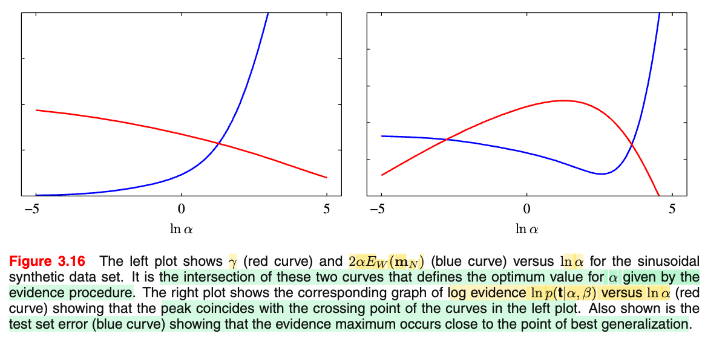</kbd>

<kbd>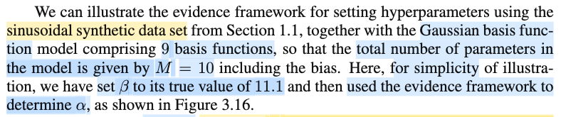</kbd>

<kbd>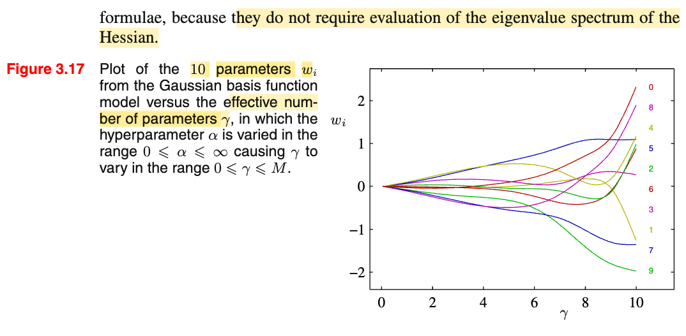</kbd>

> [!NOTE]
> Gs Bishop minh họa kết quả của việc ta tìm α thông qua maximize model evidence:
>
>
>
> Đầu tiên list lại vài công thức cho dễ nhìn:
>
>
>
> (3.25): E_W\[𝐰\] = (1/2)𝐰ᵀ𝐰
>
>
>
> (3.26): E_D(𝐰) = (1/2) Σi {ti - 𝐰ᵀ Φ(xi)}²
>
>
>
> (3.87): (β**Φ**ᵀ**Φ**)𝐮i = λi 𝐮i
>
>
>
> và trong phần trước ta đã có các kết quả α, β maximize model evidence
>
>
>
> α = γ / (𝐦N)ᵀ(𝐦N)
>
>
>
> γ = Σi=1:M \[λi / (λi + α)\]
>
>
>
> mà theo 3.25 thì đây chính γ/2E_W(𝐦N)
>
>
>
> 1/β = \[1/(N-γ)\] \[Σi (ti - 𝐦NᵀΦ(𝐱i))²\]
>
>
>
> theo 3.26 thì đây chính là \[1/(N-γ)\] 2E_D(𝐦N), = 2E_D(𝐦N) / (N-γ)
>
>
>
> ---
>
>
>
> Ta có α = γ/2E_W(𝐦N), thế thì hình 3.16 trái, đường màu đỏ và màu xanh là γ và 2αE_W(𝐦N) (thay đổi theo ln α): Ý nghĩa là sao:
>
>
>
> bài trước mình đã hiểu rằng, với công thức α = γ/2E_W(𝐦N) ⇔ 2αE_W(𝐦N) = γ, thì vì γ = Σi=1:M \[λi / (λi + α)\], lại phụ thuộc α, và 𝐦N cũng vậy, nên công thức này là implicit function. Thành ra phải giải tìm α bằng itererative loop: Chọn α0, tính γ, 𝐦N, rồi tính ra α1, sau đó lại lặp lại,...cho đến khi converge.
>
>
>
> Vậy thì nó sẽ converge thế nào tạm hiểu là nó sẽ converge về cái điểm cân bằng nơi mà hai đường xanh đỏ của hình 3.16 bên trái, cắt nhau (để 2αE_W(𝐦N) = γ) (Bài trước gs không nói gì về thuật toán giải ra α, nên mình tạm thời chưa hiểu chính xác cách thức)
>
>
>
> Nhưng ý chính đó là, khi ta vẽ giá trị của hàm model evidence f(𝐭|α, β) với β đã chọn fixed, thì sẽ thấy nó đạt đỉnh tại vị trí của α nơi hai đường xanh đỏ giao nhau ở trên (điều này ko có gì ngạc nhiên, vì đương nhiên công thức đó chính là α giúp maximize model evidence). Tuy nhiên hình bên phải còn có đường màu xanh, là test errorr, nó thấp nhất cũng đâu đó tại αMAP này, do đó thể hiện rằng, bằng cách tìm α giúp maximize model evidence, ta đã giống như là tìm ra α giúp model có tính chất generalization tốt nhất, vốn là mục tiêu quan trọng nhất, mà đây cũng là thứ mà cái gọi là hyperparameter tuning (ví dụ với cross validation) muốn đạt được
>
>
>
> ---
>
>
>
> Tiếp, người ta plot đồ thị của 10 tham số w0,...w9 theo γ, mà γ thay đổi cũng là do α thay đổi. Nhằm cho thấy liên hệ giữa: precision của prior distribution của 𝐰 → số effective parameter γ = Σi=1:M \[λi / (λi + α)\]
>
>
>
> Kết quả cho thấy khi α từ rất nhỏ, đến rất lớn γ giảm từ M về 0.
>
>
>
> Và khi γ lớn, tức là số parameter hiệu dụng lớn, mọi param đều có gía trị lớn (các xa 0)
>
>
>
> khi γ nhỏ, số param hiệu dụng bị bóp lại, giá trị của chúng bị bóp về 0.
>
>
>
> Nhớ lại hình ảnh sự giằng co ảnh hưởng của prior và likelihood, ta thấy rằng khi α nhỏ, tức 1/α lớn, priori trở nên dàn trải xác suất khiến kiểu như niềm tin ban đầu về 𝐰 yếu ớt → sức ảnh hưởng của prior nhỏ, và do đó mọi tham số đều bị likelihood kéo lên khiến cho chúng đề có giá trị lớn (xa mức 0).
>
>
>
> Ngược lại, khi α lớn, 1/α nhỏ, priori trở nên tập trung cao xác suất, mang ý nghĩa niềm tin ban đầu của 𝐰 rất lớn → sức ảnh hưởng của prior lớn, kéo mọi tham số về 0.
>
>
>
> ---

> [!TIP]
> 🤖 **AI Check** — 🟢 Pass — ✅ **98/100** · ✓ Move on
>
> Ghi chú cực kỳ chính xác và thể hiện sự hiểu biết sâu sắc về mặt toán học lẫn ý nghĩa trực quan của các hình vẽ, đặc biệt là phần giải thích về cơ chế 'giằng co' giữa prior và likelihood ở Hình 3.17. Chỉ có một vài lỗi chính tả rất nhỏ không đáng kể (như 'itererative', 'errorr').

**🔗 See also:** [Section 3.5.2 Maximizing the Evidence Function](./352_maximizing_the_evidence_function.md#node-nc5qxnz) · [3.1.4 Regularized least squares](./314_regularized_least_squares.md#node-y97v4o1) · [Marginal Likelihood Maximization for Beta](./352_maximizing_the_evidence_function.md#node-l71837c)

 

###### Ước lượng siêu tham số

<kbd>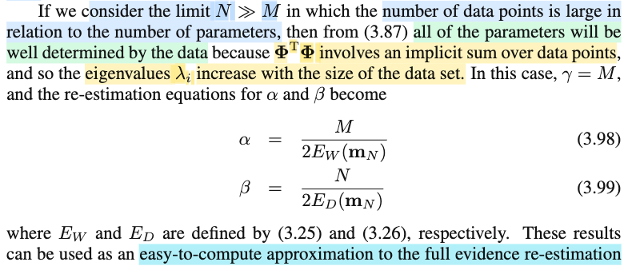</kbd>

<kbd>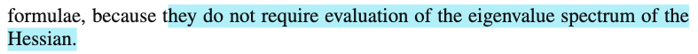</kbd>

> [!NOTE]
> Và đoạn cuối cùng, gs nói về case khi N lớn hơn M nhiều lần (data nhiều hơn số lượng tham số) thì đại ý là ta có thể khỏi phải giải tìm α, β (maximize model evidence) theo lối iterative, và thậm chí cũng khỏi cần tính các eigenvalue của β**Φ**ᵀ**Φ**. Nhờ đó tiết kiệm được chi phí tính toán.
>
>
>
> Ý chính là vậy, còn cụ thể là vì như sau:
>
>
>
> Đầu tiên là ta nhớ công thức (3.87): (β**Φ**ᵀ**Φ**)𝐮i = λi 𝐮i, ko có gì ghê gớm, chỉ là nói λi là eigenvalue của β**Φ**ᵀ**Φ** thôi, nhưng quan trọng là, xét cái design matrix **Φ**ᵀ**Φ**, thì dựa vào kiến thức đã học với thầy Strang trong 18.06, rằng, nhân hai matrix AB có 4 cách nhìn, trong đó cách thứ 4 là: AB = tổng của các rank 1 matrix tạo bởi outer product của (cột i của A) và (hàng i của B). Mà Φ là matrix có các hàng là Φ(𝐱1)ᵀ,...Φ(𝐱N)ᵀ. Nên **Φ**ᵀ chính là có các cột là Φ(𝐱1),...Φ(𝐱N), và như vậy **Φ**ᵀ**Φ** = Σi=1:N Φ(𝐱i)Φ(𝐱i)ᵀ. Mà như vậy thì có nghĩa là khi N rất lớn, design matrix là matrix có giá trị rất lớn theo, dẫn tới eigenvalue λi của nó cũng vậy.
>
>
>
> Như vậy N ≫ M tức là λi đều lớn ⇒ λi / (λi + α) đều ≈ 1 ⇒ γ ≈ γ = Σi=1:M (1) = M
>
>
>
> Khi đó α = γ / 2E(𝐦N) (vì sao trong note trước đã nói), thì ≈ M / 2E(𝐦N)
>
>
>
> và β = (N-γ) / 2E_D(𝐦N) ≈ (N-M) / 2E_D(𝐦N) ≈ N / 2E_D(𝐦N) (do N ≫ M)
>
>
>
> Như vậy có nghĩa là sao:
>
>
>
> Trả lời: Là khỏi tính γ, và như vậy khỏi tính λi, eigenvalue của β**Φ**ᵀ**Φ** (cũng là Hessian của likelihood), và từ đó giảm chi phí tính toán chứ sao.

> [!TIP]
> 🤖 **AI Check** — 🟡 Minor issues — ✅ **92/100** · ✓ Move on
>
> Ghi chú rất xuất sắc, hiểu sâu bản chất tích ngoài (outer product) từ đại số tuyến tính để giải thích sự tăng trưởng của các eigenvalue và dẫn ra công thức xấp xỉ của γ. Điểm chưa thật chuẩn xác duy nhất là việc cho rằng hoàn toàn không cần lặp (iterative), vì m_N vẫn phụ thuộc vào α và β nên về nguyên tắc đây vẫn là các phương trình tái ước lượng (re-estimation).
>
> **🟡 Minor issues**
>
> **1.** *"ta có thể khỏi phải giải tìm α, β (maximize model evidence) theo lối iterative"*
>
> Các công thức (3.98) và (3.99) trong sách vẫn được gọi là 're-estimation equations' vì vế phải phụ thuộc vào m_N, mà m_N lại phụ thuộc vào α và β (thông qua ma trận hiệp biến S_N). Do đó, về mặt thuật toán, ta vẫn phải cập nhật lặp giữa việc tính m_N và cập nhật α, β (trừ phi ta xấp xỉ thêm m_N ≈ m_ML độc lập với prior). Lợi ích chính ở đây là bỏ được bước phân tích phổ trị riêng (eigenvalue decomposition) của Hessian ở mỗi vòng lặp, chứ chưa hẳn là triệt tiêu hoàn toàn tính lặp.
>
>
> **✓ Strengths**
> - Liên hệ xuất sắc với kiến thức tích ngoài ma trận (hàng nhân cột thành tổng các ma trận rank 1) từ đại số tuyến tính để giải thích trực quan tại sao các eigenvalue tỉ lệ thuận với N.
> - Biện luận chặt chẽ và chính xác quá trình giới hạn: khi λ_i >> α thì λ_i / (λ_i + α) ≈ 1, dẫn đến γ ≈ M và rút gọn trực tiếp ra hai công thức (3.98), (3.99).
> - Nắm đúng insight cốt lõi: mục đích của xấp xỉ này là tránh việc phải tính phổ trị riêng của Hessian (ma trận M x M) tốn kém chi phí tính toán.
>
> **💡 Deeper notes**
> - Khi N ≫ M, nghiệm MAP m_N tiến rất gần về nghiệm Maximum Likelihood m_ML (vốn không phụ thuộc vào α và β). Nếu thực hiện thêm xấp xỉ m_N ≈ m_ML thì quả thực ta có thể tính α, β chỉ trong một bước duy nhất mà không cần lặp.

 

