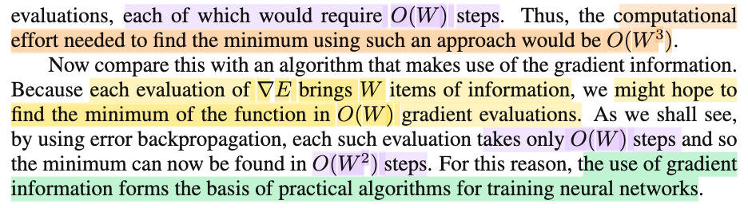
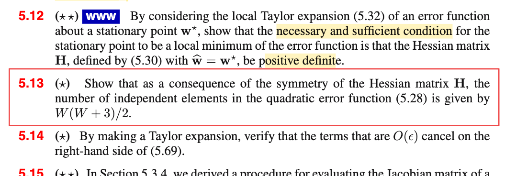

# 5.2.3 Use of gradient information

📊 **Progress:** `1` Notes | `3` Screenshots | `1` AI Reviews

---

 

## Use of Gradient Information

<kbd></kbd>

<kbd></kbd>

<kbd></kbd>

> [!NOTE]
> Giờ xét hàm f(𝐱) = (1/2)𝐱ᵀ𝐏𝐱 + 𝐪ᵀ𝐱 + r, 𝐱 = (x1,x2), 𝐏 đối xứng, 𝐏 positive definite,
>
>
>
> ta biết nghiệm là 𝐱\*: 𝐏𝐱\* = -𝐪 ⇔ 𝐱\* = - 𝐏⁻¹𝐪
>
>
>
> Như vậy để có tính được 𝐱\*, ta cần biết 𝐏, 𝐪.
>
>
>
> f(𝐱) = (1/2)𝐱ᵀ𝐏𝐱 + 𝐪ᵀ𝐱 + r
>
>
>
> (1/2) (p11x1² + p12x1x2 + p21x1x2 + p22x2²) + q1x1 + q2x2 + r
>
>
>
> Nếu xét ta tính f(𝐱)|𝐱=(1,2) tại 𝐱 mang giá trị nào đó, ra = 10 chẳng hạn, ta sẽ có 1 phương trình có 3 + 2 + 1 = 6 biến. Để giải, ta cần 6 phương trình. Tức là cần tính f(x) tại 6 điểm khác nhau.
>
>
>
> (1/2) (p11 + 2p12 + 2p12 + 4p22) + q1 + 2q2 + r = 10
>
>
>
> Trong khi đó, nếu xét hàm gradient ∇f(𝐱) = 𝐏𝐱 + 𝐪 = \[p11x1 + p12x2 + q1, p21x1 + p22x2 + q2\]ᵀ, số biến là 3 + 2 = 5 (6 với 5 thì cũng coi như xem xem nhau)
>
>
>
> Mấu chốt là nếu ta evaluate ∇f(𝐱) tại một điểm 𝐱 = (2,3), để có vector \[10, 20\]ᵀ, ta sẽ có ngay hai phương trình:
>
>
>
> 2p11 + 3p12 + q1 = 10
>
>
>
> 2p21 + 3p22 + q2 = 20 (p21 cũng là p12)
>
>
>
> Và evaluate tại 2 điểm sẽ có 4 phương trình. Và tương tự 3 điểm là có đủ 6 phương trình để giải hệ rồi. So với 6 của việc ko dùng gradient.
>
>
>
> ---
>
>
>
> Với hàm E(𝐰) ≈ E(𝐰') + (𝐰 - 𝐰')ᵀ𝐛 + (1/2)(𝐰-𝐰')ᵀ𝐇(𝐰-𝐰')
>
>
>
> = E(𝐰') + 𝐰ᵀ𝐛 - 𝐰'ᵀ𝐛 + (1/2)(𝐰ᵀ𝐇𝐰 - 𝐰'ᵀ𝐇𝐰 - 𝐰ᵀ𝐇𝐰' + 𝐰'ᵀ𝐇𝐰')
>
>
>
> = (1/2)𝐰ᵀ𝐇𝐰 - 𝐰'ᵀ𝐇𝐰 + 𝐛ᵀ𝐰 + E(𝐰') + (1/2)𝐰'ᵀ𝐇𝐰' - 𝐰'ᵀ𝐛
>
>
>
> = (1/2)𝐰ᵀ𝐇𝐰 - (𝐇𝐰' - 𝐛)ᵀ𝐰 + c
>
>
>
> Số tham số: M(M+1)/2 (của 𝐇) + M (của 𝐛) = (M²+M+2M)/2 = (M²+3M)/2 = M(M+3)/2
>
>
>
> ⇒ Số tham số: coi như M², tức O(M²) nên cần số phương trình: O(M²) → số lần evaluate hàm: O(M²), mỗi lần tốn M step ⇒ O(M³) step.
>
>
>
> ∇E(𝐰) = 𝐇𝐰 - 𝐇𝐰' + 𝐛
>
>
>
> Số tham số: cũng M(M+3)/2, cũng coi như M², tức O(M²)
>
>
>
> Nhưng mỗi evaluate ∇E(𝐰) sẽ cho ta M phương trình nên chỉ cần M lần evaluate hàm ∇E(𝐰), tốn O(M²) step thay vì O(M³) step.

📹 [Xem video trên YouTube](https://www.youtube.com/watch?v=fdCQxx5mvnE)

> [!TIP]
> 🤖 **AI Check** — 🟢 Pass — ✅ **98/100** · ✓ Move on
>
> Ghi chú rất xuất sắc, hiểu sâu sắc bản chất vấn đề từ ví dụ 2 chiều cụ thể cho đến công thức tổng quát và độ phức tạp tính toán O(W^2) vs O(W^3).
>
> **✓ Strengths**
> - Xây dựng ví dụ cụ thể ở không gian 2 chiều để giải thích trực quan tại sao mỗi lần tính gradient lại cung cấp số phương trình bằng số chiều.
> - Khai triển chính xác xấp xỉ Taylor bậc hai và chỉ ra số tham số độc lập là M(M+3)/2 do tính đối xứng của ma trận Hessian H (giải quyết trọn vẹn Bài tập 5.13).
> - Lập luận chặt chẽ về độ phức tạp tính toán giữa việc tối ưu không dùng gradient O(W^3) và có dùng gradient O(W^2).
>
> **💡 Deeper notes**
> - Hằng số tự do r (hoặc E(w')) biến mất khi lấy đạo hàm, do đó gradient chỉ cần xác định M(M+3)/2 tham số để tìm cực tiểu mà không cần xác định giá trị cực tiểu của hàm mục tiêu.

 

