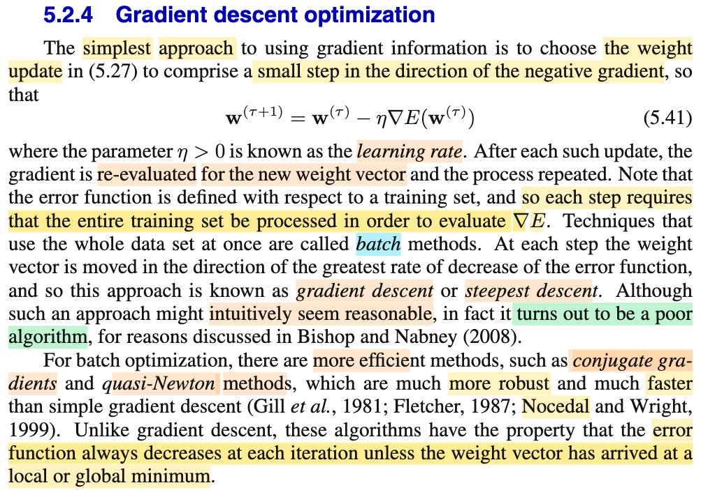
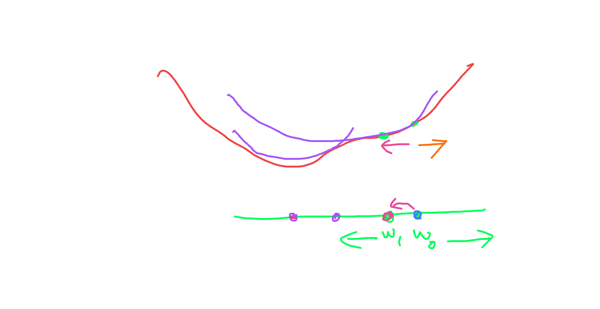
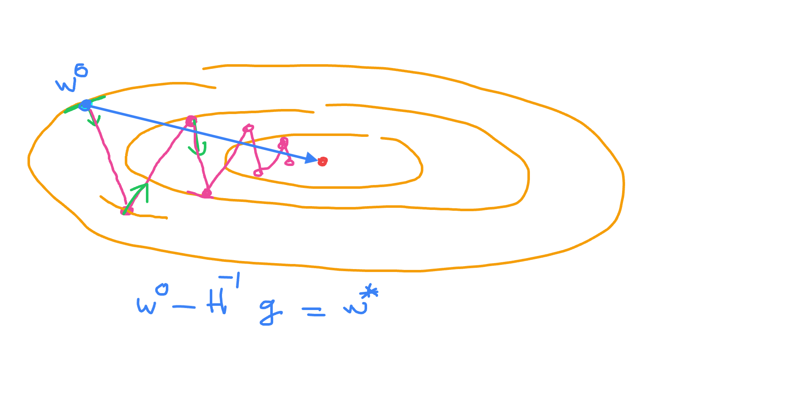
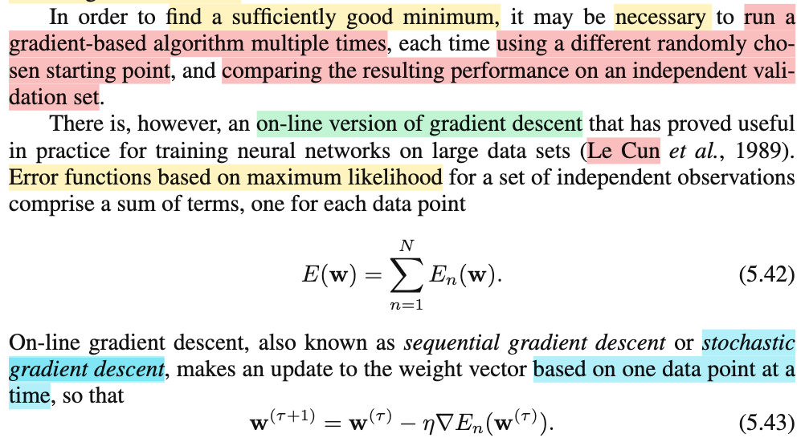
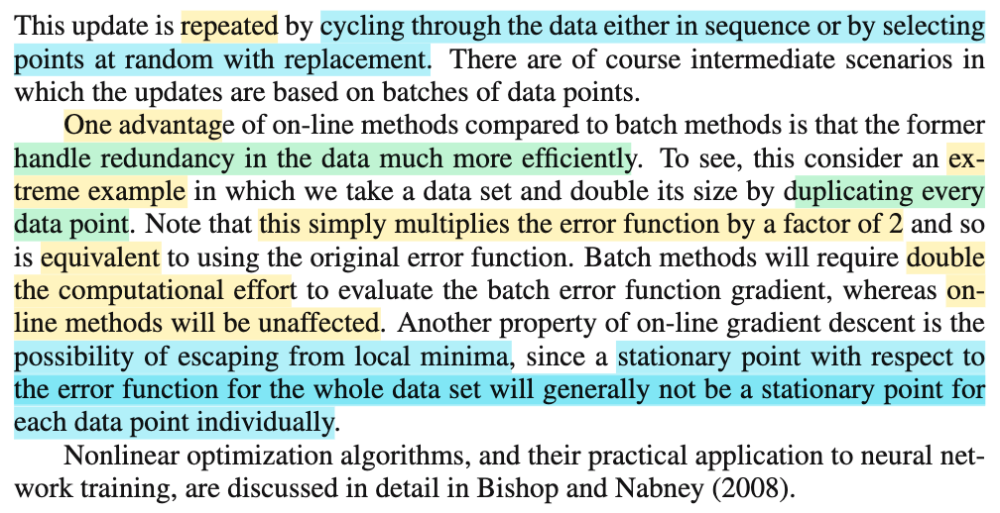
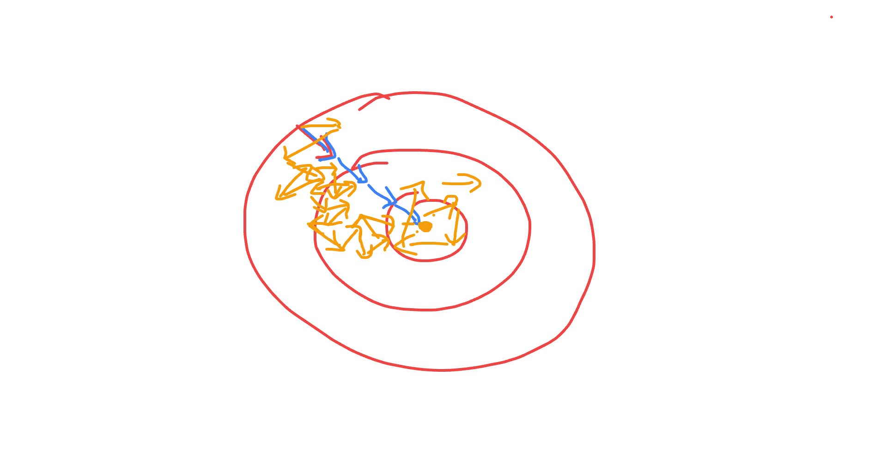

# 5.2.4 Gradient descent optimization

📊 **Progress:** `2` Notes | `6` Screenshots | `2` AI Reviews

---

 

## 5.2.4 Gradient Descent Optimization

<kbd></kbd>

<kbd></kbd>

<kbd></kbd>

> [!NOTE]
> Đoạn này nói về gradient (steepest) descent: Như tên gọi, dùng hướng di chuyển là hướng dốc nhất: - ∇E(𝐰):
>
>
>
> Directional derivative: tìm 𝐝, ∇E(𝐰1)ᵀ𝐝, ||𝐝|| = 1
>
>
>
> ∇E(𝐰1)ᵀ𝐝 = ||∇E(𝐰1)|| ||𝐝|| cos θ 
>
>
>
> 𝐰\_(τ+1) = 𝐰\_(τ) - ∇E(𝐰\_τ)
>
>
>
> η gọi là learning rate.
>
>
>
> Nếu tính ∇E(𝐰) với E(𝐰) dựa trên toàn bộ training set, ta gọi là batch method (batch gradient descent)
>
>
>
> Dù có vẻ hợp lí khi đi theo hướng dốc nhất nhưng như đã biết bên Nocedal, thường nó là thuật toán kém hiệu qủa.
>
>
>
> ---
>
>
>
> Tác giả nhắc đến conjugate gradient và quasi-Newton, và cho rằng chúng hiệu quả hơn so với steepest gradient descent. Đây là hai cái mình đã học bên Nocedal, thử active recall lại:
>
>
>
> CG (chương 5 Nocedal): Còn nhớ, đại khái linear CG là thuật toán chuyên trị việc giải hệ tuyến tính 𝐀𝐱 = 𝐛.
>
>
>
> Ta coi nó như giải bài toán minimize hàm (1/2)𝐱ᵀ𝐀𝐱 - 𝐛ᵀ𝐱, (𝐀 đối xứng xác định dương) vì nghiệm của nó, chính là điểm thỏa 𝐀𝐱 - 𝐛 = 0.
>
>
>
> Phương pháp của nó đại khái là: bắt đầu với điểm 𝐱0. Lần đầu tiên ta đi theo steepest descent direction 𝐩0 = -∇f(𝐱0), với step size thế nào ta sẽ nói sau, để đến 𝐱1. Từ đó bắt đầu đi theo các conjugate gradient: 𝐩1ᵀ𝐀𝐩0 = 0, đến 𝐱2. Đi tiếp theo hướng 𝐩2: 𝐩2ᵀ𝐀𝐩0 = 0, 𝐩2ᵀ𝐀𝐩1 = 0, đến 𝐱3. Thì thuật toán CG đảm bảo sẽ về tới 𝐱\* (nghiệm của 𝐀𝐱 = 𝐛 sau n bước, (matrix 𝐀 shape n × n) là tối đa, và có thể ít hơn thông qua vài kĩ thuật).
>
>
>
> Nói về step size, ví dụ từ điểm đang đứng 𝐱0, tìm step size đi thep 𝐩0 tới 𝐱1): Dùng exact line search: minimize hàm f(𝐱) = (1/2)𝐱ᵀ𝐀𝐱 - 𝐛ᵀ𝐱 restrict to hướng 𝐩: g(α) = f(𝐱0 + α𝐩0)
>
>
>
> ---
>
>
>
> Còn quasi-Newton (chương 7 Nocedal): Cơ bản là chọn hướng đi là Newton step, có điều thay vì dùng real Hessian: - 𝐇⁻¹ 𝐠, với bài toán lớn (large scale), sẽ rất tốn kém, thay vào đó, ta dùng phương pháp để tính ra xấp xỉ matrix Hessian: 𝐁, và dùng hướng đi quasi Newton - 𝐁⁻¹ 𝐠 thay vì hướng Newton thật. (vài chi tiết khác như thường ta tính thẳng 𝐁⁻¹ thay vì tính 𝐁 rồi lấy nghịch đảo)

📹 [Xem video trên YouTube](https://youtu.be/s0CUmjNqJO8)

> [!TIP]
> 🤖 **AI Check** — 🟢 Pass — ✅ **95/100** · ✓ Move on
>
> Ghi chú nắm rất chắc nội dung bài học và có khả năng liên hệ, active recall kiến thức tối ưu từ sách Nocedal rất chính xác về bản chất của Gradient Descent, Conjugate Gradient và Quasi-Newton.
>
> **✓ Strengths**
> - Tóm tắt chính xác định nghĩa Gradient Descent và khái niệm batch method từ văn bản.
> - Khả năng active recall về Linear CG rất chuẩn: bài toán dạng toàn phương tương đương hệ Ax = b, tính trực giao qua ma trận A (A-conjugate), hội tụ tối đa n bước và exact line search.
> - Nắm rõ trực giác của Quasi-Newton là xấp xỉ Hessian (hoặc nghịch đảo Hessian) để giảm độ phức tạp tính toán so với Newton thuần túy.
>
> **💡 Deeper notes**
> - Trong bối cảnh hàm lỗi của Neural Network (phi tuyến tính nói chung), thuật toán CG được dùng là Non-linear CG (như Fletcher-Reeves hoặc Polak-Ribière) thay vì Linear CG thuần túy, trong đó không thể giải exact line search một cách giải tích đóng mà phải dùng inexact line search (thỏa mãn điều kiện Wolfe).

**🔗 See also:** [Góc nhìn hình học lí giải tính chất của conjugate direction *(Numerical Optimization_J.Nocedal)*](../numerical_optimization_jnocedal/51_linear_conjugate_gradient.md#node-aads1j4)

 

### On-line Gradient Descent

<kbd></kbd>

<kbd></kbd>

<kbd></kbd>

> [!NOTE]
> Đoạn này quan trọng, ông nói để tìm được minimum đủ tốt (nhớ lại, E(𝐰) là hàm phi tuyến có nhiều local minimum, và cũng không biết cách nào đã đến được global minima chưa, nên cơ bản là ta sẽ chỉ tìm local minima đủ tốt) bằng cách chạy thuật toán tối ưu vài lần với các initial 𝐰0 khác nhau và so sánh kết quả với nhau.
>
>
>
> Tuy nhiên, có một thuật toán: Stochastic gradient descent nổi tiếng.
>
>
>
> Đại ý là với error function, mà ta đã biết, là negative log likelihood E(𝐰)
>
>
>
> = - ln f(t1,t2,...|𝐱1,𝐱2,.. 𝐰) = - ln Πi f(ti|𝐱i, 𝐰) = Σi (-ln f(ti|𝐱i, 𝐰)) = Σi Ei(𝐰)
>
>
>
> Do đó ∇E(𝐰) = Σi ∇Ei(𝐰)
>
>
>
> Từ đó, thay vì update: 𝐰\_τ+1 = 𝐰\_τ - η ∇E(𝐰): batch gradient descent, mỗi lần phải tính gradient ∇E(𝐰), gradient của hàm error của trên toàn bộ training set
>
>
>
> Ta sẽ dùng update: 𝐰\_τ+1 = 𝐰\_τ - η ∇En(𝐰):
>
>
>
> Ví dụ: tính ∇E1(𝐰), update 𝐰, tính ∇E2(𝐰), update 𝐰, tính ∇E3(𝐰) update 𝐰,...
>
>
>
> hoặc, có thể không cần theo thứ tự: Mà sampling with replacement ra một số n trong đám 1:N, để tính ∇En(𝐰) rồi update 𝐰.
>
>
>
> Như vậy hình dung: Với batch steepest gradient descent, mỗi lần update, ta đều đi theo hướng dốc nhất nên kiểu như là đi theo đường tốt nhất (dù cho là như đã nói steepest gradient không hẵn là good algorithm). Nhưng vì mỗi lần tính, ta phải tính gradient của E(𝐰), hàm error của cả training set, nên sẽ tốn kém và chậm.
>
>
>
> Với stochastic GD, việc tính gradient ∇En(𝐰) rất nhanh. Nên dù cho việc đi theo hướng này sẽ có thể không phải hướng tốt nhất, nhưng sẽ về đích nhanh hơn vì tổng Σi ∇Ei(𝐰) = ∇E(𝐰).
>
>
>
> Thêm nữa, tác giả nói có ưu điểm quan trọng: Thóat được local minima: Là sao:
>
>
>
> Nếu dùng ∇E(𝐰), một khi đã đến stationary point 𝐰\*, ∇E(𝐰\*) sẽ = 0, thuật toán dừng.
>
>
>
> Stationary point có thể là local minima, saddle point hoặc global minimum
>
>
>
> Nhưng các hàm En(𝐰) thì không có chung local minima với E(𝐰), nên tại stationary point của E(𝐰), thì chưa chắc ∇En(𝐰) = 0, nên nó sẽ kéo 𝐰 ra khỏi đó giúp thoát local minima và saddle point và thậm chí là cả global minimum từ đó sinh ra hệ quả: thoát local minima và saddle point
>
>
>
> Tuy nhiên, điều này cũng gây ra rằng nếu giả sử có tìm được global minima thì nó cũng dao động quanh cái này chứ không tụ lại được.
>
>
>
> Do đó, người ta mới giảm dần learning rate để giảm sự oscillation quanh global minimum (hoặc local minima)
>
>
>
> ---
>
>
>
> Ưu điểm thứ hai là: Nó giúp deal với việc bị dư thừa data (redundancy): Ông lấy ví dụ extreme là data bị duplicate, khi đó dễ hiểu là chi phí tính E(𝐰) phải tăng gấp đôi (training set size double) nhưng với En(𝐰) thì ko ảnh hưởng

📹 [Xem video trên YouTube](https://www.youtube.com/watch?v=NP2YnuUjMIU)

> [!TIP]
> 🤖 **AI Check** — 🟢 Pass — ✅ **95/100** · ✓ Move on
>
> Ghi chú rất xuất sắc, nắm bắt trọn vẹn và giải thích sâu sắc các luận điểm chính trong sách giáo trình từ việc khởi tạo ngẫu nhiên, bản chất toán học của SGD đến hai ưu điểm lớn (thoát điểm dừng và xử lý dữ liệu trùng lặp).
>
> **✓ Strengths**
> - Hiểu rất rõ và diễn giải mạch lạc nguồn gốc của hàm loss dạng tổng qua negative log-likelihood của các quan sát độc lập.
> - Nắm chuẩn hai ưu điểm cốt lõi của SGD được đề cập trong sách: xử lý redundancy hiệu quả và khả năng thoát local minima/saddle points do gradient từng điểm không triệt tiêu đồng thời.
> - Tự liên hệ tốt kiến thức thực tế về hiện tượng dao động quanh điểm cực trị và lý do cần giảm dần learning rate (learning rate decay).
>
> **💡 Deeper notes**
> - Khi chạy nhiều lần với các điểm khởi tạo khác nhau để chọn nghiệm tốt nhất, sách nhấn mạnh việc đánh giá và so sánh hiệu năng trên một tập kiểm định độc lập (independent validation set) thay vì chỉ nhìn vào giá trị hàm lỗi trên tập train.
> - Về mặt lý thuyết tối ưu ngẫu nhiên, gradient của từng điểm $\nabla E_n(\mathbf{w})$ khi lấy mẫu ngẫu nhiên đồng đều chính là một ước lượng không chệch (unbiased estimate) của $\frac{1}{N} \nabla E(\mathbf{w})$.

 

