# 5.3.1 Evaluation of error-function derivatives

📊 **Progress:** `4` Notes | `13` Screenshots | `4` AI Reviews

---

 

## Section 5.3 Error Backpropagation

<kbd>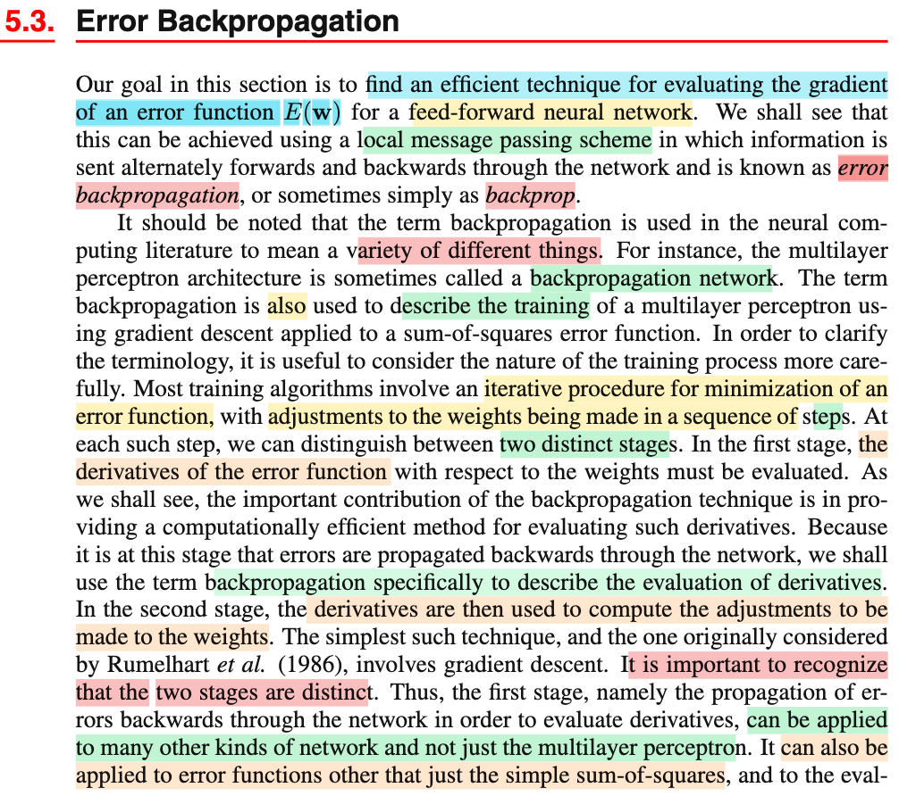</kbd>

<kbd>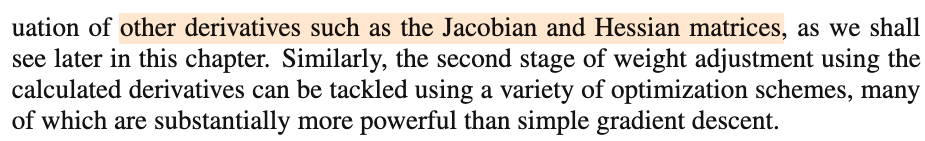</kbd>

> [!NOTE]
> Vài lời dặn dò, đại ý là ở đây backpropagation sẽ chỉ quá trình tính gradient ∇E(𝐰).
>
>
>
> Và chú ý là có hai bước: tính gradient xong, thì dùng để update weight

> [!TIP]
> 🤖 **AI Check** — 🟢 Pass — ✅ **100/100** · ✓ Move on
>
> Ghi chú tóm tắt rất chính xác và trúng trọng tâm điểm phân biệt then chốt mà tác giả nhấn mạnh: backpropagation về bản chất là bước tính đạo hàm/gradient, tách biệt hoàn toàn với bước cập nhật trọng số (tối ưu hóa).
>
> **✓ Strengths**
> - Nắm đúng định nghĩa trọng tâm của tác giả: phân biệt rõ ràng giữa giai đoạn tính gradient (backpropagation) và giai đoạn cập nhật trọng số (optimization).
>
> **💡 Deeper notes**
> - Bishop cũng lưu ý thêm rằng việc tách biệt hai bước này giúp ta thấy: bước tính đạo hàm có thể áp dụng cho nhiều kiến trúc mạng khác (không chỉ MLP) và để tính cả ma trận Jacobian/Hessian, trong khi bước cập nhật trọng số có thể áp dụng nhiều thuật toán tối ưu hóa mạnh hơn gradient descent thông thường.

 

### 5.3.1 Evaluation of Error-Function Derivatives

<kbd>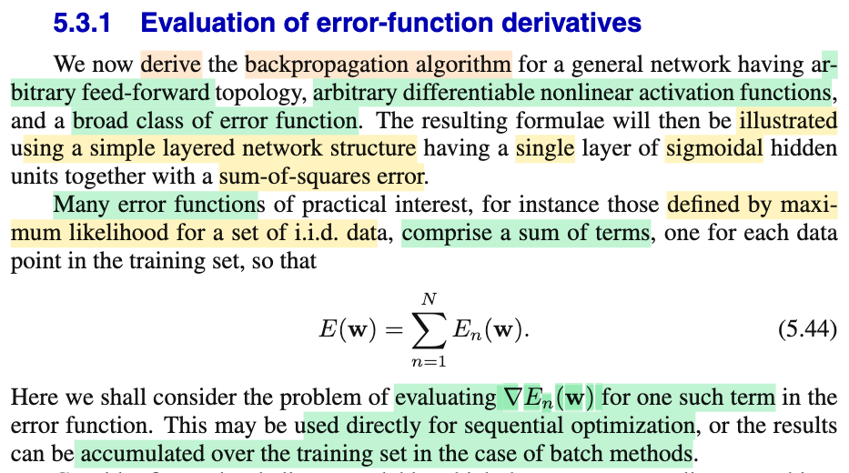</kbd>

<kbd>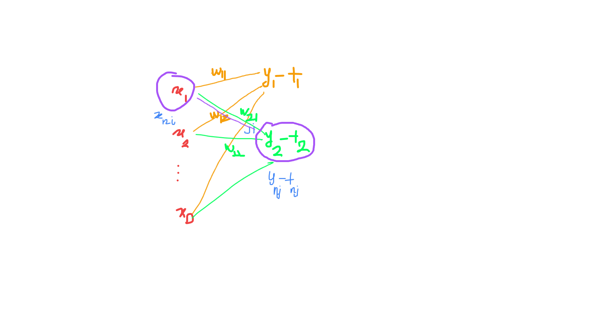</kbd>

<kbd>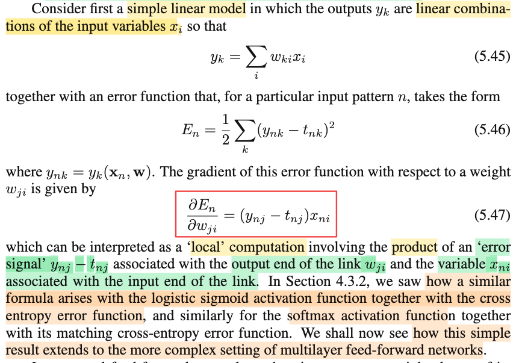</kbd>

> [!NOTE]
> ∂/∂wji En = ∂/∂wji \[(1/2) Σk (ynk - tnk)²\]
>
>
>
> = (1/2) ∂/∂wji \[(yn1 - tn1)² + ...+ (ynj - tnj)² + ...\]
>
>
>
> trong cái tổng này chỉ có ynj là hàm của wji
>
>
>
> = (1/2) ∂/∂wji (ynj - tnj)²
>
>
>
> = (1/2) ∂/∂(ynj - tnj) (ynj - tnj)² . ∂/∂wji (ynj - tnj)
>
>
>
> = (1/2) 2(ynj - tnj) . ∂/∂wji (ynj)
>
>
>
> Mà ynj = y(𝐰j, 𝐱n) = wj1 xn1 + ..+ wji xni + ...
>
>
>
> trong cái tổng này, chỉ có wji xni là hàm của wji
>
>
>
> = (ynj - tnj) . ∂/∂wji (wj1 xn1 + ..+wji xni + ...)
>
>
>
> = (ynj - tnj) . ∂/∂wji (wji xni)
>
>
>
> = (ynj - tnj) xni → 5.47
>
>
>
> ---
>
>
>
> Và đại ý là ta có thể xem cái này như local computation bao gồm tích của xni với error signal ynj - tnj.
>
>
>
> Có thể thấy trong hình vẽ, cái link của w21 (j=2, i=1) nối x1 (xi) với y2 - t2 (yj - tj).
>
>
>
> Và mình đã thấy công thức này xuất hiện với hàm activation function là sigmoid với loss là cross entropy cũng là softmax.

> [!TIP]
> 🤖 **AI Check** — 🟡 Minor issues — ✅ **90/100** · ✓ Move on
>
> Ghi chú rất tốt, bạn đã tự tay đạo hàm chi tiết từng bước để ra được công thức (5.47) và vẽ hình trực quan hóa cơ chế 'local computation'. Cần chú ý một vài ký hiệu viết nhầm giữa w_{ij} và w_{ji} cùng vị trí dấu bình phương ở dòng đầu.
>
> **🟡 Minor issues**
>
> **1.** *"∂/∂wij En = ∂/∂wij [(1/2) Σk (ynk - tnk)]²"*
>
> Dấu bình phương bị viết nhầm ra ngoài dấu ngoặc vuông chứa cả hệ số 1/2 và phép tổng; đúng chuẩn phải là (1/2) Σk (ynk - tnk)². Tuy nhiên các bước ngay phía sau bạn đã khai triển đúng.
>
> **2.** *"∂/∂wij (wji xni)"*
>
> Có sự lẫn lộn giữa thứ tự chỉ số trọng số w_{ij} và w_{ji}. Ở vế trái bạn viết đạo hàm theo w_{ij}, nhưng trong biểu thức mô hình y_{nj} thì trọng số kết nối từ i tới j lại ký hiệu là w_{ji}.
>
> **3.** *"bao gồm tích error signal: xni với ynj - tnj"*
>
> Cách diễn đạt dễ gây hiểu nhầm x_{ni} cũng là error signal; chính xác thì (y_{nj} - t_{nj}) là 'error signal' ở đầu ra của liên kết, còn x_{ni} là biến đầu vào (input variable).
>
>
> **✓ Strengths**
> - Đã chủ động thực hiện chi tiết toàn bộ các bước đạo hàm theo quy tắc chuỗi (chain rule) thay vì chỉ chép lại công thức.
> - Hiểu và minh họa chính xác bản chất tính toán cục bộ (local computation) bằng sơ đồ mạng liên kết giữa các nút.
>
> **💡 Deeper notes**
> - Quy ước chỉ số w_{ji} trong sách Bishop biểu thị trọng số của liên kết từ nút i đến nút j (thứ tự 'đích - nguồn'), việc ghi nhớ đúng quy ước này rất quan trọng để tránh nhầm lẫn khi triển khai phép nhân ma trận trong backpropagation sau này.

 

#### Feed-Forward Network Unit Activation

<kbd>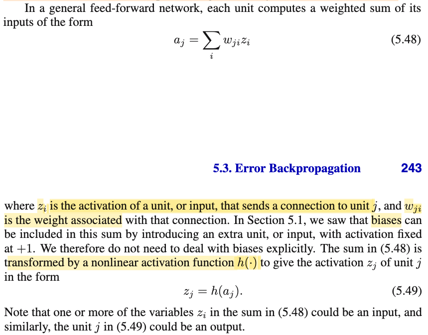</kbd>

> [!NOTE]
> đoạn này ko có gì, chỉ nhắc lại điểm đã biết:
>
>
>
> một cách khái quát: aj (ví dụ a2) = Σi w2i zi + w20 hay Σi w2i z⁽¹⁾i + w20
>
>
>
> sau đó z2 = h(a2) (z này là của layer sau: z⁽²⁾2, phân biệt với đám z⁽¹⁾i của layer trước)

> [!TIP]
> 🤖 **AI Check** — 🟢 Pass — ✅ **95/100** · ✓ Move on
>
> Ghi chú rất chính xác và thể hiện sự hiểu rõ bản chất của quá trình tính toán xuôi (forward pass), đồng thời làm rõ cách biểu diễn tường minh của bias và chỉ số layer.
>
> **✓ Strengths**
> - Tách rõ số hạng bias thay vì gộp ẩn trong ký hiệu vector/tổng giúp việc theo dõi trực quan hơn.
> - Bổ sung chỉ số tầng (layer superscript) để phân biệt rõ ràng giữa giá trị kích hoạt đầu vào và đầu ra của từng nút.
>
> **💡 Deeper notes**
> - Sách dùng công thức tổng quát cho mạng 'feed-forward' nói chung (có thể có kết nối nhảy cóc/skip-connection giữa các tầng không liền kề), trong khi ví dụ của bạn đang cụ thể hóa cho mạng nhiều tầng tuần tự (layered feed-forward network).

**🔗 See also:** [Efficiency of Backpropagation](./533_efficiency_of_backpropagation.md#node-xgrbhhi)

 

##### Weight Derivative Evaluation

<kbd>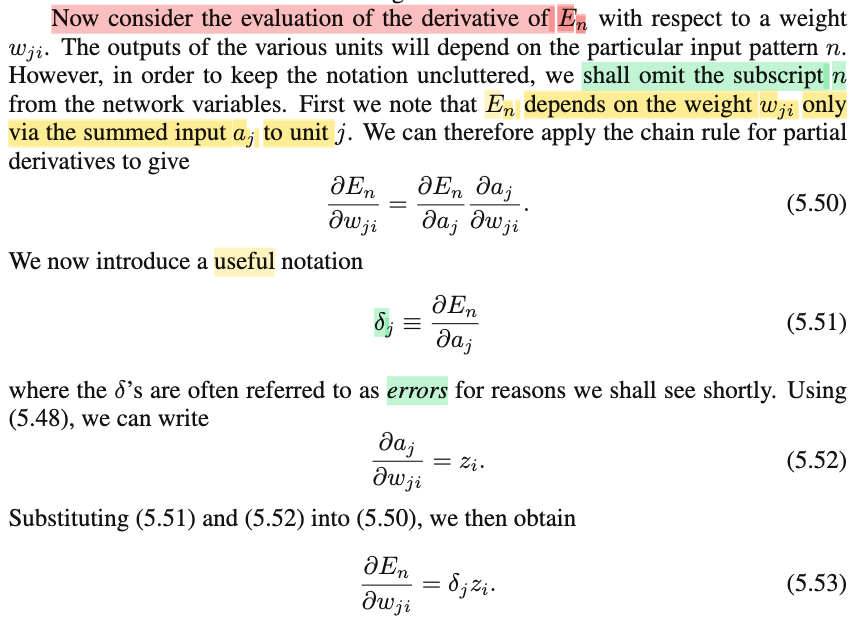</kbd>

<kbd>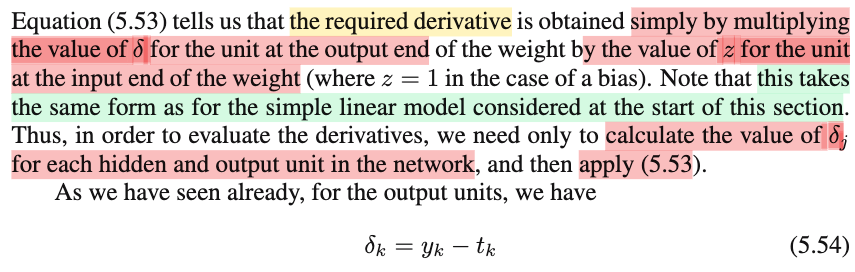</kbd>

<kbd>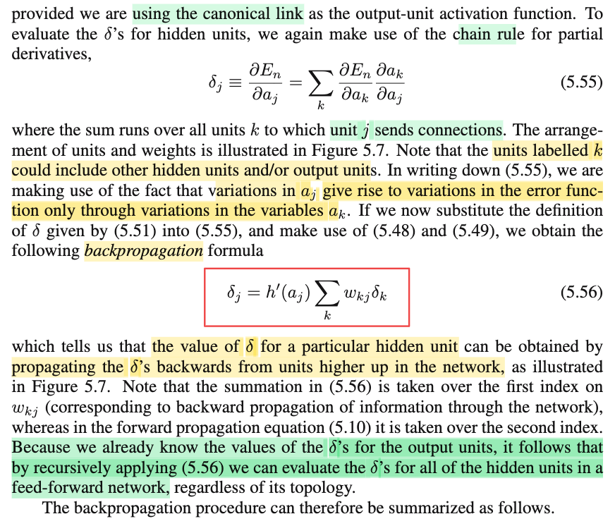</kbd>

<kbd>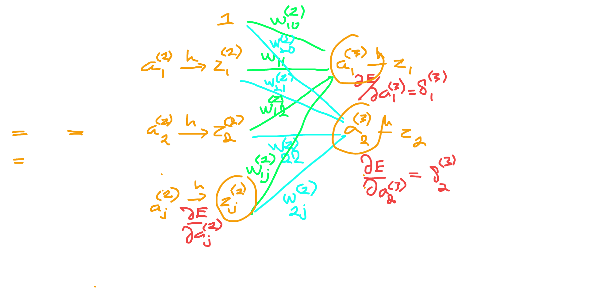</kbd>

<kbd>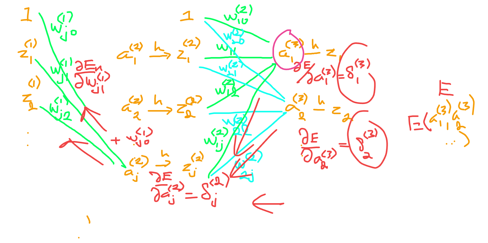</kbd>

> [!NOTE]
> w⁽¹⁾j1 z⁽¹⁾1 + w⁽¹⁾j2 z⁽¹⁾2 + ... = a⁽²⁾j
>
>
>
> ---
>
>
>
> z⁽²⁾1 = h(a⁽²⁾1)
>
> ..
>
> z⁽²⁾j = h(a⁽²⁾j)
>
> ..
>
>
>
> ---
>
>
>
> a⁽³⁾1 = w⁽²⁾11 z⁽²⁾1 + ...w⁽²⁾1j z⁽²⁾j + ...
>
>
>
> a⁽³⁾2 = w⁽²⁾21 z⁽²⁾1 + ..w⁽²⁾2j z⁽²⁾j + ..
>
>
>
> ...
>
>
>
> En = En(a⁽³⁾1, a⁽³⁾2,...)
>
>
>
> ---
>
>
>
> δj ≡ ∂En/∂a⁽²⁾j
>
>
>
> Ôn kiến thức giải tích:
>
>
>
> f(x,y,z) với x = x(u), y = y(u), z = z(u):
>
>
>
> Vi phân toàn phần: df = ∂f/∂x dx + ∂f/∂y dy + ∂f/∂z dz
>
>
>
> df = \[∂f/∂x x'(u)  + ∂f/∂y y'(u) + ∂f/∂z z'(u)\] du
>
>
>
> df/du = ∂f/∂x x'(u) + ∂f/∂y y'(u) + ∂f/∂z z'(u)
>
>
>
> ---
>
>
>
> nên En = En(a⁽³⁾1, a⁽³⁾2,...)
>
>
>
> và a⁽³⁾1 là hàm của a⁽²⁾j, a⁽³⁾2 là hàm của a⁽²⁾j...
>
>
>
> Nên ∂En/∂a⁽²⁾j = Σk (∂En/∂a⁽³⁾k) (∂a⁽³⁾k/∂a⁽²⁾j)
>
>
>
> Theo định nghĩa đã đặt ∂En/∂a⁽³⁾k = δ⁽³⁾k
>
>
>
> .. = Σk δ⁽³⁾k (∂a⁽³⁾k/∂a⁽²⁾j)
>
>
>
> Xét ∂a⁽³⁾k/∂a⁽²⁾j:
>
>
>
> a⁽³⁾k = w⁽²⁾k1 h(a⁽²⁾1) + ...w⁽²⁾kj h(a⁽²⁾j) + ...
>
>
>
> ⇒ ∂a⁽³⁾k/∂a⁽²⁾j = ∂/∂a⁽²⁾j \[w⁽²⁾k1 h(a⁽²⁾1) + ...w⁽²⁾kj h(a⁽²⁾j) + ...\]
>
>
>
> = ∂/∂a⁽²⁾j \[w⁽²⁾kj h(a⁽²⁾j)\]
>
>
>
> = w⁽²⁾kj d/da⁽²⁾j \[h(a⁽²⁾j)\]
>
>
>
> = w⁽²⁾kj h'(a⁽²⁾j)
>
>
>
> Vậy ∂En/∂a⁽²⁾j = Σk δ⁽³⁾k (∂a⁽³⁾k/∂a⁽²⁾j) = Σk δk w⁽²⁾kj h'(a⁽²⁾j)
>
>
>
> = h'(a⁽²⁾j) Σk w⁽²⁾kj δ⁽³⁾k → 5.56
>
>
>
> ---
>
>
>
> a⁽²⁾j = w⁽¹⁾j1 z⁽¹⁾1 + w⁽¹⁾j2 z⁽¹⁾2 + ...
>
>
>
> ∂En/∂w⁽¹⁾j1 = (∂En/∂a⁽²⁾j) (∂a⁽²⁾j/∂w⁽¹⁾j1)
>
>
>
> = δ⁽²⁾j (∂a⁽²⁾j/∂w⁽¹⁾j1)
>
>
>
> = δ⁽²⁾j z⁽¹⁾1
>
>
>
> Tương tự: ∂En/∂w⁽¹⁾ji = δ⁽²⁾j z⁽¹⁾i → 5.53
>
>
>
> Kết quả này giống kết quả ở trên khi ta xét linear model:
>
>
>
> ∂En/∂wji = (yj - tj)xi (chính là 5.47 (bỏ đi subscript n))

📹 [Xem video trên YouTube](https://www.youtube.com/watch?v=X3c2DARr8EM)

> [!TIP]
> 🤖 **AI Check** — 🟢 Pass — ✅ **98/100** · ✓ Move on
>
> Ghi chú rất xuất sắc, tự diễn giải chi tiết và chứng minh tường minh quy tắc lan truyền ngược (công thức 5.56 và 5.53) qua quy tắc chuỗi giải tích.
>
> **✓ Strengths**
> - Tự thiết lập chỉ số layer cụ thể (1, 2, 3) để tường minh hóa các biến số trong sách, giúp việc tính đạo hàm rất rõ ràng.
> - Tái hiện chính xác cơ sở giải tích (quy tắc chuỗi nhiều biến thông qua vi phân toàn phần) để giải thích cho công thức (5.55).
> - Thực hiện đầy đủ từng bước đạo hàm riêng ∂a_k/∂a_j qua hàm kích hoạt h(·) để dẫn ra công thức backpropagation (5.56).
> - Áp dụng chính xác quy tắc chuỗi để tính đạo hàm theo trọng số ∂En/∂w_ji (5.53) và liên hệ chuẩn xác về mô hình tuyến tính đơn giản.
>
> **💡 Deeper notes**
> - Ở bước liên hệ với mô hình tuyến tính, ghi chú nhắc đến δ = y - t; trong Bishop, điều này áp dụng khi activation output đi kèm hàm lỗi tương ứng là canonical link (ví dụ softmax + cross-entropy hoặc identity + sum-of-squares).

**🔗 See also:** [Efficiency of Backpropagation](./533_efficiency_of_backpropagation.md#node-xgrbhhi)

 

###### Total Error Derivative in Batch Methods

<kbd>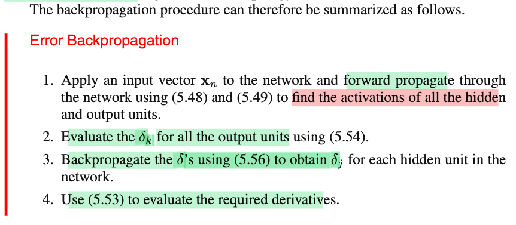</kbd>

<kbd>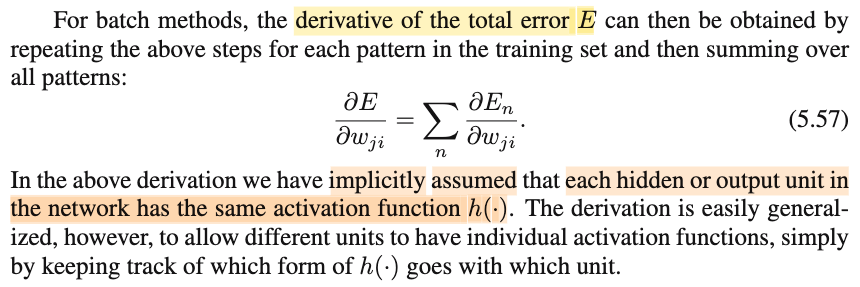</kbd>

 

