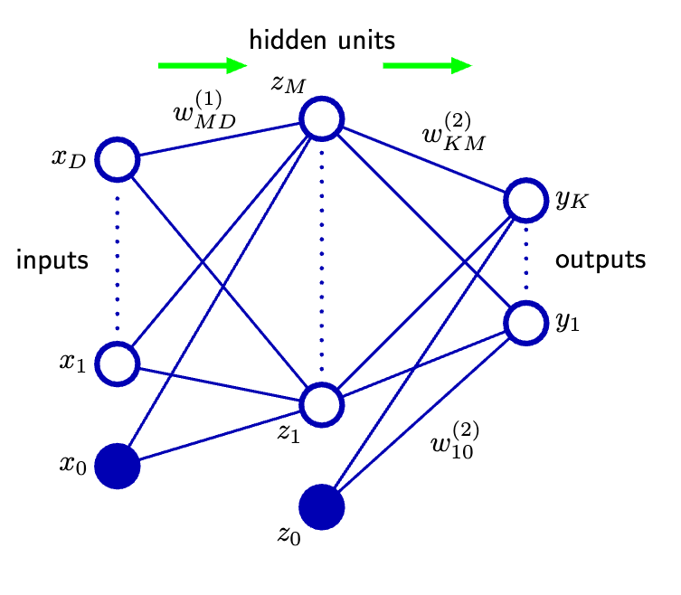
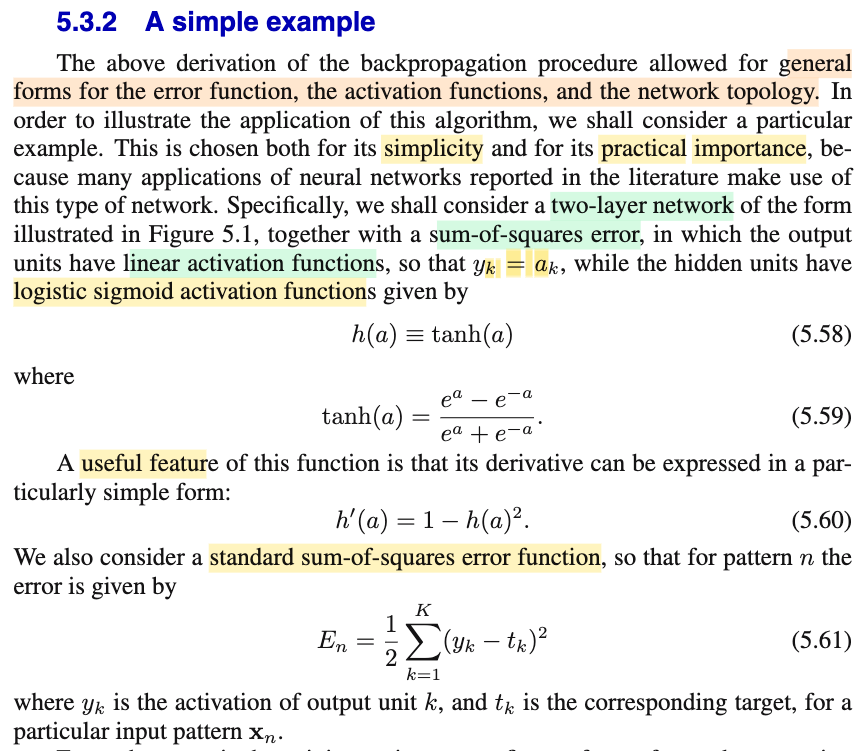
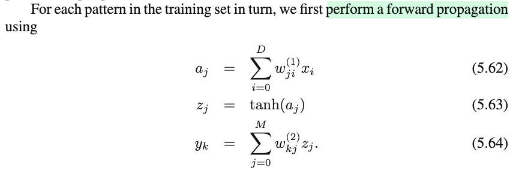
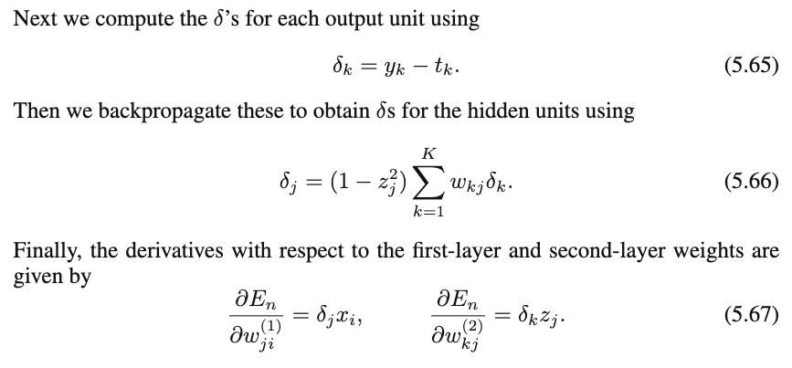
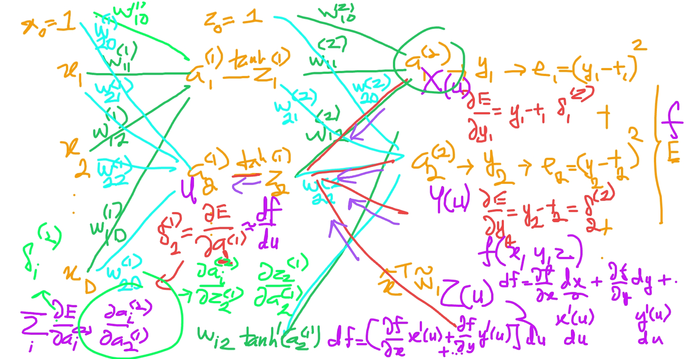
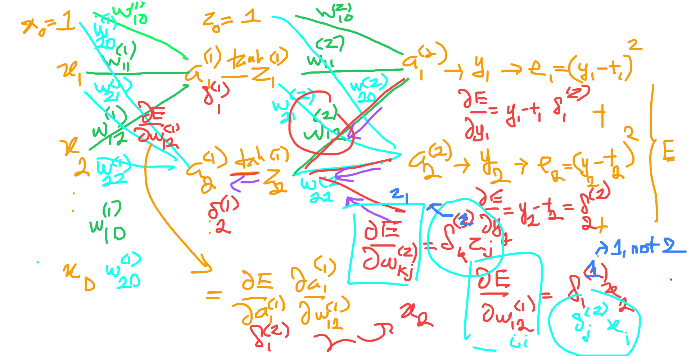

# 5.3.2 A simple example

📊 **Progress:** `1` Notes | `6` Screenshots | `1` AI Reviews

---

<kbd></kbd>

 

## Forward Propagation Equations

<kbd></kbd>

<kbd></kbd>

<kbd></kbd>

<kbd></kbd>

<kbd></kbd>

> [!NOTE]
> aj = w⁽¹⁾j0 × x0 + w⁽¹⁾j1 x1 + w⁽¹⁾j2 x2 + ..= Σi=0:D w⁽¹⁾ji xi
>
>
>
> zj = tanh(aj)
>
>
>
> yk = (a⁽²⁾k) = w⁽²⁾k0 × z0 + w⁽²⁾k1 z1 + ... = Σj=0:M w⁽²⁾kj zj
>
>
>
>
>
> E = (1/2)\[(y1 - t1)² + (y2 - t2)² + ...\]
>
>
>
> ∂E/∂y2 = ∂/∂y2 \[(1/2)\[(y1 - t1)² + (y2 - t2)² + ...\]\]
>
>
>
> = (1/2) ∂/∂y2 \[(y1 - t1)² + (y2 - t2)² + ...\]
>
>
>
> = (1/2) ∂/∂y2 (y2 - t2)²
>
>
>
> = (1/2) ∂/∂(y2 - t2) (y2 - t2)² . ∂/∂y2 (y2 - t2)
>
>
>
> = y2 - t2
>
>
>
> ∂E/∂yk = yk - tk
>
>
>
> ---
>
>
>
> ∂E/∂a⁽¹⁾2 = Σi δ⁽²⁾i w⁽²⁾i2 tanh'(a⁽¹⁾2)
>
>
>
> ∂E/∂a⁽¹⁾2 = \[1 - tanh(a⁽¹⁾2)²\] Σi δ⁽²⁾i w⁽²⁾i2
>
>
>
> Khái quát: ∂E/∂a⁽¹⁾j = \[1 - tanh(a⁽¹⁾j)²\] Σk δ⁽²⁾k w⁽²⁾kj 
>
>
>
> ---
>
>
>
> ∂E/∂w⁽¹⁾12 = (∂E/∂a⁽¹⁾1) (∂a⁽¹⁾1/∂w⁽¹⁾12)
>
>
>
> = δ⁽¹⁾1 (∂/∂w⁽¹⁾12 \[..+ w⁽¹⁾12 x2 +\])
>
>
>
> = δ⁽¹⁾1 x2
>
>
>
> Khái quát: ∂E/∂w⁽¹⁾ji = δ⁽¹⁾j xi → 5.67
>
>
>
> ---
>
>
>
> Tương tự ∂E/∂w⁽²⁾kj = δ⁽²⁾k zj → 5.67

📹 [Xem video trên YouTube](https://youtu.be/ynakCCSkgh0)

> [!TIP]
> 🤖 **AI Check** — 🟢 Pass — ✅ **98/100** · ✓ Move on
>
> Ghi chú rất tốt, bạn đã tự tường minh hóa các bước đạo hàm bằng quy tắc chuỗi (chain rule) trên các chỉ số cụ thể rồi tổng quát hóa lại chính xác các công thức trong sách.
>
> **✓ Strengths**
> - Tự triển khai chi tiết từng bước đạo hàm hàm lỗi theo output và theo activation tầng ẩn trước khi khái quát hóa thành công thức tổng quát.
> - Áp dụng chính xác đạo hàm của hàm kích hoạt tanh để tìm ra delta cho tầng ẩn.
> - Hiểu rõ bản chất lan truyền ngược bằng quy tắc chuỗi qua từng trọng số cụ thể.
>
> **💡 Deeper notes**
> - Biểu thức 1 - tanh(a_j)^2 chính là 1 - z_j^2, việc lưu lại giá trị kích hoạt z_j từ lượt forward giúp việc tính toán gradient ở lượt backward nhanh hơn mà không cần tính lại hàm tanh.

 

