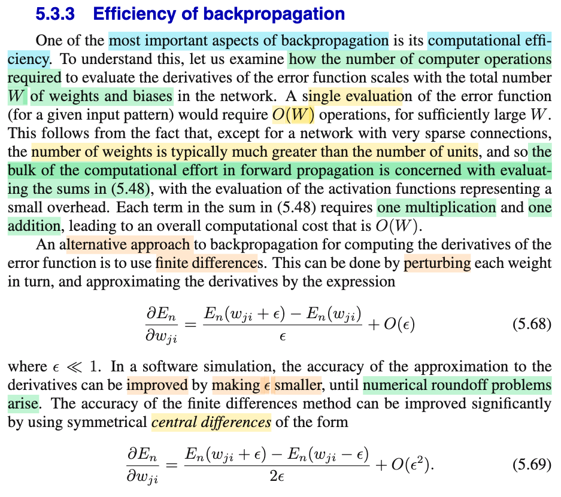
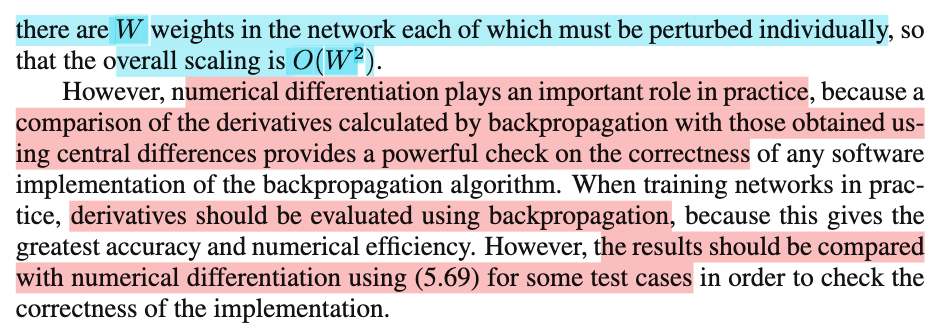
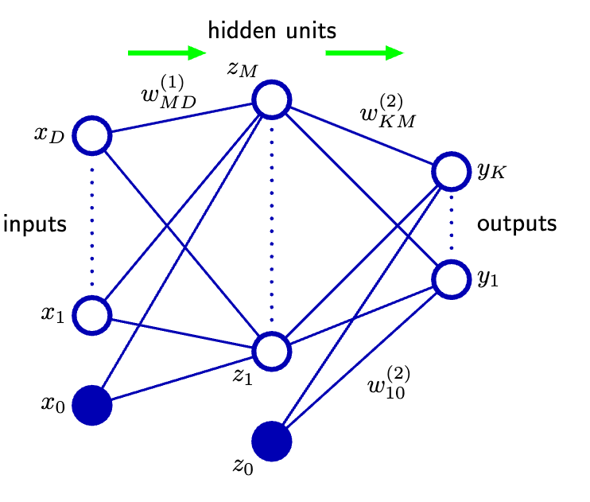

# 5.3.3 Efficiency of backpropagation

📊 **Progress:** `1` Notes | `3` Screenshots | `1` AI Reviews

---

 

## Efficiency of Backpropagation

<kbd></kbd>

<kbd></kbd>

<kbd></kbd>

> [!NOTE]
> Đại ý là nói về sự hiệu quả của thuật toán backprop khi chi phí tính toán chỉ là O(W) (tăng tuyến tính theo số tham số).
>
>
>
> Lí do đại khái việc tính toán forward sẽ chỉ chủ yếu là phần tính các weighted sum: ví dụ a⁽²⁾i = w⁽¹⁾i1 z⁽¹⁾1 + w⁽¹⁾i2 z⁽¹⁾2 + ..
>
>
>
> còn những phần khác: như tính z⁽²⁾i = h(a⁽²⁾i) đều không đáng kể do số lượng w lớn hơn rất nhiều số unit (hidden unit và output unit, kể cả dùng rất nhiều hidden layer và rất nhiều unit, thì thường vẫn không là gì so với số tham số w (và bias))
>
>
>
> Và nhìn network có thể hình dung ràng toàn bộ phép tính forward chỉ cơ bản là tính 1 cái weighted sum Σi=1:W wi × something (x hoặc z) cộng với các phép tính activation function của các unit. Từ đó có thể hiểu chi phí tính toán của forward là O(W).
>
>
>
> Còn backprop?
>
>
>
> 5.56: ∂En/∂a⁽²⁾j = h'(a⁽²⁾j) Σk w⁽²⁾kj δ⁽³⁾k
>
>
>
> 5.53: ∂En/∂w⁽¹⁾ji = δ⁽²⁾j z⁽¹⁾i 
>
>
>
> Có thể thấy phần tính toán chủ yếu là tính weight sum của các weight (O(W)) và một phép nhân trong 5.53 cho mỗi wi trong W: O(W) luôn.
>
>
>
> Vậy backprop cũng chỉ tốn O(W).
>
>
>
> ---
>
>
>
>
>
> Đoạn sau nhắc đến cách tính (gọi là numerical derivative) cách này dùng để check khi làm thật (debug xem backprop tính đạo hàm bằng công thức có đúng ko)
>
>
>
> Nếu dùng để train thì sẽ tốn kém: vì O(W²):
>
>
>
> Vì kiểu tính của nó là ∂E/∂wi = \[E(w1, w2,...,wi+ε,..) - E(w1, w2,...,wi,..)\]/ε
>
>
>
> (có thể dùng central difference thay vì forward difference) để chính xác hơn, ε càng nhỏ càng chính xác miễn là không bị lỗi làm tròn máy tính (cái này chương 8 Nocedal đã nói kĩ)
>
>
>
> Tốn O(W) mỗi lần (forward prop như nói trên), nên để đủ W tham số, phải tốn O(W²).

📹 [Xem video trên YouTube](https://www.youtube.com/watch?v=vnhEb1jYjho)

> [!TIP]
> 🤖 **AI Check** — 🟢 Pass — ✅ **95/100** · ✓ Move on
>
> Ghi chú rất xuất sắc, nắm bắt chuẩn xác bản chất độ phức tạp tính toán O(W) của forward/backpropagation so với O(W²) của đạo hàm số trị (numerical differentiation), đồng thời nêu đúng vai trò thực tế của gradient check.
>
> **✓ Strengths**
> - Giải thích rất trực quan và chính xác lý do forward propagation và backpropagation đều tốn O(W) dựa trên ưu thế số lượng liên kết/trọng số W áp đảo số lượng unit.
> - Nắm vững lý do đạo hàm sai phân hữu hạn (finite differences) tốn O(W²) và vai trò thực tiễn của nó là dùng để kiểm tra tính đúng đắn (gradient checking/debug) thay vì huấn luyện trực tiếp.
> - Hiểu rõ sự đánh đổi số học khi chọn bước nhảy ε (độ chính xác giải tích so với lỗi làm tròn máy tính - roundoff error).
>
> **💡 Deeper notes**
> - Giả định W >> số unit áp dụng cho các mạng đầy đủ (dense) hoặc có độ kết nối cao; sách gốc có ghi chú một ngoại lệ nhỏ là với các mạng có liên kết cực kỳ thưa (very sparse connections), chi phí tính toán có thể không hoàn toàn bị thống trị bởi W.
> - Với sai phân trung tâm (central differences), sai số cắt cụt giảm theo O(ε²) thay vì O(ε) như sai phân tiến, nên độ chính xác tăng nhanh hơn đáng kể với cùng một độ lớn của ε.

**🔗 See also:** [Feed-Forward Network Unit Activation](./531_evaluation_of_error_function_derivatives.md#node-krbtnm2) · [Weight Derivative Evaluation](./531_evaluation_of_error_function_derivatives.md#node-noaxia8)

 

