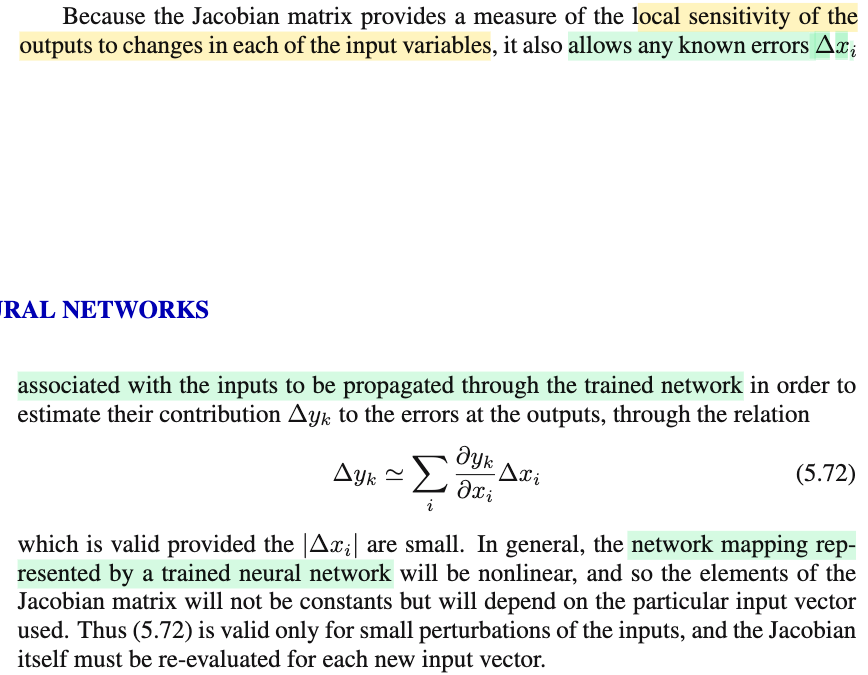
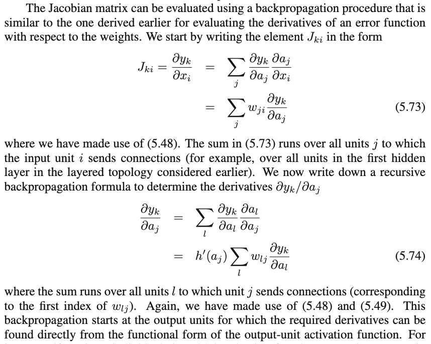
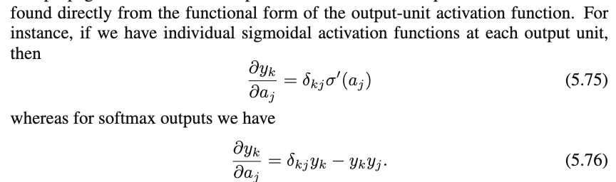
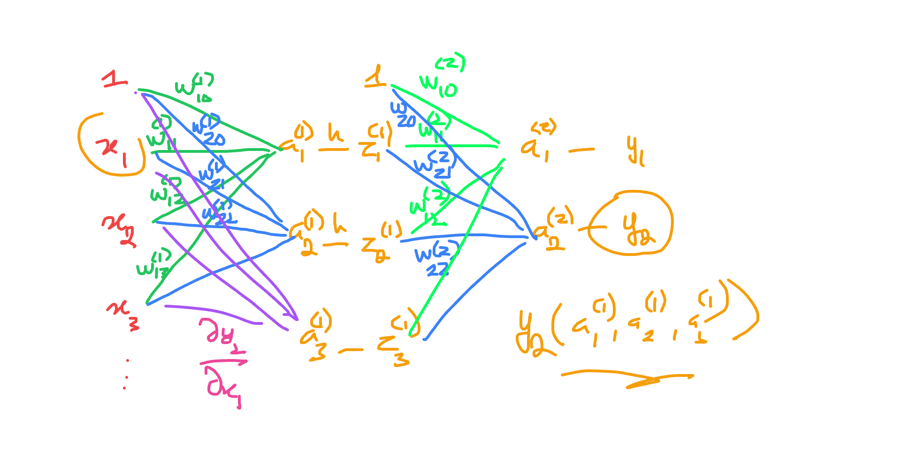
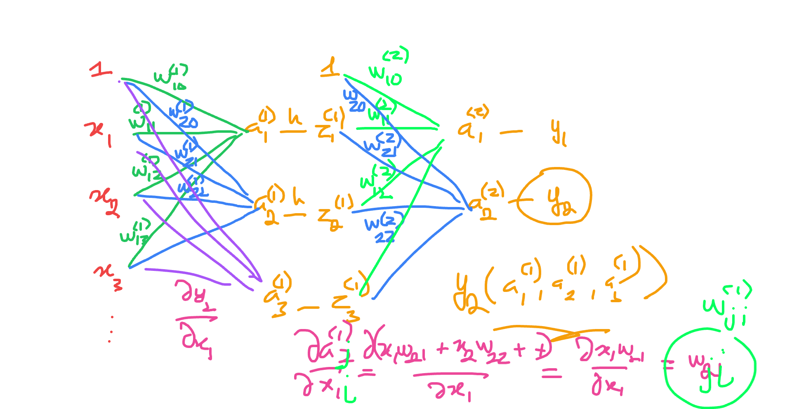
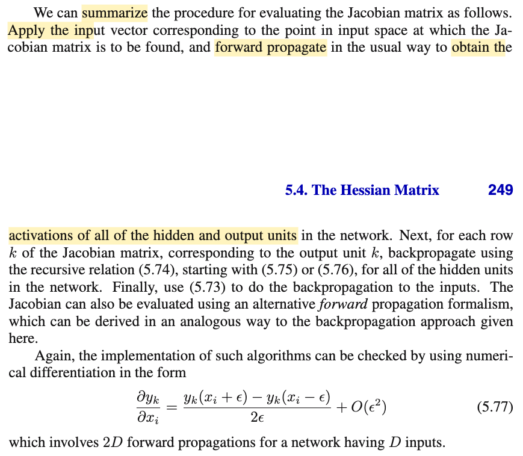

# 5.3.4 The Jacobian matrix

📊 **Progress:** `3` Notes | `9` Screenshots | `3` AI Reviews

---

 

## 5.3.4 The Jacobian Matrix

<kbd></kbd>

<kbd></kbd>

> [!NOTE]
> Đại khái là:
>
>
>
> Xét tác động của trọng số w khi tham gia tính ra 𝐲:
>
>
>
> 𝐳 = 𝐳(w, ω): w tham gia tính ra mọi zi của 𝐳, và gỉa sử có 2 tham số w, ω
>
>
>
> z1 = z1(w, ω), z2 = z2(w, ω),...
>
>
>
> 𝐲 = 𝐲(𝐳): Mọi phần tử zi đều tham gia tính một phần tử tương ứng của 𝐲: ví dụ khi output là hàm tuyến tính: yk = zk hoặc mọi phần tử của 𝐲 ví dỵ yk = exp(zk) / Σj exp(zj)
>
>
>
> Và E = E(𝐲): Mọi phần tử của 𝐲 đều tham gia tính E
>
>
>
> Nên có câu chuyện tương tự như: f = f(x,y,z) với x=x(u), y = y(u), z = z(u).
>
>
>
> Vi phân toàn phần: total differential: 
>
>
>
> df = (∂f/∂x) dx + (∂f/∂y) dy + (∂f/∂z) dz 
>
>
>
> và dx = x'(u)du, dy = y'(u)du, dz = z'(u)du 
>
>
>
> ⇒ df = \[(∂f/∂x) x'(u) + (∂f/∂y) y'(u) + (∂f/∂z) z'(u)\] du
>
>
>
> Ở đây cũng vậy: y1 = y1(z1,z2,..), y2 = y2(z1,z2,..),... và E = E(y1,y2,...)
>
>
>
> nên dE = ∂E/∂y1 dy1 + ∂E/∂y2 dy2 + ..
>
>
>
> ---
>
>
>
> y1 = y1(z1,z2,...) ⇒ dy1 = ∂y1/∂z1 dz1 + ∂y1/∂z2 dz2 + ...= Σj ∂y1/∂zj dzj
>
>
>
> y2 = y2(z1,z2,...) ⇒ dy2 = ∂y2/∂z1 dz1 + ∂y2/∂z2 dz2 + ...= Σj ∂y2/∂zj dzj
>
>
>
> ⇒ dE = (∂E/∂y1) Σj ∂y1/∂zj dzj + (∂E/∂y2) Σj ∂y2/∂zj dzj + ..
>
>
>
> =  Σj (∂E/∂y1) (∂y1/∂zj) dzj + Σj (∂E/∂y2) (∂y2/∂zj) dzj + ..
>
>
>
> =  Σk Σj (∂E/∂yk) (∂yk/∂zj) dzj 
>
>
>
> ---
>
>
>
> z1 = z1(w, ω), z2 = z2(w, ω),...zj = zj(w, ω)
>
>
>
> dz1 = ∂z1/∂w dw + ∂z1/∂ω dω
>
>
>
> ⇒ dzj = ∂zj/∂w dw + ∂zj/∂ω dω
>
>
>
> ⇒ dE = Σk Σj (∂E/∂yk) (∂yk/∂zj) \[∂zj/∂w dw + ∂zj/∂ω dω\]
>
>
>
> dE = Σk Σj (∂E/∂yk) (∂yk/∂zj) (∂zj/∂w) dw + Σk Σj (∂E/∂yk) (∂yk/∂zj) (∂zj/∂ω) dω
>
>
>
> ⇒ ∂E/∂w: Σk Σj (∂E/∂yk) (∂yk/∂zj) (∂zj/∂w)

📹 [Xem video trên YouTube](https://www.youtube.com/watch?v=shn4HGB4mrQ)

> [!TIP]
> 🤖 **AI Check** — 🟢 Pass — ✅ **95/100** · ✓ Move on
>
> Ghi chú rất tốt, tự diễn giải và chứng minh công thức quy tắc chuỗi (chain rule) qua vi phân toàn phần một cách rõ ràng, chính xác.
>
> **✓ Strengths**
> - Sử dụng vi phân toàn phần để giải thích nguồn gốc của hai dấu tổng (sum over k và j) rất trực quan và chuẩn xác.
> - Bản chất của các phụ thuộc hàm (E theo y, y theo z, z theo w) được mô hình hóa đúng với cấu trúc của sơ đồ khối trong tài liệu tham khảo.
>
> **💡 Deeper notes**
> - Theo Hình 5.8, khối màu đỏ nhận cả đầu vào z và v (từ khối màu xanh lá). Đầy đủ thì vi phân dy_k còn có thêm thành phần theo dv, nhưng do v độc lập với w (dv/dw = 0) nên thành phần này triệt tiêu khi lấy đạo hàm riêng theo w.

 

### Jacobian Matrix Error Propagation

<kbd></kbd>

<kbd></kbd>

<kbd></kbd>

<kbd></kbd>

<kbd></kbd>

> [!NOTE]
> f(x,y,z): df = ∂f/∂x dx + ∂f/∂y dy + ∂f/∂z dz (total differential: MIT 1802)
>
>
>
> g(x): dg = g'(x) dx
>
>
>
> x = x(u,v), y = y(u,v), z = z(u,v)
>
>
>
> dx = ∂x/∂u du + ∂x/∂v dv
>
>
>
> dy = ∂y/∂u du + ∂y/∂v dv
>
>
>
> dz = ∂z/∂u du + ∂z/∂v dv
>
>
>
> df = ∂f/∂x (∂x/∂u du + ∂x/∂v dv) + ∂f/∂y (∂y/∂u du + ∂y/∂v dv) + ∂f/∂z (∂z/∂u du + ∂z/∂v dv)
>
>
>
> = (∂f/∂x ∂x/∂u + ∂f/∂y ∂y/∂u + ∂f/∂z ∂z/∂u) du + (∂f/∂x ∂x/∂v + ∂f/∂y ∂y/∂v + ∂f/∂z ∂z/∂v) dv
>
>
>
> ∂f/∂u =  (∂f/∂x ∂x/∂u + ∂f/∂y ∂y/∂u + ∂f/∂z ∂z/∂u)
>
>
>
> ∂f/∂v = (∂f/∂x ∂x/∂v + ∂f/∂y ∂y/∂v + ∂f/∂z ∂z/∂v)
>
>
>
> ---
>
>
>
>
>
> ∂yk/∂xi = Σj ∂yk/∂⁽¹⁾aj ∂a⁽¹⁾j/∂xi
>
>
>
> yk = yk(a⁽¹⁾1, a⁽¹⁾2, a⁽¹⁾3)
>
>
>
> dyk = ∂yk/∂a⁽¹⁾1 da⁽¹⁾1 + ∂yk/∂a⁽¹⁾2 da⁽¹⁾2 + ∂yk/∂a⁽¹⁾3 da⁽¹⁾3
>
>
>
> = Σj ∂yk/∂a⁽¹⁾j da⁽¹⁾j
>
>
>
> ---
>
>
>
>  a⁽¹⁾1 =  a⁽¹⁾1(x1,x2,...,xi,..)
>
>
>
> = Σm w⁽¹⁾1m xm = w⁽¹⁾11x1 + ...+ w⁽¹⁾1i xi + ... + w⁽¹⁾10
>
>
>
> a⁽¹⁾2 = a⁽¹⁾2(x1,x2,...,xi,..) = 
>
>
>
> Σm w⁽¹⁾2m xm = w⁽¹⁾21x1 + ...+ w⁽¹⁾2i xi + ... + w⁽¹⁾20
>
>
>
> ...
>
>
>
> da⁽¹⁾1 = ∂a⁽¹⁾1/∂x1 dx1 + ∂a⁽¹⁾1/∂x2 dx2 + ... + ∂a⁽¹⁾1/∂xi dxi + ... = Σs ∂a⁽¹⁾1/∂xs dxs
>
>
>
> da⁽¹⁾2 = ∂a⁽¹⁾2/∂x1 dx1 + ∂a⁽¹⁾2/∂x2 dx2 + ... + ∂a⁽¹⁾2/∂xi dxi + ... = Σs ∂a⁽¹⁾2/∂xs dxs
>
>
>
> da⁽¹⁾j = ∂a⁽¹⁾j/∂x1 dx1 + ∂a⁽¹⁾j/∂x2 dx2 + ... + ∂a⁽¹⁾j/∂xi dxi + ... = Σs ∂a⁽¹⁾j/∂xs dxs
>
>
>
> ..
>
>
>
> Lắp vào:
>
>
>
> dyk = Σj ∂yk/∂a⁽¹⁾j da⁽¹⁾j = Σj ∂yk/∂a⁽¹⁾j (Σs ∂a⁽¹⁾j/∂xs dxs)
>
>
>
> = Σj Σs (∂yk/∂a⁽¹⁾j) (∂a⁽¹⁾j/∂xs) dxs
>
>
>
> = Σs Σj (∂yk/∂a⁽¹⁾j) (∂a⁽¹⁾j/∂xs) dxs
>
>
>
> = Σj (∂yk/∂a⁽¹⁾j) (∂a⁽¹⁾j/∂x1) dx1 + Σj (∂yk/∂a⁽¹⁾j) (∂a⁽¹⁾j/∂x2) dx2 + ...+ Σj (∂yk/∂a⁽¹⁾j) (∂a⁽¹⁾j/∂xi) dxi + ...
>
>
>
> ∂yk/∂xi = Σj (∂yk/∂a⁽¹⁾j) (∂a⁽¹⁾j/∂xi)
>
>
>
> = Σj w⁽¹⁾ji (∂yk/∂a⁽¹⁾j) → 5.73
>
>
>
> ---
>
>
>
> ∂yk/∂a⁽¹⁾j:
>
>
>
> yk = yk(a⁽²⁾1, a⁽²⁾2,...)
>
>
>
> dyk = Σl ∂yk/∂a⁽²⁾l da⁽²⁾l
>
>
>
> ---
>
>
>
> a⁽²⁾1 = a⁽²⁾1(z⁽¹⁾1, z⁽¹⁾2,...)
>
>
>
> a⁽²⁾2 = a⁽²⁾2(z⁽¹⁾1, z⁽¹⁾2,...)
>
>
>
> a⁽²⁾l = a⁽²⁾l(z⁽¹⁾1, z⁽¹⁾2,...) 
>
>
>
> ⇒ da⁽²⁾l = ∂a⁽²⁾l/∂z⁽¹⁾1 dz⁽¹⁾1 + ∂a⁽²⁾l/∂z⁽¹⁾2 dz⁽¹⁾2 + ... = Σn ∂a⁽²⁾l/∂z⁽¹⁾n dz⁽¹⁾n
>
>
>
> mà z⁽¹⁾n = h(a⁽¹⁾n) ⇒ dz⁽¹⁾n = h'(a⁽¹⁾n) da⁽¹⁾n
>
>
>
> Nên da⁽²⁾l = Σn ∂a⁽²⁾l/∂z⁽¹⁾n h'(a⁽¹⁾n) da⁽¹⁾n
>
>
>
> Vậy dyk = Σl ∂yk/∂a⁽²⁾l da⁽²⁾l
>
>
>
> = Σl ∂yk/∂a⁽²⁾l \[Σn ∂a⁽²⁾l/∂z⁽¹⁾n h'(a⁽¹⁾n) da⁽¹⁾n\]
>
>
>
> = Σn Σl ∂yk/∂a⁽²⁾l ∂a⁽²⁾l/∂z⁽¹⁾n h'(a⁽¹⁾n) da⁽¹⁾n
>
>
>
> = Σl ∂yk/∂a⁽²⁾l ∂a⁽²⁾l/∂z⁽¹⁾1 h'(a⁽¹⁾1) da⁽¹⁾1 + Σl ∂yk/∂a⁽²⁾l ∂a⁽²⁾l/∂z⁽¹⁾2 h'(a⁽¹⁾2) da⁽¹⁾2 + ...
>
>
>
> ⇒ ∂yk/∂a⁽¹⁾j = Σl ∂yk/∂a⁽²⁾l ∂a⁽²⁾l/∂z⁽¹⁾j h'(a⁽¹⁾j)
>
>
>
> ---
>
>
>
>
>
> ∂a⁽²⁾l/∂z⁽¹⁾j = w⁽²⁾lj (theo (1))
>
>
>
> .. = Σl ∂yk/∂a⁽²⁾l w⁽²⁾lj h'(a⁽¹⁾j)
>
>
>
> = h'(a⁽¹⁾j) Σl w⁽²⁾lj ∂yk/∂a⁽²⁾l → 5.47
>
>
>
> ---
>
>
>
>  Nếu yk = σ(a⁽²⁾k)
>
>
>
> ⇒ ∂yk/∂a⁽²⁾l = 0 với l ≠ k,
>
>
>
> ngược lại ∂yk/∂a⁽²⁾l = ∂yk/∂a⁽²⁾k = σ'(a⁽²⁾k) 
>
>
>
> Ghi là ∂yk/∂a⁽²⁾l = δkl σ'(a⁽²⁾l), hay trong sách là ∂yk/∂a⁽²⁾j = δkj σ'(a⁽²⁾j)
>
>
>
> Nếu yk = exp(a⁽²⁾k)/Σs exp(a⁽²⁾s) (softmax):
>
>
>
> ---
>
>
>
> Theo kết quả bữa trước tính đạo hàm hàm softmax (xem link)
>
>
>
> ∂yi/∂ak = yi \[𝐈\_{i=k} - yk\] , cũng là yi δik - yiyk
>
>
>
> ∂yk/∂al = yk δkl - yk yl
>
>
>
>
>
> ---
>
>
>
>
>
> ∂yk/∂a⁽²⁾l = δkl yk - ykyl, hay
>
>
>
> trong sách là ∂yk/∂a⁽²⁾j = δkj yk - ykyj

📹 Video 1: [Làm Sao Dùng Vi Phân Toàn Phần Tính Ma Trận Jacobian?](https://youtu.be/oc3MeNvCth0)

📹 Video 2: [Cách tính ma trận Jacobian ∂yk/∂xi bằng vi phân toàn phần?](https://www.youtube.com/watch?v=kQ5U-bfAg2o)

> [!TIP]
> 🤖 **AI Check** — 🟢 Pass — ✅ **100/100** · ✓ Move on
>
> Ghi chú rất xuất sắc, tự triển khai đạo hàm bằng vi phân toàn phần rõ ràng, mạch lạc và hoàn toàn chính xác theo các công thức (5.73) - (5.76) trong sách.
>
> **✓ Strengths**
> - Sử dụng vi phân toàn phần (total differential) để suy ra quy tắc dây chuyền rất chặt chẽ và trực quan.
> - Tự chứng minh chi tiết công thức lan truyền ngược cho Jacobian qua các tầng ẩn và các trường hợp hàm kích hoạt đầu ra (sigmoid, softmax).
>
> **💡 Deeper notes**
> - Ký hiệu chỉ số tầng (1), (2) được áp dụng cho mạng 2 tầng (1 tầng ẩn), nhưng thuật toán đệ quy (5.74) có thể mở rộng tự nhiên cho mạng nhiều tầng ẩn bằng cách lặp lại bước lan truyền ngược này.

**🔗 See also:** [Exercise 5.7 Softmax Derivative](./52_training.md#node-5kuxlzr)

 

#### Evaluating the Jacobian Matrix

<kbd></kbd>

<kbd></kbd>

> [!NOTE]
> 5.73: ∂yk/∂xi = Σj w⁽¹⁾ji (∂yk/∂a⁽¹⁾j)
>
>
>
> 5.74: ∂yk/∂a⁽¹⁾j = h'(a⁽¹⁾j) Σl w⁽²⁾lj ∂yk/∂a⁽²⁾l
>
>
>
> 5.75: ∂yk/∂a⁽²⁾j = δkj σ'(aj)
>
>
>
> 5.76: ∂yk/∂a⁽²⁾j = δkj yk - yk yj
>
>
>
> Như vậy quy trình sẽ là như sau (để tính ra Jacobian: đạo hàm của vector output 𝐲 đối với input vector 𝐱:
>
>
>
> Nhập input 𝐱, forward prop một lần để có các giá trị trung gian: 𝐚⁽¹⁾, 𝐚⁽²⁾, 𝐳⁽¹⁾
>
>
>
> Với mỗi phần tử của y: ví dụ yk backprop để tính ∂yk/∂a⁽²⁾j theo 5.75 hoặc 5.76. rồi dùng 5.74 tính ∂yk/∂a⁽¹⁾j và dùng 5.73 tính ∂yk/∂xi. Mỗi lần như vậy ta có đủ 1 hàng của J, ví dụ k=1, ta có được hàng 1: \[∂yk/∂x1, ∂yk/∂x2, ...\]
>
>
>
> ---
>
>
>
> Tác giả có nhắc đến Forward propagation formalism, cái này trong Nocedal đã học, chính là Forward Mode. (cái backpropagation ở đây chính là Backward Mode (gồm Forward Sweep + Backward Sweep)
>
>
>
> ---
>
>
>
> Cuối cùng là, tương tự, ta có thể dùng numerical gradient để check. Nguyên lí cũng tương tự với ∇E (∂E/∂wi)

> [!TIP]
> 🤖 **AI Check** — 🟢 Pass — ✅ **100/100** · ✓ Move on
>
> Ghi chú tóm tắt rất chính xác và mạch lạc quy trình tính ma trận Jacobian theo từng bước, đồng thời liên hệ chuẩn xác với Forward Mode và Reverse Mode trong vi phân tự động (Automatic Differentiation).
>
> **✓ Strengths**
> - Tóm tắt đúng và đầy đủ quy trình tính ma trận Jacobian: 1 lần forward pass, sau đó với mỗi output y_k thực hiện 1 lần backprop để tính một hàng của ma trận Jacobian.
> - Liên hệ rất chuẩn xác giữa thuật toán lan truyền tiến/lùi với Forward Mode và Reverse Mode (Forward/Backward Sweep) trong môn tối ưu / Automatic Differentiation.
>
> **💡 Deeper notes**
> - Về chi phí tính toán: phương pháp Backprop (Reverse mode) mất K lần backward sweeps (với K là số output units), phù hợp khi K < D; còn Forward propagation formalism (Forward mode) mất D lần forward sweeps (với D là số input dimensions), tối ưu hơn khi D < K.

 

