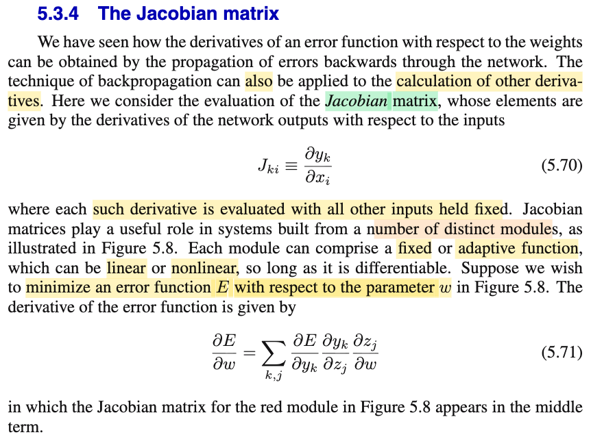
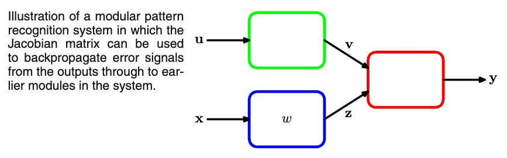

# 5.3.4 The Jacobian matrix

📊 **Progress:** `2` Notes | `2` Screenshots | `1` AI Reviews

---

 

## 5.3.4 The Jacobian Matrix

<kbd></kbd>

<kbd></kbd>

> [!NOTE]
> Đại khái là:
>
>
>
> Xét tác động của trọng số w khi tham gia tính ra 𝐲:
>
>
>
> 𝐳 = 𝐳(w, ω): w tham gia tính ra mọi zi của 𝐳, và gỉa sử có 2 tham số w, ω
>
>
>
> z1 = z1(w, ω), z2 = z2(w, ω),...
>
>
>
> 𝐲 = 𝐲(𝐳): Mọi phần tử zi đều tham gia tính một phần tử tương ứng của 𝐲: ví dụ khi output là hàm tuyến tính: yk = zk hoặc mọi phần tử của 𝐲 ví dỵ yk = exp(zk) / Σj exp(zj)
>
>
>
> Và E = E(𝐲): Mọi phần tử của 𝐲 đều tham gia tính E
>
>
>
> Nên có câu chuyện tương tự như: f = f(x,y,z) với x=x(u), y = y(u), z = z(u).
>
>
>
> Vi phân toàn phần: total differential: 
>
>
>
> df = (∂f/∂x) dx + (∂f/∂y) dy + (∂f/∂z) dz 
>
>
>
> và dx = x'(u)du, dy = y'(u)du, dz = z'(u)du 
>
>
>
> ⇒ df = \[(∂f/∂x) x'(u) + (∂f/∂y) y'(u) + (∂f/∂z) z'(u)\] du
>
>
>
> Ở đây cũng vậy: y1 = y1(z1,z2,..), y2 = y2(z1,z2,..),... và E = E(y1,y2,...)
>
>
>
> nên dE = ∂E/∂y1 dy1 + ∂E/∂y2 dy2 + ..
>
>
>
> ---
>
>
>
> y1 = y1(z1,z2,...) ⇒ dy1 = ∂y1/∂z1 dz1 + ∂y1/∂z2 dz2 + ...= Σj ∂y1/∂zj dzj
>
>
>
> y2 = y2(z1,z2,...) ⇒ dy2 = ∂y2/∂z1 dz1 + ∂y2/∂z2 dz2 + ...= Σj ∂y2/∂zj dzj
>
>
>
> ⇒ dE = (∂E/∂y1) Σj ∂y1/∂zj dzj + (∂E/∂y2) Σj ∂y2/∂zj dzj + ..
>
>
>
> =  Σj (∂E/∂y1) (∂y1/∂zj) dzj + Σj (∂E/∂y2) (∂y2/∂zj) dzj + ..
>
>
>
> =  Σk Σj (∂E/∂yk) (∂yk/∂zj) dzj 
>
>
>
> ---
>
>
>
> z1 = z1(w, ω), z2 = z2(w, ω),...zj = zj(w, ω)
>
>
>
> dz1 = ∂z1/∂w dw + ∂z1/∂ω dω
>
>
>
> ⇒ dzj = ∂zj/∂w dw + ∂zj/∂ω dω
>
>
>
> ⇒ dE = Σk Σj (∂E/∂yk) (∂yk/∂zj) \[∂zj/∂w dw + ∂zj/∂ω dω\]
>
>
>
> dE = Σk Σj (∂E/∂yk) (∂yk/∂zj) (∂zj/∂w) dw + Σk Σj (∂E/∂yk) (∂yk/∂zj) (∂zj/∂ω) dω
>
>
>
> ⇒ ∂E/∂w: Σk Σj (∂E/∂yk) (∂yk/∂zj) (∂zj/∂w)

📹 [Xem video trên YouTube](https://www.youtube.com/watch?v=shn4HGB4mrQ)

> [!TIP]
> 🤖 **AI Check** — 🟢 Pass — ✅ **95/100** · ✓ Move on
>
> Ghi chú rất tốt, tự diễn giải và chứng minh công thức quy tắc chuỗi (chain rule) qua vi phân toàn phần một cách rõ ràng, chính xác.
>
> **✓ Strengths**
> - Sử dụng vi phân toàn phần để giải thích nguồn gốc của hai dấu tổng (sum over k và j) rất trực quan và chuẩn xác.
> - Bản chất của các phụ thuộc hàm (E theo y, y theo z, z theo w) được mô hình hóa đúng với cấu trúc của sơ đồ khối trong tài liệu tham khảo.
>
> **💡 Deeper notes**
> - Theo Hình 5.8, khối màu đỏ nhận cả đầu vào z và v (từ khối màu xanh lá). Đầy đủ thì vi phân dy_k còn có thêm thành phần theo dv, nhưng do v độc lập với w (dv/dw = 0) nên thành phần này triệt tiêu khi lấy đạo hàm riêng theo w.

 

> [!NOTE]
> ∂yk/∂xi = Σj ∂yk/∂aj ∂aj/∂xi (1)
>
>
>
> yk = yk(
>
>
>
> a1 = Σj w1j xj = w11x1 + ...+ w1i xi + ... + w10
>
>
>
> a2 = Σj w2j xj = w21x1 + ...+ w2i xi + ... + w20
>
>
>
> ...
>
>
>
> nên ∂a1/∂xi = w1i, ∂a2/∂xi = w2i,..., ∂aj/∂xi = wji
>
>
>
> (1) = Σj ∂yk/∂aj wji = Σj wji ∂yk/∂aj

 

