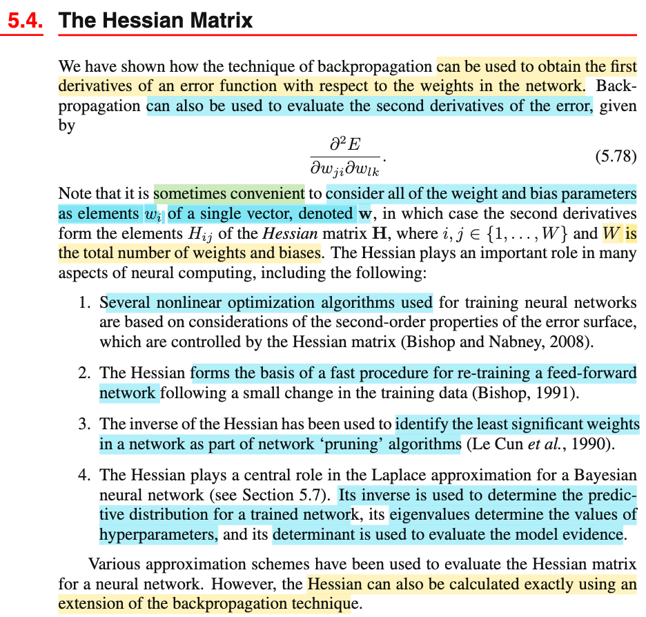
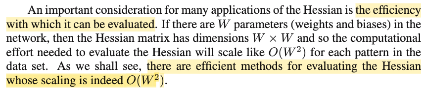
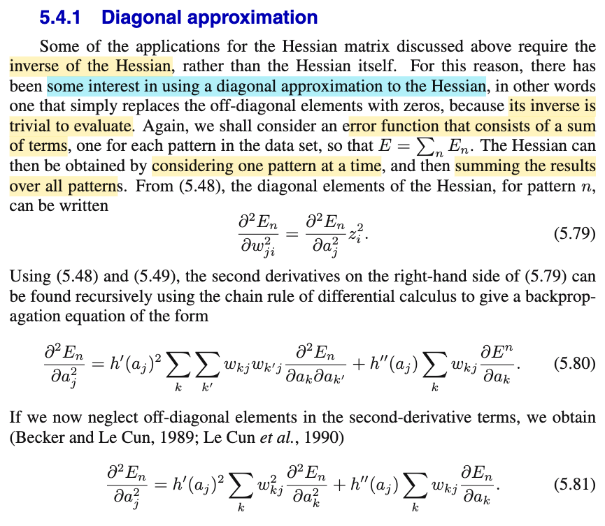

# 5.3.5 Hessian

📊 **Progress:** `1` Notes | `3` Screenshots

---

 

## 5.4 The Hessian Matrix

<kbd></kbd>

<kbd></kbd>

> [!NOTE]
> Phần này đại ý là nói về vai trò của Hessian, và backprop có thể dùng để tính Hessian
>
>
>
> Và một vấn đề cần cân nhắc khi tính Hessian là chi phí tính toán. Ta sẽ thấy, chi phí tính Hessian sẽ scale theo O(W²) (W là số tham số (weight + bias))

 

### 5.4.1 Diagonal Approximation

<kbd></kbd>

**🔗 See also:** [Feed-Forward Network Unit Activation](./531_evaluation_of_error_function_derivatives.md#node-krbtnm2)

 

