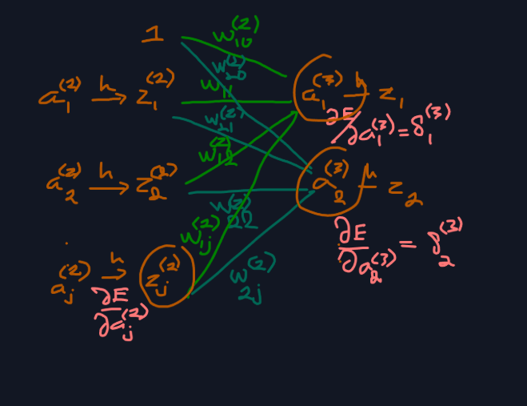
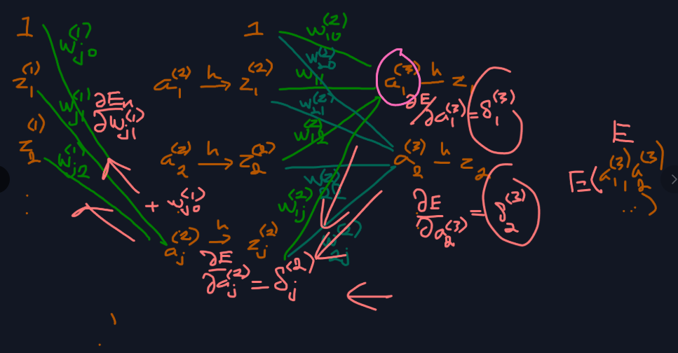

# 5.3.5 Hessian

📊 **Progress:** `2` Notes | `6` Screenshots | `1` AI Reviews

---

 

## 5.4 The Hessian Matrix

<kbd></kbd>

<kbd></kbd>

> [!NOTE]
> Phần này đại ý là nói về vai trò của Hessian, và backprop có thể dùng để tính Hessian
>
>
>
> Và một vấn đề cần cân nhắc khi tính Hessian là chi phí tính toán. Ta sẽ thấy, chi phí tính Hessian sẽ scale theo O(W²) (W là số tham số (weight + bias))

 

### 5.4.1 Diagonal Approximation

<kbd></kbd>

<kbd></kbd>

<kbd></kbd>

<kbd></kbd>

> [!NOTE]
> 5.48: aj = Σi wji zi
>
>
>
> 5.49: zj = h(aj)
>
>
>
> 5.53: ∂En/∂w⁽¹⁾ji = δ⁽²⁾j z⁽¹⁾i
>
>
>
> với δ⁽²⁾j = ∂En/∂a⁽²⁾j
>
>
>
> 5.56: ∂En/∂a⁽²⁾j = h'(a⁽²⁾j) Σk w⁽²⁾kj δ⁽³⁾k
>
>
>
> ---
>
>
>
> f(x,y,z), x(u,v), y(u,v), z(v)
>
>
>
> df = ∂f/∂x dx + ∂f/∂y dy + ∂f/∂z dz
>
>
>
> dx = ∂x/∂u du + ∂x/∂v dv
>
>
>
> dy = ∂y/∂u du + ∂y/∂v dv
>
>
>
> dz = z'(v) dv
>
>
>
> df = ∂f/∂x (∂x/∂u du + ∂x/∂v dv) + ∂f/∂y (∂y/∂u du + ∂y/∂v dv) +  ∂f/∂z z'(v) dv
>
>
>
> df = (∂f/∂x ∂x/∂u + ∂f/∂y ∂y/∂u) du + (∂f/∂x ∂x/∂v + ∂f/∂y ∂y/∂v  + ∂f/∂z z'(v)) dv
>
>
>
> ⇒ ∂f/∂u = ∂f/∂x ∂x/∂u + ∂f/∂y ∂y/∂u
>
>
>
> ∂f/∂v = ∂f/∂x ∂x/∂v + ∂f/∂y ∂y/∂v + ∂f/∂z z'(v)
>
>
>
> ---
>
>
>
>
>
> ∂²En/∂w⁽¹⁾ji² 
>
>
>
> = ∂/∂w⁽¹⁾ji \[∂En/∂w⁽¹⁾ji\] 
>
>
>
> Theo 5.53: ∂En/∂w⁽¹⁾ji = δ⁽²⁾j z⁽¹⁾i
>
>
>
> = ∂/∂w⁽¹⁾ji \[∂En/∂a⁽²⁾j z⁽¹⁾i\]
>
>
>
> (5.56: ∂En/∂a⁽²⁾j = h'(a⁽²⁾j) Σk w⁽²⁾kj δ⁽³⁾k)
>
>
>
> = z⁽¹⁾i ∂/∂w⁽¹⁾ji \[∂En/∂a⁽²⁾j\]
>
>
>
> = z⁽¹⁾i (∂/∂a⁽²⁾j \[∂En/∂a⁽²⁾j\]) (∂a⁽²⁾j/∂w⁽¹⁾ji)
>
>
>
> = z⁽¹⁾i (∂²En/∂a⁽²⁾j²) (∂a⁽²⁾j/∂w⁽¹⁾ji)
>
>
>
> a⁽²⁾j = z⁽¹⁾1 w⁽¹⁾j1 + z⁽¹⁾2 w⁽¹⁾j2 + ... + z⁽¹⁾i w⁽¹⁾ji + ..
>
>
>
> ⇒ ∂a⁽²⁾j/∂w⁽¹⁾ji = z⁽¹⁾i
>
>
>
> ... = z⁽¹⁾i z⁽¹⁾i (∂²En/∂a⁽²⁾j²) = (∂²En/∂a⁽²⁾j²) z⁽¹⁾i² → 5.79
>
>
>
> ---
>
>
>
> ∂/∂a⁽²⁾j \[∂En/∂a⁽²⁾j\]
>
>
>
> Gọi ∂En/∂a⁽²⁾j là f 
>
>
>
> thì theo 5.56 ở trên: ∂En/∂a⁽²⁾j = h'(a⁽²⁾j) Σk w⁽²⁾kj δ⁽³⁾k, thì
>
>
>
> f là hàm của x, y:
>
>
>
> với x = x(a⁽²⁾j) = h'(a⁽²⁾j).
>
>
>
> dx = x'(a⁽²⁾j) da⁽²⁾j = h''(a⁽²⁾j) da⁽²⁾j
>
>
>
> và y(δ⁽³⁾1, δ⁽³⁾2,...) = Σk w⁽²⁾kj δ⁽³⁾k = w⁽²⁾1j δ⁽³⁾1 + w⁽²⁾2j δ⁽³⁾2 + ....
>
>
>
> ⇒ dy = ∂y/∂δ⁽³⁾1 dδ⁽³⁾1 + ∂y/∂δ⁽³⁾2 dδ⁽³⁾2 + ...
>
>
>
> = w⁽²⁾1j dδ⁽³⁾1 + w⁽²⁾2j dδ⁽³⁾2 + ...
>
>
>
> ⇒ df = ∂f/∂x dx + ∂f/∂y dy
>
>
>
> df = y h''(a⁽²⁾j) da⁽²⁾j + x (w⁽²⁾1j dδ⁽³⁾1 + w⁽²⁾2j dδ⁽³⁾2 + ...)
>
>
>
> ---
>
>
>
> Cách 1 (dù rằng sẽ ko chuẩn lắm, vì ta ko cho chia da⁽²⁾j): Chia hai vế cho da⁽²⁾j
>
>
>
> ⇔ df/da⁽²⁾j = y h''(a⁽²⁾j) + x (w⁽²⁾1j dδ⁽³⁾1/da⁽²⁾j + w⁽²⁾2j dδ⁽³⁾2/da⁽²⁾j + ...)
>
>
>
> ⇔ df/da⁽²⁾j = (Σk w⁽²⁾kj δ⁽³⁾k) h''(a⁽²⁾j) + h'(a⁽²⁾j) (w⁽²⁾1j dδ⁽³⁾1/da⁽²⁾j + w⁽²⁾2j dδ⁽³⁾2/da⁽²⁾j + ...)
>
>
>
> ⇔ df/da⁽²⁾j = (Σk w⁽²⁾kj δ⁽³⁾k) h''(a⁽²⁾j) + h'(a⁽²⁾j) Σk (w⁽²⁾kj dδ⁽³⁾k/da⁽²⁾j)
>
>
>
> ⇔ df/da⁽²⁾j = h'(a⁽²⁾j) Σk (w⁽²⁾kj dδ⁽³⁾k/da⁽²⁾j) + h''(a⁽²⁾j) (Σk w⁽²⁾kj δ⁽³⁾k)
>
>
>
> ---
>
>
>
> Cách 2:
>
>
>
>  df = y h''(a⁽²⁾j) da⁽²⁾j + x (w⁽²⁾1j dδ⁽³⁾1 + w⁽²⁾2j dδ⁽³⁾2 + ...) (1)
>
>
>
>  δ⁽³⁾1 =  δ⁽³⁾1(a⁽²⁾1, a⁽²⁾2,...)
>
>
>
> ⇒ dδ⁽³⁾1 = ∂δ⁽³⁾1/∂a⁽²⁾1 da⁽²⁾1+ ∂δ⁽³⁾1/∂a⁽²⁾2 da⁽²⁾2 + ... ∂δ⁽³⁾1/∂a⁽²⁾j da⁽²⁾j
>
>
>
> tương tự
>
>
>
> dδ⁽³⁾2 = ∂δ⁽³⁾2/∂a⁽²⁾1 da⁽²⁾1+ ∂δ⁽³⁾2/∂a⁽²⁾2 da⁽²⁾2 + ... ∂δ⁽³⁾2/∂a⁽²⁾j da⁽²⁾j
>
>
>
> ..
>
>
>
> Thế vào (1) nhân ra gom lại ta sẽ có:
>
>
>
> df = y h''(a⁽²⁾j) da⁽²⁾j + x \[w⁽²⁾1j (∂δ⁽³⁾1/∂a⁽²⁾1 da⁽²⁾1+ ...+ ... ∂δ⁽³⁾1/∂a⁽²⁾j da⁽²⁾j) + w⁽²⁾2j (∂δ⁽³⁾2/∂a⁽²⁾1 da⁽²⁾1+ ... ∂δ⁽³⁾2/∂a⁽²⁾j da⁽²⁾j) + ...)
>
>
>
> = y h''(a⁽²⁾j) da⁽²⁾j + x \[(w⁽²⁾1j ∂δ⁽³⁾1/∂a⁽²⁾j da⁽²⁾j) + w⁽²⁾2j (∂δ⁽³⁾2/∂a⁽²⁾j da⁽²⁾j) + ...\] + ...(những term gắn với da⁽²⁾1, da⁽²⁾2,..)
>
>
>
> = y h''(a⁽²⁾j) da⁽²⁾j + x \[(w⁽²⁾1j ∂δ⁽³⁾1/∂a⁽²⁾j) + w⁽²⁾2j ∂δ⁽³⁾2/∂a⁽²⁾j) da⁽²⁾j + ...\] + ...(những term gắn với da⁽²⁾1, da⁽²⁾2,..)
>
>
>
> = y h''(a⁽²⁾j) da⁽²⁾j + x \[Σk w⁽²⁾kj ∂δ⁽³⁾k/∂a⁽²⁾j\] da⁽²⁾j + ...\] + ...(những term gắn với da⁽²⁾1, da⁽²⁾2,..)
>
>
>
> df = {y h''(a⁽²⁾j) + x \[Σk w⁽²⁾kj ∂δ⁽³⁾k/∂a⁽²⁾j\] } da⁽²⁾j + ...\] + ...(những term gắn với da⁽²⁾1, da⁽²⁾2,..)
>
>
>
> ⇒ df/da⁽²⁾j = y h''(a⁽²⁾j) + x \[Σk w⁽²⁾kj ∂δ⁽³⁾k/∂a⁽²⁾j\]
>
>
>
> = Σk w⁽²⁾kj δ⁽³⁾k h''(a⁽²⁾j) + h'(a⁽²⁾j) \[Σk w⁽²⁾kj ∂δ⁽³⁾k/∂a⁽²⁾j\]
>
>
>
> = h'(a⁽²⁾j) \[Σk w⁽²⁾kj ∂δ⁽³⁾k/∂a⁽²⁾j\] + Σk w⁽²⁾kj δ⁽³⁾k h''(a⁽²⁾j)
>
>
>
> = h'(a⁽²⁾j) \[Σk w⁽²⁾kj ∂δ⁽³⁾k/∂a⁽²⁾j\] + h''(a⁽²⁾j) Σk w⁽²⁾kj δ⁽³⁾k
>
>
>
> Ra kết quả như cách 1:
>
>
>
> ---
>
>
>
> ∂δ⁽³⁾k/∂a⁽²⁾j
>
>
>
> δ⁽³⁾k = ∂En/∂a⁽³⁾k = δ⁽³⁾k(a⁽³⁾1, a⁽³⁾2,...)
>
>
>
> dδ⁽³⁾k = ∂δ⁽³⁾k/∂a⁽³⁾1 da⁽³⁾1 + ∂δ⁽³⁾k/∂a⁽³⁾2 da⁽³⁾2 + ...
>
>
>
> = Σk' ∂δ⁽³⁾k/∂a⁽³⁾k' da⁽³⁾k' (2)
>
>
>
> ---
>
>
>
> a⁽³⁾k' = w⁽²⁾k'1 h(a⁽²⁾1) + w⁽²⁾k'2 h(a⁽²⁾2) +..+ w⁽²⁾k'j h(a⁽²⁾j) 
>
>
>
> da⁽³⁾k' = ∂a⁽³⁾k'/∂a⁽²⁾1 da⁽²⁾1 + ...+ ∂a⁽³⁾k'/∂a⁽²⁾j da⁽²⁾j
>
>
>
> = w⁽²⁾k'1 h'(a⁽²⁾1) da⁽²⁾1 + ...+ w⁽²⁾k'j h'(a⁽²⁾j) da⁽²⁾j
>
>
>
> Lắp da⁽³⁾k' vào (2):
>
>
>
> .. = Σk' ∂δ⁽³⁾k/∂a⁽³⁾k' \[w⁽²⁾k'1 h'(a⁽²⁾1) da⁽²⁾1 + ...+ w⁽²⁾k'j h'(a⁽²⁾j) da⁽²⁾j\]
>
>
>
> .= Σk' \[ ∂δ⁽³⁾k/∂a⁽³⁾k' w⁽²⁾k'1 h'(a⁽²⁾1) da⁽²⁾1 + ...+ ∂δ⁽³⁾k/∂a⁽³⁾k' w⁽²⁾k'j h'(a⁽²⁾j) da⁽²⁾j\]
>
>
>
> = Σk' \[ ∂δ⁽³⁾k/∂a⁽³⁾k' w⁽²⁾k'1 h'(a⁽²⁾1)\] da⁽²⁾1 + ...+ Σk' \[∂δ⁽³⁾k/∂a⁽³⁾k' w⁽²⁾k'j h'(a⁽²⁾j)\] da⁽²⁾j
>
>
>
> ⇒ ∂δ⁽³⁾k/∂a⁽²⁾j = Σk' \[∂δ⁽³⁾k/∂a⁽³⁾k' w⁽²⁾k'j h'(a⁽²⁾j)\]
>
>
>
> = Σk' \[∂(∂En/∂a⁽³⁾k)/∂a⁽³⁾k' w⁽²⁾k'j h'(a⁽²⁾j)\]
>
>
>
> = Σk' \[(∂²En/∂a⁽³⁾k∂a⁽³⁾k') w⁽²⁾k'j h'(a⁽²⁾j)\]
>
>
>
> = h'(a⁽²⁾j) Σk' \[w⁽²⁾k'j (∂²En/∂a⁽³⁾k∂a⁽³⁾k')\]
>
>
>
> Viết lại: ∂δ⁽³⁾k/∂a⁽²⁾j = h'(a⁽²⁾j) Σk' \[w⁽²⁾k'j (∂²En/∂a⁽³⁾k∂a⁽³⁾k')\]
>
>
>
> ---
>
>
>
> Vậy, thay vào lại: h'(a⁽²⁾j) \[Σk w⁽²⁾kj ∂δ⁽³⁾k/∂a⁽²⁾j\] + h''(a⁽²⁾j) Σk w⁽²⁾kj δ⁽³⁾k
>
>
>
> = h'(a⁽²⁾j) \[Σk w⁽²⁾kj (h'(a⁽²⁾j) Σk' \[w⁽²⁾k'j (∂²En/∂a⁽³⁾k∂a⁽³⁾k')\])\] + h''(a⁽²⁾j) Σk w⁽²⁾kj δ⁽³⁾k
>
>
>
> = h'(a⁽²⁾j) h'(a⁽²⁾j) \[Σk w⁽²⁾kj Σk' \[w⁽²⁾k'j (∂²En/∂a⁽³⁾k∂a⁽³⁾k')\])\] + h''(a⁽²⁾j) Σk w⁽²⁾kj δ⁽³⁾k
>
>
>
> = h'(a⁽²⁾j)² \[Σk Σk' w⁽²⁾kj w⁽²⁾k'j (∂²En/∂a⁽³⁾k∂a⁽³⁾k')\] + h''(a⁽²⁾j) Σk w⁽²⁾kj δ⁽³⁾k
>
>
>
> Đây là 5.80

📹 [Xem video trên YouTube](https://www.youtube.com/watch?v=fvqdTDe0cek)

> [!TIP]
> 🤖 **AI Check** — 🟢 Pass — ✅ **98/100** · ✓ Move on
>
> Ghi chú xuất sắc! Bạn đã tự chứng minh chi tiết và chính xác từng bước biến đổi từ quy tắc đạo hàm hợp (chain rule) để đi đến công thức (5.79) và (5.80) trong sách giáo trình.
>
> **🟡 Minor issues**
>
> **1.** *"df/da⁽²⁾j = y h''(a⁽²⁾j) + x (w⁽²⁾1j dδ⁽³⁾1/da⁽²⁾j + w⁽²⁾2j dδ⁽³⁾2/da⁽²⁾j + ...)"*
>
> Ở 'Cách 1', việc chia trực tiếp vi phân toàn phần df cho da_j trong hàm nhiều biến là thao tác hình thức (informal). Tuy nhiên, bạn đã nhận thức rõ điều này và bổ sung 'Cách 2' triển khai vi phân chính tắc rất chuẩn xác.
>
>
> **✓ Strengths**
> - Tự triển khai và chứng minh đầy đủ chi tiết công thức (5.79) và (5.80) thay vì chỉ chép lại kết quả.
> - Sử dụng công cụ vi phân toàn phần rất khéo léo để tách và tìm đạo hàm bậc hai của hàm hợp nhiều biến.
> - Ký hiệu chỉ số tầng (layer index) và trọng số liên kết rõ ràng, theo sát trực quan hình vẽ minh họa.
>
> **💡 Deeper notes**
> - Để đi từ (5.80) sang (5.81) (xấp xỉ đường chéo của LeCun), người ta giả định bỏ qua các phần tử ngoài đường chéo ∂²En/(∂a_k ∂a_k') khi k ≠ k', khi đó tổng kép Σ_k Σ_k' rút gọn chỉ còn tổng đơn Σ_k với w_kj².

**🔗 See also:** [Feed-Forward Network Unit Activation](./531_evaluation_of_error_function_derivatives.md#node-krbtnm2) · [Weight Derivative Evaluation](./531_evaluation_of_error_function_derivatives.md#node-noaxia8)

 

