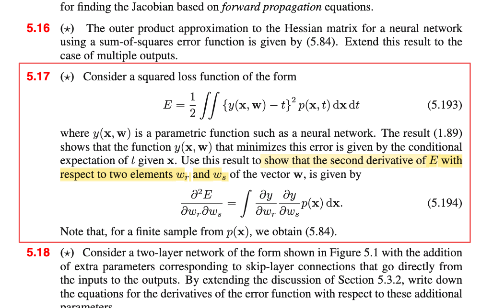

# 5.4.2 Outer product approximation

📊 **Progress:** `2` Notes | `3` Screenshots | `2` AI Reviews

---

 

## Outer Product Approximation

<kbd></kbd>

> [!NOTE]
> E = (1/2) Σn (yn - tn)²
>
>
>
> ∇E = ∇\[(1/2) Σn (yn - tn)²\]
>
>
>
> = (1/2) ∇\[Σn (yn - tn)²\]
>
>
>
> = (1/2) Σn \[∇(yn - tn)²\]
>
>
>
> = (1/2) Σn \[d/d(yn - tn) (yn - tn)² . ∇(yn - tn)\]
>
>
>
> ∇E = Σn \[(yn - tn) ∇yn\]
>
>
>
> 𝐇 = ∇∇E = ∇\[Σn \[(yn - tn) ∇yn\]\]
>
>
>
> = Σn ∇\[(yn - tn) ∇yn\]
>
>
>
> = Σn \[∇(yn - tn) ∇ynᵀ   + (yn - tn) ∇∇yn\]
>
>
>
> = Σn \[∇yn ∇ynᵀ + (yn - tn) ∇∇yn\]
>
>
>
> = Σn ∇yn ∇ynᵀ + Σn (yn - tn) ∇∇yn → 5.83

📹 [Xem video trên YouTube](https://www.youtube.com/watch?v=uF2pBk9VPxg)

> [!TIP]
> 🤖 **AI Check** — 🟢 Pass — ✅ **100/100** · ✓ Move on
>
> Ghi chú suy dẫn rất chi tiết, mạch lạc và hoàn toàn chính xác từ công thức hàm lỗi (5.82) ra ma trận Hessian (5.83).
>
> **✓ Strengths**
> - Khai triển đạo hàm cấp một và cấp hai từng bước rất rõ ràng, áp dụng chính xác quy tắc dây chuyền và quy tắc tích.
> - Làm rõ ký hiệu của sách bằng cách viết tường minh dạng tích ngoài (outer product) ∇yn ∇ynᵀ tạo thành ma trận kích thước phù hợp với Hessian.
>
> **💡 Deeper notes**
> - Trong sách giáo trình (Bishop PRML), tác giả viết tắt tích ngoài là ∇yn ∇yn; việc bạn viết thêm chuyển vị (∇ynᵀ) thể hiện sự hiểu đúng về chiều ma trận/vector trong giải tích ma trận.

 

### Bản chất hàm dự đoán

<kbd></kbd>

<kbd></kbd>

> [!NOTE]
> Đầu tiên cần recall lại một điểm kiến thức quan trọng:
>
>
>
> Khác nhau giữa mô hình linear regression chương 3 và neural network regression chương 5 là ở giả định:
>
>
>
> Cả hai đều giả định 𝐱1,𝐱2,...là các giá trị cố định có sẵn. t1,t2,...là các **giá trị quan sát được** của các biến ngẫu nhiên T1,T2,....độc lập có phân phối:
>
>
>
> Ti \~ 𝒩(μ(𝐱i), 1/β)
>
>
>
> Linear regression: μ(𝐱i) = 𝐰ᵀΦ(𝐱i)
>
>
>
> Neural network regression: μ(𝐱i) là hàm số phi tuyến của 𝐰 và 𝐱i biểu diễn bởi neural network
>
>
>
> ---
>
>
>
> Từ đó, ta đi giải bài toán suy luận thống kê: TÌm MLE của 𝐰 và β.
>
>
>
> Khi đó ta có gì: Ta có phân phối của Ti: 𝒩(μ(𝐱i), 1/β)
>
>
>
> Và dựa vào decision theory, nói rằng, từ phân phối xác suất của Ti, nếu ta muốn đưa ra ước lượng điểm của Ti, thì cái sẽ giúp giảm risk function với square loss chính là E\[Ti|𝐱i\] (chính là cái nói đến trong 1.5.5)
>
>
>
> Do đó, hàm dự đoán (là thứ mà machine learning cần) mà ta xài là y(𝐰, 𝐱i) = 𝐰ᵀΦ(𝐱i) hoặc và y(𝐰, 𝐱i) = "đầu ra của neural network"
>
>
>
> Đây là lớp ý nghĩa ẩn mà dễ ko để ý: việc nghĩ rằng ouput của neural net là hàm dựa đoán không sai, nhưng nó có lí do như vậy. 
>
>
>
> ---
>
>
>
> Do đó ở đây mới nói rằng: yi = E\[Ti|𝐗i\], hay yn = E\[Tn|𝐗n\]
>
>
>
> Từ đó yn - Tn = E\[Tn|𝐗n\] - Tn
>
>
>
> (Tác giả không viết hoa, nhưng phải hiểu ông đang nói nó với tư cách là biến ngẫu nhiên (nên mới nói đến kì vọng))
>
>
>
> ⇒ E\[E\[Tn|𝐗n\] - Tn\] = E(E\[Tn|𝐗n\]) - E\[Tn\]
>
>
>
> (E\[Tn\] , với Tn \~ 𝒩(μ(𝐱n), 1/β), ta hiểu nó là E\[Tn|𝐱n\])
>
>
>
> Xét E(E\[Tn|𝐗n\])
>
>
>
> E\[Tn|𝐗n\] là rv có được bởi áp hàm g(𝐱) = E\[Tn|𝐱\] lên rv 𝐗n, tức g(𝐗n)
>
>
>
> Theo LOTUS: E\[g(𝐗n)\] = ∫g(𝐱)f(𝐱)d𝐱 = ∫E\[Tn|𝐱\] f(𝐱)d𝐱
>
>
>
> = ∫∫tn f(tn|𝐱) dtn f(𝐱)d𝐱
>
>
>
> = ∫∫tn f(tn|𝐱) f(𝐱) dtn d𝐱
>
>
>
> = ∫∫tn f(tn,𝐱) dtn d𝐱
>
>
>
> = ∫tn ∫f(tn,𝐱) d𝐱 dtn
>
>
>
> = ∫tn f(tn) dtn
>
>
>
> = E\[Tn\]
>
>
>
> Vậy kết quả là E\[Tn\] - E\[Tn\] = 0
>
>
>
> Đây chính là ý trong sách "yn - tn is then a random variable with zero mean".
>
>
>
> ---
>
>
>
> Vậy thì ý định của ông là: Xét cái term thứ hai của 5.83:
>
>
>
> Σn (yn - tn) ∇∇yn
>
>
>
> ∇∇yn: Hiểu thế này yn, theo như decision theory, ta sẽ dùng E\[Tn|𝐱n\] (đây là hàm số của 𝐰 và 𝐱n).
>
>
>
> Nếu như ta giả định rằng 𝐱1, 𝐱2,...cũng là giá trị quan sát được của 𝐗1, 𝐗2,....thì đương nhiên khi đó yn, với tư cách là hàm của 𝐗n, cũng là biến ngẫu nhiên: Yn. Và tương tự ∇∇Yn cũng là biến ngẫu nhiên (vì nó là hàm của 𝐗n).
>
>
>
> Để rồi theo như tác gỉa, nếu giả định tiếp là ∇∇Yn uncorrelate với biến ngẫu nhiên E\[Tn|𝐱n\] - Tn thì E\[(E\[Tn|𝐗n\] - Tn) ∇∇Yn\] sẽ bằng:
>
>
>
> = E\[(E\[Tn|𝐗n\] - Tn))E\[∇∇Yn\] 
>
>
>
> = 0 × E\[∇∇Yn\] 
>
>
>
> = 0
>
>
>
> Và khiến cho Σn (yn - tn) ∇∇yn, có thể coi như là sample mean:
>
>
>
> ū = Σi ui với ui là observed value của Ui = (E\[Tn|𝐱n\] - Tn) ∇∇Yn, có E\[Ui\] = 0 như vừa tính.
>
>
>
> Theo LLN, ū sẽ converge về true mean = 0 như tính vừa trên.
>
>
>
> Ý định của tác giả là biện minh cho việc ta có thể bỏ đi term thứ hai trong 5.83 (..the second term will be small and can be neglect)
>
>
>
> ---
>
>
>
> E = (1/2) ∫∫{y(𝐰,𝐱) - t}² p(𝐱, t) d𝐱 dt

📹 [Xem video trên YouTube](https://youtu.be/GJojz_jbdoc)

> [!TIP]
> 🤖 **AI Check** — 🟡 Minor issues — ⚠️ **88/100** · ✓ Move on
>
> Ghi chú thể hiện sự hiểu biết sâu sắc và chính xác về mặt xác suất - thống kê đằng sau lập luận bỏ số hạng thứ hai trong xấp xỉ Hessian (5.83). Có một vài điểm chưa thật chặt chẽ về mặt ký hiệu và khái niệm trung bình mẫu nhưng không ảnh hưởng đến hiểu biết cốt lõi.
>
> **🟡 Minor issues**
>
> **1.** *"ū = Σi ui với ui là observed value của Ui = (E[Tn|𝐱n] - Tn) ∇∇Yn, có E[Ui] = 0 như vừa tính. Theo LLN, ū sẽ converge về true mean = 0 như tính vừa trên."*
>
> Đại lượng $\sum_{n=1}^N u_n$ là tổng mẫu (sample sum), không phải trung bình mẫu. Luật số lớn (LLN) áp dụng cho trung bình mẫu $\frac{1}{N}\sum_{n=1}^N u_n \to 0$. Khi trung bình mẫu tiến về 0, đóng góp trung bình trên mỗi mẫu triệt tiêu (số hạng này là $o(N)$ trong khi số hạng thứ nhất là $O(N)$).
>
> **2.** *"E[(E[Tn|𝐱n] - Tn) ∇∇Yn]"*
>
> Có sự lẫn lộn ký hiệu giữa giá trị quan sát cố định $\mathbf{x}_n$ và biến ngẫu nhiên $\mathbf{X}_n$. Để lấy kỳ vọng không điều kiện, biến số phải là $\mathbf{X}_n$.
>
> **3.** *"E = (1/2) ∫∫{y(𝐰,𝐱) - t}² p(𝐱, t) d𝐱 dt"*
>
> Công thức tích phân của Bài tập 5.17 được chép ở cuối nhưng để trống, chưa triển khai tiếp phần đạo hàm và chứng minh công thức (5.194).
>
>
> **✓ Strengths**
> - Liên kết xuất sắc giữa Decision Theory (Chương 1), Hồi quy tuyến tính (Chương 3) và Mạng nơ-ron (Chương 5) để làm rõ bản chất của hàm dự đoán y(x, w).
> - Sử dụng công cụ xác suất (LOTUS, luật kỳ vọng toàn phần) để chứng minh chặt chẽ tại sao sai số (yn - tn) có kỳ vọng bằng 0.
> - Hiểu đúng trực giác thống kê biện minh cho việc triệt tiêu số hạng thứ hai trong ma trận Hessian.
>
> **💡 Deeper notes**
> - Trong Bài tập 5.17, khi xét dạng kỳ vọng liên tục qua $p(\mathbf{x}, t) = p(t|\mathbf{x})p(\mathbf{x})$, số hạng bậc hai $\nabla\nabla y$ triệt tiêu một cách chính xác tuyệt đối vì $\int (y(\mathbf{x}) - t) p(t|\mathbf{x}) dt = 0$ khi $y(\mathbf{x}) = \mathbb{E}[t|\mathbf{x}]$, mà không cần giả định phụ về tính không tương quan (uncorrelated) như lập luận xấp xỉ trên mẫu rời rạc ở trang 242.

**🔗 See also:** [Minimizing Squared Loss Function](./15_decision_theory.md#node-hh6bwri)

 

