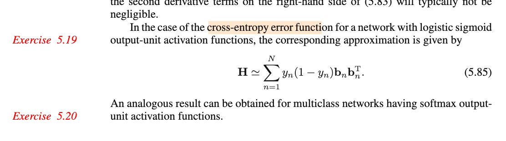

# 5.4.2 Outer product approximation

📊 **Progress:** `4` Notes | `4` Screenshots | `4` AI Reviews

---

 

## Outer Product Approximation

<kbd></kbd>

> [!NOTE]
> E = (1/2) Σn (yn - tn)²
>
>
>
> ∇E = ∇\[(1/2) Σn (yn - tn)²\]
>
>
>
> = (1/2) ∇\[Σn (yn - tn)²\]
>
>
>
> = (1/2) Σn \[∇(yn - tn)²\]
>
>
>
> = (1/2) Σn \[d/d(yn - tn) (yn - tn)² . ∇(yn - tn)\]
>
>
>
> ∇E = Σn \[(yn - tn) ∇yn\]
>
>
>
> 𝐇 = ∇∇E = ∇\[Σn \[(yn - tn) ∇yn\]\]
>
>
>
> = Σn ∇\[(yn - tn) ∇yn\]
>
>
>
> = Σn \[∇(yn - tn) ∇ynᵀ   + (yn - tn) ∇∇yn\]
>
>
>
> = Σn \[∇yn ∇ynᵀ + (yn - tn) ∇∇yn\]
>
>
>
> = Σn ∇yn ∇ynᵀ + Σn (yn - tn) ∇∇yn → 5.83

📹 [Xem video trên YouTube](https://www.youtube.com/watch?v=uF2pBk9VPxg)

> [!TIP]
> 🤖 **AI Check** — 🟢 Pass — ✅ **100/100** · ✓ Move on
>
> Ghi chú suy dẫn rất chi tiết, mạch lạc và hoàn toàn chính xác từ công thức hàm lỗi (5.82) ra ma trận Hessian (5.83).
>
> **✓ Strengths**
> - Khai triển đạo hàm cấp một và cấp hai từng bước rất rõ ràng, áp dụng chính xác quy tắc dây chuyền và quy tắc tích.
> - Làm rõ ký hiệu của sách bằng cách viết tường minh dạng tích ngoài (outer product) ∇yn ∇ynᵀ tạo thành ma trận kích thước phù hợp với Hessian.
>
> **💡 Deeper notes**
> - Trong sách giáo trình (Bishop PRML), tác giả viết tắt tích ngoài là ∇yn ∇yn; việc bạn viết thêm chuyển vị (∇ynᵀ) thể hiện sự hiểu đúng về chiều ma trận/vector trong giải tích ma trận.

 

### Bản chất hàm dự đoán

<kbd></kbd>

> [!NOTE]
> Đầu tiên cần recall lại một điểm kiến thức quan trọng:
>
>
>
> Khác nhau giữa mô hình linear regression chương 3 và neural network regression chương 5 là ở giả định:
>
>
>
> Cả hai đều giả định 𝐱1,𝐱2,...là các giá trị cố định có sẵn. t1,t2,...là các **giá trị quan sát được** của các biến ngẫu nhiên T1,T2,....độc lập có phân phối:
>
>
>
> Ti \~ 𝒩(μ(𝐱i), 1/β)
>
>
>
> Linear regression: μ(𝐱i) = 𝐰ᵀΦ(𝐱i)
>
>
>
> Neural network regression: μ(𝐱i) là hàm số phi tuyến của 𝐰 và 𝐱i biểu diễn bởi neural network
>
>
>
> ---
>
>
>
> Từ đó, ta đi giải bài toán suy luận thống kê: TÌm MLE của 𝐰 và β.
>
>
>
> Khi đó ta có gì: Ta có phân phối của Ti: 𝒩(μ(𝐱i), 1/β)
>
>
>
> Và dựa vào decision theory, nói rằng, từ phân phối xác suất của Ti, nếu ta muốn đưa ra ước lượng điểm của Ti, thì cái sẽ giúp giảm risk function với square loss chính là E\[Ti|𝐱i\] (chính là cái nói đến trong 1.5.5)
>
>
>
> Do đó, hàm dự đoán (là thứ mà machine learning cần) mà ta xài là y(𝐰, 𝐱i) = 𝐰ᵀΦ(𝐱i) hoặc và y(𝐰, 𝐱i) = "đầu ra của neural network"
>
>
>
> Đây là lớp ý nghĩa ẩn mà dễ ko để ý: việc nghĩ rằng ouput của neural net là hàm dựa đoán không sai, nhưng nó có lí do như vậy. 
>
>
>
> ---
>
>
>
> Do đó ở đây mới nói rằng: yi = E\[Ti|𝐱i\], hay Yn = E\[Tn|𝐗n\] 
>
>
>
> ---
>
>
>
> Vì sao: yn - tn là random variable zero mean?
>
>
>
> Đầu tiên hãy chú ý:
>
>
>
> 1. Tác giả không viết hoa (vì ổng thoát li cách viết quy ước của toán thống kê) nhưng phải hiểu ông đang nói nó với tư cách là biến ngẫu nhiên , nên mới nói đến kì vọng
>
>
>
> 2. Vì ông nhắc đến ∇∇yn như biến ngẫu nhiên nên ổng đang dùng giả định khác với cái ở trên chút xíu (là coi 𝐱n là giá trị cố định), ở đây 𝐱1,𝐱2 cũng là giá trị quan sát của biến 𝐗1, 𝐗2,....
>
>
>
> Và do đó, yn, nếu theo giả định 𝐱1, 𝐱2...cố định thì E\[Tn|𝐱n\] chỉ là hằng số.
>
>
>
> Nhưng với 𝐱1,𝐱2 cũng là giá trị quan sát của biến 𝐗1, 𝐗2,.... thì ta có biến Yn = E\[Tn|𝐗n\] là biến ngẫu nhiên tạo ra bởi việc áp hàm E\[Tn|𝐱\] lên biến ngẫu nhiên 𝐗n
>
>
>
> E\[Tn|𝐗n\] là biến ngẫu nhiên, như đã nói, có được bởi áp hàm g(𝐱) = E\[Tn|𝐱\] lên rv 𝐗n, tức g(𝐗n)
>
>
>
> Theo LOTUS: E\[g(𝐗n)\] = ∫g(𝐱)f(𝐱)d𝐱 = ∫E\[Tn|𝐱\] f(𝐱)d𝐱
>
>
>
> = ∫∫tn f(tn|𝐱) dtn f(𝐱)d𝐱
>
>
>
> = ∫∫tn f(tn|𝐱) f(𝐱) dtn d𝐱
>
>
>
> = ∫∫tn f(tn,𝐱) dtn d𝐱
>
>
>
> = ∫tn ∫f(tn,𝐱) d𝐱 dtn
>
>
>
> = ∫tn f(tn) dtn
>
>
>
> = E\[Tn\]
>
>
>
> Vậy kết quả là E\[Tn\] - E\[Tn\] = 0
>
>
>
> Đây chính là ý trong sách "yn - tn is then a random variable with zero mean".
>
>
>
> ---
>
>
>
> Vậy thì ý định của ông là: Xét cái term thứ hai của 5.83:
>
>
>
> Σn (yn - tn) ∇∇yn
>
>
>
> ∇∇yn: Hiểu thế này yn, theo như decision theory, ta sẽ dùng E\[Tn|𝐱n\] (đây là hàm số của 𝐰 và 𝐱n).
>
>
>
> Nếu như ta giả định rằng 𝐱1, 𝐱2,...cũng là giá trị quan sát được của 𝐗1, 𝐗2,....thì đương nhiên khi đó yn, với tư cách là hàm của 𝐗n, cũng là biến ngẫu nhiên: Yn. Và tương tự ∇∇Yn cũng là biến ngẫu nhiên (vì nó là hàm của 𝐗n).
>
>
>
> Để rồi theo như tác gỉa, nếu giả định tiếp là ∇∇Yn uncorrelate với biến ngẫu nhiên E\[Tn|𝐗n\] - Tn thì E\[(E\[Tn|𝐗n\] - Tn) ∇∇Yn\] sẽ bằng:
>
>
>
> = E\[(E\[Tn|𝐗n\] - Tn))E\[∇∇Yn\]
>
>
>
> = 0 × E\[∇∇Yn\]
>
>
>
> = 0
>
>
>
> Và khiến cho Σn (yn - tn) ∇∇yn, có thể coi như là sample mean:
>
>
>
> ū = Σi ui/n với ui là observed value của Ui = (E\[Tn|𝐗n\] - Tn) ∇∇Yn, có E\[Ui\] = 0 như vừa tính.
>
>
>
> Đại khái là ổng nói cái này sẽ có trung bình = 0 (tác giả cũng chả thèm giải thích)
>
>
>
> Ý định của tác giả là biện minh cho việc ta có thể bỏ đi term thứ hai trong 5.83 (..the second term will be small and can be neglect)
>
>
>
> ---

📹 Video 1: [Điểm khác nhau giữa linear regression và neural network regression.](https://youtu.be/GJojz_jbdoc)

📹 Video 2: [Vì sao yn - tn có kỳ vọng bằng 0?](https://www.youtube.com/watch?v=xxcxiTXNEYo)

> [!TIP]
> 🤖 **AI Check** — 🟢 Pass — ✅ **95/100** · ✓ Move on
>
> Ghi chú phân tích rất sâu sắc và chính xác bản chất xác suất đằng sau lập luận của Bishop. Bạn đã làm rõ được tại sao yn - tn có kỳ vọng bằng 0 thông qua luật kỳ vọng toàn phần và giải thích trọn vẹn lý do số hạng thứ hai triệt tiêu khi lấy tổng.
>
> **✓ Strengths**
> - Hiểu rất rõ và giải thích tường tận việc xem (x_n, t_n) như các biến ngẫu nhiên lấy mẫu từ phân phối p(x, t) để biến yn và đạo hàm của nó thành các biến ngẫu nhiên.
> - Chứng minh chặt chẽ E[E[T|X] - T] = 0 bằng định lý LOTUS / Law of Total Expectation.
> - Giải thích chính xác cơ chế mà Bishop dùng để bỏ qua số hạng thứ hai: tính không tương quan dẫn đến tích kỳ vọng bằng 0, và tổng trên N mẫu đóng vai trò xấp xỉ trung bình mẫu.
>
> **💡 Deeper notes**
> - Về mặt bản chất, kỳ vọng có điều kiện E[y(x) - t | x] = y(x) - E[t | x] = 0 ngay với mỗi x cố định (nếu mô hình đạt hàm hồi quy tối ưu). Do đó, E[y(X) - T] = E_X[E[y(X) - T | X]] = E_X[0] = 0 mà không nhất thiết phải triển khai tích phân 2 lớp đầy đủ.
> - Để số hạng tổng chia cho N tiến về 0, ta còn ngầm giả định luật số lớn (Law of Large Numbers) và phương sai của số hạng đó hữu hạn.

**🔗 See also:** [Minimizing Squared Loss Function](./15_decision_theory.md#node-hh6bwri)

 

#### Outer Product Hessian Approximation

<kbd></kbd>

> [!NOTE]
> đại khái là dùng outer product approximation, chi phí tính toán sẽ chỉ còn là O(W) (tính ∇y) và tính ra outer product tốn O(W²)
>
>
>
> Phần còn lại quay lại sau

> [!TIP]
> 🤖 **AI Check** — 🟡 Minor issues — ⚠️ **85/100** · ✓ Move on
>
> Ghi chú đã nắm được ý chính về lợi ích độ phức tạp tính toán khi dùng xấp xỉ tích ngoài (outer product approximation). Cần lưu ý thêm đây là chi phí tính trên mỗi mẫu dữ liệu và xấp xỉ này chỉ hợp lệ khi mô hình đã được huấn luyện tốt.
>
> **🟡 Minor issues**
>
> **1.** *"chi phí tính toán sẽ chỉ còn là O(W) (tính ∇y) và tính ra outer product tốn O(W²)"*
>
> Độ phức tạp O(W) cho lan truyền ngược và O(W²) cho phép nhân ma trận là tính trên từng mẫu dữ liệu n; với tập dữ liệu gồm N mẫu, tổng chi phí tính toán xấp xỉ Hessian sẽ là O(N W²).
>
>
> **✓ Strengths**
> - Nắm đúng bản chất: xấp xỉ tích ngoài chỉ cần đạo hàm bậc nhất, tận dụng được lan truyền ngược O(W) và xây dựng ma trận trong O(W²).
>
> **💡 Deeper notes**
> - Xấp xỉ Levenberg–Marquardt / tích ngoài này chỉ thực sự đáng tin cậy khi mạng đã được huấn luyện tốt (trained appropriately), khi đó phần dư sai số nhỏ khiến số hạng chứa đạo hàm bậc hai bị triệt tiêu.
> - Công thức H ≈ ∑ b_n b_n^T áp dụng cho hàm kích hoạt đồng nhất (identity) ở đầu ra; với cross-entropy và hàm sigmoid/softmax, công thức sẽ có thêm hệ số trọng số đầu ra (ví dụ: y_n(1 - y_n)).

 

##### Hessian Approximation for Cross-Entropy

<kbd></kbd>

> [!NOTE]
> Ex 5.19:
>
>
>
> E(𝐰) = - Σi=1:N {ti ln yi + (1-ti) ln (1-yi)}
>
>
>
> 𝐇 = ∇²E(𝐰)
>
>
>
> ∇E(𝐰) = ∇(-Σi=1:N {ti ln yi + (1-ti) ln (1-yi)})
>
>
>
> = -Σi ∇{ti ln yi + (1-ti) ln (1-yi)}
>
>
>
> = -Σi {∇(ti ln yi) + ∇\[(1-ti) ln (1-yi)\]}
>
>
>
> = -Σi {ti ∇(ln yi) + (1-ti) ∇ln (1-yi)}
>
>
>
> = -Σi {ti \[d/dyi (ln yi) . ∇yi\] + (1-ti) \[d/d(1-yi) ln (1-yi) . ∇(1-yi)}
>
>
>
> = -Σi { (ti/yi) ∇yi + \[(1-ti)/(1-yi)\] (-∇yi) }
>
>
>
> = -Σi { (ti/yi) ∇yi - \[(1-ti)/(1-yi)\] ∇yi }
>
>
>
> = -Σi { (ti/yi) - (1-ti)/(1-yi) } ∇yi
>
>
>
> = -Σi { \[ti(1-yi) - (1-ti)yi\]/\[yi(1-yi)\] } ∇yi
>
>
>
> = -Σi { (ti-tiyi-yi+tiyi)/\[yi(1-yi)\] } ∇yi
>
>
>
> = -Σi { (ti-yi)/\[yi(1-yi)\] } ∇yi
>
>
>
> yi = σ(ai) ⇒ dyi/dai = σ'(ai) = σ(ai)\[1-σ(ai)\] = yi(1-yi)
>
>
>
> = -Σi { (ti-yi)/σ'(ai) } \[d/dai yi . ∇ai\]
>
>
>
> = -Σi { (ti-yi)/σ'(ai) } \[σ'(ai) ∇ai\]
>
>
>
> = -Σi { (ti-yi) ∇ai }
>
>
>
> 𝐇 = ∇\[-Σi { (ti-yi) ∇ai }\]
>
>
>
> = -Σi ∇\[(ti-yi) ∇ai\]
>
>
>
> = -Σi \[∇(ti-yi) ∇ai + (ti-yi) ∇∇ai\]
>
>
>
> = -Σi \[-∇yi ∇aiᵀ + (ti-yi) ∇∇ai\]
>
>
>
> = Σi ∇yi ∇aiᵀ - Σi (ti-yi) ∇∇ai
>
>
>
> ≈ Σi ∇yi ∇aiᵀ
>
>
>
> = Σi \[yi(1-yi) ∇ai ∇aiᵀ\] → 5.85 (𝐛i chính là ∇ai)
>
>
>
> ---

📹 [Xem video trên YouTube](https://www.youtube.com/watch?v=1qi4xJ1oBss)

> [!TIP]
> 🤖 **AI Check** — 🟢 Pass — ✅ **95/100** · ✓ Move on
>
> Ghi chú giải quyết trọn vẹn và chi tiết bài tập 5.19, các bước biến đổi đạo hàm và ma trận Hessian rất mạch lạc và chính xác.
>
> **✓ Strengths**
> - Thực hiện đầy đủ từng bước đạo hàm từ hàm mất mát Cross-Entropy đến gradient và ma trận Hessian.
> - Nhận diện chính xác quy tắc chuỗi cho hàm logistic sigmoid và biểu diễn đúng tích ngoài (outer product) của gradient vector b_n.
>
> **💡 Deeper notes**
> - Bước xấp xỉ bỏ qua số hạng đạo hàm bậc hai thứ hai (ti - yi)∇²a_i dựa trên giả định mô hình đã được huấn luyện tốt (phần dư ti - yi nhỏ) hoặc xấp xỉ dạng Gauss-Newton / ma trận Fisher Information.

**🔗 See also:** [Cross-Entropy Error Function Gradient](./432_logistic_regression.md#node-gvw6cdv) · [Multiclass Cross-Entropy Error Function](./434_multiclass_logistic_regression.md#node-ndts6t4)

 

