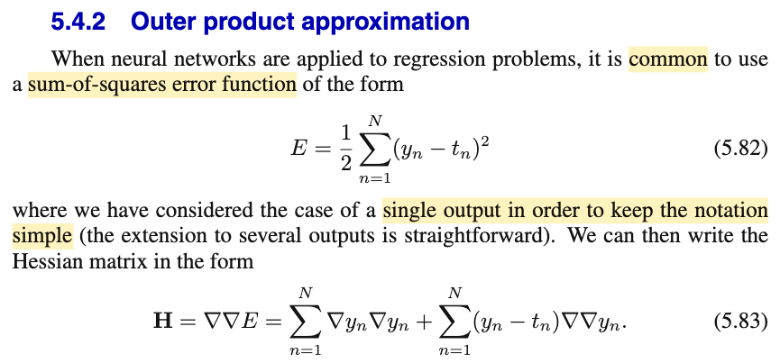
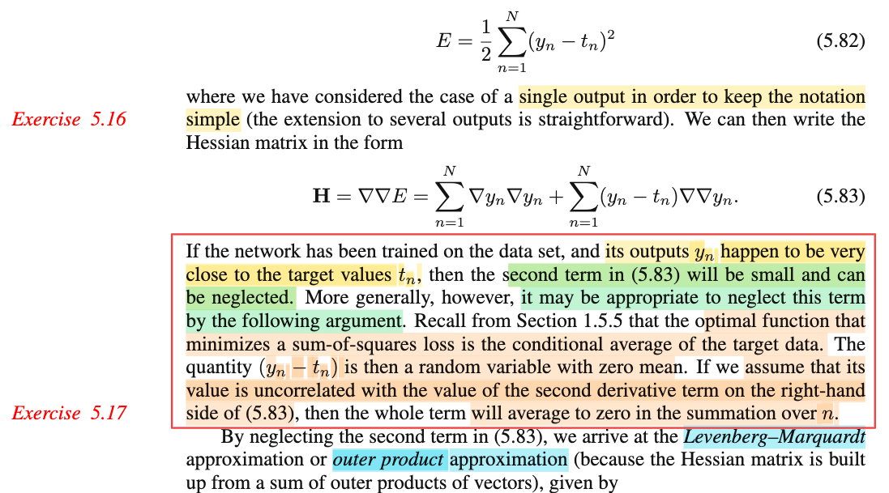
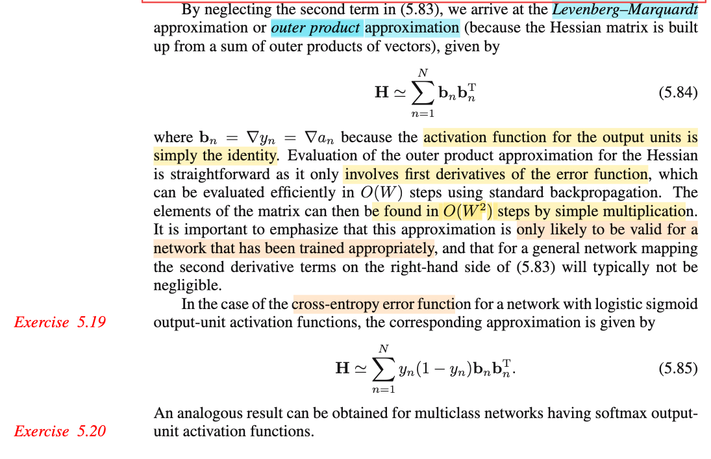

# 5.4.2 Outer product approximation

📊 **Progress:** `3` Notes | `3` Screenshots | `2` AI Reviews

---

 

## Outer Product Approximation

<kbd></kbd>

> [!NOTE]
> E = (1/2) Σn (yn - tn)²
>
>
>
> ∇E = ∇\[(1/2) Σn (yn - tn)²\]
>
>
>
> = (1/2) ∇\[Σn (yn - tn)²\]
>
>
>
> = (1/2) Σn \[∇(yn - tn)²\]
>
>
>
> = (1/2) Σn \[d/d(yn - tn) (yn - tn)² . ∇(yn - tn)\]
>
>
>
> ∇E = Σn \[(yn - tn) ∇yn\]
>
>
>
> 𝐇 = ∇∇E = ∇\[Σn \[(yn - tn) ∇yn\]\]
>
>
>
> = Σn ∇\[(yn - tn) ∇yn\]
>
>
>
> = Σn \[∇(yn - tn) ∇ynᵀ   + (yn - tn) ∇∇yn\]
>
>
>
> = Σn \[∇yn ∇ynᵀ + (yn - tn) ∇∇yn\]
>
>
>
> = Σn ∇yn ∇ynᵀ + Σn (yn - tn) ∇∇yn → 5.83

📹 [Xem video trên YouTube](https://www.youtube.com/watch?v=uF2pBk9VPxg)

> [!TIP]
> 🤖 **AI Check** — 🟢 Pass — ✅ **100/100** · ✓ Move on
>
> Ghi chú suy dẫn rất chi tiết, mạch lạc và hoàn toàn chính xác từ công thức hàm lỗi (5.82) ra ma trận Hessian (5.83).
>
> **✓ Strengths**
> - Khai triển đạo hàm cấp một và cấp hai từng bước rất rõ ràng, áp dụng chính xác quy tắc dây chuyền và quy tắc tích.
> - Làm rõ ký hiệu của sách bằng cách viết tường minh dạng tích ngoài (outer product) ∇yn ∇ynᵀ tạo thành ma trận kích thước phù hợp với Hessian.
>
> **💡 Deeper notes**
> - Trong sách giáo trình (Bishop PRML), tác giả viết tắt tích ngoài là ∇yn ∇yn; việc bạn viết thêm chuyển vị (∇ynᵀ) thể hiện sự hiểu đúng về chiều ma trận/vector trong giải tích ma trận.

 

### Bản chất hàm dự đoán

<kbd></kbd>

> [!NOTE]
> Đầu tiên cần recall lại một điểm kiến thức quan trọng:
>
>
>
> Khác nhau giữa mô hình linear regression chương 3 và neural network regression chương 5 là ở giả định:
>
>
>
> Cả hai đều giả định 𝐱1,𝐱2,...là các giá trị cố định có sẵn. t1,t2,...là các **giá trị quan sát được** của các biến ngẫu nhiên T1,T2,....độc lập có phân phối:
>
>
>
> Ti \~ 𝒩(μ(𝐱i), 1/β)
>
>
>
> Linear regression: μ(𝐱i) = 𝐰ᵀΦ(𝐱i)
>
>
>
> Neural network regression: μ(𝐱i) là hàm số phi tuyến của 𝐰 và 𝐱i biểu diễn bởi neural network
>
>
>
> ---
>
>
>
> Từ đó, ta đi giải bài toán suy luận thống kê: TÌm MLE của 𝐰 và β.
>
>
>
> Khi đó ta có gì: Ta có phân phối của Ti: 𝒩(μ(𝐱i), 1/β)
>
>
>
> Và dựa vào decision theory, nói rằng, từ phân phối xác suất của Ti, nếu ta muốn đưa ra ước lượng điểm của Ti, thì cái sẽ giúp giảm risk function với square loss chính là E\[Ti|𝐱i\] (chính là cái nói đến trong 1.5.5)
>
>
>
> Do đó, hàm dự đoán (là thứ mà machine learning cần) mà ta xài là y(𝐰, 𝐱i) = 𝐰ᵀΦ(𝐱i) hoặc và y(𝐰, 𝐱i) = "đầu ra của neural network"
>
>
>
> Đây là lớp ý nghĩa ẩn mà dễ ko để ý: việc nghĩ rằng ouput của neural net là hàm dựa đoán không sai, nhưng nó có lí do như vậy. 
>
>
>
> ---
>
>
>
> Do đó ở đây mới nói rằng: yi = E\[Ti|𝐱i\], hay Yn = E\[Tn|𝐗n\] = 𝐰ᵀΦ(𝐱)
>
>
>
> ---
>
>
>
> Vì sao: yn - tn là random variable zero mean?
>
>
>
> Đầu tiên hãy chú ý:
>
>
>
> 1. Tác giả không viết hoa (vì ổng thoát li cách viết quy ước của toán thống kê) nhưng phải hiểu ông đang nói nó với tư cách là biến ngẫu nhiên , nên mới nói đến kì vọng
>
>
>
> 2. Vì ông nhắc đến ∇∇yn như biến ngẫu nhiên nên ổng đang dùng giả định khác với cái ở trên chút xíu (là coi 𝐱n là giá trị cố định), ở đây 𝐱1,𝐱2 cũng là giá trị quan sát của biến 𝐗1, 𝐗2,....
>
>
>
> Và do đó, yn, nếu theo giả định 𝐱1, 𝐱2...cố định thì E\[Tn|𝐱n\] chỉ là hằng số.
>
>
>
> Nhưng với 𝐱1,𝐱2 cũng là giá trị quan sát của biến 𝐗1, 𝐗2,.... thì ta có biến Yn = E\[Tn|𝐗n\] là biến ngẫu nhiên tạo ra bởi việc áp hàm E\[Tn|𝐱\] lên biến ngẫu nhiên 𝐗n
>
>
>
> E\[Tn|𝐗n\] là biến ngẫu nhiên, như đã nói, có được bởi áp hàm g(𝐱) = E\[Tn|𝐱\] lên rv 𝐗n, tức g(𝐗n)
>
>
>
> Theo LOTUS: E\[g(𝐗n)\] = ∫g(𝐱)f(𝐱)d𝐱 = ∫E\[Tn|𝐱\] f(𝐱)d𝐱
>
>
>
> = ∫∫tn f(tn|𝐱) dtn f(𝐱)d𝐱
>
>
>
> = ∫∫tn f(tn|𝐱) f(𝐱) dtn d𝐱
>
>
>
> = ∫∫tn f(tn,𝐱) dtn d𝐱
>
>
>
> = ∫tn ∫f(tn,𝐱) d𝐱 dtn
>
>
>
> = ∫tn f(tn) dtn
>
>
>
> = E\[Tn\]
>
>
>
> Vậy kết quả là E\[Tn\] - E\[Tn\] = 0
>
>
>
> Đây chính là ý trong sách "yn - tn is then a random variable with zero mean".
>
>
>
> ---
>
>
>
> Vậy thì ý định của ông là: Xét cái term thứ hai của 5.83:
>
>
>
> Σn (yn - tn) ∇∇yn
>
>
>
> ∇∇yn: Hiểu thế này yn, theo như decision theory, ta sẽ dùng E\[Tn|𝐱n\] (đây là hàm số của 𝐰 và 𝐱n).
>
>
>
> Nếu như ta giả định rằng 𝐱1, 𝐱2,...cũng là giá trị quan sát được của 𝐗1, 𝐗2,....thì đương nhiên khi đó yn, với tư cách là hàm của 𝐗n, cũng là biến ngẫu nhiên: Yn. Và tương tự ∇∇Yn cũng là biến ngẫu nhiên (vì nó là hàm của 𝐗n).
>
>
>
> Để rồi theo như tác gỉa, nếu giả định tiếp là ∇∇Yn uncorrelate với biến ngẫu nhiên E\[Tn|𝐗n\] - Tn thì E\[(E\[Tn|𝐗n\] - Tn) ∇∇Yn\] sẽ bằng:
>
>
>
> = E\[(E\[Tn|𝐗n\] - Tn))E\[∇∇Yn\]
>
>
>
> = 0 × E\[∇∇Yn\]
>
>
>
> = 0
>
>
>
> Và khiến cho Σn (yn - tn) ∇∇yn, có thể coi như là sample mean:
>
>
>
> ū = Σi ui/n với ui là observed value của Ui = (E\[Tn|𝐗n\] - Tn) ∇∇Yn, có E\[Ui\] = 0 như vừa tính.
>
>
>
> Đại khái là ổng nói cái này sẽ có trung bình = 0 (tác giả cũng chả thèm giải thích)
>
>
>
> Ý định của tác giả là biện minh cho việc ta có thể bỏ đi term thứ hai trong 5.83 (..the second term will be small and can be neglect)
>
>
>
> ---

📹 Video 1: [Điểm khác nhau giữa linear regression và neural network regression.](https://youtu.be/GJojz_jbdoc)

📹 Video 2: [Vì sao yn - tn có kỳ vọng bằng 0?](https://www.youtube.com/watch?v=xxcxiTXNEYo)

> [!TIP]
> 🤖 **AI Check** — 🟢 Pass — ✅ **92/100** · ✓ Move on
>
> Ghi chú phân tích rất sâu sắc và chính xác bản chất xác suất đằng sau lập luận rút gọn của Bishop khi bỏ qua số hạng đạo hàm bậc hai.
>
> **🟡 Minor issues**
>
> **1.** *"hay Yn = E[Tn|𝐗n] = 𝐰ᵀΦ(𝐱)"*
>
> Ở đoạn này bạn ghi nhầm lại công thức của Linear Regression (𝐰ᵀΦ(𝐱)), trong khi ngữ cảnh chương 5 đang là mạng neural phi tuyến tổng quát y(𝐱, 𝐰).
>
> **2.** *"Theo LOTUS: E[g(𝐗n)] = ∫g(𝐱)f(𝐱)d𝐱 = ∫E[Tn|𝐱] f(𝐱)d𝐱 ... = E[Tn]"*
>
> Về mặt thuật ngữ lý thuyết xác suất, tính chất E[E[T|X]] = E[T] được gọi là Luật kỳ vọng toàn phần (Law of Total Expectation / Tower Property). Việc bạn tự khai triển tích phân là hoàn toàn chính xác, chỉ là không nhất thiết phải gọi tên riêng là LOTUS.
>
>
> **✓ Strengths**
> - Nhận diện chính xác việc Bishop đã chuyển từ giả định điểm dữ liệu cố định (fixed design) sang xem xét (X_n, T_n) như các biến ngẫu nhiên lấy mẫu từ phân phối chung.
> - Chứng minh chặt chẽ tại sao (Y_n - T_n) có kỳ vọng bằng 0 bằng luật kỳ vọng toàn phần.
> - Giải thích chuẩn xác logic thống kê: giả định không tương quan kết hợp kỳ vọng bằng 0 giúp số hạng tích trung bình triệt tiêu về 0 khi lấy tổng.
>
> **💡 Deeper notes**
> - Trên thực tế, y(x, w) chỉ tiệm cận kỳ vọng có điều kiện E[T|x] khi mạng neural có đủ dung lượng (capacity) và đã hội tụ về nghiệm tối ưu. Nếu mô hình bị lệch (misspecified) hoặc chưa hội tụ, residual (y - t) sẽ chứa cả sai số mô hình (bias), khiến kỳ vọng không hoàn toàn bằng 0.
> - Trong công thức (5.83), số hạng là tổng trực tiếp ∑ chứ không có hệ số 1/N. Tuy nhiên, lập luận của Bishop ngầm dựa trên Luật số lớn (Law of Large Numbers) rằng tổng này có bậc O(√N) hoặc trung bình mẫu hội tụ về 0, do đó nhỏ hơn đáng kể so với số hạng thứ nhất (luôn là ma trận nửa xác định dương tích lũy tăng tuyến tính theo N).

**🔗 See also:** [Minimizing Squared Loss Function](./15_decision_theory.md#node-hh6bwri)

 

#### Outer Product Hessian Approximation

<kbd></kbd>

> [!NOTE]
> đại khái là dùng outer product approximation, chi phí tính toán sẽ chỉ còn là O(W) (tính ∇y) và tính ra outer product tốn O(W²)
>
>
>
> Phần còn lại quay lại sau

 

