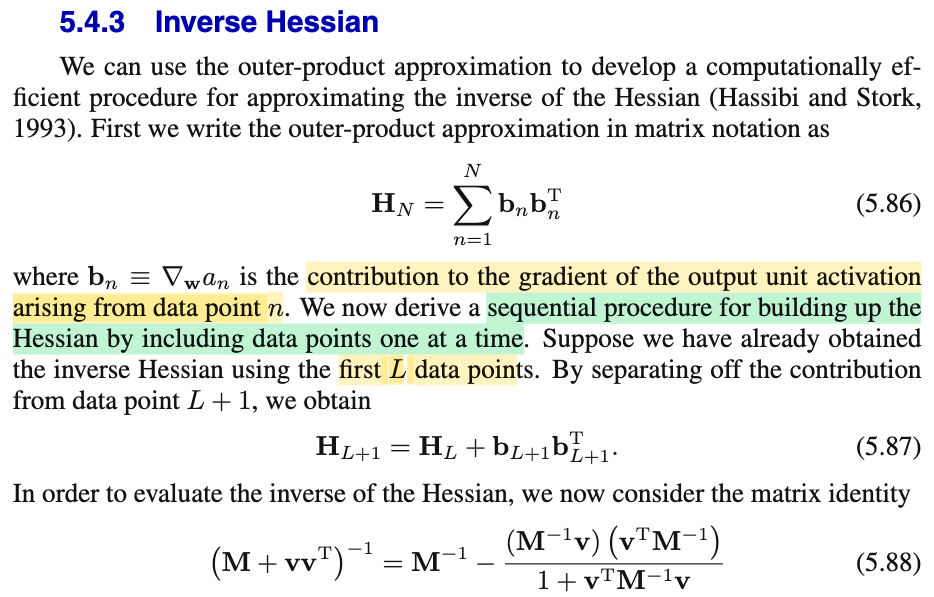
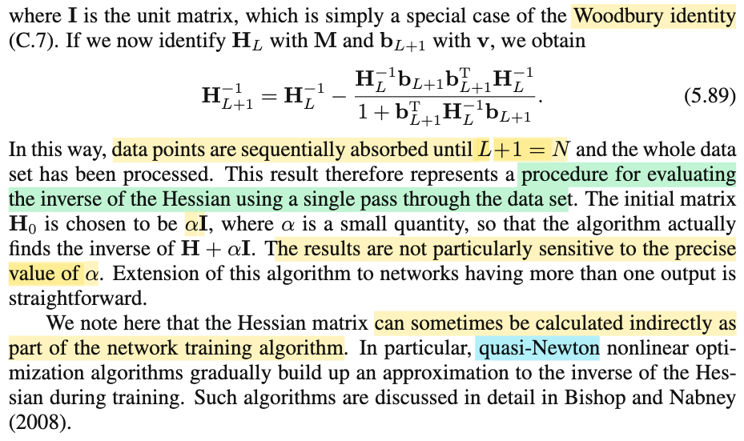

# 5.4.3 Inverse Hessian

📊 **Progress:** `1` Notes | `2` Screenshots | `1` AI Reviews

---

 

## Section 5.4.3 Inverse Hessian

<kbd></kbd>

<kbd></kbd>

> [!NOTE]
> Đại ý là dựa vào công thức xấp xỉ Hessian theo kiểu trên (outer product approximation), ta có thể tạo ra một quy trình để tính ra Hessian ngịch đảo của toàn bộ data point (tức là matrix Hessian của hàm E(𝐰) tính bởi tổng error của toàn bộ data):
>
>
>
> 𝐇\_N = Σn 𝐛n 𝐛nᵀ với 𝐛n = ∇a_n
>
>
>
> Dĩ nhiên theo đó: 𝐇\_L+1 = 𝐇\_L + 𝐛\_L+1 𝐛\_L+1ᵀ
>
>
>
> Từ đó, ta áp dụng công thức 5.88 (là trường hợp đặc biệt của Woodbury identity), cho 𝐇\_L đóng vai 𝐌 và 𝐛\_L+1 đóng vai 𝐯, (cái này chỉ cần biết vậy, ko cần đào sâu làm gì). Ta sẽ có 5.89 là công thức tính nghịch đảo của 𝐇\_L+1 tính từ nghịch đảo của 𝐇\_L
>
>
>
> Và như vậy, bắt đầu từ 𝐇\_0, chọn = α𝐈, lần lượt tính theo công thức này, ta sẽ  có (𝐇\_N + α𝐈)⁻¹
>
>
>
> ---
>
>
>
> Tác giả có nhắc tới quasi Newton, quả thật, quasi Newton cũng dùng cơ chế tương tự để tính nghịch đảo của xấp xỉ Hessian trong quá trình chạy bài toán tối ưu.

> [!TIP]
> 🤖 **AI Check** — 🟢 Pass — ✅ **95/100** · ✓ Move on
>
> Ghi chú tóm tắt rất chính xác và mạch lạc luồng tư duy của mục 5.4.3 về cách tính xấp xỉ Hessian nghịch đảo tuần tự qua từng điểm dữ liệu.
>
> **✓ Strengths**
> - Nắm bắt chính xác bản chất của thuật toán là cập nhật rank-1 tuần tự (sequential rank-1 update) qua từng điểm dữ liệu.
> - Hiểu đúng vai trò của điều kiện khởi tạo $H_0 = \alpha I$ giúp thuật toán tính được xấp xỉ nghịch đảo $(H_N + \alpha I)^{-1}$.
> - Nhận diện đúng mối liên hệ thực tế với các thuật toán tối ưu Quasi-Newton (như BFGS).
>
> **💡 Deeper notes**
> - Công thức (5.88) thường được biết đến với tên gọi cụ thể hơn là công thức Sherman-Morrison (trường hợp rank-1 của đẳng thức Woodbury).
> - Khởi tạo $H_0 = \alpha I$ với $\alpha$ nhỏ là bắt buộc vì ở các bước đầu khi số điểm $L$ nhỏ hơn số chiều tham số $W$, ma trận $H_L$ bị suy biến (chưa đủ rank) và không thể nghịch đảo trực tiếp.
> - Ý nghĩa tính toán cốt lõi của thủ thuật này là giảm độ phức tạp từ $O(W^3)$ (nghịch đảo ma trận trực tiếp) xuống $O(W^2)$ cho mỗi điểm dữ liệu thông qua các phép nhân ma trận - vector.

 

