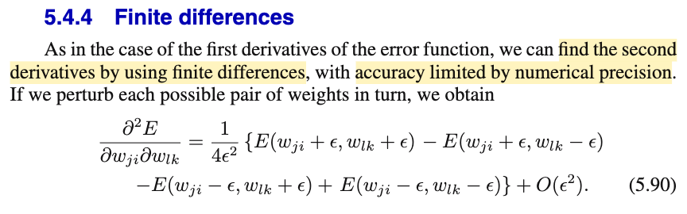
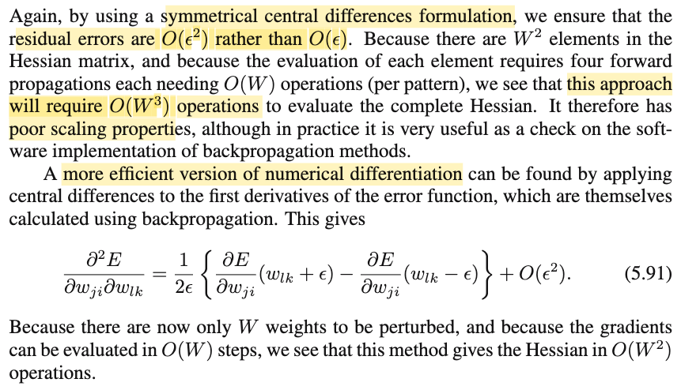

# 5.4.4 Finite differences

📊 **Progress:** `1` Notes | `2` Screenshots | `1` AI Reviews

---

 

## Section 5.4.4 Finite Differences

<kbd></kbd>

<kbd></kbd>

> [!NOTE]
> Quay lại sau

> [!TIP]
> 🤖 **AI Check** — 🔴 Critical issues — ❌ **0/100** · ✗ Fix first
>
> Ghi chú chưa có nội dung nào liên quan đến kiến thức về sai phân hữu hạn (finite differences) để tính ma trận Hessian từ tài liệu.
>
> **🔴 Critical issues**
>
> **1.** *"Quay lại sau"*
>
> Ghi chú chỉ là lời nhắc tạm hoãn và hoàn toàn chưa có nội dung học tập hay tóm tắt kiến thức từ tài liệu tham khảo.
>

 

