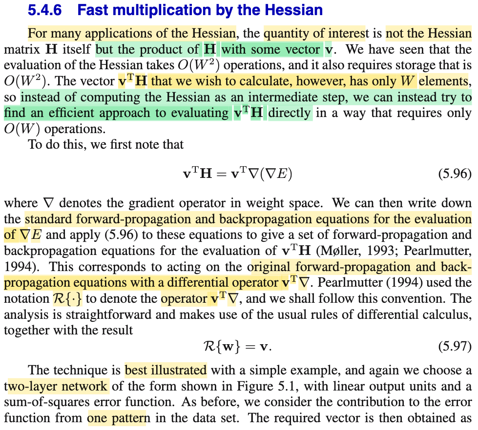
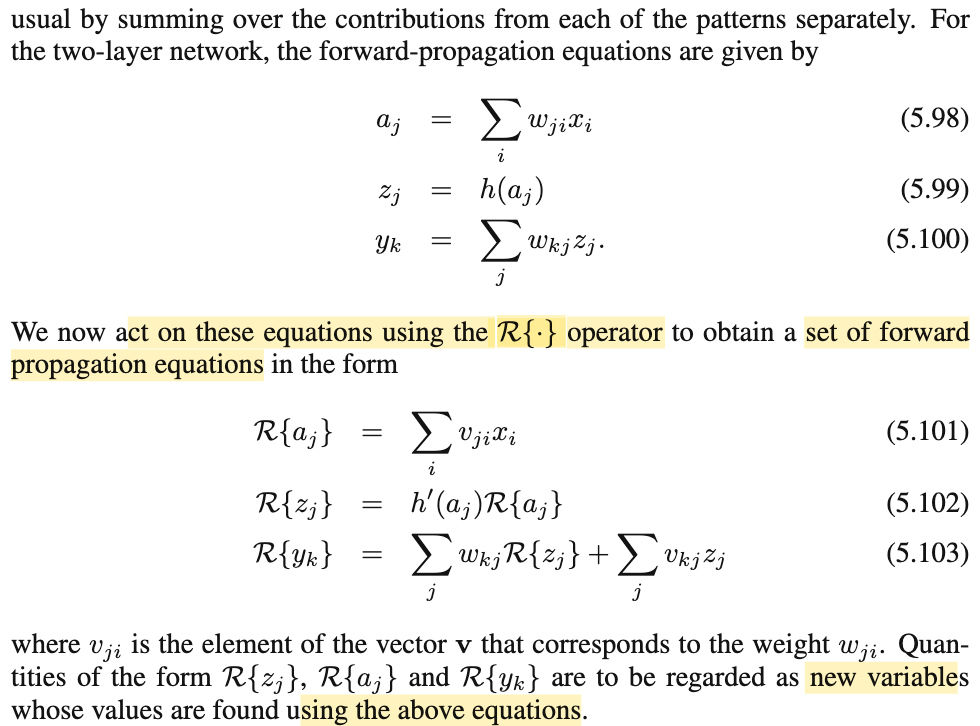
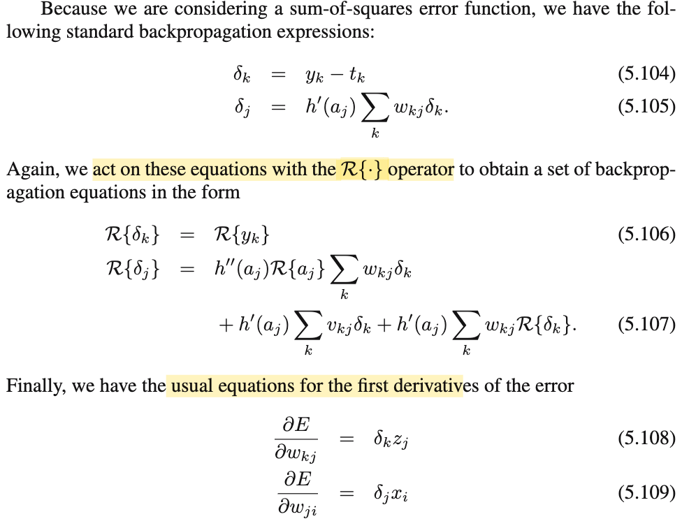
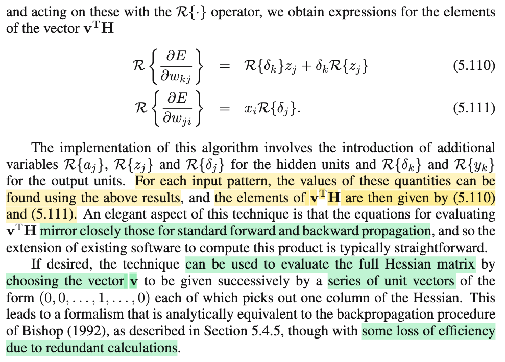

# 5.4.6 Fast multiplication by the Hessian

📊 **Progress:** `1` Notes | `4` Screenshots | `1` AI Reviews

---

 

## Fast Multiplication by the Hessian

<kbd></kbd>

<kbd></kbd>

<kbd></kbd>

<kbd></kbd>

> [!NOTE]
> Đại ý là, trong nhiều ứng dụng cần dùng Hessian thì ta thật ra ta cần là cần một tính một vector tạo bởi Hessian nhân với vector nào đó, 𝐯ᵀ𝐇 chứ không phải bản thân Hessian. Thành ra tuy để tính Hessian cần O(W²) nhưng để tính cái kia, có thể chỉ tốn O(W)
>
>
>
> Cách làm như sau:
>
>
>
> Đại khái là ta cũng forward và backward để có E và ∇E(𝐰)
>
>
>
> sau đó forward sweep, ta tính toán tử ℛ(.) = 𝐯ᵀ∇ lên các node và giá trị trung gian (a, z) và backward sweep tính ra ℛ(∂E/∂wkj) và ℛ(∂E/∂wji). Và đây chính là các phần tử của vector cần tính 𝐯ᵀ𝐇
>
>
>
> toán tử ℛ(.) = 𝐯ᵀ∇ tức là: lấy đạo hàm theo 𝐰 và tích vô hướng với vector 𝐯.
>
>
>
> Nên ℛ(∂E/∂wkj) sẽ chính là: lấy đạo hàm theo 𝐰 của ∂E/∂wkj, cho ra ∇(∂E/∂wkj) chứa các phần tử là đạo hàm riêng của ∂E/∂wkj đối với các w1,w2,....., đây chính là một hàng của Hessian. Ví dụ hàng 1, thì khi dot product với 𝐯, ta sẽ có phần tử đầu tiên của 𝐇ᵀ𝐯
>
>
>
> ---
>
>
>
> Và cách làm này thậm chí có thể tính ra Hessian chính xác bằng cách dùng seed vector là 𝐯 = 𝐞: ví dụ 𝐞1, ta sẽ có 𝐇ᵀ𝐞1, chính là hàng 1 của Hessian. Và làm vậy lần lượt với 𝐞2, 𝐞3,...ta sẽ có đủ matrix Hessian. Tuy nhiên cách làm này ko hiệu quả vì bị dư thừa tính toán.

> [!TIP]
> 🤖 **AI Check** — 🟡 Minor issues — ⚠️ **88/100** · ✓ Move on
>
> Ghi chú nắm rất chuẩn xác tư tưởng cốt lõi của toán tử Pearlmutter R{.} để tính tích Hessian - vector với chi phí O(W) cũng như cách trích xuất ma trận Hessian bằng các vector đơn vị. Điểm cần làm rõ là thuật toán đòi hỏi cả lan truyền xuôi và lan truyền ngược cho toán tử R chứ không chỉ thực hiện trong forward sweep.
>
> **🟡 Minor issues**
>
> **1.** *"Chỉ là trong foraward sweep, ta tính toán tử ℛ(.) = 𝐯ᵀ∇ lên các node và giá trị trung gian (a, z) để cuối cùng tính ra ℛ(∂E/∂wkj) và ℛ(∂E/∂wji)."*
>
> Để tính được R{∂E/∂w}, ta cần cả một lượt lan truyền xuôi cho toán tử R (tính R{a}, R{z}) lẫn một lượt lan truyền ngược cho toán tử R (tính R{δ} theo công thức 5.106–5.107), chứ không chỉ thực hiện riêng trong forward sweep.
>
>
> **✓ Strengths**
> - Hiểu chính xác mục tiêu cốt lõi: tính trực tiếp tích Hessian - vector với độ phức tạp O(W) thay vì phải tính và lưu toàn bộ Hessian tốn O(W^2).
> - Nắm rõ bản chất giải tích của toán tử R{.} = v^T∇ là lấy đạo hàm có hướng theo v trên các phương trình đạo hàm cấp một.
> - Hiểu đúng cách tái tạo lại toàn bộ ma trận Hessian bằng các vector đơn vị e_i và nhận xét chính xác về tính dư thừa tính toán của cách này.
>
> **💡 Deeper notes**
> - Ma trận Hessian H của hàm lỗi thường đối xứng (do các đạo hàm riêng cấp hai liên tục), do đó v^T H hay H v cho ra cùng bản chất hình học, và việc nhân với vector đơn vị e_i trích xuất hàng hay cột là tương đương.
> - Thuật toán thực tế đòi hỏi chạy forward và backward chuẩn trước để thu được các giá trị mạng (a, z, δ), sau đó mới áp dụng các phương trình forward và backward mở rộng của toán tử R.

 

