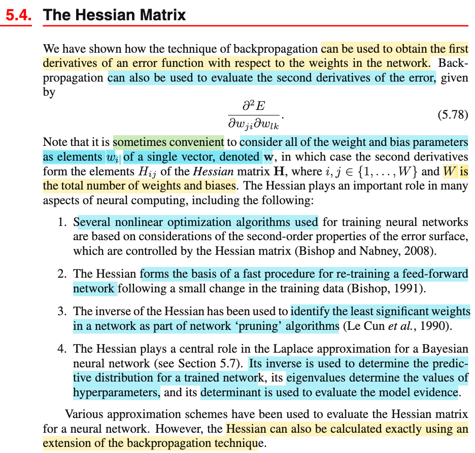
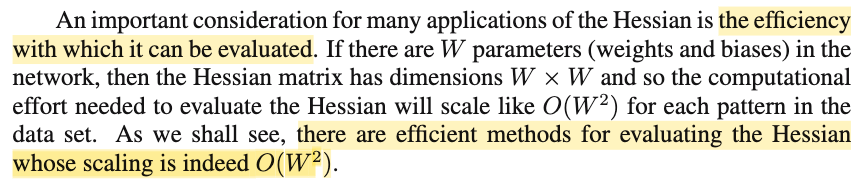
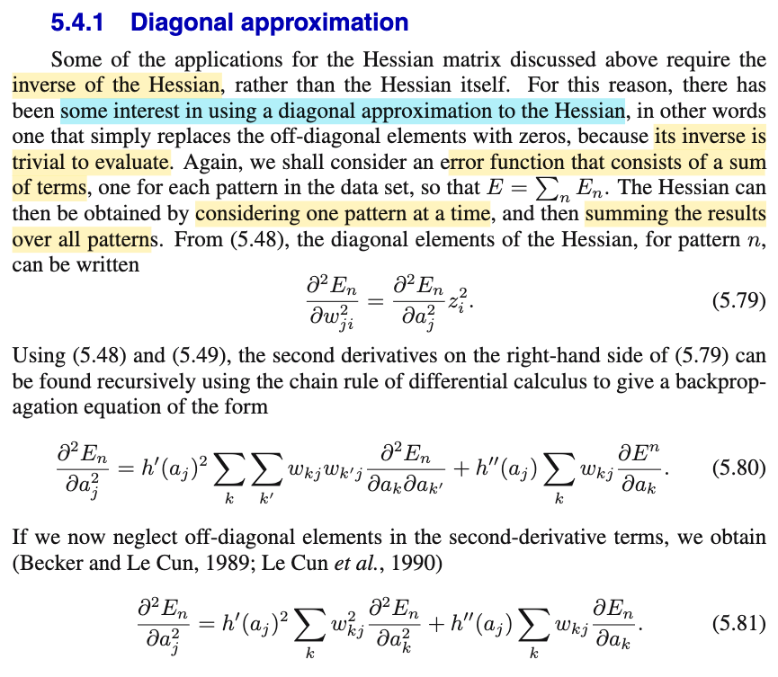
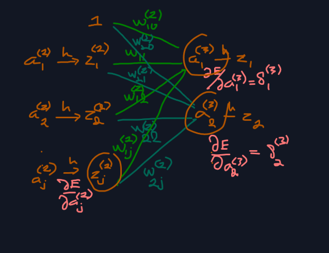
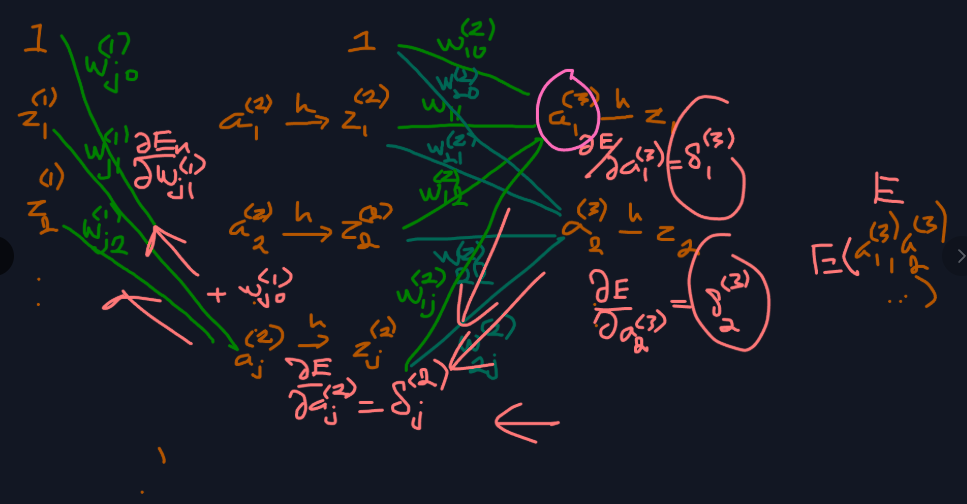
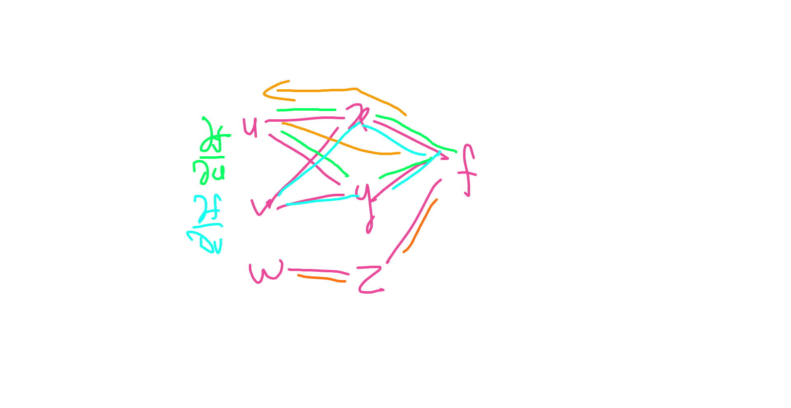
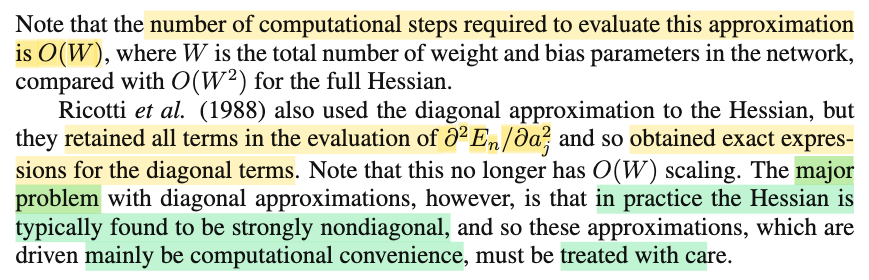

# 5.4 The Hessian Matrix

📊 **Progress:** `3` Notes | `10` Screenshots | `3` AI Reviews

---

 

## 5.4 The Hessian Matrix

<kbd></kbd>

<kbd></kbd>

> [!NOTE]
> Phần này đại ý là nói về vai trò của Hessian, và backprop có thể dùng để tính Hessian
>
>
>
> Và một vấn đề cần cân nhắc khi tính Hessian là chi phí tính toán. Ta sẽ thấy, chi phí tính Hessian sẽ scale theo O(W²) (W là số tham số (weight + bias))

> [!TIP]
> 🤖 **AI Check** — 🟡 Minor issues — ⚠️ **88/100** · ✓ Move on
>
> Ghi chú tóm tắt đúng các ý cốt lõi về vai trò của ma trận Hessian, khả năng mở rộng của backpropagation và độ phức tạp tính toán O(W²). Cần bổ sung thêm việc chi phí O(W²) này được tính trên từng mẫu dữ liệu.
>
> **🟡 Minor issues**
>
> **1.** *"chi phí tính Hessian sẽ scale theo O(W²)"*
>
> Độ phức tạp O(W²) trong tài liệu được tính riêng cho từng mẫu dữ liệu (for each pattern in the data set). Nếu tính trên toàn bộ tập dữ liệu có N mẫu, tổng chi phí tính toán sẽ tỷ lệ với O(N * W²).
>
>
> **✓ Strengths**
> - Nắm bắt chính xác việc thuật toán lan truyền ngược (backpropagation) có thể mở rộng để tính đạo hàm bậc hai (Hessian).
> - Hiểu đúng kích thước ma trận W x W dẫn đến chi phí tính toán tối thiểu ở mức bậc hai O(W²).
>
> **💡 Deeper notes**
> - Ma trận Hessian còn có 4 ứng dụng thực tế quan trọng được liệt kê trong bài: tối ưu hóa phi tuyến bậc 2, huấn luyện lại nhanh khi dữ liệu thay đổi nhỏ, tỉa bớt trọng số (network pruning), và xấp xỉ Laplace trong mạng Bayes.

 

### 5.4.1 Diagonal Approximation

<kbd></kbd>

<kbd></kbd>

<kbd></kbd>

> [!NOTE]
> 5.48: aj = Σi wji zi
>
>
>
> 5.49: zj = h(aj)
>
>
>
> 5.53: ∂En/∂w⁽¹⁾ji = δ⁽²⁾j z⁽¹⁾i
>
>
>
> với δ⁽²⁾j = ∂En/∂a⁽²⁾j
>
>
>
> 5.56: ∂En/∂a⁽²⁾j = h'(a⁽²⁾j) Σk w⁽²⁾kj δ⁽³⁾k
>
>
>
> ---
>
>
>
> f(x,y,z), x(u,v), y(u,v), z(v)
>
>
>
> df = ∂f/∂x dx + ∂f/∂y dy + ∂f/∂z dz
>
>
>
> dx = ∂x/∂u du + ∂x/∂v dv
>
>
>
> dy = ∂y/∂u du + ∂y/∂v dv
>
>
>
> dz = z'(v) dv
>
>
>
> df = ∂f/∂x (∂x/∂u du + ∂x/∂v dv) + ∂f/∂y (∂y/∂u du + ∂y/∂v dv) + ∂f/∂z z'(v) dv
>
>
>
> df = (∂f/∂x ∂x/∂u + ∂f/∂y ∂y/∂u) du + (∂f/∂x ∂x/∂v + ∂f/∂y ∂y/∂v + ∂f/∂z z'(v)) dv
>
>
>
> ⇒ ∂f/∂u = ∂f/∂x ∂x/∂u + ∂f/∂y ∂y/∂u
>
>
>
> ∂f/∂v = ∂f/∂x ∂x/∂v + ∂f/∂y ∂y/∂v + ∂f/∂z z'(v)
>
>
>
> ---
>
>
>
>
>
> ∂²En/∂w⁽¹⁾ji²
>
>
>
> = ∂/∂w⁽¹⁾ji \[∂En/∂w⁽¹⁾ji\]
>
>
>
> Theo 5.53: ∂En/∂w⁽¹⁾ji = δ⁽²⁾j z⁽¹⁾i
>
>
>
> = ∂/∂w⁽¹⁾ji \[∂En/∂a⁽²⁾j z⁽¹⁾i\]
>
>
>
> (5.56: ∂En/∂a⁽²⁾j = h'(a⁽²⁾j) Σk w⁽²⁾kj δ⁽³⁾k)
>
>
>
> = z⁽¹⁾i ∂/∂w⁽¹⁾ji \[∂En/∂a⁽²⁾j\]
>
>
>
> = z⁽¹⁾i (∂/∂a⁽²⁾j \[∂En/∂a⁽²⁾j\]) (∂a⁽²⁾j/∂w⁽¹⁾ji)
>
>
>
> = z⁽¹⁾i (∂²En/∂a⁽²⁾j²) (∂a⁽²⁾j/∂w⁽¹⁾ji)
>
>
>
> a⁽²⁾j = z⁽¹⁾1 w⁽¹⁾j1 + z⁽¹⁾2 w⁽¹⁾j2 + ... + z⁽¹⁾i w⁽¹⁾ji + ..
>
>
>
> ⇒ ∂a⁽²⁾j/∂w⁽¹⁾ji = z⁽¹⁾i
>
>
>
> ... = z⁽¹⁾i z⁽¹⁾i (∂²En/∂a⁽²⁾j²) = (∂²En/∂a⁽²⁾j²) z⁽¹⁾i² → 5.79
>
>
>
> ---
>
>
>
> ∂/∂a⁽²⁾j \[∂En/∂a⁽²⁾j\]
>
>
>
> Gọi ∂En/∂a⁽²⁾j là f
>
>
>
> thì theo 5.56 ở trên: ∂En/∂a⁽²⁾j = h'(a⁽²⁾j) Σk w⁽²⁾kj δ⁽³⁾k, thì
>
>
>
> f là hàm của x, y:
>
>
>
> với x = x(a⁽²⁾j) = h'(a⁽²⁾j).
>
>
>
> dx = x'(a⁽²⁾j) da⁽²⁾j = h''(a⁽²⁾j) da⁽²⁾j
>
>
>
> và y(δ⁽³⁾1, δ⁽³⁾2,...) = Σk w⁽²⁾kj δ⁽³⁾k = w⁽²⁾1j δ⁽³⁾1 + w⁽²⁾2j δ⁽³⁾2 + ....
>
>
>
> ⇒ dy = ∂y/∂δ⁽³⁾1 dδ⁽³⁾1 + ∂y/∂δ⁽³⁾2 dδ⁽³⁾2 + ...
>
>
>
> = w⁽²⁾1j dδ⁽³⁾1 + w⁽²⁾2j dδ⁽³⁾2 + ...
>
>
>
> ⇒ df = ∂f/∂x dx + ∂f/∂y dy
>
>
>
> df = y h''(a⁽²⁾j) da⁽²⁾j + x (w⁽²⁾1j dδ⁽³⁾1 + w⁽²⁾2j dδ⁽³⁾2 + ...)
>
>
>
> ---
>
>
>
> Cách 1 (dù rằng sẽ ko chuẩn lắm, vì ta ko cho chia da⁽²⁾j): Chia hai vế cho da⁽²⁾j
>
>
>
> ⇔ df/da⁽²⁾j = y h''(a⁽²⁾j) + x (w⁽²⁾1j dδ⁽³⁾1/da⁽²⁾j + w⁽²⁾2j dδ⁽³⁾2/da⁽²⁾j + ...)
>
>
>
> ⇔ df/da⁽²⁾j = (Σk w⁽²⁾kj δ⁽³⁾k) h''(a⁽²⁾j) + h'(a⁽²⁾j) (w⁽²⁾1j dδ⁽³⁾1/da⁽²⁾j + w⁽²⁾2j dδ⁽³⁾2/da⁽²⁾j + ...)
>
>
>
> ⇔ df/da⁽²⁾j = (Σk w⁽²⁾kj δ⁽³⁾k) h''(a⁽²⁾j) + h'(a⁽²⁾j) Σk (w⁽²⁾kj dδ⁽³⁾k/da⁽²⁾j)
>
>
>
> ⇔ df/da⁽²⁾j = h'(a⁽²⁾j) Σk (w⁽²⁾kj dδ⁽³⁾k/da⁽²⁾j) + h''(a⁽²⁾j) (Σk w⁽²⁾kj δ⁽³⁾k)
>
>
>
> ---
>
>
>
> Cách 2:
>
>
>
>  df = y h''(a⁽²⁾j) da⁽²⁾j + x (w⁽²⁾1j dδ⁽³⁾1 + w⁽²⁾2j dδ⁽³⁾2 + ...) (1)
>
>
>
>  δ⁽³⁾1 =  δ⁽³⁾1(a⁽²⁾1, a⁽²⁾2,...)
>
>
>
> ⇒ dδ⁽³⁾1 = ∂δ⁽³⁾1/∂a⁽²⁾1 da⁽²⁾1+ ∂δ⁽³⁾1/∂a⁽²⁾2 da⁽²⁾2 + ... ∂δ⁽³⁾1/∂a⁽²⁾j da⁽²⁾j
>
>
>
> tương tự
>
>
>
> dδ⁽³⁾2 = ∂δ⁽³⁾2/∂a⁽²⁾1 da⁽²⁾1+ ∂δ⁽³⁾2/∂a⁽²⁾2 da⁽²⁾2 + ... ∂δ⁽³⁾2/∂a⁽²⁾j da⁽²⁾j
>
>
>
> ..
>
>
>
> Thế vào (1) nhân ra gom lại ta sẽ có:
>
>
>
> df = y h''(a⁽²⁾j) da⁽²⁾j + x \[w⁽²⁾1j (∂δ⁽³⁾1/∂a⁽²⁾1 da⁽²⁾1+ ...+ ... ∂δ⁽³⁾1/∂a⁽²⁾j da⁽²⁾j) + w⁽²⁾2j (∂δ⁽³⁾2/∂a⁽²⁾1 da⁽²⁾1+ ... ∂δ⁽³⁾2/∂a⁽²⁾j da⁽²⁾j) + ...)
>
>
>
> = y h''(a⁽²⁾j) da⁽²⁾j + x \[(w⁽²⁾1j ∂δ⁽³⁾1/∂a⁽²⁾j da⁽²⁾j) + w⁽²⁾2j (∂δ⁽³⁾2/∂a⁽²⁾j da⁽²⁾j) + ...\] + ...(những term gắn với da⁽²⁾1, da⁽²⁾2,..)
>
>
>
> = y h''(a⁽²⁾j) da⁽²⁾j + x \[(w⁽²⁾1j ∂δ⁽³⁾1/∂a⁽²⁾j) + w⁽²⁾2j ∂δ⁽³⁾2/∂a⁽²⁾j) da⁽²⁾j + ...\] + ...(những term gắn với da⁽²⁾1, da⁽²⁾2,..)
>
>
>
> = y h''(a⁽²⁾j) da⁽²⁾j + x \[Σk w⁽²⁾kj ∂δ⁽³⁾k/∂a⁽²⁾j\] da⁽²⁾j + ...\] + ...(những term gắn với da⁽²⁾1, da⁽²⁾2,..)
>
>
>
> df = {y h''(a⁽²⁾j) + x \[Σk w⁽²⁾kj ∂δ⁽³⁾k/∂a⁽²⁾j\] } da⁽²⁾j + ...\] + ...(những term gắn với da⁽²⁾1, da⁽²⁾2,..)
>
>
>
> ⇒ df/da⁽²⁾j = y h''(a⁽²⁾j) + x \[Σk w⁽²⁾kj ∂δ⁽³⁾k/∂a⁽²⁾j\]
>
>
>
> = Σk w⁽²⁾kj δ⁽³⁾k h''(a⁽²⁾j) + h'(a⁽²⁾j) \[Σk w⁽²⁾kj ∂δ⁽³⁾k/∂a⁽²⁾j\]
>
>
>
> = h'(a⁽²⁾j) \[Σk w⁽²⁾kj ∂δ⁽³⁾k/∂a⁽²⁾j\] + Σk w⁽²⁾kj δ⁽³⁾k h''(a⁽²⁾j)
>
>
>
> = h'(a⁽²⁾j) \[Σk w⁽²⁾kj ∂δ⁽³⁾k/∂a⁽²⁾j\] + h''(a⁽²⁾j) Σk w⁽²⁾kj δ⁽³⁾k
>
>
>
> Ra kết quả như cách 1:
>
>
>
> ---
>
>
>
> ∂δ⁽³⁾k/∂a⁽²⁾j
>
>
>
> δ⁽³⁾k = ∂En/∂a⁽³⁾k = δ⁽³⁾k(a⁽³⁾1, a⁽³⁾2,...)
>
>
>
> dδ⁽³⁾k = ∂δ⁽³⁾k/∂a⁽³⁾1 da⁽³⁾1 + ∂δ⁽³⁾k/∂a⁽³⁾2 da⁽³⁾2 + ...
>
>
>
> = Σk' ∂δ⁽³⁾k/∂a⁽³⁾k' da⁽³⁾k' (2)
>
>
>
> ---
>
>
>
> a⁽³⁾k' = w⁽²⁾k'1 h(a⁽²⁾1) + w⁽²⁾k'2 h(a⁽²⁾2) +..+ w⁽²⁾k'j h(a⁽²⁾j) 
>
>
>
> da⁽³⁾k' = ∂a⁽³⁾k'/∂a⁽²⁾1 da⁽²⁾1 + ...+ ∂a⁽³⁾k'/∂a⁽²⁾j da⁽²⁾j
>
>
>
> ∂a⁽³⁾k'/∂a⁽²⁾1 = ∂a⁽³⁾k'/∂z⁽²⁾1 ∂z⁽²⁾1/∂a⁽²⁾1
>
>
>
> ∂a⁽³⁾k'/∂z⁽²⁾1 = ∂\[tổng\]/∂z⁽²⁾1 = \[∂(z⁽²⁾1w⁽²⁾11)/∂z⁽²⁾1 + ∂(z⁽²⁾2w⁽²⁾12)∂z⁽²⁾1 +... 
>
>
>
> = ∂\[z⁽²⁾1 w⁽²⁾11\]/∂z⁽²⁾1 = w⁽²⁾11
>
>
>
> = ∂a⁽³⁾k'/∂z⁽²⁾1 z⁽²⁾1/∂a⁽²⁾1 da⁽²⁾1 + ...+ ∂a⁽³⁾k'/∂a⁽²⁾j da⁽²⁾j
>
>
>
> = w⁽²⁾k'1 h'(a⁽²⁾1) da⁽²⁾1 + ...+ w⁽²⁾k'j h'(a⁽²⁾j) da⁽²⁾j
>
>
>
> Lắp da⁽³⁾k' vào (2):
>
>
>
> .. = Σk' ∂δ⁽³⁾k/∂a⁽³⁾k' \[w⁽²⁾k'1 h'(a⁽²⁾1) da⁽²⁾1 + ...+ w⁽²⁾k'j h'(a⁽²⁾j) da⁽²⁾j\]
>
>
>
> .= Σk' \[ ∂δ⁽³⁾k/∂a⁽³⁾k' w⁽²⁾k'1 h'(a⁽²⁾1) da⁽²⁾1 + ...+ ∂δ⁽³⁾k/∂a⁽³⁾k' w⁽²⁾k'j h'(a⁽²⁾j) da⁽²⁾j\]
>
>
>
> = Σk' \[ ∂δ⁽³⁾k/∂a⁽³⁾k' w⁽²⁾k'1 h'(a⁽²⁾1)\] da⁽²⁾1 + ...+ Σk' \[∂δ⁽³⁾k/∂a⁽³⁾k' w⁽²⁾k'j h'(a⁽²⁾j)\] da⁽²⁾j
>
>
>
> ⇒ ∂δ⁽³⁾k/∂a⁽²⁾j = Σk' \[∂δ⁽³⁾k/∂a⁽³⁾k' w⁽²⁾k'j h'(a⁽²⁾j)\]
>
>
>
> = Σk' \[∂(∂En/∂a⁽³⁾k)/∂a⁽³⁾k' w⁽²⁾k'j h'(a⁽²⁾j)\]
>
>
>
> = Σk' \[(∂²En/∂a⁽³⁾k∂a⁽³⁾k') w⁽²⁾k'j h'(a⁽²⁾j)\]
>
>
>
> = h'(a⁽²⁾j) Σk' \[w⁽²⁾k'j (∂²En/∂a⁽³⁾k∂a⁽³⁾k')\]
>
>
>
> Viết lại: ∂δ⁽³⁾k/∂a⁽²⁾j = h'(a⁽²⁾j) Σk' \[w⁽²⁾k'j (∂²En/∂a⁽³⁾k∂a⁽³⁾k')\]
>
>
>
> ---
>
>
>
> Vậy, thay vào lại: h'(a⁽²⁾j) \[Σk w⁽²⁾kj ∂δ⁽³⁾k/∂a⁽²⁾j\] + h''(a⁽²⁾j) Σk w⁽²⁾kj δ⁽³⁾k
>
>
>
> = h'(a⁽²⁾j) \[Σk w⁽²⁾kj (h'(a⁽²⁾j) Σk' \[w⁽²⁾k'j (∂²En/∂a⁽³⁾k∂a⁽³⁾k')\])\] + h''(a⁽²⁾j) Σk w⁽²⁾kj δ⁽³⁾k
>
>
>
> = h'(a⁽²⁾j) h'(a⁽²⁾j) \[Σk w⁽²⁾kj Σk' \[w⁽²⁾k'j (∂²En/∂a⁽³⁾k∂a⁽³⁾k')\])\] + h''(a⁽²⁾j) Σk w⁽²⁾kj δ⁽³⁾k
>
>
>
> = h'(a⁽²⁾j)² \[Σk Σk' w⁽²⁾kj w⁽²⁾k'j (∂²En/∂a⁽³⁾k∂a⁽³⁾k')\] + h''(a⁽²⁾j) Σk w⁽²⁾kj δ⁽³⁾k
>
>
>
> Đây là 5.80

> [!TIP]
> 🤖 **AI Check** — 🟢 Pass — ✅ **98/100** · ✓ Move on
>
> Ghi chú xuất sắc! Bạn đã tự chứng minh chi tiết và chính xác từng bước biến đổi từ quy tắc đạo hàm hợp (chain rule) để đi đến công thức (5.79) và (5.80) trong sách giáo trình.
>
> **🟡 Minor issues**
>
> **1.** *"df/da⁽²⁾j = y h''(a⁽²⁾j) + x (w⁽²⁾1j dδ⁽³⁾1/da⁽²⁾j + w⁽²⁾2j dδ⁽³⁾2/da⁽²⁾j + ...)"*
>
> Ở 'Cách 1', việc chia trực tiếp vi phân toàn phần df cho da_j trong hàm nhiều biến là thao tác hình thức (informal). Tuy nhiên, bạn đã nhận thức rõ điều này và bổ sung 'Cách 2' triển khai vi phân chính tắc rất chuẩn xác.
>
>
> **✓ Strengths**
> - Tự triển khai và chứng minh đầy đủ chi tiết công thức (5.79) và (5.80) thay vì chỉ chép lại kết quả.
> - Sử dụng công cụ vi phân toàn phần rất khéo léo để tách và tìm đạo hàm bậc hai của hàm hợp nhiều biến.
> - Ký hiệu chỉ số tầng (layer index) và trọng số liên kết rõ ràng, theo sát trực quan hình vẽ minh họa.
>
> **💡 Deeper notes**
> - Để đi từ (5.80) sang (5.81) (xấp xỉ đường chéo của LeCun), người ta giả định bỏ qua các phần tử ngoài đường chéo ∂²En/(∂a_k ∂a_k') khi k ≠ k', khi đó tổng kép Σ_k Σ_k' rút gọn chỉ còn tổng đơn Σ_k với w_kj².

**🔗 See also:** [Feed-Forward Network Unit Activation](./531_evaluation_of_error_function_derivatives.md#node-krbtnm2) · [Weight Derivative Evaluation](./531_evaluation_of_error_function_derivatives.md#node-noaxia8)

 

#### 5.4.1 Diagonal Approximation (bản sao)

<kbd></kbd>

<kbd></kbd>

<kbd></kbd>

<kbd></kbd>

<kbd></kbd>

> [!NOTE]
> Đại khái là tương tự như backprop có thể dùng để tính Jacobian 𝐉 (đạo hàm của vector 𝐲 với vector input 𝐱) hoặc trước đó là gradient ∇En (đạo hàm của En đối với vector trọng số (gồm cả weight và bias 𝐰) 
>
>
>
> Thì ở đây, nói backprop dùng để tính Hessian: Matrix đạo hàm cấp 2 của En đối với 𝐰. tức chính là ∇²E(𝐰)
>
>
>
> Và tương tự. do E(𝐰) = Σn En(𝐰) thì ∇²E(𝐰) = Σ ∇²En(𝐰)
>
>
>
> Thử derive công thức 5.79, 80, 81
>
>
>
> 5.48: aj = Σi wji zi
>
>
>
> 5.49: zj = h(aj)
>
>
>
> 5.53: ∂En/∂w⁽¹⁾ji = δ⁽²⁾j z⁽¹⁾i
>
>
>
> với δ⁽²⁾j = ∂En/∂a⁽²⁾j
>
>
>
> 5.56: ∂En/∂a⁽²⁾j = h'(a⁽²⁾j) Σk w⁽²⁾kj δ⁽³⁾k
>
>
>
> ---
>
>
>
> f(x,y,z), x(u,v), y(u,v), z(w)
>
>
>
> df = ∂f/∂x dx + ∂f/∂y dy + ∂f/∂z dz (total differenetial)
>
>
>
> dx = ∂x/∂u du + ∂x/∂v dv
>
>
>
> dy = ∂y/∂u du + ∂y/∂v dv
>
>
>
> dz = z'(w)dw
>
>
>
> df = ∂f/∂x (∂x/∂u du + ∂x/∂v dv) + ∂f/∂y (∂y/∂u du + ∂y/∂v dv) + ∂f/∂z z'(w)dw
>
>
>
> = (∂f/∂x ∂x/∂u + ∂f/∂y∂y/∂u) du + (∂f/∂x ∂x/∂v + ∂f/∂y ∂y/∂v) dv + ∂f/∂z z'(w) dw
>
>
>
> ∂f/∂u = ∂f/∂x ∂x/∂u + ∂f/∂y∂y/∂u
>
>
>
> ∂f/∂v = ∂f/∂x ∂x/∂v + ∂f/∂y ∂y/∂v
>
>
>
> ∂f/∂w = ∂f/∂z z'(w)
>
>
>
> ---
>
>
>
> i = 2:
>
>
>
> f(x), f'(x) = d/dx f(x), f''(x) = d/dx f'(x)
>
>
>
> ∂²En/∂w⁽¹⁾j2² = ∂/∂w⁽¹⁾j2 (∂En/∂w⁽¹⁾j2)
>
>
>
> 5.53: ∂En/∂w⁽¹⁾j2 = δ⁽²⁾j z⁽¹⁾2
>
>
>
> .. = ∂/∂w⁽¹⁾j2 (δ⁽²⁾j z⁽¹⁾2)
>
>
>
> = z⁽¹⁾2 ∂/∂w⁽¹⁾j2 (δ⁽²⁾j)
>
>
>
> = z⁽¹⁾2 ∂δ⁽²⁾j/∂a⁽²⁾j ∂a⁽²⁾j/∂w⁽¹⁾j2
>
>
>
> Xét ∂a⁽²⁾j/∂w⁽¹⁾j2
>
>
>
> = ∂(z⁽¹⁾1w⁽¹⁾j1 + z⁽¹⁾2w⁽¹⁾j2 + ...)/∂w⁽¹⁾j2
>
>
>
> = ∂(z⁽¹⁾2w⁽¹⁾j2)/∂w⁽¹⁾j2
>
>
>
> = z⁽¹⁾2
>
>
>
> ...= z⁽¹⁾2 ∂δ⁽²⁾j/∂a⁽²⁾j z⁽¹⁾2
>
>
>
> = (z⁽¹⁾2)² ∂δ⁽²⁾j/∂a⁽²⁾j
>
>
>
> = (z⁽¹⁾2)² ∂/∂a⁽²⁾j δ⁽²⁾j
>
>
>
> = (z⁽¹⁾2)² ∂/∂a⁽²⁾j \[∂En/∂a⁽²⁾j\]
>
>
>
> = (z⁽¹⁾2)² ∂²En/∂a⁽²⁾j²
>
>
>
> Viết lại:
>
>
>
> ∂²En/∂w⁽¹⁾j2² = (z⁽¹⁾2)² ∂²En/∂a⁽²⁾j²
>
>
>
> thay 2 bởi i (nãy mượn i = 2 cho dễ):
>
>
>
> ∂²En/∂w⁽¹⁾ji² = (z⁽¹⁾i)² ∂²En/∂a⁽²⁾j² → 5.79
>
>
>
> ---
>
>
>
> Derive 5.80:
>
>
>
> ∂²En/∂a⁽²⁾j² = ∂/∂a⁽²⁾j \[∂En/∂a⁽²⁾j\]
>
>
>
> 5.56: ∂En/∂a⁽²⁾j = h'(a⁽²⁾j) Σk w⁽²⁾kj δ⁽³⁾k
>
>
>
> .. = ∂/∂a⁽²⁾j \[h'(a⁽²⁾j) Σk w⁽²⁾kj δ⁽³⁾k\]
>
>
>
> Dễ thấy h'(a⁽²⁾j) là hàm phụ thuộc a⁽²⁾j
>
>
>
> Σk w⁽²⁾kj δ⁽³⁾k, có các δ⁽³⁾k, cũng là hàm phụ thuộc a⁽²⁾j do để có δ⁽³⁾k ta phải forward prop ra E.
>
>
>
> Nên đây là đạo hàm của tích hai hàm số phụ thuộc a⁽²⁾j, dùng product rule: (uv)' = u'v + uv'
>
>
>
> ..= ∂/∂a⁽²⁾j \[h'(a⁽²⁾j)\] (Σk w⁽²⁾kj δ⁽³⁾k) + h'(a⁽²⁾j) \[∂/∂a⁽²⁾j Σk w⁽²⁾kj δ⁽³⁾k\]
>
>
>
> Xét ∂/∂a⁽²⁾j \[h'(a⁽²⁾j)\] = h''(a⁽²⁾j)
>
>
>
> Hạng tử 1: h''(a⁽²⁾j) (Σk w⁽²⁾kj δ⁽³⁾k) Đấy chính là hạng tử 2 của 5.80
>
>
>
> ---
>
>
>
> Hạng tử 2: h'(a⁽²⁾j) \[∂/∂a⁽²⁾j Σk w⁽²⁾kj δ⁽³⁾k\]
>
>
>
> ---
>
>
>
> Xét ∂/∂a⁽²⁾j Σk w⁽²⁾kj δ⁽³⁾k
>
>
>
> = Σk ∂/∂a⁽²⁾j \[w⁽²⁾kj δ⁽³⁾k\]
>
>
>
> = Σk w⁽²⁾kj ∂/∂a⁽²⁾j \[δ⁽³⁾k\] (1)
>
>
>
> ---
>
>
>
> Xét ∂/∂a⁽²⁾j \[δ⁽³⁾k\]
>
>
>
> Tính ∂δ⁽³⁾k/∂z⁽²⁾j trước:
>
>
>
> ∂δ⁽³⁾k/∂z⁽²⁾j = ∂δ⁽³⁾k/∂a⁽³⁾1 ∂a⁽³⁾1/∂z⁽²⁾j + ∂δ⁽³⁾k/∂a⁽³⁾2 ∂a⁽³⁾2/∂z⁽²⁾j + ..
>
>
>
> = Σk' ∂δ⁽³⁾k/∂a⁽³⁾k' ∂a⁽³⁾k'/∂z⁽²⁾j
>
>
>
> ---
>
>
>
> Từ đó tính ∂δ⁽³⁾k/∂a⁽²⁾j:
>
>
>
> ∂δ⁽³⁾k/∂a⁽²⁾j = ∂δ⁽³⁾k/∂z⁽²⁾j ∂z⁽²⁾j/∂a⁽²⁾j
>
>
>
> (thay ∂δ⁽³⁾k/∂z⁽²⁾j ở trên vào)
>
>
>
> = (Σk' ∂δ⁽³⁾k/∂a⁽³⁾k' ∂a⁽³⁾k'/∂z⁽²⁾j) ∂z⁽²⁾j/∂a⁽²⁾j
>
>
>
> (do z⁽²⁾j = h(a⁽²⁾j) ⇒ ∂z⁽²⁾j/∂a⁽²⁾j = h'(a⁽²⁾j))
>
>
>
> = (Σk' ∂δ⁽³⁾k/∂a⁽³⁾k' ∂a⁽³⁾k'/∂z⁽²⁾j) h'(a⁽²⁾j)
>
>
>
> Viết lại: ∂δ⁽³⁾k/∂a⁽²⁾j = (Σk' ∂δ⁽³⁾k/∂a⁽³⁾k' ∂a⁽³⁾k'/∂z⁽²⁾j) h'(a⁽²⁾j)
>
>
>
> ta tính tiếp ∂δ⁽³⁾k/∂a⁽³⁾k' và ∂a⁽³⁾k'/∂z⁽²⁾j
>
>
>
> ---
>
>
>
>  Tính ∂δ⁽³⁾k/∂a⁽³⁾k':
>
>
>
> = ∂\[∂En/∂a⁽³⁾k\]/∂a⁽³⁾k'
>
>
>
> = ∂²En/(∂a⁽³⁾k∂a⁽³⁾k')
>
>
>
> ---
>
>
>
> Tính ∂a⁽³⁾k'/∂z⁽²⁾j: dễ thấy = w⁽²⁾k'j
>
>
>
> ---
>
>
>
> Vậy ∂δ⁽³⁾k/∂a⁽²⁾j = (Σk' ∂δ⁽³⁾k/∂a⁽³⁾k' ∂a⁽³⁾k'/∂z⁽²⁾j) h'(a⁽²⁾j)
>
>
>
> = (Σk' (∂²En/(∂a⁽³⁾k∂a⁽³⁾k')) w⁽²⁾k'j) h'(a⁽²⁾j)
>
>
>
> ---
>
>
>
> Thế kết quả trên vào (1):
>
>
>
> ∂/∂a⁽²⁾j Σk w⁽²⁾kj δ⁽³⁾k = Σk w⁽²⁾kj **∂δ⁽³⁾k/∂a⁽²⁾j**
>
>
>
> = Σk w⁽²⁾kj Σk' {(∂²En/(∂a⁽³⁾k∂a⁽³⁾k')) w⁽²⁾k'j) h'(a⁽²⁾j)}
>
>
>
> = Σk w⁽²⁾kj h'(a⁽²⁾j) Σk' {(∂²En/(∂a⁽³⁾k∂a⁽³⁾k')) w⁽²⁾k'j }
>
>
>
> = h'(a⁽²⁾j) Σk w⁽²⁾kj Σk' {(∂²En/(∂a⁽³⁾k∂a⁽³⁾k')) w⁽²⁾k'j }
>
>
>
> = h'(a⁽²⁾j) Σk Σk' w⁽²⁾kj {(∂²En/(∂a⁽³⁾k∂a⁽³⁾k')) w⁽²⁾k'j }
>
>
>
> = h'(a⁽²⁾j) Σk Σk' w⁽²⁾kj w⁽²⁾k'j {(∂²En/(∂a⁽³⁾k∂a⁽³⁾k')) }
>
>
>
> Hạng tử 2 còn đầy đủ:
>
>
>
> h'(a⁽²⁾j) \[∂/∂a⁽²⁾j Σk w⁽²⁾kj δ⁽³⁾k\]
>
>
>
> = h'(a⁽²⁾j) h'(a⁽²⁾j) Σk w⁽²⁾kj w⁽²⁾k'j Σk' {(∂²En/(∂a⁽³⁾k∂a⁽³⁾k')) }
>
>
>
> = h'(a⁽²⁾j)² Σk w⁽²⁾kj w⁽²⁾k'j Σk' {(∂²En/(∂a⁽³⁾k∂a⁽³⁾k')) }
>
>
>
> = h'(a⁽²⁾j)² Σk Σk' w⁽²⁾kj w⁽²⁾k'j {(∂²En/(∂a⁽³⁾k∂a⁽³⁾k')) }
>
>
>
> ---
>
>
>
> Vậy ∂²En/∂a⁽²⁾j² =
>
>
>
> h'(a⁽²⁾j)² Σk Σk' w⁽²⁾kj w⁽²⁾k'j {(∂²En/(∂a⁽³⁾k∂a⁽³⁾k'))}
>
>
>
> \+ h''(a⁽²⁾j) (Σk w⁽²⁾kj δ⁽³⁾k) → 5.80
>
>
>
> ---
>
>
>
> 5.81: (∂²En/(∂a⁽³⁾k∂a⁽³⁾k') = 0 với k khác k'
>
>
>
> Với k = k': ∂²En/∂a⁽³⁾k²
>
>
>
> ∂²En/∂a⁽²⁾j² =
>
>
>
> h'(a⁽²⁾j)² Σk w⁽²⁾kj² ∂²En/∂a⁽³⁾k² + h''(a⁽²⁾j) (Σk w⁽²⁾kj δ⁽³⁾k) → 5.81
>
>
>
> ---
>
>
>
> Hiểu thế này, nếu lắp 5.80 vào 5.79, ta có công thức chính xác của Hessian tính bằng backprop. Ta mới bỏ các phần tử đường chéo (cho bằng 0) để có 5.81. Thì đây là xấp xỉ của Hessian.
>
>
>
> Điều này giúp chi phí tính toán cái Hessian này chỉ còn O(W) (vì lúc này chỉ y như tính thêm 1 vector gradient nữa)
>
>
>
> Tuy nhiên dĩ nhiên xấp xỉ này có thể làm mất đi rất nhiều thông tin về độ cong của hàm số

📹 [Xem video trên YouTube](https://www.youtube.com/watch?v=0ZCEjdG0CXs)

> [!TIP]
> 🤖 **AI Check** — 🟡 Minor issues — ✅ **92/100** · ✓ Move on
>
> Ghi chú rất xuất sắc, tự thực hiện các bước dẫn xuất chi tiết và chính xác cho các phương trình 5.79, 5.80 và 5.81 thông qua quy tắc chuỗi và quy tắc nhân.
>
> **🟡 Minor issues**
>
> **1.** *"Ta mới bỏ các phần tử đường chéo (cho bằng 0) để có 5.81."*
>
> Lỗi diễn đạt (nói nhịu): Bạn viết thiếu chữ 'ngoài', đúng ra phải là 'bỏ các phần tử ngoài đường chéo' (off-diagonal elements), dù ở bước đại số ngay phía trên bạn đã biểu diễn đúng là cho k khác k' bằng 0.
>
> **2.** *"nếu lắp 5.80 vào 5.79, ta có công thức chính xác của Hessian tính bằng backprop."*
>
> Chưa hoàn toàn chuẩn xác về mặt phạm vi: Công thức 5.79 vốn chỉ tính phần tử đường chéo của Hessian theo trọng số (∂²En/∂w_ji²). Do đó, nếu lắp 5.80 vào 5.79 thì ta chỉ thu được giá trị chính xác cho các phần tử đường chéo của Hessian (giống cách tiếp cận của Ricotti et al., 1988), chứ không phải toàn bộ ma trận Hessian đầy đủ (vì vẫn thiếu các đạo hàm chéo giữa các cặp trọng số khác nhau).
>
>
> **✓ Strengths**
> - Dẫn xuất toán học rất chặt chẽ, tự khai triển đúng quy tắc tích (product rule) và quy tắc chuỗi nhiều biến cho mạng nơ-ron.
> - Nắm vững bản chất liên hệ giữa gradient, Jacobian và Hessian trong bài toán backpropagation.
> - Hiểu rõ động lực tính toán: xấp xỉ đường chéo đưa độ phức tạp về O(W) và giúp việc tính nghịch đảo Hessian trở nên dễ dàng.
>
> **💡 Deeper notes**
> - Việc xấp xỉ đường chéo thực chất diễn ra ở hai cấp độ: (1) bỏ qua các đạo hàm chéo giữa các trọng số khác nhau ∂²E/(∂w_ji ∂w_lk), và (2) bỏ qua các đạo hàm chéo giữa các nút ẩn ∂²E/(∂a_k ∂a_k') trong quá trình lan truyền ngược cấp hai (từ 5.80 sang 5.81) để giữ độ phức tạp là O(W).
> - Trong thực tế, ma trận Hessian của mạng nơ-ron thường có tính tương quan chéo rất mạnh (strongly nondiagonal), do đó xấp xỉ đường chéo có thể dẫn đến đánh giá sai lệch nghiêm trọng về độ cong cục bộ.

 

