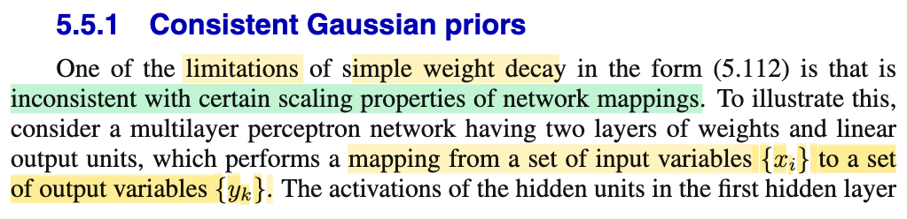
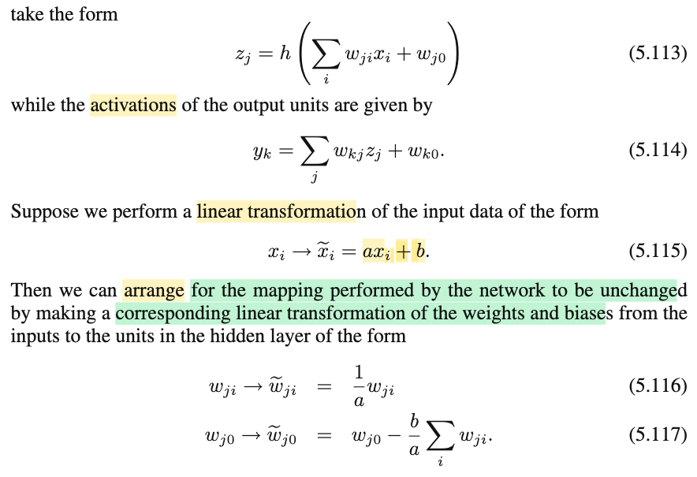
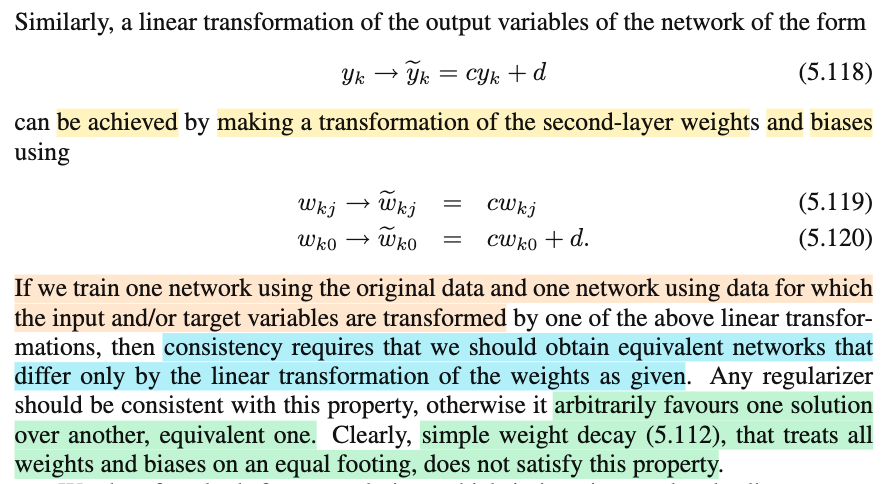

# 5.5.1 Consistent Gaussian priors

📊 **Progress:** `1` Notes | `3` Screenshots | `1` AI Reviews

---

 

## Consistent Gaussian Priors

<kbd></kbd>

<kbd></kbd>

<kbd></kbd>

> [!NOTE]
> Để dễ hiểu, tốt nhất là lấy ví dụ một neural net đơn giản:
>
> z = h(w⁽¹⁾x)
>
> y = w⁽²⁾z
>
> gỉa sử x là bề dài, y là giá nhà. Và neural net đã được train để đoán đúng:
>
> căn nhà 10 mét với giá 5 (tỷ): y = f(𝐰, 10) = w⁽²⁾ h(w⁽¹⁾ × 10) = 5
>
> giả sử chiều dài nhà bây giờ là cm, x̃ = 100 x
>
> để mô hình có tính nhất quán, mô hình sẽ điều chỉnh giá trị của 𝐰 sao cho
>
> w̃⁽²⁾ h(w̃⁽¹⁾x̃ ) = y
>
> ⇔ w̃⁽²⁾ h(w̃⁽¹⁾100x) = y
>
> ⇔ w̃⁽²⁾ h(w̃⁽¹⁾100x) = y
>
> để có tính nhất quán, hai biểu thức tính y theo x phải đồng nhất với nhau ∀x
>
> w̃⁽²⁾h(w̃⁽¹⁾100x) = w⁽²⁾ h(w⁽¹⁾x) ∀x
>
> Điều này xảy ra khi w̃⁽¹⁾100x = w⁽¹⁾x và w̃⁽²⁾ = w⁽²⁾
>
> ⇔ w̃⁽¹⁾ = w⁽¹⁾/100 và w̃⁽²⁾ = w⁽²⁾
>
> ---
>
> Vấn đề là, nếu có regularizer:
>
> Reg loss cũ: (λ/2)[(w⁽¹⁾)² + (w⁽²⁾)²]
>
> Reg loss mới: (λ/2)[(w⁽¹⁾/100)² + (w⁽²⁾)²]
>
> điều này sẽ khiến reg loss chỉ hầu như còn là đóng góp của w⁽²⁾, khiến cho regularizer sẽ ưu tiên tập trung vào w⁽²⁾ và bỏ qủa w⁽¹⁾ từ đó sẽ ưu tiên 𝐰 mà w⁽²⁾ nhỏ. 
>
> Từ đó, nó sẽ không scale w như trên để network có tính consistent 
>
> Đây là ý arbitrarily favours one solution over another solution 
>
> ---
>
> Khái quát lên
>
> Nếu ta có mạng với hàm số:
>
> zj = h(Σi wjixi + wj0)
>
> yk = Σj wkjzj + wk0
>
> và ta biến đổi tuyến tính x: x̃ i = axi + b
>
> yk = Σj wkj h(Σi w̃jix̃i + w̃j0) + wk0
>
> Để Σi w̃jix̃i + w̃j0 = Σi wjixi + wj0
>
> ⇔ Σi w̃ji(axi + b) + w̃j0 = Σi wjixi + wj0
>
> ⇔ Σi (aw̃jixi + w̃jib) + w̃j0 = Σi wjixi + wj0
>
> ⇔ Σi aw̃jixi + Σiw̃jib + w̃j0 = Σi wjixi + wj0
>
> aw̃jixi = wjixi ⇔ w̃ji = wji/a
>
> Σiw̃jib + w̃j0 = wj0 ⇔ w̃j0 = wj0 - Σiw̃jib = wj0 - Σi(wji/a)b = wj0 - (b/a) Σi wji
>
> ---
>
> Tương tự, nếu biến đổi tuyến tính yk thành ỹk = cyk + d thì w sau cũng phải thay đổi
>
> ỹk = Σj w̃ kj zj + w̃k0
>
> ⇔ cyk + d = Σj w̃ kj zj + w̃k0
>
> ⇔ yk = Σj w̃ kj zj/c + w̃k0/c - d/c
>
> để w̃ kj/c = wkj ⇔ w̃ kj = c wkj
>
> w̃k0/c - d/c = wk0 ⇔ w̃k0 - d = cwk0 ⇔ w̃k0 = cwk0 + d
>
> ---
>
> --

📹 [Xem video trên YouTube](https://www.youtube.com/watch?v=W_XXQCusF6Q)

> [!TIP]
> 🤖 **AI Check** — 🟢 Pass — ✅ **95/100** · ✓ Move on
>
> Ghi chú rất xuất sắc, bạn đã lấy một ví dụ số cụ thể trực quan để làm rõ bản chất của việc phá vỡ tính nhất quán khi scale dữ liệu, đồng thời chứng minh chi tiết và chính xác các công thức biến đổi trọng số trong giáo trình.
>
> **✓ Strengths**
> - Ví dụ cụ thể về giá nhà và chiều dài giúp làm nổi bật trực giác vì sao simple weight decay lại thiên vị nghiệm một cách tùy tiện (arbitrarily favors one solution).
> - Các bước biến đổi đại số để tìm w̃_ji, w̃_j0, w̃_kj, w̃_k0 hoàn toàn chính xác và bám sát các công thức (5.116) đến (5.120) trong giáo trình.
>
> **💡 Deeper notes**
> - Khi cân bằng hai vế Σ aw̃_ji x_i + (Σ w̃_ji b + w̃_j0) = Σ w_ji x_i + w_j0, về mặt toán học đây là đồng nhất thức phải đúng với mọi vector đầu vào x, do đó ta đồng nhất hệ số của x_i và hệ số tự do.
> - Trong thực tế, weight decay thường chỉ áp dụng cho weights mà bỏ qua biases (hoặc dùng hệ số suy giảm riêng), một phần cũng chính vì sự biến đổi phức tạp của bias w̃_j0 = w_j0 - (b/a)Σ w_ji khi input bị dịch chuyển (shift).

 

