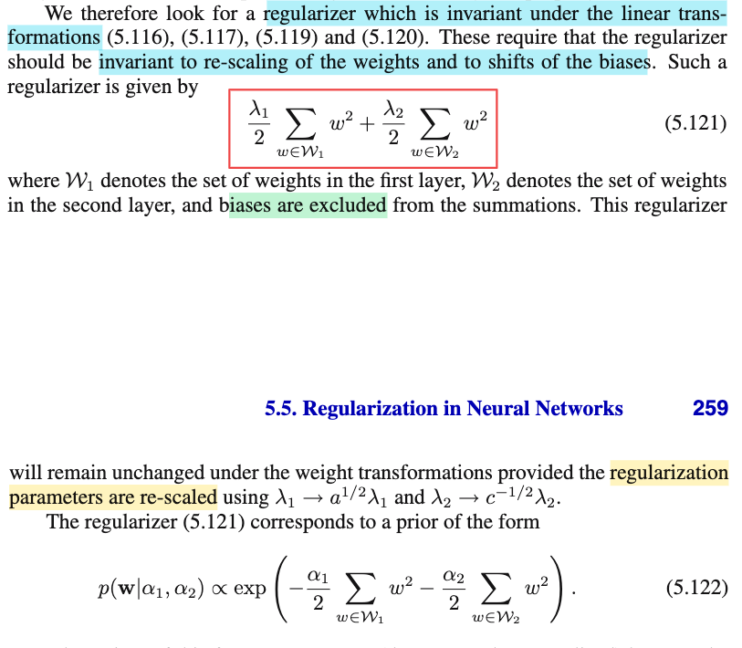
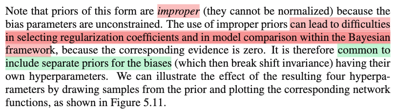
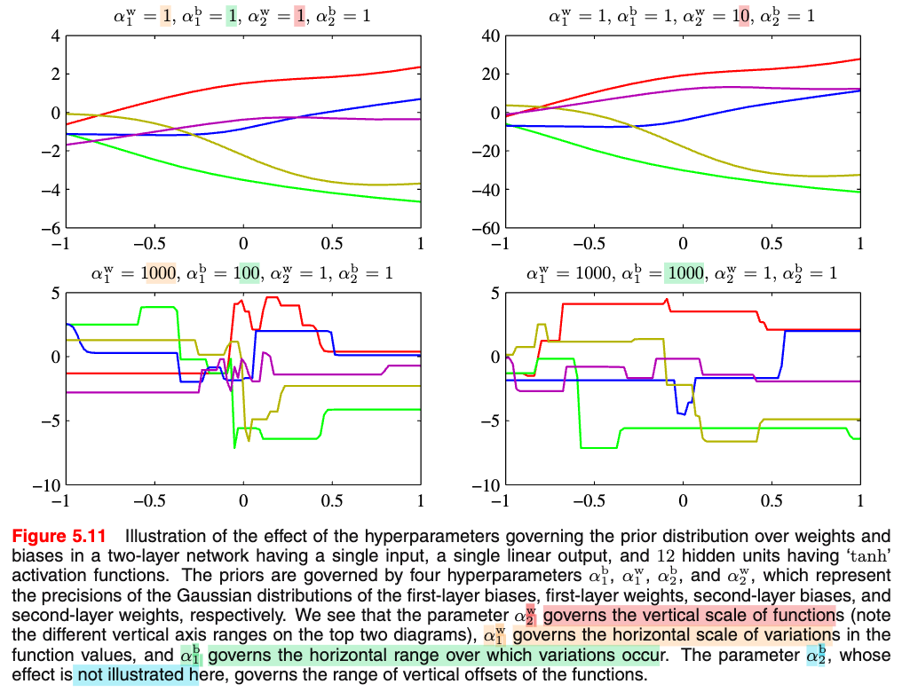
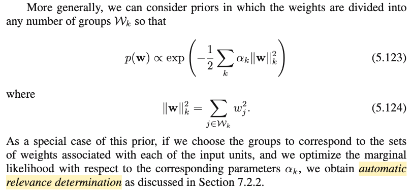

# 5.5.1 Consistent Gaussian priors

📊 **Progress:** `3` Notes | `7` Screenshots | `3` AI Reviews

---

 

## Consistent Gaussian Priors

<kbd></kbd>

<kbd></kbd>

<kbd></kbd>

> [!NOTE]
> Để dễ hiểu, tốt nhất là lấy ví dụ một neural net đơn giản:
>
> z = h(w⁽¹⁾x)
>
> y = w⁽²⁾z
>
> gỉa sử x là bề dài, y là giá nhà. Và neural net đã được train để đoán đúng:
>
> căn nhà 10 mét với giá 5 (tỷ): y = f(𝐰, 10) = w⁽²⁾ h(w⁽¹⁾ × 10) = 5
>
> giả sử chiều dài nhà bây giờ là cm, x̃ = 100 x
>
> để mô hình có tính nhất quán, mô hình sẽ điều chỉnh giá trị của 𝐰 sao cho
>
> w̃⁽²⁾ h(w̃⁽¹⁾x̃ ) = y
>
> ⇔ w̃⁽²⁾ h(w̃⁽¹⁾100x) = y
>
> ⇔ w̃⁽²⁾ h(w̃⁽¹⁾100x) = y
>
> để có tính nhất quán, hai biểu thức tính y theo x phải đồng nhất với nhau ∀x
>
> w̃⁽²⁾h(w̃⁽¹⁾100x) = w⁽²⁾ h(w⁽¹⁾x) ∀x
>
> Điều này xảy ra khi w̃⁽¹⁾100x = w⁽¹⁾x và w̃⁽²⁾ = w⁽²⁾
>
> ⇔ w̃⁽¹⁾ = w⁽¹⁾/100 và w̃⁽²⁾ = w⁽²⁾
>
> ---
>
> Vấn đề là, nếu có regularizer:
>
> Reg loss cũ: (λ/2)\[(w⁽¹⁾)² + (w⁽²⁾)²\]
>
> Reg loss mới: (λ/2)\[(w⁽¹⁾/100)² + (w⁽²⁾)²\]
>
> điều này sẽ khiến reg loss chỉ hầu như còn là đóng góp của w⁽²⁾, khiến cho regularizer sẽ ưu tiên tập trung vào w⁽²⁾ và bỏ qủa w⁽¹⁾ từ đó sẽ ưu tiên 𝐰 mà w⁽²⁾ nhỏ.
>
> Từ đó, nó sẽ không scale w như trên để network có tính consistent
>
> Đây là ý arbitrarily favours one solution over another solution
>
> ---
>
> Khái quát:
>
>
>
> Nếu ta có mạng:
>
>
>
> zj = h(Σi wjixi + wj0)
>
>
>
> yk = Σj wkjzj + wk0 
>
>
>
> yk = Σj wkj h(Σi wjixi + wj0) + wk0
>
>
>
> x1 → y1
>
>
>
> x2 → y2
>
>
>
> và ta biến đổi tuyến tính x, y:
>
>
>
> x̃ i = axi + b
>
>
>
> ỹk = cyk + d
>
>
>
> ỹk = Σj w̃ kj h(Σi w̃ ji x̃i + w̃ j0) + w̃ k0 (1)
>
>
>
> để giữ nguyên hàm mapping thì network với tham số w̃ phải map x với y với mọi cặp vector x,y:
>
>
>
> (1) ⇔ cyk + d = Σj w̃ kj h(Σi w̃ ji (axi + b) + w̃ j0) + w̃ k0
>
>
>
> ⇔ cyk = Σj w̃ kj h(Σi w̃ ji (axi + b) + w̃ j0) + w̃ k0 - d
>
>
>
> ⇔ yk = Σj (w̃ kj/c) h(Σi w̃ ji (axi + b) + w̃ j0) + w̃ k0/c - d/c
>
>
>
> ⇔ yk = Σj (w̃ kj/c) h(Σi (w̃ ji axi + w̃ ji b) + w̃ j0) + w̃ k0/c - d/c
>
>
>
> ⇔ y1k = Σj (w̃ kj/c) h(Σi a w̃ ji x1i + Σi w̃ ji b + w̃ j0) + w̃ k0/c - d/c
>
>
>
> y1k = Σj wkj h(Σi wjix1i + wj0) + wk0
>
>
>
> để đạt (2) ta phải có:
>
>
>
> ⇔ Σj (w̃ kj/c) h(Σi a w̃ ji xi + Σi b w̃ ji + w̃ j0) + w̃ k0/c - d/c
>
>
>
> = Σj wkj h(Σi wjixi + wj0) + wk0 **với mọi x**
>
>
>
> Điều này tương đương:
>
>
>
> Σi a w̃ ji xi + Σi b w̃ ji + w̃ j0 = Σi wji xi + wj0
>
>
>
> (w̃ kj/c) = wkj
>
>
>
> w̃ k0/c - d/c = wk0
>
>
>
> ⇔
>
>
>
> a w̃ ji = wji ⇔ w̃ ji = wji/a → 5.116
>
>
>
> Σi b w̃ ji + w̃ j0 = wj0 ⇔ w̃ j0 = wj0 - Σi b w̃ ji = wj0 - Σi b wji/a = wj0 - (b/a) Σi wji → 5.117
>
>
>
> w̃ kj = c wkj → 5.119
>
>
>
> w̃ k0/c - d/c = wk0 ⇔ w̃ k0 = c wk0 + d → 5.120
>
>
>
> ---
>
>
>
> Vậy có nghĩa là sao?
>
>
>
> Là để mạng vẫn biểu diễn cùng một mapping, weight của layer 1 phải scale nhỏ lại a lần (ví dụ a,b,c,d đều là số &gt; 1 ví dụ 2,3,4,5)
>
>
>
> weight của layer 2 phải scale to lên c lần
>
>
>
> bias của layer 1 phải shift một khoảng: -(b/a) Σi wji
>
>
>
> bias của layer 2 được scale bởi c và shift một khoảng d: + c wk0 + d
>
>
>
> Nếu chỉ có main loss SSE, mạng sẽ điều chỉnh đúng như vậy để giữ main loss ko đổi.
>
>
>
> Nhưng nếu có L2 regularizer: (λ/2) Σ w² thì việc điều chỉnh như vậy sẽ khiến L2 regularization loss bị hiện tượng như trong ví dụ cụ thể ở trên đã thấy: đóng góp của một loại nào đó sẽ có thể bị trở nên quá nhỏ so với loại còn lại. Khiến cho hiệu ứng của regularization sẽ thiên vị một loại này hơn loại kia, ví dụ chỉ ưu tiên khống chế weight của layer này mà bỏ mặc layer kia tạo nên cái gọi là "favor solution này hơn solution khác một cách tùy tiện"

📹 Video 1: [Vì sao weight decay không nhất quán khi co giãn đầu vào? (phần 1)](https://www.youtube.com/watch?v=W_XXQCusF6Q)

📹 Video 2: [Trọng số phải biến đổi thế nào khi co giãn đầu vào? (phần 2)](https://www.youtube.com/watch?v=Sgg5UMQVzsI)

> [!TIP]
> 🤖 **AI Check** — 🟢 Pass — ✅ **100/100** · ✓ Move on
>
> Ghi chú xuất sắc! Bạn đã tự diễn giải trực quan bằng ví dụ thực tế và biến đổi đại số đầy đủ, chính xác từng bước cho các công thức (5.116) - (5.120), đồng thời nắm rất vững bản chất vì sao regularizer L2 thông thường lại phá vỡ tính nhất quán này.
>
> **✓ Strengths**
> - Dùng ví dụ cụ thể (đổi đơn vị mét sang cm) giúp hình dung trực quan bản chất của việc scale trọng số giữa các tầng.
> - Tự triển khai phép biến đổi đại số đầy đủ và chính xác từ định nghĩa hàm ánh xạ tới các công thức (5.116) đến (5.120) trong sách.
> - Hiểu rất rõ và giải thích chuẩn xác lý do weight decay truyền thống (với một hệ số λ chung) làm lệch mục tiêu tối ưu khi quy mô dữ liệu thay đổi.
>
> **💡 Deeper notes**
> - Trong thực tế, người ta thường không áp dụng weight decay lên các tham số bias (w_0) vì bias chỉ dịch chuyển vị trí mà không ảnh hưởng trực tiếp đến độ mượt của hàm số, tuy nhiên ngay cả với riêng các ma trận trọng số w, việc dùng chung một hệ số λ giữa các tầng khác nhau vẫn vi phạm tính nhất quán này.

 

### Section 5.5 Regularization in Neural Networks

<kbd></kbd>

> [!NOTE]
> Đại ý là với mong muốn có một regularizer "tốt hơn" khắc phục vấn đề này, một giải pháp là:
>
>
>
> (λ/2) Σ w²
>
>
>
> (λ1/2) Σ\_w∈𝒲1 w² + (λ2/2) Σ\_w∈𝒲2 w²
>
>
>
> tức là: dùng λ khác nhau cho hai layer và không đưa vào bias.
>
>
>
> Vì sao nó tốt hơn?
>
>
>
> Ví dụ:
>
>
>
> Reg loss cũ: (λ1/2) Σ\_w∈𝒲1 w² + (λ2/2) Σ\_w∈𝒲2 w²
>
>
>
> Reg loss mới: (λ1/2) Σ\_w∈𝒲1 (w/a)² + (λ2/2) Σ\_w∈𝒲2 (cw)²
>
>
>
> = (λ1/2a²) Σ\_w∈𝒲1 w² + (c²λ2/2) Σ\_w∈𝒲2 w²
>
>
>
> Như vậy, để trọng số cứ việc scale lên/xuống như mong muốn mà reg loss như cũ chỉ cần thay λ1 bằng λ1 × a² và λ2 thay bằng λ2/c²
>
>
>
> (hình như trong sách in sai)
>
>
>
> Còn bias cũng được điều chỉnh như mong muốn (vì nó ko bị regularizer khống chế)
>
>
>
> ---
>
>
>
> Và đại khái regularizer này tương ứng với việc dùng prior distribution của 𝐰 là:
>
>
>
> p(𝐰|α1,α2) ∝ exp(-(α1/2) Σ\_w∈𝒲1 w² - (α2/2) Σ\_w∈𝒲2 w²) (tìm hiểu sau)

📹 [Xem video trên YouTube](https://www.youtube.com/watch?v=1F3wizYVnQo)

> [!TIP]
> 🤖 **AI Check** — 🟢 Pass — ✅ **100/100** · ✓ Move on
>
> Ghi chú rất xuất sắc, bạn không những nắm đúng bản chất về việc chia regularization parameter riêng cho từng layer và bỏ qua bias, mà còn rất sắc bén khi phát hiện ra lỗi in ấn chính thức trong sách của Bishop.
>
> **✓ Strengths**
> - Hiểu chính xác nguyên lý: không phạt bias và cần dùng các hệ số phạt khác nhau (λ1, λ2) cho từng layer để bảo toàn tính bất biến đối với biến đổi tuyến tính của input/output.
> - Biến đổi đại số chính xác và phát hiện đúng lỗi in sai của sách PRML (trong bản gốc sách in nhầm lũy thừa 1/2 và -1/2 thay vì 2 và -2, đã được xác nhận trong errata chính thức của Bishop).
>
> **💡 Deeper notes**
> - Về mặt ý nghĩa đầy đủ: việc regularizer bất biến (sau khi scale λ tương ứng) nhằm đảm bảo nghiệm tối ưu của toàn bộ hàm mục tiêu (Data Loss + Reg Loss) cho ra các dự đoán mạng nơ-ron hoàn toàn đồng nhất khi dữ liệu đầu vào hoặc đầu ra bị biến đổi affine.

 

#### Improper Priors on Bias Parameters

<kbd></kbd>

<kbd></kbd>

<kbd></kbd>

> [!NOTE]
> Cuối cùng đại ý là, cách làm này sẽ gây vấn đề khi ta làm công tác model comparision với Bayesian framework.
>
>
>
> Cụ thể là phân phối tiên nghiệm của bias sẽ trở thành improper. Khiến mọi thứ không đúng nữa.
>
>
>
> Là sao?
>
>
>
> Đầu tiên hãy nhớ lại, với Bayesian, ta sẽ coi 𝐰 (bao gồm mọi weight bias) là random variable hết. 
>
>
>
> Để rồi ta chọn prior distribution của 𝐰: f(𝐰) hay p(𝐰|α). Ví dụ, chọn 𝒩(𝟎, (1/α)𝐈)
>
>
>
> posterior distribution của 𝐰: p(𝐰|𝐭) ∝ p(𝐭|𝐰)p(𝐰|α)
>
>
>
> t1,t2,...d

> [!TIP]
> 🤖 **AI Check** — 🟡 Minor issues — ⚠️ **80/100** · ✓ Move on
>
> Ghi chú nắm đúng một hệ quả quan trọng là việc dùng improper priors gây khó khăn cho model comparison trong Bayesian framework. Tuy nhiên, bạn nên ghi rõ tên phương pháp ('dùng improper priors') và lý do cốt lõi (evidence bằng 0) để ghi chú hoàn thiện hơn.
>
> **🟡 Minor issues**
>
> **1.** *"cách làm này"*
>
> Cách diễn đạt còn mơ hồ. Cần làm rõ 'cách làm này' chính là việc sử dụng tiền nghiệm không chuẩn hóa được (improper priors) do để ngỏ các tham số bias không ràng buộc.
>
>
> **✓ Strengths**
> - Nắm bắt chính xác kết luận về sự bất lợi của improper priors đối với bài toán so sánh mô hình (model comparison) trong Bayesian framework.
>
> **💡 Deeper notes**
> - Nguyên nhân trực tiếp khiến việc so sánh mô hình và chọn hệ số điều chuẩn gặp khó khăn là do đại lượng evidence (marginal likelihood) tương ứng bị triệt tiêu bằng 0 khi sử dụng improper prior.
> - Để khắc phục, trong thực tế người ta thường đặt prior riêng cho các bias đi kèm siêu tham số độc lập, chấp nhận đánh đổi tính bất biến tịnh tiến (shift invariance).

 

