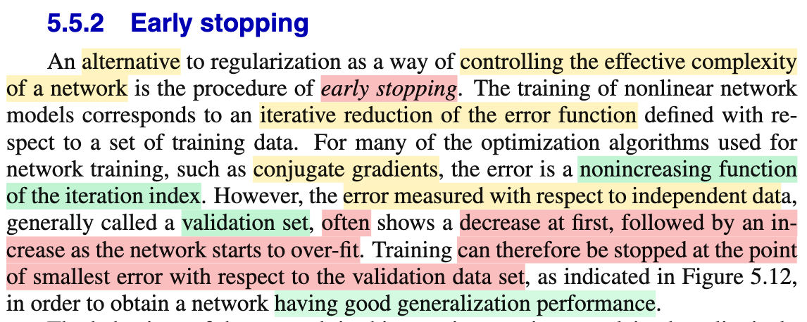
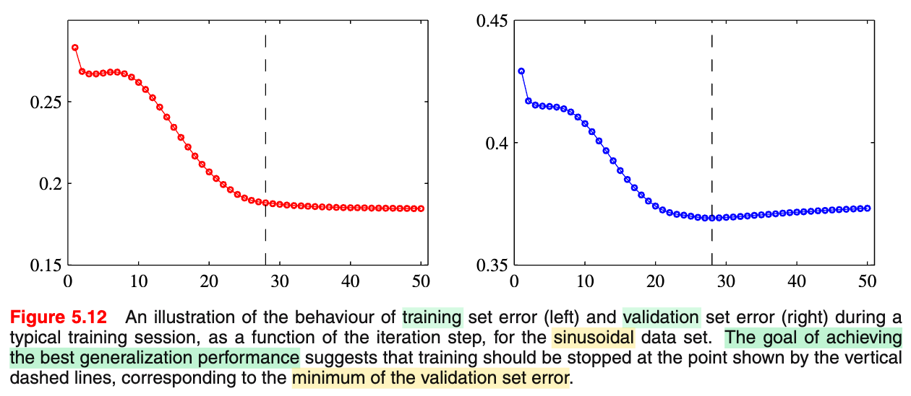
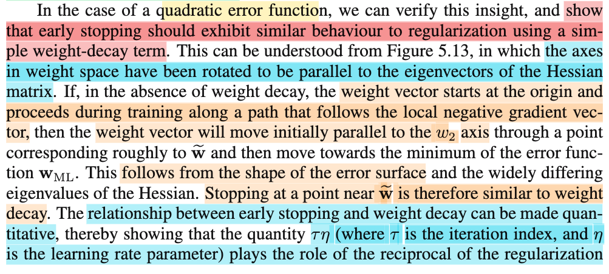
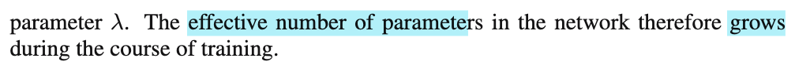
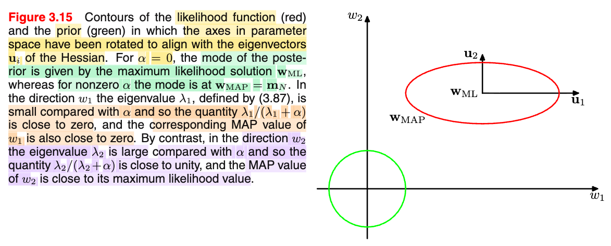
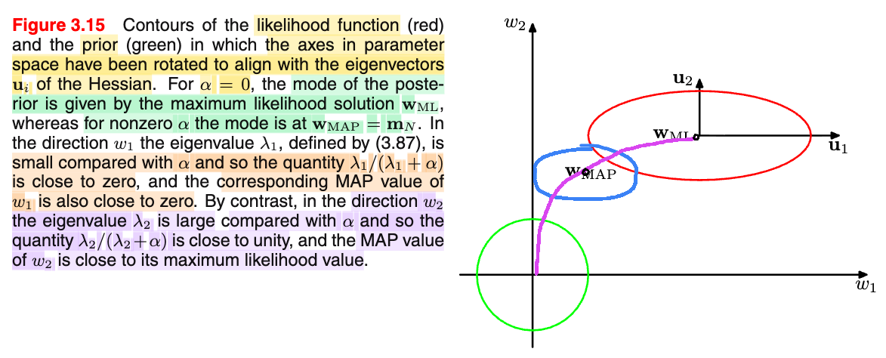
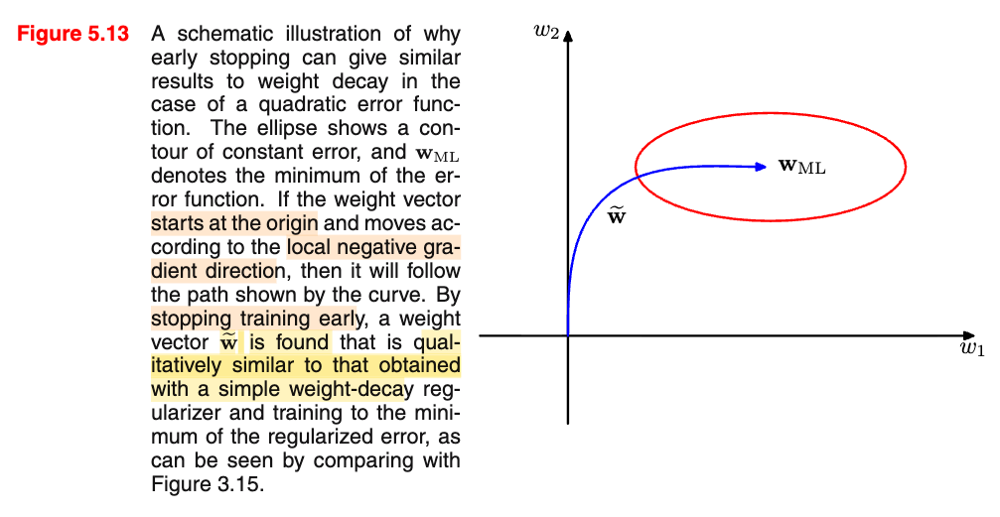

# 5.5.2 Early stopping

📊 **Progress:** `2` Notes | `7` Screenshots | `2` AI Reviews

---

 

## 5.5.2 Early Stopping

<kbd></kbd>

<kbd></kbd>

> [!NOTE]
> Đại khái là một cách khác so với regularization trong mục đích kiểm soát mức độ phức tạp hiệu qủa của network đó là "early stopping"
>
>
>
> Nếu mình xét hàm số "số iteration - training error" thì thường nó sẽ là hàm non-increasing: càng train lâu thì training error càng giảm.
>
>
>
> nhưng nếu xét hàm số "số iteration - validation error" thì nó sẽ không vậy, mà sẽ giảm lúc đầu và tăng lúc sau khi bắt đầu overfit. Đây là đường chữ U nổi tiếng.
>
>
>
> Thành ra với cách làm này, ta sẽ dừng khi validation error thấp nhất. Nhờ đó, có được khả năng generalization.
>
>
>
> (Đã biết mục tiêu của machine learning là có khả năng generalization: mô hình phải dự đoán đúng với data mới, chứ ko phải chỉ training data. Và do đó ta sẽ tách riêng 1 data set gọi là validation set, để kiểm tra sau khi train với training set)

> [!TIP]
> 🤖 **AI Check** — 🟢 Pass — ✅ **95/100** · ✓ Move on
>
> Ghi chú nắm rất chính xác và đầy đủ bản chất của early stopping như một giải pháp thay thế regularization để kiểm soát độ phức tạp mô hình.
>
> **✓ Strengths**
> - Hiểu đúng bản chất của early stopping là một kỹ thuật thay thế regularization nhằm kiểm soát độ phức tạp hiệu dụng (effective complexity) của mạng.
> - Nắm rõ hành vi đối lập giữa training error (hàm không tăng theo số vòng lặp với các thuật toán tối ưu chuẩn) và validation error (giảm rồi tăng lại do overfitting).
> - Xác định chính xác thời điểm dừng tối ưu là tại điểm validation error đạt cực tiểu để đạt năng lực tổng quát hóa (generalization) tốt nhất.
>
> **💡 Deeper notes**
> - Tính chất 'non-increasing' (không tăng) của training error thường được đảm bảo chặt chẽ với các thuật toán tối ưu hóa theo batch (như conjugate gradients hoặc gradient descent có line search); trong thực tế khi dùng Mini-batch SGD, đường training loss có thể dao động (noisy) chứ không hoàn toàn đơn điệu.
> - Trong thực nghiệm thực tế, validation loss thường có nhiều điểm gợn sóng (local fluctuations) trước khi tăng hẳn, nên người ta thường đặt thêm tham số 'patience' (chờ thêm k epoch) thay vì dừng ngay khi vừa thấy loss tăng nhẹ.

 

### Early Stopping and Weight Decay

<kbd></kbd>

<kbd></kbd>

<kbd></kbd>

<kbd></kbd>

<kbd></kbd>

> [!NOTE]
> Ý sau mới hay: tác giả cho ta thấy một góc nhìn sẽ cho thấy early stopping có một hiệu qủa tương tự với regularization dùng weight-decay term (add thêm cái L2 regularizer vào obective):
>
>
>
> Đại khái là dùng một hàm loss bậc hai của tham số: ví dụ chính là SSE đó, khi đó các level curve tạo thành các đường ellipse. Và giả sử đã đổi biến để xoay hệ trục sao cho dùng hệ trục các eigenvector của matrix Hessian, nên trong hệ trục đó các đường ellipse có trục song song với trục tọa độ.
>
>
>
> Ta sẽ thấy thế này, nếu không có L2 regularizer, việc training, mà như đã biết chính là tìm 𝐰 maximize likelihood và cũng là minimize hàm SSE sẽ kiểu như ta sẽ bắt đầu tại 𝐰 giả sử initialize = 𝟎 để rồi trượt dần về đáy khối chảo paraboloid. Giả sử dùng steepest descent algorithm thì mỗi bước di chuển ta sẽ đi theo hướng dốc nhất = vuông góc với các level curve và tiến về đáy chảo (tâm ellipse). Tại đó 𝐰ML, chính là nơi có MLE của 𝐰, 𝐰ML: là ước lượng 𝐰 hợp lí nhất dựa trên dữ liệu quan sát.
>
>
>
> Nhưng nếu có regularizer: (λ/2) 𝐰ᵀ𝐰, nó sẽ khống chế độ lớn của 𝐰 khiến 𝐰 mininimize regularized loss sẽ nằm đâu đó giữa 𝟎 và 𝐰ML
>
>
>
> Nếu nhìn theo cách tiếp cận Bayesian, nơi ta coi 𝐰 là random variable (vector). và chọn prior distribution là 𝐰 \~ 𝒩(0, (1/α) 𝐈) từ đó dùng Bayesian để xây dựng posterior distribution p(𝐰|𝒟). Rồi đi tìm 𝐰 để có p(𝐰|𝒟) lớn nhất: 𝐰MAP thì nó cũng chính là bài toán maximize log likelihood có regularizer. Nên cũng chính là 𝐰MAP, và vị trí của nó nằm đó mang ý nghĩa: vì có niềm tin tiên nghiệm rằng 𝐰 chỉ nhỏ loanh quanh 𝟎 nên dù có bắt được dữ liệu khiến kéo 𝐰 về 𝐰ML, thì niềm tin ban đầu vẫn sẽ chi phối để kéo 𝐰 lại, nên 𝐰MAP chỉ đâu đó từ 𝟎 tới 𝐰ML mà thôi.
>
>
>
> Và chính vì lẽ đó, động tác "dừng sớm" khi traing với objective là SSE sẽ có thể thấy giống giống như việc ta dùng prior knowledge để kéo 𝐰 lại không cho nó tới được 𝐰ML, mà 𝐰ML chính là cái gây ra overfit.
>
>
>
> ---
>
>
>
> Vì sao nói sự chênh lệch của eigenvalue của Hessian tạo ra bề mặt của error khiến 𝐰 sẽ ban đầu đi gần như song song với trục w2 và sau đó mới hướng về 𝐰ML?
>
>
>
> Ý này đã được giải thích rõ ở ghi chú 3.5.3 (xem link): Trong ghi chú đó, ta xét hàm log likelihood, sau khi đổi hệ trục tọa độ về 𝐰ML: để có Hessian tại 𝐰ML là:
>
>
>
> (1/2)𝐰'ᵀ(-β𝚽ᵀ𝚽)𝐰' + c4
>
>
>
> Và đổi hệ trục sang basis 𝐮's bằng: 𝐲 = 𝐐ᵀ𝐰': f(𝐲) = (-β/2)𝐲ᵀ𝚲𝐲 + c4
>
>
>
> matrix Hessian tại 𝐲ML là -β𝚲, trị riêng là -βλ1, -βλ2 (λ1, λ2 là trị riêng của 𝚽ᵀ𝚽)
>
>
>
> và độ cong theo phương 𝐮1, 𝐮2 sẽ là đạo hàm riêng bậc hai:
>
>
>
> ∂f/∂y1 = -βλ1y1 và ∂²f/∂y1² = -βλ1 và 
>
>
>
> ∂f/∂y2 = -βλ2y2 và ∂²f/∂y2² = -βλ2
>
>
>
> Vậy nên, trong hai trị riêng λ1, λ2. Cái nào lớn hơn thì độ cong theo phương tương ứng lớn hơn. Khiến bề mặt hàm log likelihood và (cũng sẽ kéo theo bề mặt hàm likelihood) sẽ càng dốc theo phương đó, khiến đường đồng mức ellipse sẽ bị bóp lại theo phương đó nhiều hơn.
>
>
>
> Ở đây ta giả sử λ1 ≪ λ2, nên ta có cái hình như vậy. 
>
>
>
> Và hình dung là, đặc điểm này khiến từ 𝟎, nếu trượt theo hướng dốc nhất, ta sẽ trượt nhanh theo hướng gần song song với 𝐮2 (vì độ dốc theo phương này cao hơn, ellipse bị bóp theo phương này nhiề hơn). 
>
>
>
> Sau đó, mới bắt đầu trượt theo phương song song với 𝐮1 để tiến về phí 𝐲ML (tọa độ của 𝐰ML trong hệ trục gốc 𝟎, basis 𝐮's)
>
>
>
> Để rồi, nếu có L2 regularizer, giải thích theo góc nhìn Bayesian, là ta có prior distribution của 𝐰, mang theo niềm tin ban đầu là 𝐰 nhỏ loanh quanh 𝟎, từ đó việc training objective gồm main loss và regularizer giống như có một lực kéo ép 𝐰 phải ≈ 𝟎. Lực kéo này theo hai phương đều bằng nhau, nên ở phương 𝐮2, nơi độ dốc cao, nó không ảnh hưởng bằng theo phương 𝐮1. Từ đó:
>
>
>
> 𝐲MAP sẽ nằm là điểm cân bằng giữa hai thế lực này: theo 𝐮2, vì độ dốc mạnh, nên "tạo gọi là likelihood thắng" khiến 𝐲MAP_2 sẽ lớn. còn theo 𝐮1, vì độ dốc yếu, nên "prior thắng", khiến yMAP_1 nhỏ ≈ 0.
>
>
>
> Như vậy, có thể hiểu là khi có L2 reg, hàm mục tiêu log likelihood + regularizer trở thành cái bát bậc hai có đáy tại 𝐲MAP, và contour cũng là ellipse có tâm tại 𝐲MAP. để rồi thuật toán train hàm này sẽ hội tụ về 𝐲MAP.
>
>
>
> Thế thì kết quả này sẽ rất giống quá trìng training với main loss (ko có regularizer) + early stopping: vì lúc đầu 𝐰 cũng sẽ trượt nhanh theo hướng song song 𝐮2 sau đó mới quẹo qua và trượt về 𝐲ML theo 𝐮1. Để rồi nếu ta early stopping, kết quả sẽ cũng là ỹ (tọa độ của 𝐰̃ trong cơ sở) có ỹ1 nhỏ và ỹ2 lớn hơn cũng sẽ chính là gần với 𝐲MAP.
>
>
>
> Và do đó, τη, với τ là iteration index, thì τ càng lớn thì sẽ tương đương ta có λ nhỏ (vì τ lớn có nghĩa là training lâu, sẽ tương đương việc ta giảm λ của regularizer)
>
>
>
> Cũng hiểu ý cuối, rằng khi train lâu, thì tọa độ của 𝐲 sẽ đều lớn, nên số param hiệu dụng sẽ tăng.
>
>
>
> (nhắc lại, 𝐲 ở đây là tọa độ của 𝐰 trong không gian hệ trục gốc 𝟎, basis 𝐮i's
>
>
>
> 𝐲ML là \[𝐰ML\]\_u)

> [!TIP]
> 🤖 **AI Check** — 🟢 Pass — ✅ **95/100** · ✓ Move on
>
> Ghi chú xuất sắc! Bạn đã hiểu rất sâu sắc và trực quan bản chất hình học đằng sau mối liên hệ giữa Early Stopping và L2 Regularization (Weight Decay/MAP) qua phân tích trị riêng của Hessian.
>
> **✓ Strengths**
> - Giải thích trực quan và chính xác vì sao hướng có trị riêng lớn (độ cong lớn, ellipse bị nén mạnh) lại được gradient descent cập nhật nhanh trước, khiến quỹ đạo ban đầu chạy gần song song với trục w2.
> - Kết nối rất mượt mà giữa góc nhìn tối ưu hóa (Early Stopping) với góc nhìn Bayes (MAP / Prior kéo về 0) từ Hình 3.15.
> - Nắm chuẩn hệ thức đối ngẫu giữa thời gian huấn luyện và độ mạnh của regularization: τη tương đương với 1/λ.
>
> **💡 Deeper notes**
> - Cần lưu ý phân biệt ký hiệu trong giáo trình Bishop: ký hiệu λ vừa được dùng cho trị riêng của Hessian (λ_i trong chương 3 và 5) vừa được dùng làm hệ số phạt L2 (weight decay parameter λ trong chương 5, vốn tương đương với α trong mô hình Bayes).
> - Về mặt thuật ngữ giải tích: gradient descent di chuyển theo hướng dốc nhất cục bộ (-∇E), do đó thành phần gradient theo phương u2 ban đầu lớn gấp nhiều lần theo u1 (|∂E/∂w2| = λ2|w2 - wML,2| >> λ1|w1 - wML,1|), dẫn đến việc biến w2 hội tụ về lân cận wML,2 nhanh hơn nhiều so với w1.

**🔗 See also:** [Số lượng tham số hiệu dụng](./353_effective_number_of_parameters.md#node-jdgevif) · [Section 3.5.3 Effective Number of Parameters](./353_effective_number_of_parameters.md#node-2wanjgv)

 

