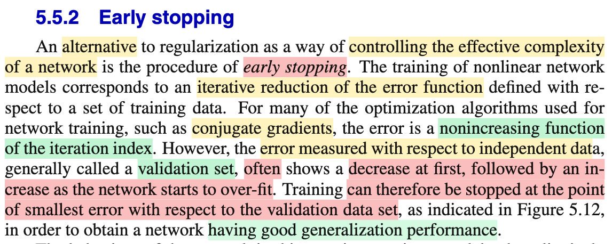
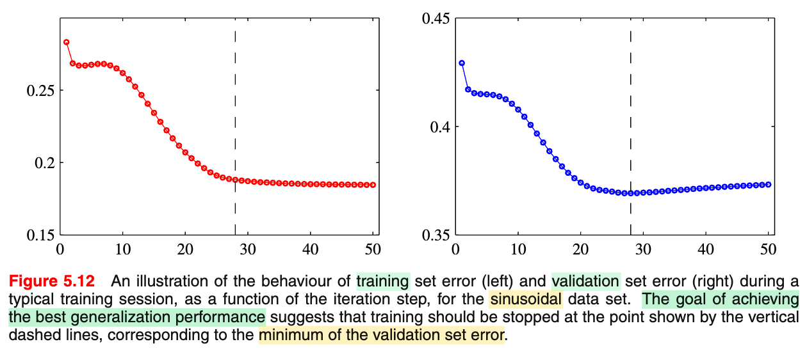
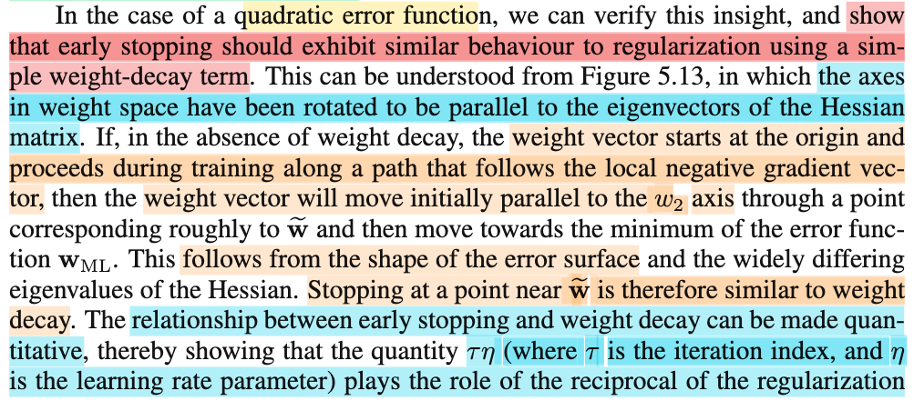
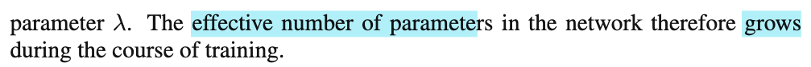
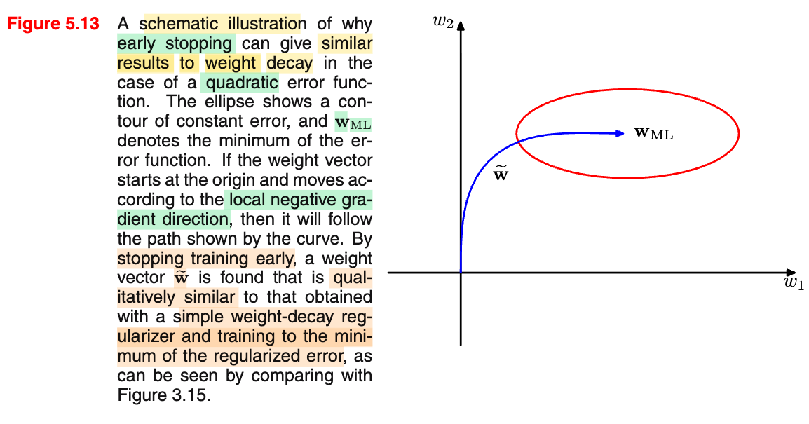
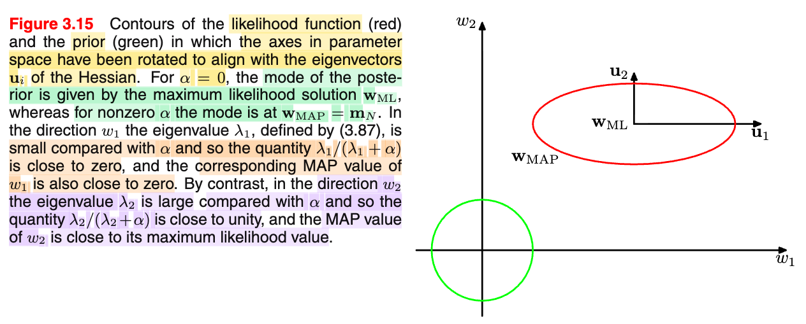

# 5.5.2 Early stopping

📊 **Progress:** `0` Notes | `6` Screenshots

---

 

## 5.5.2 Early Stopping

<kbd></kbd>

<kbd></kbd>

 

### Early Stopping and Weight Decay

<kbd></kbd>

<kbd></kbd>

<kbd></kbd>

<kbd></kbd>

 

