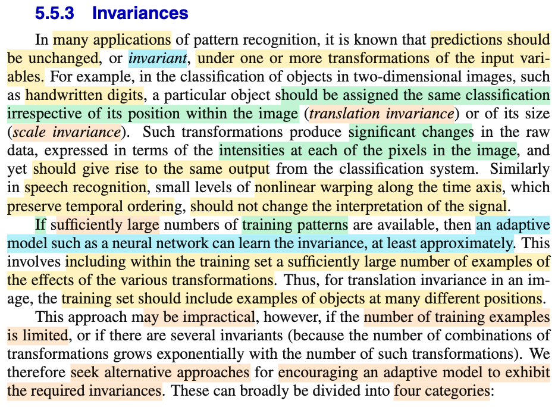
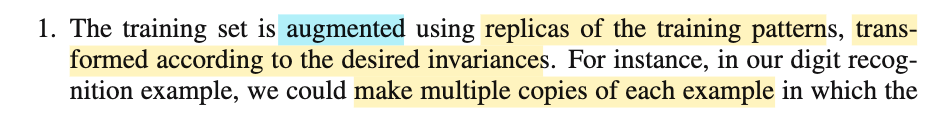
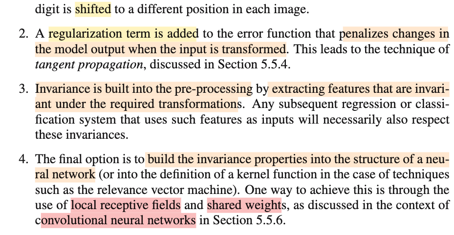
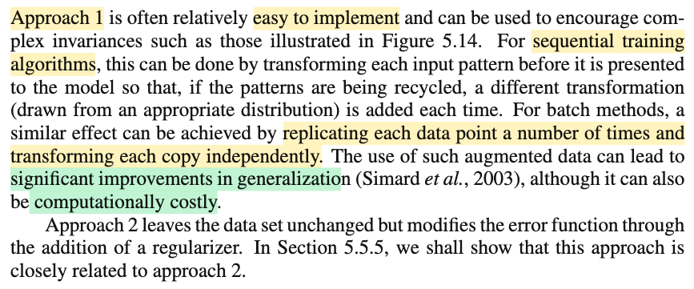
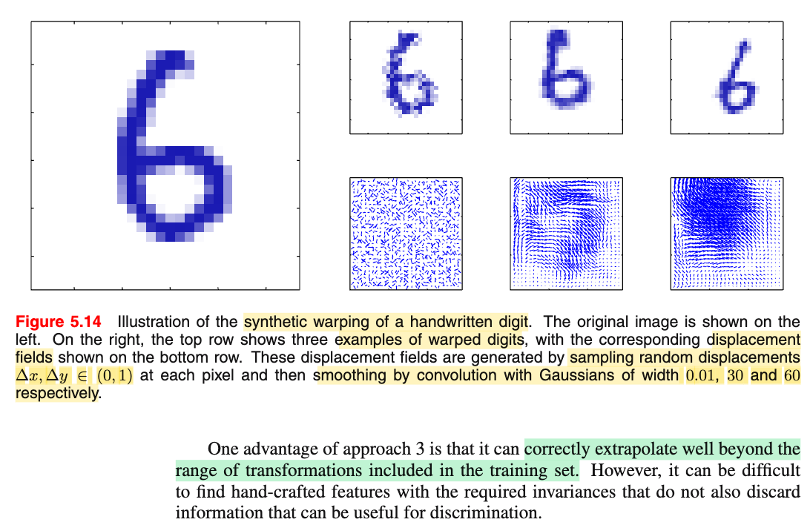

# 5.5.3 Invariances

📊 **Progress:** `3` Notes | `5` Screenshots | `3` AI Reviews

---

 

## Section 5.5.3 Invariances

<kbd></kbd>

> [!NOTE]
> Phần này ta sẽ được học về khái niệm Invariance (một cái đã từng được thấy trong cs231n), đại ý là thế này:
>
>
>
> Nói ngắn gọn thì, đây là một yêu cầu đặt ra với hệ thống nhận diện mẫu (pattern regconition): là khi input bị biến đổi (transform) theo cách thức nào đó, thì hệ thống vẫn nhận diện được.
>
>
>
> Ví dụ đối với hệ thống phân loại ảnh, nhận diện ảnh, lấy ví dụ phân loại ảnh chó mèo chẳng hạn. Thì khi con mèo nằm ở đâu trong bức hình hay cái hình to nhỏ thế nào thì hệ thống vẫn phải nhận diện đúng, đó chính là hệ thống có tính translation invariance và scale invariance
>
>
>
> Tương tự với lĩnh vực speech recognition cũng vậy.
>
>
>
> ---
>
>
>
> Ý tiếp theo đại khái là nếu có nhiều dữ liệu huấn luyện, ta có thể train network để nó học được khả năng này. Nói đơn giản là nếu trong training data có nhiều ảnh mèo với vị trí khác nhau, thì network sẽ học được để có được tính translation và scale invariance nói trên.
>
>
>
> Nhưng nếu không có nhiều data thì sao, hoặc số lượng cách biến đổi quá nhiều thì sao. Do đó ta cần có cách tiếp cận khác

> [!TIP]
> 🤖 **AI Check** — 🟢 Pass — ✅ **95/100** · ✓ Move on
>
> Ghi chú tóm tắt rất tốt và chính xác bản chất của khái niệm Invariance cùng lý do tại sao phương pháp dựa vào dữ liệu huấn luyện lớn không phải lúc nào cũng khả thi.
>
> **✓ Strengths**
> - Nắm bắt chính xác định nghĩa Invariance là đầu ra dự đoán không đổi khi đầu vào trải qua các phép biến đổi nhất định.
> - Lấy ví dụ trực quan, dễ hiểu về translation invariance và scale invariance trong thị giác máy tính.
> - Hiểu rõ hạn chế của việc dựa thuần túy vào lượng dữ liệu mẫu (bùng nổ số lượng tổ hợp biến đổi khi có nhiều biến đổi kết hợp).
>
> **💡 Deeper notes**
> - Sách gốc nhấn mạnh rằng việc học invariance thuần túy qua dữ liệu lớn chỉ giúp mô hình đạt được tính bất biến ở mức xấp xỉ ('at least approximately'), chứ không đảm bảo tính bất biến tuyệt đối về mặt cấu trúc toán học.

 

### Training Set Data Augmentation

<kbd></kbd>

<kbd></kbd>

> [!NOTE]
> Cách thứ nhất đại khái là lấy training data ra, dùng photoshop hay cái gì đó để chế một bức hình thành nhiều bức khác mà con mèo bị move tới nhiều vị trí khác nhau, nói cách khác, ta biến đổi nó theo nhiều cách để "một cách nhân tạo" ta tạo ra một dataset lớn hơn, chứa nhiều dạng transformation mà ta muốn hệ thống có được tính bất biết đối với dạng transformation đó.
>
>
>
> Cách thứ hai là thêm regularization term để phạt mô hình khi nó thay đổi output khi được input bị transform, kiểu này giống như chủ động ép nó phải học được tính bất biến vậy. Đây sẽ là tiền đề của kĩ thuật tangent propagation
>
>
>
> Cách thứ 3 đại khái là tính bất biến sẽ được đưa vào hệ thống tiền xử lí, nói dễ hiểu là hệ thống tiền xử lí sẽ extract các features có tính bất biến rồi cái này sẽ đưa vào neural net. 
>
>
>
> Cách thứ 4 là: Tích hợp tính invariance vào trong cấu trúc của network, nói cách khác, là làm sao cho kiến trúc của network tự thân giúp nó có được tính này. Một cách chính là dùng local receptive field (đã học trong cs231n), shared weights mà ta sẽ thảo luận trong CNN

> [!TIP]
> 🤖 **AI Check** — 🟢 Pass — ✅ **95/100** · ✓ Move on
>
> Ghi chú tóm tắt rất tốt và trực quan 4 phương pháp tạo tính bất biến (invariance) theo tài liệu, giải thích bằng ngôn ngữ cá nhân chính xác và dễ hiểu.
>
> **✓ Strengths**
> - Nắm chắc và diễn đạt lại trọn vẹn bản chất của 4 kỹ thuật tạo tính bất biến (data augmentation, regularization/tangent propagation, invariant feature pre-processing, và kiến trúc mạng chuyên biệt).
> - Sử dụng các ví dụ trực quan (dịch chuyển vị trí hình ảnh, liên hệ CS231n) giúp kết nối kiến thức rất tốt.
>
> **💡 Deeper notes**
> - Ở cách thứ 3, tài liệu nêu tổng quát là 'hệ thống hồi quy hoặc phân loại tiếp theo' (bất kỳ mô hình nào, không nhất thiết chỉ riêng neural network).
> - Ở cách thứ 4, ngoài mạng nơ-ron (CNN với shared weights / local receptive fields), sách còn mở rộng việc tích hợp tính bất biến vào định nghĩa hàm nhân (kernel function) trong các phương pháp như Relevance Vector Machine (RVM).

 

#### Data Augmentation for Invariance

<kbd></kbd>

<kbd></kbd>

> [!NOTE]
> Nói về cách 1, đại khái là ta sẽ làm như sau. Nếu traing theo kiểu đưa từng data sample vào thì mỗi lần trước khi đưa vào, ta sẽ áp một phép biến đổi nào đó (lấy ngẫu nhiên từ 1 rổ các phép biến đổi). Như vậy giả sử lần sau có gặp lại data point này thì nó cũng sẽ được transform theo một kiểu khác.
>
>
>
> Hoặc nếu traing theo gói (batch) thì ta sẽ copy thành nhiều bộ rồi tranform trước. 
>
>
>
> Nói chung cái này không có gì khó hiểu, chỉ là cách thức làm.
>
>
>
> Cách thức thứ 2, là thêm hàm phạt, ta sẽ thấy ở phần sau, về cơ bản, nó rất gần với dùng cách 1
>
>
>
> Trong hình đại khái là minh họa việc tranform một chữ viết tay thành cách phiên bản khác nhau.
>
>
>
> Cách 3, nơi mà ta đại khái là thiết kế ra hệ thống tìên xử lí giúp extract ra invariance feature, thì cái này cơ bản là tuy có thể có ưu điểm lớn là giúp hệ thống dự đoán đúng trong những trường hợp mà phép biến đổi vượt xa những gì có trong training set (đại khái là nhờ lập trình ra công thức để extract feature nên nó có thể làm đúng được ở mọi trường hợp biến đổi khác nhau). Tuy nhiên như đã nói, lập trình kiểu đó rất khó. Ví dụ hình ảnh từ thế giới thực tế là muôn hình vạn trạng. Ta nói thẳng ra là éo thể nào mà lập trình ra một cái công thức nào gíúp nhận vào bất cứ cái hình nào có con mèo với bất kì tư thế nào bất kì màu sắc, góc nhìn,... nào để extract ra cái feature vector chung của đám hình mèo đó. vì làm vậy thì éo cần mô hình làm gì nữa. 
>
>
>
> Thậm chí, việc lập trình thủ công như vậy, có khi còn gây hại khi vứt bỏ các thông tin hữu ích

> [!TIP]
> 🤖 **AI Check** — 🟢 Pass — ✅ **95/100** · ✓ Move on
>
> Ghi chú nắm rất chắc và diễn giải trực quan, chính xác cả 3 phương pháp tiếp cận bất biến (invariance) được đề cập trong tài liệu.
>
> **✓ Strengths**
> - Phân biệt chính xác cơ chế áp dụng data augmentation giữa học tuần tự (sequential) và học theo mẻ (batch).
> - Nắm đúng bản chất và sự đánh đổi của phương pháp 3 (trích xuất đặc trưng bất biến thủ công): có thể ngoại suy tốt ngoài tập huấn luyện nhưng khó thiết kế và dễ làm mất thông tin phân loại quan trọng.
>
> **💡 Deeper notes**
> - Ở Hình 5.14, phương pháp làm biến dạng chữ số (synthetic warping) sử dụng trường dịch chuyển ngẫu nhiên (displacement fields) được làm mịn bằng hàm Gaussian với các độ rộng khác nhau (0.01, 30, 60) để tạo ra các biến thể liên tục, tự nhiên thay vì biến đổi rời rạc ngẫu nhiên từng pixel.

 

