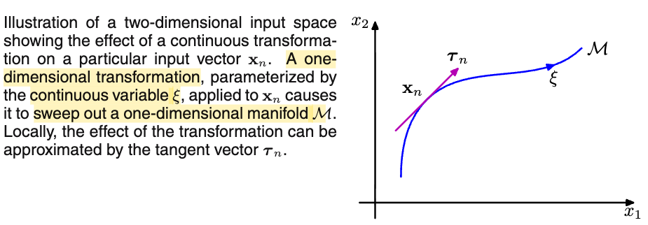
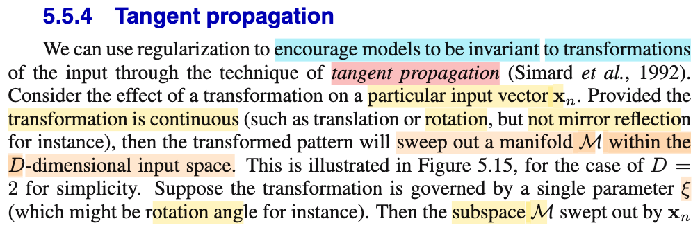
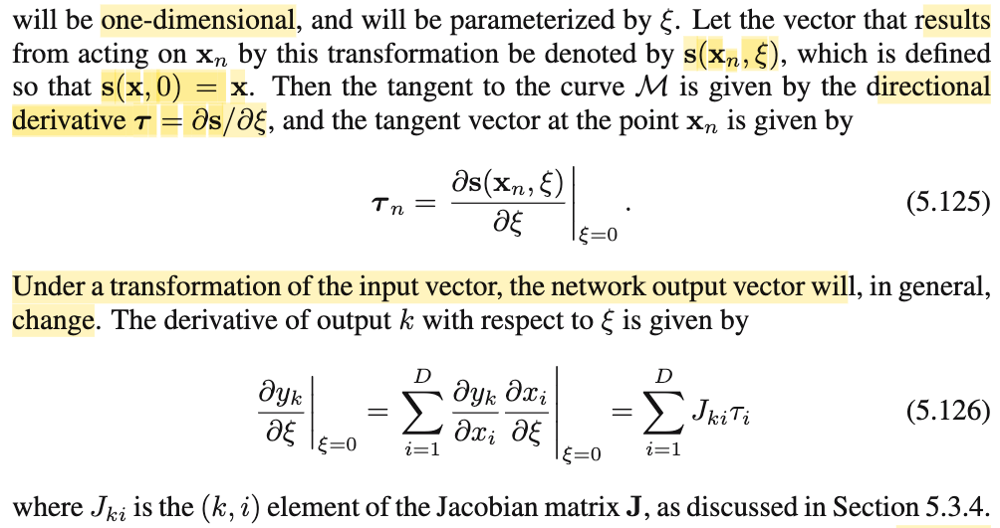
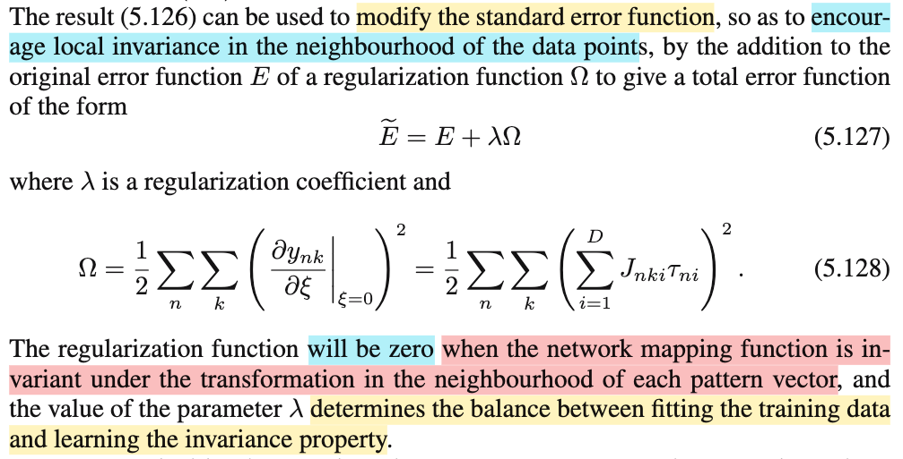
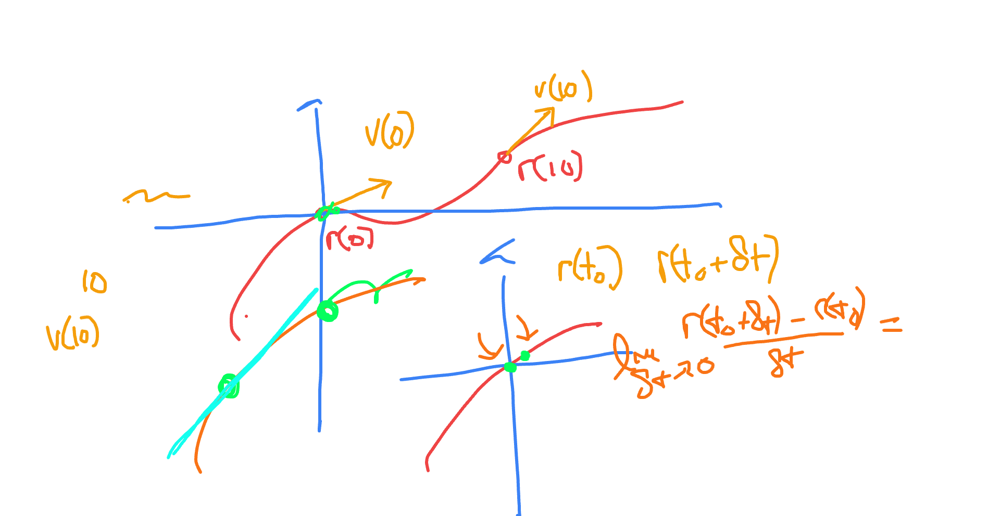
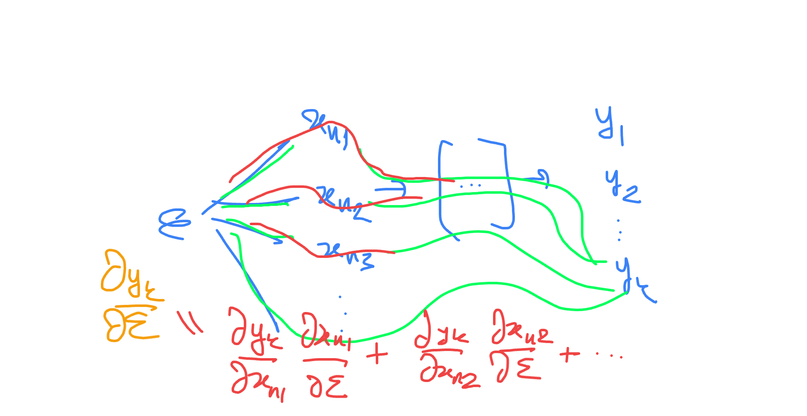
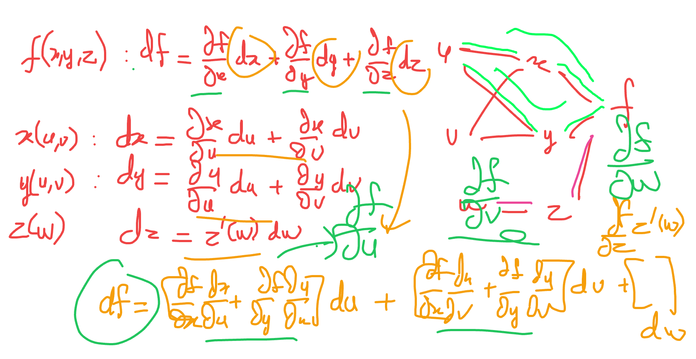
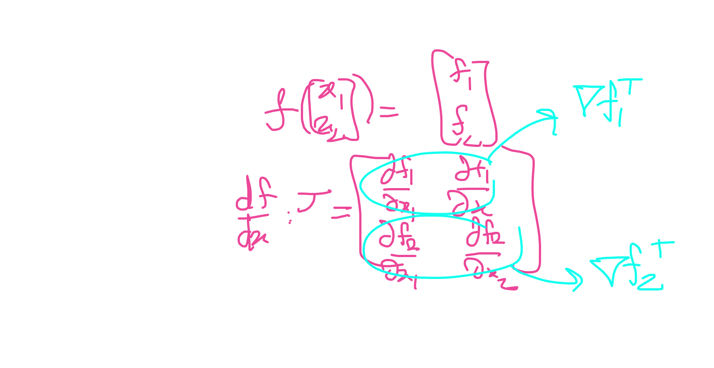
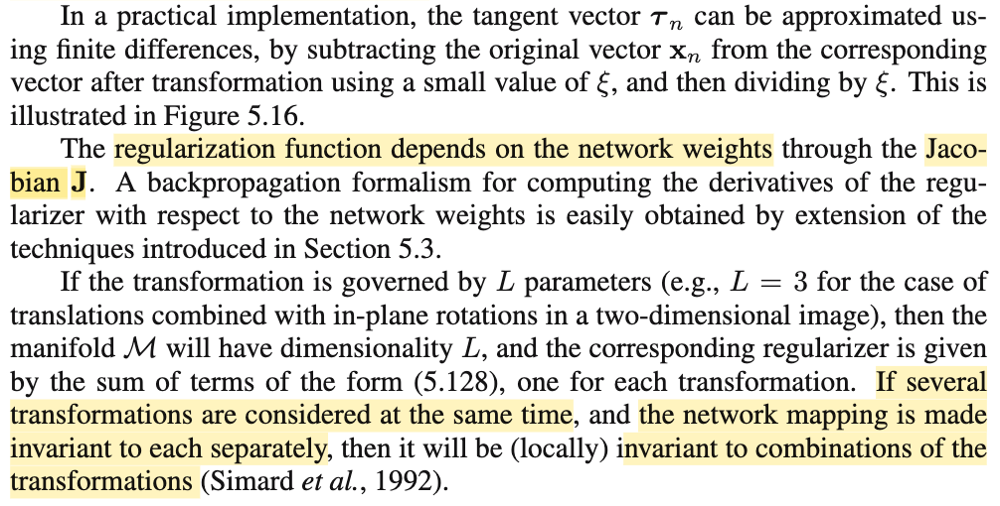
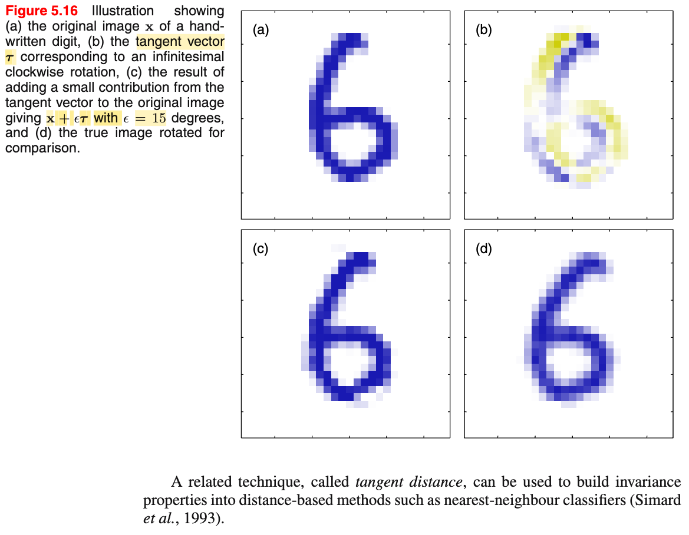

# 5.5.4 Tangent propagation

📊 **Progress:** `2` Notes | `10` Screenshots | `2` AI Reviews

---

 

## Section 5.5.4 Tangent Propagation

<kbd></kbd>

<kbd></kbd>

<kbd></kbd>

<kbd></kbd>

<kbd></kbd>

<kbd></kbd>

<kbd></kbd>

<kbd></kbd>

> [!NOTE]
> Hiểu đại khái là vầy, gọi 𝐬(𝐱, ξ) là hàm số nhận vào ξ và 𝐱, thực hiện phép biến đổi có tham số ξ nào đó lên 𝐱, để cho ra một vector 𝐱 mới. Do đó, 𝐬(𝐱, ξ)|ξ=0 = 𝐱 và với ξ khác nhau ta sẽ tạo ra một quỹ đạo đi qua 𝐱.
>
>
>
> nên 𝐬(𝐱, ξ) là chính là đường cong tham số hóa bởi (parameterized by) ξ.
>
>
>
> Ví dụ 𝐬(𝐱, ξ) = 𝐱 + ξ𝐞1, đây sẽ là quỹ đạo đường thẳng đi qua 𝐱 và song song trục 𝐞1.
>
>
>
> Nên tự nó ta có thể coi 𝐬(𝐱, ξ) đối với ξ, là hàm scalar - vector.
>
>
>
> Giống như trong MIT 18.02 đã học 𝐫(t) là vector tham số bởi t: 𝐫(t) = (x(t), y(t), z(t))ᵀ. Thì lấy đạo hàm theo t, ta sẽ có vector vận tốc (velocity):
>
>
>
> 𝐫(t) = (x(t) = 2t², y(t) = 3t)
>
>
>
> 𝐫(t): scalar t → vector 𝐫(t)
>
>
>
> x(t): scalar t → scalar x(t), 
>
>
>
> y(t): scalar t → scalar y(t)
>
>
>
> d/dt 𝐫(t) = velocity vector 𝐯(t) = (dx(t)/dt, dy(t)/dt)ᵀ = (4t, 3)
>
>
>
>  𝐯(t)|t=0: vector velocity tại 𝐫(0)
>
>
>
> f(𝐱): d/d𝐱 f = gradient vector ∇f(𝐱) = (∂f/∂x1, ∂f/∂x2)ᵀ
>
>
>
> 𝐬(𝐱, ξ)|ξ=0 = 𝐱
>
>
>
> 𝐬(𝐱, ξ)|ξ=1 = 𝐱'
>
>
>
> 𝐬(𝐱n, ξ)|ξ=0 = 𝐱n
>
>
>
> d𝐬(𝐱n, ξ)/dξ = velocity 𝐯(ξ) = 𝛕(ξ)
>
>
>
>  𝛕(ξ)|ξ=0: velocity vector tại 𝐬(𝐱n, ξ)|ξ=0, tức 𝐱n, đặt 𝛕n
>
>
>
> 𝐱n(ξ) = 𝐬(𝐱n, ξ)
>
>
>
> d/dξ 𝐬(𝐱n, ξ) = d/dξ 𝐱n(ξ) 
>
>
>
> d/dξ 𝐬(𝐱n, ξ)\]|ξ=0 = d/dξ 𝐱n(ξ)|ξ=0 
>
>
>
> (𝛕n1, 𝛕n2,...)ᵀ = (dxn1/dξ, dxn2/dξ ...)ᵀ 
>
>
>
> 𝐲(ξ) = network(𝐱n(ξ))
>
>
>
> 𝐲(ξ) là hàm scalar - vector
>
>
>
> đạo hàm của 𝐲 đối ξ: sẽ là velocity vector: d/dξ 𝐲(ξ) 
>
>
>
> = (∂/∂ξ 𝐲1(ξ), ∂/∂ξ 𝐲2(ξ),...,∂/∂ξ 𝐲k(ξ),... )
>
>
>
> = (∂yk/∂xn1) (∂xn1/∂ξ) + (∂yk/∂xn2) (∂xn2/∂ξ) + ...
>
>
>
> = Σi=1:D (∂yk/∂xni) (∂xni/∂ξ)
>
>
>
> =  𝐉kᵀ𝛕n
>
>
>
> = Σi=1:D 𝐉ki 𝛕ni
>
>
>
> 𝐲(𝐱n): là hàm vector 𝐱n → 𝐲
>
>
>
> ∂𝐲/∂𝐱n = 𝐉
>
>
>
> hàng 1: (∂y1/∂xn1, ∂y1/∂xn2,...)
>
> .., hàng k: (∂yk/∂xn1, ∂yk/∂xn2,...) = (𝐉k1, 𝐉k2,....)
>
>
>
> (∂yk/∂xn1, ∂yk/∂xn2, ....) = (𝐉k1, 𝐉k2,....)
>
>
>
> (∂xn1/∂ξ, (∂xn2/∂ξ),....) = 𝛕n
>
>
>
> Viết lại: ∂/∂ξ 𝐲k(ξ)|ξ=0 = Σi=1:D (∂yk/∂xni) (∂xni/∂ξ) = Σi=1:D 𝐉ki 𝛕ni
>
>
>
> 𝐱n: ∂/∂ξ 𝐲nk(ξ)|ξ=0 = Σi=1:D (∂yk/∂xni) (∂xni/∂ξ) = Σi=1:D 𝐉nki 𝛕ni
>
>
>
> Ω = (1/2) Σn Σk \[∂/∂ξ 𝐲nk(ξ)|ξ=0\]² 
>
>
>
> = (1/2) Σn Σk \[Σi=1:D 𝐉nki 𝛕ni\]²
>
>
>
>
>
>
>
>
>
>
>
>
>
> 𝐫(t), đối với t, cũng là hàm scalar - vector. Đạo hàm của nó, sẽ là vector chứa các đạo hàm của từng phần tử đối với t:
>
>
>
> d/dt 𝐫(t) = 𝐯(t) = (dx(t)/dt, dy(t)/dt, dz(t)/dt)ᵀ
>
>
>
> Dĩ nhiên 𝐯(t) vẫn là hàm scalar - vector, với t khác nhau, ta có vector vận tốc khác nhau.
>
>
>
> Và nếu evaluate tại t = 0, ta sẽ có vector vận tốc tại điểm 𝐫(0)
>
>
>
> Vậy thì ở đây cũng vậy, đạo hàm 𝐬(𝐱, ξ) theo ξ ta cũng có velocity vector:
>
>
>
> ∂𝐬(𝐱, ξ)/∂ξ = 𝐯(ξ) Và ở đây ta đặt là 𝛕(ξ).
>
>
>
> Và evaluate 𝛕(ξ) tại ξ=0, ta sẽ có velocity tại 𝐬(𝐱, 0), chính là velocity tại 𝐱, đặt là 𝛕n
>
>
>
> Cũng là tiếp tuyến với quỹ đạo ℳ (tập mọi 𝐬(𝐱, ξ) khi ξ thay đổi) tại 𝐱. Điều này giải thích cho câu:
>
>
>
> "Then the tangent to the curve ℳ is given by the directional derivative ...và 𝛕n theo công thức 5.125 chính là vector tiếp tuyến tại 𝐱n)
>
>
>
> ---
>
>
>
> Thế thì, nếu nhìn theo khía cạnh này: 𝐬(𝐱n, ξ) là hàm phụ thuộc ξ, nhận vào ξ, thực một phép biến đổi lên 𝐱n để trả ra một vector 𝐱n mới, thì ta cũng có thể đặt hàm 𝐱n(ξ) = 𝐬(𝐱n, ξ) để rồi chuyển thành góc nhìn là input 𝐱n bây giờ cũng là hàm theo ξ
>
>
>
> và dĩ nhiên các phần tử của 𝐱n: 𝐱n1, 𝐱n2,..sẽ là các hàm scalar-scalar 𝐱n1(ξ), 𝐱n2(ξ)..
>
>
>
> nên đạo hàm của 𝐱n đối với ξ d𝐱n(ξ)/dξ sẽ là vector các đạo hàm riêng (∂𝐱n1/∂ξ, ∂𝐱n2/∂ξ,...)ᵀ
>
>
>
> dĩ nhiên vì ta đã đặt hàm 𝐱n(ξ) = 𝐬(𝐱n, ξ), nên d𝐱n(ξ)/dξ = ∂𝐬(𝐱n, ξ)/∂ξ nên
>
>
>
> d𝐱n(ξ)/dξ = (∂𝐱n1/∂ξ, ∂𝐱n2/∂ξ,...)ᵀ = ∂𝐬(𝐱n, ξ)/∂ξ
>
>
>
> evaluate tại ξ = 0, thì chính là 𝛕n đặt ở trên:
>
>
>
> (d𝐱n(ξ)/dξ) |ξ=0 = ∂𝐬(𝐱n, ξ)/∂ξ |ξ=0 = 𝛕n
>
>
>
> Bên cạnh đó, vì 𝐱n là input của network tính ra 𝐲 nên
>
>
>
> từ đó output của network 𝐲 cũng là hàm theo ξ:
>
>
>
> 𝐲 = network(𝐱n(ξ))
>
>
>
> Với tư cách hàm theo ξ, 𝐲 sẽ là hàm scalar - vector, cũng như các phần tử yk sẽ là hàm scalar - scalar Để rồi, ta sẽ lấy đạo hàm của 𝐲 theo ξ: sẽ là vector các đạo hàm riêng, (nhưng ko gọi là gradient vector, mà gọi là velocity vector)
>
>
>
> ∂𝐲/∂ξ = (∂y1/∂ξ, ∂y2/∂ξ...)ᵀ
>
>
>
> 𝐲 đối với 𝐱n là vector - vector function: d𝐲 = 𝐉n d𝐱n (viết sẵn 𝐉n để tí phân biệt với 𝐉 của các data point 𝐱1, 𝐱2,....𝐱N)
>
>
>
> 𝐱n đối với ξ là scalar - vector function: d𝐱n = (∂xn1/∂ξ, ∂xn2/∂ξ, ...) dξ
>
>
>
> Nên d𝐲 = 𝐉n d𝐱n = d𝐲 = 𝐉n (d𝐱n(ξ)/dξ) dξ
>
>
>
> Và như vậy ta sẽ có dyk = 𝐉nkᵀ (d𝐱n(ξ)/dξ) dξ với 𝐉nkᵀ là hàng k của 𝐉n
>
>
>
> mà hàng k của 𝐉n cũng là vector đạo hàm riêng của yk đối với 𝐱n1, 𝐱n2,..
>
>
>
> (∂yk/∂xn1, ∂yk/∂xn2, ...)
>
>
>
> ⇒ dyk = \[(∂yk/∂xn1) (∂xn1/∂ξ) + (∂yk/∂xn2) (∂xn2/∂ξ) + ...\] dξ
>
>
>
> ⇔ dyk = Σi=1:D (∂yk/∂xni) (∂xni/∂ξ) dξ
>
>
>
> ⇒ ∂yk/∂ξ = Σi=1:D (∂yk/∂xni) (∂xni/∂ξ)
>
>
>
> Chú ý: ∂yk/∂ξ sẽ vẫn là hàm số theo ξ, mà khi tính tại ξ = 0, sẽ mang ý nghĩa: Nếu 𝐱n(ξ) đang = 𝐱n (giá trị của data point thứ n), và ta nhích ξ tí xíu, tức biến đổi 𝐱n để dịch nó đi thành điểm 𝐱n + δ𝐱n thì khi đó yk sẽ thay đổi thế nào
>
>
>
> (∂yk/∂ξ)|ξ=0 = \[Σi=1:D (∂yk/∂xni) (∂xni/∂ξ)\]|ξ=0
>
>
>
> \[Σi=1:D (∂yk/∂xni) 𝛕ni\]
>
>
>
> = Σi=1:D 𝐉nki 𝛕ni
>
>
>
> ⇒ Đây là 5.126 (trong sách viết τi ý là phần tử i'th của 𝛕n)
>
>
>
> ---
>
>
>
> Và ý nghĩa của cái này, khi evaluate tại ξ = 0 dĩ nhiên một hàm số thể hiện rate of change - tỉ lệ của khoảng thay đổi của output yk khi ξ thay đổi. Và nếu cái này bằng 0 đồng nghĩa, khi transform input 𝐱n tí xíu, output của network không đổi. (chú ý, đây chỉ là hàm số theo ξ, phải evaluate tại ξ = 0 thì ta mới có giá trị tại 𝐱n)
>
>
>
> Để rồi từ đó, ta có thể tạo ra một regularization term: Bao gồm bình phương của ∂yk/∂ξ với mọi k và với mọi 𝐱n n = 1,2,...N
>
>
>
> Ω = (1/2) Σn Σk ((∂yk/∂ξ)|ξ=0)² = (1/2) Σn Σk (Σi=1:D 𝐉ki 𝛕ni )²
>
>
>
> Và ta sẽ train network với hàm loss:
>
>
>
> Ẽ = E + λΩ
>
>
>
> với λ sẽ kiểm soát tương quan của hai mục tiêu như đã biết

📹 [Xem video trên YouTube](https://www.youtube.com/watch?v=Fu4hPTwO1bY)

> [!TIP]
> 🤖 **AI Check** — 🟢 Pass — ✅ **98/100** · ✓ Move on
>
> Ghi chú xuất sắc! Bạn đã giải thích trực quan và tường minh toàn bộ bản chất hình học cũng như chi tiết chuỗi đạo hàm (chain rule) của phương pháp Tangent Propagation từ cơ bản tới công thức hoàn chỉnh.
>
> **✓ Strengths**
> - Liên hệ rất chính xác và trực quan giữa biến đổi liên tục một tham số với đường cong tham số hóa và vector vận tốc/tiếp tuyến trong giải tích đa biến.
> - Tự triển khai tường minh quy tắc chuỗi (chain rule) dẫn xuất ra phần tử ma trận Jacobian và tích vô hướng với vector tiếp tuyến tau_n mà sách viết ngắn gọn.
> - Hiểu đúng bản chất vật lý/hình học của việc đánh giá đạo hàm tại xi = 0 để đạt tính bất biến cục bộ (local invariance) quanh các điểm dữ liệu mẫu.
>
> **💡 Deeper notes**
> - Trong thực tế, việc tính toán ma trận Jacobian cho từng điểm dữ liệu và lấy đạo hàm bậc hai để cập nhật trọng số mạng neural qua Tangent Propagation có chi phí tính toán khá lớn, do đó ngày nay người ta thường ưu tiên kỹ thuật Data Augmentation trực tiếp để xấp xỉ tính bất biến này.
> - Công thức ở đây giả định phép biến đổi phụ thuộc vào một tham số đơn xi (1-D manifold). Nếu có nhiều tham số biến đổi độc lập (ví dụ vừa xoay vừa tịnh tiến), không gian đa tạp M sẽ có số chiều tương ứng và hàm phạt Omega sẽ lấy tổng bình phương trên từng vector tiếp tuyến của từng tham số.

 

### Local Invariance Regularization Function

<kbd></kbd>

<kbd></kbd>

> [!NOTE]
> Đại khái là trong thực tế, ta có thể không cần tính 𝛕n (tangent vector tại 𝐱n) chính xác mà có thể dùng finite difference:
>
>
>
> ∂𝐱n/∂ξ ≈ \[𝐬(𝐱n, Δξ) - 𝐱n\]/ Δξ
>
>
>
> còn 𝐉n thì tính bằng backprop mà mấy phần trước đã nói.

> [!TIP]
> 🤖 **AI Check** — 🟢 Pass — ✅ **95/100** · ✓ Move on
>
> Ghi chú nắm rất chính xác và súc tích nội dung chính từ giáo trình về việc xấp xỉ tangent vector bằng sai phân hữu hạn và cách tính toán liên quan đến Jacobian.
>
> **✓ Strengths**
> - Công thức sai phân hữu hạn để xấp xỉ tangent vector τn được viết lại rõ ràng và chính xác theo đúng mô tả của tài liệu.
> - Liên hệ chuẩn xác việc tính toán Jacobian và đạo hàm liên quan thông qua giải thuật lan truyền ngược (backpropagation) được đề cập trong Mục 5.3.
>
> **💡 Deeper notes**
> - Đạo hàm ∂xn/∂ξ ở đây thực chất được tính tại điểm ξ = 0 (tức là phép biến đổi vi phân ngay quanh điểm gốc ban đầu xn).

 

