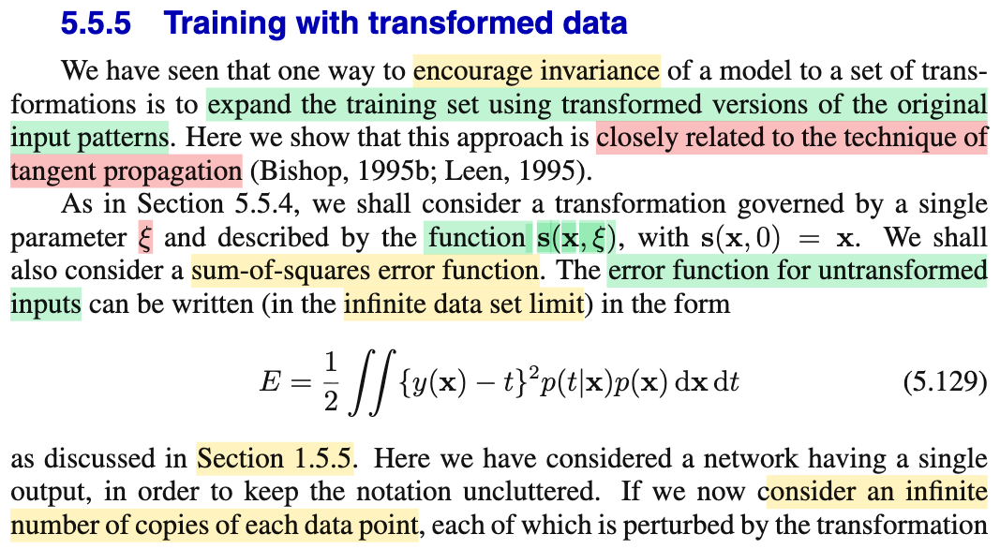
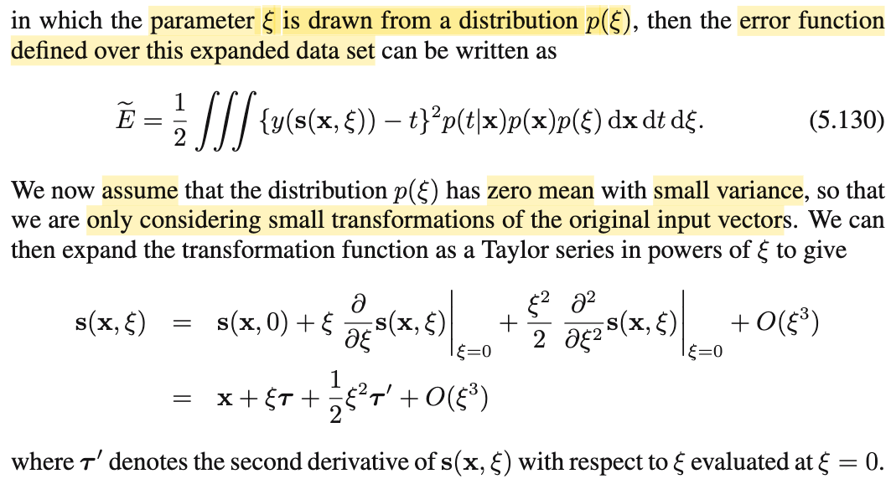
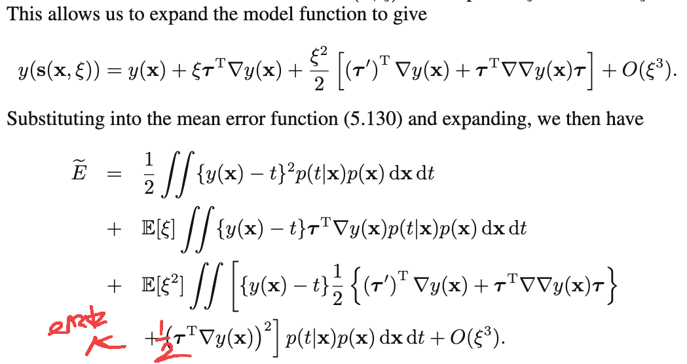
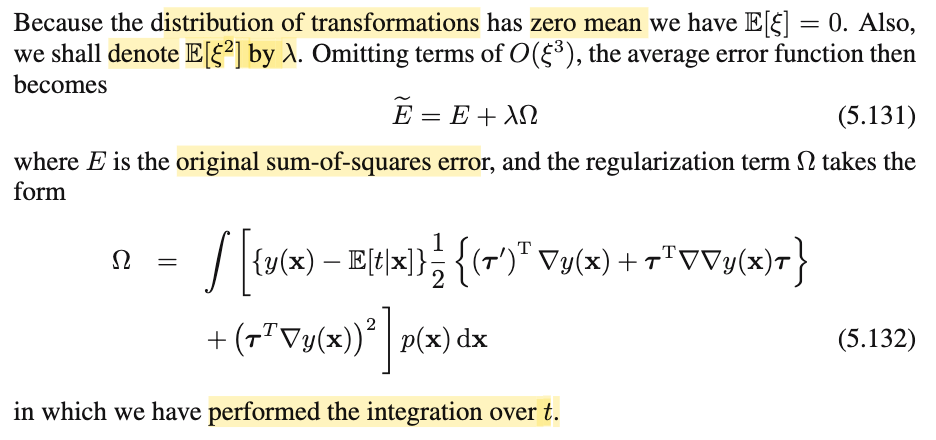
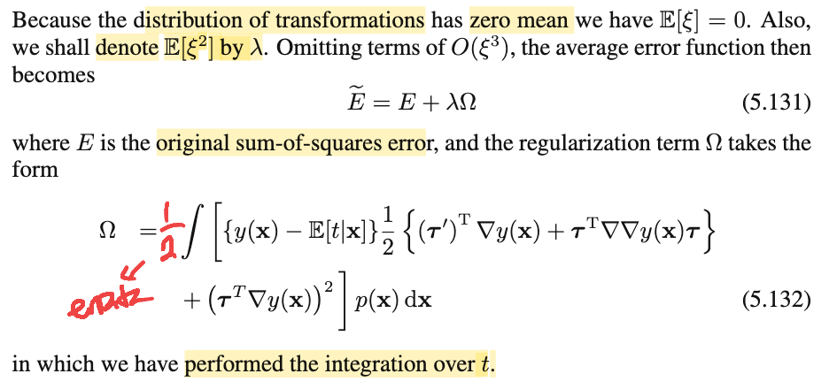
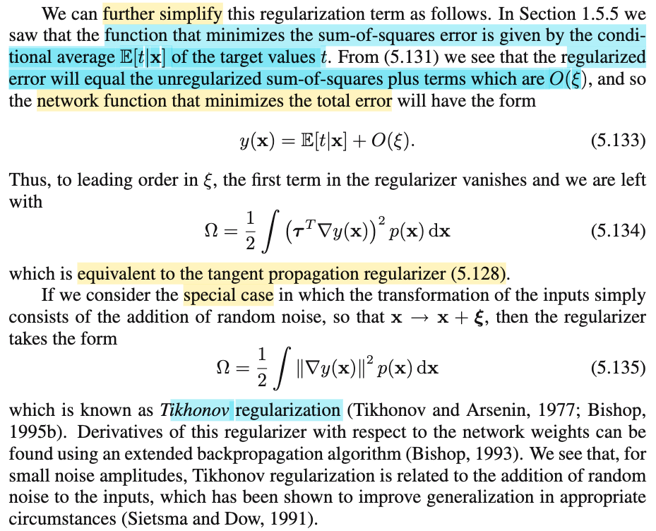

# 5.5.5 Training with transformed data

📊 **Progress:** `3` Notes | `6` Screenshots | `3` AI Reviews

---

 

## 5.5.5 Training with Transformed Data

<kbd></kbd>

<kbd></kbd>

<kbd></kbd>

> [!NOTE]
> Phần này sẽ nói về việc ta sẽ chỉ ra rằng việc training network với augmented data sẽ tương đương với việc add thêm hàm phạt vào main loss để khuyến khích network có tính invariant.
>
>
>
> Đầu tiên, tiếp nối 5.5.4, đại khái là ta có 𝐬(𝐱, ξ) là hàm thực hiện phép biến đổi lên 𝐱, tham số hóa bởi ξ, và giả sử ξ chỉ là một tham số duy nhất. Ta có 𝐬(𝐱, 0) = 𝐱.
>
>
>
> Tiếp, ta xét error function 5.129. Công thức này là sao?
>
>
>
> Như trong sách tác giả ghi là "in the infinite data set limit" tức là coi như có bộ data vô hạn.
>
>
>
> Thì giống như ta có data set (𝐱1, t1), (𝐱2, t2), .....
>
>
>
> ta sẽ coi đây là các possible value của random vector 𝐗 và random variable T. Từ đó, xét random variable Loss = (y(𝐗) - T)². và define error function là (1/2) kì vọng của Loss:
>
>
>
> E = (1/2) E\[Loss(𝐗, T)\], theo LOTUS, ta có:
>
>
>
> ---
>
>
>
> X random variable rời rạc x1, x2, x3. P(X=x)
>
>
>
> E\[X\] = P(X=x1)x1 + P(X=x2)x2 + P(X=x3)x3 = Σi xi P(X=xi)
>
>
>
> E\[X\] = ∫xfX(x)dx
>
>
>
> Y = g(X) Nếu có fY(y) EY = ∫yfY(y)dy
>
>
>
> LOTUS: EY = ∫g(x)fX(x)dx
>
>
>
> X,Y. joint f(x,y)
>
>
>
> Z = g(X,Y). ví dụ g(x,y) = xy
>
>
>
> LOTUS:  E\[Z\] = ∫∫g(x,y)f(x,y)dxdy
>
>
>
> Loss = g(𝐗, T)
>
>
>
> g(𝐱, t) = \[y(𝐱) - t\]²
>
>
>
> g(𝐗, T) = (y(𝐗) - T)²
>
>
>
> E\[Loss\] = ∫∫g(𝐱, t)p(𝐱, t)d𝐱 dt
>
>
>
> = ∫∫ \[y(𝐱) - t\]² p(𝐱, t)d𝐱 dt
>
>
>
> p(𝐱, t) = p(t|𝐱)p(𝐱)
>
>
>
> = ∫∫ \[y(𝐱) - t\]² p(t|𝐱)p(𝐱) d𝐱 dt
>
>
>
> ---
>
>
>
> = (1/2) ∫∫Loss(𝐱, t) p(𝐱, t) d𝐱 dt
>
>
>
> = (1/2) ∫∫\[y(𝐱) - t\]² p(𝐱, t) d𝐱 dt
>
>
>
> = (1/2) ∫∫\[y(𝐱) - t\]² p(t|𝐱)p(𝐱) d𝐱 dt
>
>
>
> Ý nghĩa của việc lấy tích phân là lấy trung bình qua mọi possible value của random variable
>
>
>
> ---
>
>
>
> Loss = g(𝐬(𝐗, ξ), T)
>
>
>
> E\[Loss\] = ∫∫∫g(𝐬(𝐱, ξ), t) p(𝐱, ξ, t) d𝐱 dt dξ
>
>
>
> Thế thì với input bị biến đổi bởi 𝐬(𝐱, ξ), ta có error function lúc này là:
>
>
>
> Ẽ = ∫E p(ξ) dξ
>
>
>
> = (1/2) ∫∫∫\[y(𝐬(𝐱, ξ)) - t\]² p(t|𝐱)p(𝐱)p(ξ) d𝐱 dt dξ
>
>
>
> ---
>
>
>
> f(x)
>
>
>
> x0: f(x) = f(x0) + f'(x0)(x-x0) + f''(x0)(x-x0)²/2! + f'''(x0)(x-x0)³/3! + ...
>
>
>
> f(x) ≈ f(x0) + f'(x0)(x-x0)
>
>
>
> f(x) ≈ f(x0) + f'(x0)(x-x0) + f''(x0)(x-x0)²/2!
>
>
>
> f(x) = f(x0) + ∇f(x0)ᵀ(x-x0) + (x-x0)ᵀ∇²(x0)(x-x0)/2! + ...
>
>
>
> Khai triển Taylor với 𝐬(𝐱, ξ) tại ξ = 0:
>
>
>
> g(ξ) = g(0) + g'(0)ξ + g''(0)ξ²/2 + O(ξ³)
>
> 𝐬(𝐱, ξ) = 𝐬(𝐱, ξ)|ξ=0 + ξ\[d/dξ 𝐬(𝐱, ξ)\]|ξ=0 + (1/2) ξ² \[d²/dξ² 𝐬(𝐱, ξ)\]|ξ=0 + O(ξ³)
>
>
>
> = 𝐬(𝐱, 0) + ξ𝛕 + (1/2) ξ² 𝛕' + O(ξ³)
>
>
>
> = 𝐱 + ξ𝛕 + (1/2) ξ² 𝛕' + O(ξ³)
>
>
>
> đặt \[d²/dξ² 𝐬(𝐱, ξ)\]|ξ=0 là 𝛕'
>
>
>
> Viết lại, ta có: 𝐬(𝐱, ξ) = 𝐱 + ξ𝛕 + (1/2) ξ² 𝛕' + O(ξ³)
>
>
>
> ---
>
>
>
> ⇒ y(𝐬(𝐱, ξ)) = y(𝐱(ξ)) =
>
>
>
> = y(𝐱 + ξ𝛕 + (1/2) ξ² 𝛕' + O(ξ³)) = h(ξ)
>
>
>
> Khai triển Taylor hàm này quanh ξ=0:
>
>
>
> h(ξ) = h(0) + h'(0)ξ + h''(0)ξ²/2 + O(ξ³)
>
>
>
> y(𝐬(𝐱, ξ)) = y(𝐬(𝐱, ξ))|ξ=0 + ξ \[d/dξ y(𝐬(𝐱, ξ))\]|ξ=0 + (1/2) ξ² \[d²/dξ² y(𝐬(𝐱, ξ))\]|ξ=0 + O(ξ³) (1)
>
>
>
> a) y(𝐬(𝐱, ξ))|ξ=0 = y(𝐬(𝐱, 0)) = y(𝐱)
>
>
>
> b) d/dξ y(𝐬(𝐱, ξ)) (đi tìm h(ξ))
>
>
>
> y(𝐬): dy = ∇y(𝐬)ᵀd𝐬 
>
>
>
> d𝐬 = \[d/dξ 𝐬(𝐱, ξ)\] dξ
>
>
>
> ⇒ dy(𝐬(𝐱, ξ)) = ∇y(𝐬)ᵀ\[d/dξ 𝐬(𝐱, ξ)\] dξ
>
>
>
> ⇒ d/dξ y(𝐬(𝐱, ξ)) = ∇y(𝐬)ᵀ\[d/dξ 𝐬(𝐱, ξ)\]
>
>
>
> và \[d/dξ y(𝐬(𝐱, ξ))\]ξ=0 = \[∇y(𝐬)ᵀ\[d/dξ 𝐬(𝐱, ξ)\]\]|ξ=0 = ∇y(𝐬(𝐱, 0))ᵀ\[d/dξ 𝐬(𝐱, 0)\]
>
>
>
> = ∇y(𝐱)ᵀ𝛕
>
>
>
> c) d²/dξ² y(𝐬(𝐱, ξ)):
>
>
>
> Xét hàm d/dξ y(𝐬(𝐱, ξ)), như trên đã có = ∇y(𝐬(𝐱, ξ))ᵀ\[d/dξ 𝐬(𝐱, ξ)\]
>
>
>
> d/dξ \[∇y(𝐬(𝐱, ξ))ᵀ\[d/dξ 𝐬(𝐱, ξ)\]\]
>
>
>
> = d/dξ \[∇y(𝐬(𝐱, ξ))\]ᵀ \[d/dξ 𝐬(𝐱, ξ)\] + \[∇y(𝐬(𝐱, ξ))ᵀ d²/dξ² 𝐬(𝐱, ξ)
>
>
>
> = {\[d/d𝐬 ∇y(𝐬(𝐱, ξ)) . d/dξ 𝐬(𝐱, ξ)\]}ᵀ \[d/dξ 𝐬(𝐱, ξ)\] + \[∇y(𝐬(𝐱, ξ))ᵀ d²/dξ² 𝐬(𝐱, ξ)
>
>
>
> = {∇∇y(𝐬(𝐱, ξ)) . d/dξ 𝐬(𝐱, ξ)}ᵀ \[d/dξ 𝐬(𝐱, ξ)\] + \[∇y(𝐬(𝐱, ξ))ᵀ d²/dξ² 𝐬(𝐱, ξ)
>
>
>
> = \[d/dξ 𝐬(𝐱, ξ)\]ᵀ ∇∇y(𝐬(𝐱, ξ))\[d/dξ 𝐬(𝐱, ξ)\] + \[∇y(𝐬(𝐱, ξ))ᵀ d²/dξ² 𝐬(𝐱, ξ)
>
>
>
> ⇒ d²/dξ² y(𝐬(𝐱, ξ))|ξ=0
>
>
>
> = \[d/dξ 𝐬(𝐱, 0)\]ᵀ ∇∇y(𝐬(𝐱, 0)) \[d/dξ 𝐬(𝐱, 0)\] + \[∇y(𝐬(𝐱, 0))ᵀ d²/dξ² 𝐬(𝐱, 0)
>
>
>
> = 𝛕ᵀ ∇∇y(𝐱) 𝛕 + ∇y(𝐱)ᵀ 𝛕'
>
>
>
> ---
>
>
>
> Vậy tiếp tục (1):
>
>
>
> y(𝐬(𝐱, ξ)) = y(𝐬(𝐱, ξ))|ξ=0 + ξ \[d/dξ y(𝐬(𝐱, ξ))\]|ξ=0 + (1/2) ξ² \[d²/dξ² y(𝐬(𝐱, ξ))\]|ξ=0 + O(ξ³)
>
>
>
> = y(𝐱) + ξ ∇y(𝐱)ᵀ𝛕 + (1/2) ξ² (𝛕ᵀ ∇∇y(𝐱) 𝛕 + ∇y(𝐱)ᵀ 𝛕') + O(ξ³)
>
>
>
> ---
>
>
>
> Thay y(𝐬(𝐱, ξ)) vào trong Error Ẽ:
>
>
>
> (1/2) ∫∫∫\[y(𝐬(𝐱, ξ)) - t\]² p(t|𝐱)p(𝐱)p(ξ) d𝐱 dt dξ
>
>
>
> = (1/2) ∫∫∫\[y(𝐱) + ξ 𝛕ᵀ∇y(𝐱) + (1/2) ξ² \[𝛕ᵀ ∇∇y(𝐬(𝐱, 0) 𝛕 + 𝛕'ᵀ∇y(𝐱)\] + O(ξ³) - t\]² p(t|𝐱)p(𝐱)p(ξ) d𝐱 dt dξ
>
>
>
> ---
>
>
>
> Đặt A = y(𝐱) - t, B = 𝛕ᵀ∇y(𝐱), C = (1/2) \[𝛕ᵀ ∇∇y(𝐬(𝐱, 0) 𝛕 + 𝛕'ᵀ∇y(𝐱)\]
>
>
>
> ---
>
>
>
>
>
>
>
> .. = (1/2) ∫∫∫\[A + ξB + ξ² C + O(ξ³)\]² p(t|𝐱)p(𝐱)p(ξ) d𝐱 dt dξ
>
>
>
> Xét \[A + ξB + ξ² C + O(ξ³)\]², khai triển ra ta có A² + 2ABξ + (B² + 2AC)ξ² + O(ξ³)
>
>
>
> ... = (1/2) ∫∫∫\[A² + 2ABξ + (B² + 2AC)ξ² + O(ξ³)\] p(t|𝐱)p(𝐱)p(ξ) d𝐱 dt dξ
>
>
>
> = ∫∫∫\[(1/2)A² + ABξ + ((1/2)B² + AC)ξ² + O(ξ³)\] p(t|𝐱)p(𝐱)p(ξ) d𝐱 dt dξ
>
>
>
> = ∫∫∫\[(1/2)A² + ABξ + ((1/2)B² + AC)ξ² + O(ξ³)\] p(ξ)dξ p(t|𝐱)p(𝐱) d𝐱 dt (2)
>
>
>
> Xét ∫\[(1/2)A² + ABξ + ((1/2)B² + AC)ξ² + O(ξ³)\] p(ξ)dξ
>
>
>
> = ∫(1/2)A² p(ξ)dξ + ∫ABξ p(ξ) dξ + ∫((1/2)B² + AC)ξ²\] p(ξ)dξ + ∫O(ξ³)p(ξ)dξ
>
>
>
> = (1/2)A² ∫p(ξ)dξ + AB ∫ξ p(ξ) dξ + ((1/2)B² + AC)∫ξ² p(ξ)dξ + ∫O(ξ³)p(ξ)dξ
>
>
>
> = (1/2)A² + AB E\[ξ\] + ((1/2)B² + AC) E\[ξ²\] + O(ξ³)
>
>
>
> Thay vào lại ta có: (2)
>
>
>
> = ∫∫ \[(1/2)A² + AB E\[ξ\] + ((1/2)B² + AC) E\[ξ²\] + O(ξ³)\] p(t|𝐱)p(𝐱) d𝐱 dt
>
>
>
> = ∫∫ (1/2)A² p(t|𝐱)p(𝐱) d𝐱 dt + ∫∫ AB E\[ξ\] p(t|𝐱)p(𝐱) d𝐱 dt + ∫∫ ((1/2)B² + AC) E\[ξ²\] p(t|𝐱)p(𝐱) d𝐱 dt + ∫∫ O(ξ³) p(t|𝐱)p(𝐱) d𝐱 dt
>
>
>
> = ∫∫ (1/2)A² p(t|𝐱)p(𝐱) d𝐱 dt
>
>
>
> \+ ∫∫ AB E\[ξ\] p(t|𝐱)p(𝐱) d𝐱 dt
>
>
>
> \+ ∫∫ ((1/2)B² + AC) E\[ξ²\] p(t|𝐱)p(𝐱) d𝐱 dt
>
>
>
> \+ ∫∫ O(ξ³) p(t|𝐱)p(𝐱) d𝐱 dt
>
>
>
> = ∫∫ (1/2)A² p(t|𝐱)p(𝐱) d𝐱 dt
>
>
>
> \+ E\[ξ\] ∫∫ AB p(t|𝐱)p(𝐱) d𝐱 dt
>
>
>
> \+ E\[ξ²\] ∫∫ ((1/2)B² + AC) p(t|𝐱)p(𝐱) d𝐱 dt
>
>
>
> \+ O(ξ³)
>
>
>
> Thay A, B, C:
>
>
>
> Đặt A = y(𝐱) - t, B = 𝛕ᵀ∇y(𝐱), C = (1/2) \[𝛕ᵀ ∇∇y(𝐬(𝐱, 0) 𝛕 + 𝛕'ᵀ∇y(𝐱)\]
>
>
>
> vào sẽ có công thức trong sách.

📹 [Xem video trên YouTube](https://www.youtube.com/watch?v=g_7hFLLIgX4)

> [!TIP]
> 🤖 **AI Check** — 🟢 Pass — ✅ **98/100** · ✓ Move on
>
> Ghi chú xuất sắc! Bạn đã tự khai triển chi tiết và chính xác từng bước giải tích đa biến (đạo hàm bậc nhất, bậc hai theo quy tắc chuỗi và ma trận Hessian) mà sách giáo khoa lược bớt.
>
> **✓ Strengths**
> - Diễn giải trực quan và chính xác ý nghĩa của hàm lỗi trong giới hạn dữ liệu vô hạn (infinite data set limit) thông qua kỳ vọng và định lý LOTUS.
> - Tự lực khai triển chi tiết đạo hàm cấp 1 và cấp 2 của hàm hợp y(s(x, ξ)) bằng giải tích ma trận/vector, thu được đúng số hạng liên quan đến vector tiếp tuyến τ và ma trận Hessian ∇∇y.
> - Khai triển bình phương và lấy tích phân theo p(ξ) rất chặt chẽ, tách bạch rõ các mô-men E[ξ] và E[ξ²].
>
> **💡 Deeper notes**
> - Trong công thức cuối ở sách Bishop, số hạng thứ hai trong ngoặc vuông của E[ξ²] được in là (τᵀ∇y(x))² thay vì (1/2)(τᵀ∇y(x))². Khai triển của bạn với hệ số (1/2)B² mới chính xác về mặt đại số (do có thừa số 1/2 ở trước tích phân Ẽ trong phương trình 5.130); đây là một lỗi in nhỏ (typo) khá nổi tiếng trong sách của Bishop.

 

### Transformation Regularization Term

<kbd></kbd>

<kbd></kbd>

> [!NOTE]
> Tiếp nối note trên ta đang có Ẽ = ∫∫ (1/2)A² p(t|𝐱)p(𝐱) d𝐱 dt
>
>
>
> \+ E\[ξ\] ∫∫ AB p(t|𝐱)p(𝐱) d𝐱 dt
>
>
>
> \+ E\[ξ²\] ∫∫ ((1/2)B² + AC) p(t|𝐱)p(𝐱) d𝐱 dt
>
>
>
> \+ O(ξ³)
>
>
>
> Với A = y(𝐱) - t, B = 𝛕ᵀ∇y(𝐱), C = (1/2) \[𝛕ᵀ ∇∇y(𝐬(𝐱, 0) 𝛕 + 𝛕'ᵀ∇y(𝐱)\]
>
>
>
> Với việc ta giả định rằng dùng ξ có phân phối zero mean nên E\[ξ\] = 0. Đặt λ là E\[ξ²\] và bỏ đi O(ξ³) ta có
>
>
>
> Ẽ = ∫∫ (1/2)A² p(t|𝐱)p(𝐱) d𝐱 dt + λ ∫∫ ((1/2)B² + AC) p(t|𝐱)p(𝐱) d𝐱 dt
>
>
>
> = ∫∫ (1/2)(y(𝐱) - t)² p(t|𝐱)p(𝐱) d𝐱 dt + λ ∫∫ ((1/2)B² + AC) p(t|𝐱)p(𝐱) d𝐱 dt
>
>
>
> = E + λ ∫∫ ((1/2)B² + AC) p(t|𝐱)p(𝐱) d𝐱 dt
>
>
>
> Đặt Ω = ∫∫ ((1/2)B² + AC) p(t|𝐱)p(𝐱) d𝐱 dt
>
>
>
> ∫∫ ((1/2)B² + AC) p(t|𝐱)p(𝐱) d𝐱 dt
>
>
>
> = ∫∫ (1/2)B² p(t|𝐱)p(𝐱)d𝐱 dt + ∫∫ AC p(t|𝐱)p(𝐱) d𝐱 dt
>
>
>
> = ∫(1/2)B² \[∫p(t|𝐱)dt\] p(𝐱)d𝐱 + ∫C ∫\[A p(t|𝐱)dt\] p(𝐱) d𝐱
>
>
>
> = ∫(1/2)B² × 1 × p(𝐱)d𝐱 + ∫C ∫\[A p(t|𝐱)dt\] p(𝐱) d𝐱
>
>
>
> = ∫(1/2)B² p(𝐱)d𝐱 + ∫C ∫\[(y(𝐱) - t) p(t|𝐱)dt\] p(𝐱) d𝐱
>
>
>
> ---
>
> Xét ∫\[(y(𝐱) - t) p(t|𝐱)dt\]
>
>
>
> = ∫y(𝐱) p(t|𝐱)dt - ∫t p(t|𝐱)dt
>
>
>
> = y(𝐱) ∫p(t|𝐱)dt - ∫t p(t|𝐱)dt
>
>
>
> = y(𝐱) × 1 - E\[T|𝐱\]
>
>
>
> = y(𝐱) - E\[T|𝐱\]
>
>
>
> ---
>
>
>
> Vậy ta có:
>
>
>
> .. = ∫(1/2)B² p(𝐱)d𝐱 + ∫C (y(𝐱) - E\[T|𝐱\]) p(𝐱) d𝐱
>
>
>
> = ∫(1/2) (𝛕ᵀ∇y(𝐱))² p(𝐱)d𝐱 + ∫(y(𝐱) - E\[T|𝐱\]) C p(𝐱) d𝐱
>
>
>
> = ∫(y(𝐱) - E\[T|𝐱\]) C p(𝐱) d𝐱 + ∫(1/2) (𝛕ᵀ∇y(𝐱))² p(𝐱)d𝐱
>
>
>
> = ∫ {(y(𝐱) - E\[T|𝐱\]) C + (1/2) (𝛕ᵀ∇y(𝐱))²} p(𝐱)d𝐱
>
>
>
> = ∫ {(y(𝐱) - E\[T|𝐱\]) (1/2) \[𝛕ᵀ ∇∇y(𝐬(𝐱, 0) 𝛕 + 𝛕'ᵀ∇y(𝐱)\]) + (1/2) (𝛕ᵀ∇y(𝐱))²} p(𝐱)d𝐱
>
>
>
> = (1/2) ∫ {(y(𝐱) - E\[T|𝐱\]) \[𝛕ᵀ ∇∇y(𝐬(𝐱, 0) 𝛕 + 𝛕'ᵀ∇y(𝐱)\]) + (𝛕ᵀ∇y(𝐱))²} p(𝐱)d𝐱
>
>
>
> = (1/2) ∫ {(y(𝐱) - E\[T|𝐱\]) \[𝛕ᵀ ∇∇y(𝐬(𝐱, 0) 𝛕 + 𝛕'ᵀ∇y(𝐱)\]) p(𝐱)d𝐱
>
>
>
> \+ (1/2) ∫ 𝛕'ᵀ∇y(𝐱)² p(𝐱)d𝐱

> [!TIP]
> 🤖 **AI Check** — 🟢 Pass — ✅ **100/100** · ✓ Move on
>
> Ghi chú xuất sắc! Bạn đã biến đổi tích phân theo $t$ rất chi tiết, chặt chẽ từng bước và dẫn ra chính xác công thức của số hạng điều hòa $\Omega$ bao gồm cả việc rút thừa số $1/2$ ra ngoài đúng theo errata của sách.
>
> **✓ Strengths**
> - Thực hiện đầy đủ và chuẩn xác phép lấy tích phân theo phân phối điều kiện $p(t|\mathbf{x})$ để thu được đại lượng kỳ vọng $\mathbb{E}[t|\mathbf{x}]$.
> - Khai triển đại số chính xác hệ số bậc hai $\frac{1}{2}B^2 + AC$, giải thích rõ ràng nguồn gốc hệ số $1/2$ được đặt ra ngoài dấu tích phân (sửa lỗi in trong sách gốc theo errata).
>
> **💡 Deeper notes**
> - Trong biểu thức đạo hàm cấp hai, $\mathbf{s}(\mathbf{x}, 0) = \mathbf{x}$ nên $\nabla\nabla y(\mathbf{s}(\mathbf{x}, 0))$ chính là ma trận Hessian $\nabla\nabla y(\mathbf{x})$ tại điểm $\mathbf{x}$ ban đầu.
> - Có một lỗi đánh máy nhỏ về đóng mở ngoặc ở đoạn `∇∇y(𝐬(𝐱, 0) 𝛕` nhưng không ảnh hưởng đến bản chất phép tính.

 

#### Tikhonov Regularization and Input Noise

<kbd></kbd>

> [!NOTE]
> TIếp, đại khái là vầy:
>
>
>
> Viết lại Ω = (1/2) ∫ {\[y(𝐱) - E\[T|𝐱\]\] \[𝛕ᵀ ∇∇y(𝐬(𝐱, 0)) 𝛕 + 𝛕'ᵀ∇y(𝐱)\] + (𝛕ᵀ∇y(𝐱))²} p(𝐱)d𝐱
>
>
>
> = (1/2) ∫ (y(𝐱) - E\[T|𝐱\]) \[𝛕ᵀ ∇∇y(𝐬(𝐱, 0) 𝛕 + 𝛕'ᵀ∇y(𝐱)\]) p(𝐱)d𝐱
>
>
>
> \+ (1/2) ∫ (𝛕ᵀ∇y(𝐱))²} p(𝐱)d𝐱
>
>
>
> Đại khái là khi ta tìm y(𝐱) để mininimize E, như đã biết, kết quả sẽ là y(𝐱) = E\[T|𝐱\].
>
>
>
> khi train với regularization, kết quả sẽ bị dịch đi tí xíu: thành E\[T|𝐱\] + O(ξ)
>
>
>
> Từ đó, đại khái là độ lớn Ω tại đây là:
>
>
>
> (1/2) ∫ (O(ξ)) \[𝛕ᵀ ∇∇y(𝐬(𝐱, 0) 𝛕 + 𝛕'ᵀ∇y(𝐱)\]) p(𝐱)d𝐱 + (1/2) ∫ (𝛕ᵀ∇y(𝐱))²} p(𝐱)d𝐱 | y=(E\[T|𝐱\]+O(ξ))
>
>
>
> xét về độ lớn = O(ξ) + O(1)
>
>
>
> Và trước khi cộng vào main loss, nó còn được nhân với λ là E\[ξ²\], có độ lớn O(ξ²), nên độ lớn của regularization term là:
>
>
>
> \
> O(ξ²) × \[O(ξ) + O(1)\]
>
>
>
> = O(ξ³) + O(ξ²)
>
>
>
> do đó ta bỏ đi hạng tử đầu, chỉ giữ lại hạng tử độ lớn O(ξ²) là (1/2) ∫ (𝛕ᵀ∇y(𝐱))²} p(𝐱)d𝐱 | y=(E\[T|𝐱\]+O(ξ))
>
>
>
> để có Ω = (1/2) ∫ (𝛕ᵀ∇y(𝐱))²} p(𝐱)d𝐱
>
>
>
> Và lúc này, đại ý là khi so với công thức bữa trước trong tangent propagation:
>
>
>
> Ω = (1/2) Σn Σk ((∂yk/∂ξ)|ξ=0)² = (1/2) Σn Σk (Σi=1:D 𝐉ki 𝛕ni )²
>
>
>
> ta sẽ thấy cái này (Ω = (1/2) ∫ (𝛕ᵀ∇y(𝐱))²} p(𝐱)d𝐱) chính là phiên bản liên tục của công thức trên. Từ đó giúp chứng minh rằng:
>
>
>
> Việc traing network với augmented data cũng tương đương với dùng regularizer.
>
>
>
> ---
>
>
>
> Phần cuối về Tikhonov có thể tìm hiểu sau.

> [!TIP]
> 🤖 **AI Check** — 🟢 Pass — ✅ **95/100** · ✓ Move on
>
> Ghi chú rất tốt, bạn đã tự giải thích chi tiết và chính xác lý do tại sao số hạng đầu tiên bị triệt tiêu ở bậc dẫn đầu (leading order) mà sách chỉ nêu vắn tắt.
>
> **🟡 Minor issues**
>
> **1.** *"𝛕ᵀ ∇∇y(𝐬(𝐱, 0) 𝛕"*
>
> Lỗi gõ thiếu dấu ngoặc đóng cho hàm s(x, 0): đúng ra là s(x, 0)). Đây chỉ là lỗi ký hiệu nhỏ không ảnh hưởng đến bản chất.
>
>
> **✓ Strengths**
> - Làm rõ được bước phân tích bậc O(ξ) mà giáo trình Bishop chỉ kết luận ngắn gọn bằng một câu 'to leading order in ξ'.
> - Hiểu chính xác bản chất y(x) = E[t|x] + O(ξ) khi cực tiểu hóa hàm lỗi có điều hòa.
> - Nắm vững kết luận cốt lõi: huấn luyện với dữ liệu tăng cường (data augmentation) tương đương với việc thêm số hạng điều hòa (regularization) vào hàm lỗi.
>
> **💡 Deeper notes**
> - Khi xét trường hợp riêng biến đổi chỉ là cộng nhiễu ngẫu nhiên x -> x + ξ (isotropic noise), đạo hàm theo hướng vector tiếp tuyến τ trở thành gradient thông thường ||∇y(x)||², dẫn trực tiếp tới Tikhonov regularization.

 

