# 5.5.6 Convolutional networks

📊 **Progress:** `3` Notes | `12` Screenshots | `3` AI Reviews

---

 

## Section 5.5.6 Convolutional Networks

<kbd>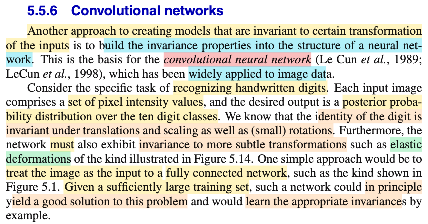</kbd>

<kbd>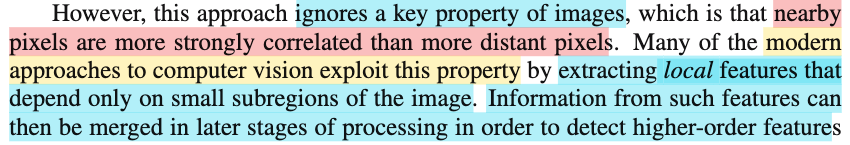</kbd>

<kbd>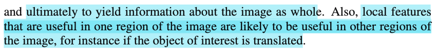</kbd>

> [!NOTE]
> Đại ý là phần này ta sẽ học về cách tiếp cận khác, đối với bài toán làm sao có được tính invariance under transformation, thông qua cách làm là xây dựng cấu trúc của mô hình sao cho nó tự nhiên có được khả năng này thay vì phải học từ data.
>
>
>
> Trước tiên ta lấy ví dụ bài toán nhận diện chữ viết tay, rõ ràng với bài toán này. một chữ số nếu bị xoay chút ít, scale, translate thì kết quả phải ko đổi, do đó yêu cầu hệ thống phải có tính bất biến.
>
>
>
> Thế thì một cách làm như bữa giờ đã nói, đó là ta có thể đặt mỗi bức ảnh - vốn có thể coi như một vector các con số - thành input vào một fullly connected network, thì nếu data nhiều, có thể network (theo nguyên tắc), có thể sẽ học được khả năng invariance này.
>
>
>
> Tuy nhiên cách làm này sẽ có nhược điểm quan trọng đại khái là nó sẽ bỏ qua hết một đặc trưng cốt lõi của hình ảnh: Đó là những pixel gần nhau sẽ tương quan mạnh với nhau hơn là các pixel ở xa. Và nhiều hướng tiếp cận hiện đại của lĩnh vực thị giác máy tính khai thác tính chất này bằng cách extract ra các LOCAL FEATURES. Thông tin này sau đó được nhập lại ở những bước xử lí sau đó để có thể detect những đặc trưng bậc cao hơn và cuối cùng sẽ cho ra thông tin của toàn bộ bức ảnh.
>
>
>
> Bên cạnh đó, local feature hữu ích trong một vùng này cũng có thể sẽ hữu ích  trong vùng kia.

📹 [Xem video trên YouTube](https://www.youtube.com/watch?v=YhqXLoQBBv4)

> [!TIP]
> 🤖 **AI Check** — 🟢 Pass — ✅ **95/100** · ✓ Move on
>
> Ghi chú tóm tắt rất chính xác ý tưởng cốt lõi của đoạn trích: xây dựng cấu trúc mạng có sẵn tính bất biến thay vì chỉ dựa vào dữ liệu lớn trên mạng kết nối đầy đủ (fully connected).
>
> **✓ Strengths**
> - Nắm bắt chính xác bản chất của CNN là nhúng tính chất bất biến (invariance) trực tiếp vào kiến trúc mạng.
> - Hiểu đúng vai trò và giới hạn theo lý thuyết của mạng fully connected: trên nguyên tắc có thể học bất biến từ dữ liệu lớn nhưng kém hiệu quả hơn so với thiết kế kiến trúc chuyên biệt.
> - Tóm tắt mạch lạc các biến đổi hình học phổ biến cần tính bất biến như dịch chuyển, co giãn và xoay góc nhỏ.
>
> **💡 Deeper notes**
> - Đoạn văn gốc còn nhắc đến 'biến dạng đàn hồi' (elastic deformations) - một loại biến dạng phi tuyến cục bộ tinh vi rất đặc trưng trong chữ viết tay ngoài các biến dạng affine cơ bản.

 

### Figure 5.17 Convolutional Neural Network

<kbd>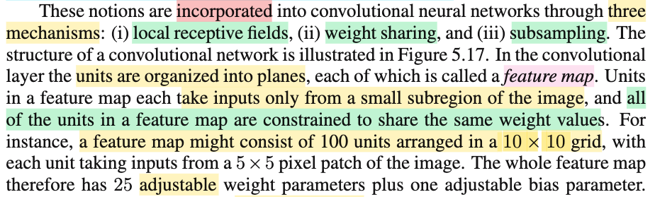</kbd>

<kbd>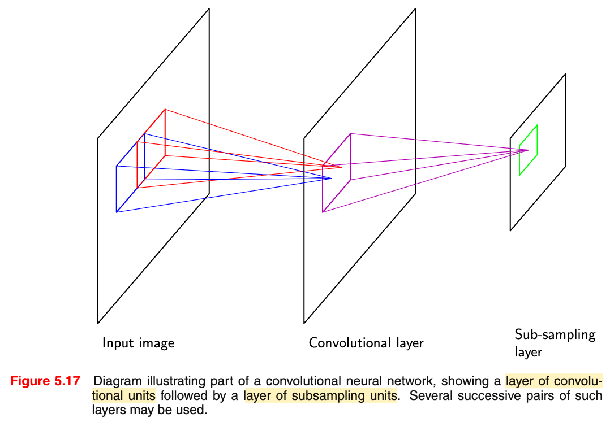</kbd>

<kbd>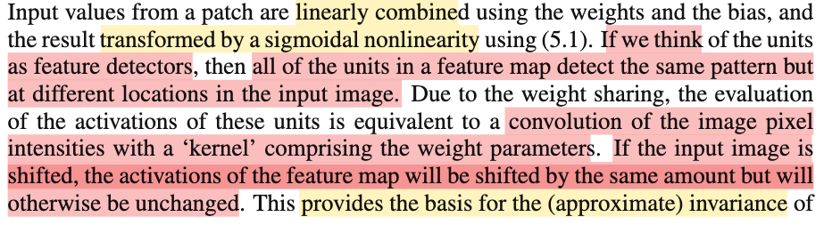</kbd>

<kbd>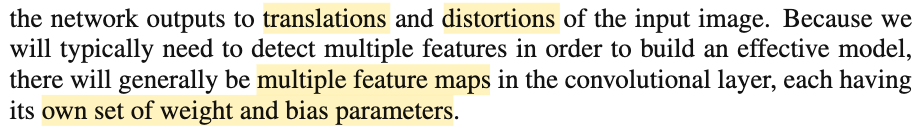</kbd>

<kbd>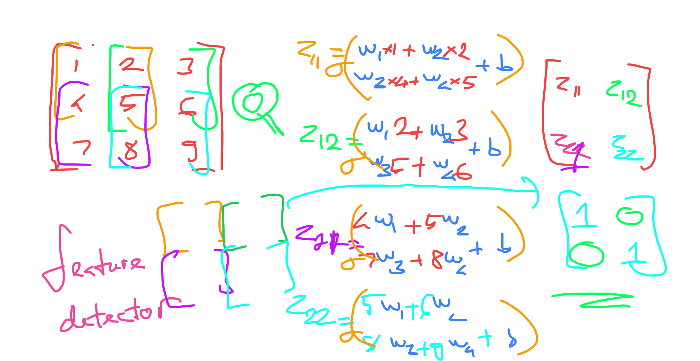</kbd>

<kbd>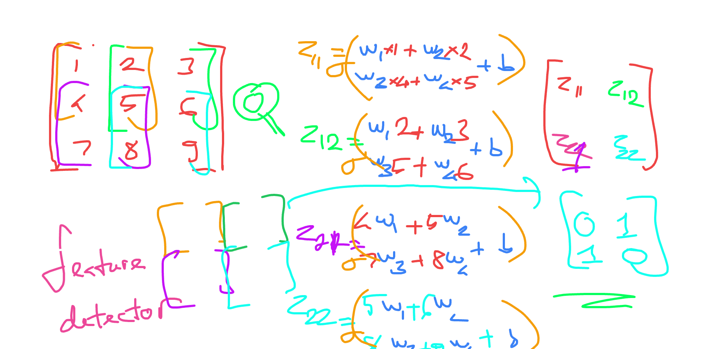</kbd>

> [!NOTE]
> Hiểu về kiến trúc của convolutional network như sau:
>
>
>
> Có 3 cấu phần chính:
>
>
>
> i) Local receptive field (vùng tiếp nhận cục bộ)
>
>
>
> ii) Weight sharing
>
>
>
> iii) Subsampling.
>
>
>
> Bắt đầu với convolutional layer: các unit sẽ được tổ chức thành planes (hiểu đại khái là mảng 2 chiều) gọi là **feature map**.
>
>
>
> Mỗi unit sẽ chỉ tiếp nhận thông tin từ một vùng (subregion) của ảnh đầu vào. Và dùng cùng một bộ trọng số + bias để tính ra giá trị của activation của unit đó. Ví dụ vùng ảnh đầu vào kích thước 5x5 = 25 input value, ta sẽ weight sum nó nới w1,w2,...w25 và + bias b, sau đó áp hàm kích hoạt như sigmoid để tính ra giá trị unit. Có nghĩa là, mỗi unit sẽ đều dùng cùng một bộ tham số này để tính với cái vùng 5x5 của mình. Để ra một cái feature map, ví dụ 10x10 = 100 units.
>
>
>
> ---
>
>
>
> Hiểu thế này, vì mỗi unit sẽ được tính từ cùng một bộ giá trị tham số và một vùng cục bộ của input, nên ta sẽ có thể hình dùng như vầy, giả sử có một pattern nào đó xuất hiện ở nhiều nơi trên cái hình input1, ví dụ một dấu gạch chữ thập chẳng hạn, thì trên feature map sẽ có nhiều unit có giá trị giống nhau. Từ đó ta có thể nhìn nhận câu chuyện giống như mỗi unit là một FEATURE DETECTOR, mang nhiệm vụ detect một hình mẫu nào đó, một feature nào đó tại các vị trí khác nhau của bức hình.
>
>
>
> (Và vì vậy, dễ hiểu là ta sẽ cần nhiều feature map để detect nhiều feature khác nhau.)
>
>
>
> Cũng như là, nếu dấu thập có bị dịch đi chỗ khác, thì giá trị của unit detect được dấu thập tương ứng trên feature map cũng bị dịch đi. Và điều này tạo cơ sở cho tính bất biến của network đối với phép tịnh tiến, hay vặn xoắn. Lẽ dễ hiểu là vì, dù cái hình có bị dịch đi (translate) thì feature map vẫn detect được mô thức dấu thập ở một unit khác.

> [!TIP]
> 🤖 **AI Check** — 🟢 Pass — ✅ **95/100** · ✓ Move on
>
> Ghi chú rất tốt, thể hiện sự hiểu bài sâu sắc và diễn giải lại trực quan, chính xác các khái niệm cốt lõi về trường tiếp nhận cục bộ, chia sẻ trọng số và tính chất phát hiện đặc trưng của mạng tích chập.
>
> **✓ Strengths**
> - Nắm bắt chính xác 3 cơ chế nền tảng của CNN (local receptive fields, weight sharing, subsampling) và cách tổ chức các unit thành feature map.
> - Mô tả cụ thể phép tính tổ hợp tuyến tính kết hợp hàm kích hoạt phi tuyến cùng ví dụ về số lượng tham số rất rõ ràng.
> - Diễn giải trực quan và chính xác vai trò của từng unit như một bộ phát hiện đặc trưng (feature detector) tại các vị trí không gian khác nhau.
>
> **💡 Deeper notes**
> - Về mặt thuật ngữ chính xác trong học sâu: Tính chất 'ảnh dịch chuyển dẫn đến feature map dịch chuyển tương ứng' được gọi là tính đồng biến với phép tịnh tiến (translation equivariance). Chính tính đồng biến này ở tầng tích chập, khi kết hợp với tầng lấy mẫu phụ (subsampling / pooling), mới tạo ra tính bất biến với phép tịnh tiến (translation invariance) ở đầu ra cuối cùng của mạng.

 

#### Subsampling Layer in CNNs

<kbd>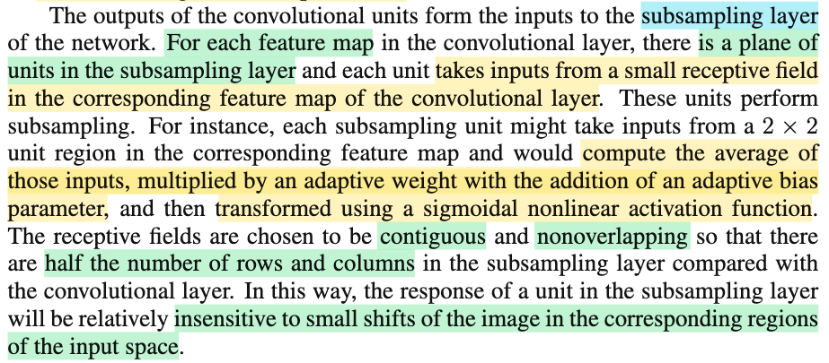</kbd>

<kbd>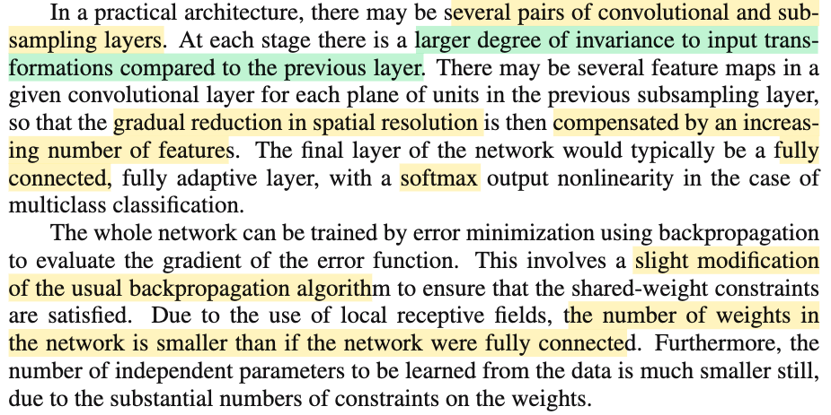</kbd>

<kbd>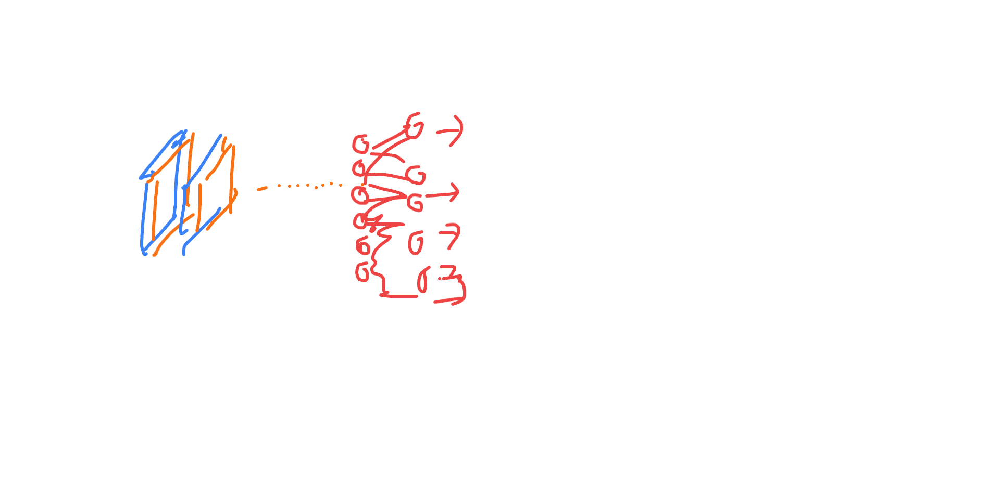</kbd>

> [!NOTE]
> Theo sau mỗi convolutional layer (lớp tích chập), sẽ là một subsampling layer, (mà người ta có thể gọi là pooling layer): Nó cũng làm tương tự: mỗi unit sẽ tính từ một vùng cục bộ của input (là feature map của conv layer trước đó), nhưng nó không có tính một phép tổng trọng số, mà chỉ là tính trung bình hoặc sau này có thể max pooling - lấy max. 
>
>
>
> (trong bối cảnh của sách, ta vẫn tính trung bình và rồi nhân thêm một adaptive weight và cộng thêm một adaptive bias rồi áp hàm phi tuyến, nhưng sau này trong deep learning hiện đại như trong cs231n mình thấy họ bỏ vụ này)
>
>
>
> Và receptive field cũng không chồng lấn như của conv net, thành ra, ví dụ như 2x2, thì số hàng/cột của subsampling layer sẽ giảm đi một nửa, để nếu như conv layer có shape 10x10 thì subsampling chỉ còn 5x5
>
>
>
> Và ý cuối đó là, vì nó chỉ tính trung bình của một vùng cục bộ của feature map, nên dễ hiểu là nếu một pattern nào đó dịch chuyển nhỏ trong cái hình gốc, khiến trên feature map, vị trí unit bị activate dịch chuyển nhỏ theo, nhưng vẫn trong cùng một receptive field đối với subsampling, thì giá trị của subsampling unit tương ứng vẫn ko đổi. Do đó mới nói là phản ứng của unit trong subsampling layer sẽ tương đối ít nhạy đối với những chuyển dịch nhỏ của bức ảnh
>
>
>
> ---
>
>
>
> Trong kiến trúc của convnet thực tế, sẽ có nhiều conv layer và subsampling layer tạo thành các cặp conv - subsampling layer xen kẽ.
>
>
>
> Tại mỗi giai đoạn, mức độ bất biến đối với input transformation sẽ ngày càng lớn hơn. Vì sao? Vì nó sẽ mang thông tin của một vùng lớn hơn của ảnh input
>
>
>
> Bên cạnh đó, ta sẽ có nhiều chứ không phải chỉ một feature map của mỗi layer (mỗi cái có một bộ tham số riêng) nhờ vậy, tuy rằng kích thước theo bề ngang rộng của feature map giảm dần, nhưng số feature mà mỗi layer chứ đựng sẽ tăng dần. Và layer cuối thường là fully connected layer và output softmax.
>
>
>
> Cuối cùng, ta vẫn train network bằng backprop, chỉ cần điều chỉnh lại tí để phản ánh vụ weight sharing.

> [!TIP]
> 🤖 **AI Check** — 🟢 Pass — ✅ **98/100** · ✓ Move on
>
> Ghi chú tóm tắt rất xuất sắc và chính xác toàn bộ nội dung của hai trang sách, đồng thời liên hệ rất tốt với kiến thức Deep Learning hiện đại (CS231n).
>
> **✓ Strengths**
> - Nắm rất vững cơ chế subsampling cổ điển (LeNet: tính trung bình + trọng số/bias học được + phi tuyến) và phân biệt chuẩn xác với pooling hiện đại (max/average pooling không tham số).
> - Giải thích trực quan và chính xác lý do subsampling mang lại tính bất biến cục bộ đối với dịch chuyển nhỏ (translation invariance).
> - Hiểu rõ kiến trúc tổng thể: đánh đổi giữa giảm kích thước không gian và tăng số lượng feature maps, cũng như nguyên lý backpropagation với ràng buộc chia sẻ trọng số (weight sharing).
>
> **💡 Deeper notes**
> - Về mặt toán học khi backpropagation với chia sẻ trọng số (weight sharing), gradient của một trọng số dùng chung đơn giản là tổng các đạo hàm riêng (gradient) tương ứng từ tất cả các vị trí/unit sử dụng trọng số đó.

 

