# 5.5.7 Soft weight sharing

📊 **Progress:** `4` Notes | `12` Screenshots | `4` AI Reviews

---

 

## Section 5.5.7 Soft Weight Sharing

<kbd>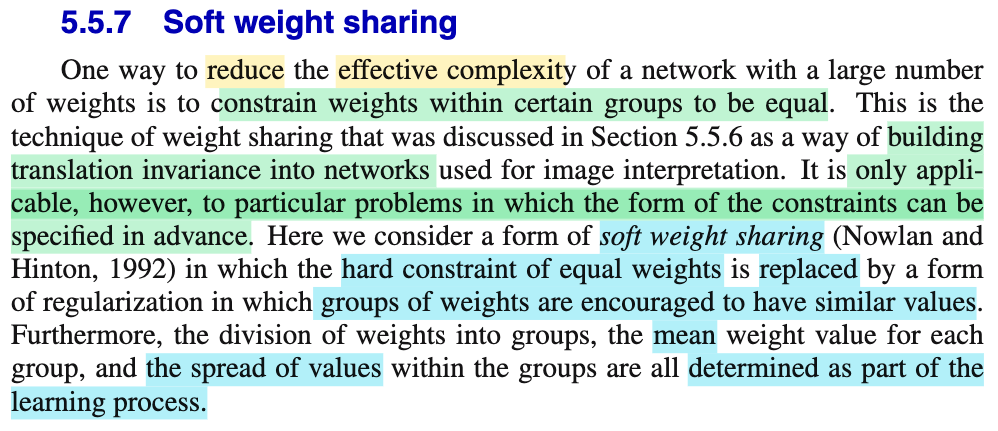</kbd>

<kbd>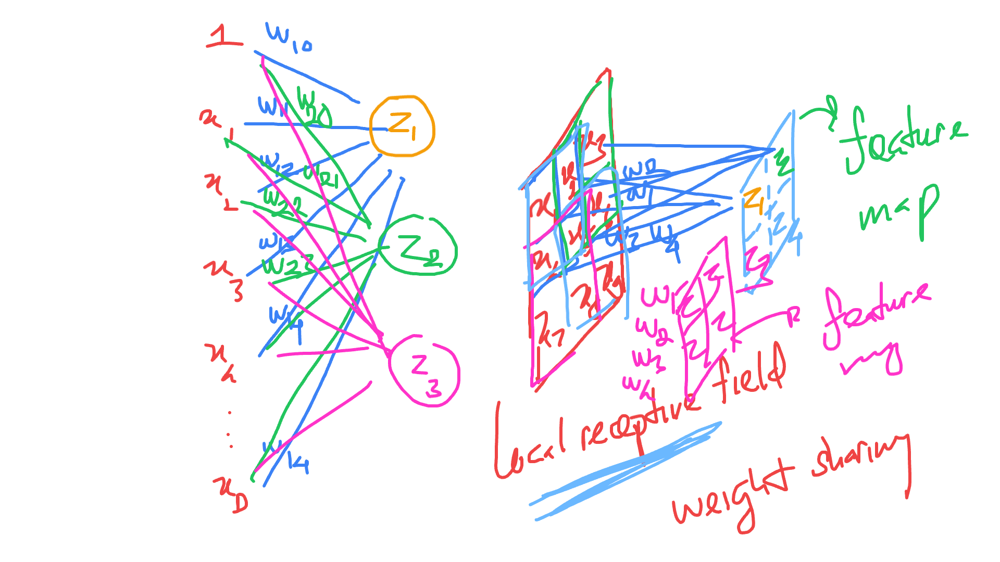</kbd>

<kbd>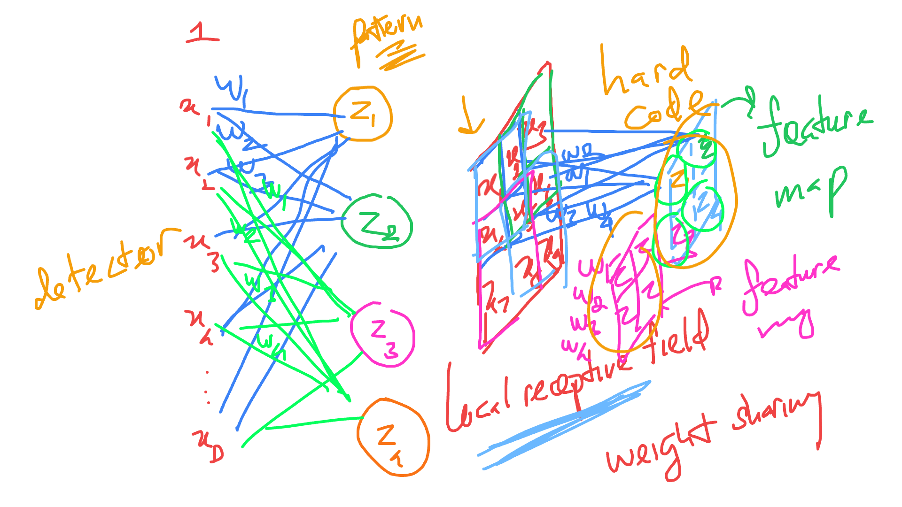</kbd>

<kbd>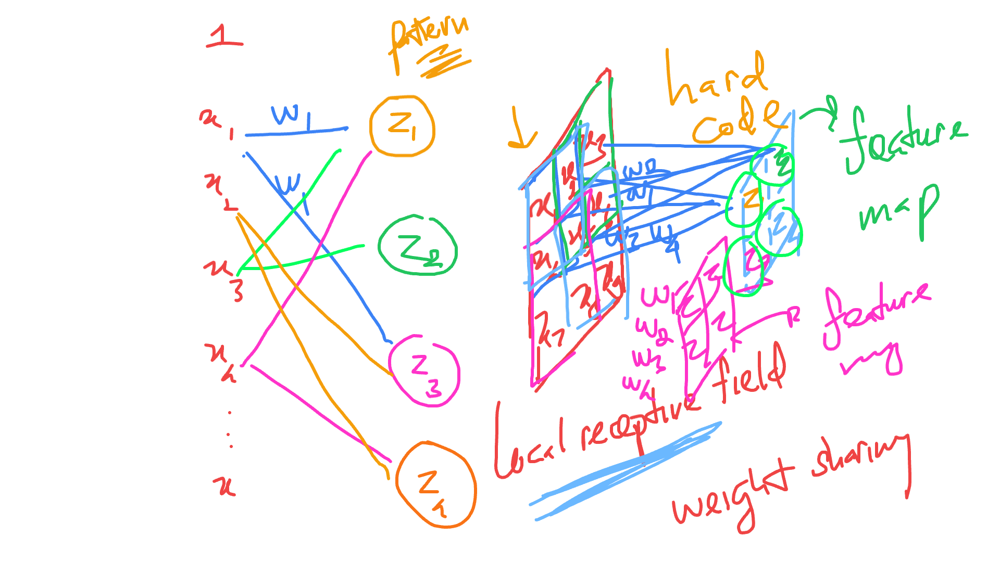</kbd>

<kbd>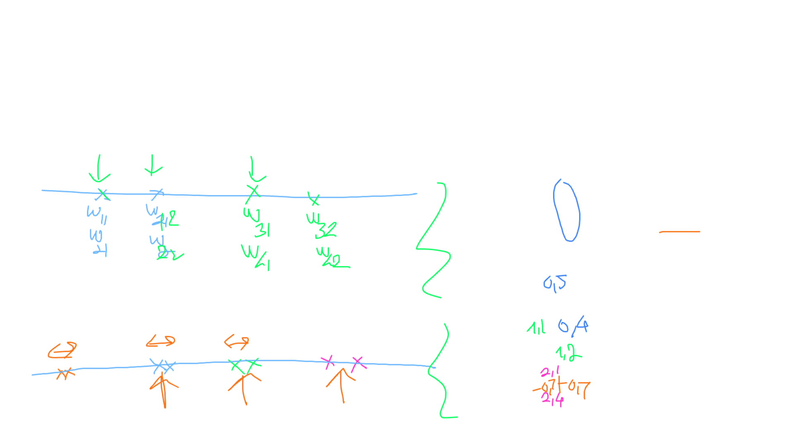</kbd>

> [!NOTE]
> Hiểu đại khái ý này là như sau:
>
>
>
> Trong mấy phần trước ta đã nói về một cách để giảm độ phức tạp hiệu dụng của network với số tham số lớn. Một trong những cách đó là weight sharing, mà kiến trúc convolutional network trong phần trước chính là một cách để làm cái này: mỗi unit trong feature map đều được tính toán với cùng một bộ weight + bias, với các receptive field khác nhau.
>
>
>
> Thế thì, cách làm này, có thể nhìn theo kiểu khác là, mỗi unit (của cùng feature map) có một bộ weight + bias giống như network trước đây nhưng ta đã ràng buộc rằng các bộ weights này một cách cứng nhắc là chúng phải bằng nhau, và do đó, thay vì mỗi unit 1 bộ, thì nay cả đám unit trong một feature map xài chung 1 bộ, khiến số tham số cần thiết giảm xuống.
>
>
>
> Vậy thì đại khái là, cách làm này nó chỉ áp dụng được cho những bài toán cụ thể nơi mà ta đã biết trước các dạng ràng buộc. Ví dụ như "các unit của cùng một feature map" đều có cùng weight, là một dạng ràng buộc mà ta đã biết trước.
>
>
>
> Tuy nhiên, nếu ta ko biết trước các dạng ràng buộc này, thì không dùng cách này được. Do đó, một cách tiếp cận là soft weight sharing, trong đó, ta thay ràng buộc cứng bằng ràng buộc mềm - đó là để neural net tự học ra nên nên ràng buộc các trọng số thế nào.

📹 [Xem video trên YouTube](https://www.youtube.com/watch?v=856zuU_VmJg)

> [!TIP]
> 🤖 **AI Check** — 🟢 Pass — ✅ **95/100** · ✓ Move on
>
> Ghi chú tóm tắt rất chính xác bản chất và động lực chuyển từ hard weight sharing (như trong CNN) sang soft weight sharing. Bạn đã nắm rất tốt ý niệm ràng buộc cứng so với điều chuẩn mềm học được từ dữ liệu.
>
> **✓ Strengths**
> - Liên hệ rất chính xác ví dụ CNN từ mục 5.5.6 như một dạng hard weight sharing với các ràng buộc biết trước cấu trúc không gian.
> - Nắm đúng hạn chế của hard weight sharing là chỉ khả thi khi dạng ràng buộc có thể xác định trước.
> - Hiểu đúng bản chất của soft weight sharing là biến ràng buộc đẳng thức cứng thành cơ chế điều chuẩn mềm để mô hình tự học cách gom nhóm.
>
> **💡 Deeper notes**
> - Trong chi tiết kỹ thuật của Bishop, 'ràng buộc mềm' cụ thể được cài đặt thông qua một hàm tiên nghiệm hỗn hợp Gauss (Gaussian mixture prior), trong đó các trọng số được khuyến khích có giá trị gần nhau (thay vì bắt buộc bằng nhau tuyệt đối). Các tham số như giá trị trung bình (mean), độ lệch (spread) và xác suất thuộc nhóm đều được tối ưu cùng lúc trong quá trình học.

 

### Mixture of Gaussians Regularizer

<kbd>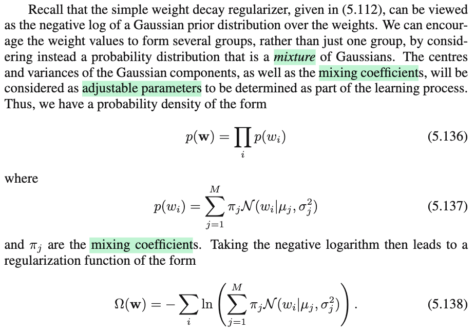</kbd>

<kbd>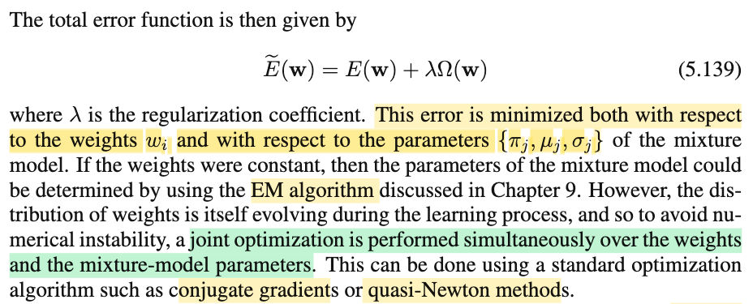</kbd>

> [!NOTE]
> Ôn lại simple weight decay, L2 regularizer để hiểu vì sao nói "simple weight decay regularizer can be viewd as the negative log of Gaussian prior...}
>
>
>
> Ẽ(𝐰) = E(𝐰) (SSE) + (λ/2) Σi wi²
>
>
>
> Frequentist 𝐰 fixed unknown
>
>
>
> Bayes 𝐰 random variables
>
>
>
> Chọn p(𝐰), 𝒩(𝟎, (1/α) 𝐈). Bayes:
>
>
>
> p(𝐰|𝒟) = p(𝒟|𝐰)p(𝐰)/p(𝒟)
>
>
>
> Assumption
>
>
>
> 𝐱1,𝐱2,...là những giá trị cố định đã biết
>
>
>
> t1,t2,....là những giá trị quan sát được của T1,T2,...: độc lập Ti \~ 𝒩(𝐰ᵀΦ(𝐱i), 1/β)
>
>
>
> p(𝒟|𝐰) = p(t1,t2,....|𝐰) = Πi p(ti|𝐰) = Πi 𝒩(ti|𝐰ᵀΦ(𝐱i), 1/β)
>
>
>
> p(𝐰|𝒟) ∝ p(𝒟|𝐰)p(𝐰) = Πi 𝒩(ti|𝐰ᵀΦ(𝐱i), 1/β) 𝒩(𝐰|𝟎, (1/α) 𝐈)
>
>
>
> Tìm 𝐰 sao cho maximize p(𝐰|𝒟)
>
>
>
> equivalent: tìm 𝐰 maximize log p(𝐰|𝒟)
>
>
>
> equivalent: tìm 𝐰 maximize log \[Πi 𝒩(ti|𝐰ᵀΦ(𝐱i), 1/β) 𝒩(𝐰|𝟎, (1/α) 𝐈)\]
>
>
>
> = log \[Πi 𝒩(ti|𝐰ᵀΦ(𝐱i), 1/β)\] + log \[𝒩(𝐰|𝟎, (1/α) 𝐈)\]
>
>
>
> = Σi log \[𝒩(ti|𝐰ᵀΦ(𝐱i), 1/β)\] + log \[𝒩(𝐰|𝟎, (1/α) 𝐈)\]
>
>
>
> = Σi log \[c exp(-β\[ti-𝐰ᵀΦ(𝐱i)\]²/2)\] + log \[𝒩(𝐰|𝟎, (1/α) 𝐈)\]
>
>
>
> = Σi log c + Σi log exp(-β\[ti-𝐰ᵀΦ(𝐱i)\]²/2)\] + log \[c exp\[-(𝐰-𝟎)ᵀα𝐈(𝐰-𝟎)/2\]
>
>
>
> = Σi log c -(β/2) Σi (ti-𝐰ᵀΦ(𝐱i))² + log \[c2 exp\[(-α/2)(𝐰ᵀ𝐰\]
>
>
>
> = Σi log c -(β/2) Σi (ti-𝐰ᵀΦ(𝐱i))² + log c2 + log exp\[(-α/2)(𝐰ᵀ𝐰)\]
>
>
>
> = Σi log c -(β/2) Σi (ti-𝐰ᵀΦ(𝐱i))² + log c2 + (-α/2)(𝐰ᵀ𝐰)
>
>
>
> = D -(β/2) Σi (ti-𝐰ᵀΦ(𝐱i))² - (α/2)(𝐰ᵀ𝐰)
>
>
>
> equivalent: tìm 𝐰 sao cho minimize:
>
>
>
> β \[(1/2) Σi (ti-𝐰ᵀΦ(𝐱i))² + (α/β)/2)(𝐰ᵀ𝐰)\]
>
>
>
> equivalent: tìm 𝐰 sao cho minimize:
>
>
>
> (1/2) Σi (ti-𝐰ᵀΦ(𝐱i))² + (λ/2)(𝐰ᵀ𝐰)
>
>
>
> SSE + L2 regularizer
>
>
>
> 𝐰ML
>
>
>
> 𝐰MAP
>
>
>
>
>
>
>
>
>
>
>
>
>
>
>
>
>
>
>
>
>
>
>
>
>
>
>
>
>
>
>
>
>
>
>
>
>
>
>
>
>
>
>
> p(𝐰): 𝒩(𝐰|𝟎, (1/α) 𝐈)
>
>
>
> wi \~ 𝒩(0, (1/α))
>
>
>
> Σj πj 𝒩(μj, σj²)
>
>
>
> Ý tưởng chỉ là: thay vì dùng prior distribution của wi là 𝒩(μ, σ²), và giả định chúng độc lập, Ví dụ wi \~ 𝒩(0, 1/α), cũng chính là 𝐰 \~ 𝒩(𝟎, (1/α)𝐈), thì nay, ta dùng mixture Gaussian:
>
>
>
> wi \~ p(𝐰i) = Σj πj 𝒩(μj, σj²)
>
>
>
> posteriori:
>
>
>
> p(𝐰|𝒟) ∝ p(𝒟|𝐰)p(𝐰)
>
>
>
> để tìm 𝐰 maximize posterior, ta đặt loss là negative log p(𝐰|𝒟) ∝ - log p(𝒟|𝐰)p(𝐰)
>
>
>
> = -log p(𝒟|𝐰) - log p(𝐰)
>
>
>
> thì -log p(𝒟|𝐰) sẽ chính là main loss: ví dụ SSE hay cross entropy
>
>
>
> còn - log p(𝐰) chính là regularizer
>
>
>
> = - ln Πi p(wi)
>
>
>
> = - Σi ln p(wi)
>
>
>
> = - Σi ln Σj πj 𝒩(wi|μj, σj²) → Ω(𝐰)
>
>
>
> Và ta sẽ train network để tìm 𝐰 và cả πj, μj, σj² giúp minimize E = E(𝐰) + λΩ(𝐰)
>
>
>
> và ta sẽ optimized đồng thời theo cả 𝐰 và cả πj, μj, σj², thông qua các thuật toán như CG hay quasi-Newton.

> [!TIP]
> 🤖 **AI Check** — 🟢 Pass — ✅ **95/100** · ✓ Move on
>
> Ghi chú rất xuất sắc, tự dẫn xuất chi tiết từ góc nhìn MAP để làm rõ cơ sở xác suất của L2 regularization trước khi mở rộng trực tiếp sang Gaussian Mixture prior đúng như sách trình bày.
>
> **🟡 Minor issues**
>
> **1.** *"wi ~ p(𝐰i) = Σj πj 𝒩(μj, σj²)"*
>
> Ký hiệu bị nhầm giữa vector và vô hướng (p(𝐰i) thay vì p(w_i)), đồng thời lược bỏ biến $w_i$ bên trong phân phối Gauss (chuẩn xác nên viết là $\mathcal{N}(w_i|\mu_j, \sigma_j^2)$).
>
> **2.** *"β [(1/2) Σi (ti-𝐰ᵀΦ(𝐱i))² + (α/β)/2)(𝐰ᵀ𝐰)]"*
>
> Lỗi gõ thừa dấu đóng ngoặc ở cụm `(α/β)/2)`.
>
>
> **✓ Strengths**
> - Dẫn xuất đầy đủ và chính xác từ phân phối tiên nghiệm Gauss và likelihood Gauss ra hàm lỗi SSE kết hợp L2 regularizer với hệ số suy giảm trọng số $\lambda = \alpha / \beta$.
> - Nắm bắt chính xác bản chất: thay vì prior Gauss đơn một cụm quanh 0, dùng Gaussian Mixture prior để gom cụm trọng số dẫn đến regularizer $\Omega(\mathbf{w})$.
> - Ghi nhận đúng việc tối ưu hóa đồng thời cả trọng số $\mathbf{w}$ lẫn các tham số của mixture model bằng các thuật toán gradient bậc hai/bán Newton (CG, quasi-Newton).
>
> **💡 Deeper notes**
> - Khi tối ưu hóa các tham số của mixture model $(\pi_j, \mu_j, \sigma_j^2)$ bằng thuật toán gradient không ràng buộc (như CG hay quasi-Newton), trên thực tế cần đổi biến/tái tham số hóa (reparameterization), ví dụ dùng softmax cho $\pi_j$ (đảm bảo $\sum \pi_j = 1, \pi_j \ge 0$) và exp cho $\sigma_j$ (đảm bảo $\sigma_j > 0$).

 

#### Error Function Derivatives with Priors

<kbd>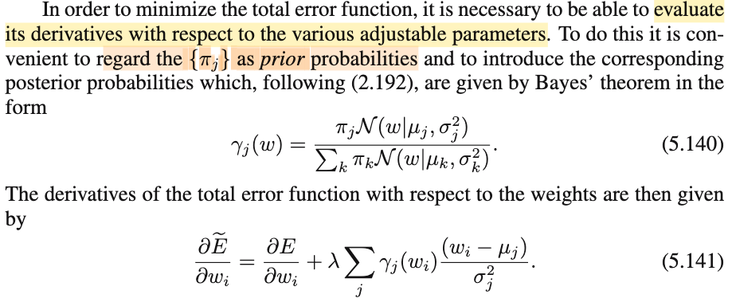</kbd>

<kbd>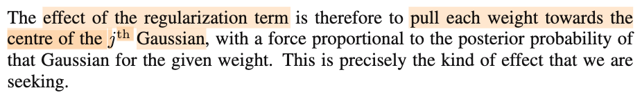</kbd>

> [!NOTE]
> Hiểu 5.140 thế này:
>
>
>
> πj ≥ 0, Σj πj = 1
>
>
>
>
>
> Cứ coi π1,π2,...πM là pmf của một biến ngẫu nhiên C: P(C=j) = πj
>
>
>
> thì đây là prior distribution của C
>
>
>
> posterior distribution của C:
>
>
>
> P(C=j|w) = p(w|C=j)P(C=j)/p(w)
>
>
>
> kí hiệu γj(w) là P(C=j|w)
>
>
>
> và p(w) = Σk p(w|C=k)P(C=k) = Σk 𝒩(w|μk, σk²)πk
>
>
>
> ⇒ γj(w) = 𝒩(w|μj, σj²)πj / Σk 𝒩(w|μk, σk²)πk
>
>
>
> ---
>
>
>
> Ω(𝐰) = - Σk ln Σj πj 𝒩(wk|μj, σj²)
>
>
>
> ∂/∂wi Ω(𝐰) = ∂/∂wi (- Σk ln Σj πj 𝒩(wk|μj, σj²))
>
>
>
> = - Σk ∂/∂wi (ln Σj πj 𝒩(wk|μj, σj²))
>
>
>
> = - ∂/∂wi (ln Σj πj 𝒩(w1|μj, σj²)) -  ∂/∂wi (ln Σj πj 𝒩(w2|μj, σj²)) - ....
>
>
>
> \- ∂/∂wi (ln Σj πj 𝒩(wi|μj, σj²))
>
>
>
> = - 0 -  0 - .... - ∂/∂wi (ln Σj πj 𝒩(wi|μj, σj²))
>
>
>
> = - ∂/∂wi (ln Σj πj 𝒩(wi|μj, σj²))
>
>
>
> ---
>
>
>
> Xét ∂/∂wi (ln Σj πj 𝒩(wi|μj, σj²))
>
>
>
> = ∂/∂u ln(u) . ∂/∂wi u(wi)
>
>
>
> = \[1/Σj πj 𝒩(wi|μj, σj²)\] \[∂/∂wi Σj πj 𝒩(wi|μj, σj²)\]
>
>
>
> Xét \[∂/∂wi Σj πj 𝒩(wi|μj, σj²)\] 
>
>
>
> = Σj πj ∂/∂wi \[𝒩(wi|μj, σj²)\]
>
>
>
> (𝒩(x | μ, σ²) = (1/√2πσ²) exp(-(x-μ)²/2σ²))
>
>
>
> = Σj πj ∂/∂wi \[c exp(-(wi-μj)²/2σj²)\]
>
>
>
> = Σj πj c ∂/∂wi \[exp(-(wi-μj)²/2σj²)\]
>
>
>
> = Σj πj c exp(-(wi-μj)²/2σj²) ∂/∂wi (-(wi-μj)²/2σj²)
>
>
>
> = Σj πj c exp(-(wi-μj)²/2σj²) \[∂/∂wi (-(wi-μj)²\]/2σj²
>
>
>
> = Σj πj c exp(-(wi-μj)²/2σj²) (-2(wi-μj)/2σj²
>
>
>
> = - Σj πj 𝒩(wi|μj, σj²) (wi-μj)/σj²
>
>
>
> ---
>
>
>
> ⇒ ∂/∂wi (ln Σj πj 𝒩(wi|μj, σj²))
>
>
>
> = \[1/Σj πj 𝒩(wi|μj, σj²)\] \[∂/∂wi Σj πj 𝒩(wi|μj, σj²)\]
>
>
>
> = \[1/Σj πj 𝒩(wi|μj, σj²)\] \[- Σj πj 𝒩(wi|μj, σj²) (wi-μj)/σj²\]
>
>
>
> = - Σj {πj 𝒩(wi|μj, σj²) (wi-μj)/σj²} / Σj πj 𝒩(wi|μj, σj²)
>
>
>
> = - Σj {\[πj 𝒩(wi|μj, σj²) / Σj πj 𝒩(wi|μj, σj²)\] (wi-μj)/σj²}
>
>
>
> = - Σj {γj(wi) (wi-μj)/σj²}
>
>
>
> Viết lại: ∂/∂wi (ln Σj πj 𝒩(wi|μj, σj²)) = - Σj {γj(wi) (wi-μj)/σj²}
>
>
>
> Vậy:
>
>
>
> ∂/∂wi Ω(𝐰) = - ∂/∂wi (ln Σj πj 𝒩(wi|μj, σj²))
>
>
>
> = - \[- Σj {γj(wi) (wi-μj)/σj²}\]
>
>
>
> = Σj γj(wi) (wi-μj)/σj²
>
>
>
> Nên ∂Ẽ/∂wi = ∂E/∂wi + λΣj γj(wi) (wi-μj)/σj² → 5.141
>
>
>
> ---
>
>
>
>  Và kết quả này đại ý là cho thấy để minimize objective, bao gồm minimizer regularizer, wi sẽ vị kéo về các mean μj của các 𝒩(μj, σj²) với một "lực" tỉ lệ thuận với γj(wi), tức posterior probability của nó. Đây chính xác là điều ta tìm kiếm. Là sao?
>
> → Ta muốn gì? nhớ lại, ta muốn network tự học cách ràng buộc giá trị của weights (hiểu nôm na là tự học cách gom nhóm weight lại, thành các cụm, ví dụ, nếu nó thấy cần cho mọi weight bằng nhau, thì cứ gom thành 1 cụm, và thậm chí gom cái cụm đó thành 1 điểm duy nhất để đạt trạng thái mọi weight đều bằng nhau. Còn nếu nó thấy cần thiết để unit 1 và unit 5 có weight giống giống nhau, cứ việc gom w11, w51 vào thành 1 cụm μj nào đó w12 và, w52,..thành 1 cụm tại mean μj'
>
>
>
> Và lực kéo tỉ lệ thuận với γj(wi) có ý nghĩa gì?
>
>
>
> Vậy posterior p(C=j|w) có ý nghĩa gì? Nó có nghĩa là, xác suất w nên thuộc cụm nào nào dựa trên giá trị của nó. Nên γj(wi), (chính là p(C=j|wi)) càng lớn thì có nghĩa là xác suất wi nên thuộc cụm j dựa trên giá trị của nó càng lớn.
>
>
>
> Vậy xét: (giả sử chỉ có 2 cụm)
>
>
>
> ∂Ω/∂wi = γ1(wi) (wi-μ1)/σ1² + γ2(wi) (wi-μ2)/σ2² 
>
>
>
> thì nếu γ1(wi) ≫ γ2(wi) đồng nghĩa dựa trên giá trị của wi, cho thấy xác suất nó thuộc cụm 1 là lớn hơn nhiều xác suất nó thuộc cụm 2. Khi đó, khi ém Ω(wi), cũng là muốn ép ∂Ω/∂wi = 0, thì do γ1(wi) ≫ γ2(wi) nên γ1(wi) (wi-μ1)/σ1² dominate γ2(wi) (wi-μ2)/σ2², khiến để giảm Ω(wi), thuật toán sẽ ưu tiên giảm wi-μ1, từ đó kéo wi về μ1.

📹 [Xem video trên YouTube](https://www.youtube.com/watch?v=2aWLf4m1SxY)

> [!TIP]
> 🤖 **AI Check** — 🟢 Pass — ✅ **98/100** · ✓ Move on
>
> Ghi chú xuất sắc! Bạn đã tự chứng minh chi tiết từng bước đạo hàm từ hàm phạt sang công thức (5.141) và giải thích trực giác 'lực kéo' cùng vai trò của posterior rất chuẩn xác.
>
> **✓ Strengths**
> - Tự diễn giải và biến đổi giải tích tường minh từ dạng hàm hợp của log-sum đến công thức đạo hàm (5.141) hoàn toàn chính xác.
> - Hiểu đúng bản chất xác suất Bayes: coi pi_j là prior của biến ẩn component C và gamma_j(w) là posterior (responsibility).
> - Trực giác về cơ chế 'soft weight sharing' (gom cụm trọng số tự động) và phân tích trường hợp gamma_1 >> gamma_2 rất trực quan và thuyết phục.
>
> **💡 Deeper notes**
> - Ngoài độ lớn của xác suất hậu kỳ gamma_j(w_i), 'lực kéo' còn tỷ lệ nghịch với phương sai sigma_j^2: một cụm có phương sai càng hẹp (sigma_j nhỏ) thì độ co kéo trọng số về tâm mu_j càng mạnh.

 

##### Soft Weight Sharing Derivatives

<kbd>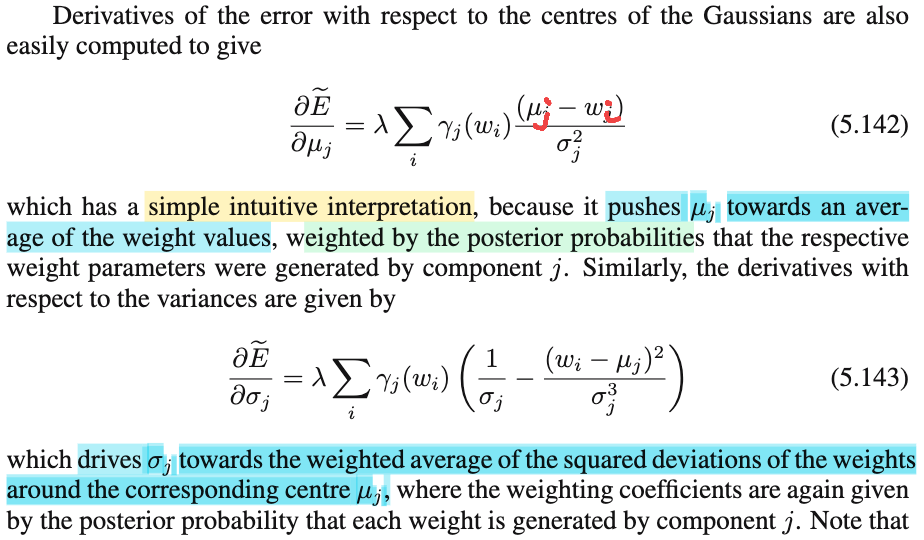</kbd>

> [!NOTE]
> Ω(𝐰) = - Σk ln Σj' πj' 𝒩(wk|μj', σj'²)
>
>
>
> (đổi biến chạy thành j' vì đang tính đaọ hàm theo μj)\
> \
> ∂/∂μj Ω(𝐰) = ∂/∂μj (- Σk ln Σj' πj' 𝒩(wk|μj', σj'²))
>
>
>
> = - Σk ∂/∂μj ln Σj' πj' 𝒩(wk|μj', σj'²))
>
>
>
> Xét ∂/∂μj ln Σj' πj' 𝒩(wk|μj', σj'²))
>
>
>
> = (1/Σj' πj' 𝒩(wk|μj', σj'²))) ∂/∂μj Σj' πj' 𝒩(wk|μj', σj'²)) (1)
>
>
>
> Xét ∂/∂μj Σj' πj' 𝒩(wk|μj', σj'²)):
>
>
>
> = Σj' ∂/∂μj πj' 𝒩(wk|μj', σj'²)
>
>
>
> = Σj' πj' ∂/∂μj 𝒩(wk|μj', σj'²)
>
>
>
> = πj ∂/∂μj 𝒩(wk|μj, σj²) (vì các hạng tử mà j' khác j đã thành 0)
>
>
>
> = πj ∂/∂μj {c exp\[-(wk-μj)²/2σj²\]}
>
>
>
> = πj c ∂/∂μj exp\[-(wk-μj)²/2σj²\]
>
>
>
> = πj c exp\[-(wk-μj)²/2σj²\] ∂/∂μj \[-(wk-μj)²/2σj²\]
>
>
>
> = πj 𝒩(wk|μj, σj²) ∂/∂μj \[-(wk-μj)²\] /2σj²
>
>
>
> = πj 𝒩(wk|μj, σj²) ∂/∂((wk-μj)) \[-(wk-μj)²\] ∂/∂μj (wk-μj) /2σj²
>
>
>
> = πj 𝒩(wk|μj, σj²) \[-2(wk-μj)\] (-1) /2σj²
>
>
>
> = πj 𝒩(wk|μj, σj²) (wk-μj) / σj²
>
>
>
> ---
>
>
>
> Vậy (1) = {πj 𝒩(wk|μj, σj²) (wk-μj) / σj²} / Σj' πj' 𝒩(wk|μj', σj'²))
>
>
>
> = \[πj 𝒩(wk|μj, σj²)/Σj' πj' 𝒩(wk|μj', σj'²)\] (wk-μj) / σj²
>
>
>
> = γj(wk) (wk-μj) / σj²
>
>
>
> Vậy ∂/∂μj Ω(𝐰) = - Σk γj(wk) (wk-μj) / σj²
>
>
>
> = Σk γj(wk) (μj-wk) / σj²
>
>
>
> = Σi γj(wi) (μj-wi) / σj²
>
>
>
> do đó ∂Ẽ/∂μj = λ Σi γj(wi) (μj-wi) / σj²
>
>
>
> chính là → 5.142
>
>
>
> Và lập luận tương tự ta sẽ thấy:
>
>
>
> (để giảm Ω(𝐰), thuật toán sẽ thay đổi μj sao cho μj tiến về điểm dừng, tức ∂/∂μj Ω(𝐰) = 0
>
>
>
> Từ đó, có thể thấy, μj sẽ bị kéo về gần những wk nào có γj(wk) lớn:
>
>
>
> ví dụ ∂/∂μ1 Ω(𝐰) viết tường minh:
>
>
>
> γ1(w11) (μ1-w11) / σ1² + γ1(w12) (μ1-w12) / σ1²
>
>
>
> \+ γ1(w51) (μ1-w51) / σ1² + γ1(w52) (μ1-w52) / σ1²
>
>
>
> trong đó γ1(w11) và γ1(w51) lớn γ1(w12), γ1(w52) nhỏ
>
>
>
> Thì khi đó μ1 sẽ bị kéo về gần w11 và w51 (chính là kéo về trung bình 2 thằng này), vì sao? vì trong 4 hạng tử trên hai cái gắn với γ1(w11) và γ1(w51) sẽ dominate, nên để giảm cả đám về 0, thuật toán ưu tiên kéo hai thằng này xuống, chính là μ1 sẽ bị kéo về gần w11 và w51.
>
>
>
> ---
>
>
>
> Tương tự:
>
>
>
> ∂/∂σj Ω(𝐰) = ∂/∂σj (- Σk ln Σj' πj' 𝒩(wk|μj', σj'²)) 
>
>
>
> = - Σk ∂/∂σj (ln Σj' πj' 𝒩(wk|μj', σj'²)) 
>
>
>
> = - Σk {∂/∂σj (Σj' πj' 𝒩(wk|μj', σj'²)) / Σj' πj' 𝒩(wk|μj', σj'²)} (2)
>
>
>
> Xét ∂/∂σj (Σj' πj' 𝒩(wk|μj', σj'²))
>
>
>
> = Σj' πj' ∂/∂σj (𝒩(wk|μj', σj'²))
>
>
>
> = πj ∂/∂σj \[(c/σj) exp(-(wk-μj)²/2σj²))\]
>
>
>
> Tạm bỏ πj, xét ∂/∂σj \[(c/σj) exp(-(wk-μj)²/2σj²))\]
>
>
>
> = ∂/∂σj (c/σj)\] exp(-(wk-μj)²/2σj²)) + (c/σj) ∂/∂σj exp(-(wk-μj)²/2σj²))
>
>
>
> = (-c/σj²) exp(-(wk-μj)²/2σj²)) + (c/σj) exp(-(wk-μj)²/2σj²)) ∂/∂σj (-(wk-μj)²/2σj²))
>
>
>
> = (-c/σj²) exp(-(wk-μj)²/2σj²)) + (c/σj) exp(-(wk-μj)²/2σj²)) \[-(wk-μj)²/2\] ∂/∂σj (1/σj²)
>
>
>
> = (-c/σj²) exp(-(wk-μj)²/2σj²)) + (c/σj) exp(-(wk-μj)²/2σj²)) \[-(wk-μj)²/2\] (-2/σj³)
>
>
>
> = (-1/σj) (c/σj) exp(-(wk-μj)²/2σj²)) + 𝒩(wk|μj, σj²) (wk-μj)²/σj³
>
>
>
> = (-1/σj) 𝒩(wk|μj, σj²) + 𝒩(wk|μj, σj²) (wk-μj)²/σj³
>
>
>
> =  𝒩(wk|μj, σj²) \[(-1/σj) + (wk-μj)²/σj³\]
>
>
>
> Gắn πj vô lại:
>
>
>
> πj 𝒩(wk|μj, σj²) \[(-1/σj) + (wk-μj)²/σj³\]
>
>
>
> ---
>
>
>
> Tiếp nối (2)
>
>
>
> ∂/∂σj Ω(𝐰) = - Σk {∂/∂σj (Σj' πj' 𝒩(wk|μj', σj'²)) / Σj' πj' 𝒩(wk|μj', σj'²)} 
>
>
>
> = - Σk {πj 𝒩(wk|μj, σj²) \[(-1/σj) + (wk-μj)²/σj³\] / Σj' πj' 𝒩(wk|μj', σj'²)} 
>
>
>
> = - Σk {{πj 𝒩(wk|μj, σj²)/ Σj' πj' 𝒩(wk|μj', σj'²)} × \[(-1/σj) + (wk-μj)²/σj³\] } 
>
>
>
> = - Σk {γj(wk) × \[(-1/σj) + (wk-μj)²/σj³\] } 
>
>
>
> = Σk {γj(wk) × \[(1/σj) - (wk-μj)²/σj³\] } 
>
>
>
> = Σi {γj(wi) × \[(1/σj) - (wi-μj)²/σj³\] }  (đổi biến chạy từ k thành i thôi)
>
>
>
> Vậy ∂/∂σj Ẽ = λ Σi {γj(wi) × \[(1/σj) - (wi-μj)²/σj³\] }
>
>
>
> Lập luận tương tự, regularizer khi tác động đến σj (điều chỉnh σj để minimizer regularizer) tập trung vào các hạng tử có γj(wi) cao, và bằng cách ép (1/σj) - (wi-μj)²/σj³ nhỏ, nó sẽ ép σj² - (wi-μj)² nhỏ lại về 0, cùng với μj bị ép về trung bình của các wi có γj(wi) cao, thì σj sẽ dần trở thành cái gì:
>
>
>
> nó sẽ là trung bình có trọng số (γj(wi)) của các (wi-μj)² với các wi khác nhau, mà Σi(wi-μj)²/n thì chính là sample variance. nói gần đúng thì σj sẽ trở thành standard deviation của các wi trong cụm j.
>
>
>
> Σi {γj(wi) (σj² - (wi-μj)²) / σj³} = 0
>
>
>
> ⇔ Σi {γj(wi) (σj² - (wi-μj)²)} = 0
>
>
>
> ⇔ Σi γj(wi) σj² - Σi {γj(wi)(wi-μj)²)} = 0
>
>
>
> ⇔ Σi γj(wi) σj² = Σi {γj(wi)(wi-μj)²)} 
>
>
>
> ⇔  σj² = Σi {γj(wi)(wi-μj)²} / Σi γj(wi)
>
>
>
> đây chính là weighted average của bình phương deviation

> [!TIP]
> 🤖 **AI Check** — 🟢 Pass — ✅ **100/100** · ✓ Move on
>
> Ghi chú xuất sắc! Bạn đã tự mình chứng minh chi tiết từng bước đạo hàm cho cả tâm Gauss (μj) và phương sai (σj), đồng thời giải thích bản chất trực giác của các công thức hoàn toàn chính xác.
>
> **✓ Strengths**
> - Thực hiện biến đổi giải tích đạo hàm theo quy tắc dây chuyền và quy tắc nhân rất chặt chẽ, chính xác tuyệt đối từng dấu âm/dương.
> - Làm rõ vai trò của trách nhiệm (responsibility) γj(wi) qua ví dụ trực quan cụ thể về việc các trọng số có γ lớn sẽ áp đảo và kéo tâm μj về phía chúng.
> - Giải phương trình điểm dừng đạo hàm bằng 0 để suy ra công thức nghiệm chính xác của σj², qua đó làm rõ nhận định trong sách về weighted average của sai số bình phương.
>
> **💡 Deeper notes**
> - Trong thực tế huấn luyện mô hình (soft weight sharing), hàm lỗi toàn phần là E_tilde = E_data + λ*Ω; vì vậy nghiệm tối ưu cuối cùng là sự thỏa hiệp (trade-off) giữa việc khớp dữ liệu (E_data) và việc gom cụm trọng số về các phân phối Gauss (Ω).

 

###### Softmax Parameterization of Mixture Weights

<kbd>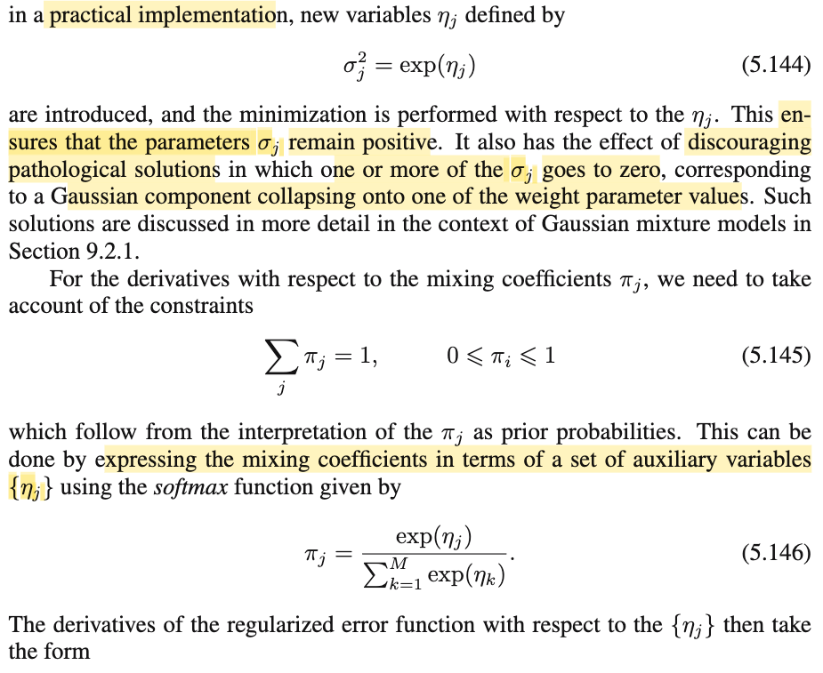</kbd>

<kbd>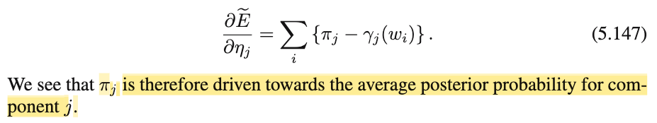</kbd>

 

