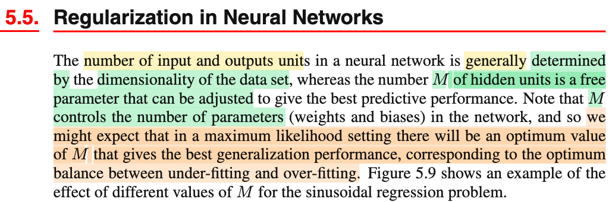
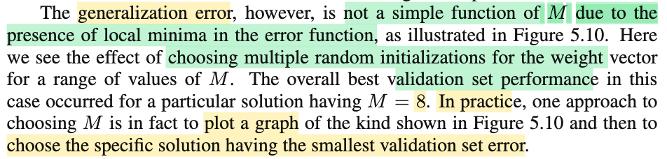
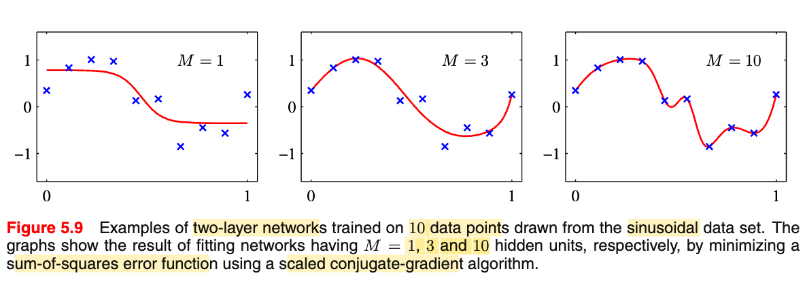
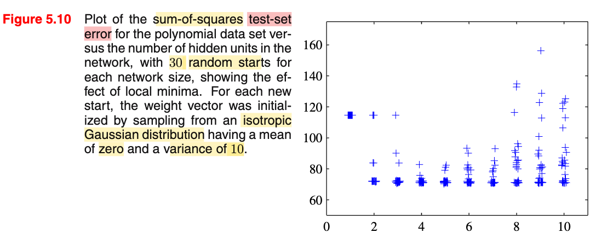
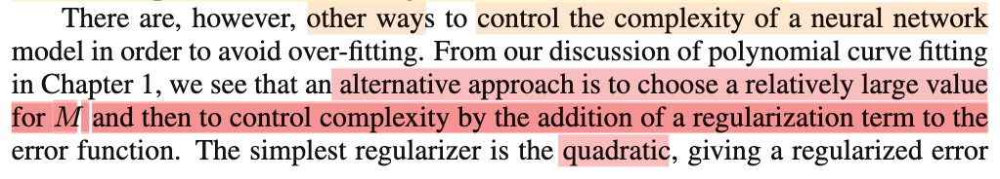
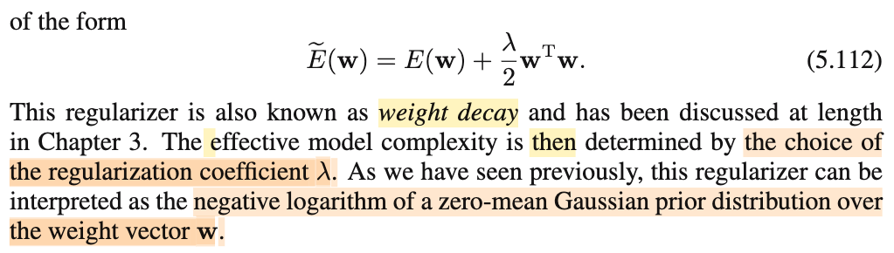

# 5.5. Regularization in Neural Networks

📊 **Progress:** `2` Notes | `6` Screenshots | `2` AI Reviews

---

 

## Regularization in Neural Networks

<kbd></kbd>

<kbd></kbd>

<kbd></kbd>

<kbd></kbd>

> [!NOTE]
> Đại ý nói rằng không như số input và output unit, thường bị quyết định bởi dạng data và bài toán cụ thể. Ngược lại, M, số lượng hidden unit là con số mà ta có thể chọn để điều chỉnh khả năng dự đoán của mô hình.
>
>
>
> Và do đó, ta có thể nghĩ đến việc chọn ra giá trị tối ưu cho nó
>
>
>
> Trong hình minh họa cho thấy 2 layer network với các M khác nhau trong bài toán khớp data với hàm sse
>
>
>
> Thế thì hình 5.10 đại khái là vầy: Lần lượt cho M = 1,2,3...10.
>
>
>
> Với mỗi M, chạy 30 lần:
>
>
>
> Cho giá trị khởi đầu của 𝐰 là được sampling từ 𝒩(0, 10 × 𝐈) (tức là mọi giá trị của các tham số của mạng sẽ được generate từ 𝒩(0, 10 × 𝐈).
>
>
>
> Train và ghi nhận test error.
>
>
>
> Thì thấy error thấp nhất ghi nhận được là khi M = 8. Nhưng với mỗi M, error cũng khác nhau trong 30 lần chạy, cho thấy kết quả nó hên xui, phụ thuộc vào việc khởi tạo giá trị ban đầu.
>
>
>
> Điều này hàm test error là một hàm phi tuyến phức tạp không chỉ phụ thuộc M, ko thể dễ dàng tìm M để minimize test error (và cái này thể hiện generalization của mô hình)
>
>
>
> Trong thực tế, tác gỉa nói một cách để chọn M là làm y vậy, vẽ cái biểu đồ này ra và chọn mô hình (tức là cả kiến trúc và giá trị tham số đã train) có validation error thấp nhất.

📹 [Xem video trên YouTube](https://youtu.be/vsLY94KCVew)

> [!TIP]
> 🤖 **AI Check** — 🟢 Pass — ✅ **95/100** · ✓ Move on
>
> Ghi chú nắm rất chắc và tóm tắt chính xác nội dung lý thuyết cũng như ý nghĩa của hai hình minh họa 5.9 và 5.10.
>
> **✓ Strengths**
> - Hiểu chính xác vai trò của số lượng hidden units M đối với độ phức tạp và khả năng tổng quát hóa (generalization) của mô hình.
> - Mô tả đúng quy trình thực nghiệm ở Hình 5.10: thử các giá trị M từ 1 đến 10 với 30 lần khởi tạo trọng số ngẫu nhiên từ phân phối Gaussian đẳng hướng.
> - Nắm đúng kết luận thực hành: chọn giải pháp cụ thể (cả M lẫn bộ trọng số đã huấn luyện) đạt sai số validation nhỏ nhất.
>
> **💡 Deeper notes**
> - Bản chất cốt lõi của việc kết quả dao động mạnh giữa các lần chạy với cùng một giá trị M là do hàm lỗi của mạng nơ-ron có nhiều cực tiểu cục bộ (local minima), khiến thuật toán tối ưu hội tụ về các nghiệm khác nhau tùy thuộc vào điểm khởi tạo.

 

### Regularization in Neural Networks

<kbd></kbd>

<kbd></kbd>

> [!NOTE]
> Đại ý là cách thứ hai để kiểm soát mức độ complexity của mô hình là chọn độ phức tạp cao (M cao) rồi dùng regularizer để khống chế. Điển hình là dùng L2 regularizer (λ/2) 𝐰ᵀ𝐰 như đã thấy trong chapter 1. Và còn nhớ trong chương 3 ta đã hiểu việc training mô hình với sse loss + L2 regularizer, tương đương với chọn 𝐰 maximize posterior với prior là Gaussian 
>
>
>
> Ôn nhanh:
>
>
>
> Cách tiếp cận Bayesian: coi 𝐰 như random variable. 
>
>
>
> Chọn prior distribution là 𝒩(𝟎, (1/α)𝐈)
>
>
>
> posterior distribution:
>
>
>
> p(𝐰|𝐭) ∝ p(𝐭|𝐰, β, 𝐗)p(𝐰|α)
>
>
>
> = Πi p(ti|𝐰, β, 𝐱i) p(𝐰|α) 
>
>
>
> = Πi 𝒩(ti|𝐰ᵀΦ(𝐱i), 1/β) 𝒩(𝐰|0, (1/α)𝐈)
>
>
>
> = Πi {C1 C2(β) exp\[-β(ti-𝐰ᵀΦ)²/2)}  C3(α) exp(-α𝐰ᵀ𝐰/2)
>
>
>
> = C exp\[-βΣi(ti-𝐰ᵀΦ)²/2 - α𝐰ᵀ𝐰/2)  
>
>
>
> Chọn 𝐰 maximize posteriori
>
>
>
> tương đương maximize exp\[-βΣi(ti-𝐰ᵀΦ)²/2 - α𝐰ᵀ𝐰/2)  
>
>
>
> tương đương maximize log exp\[-βΣi(ti-𝐰ᵀΦ)²/2 - α𝐰ᵀ𝐰/2)  
>
> \
> tương đương maximize -βΣi(ti-𝐰ᵀΦ)²/2 - α𝐰ᵀ𝐰/2)  
>
>
>
> tương đương minimize βΣi(ti-𝐰ᵀΦ)²/2 + α𝐰ᵀ𝐰/2)  
>
>
>
> tương đương minimize Σi(ti-𝐰ᵀΦ)²/2 + (α/β)𝐰ᵀ𝐰/2)  
>
>
>
> tương đương minimize \[Σi(ti-𝐰ᵀΦ)²/2 + λ𝐰ᵀ𝐰/2\] với λ = α/β
>
>
>
> đây chính là minimize sse với L2 regularizer

📹 [Xem video trên YouTube](https://www.youtube.com/watch?v=cpsMJoxEAms)

> [!TIP]
> 🤖 **AI Check** — 🟢 Pass — ✅ **100/100** · ✓ Move on
>
> Ghi chú rất xuất sắc, không chỉ nắm đúng ý chính của đoạn trích mà còn tự tái hiện lại trọn vẹn và chính xác toàn bộ chuỗi biến đổi toán học (MAP với Gaussian prior) từ Chương 3.
>
> **✓ Strengths**
> - Nắm bắt chính xác ý niệm cốt lõi: kiểm soát độ phức tạp bằng cách giữ mô hình đủ lớn (M lớn) kết hợp kỹ thuật L2 regularization (weight decay).
> - Tự triển khai đầy đủ và chính xác derivation toán học chứng minh việc tối đa hóa posterior (MAP) với Gaussian prior tương đương với tối thiểu hóa tổng bình phương sai số kèm L2 regularization với hệ số λ = α/β.
>
> **💡 Deeper notes**
> - Trong mạng nơ-ron (Chương 5), hàm lỗi E(w) là phi tuyến đối với các trọng số w (không chỉ là tổ hợp tuyến tính các hàm cơ sở phi tuyến cố định Φ(x) như trong Chương 3), do đó bề mặt lỗi E(w) thường có nhiều cực tiểu địa phương thay vì là dạng toàn phương lồi duy nhất.

 

