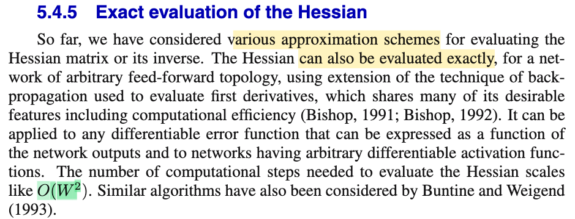
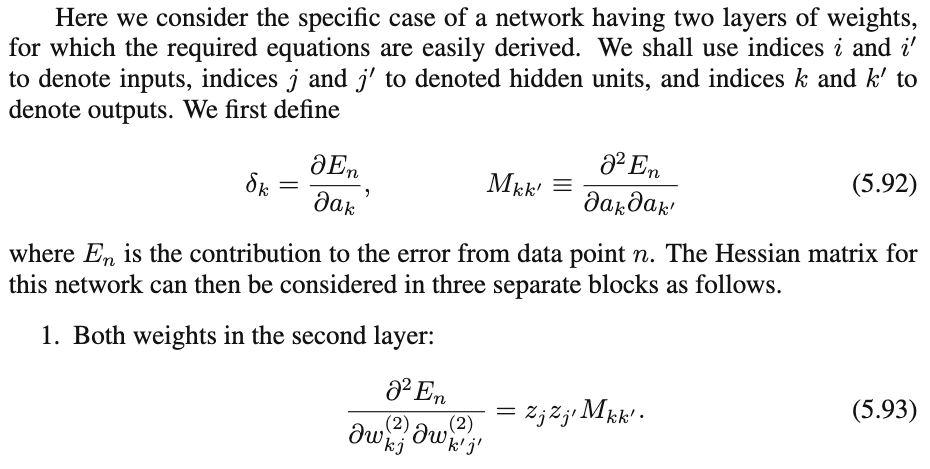
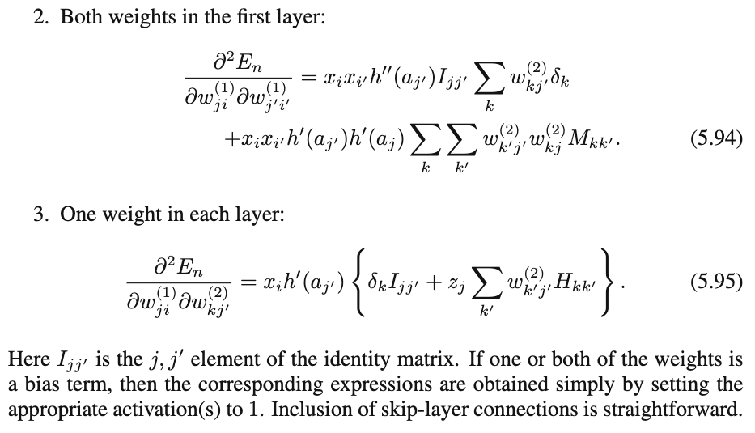
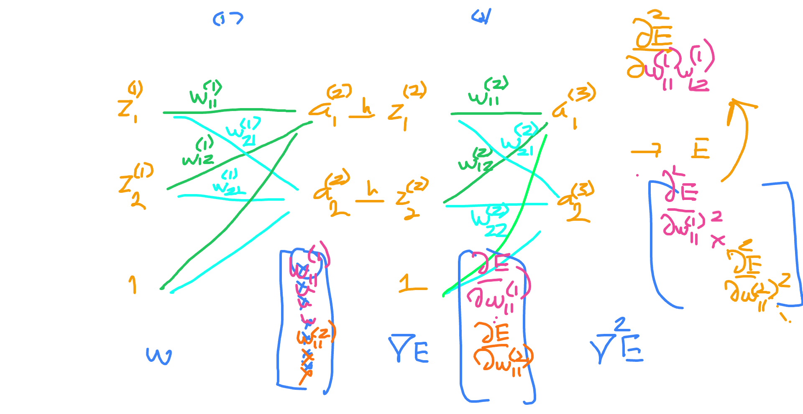
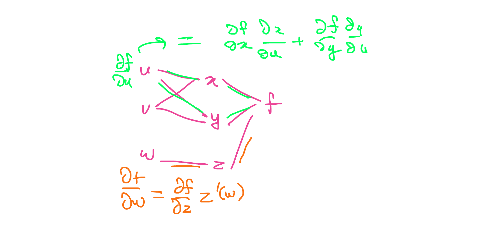
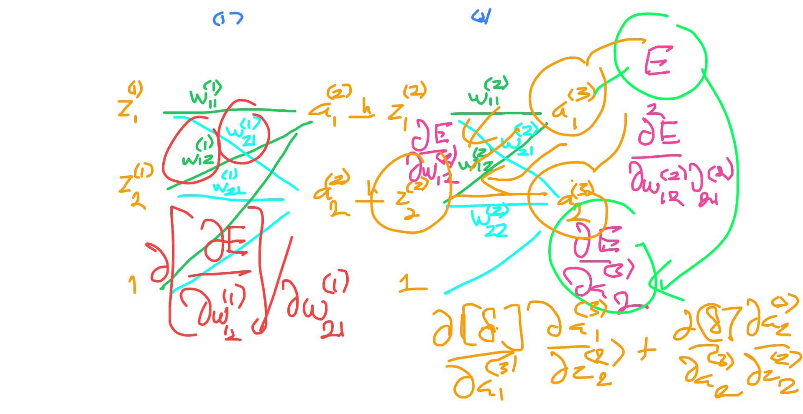
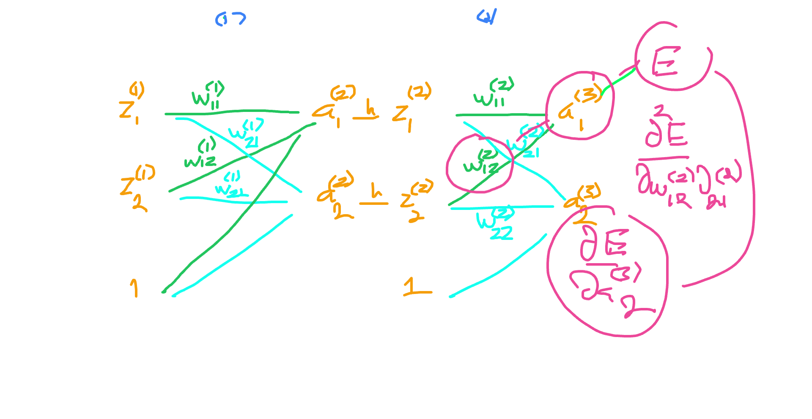

# Untitled

📊 **Progress:** `1` Notes | `7` Screenshots | `1` AI Reviews

---

## Exact Evaluation of the Hessian

<kbd></kbd>

<kbd></kbd>

<kbd></kbd>

<kbd></kbd>

<kbd></kbd>

<kbd></kbd>

<kbd></kbd>

> [!NOTE]
> Đoạn này đại khái là derive công thức chính xác của Hessian ∇² E(𝐰) cho một nn có hai layer.
>
>
>
> Việc tính toán sẽ có chi phí O(W²)
>
>
>
> δk = ∂En/∂ak
>
>
>
> Mkk' = ∂²En/∂ak∂ak'
>
>
>
> Mô tả sơ đồ:
>
>
>
> Input: zi
>
>
>
> Σi z⁽¹⁾i w⁽¹⁾ji = a⁽²⁾j
>
>
>
> Hidden: zj⁽²⁾ = h(a⁽²⁾j)
>
>
>
> Σj' zj'⁽²⁾ w⁽²⁾kj' = a⁽³⁾k
>
>
>
> ---
>
>
>
> ∂²En/∂w⁽²⁾kj∂w⁽²⁾k'j'
>
>
>
> = ∂\[∂En/∂w⁽²⁾kj\]/∂w⁽²⁾k'j'
>
>
>
> = ∂\[∂En/∂w⁽²⁾kj\]/∂a⁽³⁾k' . ∂a⁽³⁾k'/∂w⁽²⁾k'j'
>
>
>
> = ∂\[∂En/∂w⁽²⁾kj\]/∂a⁽³⁾k' . z⁽²⁾j'
>
>
>
> Xét ∂En/∂w⁽²⁾kj = ∂En/∂a⁽³⁾k ∂a⁽³⁾k/∂w⁽²⁾kj
>
>
>
> = ∂En/∂a⁽³⁾k z⁽²⁾j
>
>
>
> ⇒ ∂\[∂En/∂w⁽²⁾kj\]/∂a⁽³⁾k' . z⁽²⁾j'
>
>
>
> = ∂\[∂En/∂a⁽³⁾k z⁽²⁾j\]/∂a⁽³⁾k' z⁽²⁾j'
>
>
>
> = z⁽²⁾j ∂\[∂En/∂a⁽³⁾k\]/∂a⁽³⁾k' z⁽²⁾j'
>
>
>
> = z⁽²⁾j ∂²En/∂a⁽³⁾k∂a⁽³⁾k' z⁽²⁾j'
>
>
>
> = z⁽²⁾j z⁽²⁾j' ∂² En/∂a⁽³⁾k∂a⁽³⁾k'
>
>
>
> = z⁽²⁾j z⁽²⁾j' ∂² Mkk' → 5.93
>
>
>
> ---
>
>
>
> ∂²En/∂w⁽¹⁾ji∂w⁽¹⁾j'i'
>
>
>
> = ∂\[∂En/∂w⁽¹⁾ji\]/∂w⁽¹⁾j'i'
>
>
>
> = ∂\[∂En/∂w⁽¹⁾ji\]/∂a⁽²⁾j' . ∂a⁽²⁾j'/∂w⁽¹⁾j'i'
>
>
>
> = ∂\[∂En/∂w⁽¹⁾ji\]/∂a⁽²⁾j' z⁽¹⁾i'
>
>
>
> Xét ∂En/∂w⁽¹⁾ji = ∂En/∂a⁽²⁾j . ∂a⁽²⁾j/∂w⁽¹⁾ji
>
>
>
> = ∂En/∂a⁽²⁾j . z⁽¹⁾i
>
>
>
> ⇒ .. = ∂\[∂En/∂a⁽²⁾j . z⁽¹⁾i\]/∂a⁽²⁾j' z⁽¹⁾i'
>
>
>
> = z⁽¹⁾i ∂\[∂En/∂a⁽²⁾j\]/∂a⁽²⁾j' z⁽¹⁾i'
>
>
>
> = z⁽¹⁾iz⁽¹⁾i' ∂²En/∂a⁽²⁾j∂a⁽²⁾j'
>
>
>
> Xét ∂²En/∂a⁽²⁾j∂a⁽²⁾j': = ∂\[∂En/∂a⁽²⁾j\]/∂a⁽²⁾j'
>
>
>
> (Không dùng 5.80 được: ∂²En/∂a⁽²⁾j² = h'(a⁽²⁾j)² Σk Σk' w⁽²⁾kj w⁽²⁾k'j {(∂²En/(∂a⁽³⁾k∂a⁽³⁾k'))} + h''(a⁽²⁾j) (Σk w⁽²⁾kj δ⁽³⁾k))
>
>
>
> Mà dùng 5.56: ∂En/∂a⁽²⁾j = h'(a⁽²⁾j) Σk w⁽²⁾kj δ⁽³⁾k
>
>
>
> ∂\[∂En/∂a⁽²⁾j\]/∂a⁽²⁾j' = ∂\[h'(a⁽²⁾j) Σk w⁽²⁾kj δ⁽³⁾k\]/∂a⁽²⁾j'
>
>
>
> = ∂\[h'(a⁽²⁾j)\]/∂a⁽²⁾j' × Σk w⁽²⁾kj δ⁽³⁾k + h'(a⁽²⁾j) × ∂\[Σk w⁽²⁾kj δ⁽³⁾k\]/∂a⁽²⁾j'
>
>
>
> = δjj' h''(a⁽²⁾j') × Σk w⁽²⁾kj δ⁽³⁾k + h'(a⁽²⁾j) Σk w⁽²⁾kj ∂δ⁽³⁾k/∂a⁽²⁾j'
>
>
>
> Xét ∂δ⁽³⁾k/∂a⁽²⁾j'
>
>
>
> = ∂δ⁽³⁾k/∂z⁽²⁾j' . ∂z⁽²⁾j'/∂a⁽²⁾j'
>
>
>
> = ∂δ⁽³⁾k/∂z⁽²⁾j' h'(a⁽²⁾j')
>
>
>
> = Σk' { ∂δ⁽³⁾k/∂a⁽³⁾k' . ∂a⁽³⁾k'/∂z⁽²⁾j' } h'(a⁽²⁾j')
>
>
>
> = Σk' { ∂δ⁽³⁾k/∂a⁽³⁾k' . w⁽²⁾k'j' } h'(a⁽²⁾j')
>
>
>
> = Σk' { ∂²En/∂a⁽³⁾k∂a⁽³⁾k' . w⁽²⁾k'j' } h'(a⁽²⁾j')
>
>
>
> Viết lại:
>
>
>
> ∂²En/∂a⁽²⁾j∂a⁽²⁾j' = δjj' h''(a⁽²⁾j') × Σk w⁽²⁾kj δ⁽³⁾k + h'(a⁽²⁾j) Σk w⁽²⁾kj Σk' { ∂²En/∂a⁽³⁾k∂a⁽³⁾k' w⁽²⁾k'j' } h'(a⁽²⁾j')
>
>
>
> Viết lại:
>
>
>
> ∂²En/∂w⁽¹⁾ji∂w⁽¹⁾j'i' = z⁽¹⁾iz⁽¹⁾i' ∂²En/∂a⁽²⁾j∂a⁽²⁾j'
>
>
>
> = z⁽¹⁾iz⁽¹⁾i' { δjj' h''(a⁽²⁾j') × Σk w⁽²⁾kj δ⁽³⁾k + h'(a⁽²⁾j) Σk w⁽²⁾kj Σk' { ∂²En/∂a⁽³⁾k∂a⁽³⁾k' w⁽²⁾k'j' } h'(a⁽²⁾j') }
>
>
>
> = z⁽¹⁾iz⁽¹⁾i' { δjj' h''(a⁽²⁾j') × Σk w⁽²⁾kj δ⁽³⁾k }
>
>
>
> \+ z⁽¹⁾iz⁽¹⁾i' { h'(a⁽²⁾j) Σk w⁽²⁾kj Σk' { ∂²En/∂a⁽³⁾k∂a⁽³⁾k' w⁽²⁾k'j' } h'(a⁽²⁾j') }
>
>
>
> = z⁽¹⁾iz⁽¹⁾i' { δjj' h''(a⁽²⁾j') × Σk w⁽²⁾kj δ⁽³⁾k }
>
>
>
> \+ z⁽¹⁾iz⁽¹⁾i' { h'(a⁽²⁾j) h'(a⁽²⁾j') Σk Σk' w⁽²⁾kj w⁽²⁾k'j' { ∂²En/∂a⁽³⁾k∂a⁽³⁾k' } }
>
>
>
> Thay ∂²En/∂a⁽³⁾k∂a⁽³⁾k' = Mkk'
>
>
>
> = z⁽¹⁾iz⁽¹⁾i' δjj' h''(a⁽²⁾j') × Σk w⁽²⁾kj δ⁽³⁾k
>
>
>
> \+ z⁽¹⁾iz⁽¹⁾i' h'(a⁽²⁾j) h'(a⁽²⁾j') Σk Σk' w⁽²⁾kj w⁽²⁾k'j' Mkk'
>
>
>
> ---
>
>
>
> Block 3:
>
>
>
> ∂²En/∂w⁽¹⁾ji∂w⁽²⁾k'j'
>
>
>
> = ∂\[∂En/∂w⁽¹⁾ji\]/∂w⁽²⁾k'j'
>
>
>
> ∂En/∂w⁽¹⁾ji = δ⁽²⁾j z⁽¹⁾i (theo 5.67)
>
>
>
> và theo 5.66 (với h là tanh):
>
>
>
> δ⁽²⁾j = \[1 - z⁽²⁾j²\] Σk δ⁽³⁾k w⁽²⁾kj
>
>
>
> khái quát δ⁽²⁾j = h'(a⁽²⁾j) Σk δ⁽³⁾k w⁽²⁾kj
>
>
>
> .. = h'(a⁽²⁾j) Σk δ⁽³⁾k w⁽²⁾kj
>
>
>
> Nên ∂\[∂En/∂w⁽¹⁾ji\]/∂w⁽²⁾k'j'
>
>
>
> = ∂\[h'(a⁽²⁾j) (Σk δ⁽³⁾k w⁽²⁾kj) z⁽¹⁾i \]/∂w⁽²⁾k'j'
>
>
>
> = ∂\[h'(a⁽²⁾j) z⁽¹⁾i (Σk δ⁽³⁾k w⁽²⁾kj)\]/∂w⁽²⁾k'j'
>
>
>
> = ∂\[h'(a⁽²⁾j) z⁽¹⁾i\]/∂w⁽²⁾k'j' × (Σk δ⁽³⁾k w⁽²⁾kj)\]
>
>
>
> \+ \[h'(a⁽²⁾j) z⁽¹⁾i\] × ∂(Σk δ⁽³⁾k w⁽²⁾kj)\]/∂w⁽²⁾k'j' (product rule)
>
>
>
> = 0 × (Σk δ⁽³⁾k w⁽²⁾kj)
>
>
>
> \+ \[h'(a⁽²⁾j) z⁽¹⁾i\] × ∂(Σk δ⁽³⁾k w⁽²⁾kj)\]/∂w⁽²⁾k'j'
>
>
>
> (do h'(a⁽²⁾j) z⁽¹⁾i đều không phụ thuộc w⁽²⁾k'j')
>
>
>
> = \[h'(a⁽²⁾j) z⁽¹⁾i\] × ∂(Σk δ⁽³⁾k w⁽²⁾kj)\]/∂w⁽²⁾k'j'
>
>
>
> = h'(a⁽²⁾j) z⁽¹⁾i Σk {∂(δ⁽³⁾k w⁽²⁾kj)/∂w⁽²⁾k'j'}
>
>
>
> ---
>
>
>
> Xét ∂(δ⁽³⁾k w⁽²⁾kj)/∂w⁽²⁾k'j'
>
>
>
> w⁽²⁾kj = g(w⁽²⁾k'j'): 
>
>
>
> if k=k',j=j': w⁽²⁾k'j'
>
>
>
> if otherwise: w⁽²⁾kj
>
>
>
> g(x) = x nếu k=k',j=j', ngược lại = a 
>
>
>
> g'(x) = 1 nếu k=k',j=j', ngược lại = 0
>
>
>
> g'(x) = δkk' δjj'
>
>
>
> = ∂δ⁽³⁾k/∂w⁽²⁾k'j' × w⁽²⁾kj + δ⁽³⁾k ∂w⁽²⁾kj/∂w⁽²⁾k'j'
>
>
>
> = ∂δ⁽³⁾k/∂w⁽²⁾k'j' × w⁽²⁾kj + δ⁽³⁾k δkk'δjj'
>
>
>
> = ∂δ⁽³⁾k/∂a⁽³⁾k'. ∂a⁽³⁾k'/∂w⁽²⁾k'j' × w⁽²⁾kj + δ⁽³⁾k δkk'δjj'
>
>
>
> = ∂δ⁽³⁾k/∂a⁽³⁾k' z⁽²⁾j' w⁽²⁾kj + δ⁽³⁾k δkk'δjj'
>
>
>
> = ∂²En/∂a⁽³⁾k∂a⁽³⁾k' z⁽²⁾j' w⁽²⁾kj + δ⁽³⁾k δkk'δjj'
>
>
>
> = Mkk' z⁽²⁾j' w⁽²⁾kj + δ⁽³⁾k δkk'δjj'
>
>
>
> ---
>
>
>
>  ∂²En/∂w⁽¹⁾ji∂w⁽²⁾k'j' = h'(a⁽²⁾j) z⁽¹⁾i Σk {Mkk' z⁽²⁾j' w⁽²⁾kj + δ⁽³⁾k δkk'δjj'}
>
>
>
> = h'(a⁽²⁾j) z⁽¹⁾i {Σk Mkk' z⁽²⁾j' w⁽²⁾kj + Σk δ⁽³⁾k δkk'δjj'}
>
>
>
> = h'(a⁽²⁾j) z⁽¹⁾i {Σk δ⁽³⁾k δkk'δjj' + Σk Mkk' z⁽²⁾j' w⁽²⁾kj}
>
>
>
> = h'(a⁽²⁾j) z⁽¹⁾i {Σk δ⁽³⁾k δkk'δjj' + z⁽²⁾j' Σk Mkk' w⁽²⁾kj}
>
>
>
> (Σk δ⁽³⁾k δkk'δjj' = δ⁽³⁾1 δ1k'δjj' + δ⁽³⁾2 δ2k'δjj' + ...+ δ⁽³⁾k' δk'k'δjj' = δ⁽³⁾k' δk'k'δjj' = δ⁽³⁾k' δjj')
>
>
>
> = h'(a⁽²⁾j) z⁽¹⁾i {δ⁽³⁾k'δjj' + z⁽²⁾j' Σk Mkk' w⁽²⁾kj} 
>
>
>
> Kết quả
>
>
>
> ∂²En/∂w⁽¹⁾ji∂w⁽²⁾k'j' =  h'(a⁽²⁾j) z⁽¹⁾i {δ⁽³⁾k'δjj' + z⁽²⁾j' Σk Mkk' w⁽²⁾kj} 
>
>
>
> Trong sách là ...w⁽²⁾kj' thay vì w⁽²⁾k'j' nên thay chỗ nào k' thành k:
>
>
>
> ∂²En/∂w⁽¹⁾ji∂w⁽²⁾kj' = h'(a⁽²⁾j) z⁽¹⁾i {δ⁽³⁾k δjj' + z⁽²⁾j' Σk' Mkk' w⁽²⁾k'j} 
>
>
>
> Tuy vậy vẫn còn chỗ zj (mình là z⁽²⁾j') và Hkk' (đáng lẽ phải là Mkk') và h'(aj') (mình là h'(a⁽²⁾j)) là những chỗ in sai.

📹 Video 1: [Làm sao tính chính xác ma trận Hessian theo các trọng số? (phần 1)](https://youtu.be/-wqvroqdiWs)

📹 Video 2: [Làm sao tính Hessian cho trọng số ở hai tầng khác nhau? (phần 2)](https://www.youtube.com/watch?v=psQkLoQpYdI)

> [!TIP]
> 🤖 **AI Check** — 🟢 Pass — ✅ **100/100** · ✓ Move on
>
> Ghi chú xuất sắc! Bạn đã tự dẫn xuất chi tiết và chính xác cả 3 khối của ma trận Hessian, đồng thời phát hiện chuẩn xác các lỗi in ấn (typos) trong công thức (5.95) của sách Bishop.
>
> **✓ Strengths**
> - Dẫn xuất toán học tường minh, chặt chẽ từng bước cho cả 3 khối ma trận Hessian bằng quy tắc dây chuyền.
> - Phát hiện chính xác các lỗi in sai trong sách gốc ở công thức (5.95): ký hiệu nhầm H_kk' thay vì M_kk', và việc đảo lộn các chỉ số j và j' giữa hai số hạng.
>
> **💡 Deeper notes**
> - Ở số hạng thứ nhất của Block 3, do có mặt delta Kronecker I_{jj'} nên h'(a_j) I_{jj'} = h'(a_{j'}) I_{jj'}, nhưng ở số hạng thứ hai việc phân biệt đúng z_{j'} và w^{(2)}_{k'j} cùng thừa số chung h'(a_j) là hoàn toàn chuẩn xác theo đúng cấu trúc lan truyền.

**🔗 See also:** [Forward Propagation Equations](./532_a_simple_example.md#node-o01rr8a)

 

