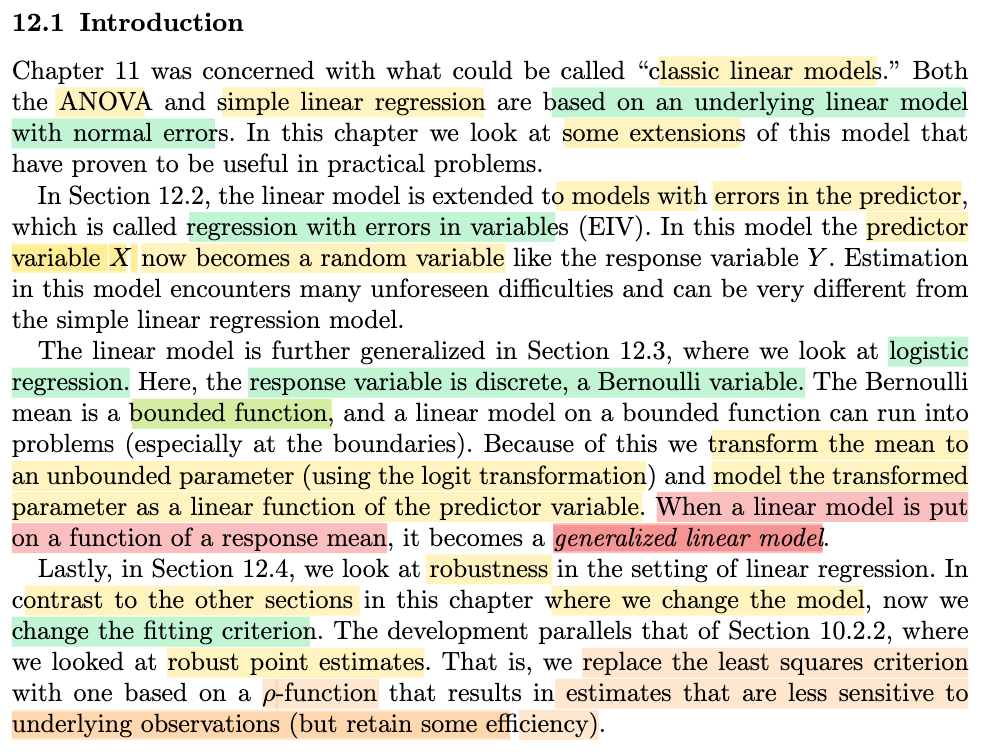

# 12.1 Regression Model - Introduction

📊 **Progress:** `1` Notes | `1` Screenshots

---

 

## Section 12.1 Introduction

<kbd></kbd>

> [!NOTE]
> Vài ý mở đầu, đại khái tác giả nói chương 12 này sẽ mở rộng mô hình hồi quy tuyến tính đơn giản (classis linear model) ở chapter 11. Gồm 3 loại:
>
>
>
> 12.2 là deal với tình huống trong predictor cũng có error. Có nghĩa là khác với simple linear regression, giả định rằng x1,x2 là các giá trị cố định đã biết trước, thì nay, trong mô hình này, cũng coi nó như observed value của các random variable X1,X2,...luôn. Thành ra ở đây, cả X, Y đều là random variable.
>
>
>
> 12.3 sẽ gặp lại logistic regression. Nơi response variable là biến discrete, cụ thể là Bernouilly. Khi đó,  mean của Y là hàm bounded (hàm bị chặn), thành ra ta sẽ biến đổi mean thành một tham số không bị chặn bằng cách dùng hàm logit. Và mô hình tham số đã được biến đổi này bởi một hàm tuyến tính của predictor. Và gặp lại khái niệm generalized linear model. Nói chung, chương này sẽ cho mình cái nhìn sâu hơn nữa của những gì đã học trong chương 4 sách Bishop.  
>
>
>
> 12.4 gặp lại khái niệm robustness đã gặp trong robust point estimator. Đối lập với các chương khác khi ta thay mô hình này bằng mô hình kia thì ở đây ta sẽ thay fitting criterion.
>
>
>
> Mình sẽ tập trung vào 12.3 và 12.4

 

