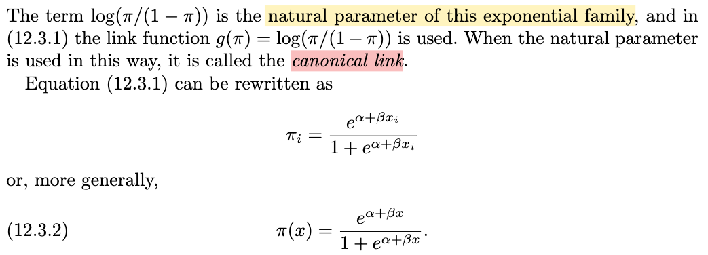

# 12.3 Logistic Regression

📊 **Progress:** `3` Notes | `5` Screenshots | `2` AI Reviews

---

 

## Section 12.3 Logistic Regression

<kbd></kbd>

> [!NOTE]
> Trước tiên có thể ôn lại conditional normal model đã gặp ở 11.3.3. Đó là mô hình trong trong đó ta giả định dữ liệu (x1,y1), (x2,y2) ... sinh ra từ mô hình sau:
>
>
>
> x1,x2,....là các giá trị đã biết trước
>
>
>
> y1,y2,...là gía trị quan sát được của các random variable Y1, Y2,....độc lập. Và Yi \~ n(α + βxi, σ²)
>
>
>
> hoặc y1,y2....là giá trị quan sát được của Y1,Y2,...trong đó: Yi = α + βxi + εi với εi iid \~ n(0, σ²)
>
>
>
> Như vậy, có thể thấy, mô hình này giả định rằng mean của Y, tức E\[Y|x\] (gọi là regression population mean) là hàm tuyến tính đối với x với tham số α và β.
>
>
>
> Thế thì ở đây tác giả cho biết, conditional normal model chỉ là một ví dụ của cái gọi là mô hình tuyến tính tổng quát (generalized linear model). Được định nghĩa là: mô tả quan hệ giữa mean của response variable Y và independent variable x. Mà quan hệ này có thể phức tạp hơn nhiều so với conditional normal model. Và phần này ta sẽ tập trung vào một trong các mô hình GLM này, logistic regression.
>
>
>
> Khái niệm GLM trong chương 4 Bishop có nói đến, nhưng ở đây mình sẽ được học nó ở mức độ sâu hơn

> [!TIP]
> 🤖 **AI Check** — 🟢 Pass — ✅ **100/100** · ✓ Move on
>
> Ghi chú rất tốt, tái hiện chính xác kiến thức nền tảng về conditional normal model và nắm bắt đúng tinh thần giới thiệu về GLM của giáo trình.
>
> **✓ Strengths**
> - Tái hiện chính xác và đầy đủ hai cách biểu diễn tương đương của conditional normal model (dạng phân phối điều kiện và dạng nhiễu Gauss cộng tính).
> - Hiểu đúng bản chất GLM là mở rộng mối quan hệ giữa kỳ vọng của biến mục tiêu E[Y|x] và biến độc lập x thay vì chỉ bó hẹp ở hàm tuyến tính trực tiếp.
>
> **💡 Deeper notes**
> - Về mặt toán học chuẩn của GLM, mối quan hệ phức tạp hơn này thường được mô hình hóa thông qua một hàm liên kết (link function) $g(\mu) = \alpha + \beta x$ với $\mu = E[Y|x]$, và phân phối của $Y|x$ thuộc họ hàm mũ (exponential dispersion family).

 

### 12.3.1 The Model

<kbd></kbd>

<kbd></kbd>

> [!NOTE]
> Đại khái đoạn này mô tả một mô hình tuyến tính tổng quát (GLM): Gồm 3 thành phần (component):
>
>
>
> 1) Random component (tạm hiểu là cấu phần chứa tính chất ngẫu nhiên): Đó chính là các response variable Y1,..Yn. Giả định đặt ra là đây là những random variable độc lập, có chung dạng phân phối thuộc họ exponential nào đó như Poisson, normal, nhưng khác tham số, nên không identically distributed.
>
>
>
> 2) Systematic component: Chính là cái hàm số áp lên x trong quan hệ giữa E\[Y|x\] và x, ví dụ trong conditional normal model, hàm số này là α + βx
>
>
>
> 3) Link function g(μ), tạm hiểu là hàm số áp lên μ (hay E\[Y|x\]) trong quan hệ giữa E\[Y|x\] và x.
>
>
>
> Trong conditional normal model, g(μ) = μ, gọi là identity link function. Thành ra kết hợp với 2), quan hệ giữa Y và x thể hiện bởi:
>
>
>
> g(E\[Y|x\]) = E\[Y|x\] = α + βx

 

#### Logistic Regression as GLM

<kbd></kbd>

<kbd></kbd>

> [!NOTE]
> Nói sang mô hình logistic regression: Trong mô hình này, random component, các random variable Y1,Y2 ...là các biến ngẫu nhiên có phân phối Yi ~ Bern(πi).
>
>
>
> Trong đó πi sẽ được giả định là quan hệ với xi bởi:
>
>
>
> log(πi/(1-πi)) = α + βxi
>
>
>
> như vậy mô hình này giả định log-odds là hàm tuyến tính của x.
>
>
>
> Và đây là một ví dụ của GLM, bằng cách phân tích như sau:
>
>
>
> Nhớ lại Exponential pdf/pmf sẽ có dạng :
>
> f(x|𝛉) = h(x) c(𝛉) exp(Σi wi(𝛉) ti(x))
>
>
>
>
>
> với h(x) ≥ 0 là **real value function** của observation x.
>
>
>
> còn wi(𝛉) là **real-valued function** của "possibly" vector-valued parameter 𝛉
>
>
>
> P(Yi = y) (pmf của Yi tại y) = (πi^y)[(1-πi)^(1-y)]
>
>
>
> = (πi^y)[(1-πi)^(1-y)]
>
> = exp log {(πi^y)[(1-πi)^(1-y)]}
>
> = exp {log (πi^y) + log [(1-πi)^(1-y)]}
>
> = exp {y log (πi) + (1-y) log (1-πi)}
>
> = exp {y log (πi)} exp {(1-y) log (1-πi)}
>
> = exp {y log (πi)} exp {log (1-πi) - y log (1-πi)}
>
> = exp {y log (πi)} exp {log (1-πi)} / exp {y log (1-πi)}
>
> = exp {y log (πi)} (1-πi) / exp {y log (1-πi)}
>
> = (1-πi) exp {y log (πi)} / exp {y log (1-πi)}
>
> = (1-πi) exp {y log (πi) - y log (1-πi)}
>
> = (1-πi) exp {y [log (πi) - log (1-πi)]}
>
> = (1-πi) exp {y log [πi/(1-πi)]}
>
> = 1 × c(πi) exp {y × log [πi/(1-πi)]}
>
> Đây chính là công thức của exponential family với h(y)=1, c(𝛉) = (1-πi), nhưng quan trọng là trong exponential cho thấy tham số của exponential family là log [πi/(1-πi)]
>
> Là sao, tức là ta biết πi là tham số của Bernoulli distribution.
>
> Nhưng thể hiện theo Exponential family thì tham số của mô hình là log [πi/(1-πi)]
>
> Và qua đó cũng cho thấy việc trong mô hình Logistics Regression, Yi ~ Bern(πi) thì cũng thõa mãn ý đầu tiên của định nghĩa về GLM.
>
> Trong Logistics Regression model, giả định là logit(πi) = α+βxi, chính là tương ứng với link function là logit function và systematic component là hàm áp lên xi có dạng α+βxi

> [!TIP]
> 🤖 **AI Check** — 🟢 Pass — ✅ **95/100** · ✓ Move on
>
> Ghi chú rất tốt, trình bày chi tiết và tự biến đổi tường minh dạng họ hàm mũ của phân phối Bernoulli để làm rõ thành phần của GLM.
>
> **🟡 Minor issues**
>
> **1.** *"nhưng quan trọng là trong exponential cho thấy tham số của exponential family là log [πi/(1-πi)]"*
>
> Cần gọi chính xác là 'tham số tự nhiên' (natural parameter hoặc canonical parameter) của họ hàm mũ, để phân biệt rõ với tham số thông thường (mean parameter πi).
>
>
> **✓ Strengths**
> - Tự triển khai đầy đủ và chính xác các bước đại số biến đổi pmf của Bernoulli về dạng chuẩn của họ hàm mũ (exponential family).
> - Hiểu và liên hệ chuẩn xác các thành phần của GLM trong mô hình hồi quy logistic: random component (Bernoulli), link function (logit / canonical link) và systematic component.
>
> **💡 Deeper notes**
> - Hàm h(y) thực chất thường mang theo hàm chỉ thị giá trị hỗ trợ (support indicator), tức là h(y) = I_{y ∈ {0, 1}}, vì biến ngẫu nhiên Bernoulli chỉ nhận giá trị 0 hoặc 1.
> - Vì hàm liên kết (link function) g(π) đồng nhất với tham số tự nhiên (natural parameter) của họ hàm mũ, nên logit được gọi cụ thể là 'canonical link' (hàm liên kết chính tắc).

 

