# 12.3 Logistic Regression

📊 **Progress:** `9` Notes | `14` Screenshots | `9` AI Reviews

---

 

## Section 12.3 Logistic Regression

<kbd>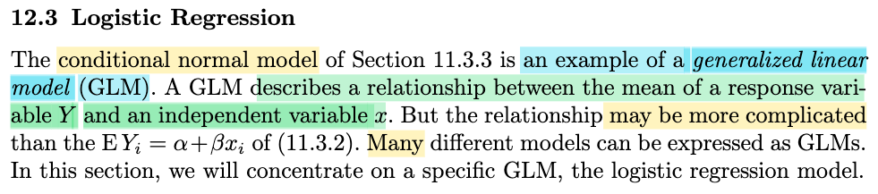</kbd>

> [!NOTE]
> Trước tiên có thể ôn lại conditional normal model đã gặp ở 11.3.3. Đó là mô hình trong trong đó ta giả định dữ liệu (x1,y1), (x2,y2) ... sinh ra từ mô hình sau:
>
>
>
> x1,x2,....là các giá trị đã biết trước
>
>
>
> y1,y2,...là gía trị quan sát được của các random variable Y1, Y2,....độc lập. Và Yi \~ n(α + βxi, σ²)
>
>
>
> hoặc y1,y2....là giá trị quan sát được của Y1,Y2,...trong đó: Yi = α + βxi + εi với εi iid \~ n(0, σ²)
>
>
>
> Như vậy, có thể thấy, mô hình này giả định rằng mean của Y, tức E\[Y|x\] (gọi là regression population mean) là hàm tuyến tính đối với x với tham số α và β.
>
>
>
> Thế thì ở đây tác giả cho biết, conditional normal model chỉ là một ví dụ của cái gọi là mô hình tuyến tính tổng quát (generalized linear model). Được định nghĩa là: mô tả quan hệ giữa mean của response variable Y và independent variable x. Mà quan hệ này có thể phức tạp hơn nhiều so với conditional normal model. Và phần này ta sẽ tập trung vào một trong các mô hình GLM này, logistic regression.
>
>
>
> Khái niệm GLM trong chương 4 Bishop có nói đến, nhưng ở đây mình sẽ được học nó ở mức độ sâu hơn

> [!TIP]
> 🤖 **AI Check** — 🟢 Pass — ✅ **100/100** · ✓ Move on
>
> Ghi chú rất tốt, tái hiện chính xác kiến thức nền tảng về conditional normal model và nắm bắt đúng tinh thần giới thiệu về GLM của giáo trình.
>
> **✓ Strengths**
> - Tái hiện chính xác và đầy đủ hai cách biểu diễn tương đương của conditional normal model (dạng phân phối điều kiện và dạng nhiễu Gauss cộng tính).
> - Hiểu đúng bản chất GLM là mở rộng mối quan hệ giữa kỳ vọng của biến mục tiêu E[Y|x] và biến độc lập x thay vì chỉ bó hẹp ở hàm tuyến tính trực tiếp.
>
> **💡 Deeper notes**
> - Về mặt toán học chuẩn của GLM, mối quan hệ phức tạp hơn này thường được mô hình hóa thông qua một hàm liên kết (link function) $g(\mu) = \alpha + \beta x$ với $\mu = E[Y|x]$, và phân phối của $Y|x$ thuộc họ hàm mũ (exponential dispersion family).

 

### 12.3.1 The Model

<kbd>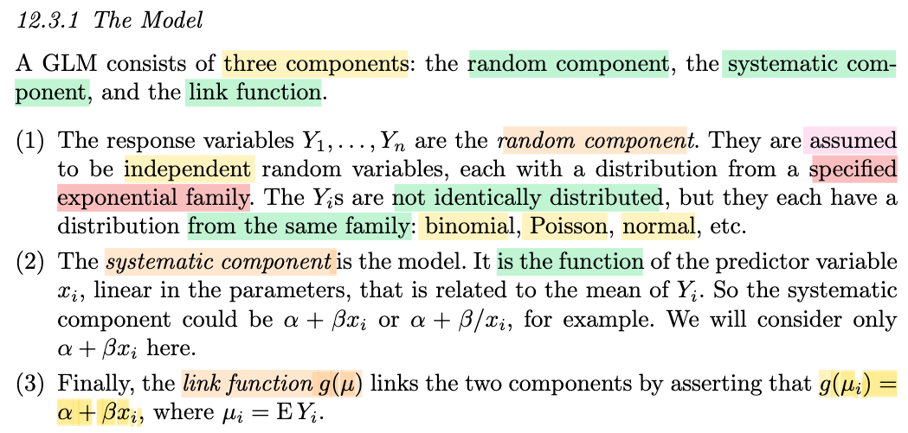</kbd>

<kbd>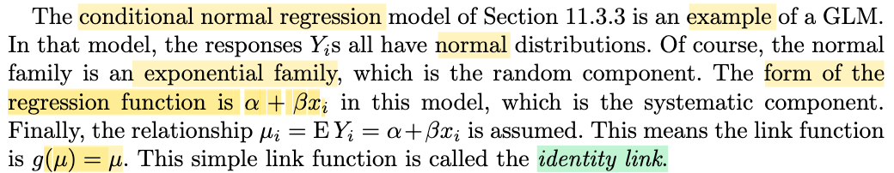</kbd>

> [!NOTE]
> Đại khái đoạn này mô tả một mô hình tuyến tính tổng quát (GLM): Gồm 3 thành phần (component):
>
>
>
> 1. Random component (tạm hiểu là cấu phần chứa tính chất ngẫu nhiên): Đó chính là các response variable Y1,..Yn. Giả định đặt ra là đây là những random variable độc lập, có chung dạng phân phối thuộc họ exponential nào đó như Poisson, normal, nhưng khác tham số, nên không identically distributed.
>
>
>
> 2. Systematic component: Chính là cái hàm số áp lên x trong quan hệ giữa E\[Y|x\] và x, ví dụ trong conditional normal model, hàm số này là α + βx
>
>
>
> 3. Link function g(μ), tạm hiểu là hàm số áp lên μ (hay E\[Y|x\]) trong quan hệ giữa E\[Y|x\] và x.
>
>
>
> Trong conditional normal model, g(μ) = μ, gọi là identity link function. Thành ra kết hợp với 2), quan hệ giữa Y và x thể hiện bởi:
>
>
>
> g(E\[Y|x\]) = E\[Y|x\] = α + βx

📹 [Xem video trên YouTube](https://www.youtube.com/watch?v=Ti80vUWcbrA)

> [!TIP]
> 🤖 **AI Check** — 🟢 Pass — ✅ **95/100** · ✓ Move on
>
> Ghi chú tóm tắt rất chính xác và mạch lạc cấu trúc 3 thành phần của GLM cùng ví dụ về mô hình hồi quy chuẩn có identity link.
>
> **✓ Strengths**
> - Hiểu đúng và giải thích rõ bản chất vì sao các biến phản hồi độc lập nhưng không cùng phân phối (cùng họ nhưng khác tham số do phụ thuộc vào x).
> - Áp dụng chính xác ví dụ hồi quy chuẩn có hàm liên kết đồng nhất (identity link) để minh họa mối liên hệ giữa ba thành phần.
>
> **💡 Deeper notes**
> - Về mặt thuật ngữ chuẩn, systematic component (thành phần hệ thống) thường được gọi là linear predictor (bộ dự báo tuyến tính), có đặc trưng cốt lõi là phải 'tuyến tính theo các tham số' (linear in parameters, ví dụ α + βx), thay vì chỉ là một hàm bất kỳ của x.

 

#### Logistic Regression as GLM

<kbd></kbd>

<kbd></kbd>

> [!NOTE]
> Nói sang mô hình logistic regression: Trong mô hình này, random component, các random variable Y1,Y2 ...là các biến ngẫu nhiên có phân phối Yi \~ Bern(πi).
>
>
>
> Trong đó πi sẽ được giả định là quan hệ với xi bởi:
>
>
>
> log(πi/(1-πi)) = α + βxi
>
>
>
> như vậy mô hình này giả định log-odds là hàm tuyến tính của x.
>
>
>
> Còn nhớ trong Bishop chương 4, cũng đã học về logistic regression, nhưng thể hiện khác chút xíu: Đó là mô hình này giả định các giá trị của y1,y2,...là giá trị quan sát của Y1,Y2,....với Yi \~ Bern(πi) với:
>
>
>
> P(Yi=1) = σ(α + βxi)
>
>
>
> thì thật ra (1) log(πi/(1-πi)) = α + βxi và (2) P(Yi=1) = πi = σ(α + βxi) cũng là một thôi:
>
>
>
> (1) log(πi/(1-πi)) = α + βxi
>
>
>
> ⇔ πi/(1-πi) = exp(α + βxi)
>
>
>
> ⇔ (1-πi)/πi = 1/exp(α + βxi)
>
>
>
> ⇔ 1/πi - 1 = 1/exp(α + βxi)
>
>
>
> ⇔ 1/πi = 1 + 1/exp(α + βxi)
>
>
>
> ⇔ 1/πi = \[exp(α + βxi) + 1\]/exp(α + βxi)
>
>
>
> ⇔ πi = exp(α + βxi)/\[exp(α + βxi) + 1\] = σ(α + βxi) ⇒ chính là (2)
>
>
>
> ---
>
>
>
> Và đây là một ví dụ của GLM, bằng cách phân tích như sau:
>
>
>
> i) ta sẽ chỉ ra rằng Bernouilly là một phân phối thuộc exponential family
>
>
>
> P(Yi = y) (pmf của Yi tại y) = (πi^y)\[(1-πi)^(1-y)\]
>
>
>
> = exp\[log(πi^y)\] exp \[log (1-πi)^(1-y)\]
>
>
>
> = exp\[log(πi^y) + log (1-πi)^(1-y)\]
>
>
>
>  = exp\[y log(πi) + (1-y) log (1-πi)\]
>
>
>
>  = exp\[y log(πi) + log (1-πi) - y log (1-πi)\]
>
>
>
>  = exp(log (1-πi)) exp\[y log(πi) - y log (1-πi)\]
>
>
>
>  = (1-πi) exp\[y(log(πi) - log (1-πi))\]
>
>
>
>  = (1-πi) exp\[y log(πi/(1-πi))\]
>
>
>
> Như vậy, pmf của Bern(πi) có dạng:
>
>
>
> f(x|𝛉) = h(x) c(𝛉) exp(Σi wi(𝛉)ti(x))
>
>
>
> với h(y) = 1, c(𝛉) = 1-πi, exp(Σi wi(𝛉)ti(x)) chính là exp\[y log(πi/(1-πi))\].
>
>
>
> Điều này cũng đồng nghĩa tham số của Bern(πi) dưới góc độ exponential family là log(πi/(1-πi), tức logit, hay log odds.
>
>
>
> ii) Theo mô tả của GLM, thì systematic và link function là gì?
>
>
>
> Ta có giả định của logistic regression model là: log(πi/(1-πi)) = α + βxi
>
>
>
> nên theo đó, systematic component chính là α + βxi
>
>
>
> và link function là log(πi/(1-πi))
>
>
>
> và vì đại khái là link function trong trường hợp này là chính là cái hàm h(πi) sao cho h(πi) cho ta cái tham số của exponential family, nên người ta gọi là canonical link (chính tắc)
>
>
>
> ---
>
>
>
> Còn conditional normal model?
>
>
>
> Conditional normal model giả định y1, y2, ...là giá trị quan sát được của Y1,Y2,..độc lập.Yi \~ n(α + βxi, σ²)
>
>
>
> Cũng có nghĩa là E\[Y|xi\] = α + βxi
>
>
>
> Chiếu theo GLM:
>
>
>
> Random component là Y1,Y2,...\~ n(α + βxi, σ²), là một exponential family:
>
>
>
> f(y|μ, σ²) = 1/√2πσ² exp(-(y-μ)²/2σ²)
>
>
>
> = 1/√2πσ² exp(-(y²-2yμ+μ²)/2σ²)
>
>
>
> = 1/√2πσ² exp(-y²/2σ²+2yμ/2σ²-μ²/2σ²)
>
>
>
> = 1/√2πσ² exp(-y²/2σ²+2yμ/2σ²)exp(-μ²/2σ²)
>
>
>
> = 1 × 1/√2πσ² exp(-μ²/2σ²) exp(-y²/2σ²+yμ/σ²)
>
>
>
> Theo công thức của exponential family:
>
>
>
> f(y|𝛉) = h(y) c(𝛉) exp(Σi wi(𝛉)ti(y))
>
>
>
> thì h(y) = 1
>
>
>
> c(𝛉) = 1/√2πσ² exp(-μ²/2σ²)
>
>
>
> Σi wi(𝛉)ti(y) chính là -y²/2σ²+yμ/σ²
>
>
>
> với w1(𝛉) = 1/σ², t1(y) = -y²/2
>
>
>
> w2(𝛉) = μ/σ², t2(y) = y
>
>
>
> Và systematic component là: α + βxi
>
>
>
> và link function là identity h(E\[Y|xi\]) = E\[Y|xi\]

> [!TIP]
> 🤖 **AI Check** — 🟢 Pass — ✅ **100/100** · ✓ Move on
>
> Ghi chú rất xuất sắc, hiểu sâu bản chất GLM khi tự liên hệ đối chiếu giữa cách biểu diễn logit và sigmoid (Bishop), tự biến đổi dạng họ hàm mũ (exponential family) và mở rộng chính xác sang mô hình hồi quy tuyến tính chuẩn (conditional normal model).
>
> **✓ Strengths**
> - Biến đổi đại số chính xác và chi tiết để chứng minh tương đương giữa logit link và hàm sigmoid trong Bishop.
> - Chứng minh chặt chẽ phân phối Bernoulli thuộc họ hàm mũ và chỉ ra chính xác natural parameter (canonical link).
> - Mở rộng tốt tư duy GLM sang mô hình Conditional Normal (phân phối chuẩn với identity link).
>
> **💡 Deeper notes**
> - Về mặt chặt chẽ trong họ hàm mũ, hàm cơ sở h(y) thường mang theo hàm chỉ thị tập giá trị (support) I_{0, 1}(y) đối với phân phối Bernoulli.
> - Trong GLM đối với phân phối chuẩn N(μ, σ²), σ² thường được coi là tham số phân tán (dispersion parameter φ). Khi đó natural parameter là θ = μ, và hàm liên kết chính tắc (canonical link) g(μ) = μ là hàm đồng nhất (identity link).

 

##### Logistic Regression Derivative and Symmetry

<kbd>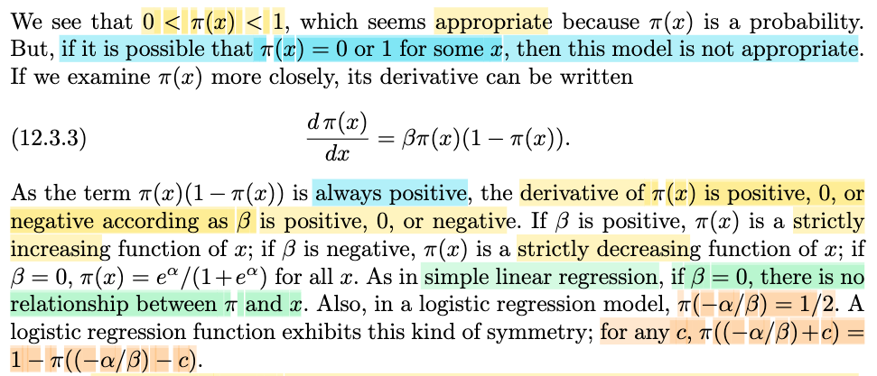</kbd>

> [!NOTE]
> π(x) = exp(α + βx) / \[1 + exp(α + βx)\]
>
>
>
> Đại khái là có thể thấy π(x) &gt; 0 (do exp(..) &gt; 0 nên tử số và mẫu số đều dương) và tử số bé hơn mẫu số nên cái này cũng &lt; 1.
>
>
>
> Như vậy có vẻ nó là một công thức hợp lí, vì π(x), là P(Y=1) (nên π(x) là một giá trị xác suất)
>
>
>
> ---
>
>
>
> Tiếp, thử lấy đạo hàm hàm π(x) đối với x:
>
>
>
> π(x) = exp(α + βx) / \[1 + exp(α + βx)\]
>
>
>
> π(u,v) = u / v
>
>
>
> dπ = (du v - u dv)/v²
>
>
>
> u = exp(z) ⇒ du = exp(z) dz = u dz
>
>
>
> v = 1 + exp(z) ⇒ dv = exp(z) dz = u dz
>
>
>
> π = u/(1 + u) ⇒ 1 - π = 1 - u/(1 + u) = 1/(1 + u)
>
>
>
> z = α + βx ⇒ dz = β dx
>
>
>
> vậy dπ = (du v - u dv)/v²
>
>
>
> = (u dz v - u u dz)/v²
>
>
>
> = (uv - u²)dz/v²
>
>
>
> = (u(1+u) - u²)dz/(1+u)²
>
>
>
> = (u + u² - u²)dz/(1+u)²
>
>
>
> = \[u/(1+u)²\]dz
>
>
>
> = π/(1+u)dz
>
>
>
> = π(1-π)dz
>
>
>
> = π(1-π)βdx
>
>
>
> Vẫy dπ = π(1-π)βdx ⇒ dπ/dx = βπ(x)(1-π(x))
>
>
>
> ---
>
>
>
> Khi đó, có thể thấy nếu β dương, âm, =0, thì dπ/dx dương, âm, = 0, tương ứng hàm π(x) strictly increasing / strictly decreasing / là hàm hằng theo x (cụ thể = exp(α) / \[1 + exp(α)\])
>
>
>
> ---
>
>
>
> Thêm nữa:
>
>
>
> π(-α/β) = exp(α + β(-α/β)) / \[1 + exp(α + β(-α/β))\]
>
>
>
> = exp(0)/(1+exp(0))
>
>
>
> = 1/2, cái này dễ thấy
>
>
>
> ---
>
>
>
> π(c-α/β) + π(-c-α/β) = 1

> [!TIP]
> 🤖 **AI Check** — 🟢 Pass — ✅ **100/100** · ✓ Move on
>
> Ghi chú rất xuất sắc, tự diễn giải chi tiết từng bước đạo hàm và các tính chất đối xứng, đơn điệu của hàm hồi quy logistic một cách chính xác.
>
> **✓ Strengths**
> - Tự thực hiện đầy đủ và chính xác từng bước biến đổi đạo hàm dπ/dx bằng quy tắc đạo hàm phân thức.
> - Hiểu rõ và giải thích trực giác tốt miền giá trị 0 < π(x) < 1 dựa trên tính chất của hàm mũ.
> - Nắm vững tính đơn điệu của hàm theo dấu của hệ số β và tính chất đối xứng tâm quanh điểm x = -α/β.
>
> **💡 Deeper notes**
> - Điểm đối xứng x = -α/β chỉ xác định khi β ≠ 0; nếu β = 0 thì đồ thị là đường nằm ngang π(x) = exp(α)/(1 + exp(α)).
> - Mô hình logistic không bao giờ đạt giá trị chính xác 0 hoặc 1 với x hữu hạn (chỉ tiệm cận khi x tiến ra vô cực).

 

###### Logistic Regression Parameter Interpretation

<kbd>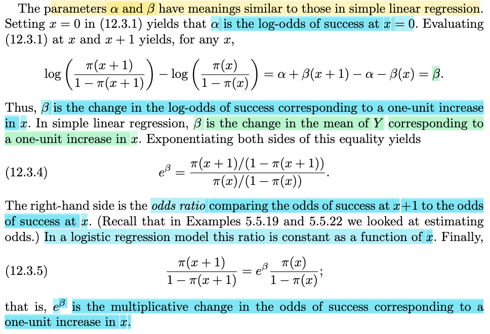</kbd>

> [!NOTE]
> Đại khái là đoạn này phân tích ý nghĩa của α, β.
>
>
>
> Nhắc lại giả định của logistic regression:
>
>
>
> y1,y2,...là các observed value của Y1,Y2,....độc lập có: Yi \~ Bern(π(xi)) với
>
>
>
> π(xi) = P(Yi=1|xi), là hàm sao cho: π(xi) = σ(α + βxi)
>
>
>
> và cũng là log (π(xi) / (1 - π(xi)) = α + βxi (1)
>
>
>
> Và soi chiếu theo mô hình GLM thì Y1,Y2,..độc lập \~ Bern(π(xi)) chính là tương ứng với exponential family có tham số là log (π(xi) / \[1 - π(xi)). link function là g(π(xi) = log (π(xi) / \[1 - π(xi)) và systematic component là α + βxi
>
>
>
> ---
>
>
>
> Vậy thì theo (1) thì:
>
>
>
> log (π(0) / \[1 - π(0)) = α
>
>
>
> ⇔ α = log \[P(Y=1|x=0)/P(Y=0|x=0)\]
>
>
>
> tức là log của odds of success, tỉ lệ giữa xác suất P(Y=1|x=0) và P(Y=0|x=0)
>
>
>
> ---
>
>
>
> Còn β: Nếu tính log (odd) tại x+1 trừ log odd tại x ta có:
>
>
>
> \[α + β(xi+1) - \[α + βxi\] = β
>
>
>
> Nên beta chính là mang ý nghĩa của mức thay đổi của log odd khi x tăng 1 đơn vị.
>
>
>
> (trong simple linear regression, E\[Y|x\] = α + βx, thì E\[Y|x+1\] - E\[Y|x\] = β nên ý nghĩa của β là mức thay đổi của mean Y khi x thay đổi 1 đơn vị)
>
>
>
> ---
>
>
>
> Tiếp, nếu từ
>
>
>
> log odd tại x+1 - log odd tại x = β
>
>
>
> exp(.) hai vế ta có:
>
>
>
> exp(log odd tại x+1 - log odd tại x) = exp(β)
>
>
>
> ⇔ exp(log odd tại x+1) / exp(log odd tại x) = exp(β)
>
>
>
> ⇔ odd tại x+1 / odd tại x = exp(β)
>
>
>
> Như vậy exp(β) là tỉ lệ odds tại x+1 và tại x
>
>
>
> ---
>
>
>
> Nói dễ hiểu: exp(β) là tỉ lệ giữa odds tại x+1: tỉ lệ xác suất success tại x+1 / xác suất failure tại x+1 với odds tại x

📹 [Xem video trên YouTube](https://www.youtube.com/watch?v=5y9ZCdAOOfo)

> [!TIP]
> 🤖 **AI Check** — 🟢 Pass — ✅ **95/100** · ✓ Move on
>
> Ghi chú rất xuất sắc, hiểu đúng và diễn giải cặn kẽ bản chất xác suất của alpha, beta và exp(beta), đồng thời mở rộng liên hệ chính xác với mô hình GLM.
>
> **✓ Strengths**
> - Diễn giải chính xác ý nghĩa log-odds của alpha tại x = 0 và mức thay đổi log-odds của beta khi x tăng 1 đơn vị.
> - Chứng minh và hiểu rõ exp(beta) là odds ratio (tỉ số odds) đại diện cho mức thay đổi nhân tử của odds.
> - Liên kết kiến thức tốt với lý thuyết GLM (họ phân phối hàm mũ, hàm liên kết logit, thành phần hệ thống).
>
> **💡 Deeper notes**
> - Cần lưu ý phân biệt giữa 'odds ratio' (tỉ số odds so với mốc trước đó) và 'xác suất' (probability), vì odds ratio tăng không đồng nghĩa với xác suất tăng tuyến tính do tính phi tuyến của hàm sigmoid.

 

###### Modeling Bernoulli Success Probability

<kbd>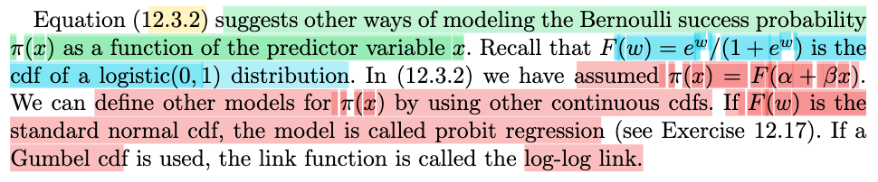</kbd>

> [!NOTE]
> Đại khái là:
>
>
>
> Nhắc lại logistic regression: giả định y1,y2,....là observed value của Y1,Y2,...độc lập sao cho:
>
>
>
> Yi \~ Bern(π(xi)) với:
>
>
>
> π(xi) = σ(α + βxi),  (1)
>
>
>
> σ(w) = exp(w) / \[1+exp(w)\], cũng là 1/\[1+exp(-w)\] là hàm logistic sigmoid, (hay như sách viết là hàm F(w))
>
>
>
> Thế thì ông nói rằng, hàm σ hay F, vốn dĩ ta đã gặp rồi, nó chính là CDF của phân phối logistic (0,1). Xem link
>
>
>
> Thế thì như vậy, nếu ta thay hàm σ/cdf của sigmoid trong giả định này bởi một hàm cdf khác, ta sẽ có mô hình khác:
>
>
>
> Ví dụ, thay bằng cdf của normal, Φ(w), ta sẽ có mô hình Probit regression, như sau:
>
>
>
> giả định y1,y2,...là observed values của Y1,Y2,...độc lập có:
>
>
>
> Yi \~ Bern(π(xi)) với
>
>
>
> π(xi) = P(Y=1|xi) = Φ(α + βxi) 
>
>
>
> Đây cũng là cái đã gặp trong chương 4 Bishop
>
>
>
> ---
>
>
>
> Tương tự, nếu thay bởi Gumbel cdf thì ta sẽ có mô hình khác, trong đó link function là log-log link.

> [!TIP]
> 🤖 **AI Check** — 🟢 Pass — ✅ **100/100** · ✓ Move on
>
> Ghi chú tóm tắt rất chính xác và mạch lạc nội dung từ giáo trình, đồng thời liên hệ tốt với các kiến thức đã học trước đó.
>
> **✓ Strengths**
> - Nắm vững bản chất việc mô hình hóa xác suất thành công π(x) thông qua hàm CDF liên tục.
> - Trình bày chuẩn xác mô hình Bernoulli và định nghĩa toán học của Probit regression.
> - Liên hệ tốt và nhất quán với kiến thức về hàm sigmoid và tài liệu tham khảo khác (Bishop).
>
> **💡 Deeper notes**
> - Hàm liên kết (link function) g(π) thực chất là hàm nghịch đảo của CDF được chọn, tức g(π) = F^(-1)(π); do đó với CDF Gumbel (loại cực trị), hàm nghịch đảo của nó sẽ cho ra log-log hoặc complementary log-log (cloglog) link.

**🔗 See also:** [Hàm phân phối Logistics](./15_distribution_function.md#node-b5jxnwe)

 

###### Section 12.3.2 Estimation

<kbd>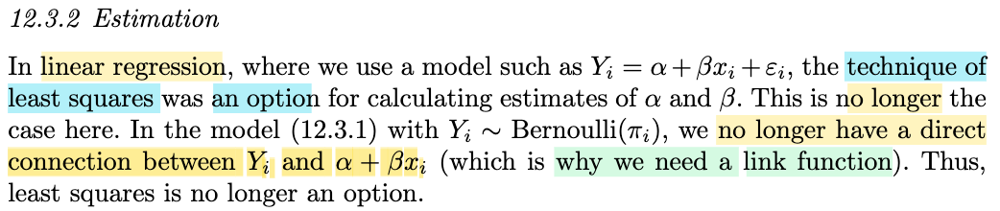</kbd>

> [!NOTE]
> Hiểu ý này thế nào?
>
>
>
> Tác giả nhắc lại trong simple linear regression (trong model đó, ta giả định y1,y2....là observed value của các Y1,Y2,....độc lập có phân phối Yi \~ n(α + βxi, σ²). Thì một option để đi estimate α, β là least square.
>
>
>
> Recall lại chút xíu: Còn nhớ trong phần đó, tác giả đã dắt ta qua 3 cách tiếp cận khác nhau khi estimate cho α và β, đầu tiên là least square, đây chỉ là một bài toán tối ưu thuần túy, không phải là statistical inference, trong đó ta hoàn toàn không đặt ra giả định gì về phân phối của Yi. Sau đó, khi bắt đầu bước chân sang bài toán suy luận thống kê bằng cách đặt giả định về hai moment đầu tiên của Y, thì ta chứng minh được rằng kết quả có được của bài toán least square cùng chính là the Best Linear Unbiased estimator (BLUE) của α và β. Cuối cùng, khi giả định hoàn chỉnh để có simple linear regressio model như trên, thì ta thấy BLUE cũng chính là MLE của α và β.
>
>
>
> Vậy thì quay lại đây, ông nói, sở dĩ với simple linear regression, việc giải bài toán least square cho phép ta có estimate của α và β là do trong mô hình đó ta có một liên hệ trực tiếp giữa Yi và α + βxi. Còn giờ đây với logistic regression model, không còn điều này nữa. Là sao?
>
>
>
> Là vì, trong mô hình simple linear regression, giả định Yi độc lập \~ n(α + βxi, σ²) thì cũng là giả định Yi = α + βxi + εi với εi iid \~ n(0, σ²). Do đó ta có liên hệ trực tiếp giữa  Yi và α + βxi:
>
>
>
> Yi = α + βxi + εi
>
>
>
> Còn với logistic regression, còn nhớ giả định là: y1,y2,....là observed value của Y1,Y2,...độc lập có phân phối:
>
>
>
> Yi \~ Bern(π(xi)) với π(xi) = σ(α + βxi)
>
>
>
> Như vậy, E\[Yi|x\] = σ(α + βxi), ta sẽ không thể liên hệ Yi trực tiếp với α + βxi nữa.

> [!TIP]
> 🤖 **AI Check** — 🟢 Pass — ✅ **98/100** · ✓ Move on
>
> Ghi chú thể hiện sự hiểu bài rất sâu sắc và mạch lạc, liên hệ chính xác kiến thức từ tối ưu thuần túy, định lý Gauss-Markov đến mô hình GLM hiện tại.
>
> **✓ Strengths**
> - Hệ thống hóa xuất sắc 3 góc nhìn của mô hình hồi quy tuyến tính (tối ưu hóa thuần túy, BLUE theo Gauss-Markov, và MLE dưới giả định phân phối chuẩn).
> - Giải thích rất chính xác bản chất của 'direct connection': trong tuyến tính $Y_i$ có quan hệ tuyến tính trực tiếp cộng thêm sai số $\varepsilon_i$, trong khi ở hồi quy logistic $Y_i$ là biến nhị phân rời rạc gắn với tổ hợp tuyến tính qua hàm phi tuyến (link function).
>
> **💡 Deeper notes**
> - Về mặt thuật toán, ta vẫn có thể dùng Iteratively Reweighted Least Squares (IRLS) để tìm nghiệm MLE cho logistic regression, nhưng đây là phương pháp giải thuật toán số chứ không phải phương pháp bình phương tối thiểu trực tiếp (OLS) đóng dạng như hồi quy tuyến tính.

 

###### Bernoulli Maximum Likelihood Estimation

<kbd>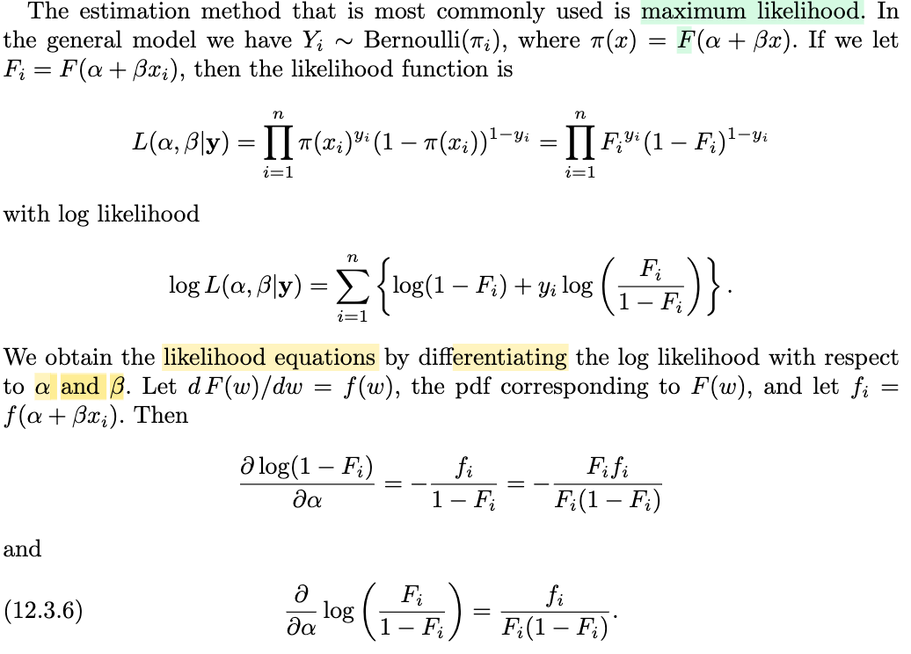</kbd>

<kbd>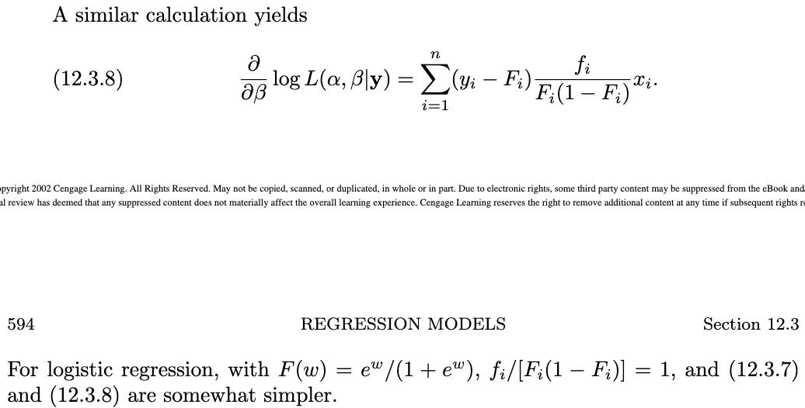</kbd>

> [!NOTE]
> Đoạn này đã làm nhiều rồi, thiết lập hàm likelihood, rồi log likelihood và tính đạo hàm hàm likelihood:
>
>
>
> (x1,y1), (x2,y2),....(xn,yn)
>
>
>
> Assumption:
>
>
>
> x1,x2,....xn là những giá trị biết trước
>
>
>
> y1,y2,...yn là các giá trị quan sát được của các random variable Y1,Y2,...Yn. độc lập
>
>
>
> Yi \~ Bern(π(xi))
>
>
>
> P(Yi=1) = π(xi)
>
>
>
> π(xi) = σ(α + βxi)
>
>
>
> ⇔ log \[π(xi)/(1-π(xi))\] = α + βxi
>
>
>
> ---
>
>
>
> Likelihood:
>
>
>
> 𝐱 = (3,5,9...) là các observed values của random sample size n: X1, X2,...Xn. iid n(x|μ, σ²)
>
>
>
> f(t), n(x|μ, σ²) = (1/√2πσ²) exp(-(t-μ)²/2σ²)
>
>
>
> f(x1|μ, σ²) = (1/√2πσ²) exp(-(x1-μ)²/2σ²)
>
>
>
> f(x2|μ, σ²) = (1/√2πσ²) exp(-(x2-μ)²/2σ²)
>
> ...
>
>
>
> joint f(t1,t2,...tn|μ, σ²)
>
>
>
> = f(x1|μ, σ²)f(x2|μ, σ²)....f(xn|μ, σ²)
>
>
>
> = Πi f(ti|μ, σ²)
>
>
>
> joint pdf của X1,...Xn tính tại 𝐱 = (3,5,9...):
>
>
>
> f(t1,t2,...tn|μ, σ²)|t1=3,t2=5,t3=9
>
>
>
> = Πi f(ti|μ, σ²) |t1=3,t2=5,t3=9
>
>
>
> = Πi (1/√2πσ²) exp(-(ti-μ)²/2σ²) |t1=3,t2=5,t3=9
>
>
>
> = (1/√2πσ²) exp(-(t1-μ)²/2σ²) (1/√2πσ²) exp(-(t2-μ)²/2σ²) ....|t1=3,t2=5,t3=9
>
>
>
> = (1/√2πσ²) exp(-(3-μ)²/2σ²) (1/√2πσ²) exp(-(5-μ)²/2σ²) ....
>
>
>
> L(μ, σ²|𝐱=(3,5,9))
>
>
>
> L(θ|𝐱) = f(𝐱|θ)
>
>
>
> ---
>
>
>
>
>
> biến ngẫu Y1,Y2,...
>
>
>
> P(Y1=y1), P(Y2=y2),...
>
>
>
> X \~ Bern(p): P(X=1) = p, P(X=0) = 1-p. P(X=x) = p^x \[(1-p)^(1-x)\]
>
>
>
> P(Y1=t1, Y2=t2,....) = Πi P(Yi=yi) = Πi π(xi)^ti \[(1-π(xi))^(1-ti)\]
>
>
>
> Xét joint pmf của Y1,... tại observed value: 𝐲 = (y1,y2,....yn)
>
>
>
> Πi π(xi)^ti \[(1-π(xi))^(1-ti)\]|𝐲 = (y1, y2,....yn)
>
>
>
> = Πi π(xi)^yi \[(1-π(xi))^(1-yi)\]
>
>
>
> = Πi (σ(α + βxi))^yi \[(1 - σ(α + βxi))^(1-yi)\]
>
>
>
> Đây likelihood:
>
>
>
> L(α,β|data) = Πi (F(α + βxi))^yi \[(1 - F(α + βxi))^(1-yi)\]
>
>
>
> = Πi (Fi)^yi \[(1 - Fi)^(1-yi)\]
>
>
>
> log L(α,β|data) = log \[Πi (Fi)^yi \[(1 - Fi)^(1-yi)\]\]
>
>
>
> = Σi log (Fi)^yi \[(1 - Fi)^(1-yi)\]\]
>
>
>
> = Σi {log (Fi)^yi + log \[(1 - Fi)^(1-yi)\]}
>
>
>
> = Σi {yi log Fi + (1-yi) log (1 - Fi)}
>
>
>
> = Σi {yi log Fi + log (1 - Fi) - yi log (1 - Fi) }
>
>
>
> = Σi {yi log Fi - yi log (1 - Fi) + log (1 - Fi) }
>
>
>
> = Σi {yi \[log Fi - log (1 - Fi)\] + log (1 - Fi) }
>
>
>
> = Σi {log (1 - Fi) + yi log \[Fi/(1 - Fi)\]}
>
>
>
> ---
>
>
>
> maximize\_ α, β {Likelihood}
>
>
>
> maximize\_ α, β {log Likelihood}
>
>
>
> ∂/∂α \[Σi {log (1 - Fi) + yi log \[Fi/(1 - Fi)\]}\]
>
>
>
> = Σi ∂/∂α {log (1 - Fi) + yi log \[Fi/(1 - Fi)\]}
>
>
>
> = Σi ∂/∂α log (1 - Fi) + Σi ∂/∂α yi log \[Fi/(1 - Fi)\]
>
>
>
> = Σi ∂/∂α log (1 - Fi) + Σi ∂/∂α yi log \[Fi/(1 - Fi)\]
>
>
>
> Xét:
>
>
>
> ∂/∂α log (1 - Fi) = ∂/∂(1 - Fi) ) log (1 - Fi) . ∂/∂α (1 - Fi)
>
>
>
> = \[1/(1 - Fi)\] . (-1) ∂Fi/∂α
>
>
>
> = \[1/(1 - Fi)\] . (-1) ∂Fi/∂α
>
>
>
> = \[1/(1 - Fi)\] . (-1) fi
>
>
>
> = -fi/(1 - Fi)
>
>
>
> ---
>
>
>
>  Tương tự không khó để tính ra
>
>
>
>  ∂/∂α log \[Fi/(1 - Fi)\] = fi / Fi(1-Fi)
>
>
>
> ---
>
>
>
> Nên ∂/∂α \[Σi {log (1 - Fi) + yi log \[Fi/(1 - Fi)\]}\]
>
>
>
> = Σi {∂/∂α log (1 - Fi) + yi ∂/∂α log \[Fi/(1 - Fi)\]}
>
>
>
> = Σi {-fi/(1 - Fi) + yi fi / Fi(1-Fi)}
>
>
>
> Tương tự là tính đạo hàm đối với β

📹 [Xem video trên YouTube](https://www.youtube.com/watch?v=c7g727RW818)

> [!TIP]
> 🤖 **AI Check** — 🟢 Pass — ✅ **92/100** · ✓ Move on
>
> Ghi chú rất chi tiết, tự khai triển và biến đổi toán học tường minh từ hàm likelihood, log-likelihood đến đạo hàm theo alpha. Kết luận đúng về tính chất phi tuyến của phương trình likelihood đòi hỏi phương pháp số.
>
> **✓ Strengths**
> - Tự lực khai triển từng bước đạo hàm theo quy tắc chuỗi (chain rule) rất rõ ràng và chuẩn xác.
> - Hiểu rõ bản chất hàm likelihood được xây dựng từ tích các hàm xác suất (pmf) độc lập của phân phối Bernoulli.
> - Nắm chắc ý nghĩa cốt lõi: phương trình đạo hàm bằng 0 là phi tuyến nên không có nghiệm đóng (closed-form), cần giải bằng thuật toán số.
>
> **💡 Deeper notes**
> - Biểu thức đạo hàm cuối cùng của bạn Σi {-fi/(1 - Fi) + yi fi / [Fi(1-Fi)]} khi quy đồng mẫu số chung sẽ rút gọn rất đẹp thành Σi (yi - Fi) * [fi / (Fi(1 - Fi))], dạng này giúp dễ nhận diện phần dư (residual) yi - Fi.
> - Tài liệu gốc có lưu ý thêm một tính chất quan trọng: hàm log-likelihood của logistic/probit là lõm ngặt (strictly concave), nên nếu có nghiệm thì nghiệm MLE là duy nhất. Tuy nhiên với dữ liệu phân tách hoàn hảo (separation/extreme data), nghiệm có thể tiến ra ±∞.

 

###### Non-existence of Logistic Regression MLEs

<kbd>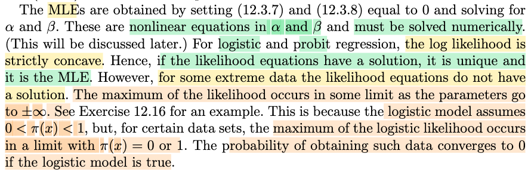</kbd>

<kbd>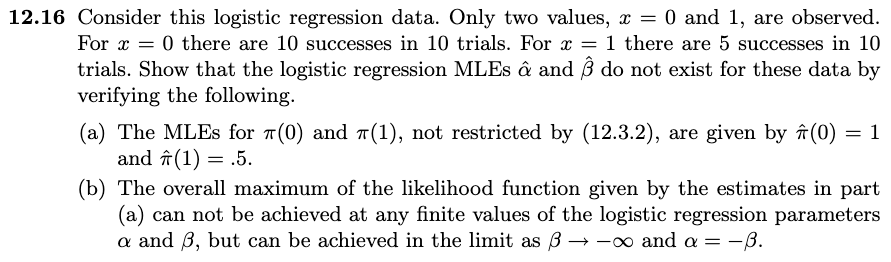</kbd>

<kbd>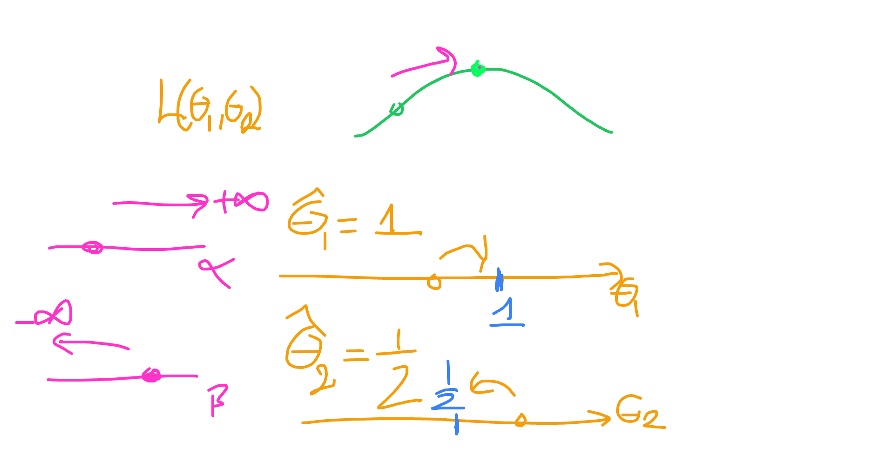</kbd>

> [!NOTE]
> Để giải phương trình đạo hàm bằng 0 để ra nghiệm MLE của α của β thì ta sẽ phải deal với phương trình phi tuyến, do đó ko có closed form solution, cần dùng thuật toán giải
>
>
>
> Và đại ý là vì hàm log likelihood là lõm ngặt nên nếu phương trình đạo hàm bằng 0 có nghiệm thì nó sẽ là nghiệm duy nhất.
>
>
>
> Có điều, tác gỉa cho biết một số trường hợp bài toán sẽ vô nghiệm,  lí do là khi xuất hiện extreme data. Sẽ hiểu rõ hơn khi làm bài 12.16
>
>
>
> ---
>
>
>
>  Ex 12.16: Đại khái là ta có data như sau (xi=0, yi=1) với i=1,2,3,.....10 và (xi=1, yi=1) với i=11,...15 và (xi=1, yi=0) với i=16,...20
>
>
>
> Yêu cầu tính MLE của π(0) và π(1):
>
>
>
> Nhắc lại giả định của logistic regression:
>
>
>
> x1,x2,...đã biết, y1,y2,....là observed values của Y1,Y2,.... độc lập có phân phối:
>
>
>
> Yi \~ Bern(π(xi)) và π(xi) = σ(α + βxi)
>
>
>
> joint pmf của Yi: P(Y1=yi,...Yn=yn), do tính độc lập của Yi:
>
>
>
> .. = Πi P(Yi = yi)
>
>
>
> Joint pmf tại observed data
>
>
>
> = Πi P(Yi = yi)
>
>
>
> = Πi=1,..10 P(Yi = yi) × Πi=11,..15 P(Yi = yi) × Πi=16,..20 P(Yi = yi)
>
>
>
> Evaluate tại data:
>
>
>
> = Πi=1,..10 P(Yi = 1) × Πi=11,..15 P(Yi = 1) × Πi=16,..20 P(Yi = 0)
>
>
>
> = Πi=1,..10 π(xi) × Πi=11,..15 π(xi) × Πi=16,..20 \[1 - π(xi)\]
>
>
>
> = Πi=1,..10 π(0) × Πi=11,..15 π(1) × Πi=16,..20 \[1 - π(1)\]
>
>
>
> = π(0)^10 π(1)^5 \[1 - π(1)\]^5
>
>
>
> Gọi θ1 là π(0) và θ2 là π(1). Ta sẽ đi tìm MLE của θ1, θ2.
>
>
>
> = θ1^10 θ2^5 \[1 - θ2\]^5
>
>
>
> L(θ1, θ2) = θ1^10 θ2^5 \[1 - θ2\]^5
>
>
>
> log L(θ1, θ2) = log (θ1^10 θ2^5 \[1 - θ2\]^5)
>
>
>
> = log θ1^10 + log θ2^5 + log \[1 - θ2\]^5
>
>
>
> = 10 log θ1 + 5 log θ2 + 5 log (1 - θ2)
>
>
>
> Giải bài toán maximize over θ1, θ2 {L(θ1, θ2)}
>
>
>
> tương đương maximize over θ1, θ2 {log L(θ1, θ2)}
>
>
>
> giải theo θ1 trước: maximize\_θ1 {10 log θ1 + constant}
>
>
>
> d/dθ1 {10 log θ1 + constant} = 10/θ1
>
>
>
> và vì θ1 ∈ (0,1\] (định nghĩa của Bern(p): p ∈ \[0,1\]) nên hàm số đạo hàm riêng của log likelihood đối với θ1 luôn dương với mọi θ1. Nên hàm log likelihood cũng như likelihood đồng biến với mọi θ1 ∈ \[0,1\]. Do đó, hàm số chỉ đạt cực đại khi θ1 = 1.
>
>
>
> Vậy MLE estimator của θ1, cũng là π(0) = 1
>
>
>
> ---
>
>
>
> Giải theo θ2:
>
>
>
> Maximize\_θ2 10 log θ̂1 + 5 log θ2 + 5 log (1 - θ2)
>
>
>
> = 5 log θ2 + 5 log (1 - θ2) (do 10 log θ̂1 = 10 log 1 = 0)
>
>
>
> d/dθ2 (5 log θ2 + 5 log (1 - θ2))
>
>
>
> = 5/θ2 - 5/(1 - θ2))
>
>
>
> = 5(1 - θ2)/\[θ2(1 - θ2)\] - 5θ2/\[θ2(1 - θ2)\]
>
>
>
> = (5-5θ2-5θ2)/\[θ2(1 - θ2)\]
>
>
>
> = (5-10θ2)/\[θ2(1 - θ2)\]
>
>
>
> Cho = 0: (5-10θ2)/\[θ2(1 - θ2)\] = 0 ⇔ θ2 = 1/2
>
>
>
> vậy MLE của θ2, tức MLE của π(1) = 1/2
>
>
>
> ---
>
>
>
> b) Chứng minh maximum của likelihood không thể đạt được tại bất kì giá trị nào của tham số α, β nhưng có thể đạt được khi β → -∞ và α = -β
>
>
>
> Đại khái là:
>
>
>
> Likelihood lớn nhất, sẽ là L(θ̂1,θ̂2) với θ̂1 = 1 và θ̂2 = 1/2
>
>
>
> Cái ta cần chứng minh là không thể tồn tại α và β hữu hạn giúp có được
>
>
>
> θ1 = 1 ⇔ π(0) = 1 ⇔ σ(α + 0 × β) = 1 ⇔ σ(α) = 1
>
>
>
> θ2 = 1/2 ⇔ π(1) = 1/2 ⇔ σ(α + β) = 1/2
>
>
>
> Nói cách khác, hệ phương trình {σ(α + 0 × β) = 1, σ(α + β) = 1/2} vô nghiệm
>
>
>
> Xét σ(α) = 1 do 0 &lt; σ(α) &lt; 1 ∀ α ∈ R nên phương trình này không có nghiệm hữu hạn.
>
>
>
> ---
>
>
>
> Cho α = -β và cho β → -∞ khi đó:
>
>
>
> π(1) = σ(α + β) = σ(0) = 1/2, tức là π(1) = σ(α + β) luôn là MLE của π(1)
>
>
>
> và α sẽ → ∞ giúp ta có π(0) = σ(α + β × 0) → 1
>
>
>
> từ đó khiến L(π(0),π(1)) sẽ → L tại MLE của π(0),π(1), tức Lmax

📹 [Xem video trên YouTube](https://youtu.be/ciIfBvGwo9w)

> [!TIP]
> 🤖 **AI Check** — 🟢 Pass — ✅ **98/100** · ✓ Move on
>
> Ghi chú rất xuất sắc, hiểu sâu bản chất lý thuyết và tự thực hiện trọn vẹn, chính xác các bước giải cho bài tập 12.16.
>
> **✓ Strengths**
> - Thiết lập hàm hợp lý (likelihood) và log-likelihood hoàn toàn chính xác từ dữ liệu phân loại nhị thức độc lập.
> - Lập luận tìm cực đại theo θ1 chặt chẽ khi chỉ ra đạo hàm luôn dương trên miền xác định nên đạt max tại biên θ1 = 1.
> - Giải thích phần (b) rất trực quan và chuẩn xác: hàm sigmoid không đạt giá trị 1 tại hữu hạn nên nghiệm chỉ đạt được ở giới hạn vô cùng (hiện tượng phân tách hoàn toàn/quasicomplete separation).
>
> **💡 Deeper notes**
> - Hiện tượng MLE không tồn tại ở giá trị hữu hạn như trong bài tập này được gọi là vấn đề phân tách dữ liệu (complete separation hoặc quasi-complete separation) trong hồi quy logistic.
> - Khi tìm nghiệm θ1 = 1, giá trị cực đại nằm ở biên của không gian tham số [0, 1], vì vậy việc đạo hàm bằng 0 không áp dụng được tại điểm biên mà phải dựa vào tính đơn điệu.

 

