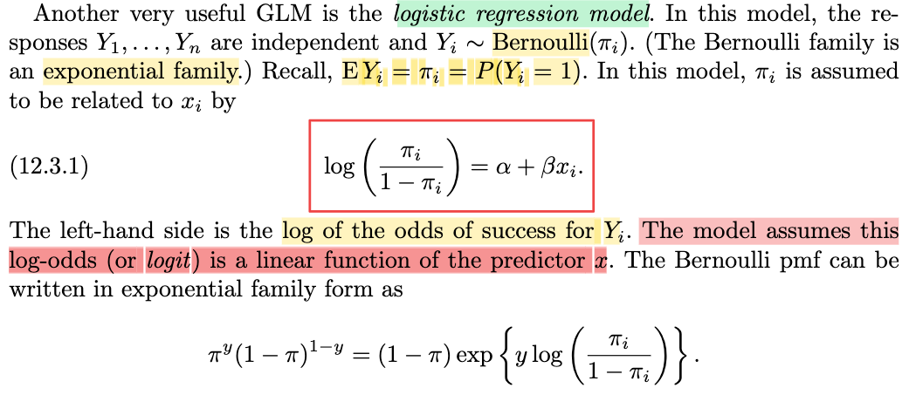

# 12.3 Logistic Regression

📊 **Progress:** `3` Notes | `5` Screenshots | `3` AI Reviews

---

 

## Section 12.3 Logistic Regression

<kbd></kbd>

> [!NOTE]
> Trước tiên có thể ôn lại conditional normal model đã gặp ở 11.3.3. Đó là mô hình trong trong đó ta giả định dữ liệu (x1,y1), (x2,y2) ... sinh ra từ mô hình sau:
>
>
>
> x1,x2,....là các giá trị đã biết trước
>
>
>
> y1,y2,...là gía trị quan sát được của các random variable Y1, Y2,....độc lập. Và Yi \~ n(α + βxi, σ²)
>
>
>
> hoặc y1,y2....là giá trị quan sát được của Y1,Y2,...trong đó: Yi = α + βxi + εi với εi iid \~ n(0, σ²)
>
>
>
> Như vậy, có thể thấy, mô hình này giả định rằng mean của Y, tức E\[Y|x\] (gọi là regression population mean) là hàm tuyến tính đối với x với tham số α và β.
>
>
>
> Thế thì ở đây tác giả cho biết, conditional normal model chỉ là một ví dụ của cái gọi là mô hình tuyến tính tổng quát (generalized linear model). Được định nghĩa là: mô tả quan hệ giữa mean của response variable Y và independent variable x. Mà quan hệ này có thể phức tạp hơn nhiều so với conditional normal model. Và phần này ta sẽ tập trung vào một trong các mô hình GLM này, logistic regression.
>
>
>
> Khái niệm GLM trong chương 4 Bishop có nói đến, nhưng ở đây mình sẽ được học nó ở mức độ sâu hơn

> [!TIP]
> 🤖 **AI Check** — 🟢 Pass — ✅ **100/100** · ✓ Move on
>
> Ghi chú rất tốt, tái hiện chính xác kiến thức nền tảng về conditional normal model và nắm bắt đúng tinh thần giới thiệu về GLM của giáo trình.
>
> **✓ Strengths**
> - Tái hiện chính xác và đầy đủ hai cách biểu diễn tương đương của conditional normal model (dạng phân phối điều kiện và dạng nhiễu Gauss cộng tính).
> - Hiểu đúng bản chất GLM là mở rộng mối quan hệ giữa kỳ vọng của biến mục tiêu E[Y|x] và biến độc lập x thay vì chỉ bó hẹp ở hàm tuyến tính trực tiếp.
>
> **💡 Deeper notes**
> - Về mặt toán học chuẩn của GLM, mối quan hệ phức tạp hơn này thường được mô hình hóa thông qua một hàm liên kết (link function) $g(\mu) = \alpha + \beta x$ với $\mu = E[Y|x]$, và phân phối của $Y|x$ thuộc họ hàm mũ (exponential dispersion family).

 

### 12.3.1 The Model

<kbd></kbd>

<kbd></kbd>

> [!NOTE]
> Đại khái đoạn này mô tả một mô hình tuyến tính tổng quát (GLM): Gồm 3 thành phần (component):
>
>
>
> 1. Random component (tạm hiểu là cấu phần chứa tính chất ngẫu nhiên): Đó chính là các response variable Y1,..Yn. Giả định đặt ra là đây là những random variable độc lập, có chung dạng phân phối thuộc họ exponential nào đó như Poisson, normal, nhưng khác tham số, nên không identically distributed.
>
>
>
> 2. Systematic component: Chính là cái hàm số áp lên x trong quan hệ giữa E\[Y|x\] và x, ví dụ trong conditional normal model, hàm số này là α + βx
>
>
>
> 3. Link function g(μ), tạm hiểu là hàm số áp lên μ (hay E\[Y|x\]) trong quan hệ giữa E\[Y|x\] và x.
>
>
>
> Trong conditional normal model, g(μ) = μ, gọi là identity link function. Thành ra kết hợp với 2), quan hệ giữa Y và x thể hiện bởi:
>
>
>
> g(E\[Y|x\]) = E\[Y|x\] = α + βx

📹 [Xem video trên YouTube](https://www.youtube.com/watch?v=Ti80vUWcbrA)

> [!TIP]
> 🤖 **AI Check** — 🟢 Pass — ✅ **95/100** · ✓ Move on
>
> Ghi chú tóm tắt rất chính xác và mạch lạc cấu trúc 3 thành phần của GLM cùng ví dụ về mô hình hồi quy chuẩn có identity link.
>
> **✓ Strengths**
> - Hiểu đúng và giải thích rõ bản chất vì sao các biến phản hồi độc lập nhưng không cùng phân phối (cùng họ nhưng khác tham số do phụ thuộc vào x).
> - Áp dụng chính xác ví dụ hồi quy chuẩn có hàm liên kết đồng nhất (identity link) để minh họa mối liên hệ giữa ba thành phần.
>
> **💡 Deeper notes**
> - Về mặt thuật ngữ chuẩn, systematic component (thành phần hệ thống) thường được gọi là linear predictor (bộ dự báo tuyến tính), có đặc trưng cốt lõi là phải 'tuyến tính theo các tham số' (linear in parameters, ví dụ α + βx), thay vì chỉ là một hàm bất kỳ của x.

 

#### Logistic Regression as GLM

<kbd></kbd>

<kbd></kbd>

> [!NOTE]
> Nói sang mô hình logistic regression: Trong mô hình này, random component, các random variable Y1,Y2 ...là các biến ngẫu nhiên có phân phối Yi \~ Bern(πi).
>
>
>
> Trong đó πi sẽ được giả định là quan hệ với xi bởi:
>
>
>
> log(πi/(1-πi)) = α + βxi
>
>
>
> như vậy mô hình này giả định log-odds là hàm tuyến tính của x.
>
>
>
> Còn nhớ trong Bishop chương 4, cũng đã học về logistic regression, nhưng thể hiện khác chút xíu: Đó là mô hình này giả định các giá trị của y1,y2,...là giá trị quan sát của Y1,Y2,....với Yi \~ Bern(πi) với:
>
>
>
> P(Yi=1) = σ(α + βxi)
>
>
>
> thì thật ra (1) log(πi/(1-πi)) = α + βxi và (2) P(Yi=1) = πi = σ(α + βxi) cũng là một thôi:
>
>
>
> (1) log(πi/(1-πi)) = α + βxi
>
>
>
> ⇔ πi/(1-πi) = exp(α + βxi)
>
>
>
> ⇔ (1-πi)/πi = 1/exp(α + βxi)
>
>
>
> ⇔ 1/πi - 1 = 1/exp(α + βxi)
>
>
>
> ⇔ 1/πi = 1 + 1/exp(α + βxi)
>
>
>
> ⇔ 1/πi = \[exp(α + βxi) + 1\]/exp(α + βxi)
>
>
>
> ⇔ πi = exp(α + βxi)/\[exp(α + βxi) + 1\] = σ(α + βxi) ⇒ chính là (2)
>
>
>
> ---
>
>
>
> Và đây là một ví dụ của GLM, bằng cách phân tích như sau:
>
>
>
> i) ta sẽ chỉ ra rằng Bernouilly là một phân phối thuộc exponential family
>
>
>
> P(Yi = y) (pmf của Yi tại y) = (πi^y)\[(1-πi)^(1-y)\]
>
>
>
> = exp\[log(πi^y)\] exp \[log (1-πi)^(1-y)\]
>
>
>
> = exp\[log(πi^y) + log (1-πi)^(1-y)\]
>
>
>
>  = exp\[y log(πi) + (1-y) log (1-πi)\]
>
>
>
>  = exp\[y log(πi) + log (1-πi) - y log (1-πi)\]
>
>
>
>  = exp(log (1-πi)) exp\[y log(πi) - y log (1-πi)\]
>
>
>
>  = (1-πi) exp\[y(log(πi) - log (1-πi))\]
>
>
>
>  = (1-πi) exp\[y log(πi/(1-πi))\]
>
>
>
> Như vậy, pmf của Bern(πi) có dạng:
>
>
>
> f(x|𝛉) = h(x) c(𝛉) exp(Σi wi(𝛉)ti(x))
>
>
>
> với h(y) = 1, c(𝛉) = 1-πi, exp(Σi wi(𝛉)ti(x)) chính là exp\[y log(πi/(1-πi))\].
>
>
>
> Điều này cũng đồng nghĩa tham số của Bern(πi) dưới góc độ exponential family là log(πi/(1-πi), tức logit, hay log odds.
>
>
>
> ii) Theo mô tả của GLM, thì systematic và link function là gì?
>
>
>
> Ta có giả định của logistic regression model là: log(πi/(1-πi)) = α + βxi
>
>
>
> nên theo đó, systematic component chính là α + βxi
>
>
>
> và link function là log(πi/(1-πi))
>
>
>
> và vì đại khái là link function trong trường hợp này là chính là cái hàm h(πi) sao cho h(πi) cho ta cái tham số của exponential family, nên người ta gọi là canonical link (chính tắc)
>
>
>
> ---
>
>
>
> Còn conditional normal model?
>
>
>
> Conditional normal model giả định y1, y2, ...là giá trị quan sát được của Y1,Y2,..độc lập.Yi \~ n(α + βxi, σ²)
>
>
>
> Cũng có nghĩa là E\[Y|xi\] = α + βxi
>
>
>
> Chiếu theo GLM:
>
>
>
> Random component là Y1,Y2,...\~ n(α + βxi, σ²), là một exponential family:
>
>
>
> f(y|μ, σ²) = 1/√2πσ² exp(-(y-μ)²/2σ²)
>
>
>
> = 1/√2πσ² exp(-(y²-2yμ+μ²)/2σ²)
>
>
>
> = 1/√2πσ² exp(-y²/2σ²+2yμ/2σ²-μ²/2σ²)
>
>
>
> = 1/√2πσ² exp(-y²/2σ²+2yμ/2σ²)exp(-μ²/2σ²)
>
>
>
> = 1 × 1/√2πσ² exp(-μ²/2σ²) exp(-y²/2σ²+yμ/σ²)
>
>
>
> Theo công thức của exponential family:
>
>
>
> f(y|𝛉) = h(y) c(𝛉) exp(Σi wi(𝛉)ti(y))
>
>
>
> thì h(y) = 1
>
>
>
> c(𝛉) = 1/√2πσ² exp(-μ²/2σ²)
>
>
>
> Σi wi(𝛉)ti(y) chính là -y²/2σ²+yμ/σ²
>
>
>
> với w1(𝛉) = 1/σ², t1(y) = -y²/2
>
>
>
> w2(𝛉) = μ/σ², t2(y) = y
>
>
>
> Và systematic component là: α + βxi
>
>
>
> và link function là identity h(E\[Y|xi\]) = E\[Y|xi\]

> [!TIP]
> 🤖 **AI Check** — 🟢 Pass — ✅ **100/100** · ✓ Move on
>
> Ghi chú rất xuất sắc, hiểu sâu bản chất GLM khi tự liên hệ đối chiếu giữa cách biểu diễn logit và sigmoid (Bishop), tự biến đổi dạng họ hàm mũ (exponential family) và mở rộng chính xác sang mô hình hồi quy tuyến tính chuẩn (conditional normal model).
>
> **✓ Strengths**
> - Biến đổi đại số chính xác và chi tiết để chứng minh tương đương giữa logit link và hàm sigmoid trong Bishop.
> - Chứng minh chặt chẽ phân phối Bernoulli thuộc họ hàm mũ và chỉ ra chính xác natural parameter (canonical link).
> - Mở rộng tốt tư duy GLM sang mô hình Conditional Normal (phân phối chuẩn với identity link).
>
> **💡 Deeper notes**
> - Về mặt chặt chẽ trong họ hàm mũ, hàm cơ sở h(y) thường mang theo hàm chỉ thị tập giá trị (support) I_{0, 1}(y) đối với phân phối Bernoulli.
> - Trong GLM đối với phân phối chuẩn N(μ, σ²), σ² thường được coi là tham số phân tán (dispersion parameter φ). Khi đó natural parameter là θ = μ, và hàm liên kết chính tắc (canonical link) g(μ) = μ là hàm đồng nhất (identity link).

 

