# 4.5 Covariance & Correlation

📊 **Progress:** `19` Notes | `29` Screenshots | `9` AI Reviews

---

 

## Hiệp phương sai và Tương quan

<kbd>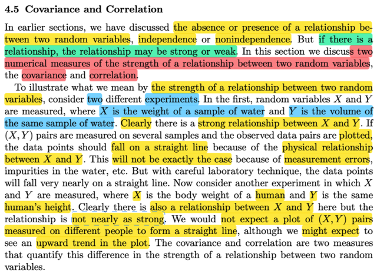</kbd>

> [!NOTE]
> Đại khái là ở đây nói rằng ở những phần trước ta đã nói về việc có hay
> không việc hai random variable có quan hệ với nhau, thể hiện qua khái niệm
> chúng independent hay không.
>
>
>
> Thế thì nếu như có quan hệ, thì sự quan hệ này cũng mạnh yếu khác nhau.
> Nên phần này ta bàn về hai thước đo của độ mạnh yếu này.Đó chính là
> covariance và correlation.
>
>
>
> Thế thì gs đề nghị ta tưởng tưỡng hai thí nghiệm. 1) Lấy ngẫu nhiên một
> sample là mẫu nước và ghi nhận thể tích (X) cũng như khối lượng của nó
> (Y). Thế thì rõ ràng rằng ta có thể expect rằng nếu như nước là tinh khiết, và
> việc lấy mẫu ko có sai sót thì khả năng cao là khi vẽ chúng lên đồ thị 2D thì
> chúng sẽ nằm trên đường thẳng, đơn giản là và quan hệ giữa khối lượng và
> thể tích của một khối nước sẽ tuân theo ràng buộc vật lí (khối lượng = thể
> tích  * khối lương riêng (constant)
>
>
>
> Trong khi đó nếu X là chiều cao một người được chọn ngẫu nhiên và Y là
> khối lượng của họ, thì dì ta  sẽ vẫn expect có quan hệ nào đó nhưng sẽ ko
> thể là tuyến tính được

 

### Covariance và Correlation

<kbd>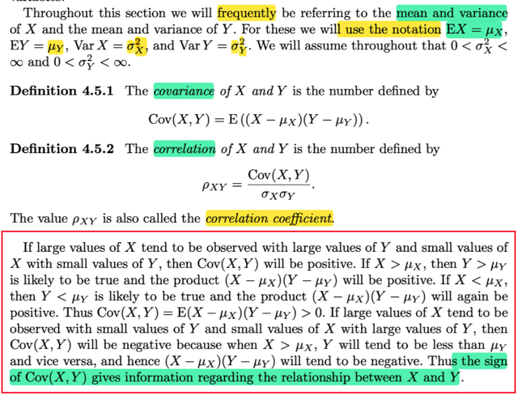</kbd>

> [!NOTE]
> định nghĩa của covariance và correlation. Cov(X,Y) = E[(X - μX)(Y -μY)]
> và rhoX,Y = Cov(X, Y) / σXσY
>
>
>
> cách hiểu là, nếu X lớn thì thường thường Y cũng lớn, mà X nhỏ thì
> thường Y cũng nhỏ thì correlation của chúng sẽ dương.
>
>
>
> Vì khi X lớn sẽ (tương đương) X > μX và Y cũng Y > μY ⇨  (X - μX)(X -
> μY) > 0. Tương tự khi X nhỏ , Y nhỏ, tích của (X - μX)(X - μY) là tích hai
> số âm cũng thành dương.
>
>
>
> Ngược lại nếu X lớn mà X có xu hướng nhỏ, thì Cov(X,Y) sẽ âm

 

#### Covariance, Correlation, Công thức

<kbd>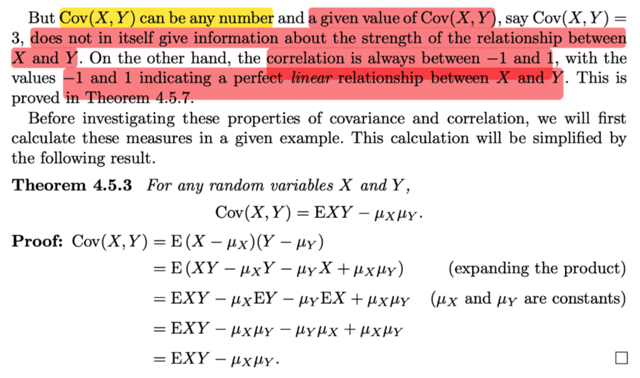</kbd>

> [!NOTE]
> đại khái nói là covariance có thể có giá trị lớn bé bất kì. Và bản thân giá trị
> của nó không nói gì về độ mạnh yếu của quan hệ giữa X, Y (dù DẤU CỦA
> COVARIANCE THÌ CÓ)
>
>
>
> Nhưng correlation thì CHỈ CÓ GIÁ TRỊ TRONG KHOẢNG [-1,1] và giá trị
> cuả nó sẽ báo hiệu độ mạnh yếu của mối quan hệ giữa hai random variable
>
>
>
> Thế thì ta sẽ có một theorem: Cov(X,Y) = E(XY) - μXμY (ko khó để chứng minh,
> chỉ là triển khai cái E(X-μX)(Y-μY) thôi

 

##### Phân phối biên và Tương quan

<kbd>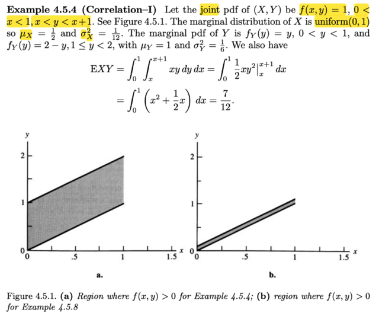</kbd>

<kbd>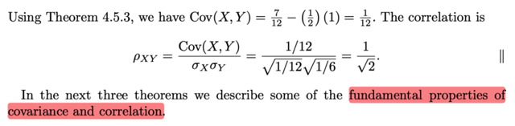</kbd>

> [!NOTE]
> rồi, ví dụ này, f(x, y) = 1, x ∈ (0,1), x &lt; y &lt; x + 1
>
>
>
> Thử xem tại sao họ nói marginal distribution của X là uniform(0,1)?
>
>
>
> Tính fX(x) bằng cách marginalizing joint pdf:
>
>
>
> fX(x) = ∫x: x+1 fX,Y(x,y) dy
>
>
>
> = ∫x: x+1 1 dy = y | x: x+1 = x + 1 - x = 1
>
>
>
> ⇨ X \~ uniform(0,1)/ Vì uniform (a,b) có pdf = 1/(b-a) khi x ∈ (a,b)
>
>
>
> ⇨ uniform (0,1) có pdf là 1/(1-0) = 1 khi x ∈ (0,1)
>
>
>
> Còn marginalizing over x ta có marginal pdf của Y:
>
>
>
> x ∈ A = (0,1) ∩ (-inf, y) ∩ (y-1, inf)
>
>
>
> \- If y &lt; 0 or y-1 &gt; 1 ⇔ y &lt; 0 or y &gt; 2 ⇨ A = ∅
>
>
>
> \- If 0 &lt; y &lt; 1 ⇨ A = (0, y) ∩ (y-1, 1) = (max(0, y-1), min(1,y))
>
>
>
> fY(y) = ∫A fX,Y(x,y) dx
>
>
>
> = x | max(0, y-1): min(1,y)
>
>
>
> = min(1,y) - max(0, y-1)
>
>
>
> Khi 0 &lt; y &lt; 1 ⇨ min(1,y) = y, max(0, y-1) = 0 ⇨ fY(y) = y - 0 = y
>
>
>
> Khi 1 ≤ y &lt; 2 ⇨ min(1,y) = 1, max(0, y-1) = y-1 ⇨ fY(y) = 1 - (y-1) = **2-y**
>
>
>
> Còn khi y &lt; 0 hoặc y &gt; 2 thì như đã nói A rỗng ⇨ tích phân = 0 ⇨ fY = 0
>
>
>
> **Vậy fY(y) = y khi y** ∈ **(0,1) hoặc bằng 2-y khi y** ∈ \*\*\[1,2)
>
>
>
> Tiếp, ta sẽ tính mean, variance của X, Y:\*\*
>
>
>
> Với X: μX = EX = ∫0:1 xfX(x)dx = ∫0:1 xdx = x²/2|0:1 = 1/2
>
>
>
> σX² = Var(X) = EX² - (EX)² = ∫0:1x²fX(x)dx - (1/2)²
>
>
>
> = ∫0:1x²dx - 1/4 = x³/3|0:1 - 1/4 = 1/3 - 1/4 = 1/12
>
>
>
> Với Y: μY = EY = ∫0:1 yfY(y)dy + ∫1:2 yfY(y)dy
>
>
>
> = ∫0:1 yy dy + ∫1:2 y(2-y)dy
>
>
>
> = ∫0:1 y² dy + ∫1:2 (2y-y²)dy
>
>
>
> =y³/3|0:1 + (y² - y³/3)|1:2
>
>
>
> =1³/3 + (2² - 2³/3) - (1² - 1³/3)
>
>
>
> =1/3 + (4 - 8/3) - (1 - 1/3)
>
>
>
> =1/3 + 4 - 8/3 - 1 + 1/3
>
>
>
> =2/3 + 3 - 8/3 =2/3 + 9/3 - 8/3 = 3/3 = **1**
>
>
>
> σY² = Var(Y) =EX² - (EX)² = ∫0:1 y²fY(y)dy + ∫1:2 y²fY(y)dy - 1
>
>
>
> ... = 1/6
>
>
>
> ====
>
>
>
> EXY = ∫0:1 ∫x:x+1 xyfX,Y(x,y)dxdy | 2D lotus
>
>
>
> = ∫0:1 ∫x:x+1 xy dx dy
>
>
>
> = ∫0:1 ∫x:x+1 xy dy dx
>
>
>
> = ∫0:1 x ∫x:x+1 y dy dx
>
>
>
> = ∫0:1 x (y²/2|x:x+1) dx
>
>
>
> = ∫0:1 x \[(x+1)²/2 - x²/2\] dx
>
>
>
> = ∫0:1 x \[x²+2x + 1 - x²\]/2 dx
>
>
>
> = (1/2)∫0:1 x (2x + 1) dx
>
>
>
> = (1/2)∫0:1 (2x² + x) dx
>
>
>
> = (1/2) (2x³/3 + x²/2)|0:1
>
>
>
> = (1/2) (2\*1³/3 + 1²/2)
>
>
>
> = (1/2) (2/3 + 1/2)
>
>
>
> = (1/2) (4/6 + 3/6) = 7/12
>
>
>
> ====
>
>
>
> Thế vào công thức covariance EXY - μXμY = 1/12 và Cor(X,Y) = 1/√2

> [!TIP]
> 🤖 **AI Check** — 🟡 Minor issues — ✅ **95/100** · ✓ Move on
>
> Ghi chú rất xuất sắc, tự diễn giải và chứng minh chi tiết từng bước mà sách giáo khoa bỏ qua (như tìm hàm mật độ biên của Y và tính kỳ vọng tích). Chỉ có vài lỗi gõ nhầm ký hiệu nhỏ không làm ảnh hưởng đến bản chất.
>
> **🟡 Minor issues**
>
> **1.** *"σY^2 = Var(Y) =EX^2 - (EX)^2"*
>
> Lỗi gõ nhầm biến ngẫu nhiên: khi tính phương sai của Y thì công thức phải là EY^2 - (EY)^2 chứ không phải EX^2 - (EX)^2 (dù phần tích phân phía sau bạn đã áp dụng đúng biến y).
>
> **2.** *"EXY = ∫0:1 ∫x:x+1 xyfX,Y(x,y)dxdy | 2D lotus = ∫0:1 ∫x:x+1 xy dx dy = ∫0:1 ∫x:x+1 xy dy dx"*
>
> Thứ tự vi phân ở hai biểu thức đầu ghi nhầm là 'dxdy' và 'dx dy' trong khi cận trong là theo y (từ x đến x+1), sau đó bạn đã tự sửa lại thành 'dy dx' ở dòng tiếp theo.
>
>
> **✓ Strengths**
> - Tự suy luận và giải thích chuẩn xác cách tìm miền chặn của X theo Y để xác định hàm mật độ biên từng đoạn của Y.
> - Tự tay thực hiện toàn bộ các tích phân kiểm chứng lại các giá trị kỳ vọng, phương sai và E(XY) thay vì chỉ chép lại kết quả có sẵn trong sách.
>
> **💡 Deeper notes**
> - Biến ngẫu nhiên Y là tổng của hai biến độc lập X ~ Uniform(0,1) và Z ~ Uniform(0,1) (khi biểu diễn y = x + z), do đó phân phối của Y có dạng tam giác (Triangular distribution) đối xứng quanh 1, giải thích trực quan tại sao fY(y) có dạng hai nhánh đối xứng và EY = 1.

 

###### Định lý Độc lập Hiệp phương sai

<kbd>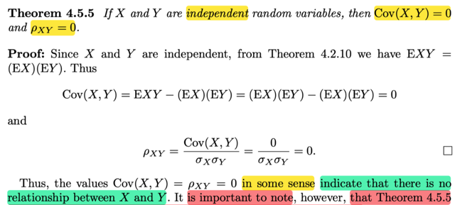</kbd>

> [!NOTE]
> Qua một theorem: Nói rằng nếu X, Y độc lập thì Cov(X, Y) = 0 và Corr(X,Y) = 0
>
>
>
> Chứng minh như sau:
>
>
>
> Ta bắt đầu với E(XY): Theo 2D lotus, giả sử đang xét continuous rvs:
>
>
>
> EXY = ∫∫xyfX,Y(x,y)dxdy (limit tích phân từ -inf, inf)
>
>
>
> Vì X, Y independent ⇨ fX,Y(x,y) = fX(x)fY(y)
>
>
>
> ⇨ EXY = ∫∫xyfX(x)fY(y)dxdy = ∫[∫xyfX(x)fY(y)dx]dy
>
>
>
> = ∫yfY(y) [∫xfX(x)dx] dy  | đưa term ko liên quan đến x ra tích phân của x
>
>
>
> = ∫xfX(x)dx ∫yfY(y)dy | đưa ∫xfX(x)dx ko liên quan đến y ra khỏi tích phân của y
>
>
>
> = EX EY | hai tích phân này chính là EX và EY
>
>
>
> Vậy EXY = EXEY ⇨ EXY - EXEY = 0
>
>
>
> ⇔ Cov(X,Y) = 0 ⇨ Corr(X,Y) = 0
>
>
>
> GIÁO SƯ CASELLA LƯU Ý THEOREM NÀY KO HỀ NÓI VỀ CHIỀU NGƯỢC 
> LẠI, TỨC NẾU COV = 0 CHƯA CHẮC X, Y ĐỘC LẬP

**🔗 See also:** [Điều kiện độc lập tổ hợp Normal](./53_sampling_from_the_normal_distribution.md#node-91dxhtz)

 

###### Hiệp phương sai và độc lập

<kbd>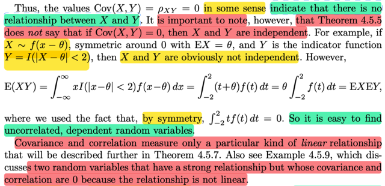</kbd>

> [!NOTE]
> QUAY LẠI SAU,. đại khái là cho thấy một ví dụ để minh họa rằng hay rv X, Y
> có EXY = EX EY (tức covariance = 0) nhưng chúng ko độc lập
>
>
>
> VÀ MỘT ĐIỂM QUAN TRỌNG LÀ COVARIANCE, VÀ CORRELATION CHỈ
> ĐO ĐẾM  MỨC ĐỘ QUAN HỆ TUYẾN TÍNH CỦA HAI RVS
>
>
>
> CHO NÊN CÓ KHI HAI RANDOM VARIABLE QUAN HỆ MẠNH VỚI NHAU
> NHƯNG KHÔNG TUYẾN TÍNH THÌ COVARIANCE VẪN = 0.

 

###### Định lý phương sai tổng

<kbd>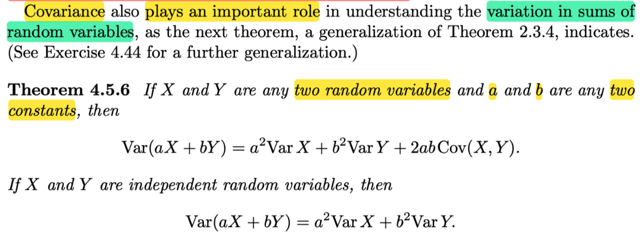</kbd>

<kbd>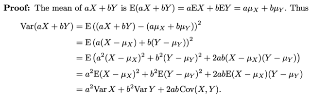</kbd>

> [!NOTE]
> Một theorem (đã gặp trong stat110): Cho X, Y và hai constant a, b:
>
>
>
> Var(aX + bY) = a²VarX + b²VarY + 2abCov(X,Y)
>
>
>
> Chứng minh 
>
>
>
> Var(aX + bY) , áp dụng công thức thứ 1 của Var: VarX = E[X - EX]²
>
>
>
> Ở đây coi rv là aX + bY, mean của nó dễ thấy chính là aEX + bEY
> (linearity) = aμX + bμY
>
>
>
> ⇨ Var(aX + bY) = E[(aX + bY) - (aμX + bμY)]²
>
>
>
> = E[(aX + bY)² + (aμX + bμY)² - 2(aX + bY)(aμX + bμY)] | khai triển ra
>
>
>
> = E[(a²X² + b²Y² + 2abXY + a²μX² + b²μY² + 2abμXμY  - 2(a²XμX + baYμX + abXμY + b²YμY)] 
>
>
>
> = E[a²X² + b²Y² + 2abXY + a²μX² + b²μY² + 2abμXμY  - 2a²XμX - 2baYμX - 2abXμY - 2b²YμY] 
>
>
>
> = E[(a²X² - 2a²XμX + a²μX²) + (b²Y² - 2b²YμY + b²μY²) + 2abXY - 2abXμY + 2abμXμY - 2baYμX ] 
>
>
>
> = E[a²(X² - 2XμX + μX²) + b²(Y² - 2YμY + μY²) + 2abX(Y - μY) - 2abμX(Y - μY)] 
>
>
>
> = E[a²(X - μX)² + b²(Y - μY)² + 2ab(X - μX)(Y - μY)] 
>
>
>
> = E[a²(X - μX)²] + E[b²(Y - μY)²] + E[2ab(X - μX)(Y - μY)] 
>
>
>
> = a²E[(X - μX)²] + b²E[(Y - μY)²] + 2abE[(X - μX)(Y - μY)] 
>
>
>
> **= a²VarX + b²VarY + 2abCov(X,Y)
>
>
>
> Khi X, Y độc lập thì Cov(X,Y) = 0 ⇨ Var(aX + bY) = a²VarX + b²VarY**

 

###### Phương sai tổng biến ngẫu nhiên

<kbd>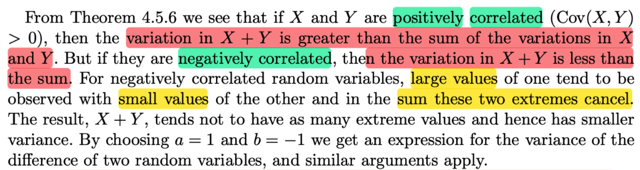</kbd>

> [!NOTE]
> Vậy theorem này, mà mình đã tự chứng minh để thấy kết quả:
>
>
>
> Var(aX + bY) = a²VarX + b²VarY + 2abCov(X,Y)
>
>
>
> Cho thấy: nếu X,Y độc lập thì variance của tổng (hai rv) = tổng variance của
> hai rv
>
>
>
> Nhưng nếu chúng POSITIVE CORRELATED (TỨC Cov(X,Y) > 0 thì dể thấy
> Variance của tổng hai rv sẽ LỚN HƠN tổng variance của từng cái
>
>
>
> Ngược lại, nếu chúng NEGATIVE CORRELATED, tức Cov(X,Y) < 0 thì
> Variance của tổng hai rv sẽ NHỎ HƠN tổng variance của từng cái
>
>
>
> Lí dễ hiểu là khi hai thằng có xu hướng cùng lớn thì tổng của nó sẽ lớn hơn
> nữa khiến mức biến động của tổng sẽ bị khuếch đại. Còn khi hai thằng mà
> một thằng lớn thì thằng kia nhỏ thì kiểu như bù trừ nhau làm giảm mức biến
> động

 

###### Giới hạn và ý nghĩa tương quan

<kbd>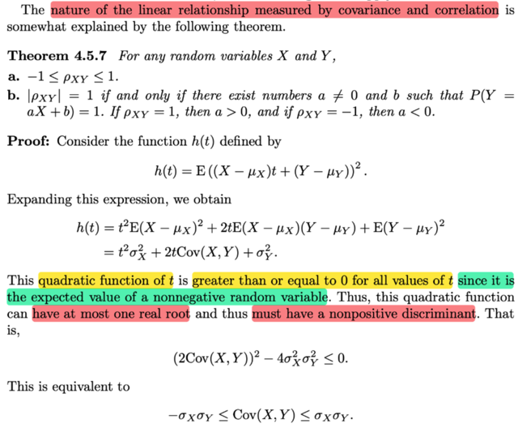</kbd>

<kbd>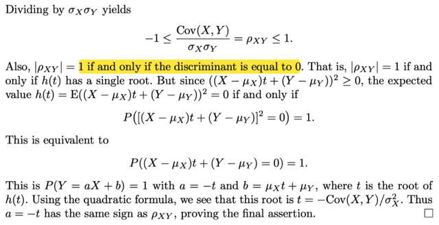</kbd>

> [!NOTE]
> Theorem này , phần 1 nói giá trị của correlation luôn nằm trong [-1,1]
> chứng minh thật là hay.
>
>
>
> Ta sẽ xét hàm h(t) = E[(X - μX)t + (Y - μY)]²
>
>
>
> = E[(X - μX)²t² + (Y - μY)² + 2t(X - μX)(Y - μY)]
>
>
>
> = E[(X - μX)²t²] + E[(Y - μY)²] + 2tE(X - μX)(Y - μY)
>
>
>
> = t²E[(X - μX)²] + E[(Y - μY)²] + 2tE(X - μX)(Y - μY)
>
>
>
> = t² σX² + σY² + 2tCov(X, Y)
>
>
>
> Đến đây ko có gì khó, thế thì bản chất hàm h(t) là expected value của
> một random variable Z = f(X,Y) = [(X - μX)t + (Y - μY)]², và nó luôn ko
> âm với mọi X, Y, t, nên mọi possible của Z luôn ko âm ⇨ EZ ≥ 0
>
>
>
> ⇨ h(t) ≥ 0 với mọi t
>
>
>
> Mà, đây là hàm số bậc 2, nếu xét phương trình bậc 2: 
>
>
>
> t² σX² + σY² + 2tCov(X, Y) = 0
>
>
>
> thì vì hàm số này luôn ko âm, nên nghiệm của phương trình trên (tức
> x khiến hàm số = 0) chỉ có thể có nhiều nhất là một nghiệm
>
>
>
> Do đó, với phương trình ax² + bx + c = 0 thì khi tìm nghiệm ta 
> sẽ xét discriminant, b² - 4ac, và nếu nó = 0 thì phương trình có 
> nghiệm duy nhất, > 0 thì có 2 nghiệm phân biệt và < 0 thì vô nghiệm
>
>
>
> Vậy ở case này b² - 4ac phải ≤ 0 để thể hiện nhiều nhất là 1 nghiệm
>
>
>
> ⇨ đó chính là [2Cov(X,Y)]² - 4σX²σY² ≤ 0
>
>
>
> ⇔ 4Cov(X,Y)² ≤ 4σX²σY²
>
>
>
> ⇔ Cov(X,Y)² ≤ σX²σY²
>
>
>
> ⇔ **-σXσY ≤ Cov(X,Y) ≤ σXσY
>
>
>
> Chia các vế cho σXσY ko âm là chứng minh xong
>
>
>
> ⇔ -1 ≤ Cov(X,Y) / σXσY ≤ 1
>
>
>
> ⇔ -1 ≤ Cor(X,Y) ≤ 1
>
>
>
> Đó là chứng minh xong ý 1**
>
>
>
> Tiếp tục, ta thấy |Cor(X,Y)| = 1 tức là dấu bằng ở trên xảy ra tức cũng
> là b² = 4ac, hay h(t) = E[(X - μX)t + (Y - μY)]² = 0
>
>
>
> Mà đã nói ở trên h(t) là expected value của một rv là [(X - μX)t + (Y - μY)]² 
> không âm nên expected value của nó bằng 0 khi và chỉ khi nó chỉ có một
> possible value là 0 (nhưng như vậy thì nó ko phải là random varialbe) 
> hoặc nó có nhiều possible value nhưng mọi xác suất tức trọng số gắn với
> các possible value khác 0 đó đều bằng 0, đồng nghĩa xác suất rv này có
> possible value là 0 sẽ phải bằng 1.
>
>
>
> ⇨ P([(X - μX)t + (Y - μY)]²=0) = 1
>
>
>
> Và bởi vì event [(X - μX)t + (Y - μY)]² = 0 ko khó để thấy nó cũng là event
> [(X - μX)t + (Y - μY)] = 0
>
>
>
> ⇨ P((X - μX)t + (Y - μY) = 0) = 1
>
>
>
> ⇔ P(Xt - μXt + Y - μY = 0) = 1
>
>
>
> ⇔ P(Y = -Xt + μXt  + μY) = 1
>
>
>
> Và như vậy tồn tại a, b sao cho Y = aX + b với , chính là a = -t, b = μXt  + μY
> chứng minh xong ý 2

> [!TIP]
> 🤖 **AI Check** — 🟡 Minor issues — ⚠️ **88/100** · ✓ Move on
>
> Ghi chú rất tốt, bạn đã tự diễn giải và hiểu rõ bản chất đại số lẫn xác suất đằng sau bất đẳng thức Cauchy-Schwarz dạng kỳ vọng. Cần lưu ý thêm rằng biến ngẫu nhiên nhận giá trị hằng số vẫn là biến ngẫu nhiên, đồng thời bổ sung bước kiểm tra dấu của hệ số a qua nghiệm t.
>
> **🟡 Minor issues**
>
> **1.** *"nhưng như vậy thì nó ko phải là random varialbe"*
>
> Về mặt toán học xác suất, một đại lượng nhận giá trị hằng số c với xác suất 1 (P(Z = c) = 1) vẫn là một biến ngẫu nhiên hợp lệ (gọi là biến ngẫu nhiên suy biến hay degenerate random variable).
>
> **2.** *"Và như vậy tồn tại a, b sao cho Y = aX + b với , chính là a = -t, b = μXt  + μY chứng minh xong ý 2"*
>
> Đoạn kết còn thiếu bước tính cụ thể nghiệm t = -Cov(X,Y)/σ_X² để chứng minh a = -t ≠ 0 và a cùng dấu với hệ số tương quan ρ_XY như định lý yêu cầu.
>
>
> **✓ Strengths**
> - Hiểu rất rõ và diễn giải chi tiết tính chất bảo toàn thứ tự của kỳ vọng: Z ≥ 0 thì E[Z] ≥ 0.
> - Nắm chắc mối liên hệ giữa tam thức bậc hai không âm với điều kiện biệt thức discriminant Δ ≤ 0.
> - Tự triển khai đầy đủ các bước khai triển tuyến tính của kỳ vọng và hiệp phương sai mà không chỉ chép lại.
>
> **💡 Deeper notes**
> - Chứng minh trong giáo trình ngầm giả định độ lệch chuẩn σ_X > 0 (biến ngẫu nhiên X không phải là hằng số suy biến) để tam thức bậc 2 h(t) có hệ số cao nhất khác 0 và cho phép chia ở bước cuối.
> - Chiều ngược lại (nếu Y = aX + b với xác suất 1 thì |ρ_XY| = 1) cũng là một phần của mệnh đề 'khi và chỉ khi', có thể kiểm tra trực tiếp bằng cách thay Y = aX + b vào công thức tính tương quan.

 

###### Ý nghĩa hệ số tương quan

<kbd>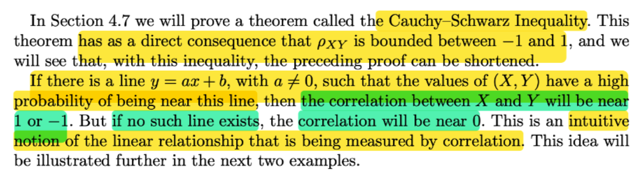</kbd>

> [!NOTE]
> Và một ý quan trọng là,nếu tồn tại đường thẳng y = ax + b với a khác 0
> sao cho các giá trị của X, Y có xác suát cao nằm gần đường này thì khi đó
> correlation giữa X và Y sẽ gần với 1 và -1
>
>
>
> Còn khi không tồn tại đường thẳng như vậy thì Cor(X, Y) = 0
>
>
>
> Mình nghĩ: Vừa rồi ý hai của theorem nói rằng Cor(X,Y) = 1 hoặc -1 khi và
> chỉ khi tồn tại cặp a, b sao cho ta có Y = aX + b. Vậy thì dễ hiểu là khi tồn
> tại a, b như vậy thì nếu biết giá trị của random variable này thì ta sẽ biết
> ngay giá trị của random variable kia thônq quan quan hệ tuyến tính.

 

###### Hàm mật độ liên hợp (X,Y)

<kbd>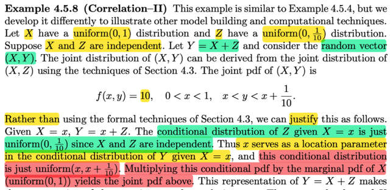</kbd>

> [!NOTE]
> Rồi, ví dụ này, đại khái là cho X \~ uniform(0,1). Z \~ uniform(0, 1/10) X, Z độc lập, Y = X + Z. và ta quan tâm random variable vector (X, Y)
>
>
>
> Gs nói nhờ 4.3 ta có thể biết joint pdf của (X, Y): Thử làm xem:
>
>
>
> Xây dựng joint pdf của X,Y, ta sẽ đổi kí hiệu chút cho quen thuộc:
>
>
>
> Coi như đây là ta có X\~Unif(0,1), Y\~Unif(0,1/1); cần tìm joint pdf của U, V: với U = g1(X, Y) = X; V = g2(X, Y) = X + Y
>
>
>
> Lập luận như vầy, đầu tiên là dựa vào điều này trước:
>
>
>
> Nếu A là tiền ảnh của B: A = {(x,y) ∈ R²: (g1(x,y), g2(x,y)) ∈ B} thì P((X, Y) ∈ A) = P((U,V) ∈ B)
>
>
>
> Tiếp, ta sẽ xác định support set của X,Y 𝒜: Với distribution đã biết của X, Y, thì 𝒜 = {(x,y) ∈ R²: 0 ≤ x ≤ 1; 0 ≤ y ≤ 1/10}
>
>
>
> Ảnh của 𝒜: ℬ = {(u,v): u = g1(x,y), v=g2(x,y), (x,y) ∈ 𝒜}
>
>
>
> Được xác định như sau: X ∈ (0,1) ⇨ U = X cũng ∈ (0,1)
>
>
>
> Y ∈ (0, 1/10) ⇨ V = X + Y ∈ (0, 1/10 + u)
>
>
>
> ⇨ ℬ = {0 ≤ u ≤ 1, 0 ≤ v ≤ 1/10 + u}
>
>
>
> Câu hỏi đặt ra: mapping từ 𝒜 → ℬ có 1-1 không?
>
>
>
> ⇨ Có.
>
>
>
> Do đó áp dụng transformation theorem:
>
>
>
> fU,V(u,v) = fX,Y(x,y)|∂(x,y)/∂(u,v)|
>
>
>
> ∂(x,y)/∂(u,v) = \[∂x/∂u ∂x/∂v ; ∂y/∂u ∂y/∂v\]
>
>
>
> = \[1 0; 0 1\] ⇨ det = 1
>
>
>
> fX,Y(x,y) = fX(x)fY(y) = 1/(1-0) \* 1/(1/10 - 0) = 1 \* 10 = 10
>
>
>
> ⇨ fU,V(u,v) = 10 ; 0 ≤ u ≤ 1, 0 ≤ v ≤ 1/10 + u
>
>
>
> Thay U vởi X , V bởi Y. (bởi mình đang dùng các kí hiệu U = g1(X,Y) V = g2(X,Y) cho giống với những gì làm ở 4.3)
>
>
>
> ⇨ **fX,Y(x,y) = 10 ; 0 &lt; x &lt; 1, 0 &lt; y &lt; 1/10 + x**
>
>
>
> **ĐÂY LÀ KẾT QUẢ TRONG SÁCH**
>
> Vậy thì ở đây đại khái nói là ta có thể lập luận kiểu khác để cho ra joint pdf của X,Y như trên:
>
>
>
> Hướng làm là ta sẽ lập luận để có conditional của Y given X=x, tức fY|X(y|x) và sau đó áp dụng fX,Y(x,y) = fY|X(y|x)fX(x) để xây dựng joint pdf của X,Y
>
>
>
> Thế thì Y = Z + X nên tìm distribution của Y given X chính là tìm distribution của (X+Z) given X
>
>
>
> Với giá trị đã biết x của X, thì:
>
>
>
> Y = Z + x, nên conditional distribution của Y given X = x là distribution của (Z + x) | x
>
>
>
> cũng sẽ là \[condition distribution của Z\] + x: Z|x + x
>
>
>
> Vì X, và Z độc lập, nên dù với giá trị cụ thể x nào của X thì conditional pdf của Z given X=x, vẫn chỉ là marginal pdf của Z, thể hiển toán học bởi
>
>
>
> fZ|X(z|x) = fZ(z), ⇨ fZ|x(z|x) = fZ(z)
>
>
>
> Nói cách khác là Z|X vẫn là uniform(0,1/10) random variable
>
>
>
> Vậy \[conditional distribution của Y given X = x\] bằng \[marginal distribution của Z\] + x
>
>
>
> Thể hiện bởi Y|x = Z + x
>
>
>
> Mà theo một theorem đã nói ở chap 3: (theorem 3.5.6)
>
>
>
> Z là rv \~ f(z) ⇔ X = σZ + μ có pdf \~ fX(x) = f\[(x - μ)/σ\] / σ
>
>
>
> Nói bằng lời là nếu Z có pdf f(z) thì X = σZ + μ sẽ có pdf fX(x) = \[f(x - μ)/σ\]/σ
>
>
>
> Ngược lại nếu X = σZ + μ và nó có pdf fX(x) = \[f(x - μ)/σ\]/σ thì Z sẽ có pdf là f(z)
>
>
>
> ====
>
>
>
> Vậy ở đây ta có Z có pdf là fZ(z) = 10, 0 &lt; z &lt; 1/19, thì với Y|x = Z + x, (với x fixed, đóng vai trò như hằng số μ)
>
>
>
> thì Y|x sẽ có pdf là fY|x(y|x) = fZ(y - x)
>
>
>
> = 10, với 0 &lt; y - x &lt; 1/10 ⇔ 0 &lt; y - x &lt; 1/10 ⇔ x &lt; y &lt; x + 1/10
>
>
>
> Vậy fY|x(y|x) = 10 với x &lt; y &lt; x + 1/10 đủ để ta kết luận Y|x \~ Uniform(x, x + 1/10)
>
>
>
> Tiếp theo, áp dụng fX,Y(x,y) = fY|X(y|x) fX(x)
>
>
>
> với fX(x) là marginal pdf của X \~ uniform(0,1), = 1, 0 &lt; x &lt; 1
>
>
>
> ⇨ **fX,Y(x,y) = 10\*1, 0 &lt; x &lt; 1; x &lt; y &lt; x + 1/10**
>
>
>
> **KẾT QỦA NÀY Y CHANG CÁI TA CÓ KHI DERIVE BẰNG CÁCH LÀM CỦA CHAP 3 Ở TRÊN**
>
> Viết gọn lại dùng toán thôi sẽ là:
>
>
>
> (ta muốn tìm) fY|X(y|x):
>
>
>
> vì Y = Z + X, nên
>
>
>
> ... = fZ+X|X(y|x)
>
>
>
> Vì biết X=x nên fZ+X|X(y|x) = fZ+x|X(y|x) (THAY ..+X|.. BỞI +x|..)
>
>
>
> QUAN TRỌNG Ta sẽ không thay fZ+X|X(..) thành fZ+x|x(..) vì CHỨC NĂNG NÓ KHÁC, vốn dĩ trong kí hiệu fZ+x|X là đang ám chỉ conditional pdf dựa trên X của Z + x
>
>
>
> Ta có fZ+X|X(y|x) = fZ+x|X(y|x)
>
>
>
> Vì Z độc lập X ⇨ Z + constant μ cũng độc lập X nên ta sẽ bỏ các kí hiệu " condition on X" (|X và (..|x)
>
>
>
> ⇨ fZ+μ|X(y|x) = fZ+μ(y)
>
>
>
> Vai trò của x trong kí hiệu fZ+x|X(...) cũng như μ, là constant, nên Z + constant x cũng độc lập X nên ta cũng làm tương tự
>
>
>
> ⇨ fZ+x|X(y|x) = fZ+x(y)
>
>
>
> Tới đây ta có fZ+x(y)
>
>
>
> Dùng theorem Z \~ fZ(z) ⇔ X = σZ + μ \~ fX(x) = (1/σ) fZ\[(x - μ) / σ\]
>
>
>
> = fZ(y-x)
>
>
>
> Tới đây thay công thức fZ vào, ...phần còn lại thì như trên

> [!TIP]
> 🤖 **AI Check** — 🟡 Minor issues — ⚠️ **82/100** · ✓ Move on
>
> Ghi chú thể hiện sự hiểu bài rất tốt về bản chất phân phối có điều kiện, nhưng gặp lỗi sai nghiêm trọng khi xác định cận của V ở phần transformation (nhầm chặn dưới của V thành 0 thay vì u, và tính sai ma trận Jacobian dù ra đáp số định thức đúng một cách may mắn).
>
> **🟡 Minor issues**
>
> **1.** *"Y ∈ (0, 1/10) ⇨ V = X + Y ∈ (0, 1/10 + u) ⇨ ℬ = {0 ≤ u ≤ 1, 0 ≤ v ≤ 1/10 + u}"*
>
> Xác định cận của V bị sai cận dưới: vì Y ∈ (0, 1/10) và U = X = u, nên V = X + Y = u + Y phải thuộc khoảng (u, u + 1/10). Ghi nhận cận từ 0 là sai miền giá trị (chưa chặn dưới v > u).
>
> **2.** *"∂(x,y)/∂(u,v) = [∂x/∂u ∂x/∂v ; ∂y/∂u ∂y/∂v] = [1 0; 0 1] ⇨ det = 1"*
>
> Nghịch đảo là x = u, y = v - u. Do đó ma trận Jacobi ∂(x,y)/∂(u,v) = [1, 0; -1, 1], chứ không phải ma trận đơn vị [1 0; 0 1]. Dù định thức vẫn bằng 1 nhưng đạo hàm riêng ∂y/∂u = -1 bị tính sai thành 0.
>
> **3.** *"fZ(z) = 10, 0 < z < 1/19"*
>
> Lỗi gõ phím nhầm số 19 thay vì 1/10.
>
>
> **✓ Strengths**
> - Lập luận rất sắc bén và chính xác về cách tìm hàm mật độ có điều kiện f_{Y|X}(y|x) thông qua tính độc lập và phép tịnh tiến vị trí (location parameter).
> - Hiểu rất rõ và diễn giải rành mạch ký hiệu xác suất điều kiện f_{Z+X|X}(y|x) = f_{Z+x}(y).
>
> **💡 Deeper notes**
> - Khi đổi biến nhiều chiều với phép biến đổi tuyến tính hình bình hành (như u = x, v = x + y), cần luôn kiểm tra kỹ miền giá trị ℬ để tránh bỏ sót chặn dưới phụ thuộc vào biến u.

 

###### Tính Cov(X, X+Z)

<kbd>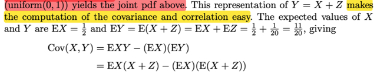</kbd>

<kbd>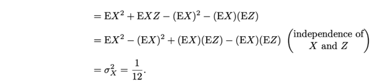</kbd>

> [!NOTE]
> Tiếp theo ta sẽ tính Cov(X, Y) đại ý là với Y = Z + X thì tính cái này dễ thôi
>
>
>
> Ôn lại tý Cov(X,Y) có công thức thứ nhất là E[(X - EX)(Y - EY)] và triển khai ra  
> ta sẽ có công thức thứ hai: E(XY) - EXEY
>
>
>
> = E[X(X + Z)] - EXE(X + Z)
>
>
>
> = E(X² + XZ) - EX(EX + EZ)
>
>
>
> = E(X²) + E(XZ) - (EX)² - EXEZ
>
>
>
> Tới đây xét E(XZ):
>
>
>
> 2D LOTUS = ∫∫ xz fX,Z(x,z)dxdz (tích phân trên toàn R²)
>
>
>
> = ∫∫xzfX(x)fZ(z)dxdz | do X,Z độc lập, joint pdf = tích marginal pdf
>
>
>
> = ∫∫[xfX(x)zfZ(z)dx]dz | đổi chỗ, 
>
>
>
> ∫zfZ(z)dz ∫xfX(x)dx | đưa zfZ(z)dz ko phụ thuộc x ra ngoài tích phân của x
>
>
>
> = ∫xfX(x)dx ∫zfZ(z)dz | đưa kết qủa ∫xfX(x)dx ra ngoài tích phân theo z
>
>
>
> Đây chính là
>
>
>
> = EX EZ 
>
>
>
> ⇨ ... = E(X²) + EXEZ - (EX)² - EXEZ
>
>
>
> = EX² - (EX)² = Var(X) và đã tính lúc trước = 1/12

 

###### Độ chặt quan hệ X,Y

<kbd>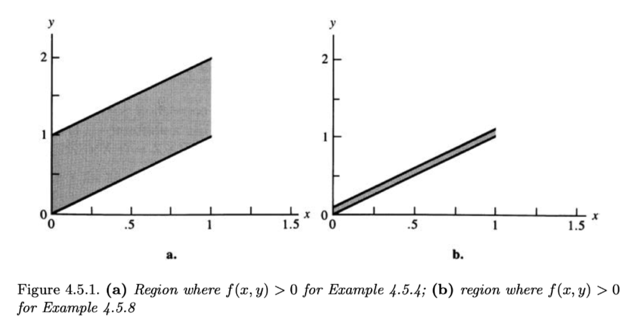</kbd>

<kbd>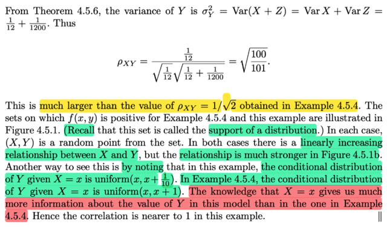</kbd>

> [!NOTE]
> Rồi, khi đã có Var(X).
>
>
>
> Ta sẽ tính Var(Y) = Var(X + Z)
>
>
>
> Thì áp dụng theorem 4.5.6 nói rằng:
>
>
>
> Var(aX + bY) = a²Var(X) + b²Var(Y) + 2abCov(X, Y)
>
>
>
> Và với X, Y độc lập thì Cov(X, Y) = 0
>
>
>
> ⇨ Var(Y) = Var(X + Z) = Var(X) + Var(Z) = 1/12 + 1/1200
>
>
>
> Từ đó áp dụng tính Cor(X,Y) = Cov(X,Y)/Var(X)Var(Y)
>
>
>
> = √100/101
>
>
>
> Thì ý chính là thế này: Ở cái ví dụ bữa trước, đã nói về một cái X,Y có
> marginal distribution của X cũng là uniform(0,1) và của Y cũng là ...
>
>
>
> Nhưng khi đó tính ra Corr(X,Y) nhỏ hơn cái này.
>
>
>
> Ở đây, cũng vậy mà Corr(X,Y) lại lớn
>
>
>
> Lí do là cách đặt bài toán lần này khác, bằng cách cho Y = Z + X
>
>
>
> người ta đã tạo nên một quan hệ có xu hướng tuyến tính rõ ràng hơn
> giữa X, Y
>
>
>
> Lần trước, conditional distribution của Y|X=x là uniform(x,x+1)
>
>
>
> Vì sao? Lần trước, trong ví dụ 4.5.4 người ta có joint pdf fX,Y = 1 với 0 <
> x < 1 và x < y < x + 1
>
>
>
> fY|X fX = fX,Y ⇨ fY|X = fX,Y / fX
>
>
>
> Marginal distribution cuả Y: fX(y) = 1, 0 < x < 1
>
>
>
> Joint distribution của X, Y: fX,Y(x,y) = 1, 0 < x < 1, x < y < x + 1
>
>
>
> ⇨ fY|X(y|x) = 1, 0 < x < 1, x < y < x + 1
>
>
>
> ⇨ biết x thì fY|X(y|x) = 1, x < y < x + 1 thì suy ra Y|x ~ Uniform(x, x+1)
>
>
>
> Còn lần này, ví dụ 4.5.8, thì như ta đã biết conditional distribution của
> Y|x là  uniform(x, x +1/10)
>
>
>
> Cho nên kiểu như khi biến giá trị của X, thì giá trị của Y ở lần sau nó
> trong phạm vi hẹp hơn, dễ đoán hơn.
>
>
>
> Thể hiện trong hình là support set của fX,Y ở lần trước và lần này. Thì có
> thể thấy một mối quan hệ giữa X, Y có xu hướng tuyến tính nhưng cái
> hình của lần trước có bề dày lớn hơn, mang ý nghĩa là nếu biết giá trị
> của X thì ta cũng  chỉ có thể áng chừng giá trị của Y nhưng phạm vi
> rộng, thể hiện sự ko chắc  Versus lần này, khi với giá trị đã biết của X thì
> giá trị của Y có thể được ước đoán trong phạm vi hẹp hơn thể hiện sự
> chắc chắn cao hơn.

 

###### Tương quan zero quan hệ phi tuyến

<kbd>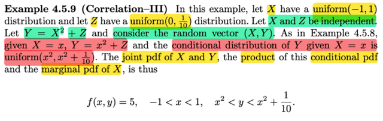</kbd>

<kbd>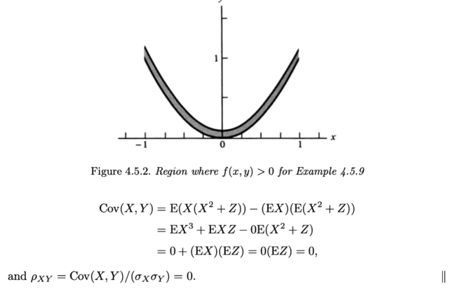</kbd>

> [!NOTE]
> Rồi, qua ví dụ này, đại khái là sẽ minh hoạ một một case mà quan hệ của
> X,Y rất mạnh, nhưng vì là quan hệ Φ tuyến nên correlation của chúng lại
> nhỏ. Cho thấy rằng correlation chỉ thể hiện độ mạnh yếu trong quan hệ 
> TUYẾN TÍNH của random variable thôi
>
>
>
> Cũng cho X ~ uniform(-1, 1) Z ~ uniform(0, 1/10), X , Z độc lập
>
>
>
> Và Y = X² + Z
>
>
>
> Thế thì lập luận tương tự ta có thể có Y|X=x ~ uniform(x², x² + 1/10)
>
>
>
> fY|X(y|x) = fX²+Z|X(y|x)
>
>
>
> Biết X=x ⇨ .. = fx²+Z|X(y|x)
>
>
>
> Vì Z độc lập X nên Z + x² cũng độc lập X
>
>
>
> ⇨ ...fx²+Z|X(y|x) = fx²+Z(y)
>
>
>
> Áp dụng theorem:
>
>
>
> Z ~ fZ(z) ⇔ X = σZ + μ ~ (1/σ) fZ[(x - μ)/σ]
>
>
>
> ⇨ fZ+x²(y) = f1*Z+x² = (1/1) fZ[(y - x²)/1]
>
>
>
> = fZ(y - x²) = 10, 0 < y - x² <1/10 ⇔ x² < y < x² + 1/10
>
>
>
> ⇨ Y|x ~ uniform(x², x² + 1/10)
>
>
>
> ====
>
>
>
> Từ đó ta có thể có joint pdf: fX,Y(x,y) = fY|X(y|x)fX(x)
>
>
>
> = 10 * 1/2 = 5, x² < y < x² + 1/10, -1 < x < 1
>
>
>
> Tính thử Cov(X,Y):
>
>
>
> Cov(X,Y) = EXEY - EXY
>
>
>
> = EX E(X² + Z) - EX(X² + Z)
>
>
>
> = EX (EX² + EZ) - E(X³ + XZ)
>
>
>
> = EXEX² + EXEZ - E(X³) - E(XZ)
>
>
>
> = 0EX² + EXEZ - 0 - E(XZ) | do X ~unif(-1,1) ⇨ dễ tính ra EX = 0
>
>
>
> =EXEZ - E(XZ) = EXEZ - EXEZ = 0, do X,Z độc lập nên EXZ = EXEZ
>
>
>
> ⇨ Corr(X,Y) = Cov(X,Y) / Var(X)Var(Y) =  0
>
>
>
> Thế thì đại khái là support set của X,Y có dạng một dải parabol, tức là
> giá trị của X, Y tập trung quanh parabol, cho thấy quan hệ của nó rất
> mạnh với nhau. Tuy nhiên khi correlation lại là 0

> [!TIP]
> 🤖 **AI Check** — 🟡 Minor issues — ✅ **90/100** · ✓ Move on
>
> Ghi chú rất tốt, thể hiện việc tự tính toán và hiểu sâu sắc bản chất hình học cũng như ý nghĩa của hệ số tương quan đối với quan hệ phi tuyến. Chỉ có hai lỗi nhỏ về công thức viết tắt của Covariance và Correlation cần chỉnh sửa lại cho chuẩn.
>
> **🟡 Minor issues**
>
> **1.** *"Cov(X,Y) = EXEY - EXY"*
>
> Định nghĩa chính xác của hiệp phương sai là Cov(X, Y) = E[XY] - E[X]E[Y]. Bạn đã viết ngược thứ tự hai số hạng; dù trong bài này cả hai đều bằng 0 nên kết quả vẫn là 0, nhưng viết ngược sẽ làm đổi dấu hiệp phương sai trong các bài toán khác.
>
> **2.** *"Corr(X,Y) = Cov(X,Y) / Var(X)Var(Y) =  0"*
>
> Mẫu số của hệ số tương quan là tích của các độ lệch chuẩn σX * σY (tức là căn bậc hai của Var(X)Var(Y)), không phải là tích hai phương sai.
>
>
> **✓ Strengths**
> - Tự triển khai chi tiết bước chứng minh phân phối có điều kiện f_{Y|X} bằng phép biến đổi biến tuyến tính thay vì chỉ chép lại kết luận của sách.
> - Nắm rất vững ý nghĩa thống kê cốt lõi: hệ số tương quan chỉ đo lường mối quan hệ tuyến tính, mối quan hệ phi tuyến dù rất mạnh (dải parabol hẹp) vẫn có thể cho tương quan bằng 0.
>
> **💡 Deeper notes**
> - Để hệ số tương quan ρ_{XY} xác định, ta luôn ngầm hiểu phương sai của X và Y phải hữu hạn và khác 0 (điều này thỏa mãn trong bài do X là uniform và Y bị chặn).
> - Ví dụ này là phản ví dụ kinh điển cho chiều đảo: Cov(X, Y) = 0 (uncorrelated) không đồng nghĩa với X và Y độc lập (independent).

 

###### Phân phối chuẩn hai biến

<kbd>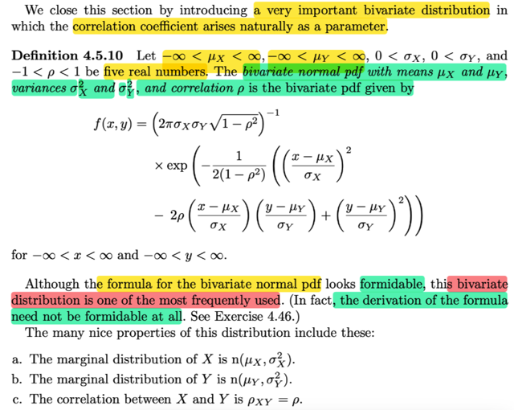</kbd>

<kbd>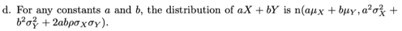</kbd>

<kbd></kbd>

<kbd></kbd>

> [!NOTE]
> Giải bài 4.46:
>
>
>
> X = axZ1 + bxZ2 + cx, Y = ayZ1 + byZ2 + cy
>
>
>
> a)
>
>
>
> EX = E\[axZ1 + bxZ2 + cx\] = E\[axZ1\] + E\[bxZ2\] + E\[cx\] (linearity)
>
>
>
> = axE\[Z1\] + bxE\[Z2\] + E\[cx\]
>
>
>
> = ax × 0 + bx × 0 + cx = cx
>
>
>
> Với EY tương tự
>
>
>
> Var(X) = Var(axZ1 + bxZ2 + cx)
>
>
>
> Dùng tính chất Var(X + a) = Var(X)
>
>
>
> .. = Var(axZ1 + bxZ2)
>
>
>
> = Var(axZ1) + Var(bxZ2) + 2Cov(axZ1, bxZ2)
>
>
>
> ---
>
>
>
> Dùng kiến thức nếu X, Y độc lập, thì Cov(X,Y) = 0.
>
>
>
> Cov(X,Y) = E\[(X-EX)(Y-EY)\] = E\[(XY-(EX)Y-X(EY)+(EX)(EY)\]
>
>
>
> = E(XY)-E\[(EX)Y\]-E\[X(EY)\]+E\[(EX)(EY)\]
>
>
>
> = E(XY)-(EX)(EY)-(EX)(EY)+(EX)(EY)
>
>
>
> = E(XY)-(EX)(EY)
>
>
>
> Nếu X, Y độc lập, thì E\[XY\] = (EX)(EY) ⇒ Cov(X,Y) = E(XY)-(EX)(EY) = 0
>
>
>
> E\[XY\] = ∫∫xyf(x,y)dxdy = ∫∫xyf(x)f(y)dxdy = ∫y(∫xf(x)dx)f(y)dy
>
>
>
> = ∫y(EX)f(y)dy = (EX) ∫yf(y)dy = EX EY
>
>
>
> ---
>
>
>
> Do đó ở đây Cov(axZ1, bxZ2) là cov của hai biến độc lập (do Z1, Z2 độc lập)
>
>
>
> Và dùng tính chất Var(cX) = c² Var(X)
>
>
>
> ...= ax² Var(Z1) + bx² Var(Z2)
>
>
>
> = ax² + bx²
>
>
>
> Tương tự cho Var(Y)
>
>
>
> ---
>
>
>
> Tính Var(X) theo cách khác:
>
>
>
> X = axZ1 + bxZ2 + cx
>
>
>
> Theo location scale theorem: Z \~ standard member (location = 0, scale = 1), thì σZ + μ \~ location = μ, scale = σ
>
>
>
> Và normal chính là một location scale family, với location = mean, scale = standard deviation
>
>
>
> Z1 \~ n(0,1), axZ1 \~ n(0, ax²)
>
>
>
> Tương tự bxZ2 \~ n(0, bx²)
>
>
>
> Nếu axZ1 + bxZ2 \~ n(0, ax² + bx²)
>
>
>
> X = axZ1 + bxZ2 + cx \~ n(cx, ax² + bx²)
>
>
>
> Var(X) = ax² + bx²
>
>
>
> ---
>
>
>
> Cov(X,Y) = E\[(X-EX)(Y-EY)\]
>
>
>
> X - EX = axZ1 + bxZ2 + cx - cx = axZ1 + bxZ2
>
>
>
> Y - EY = ayZ1 + byZ2
>
>
>
> (X-EX)(Y-EY) = (axZ1 + bxZ2)(ayZ1 + byZ2)
>
>
>
> = axayZ1² + bxayZ1Z2 + axbyZ1Z2 + bxbyZ2²
>
>
>
> = axayZ1² + (bxay+axby)Z1Z2 + bxbyZ2²
>
>
>
> E\[(X-EX)(Y-EY)\] = E\[axayZ1² + (bxay+axby)Z1Z2 + bxbyZ2²\]
>
>
>
> = E\[axayZ1²\] + E\[(bxay+axby)Z1Z2\] + E\[bxbyZ2²\]
>
>
>
> = axayE\[Z1²\] + (bxay+axby)E\[Z1Z2\] + bxbyE\[Z2²\]
>
>
>
> = axayE\[Z1²\] + (bxay+axby)E\[Z1\]\[Z2\] + bxbyE\[Z2²\]
>
>
>
> = axayE\[Z1²\] + bxbyE\[Z2²\]
>
>
>
> Var(Z1) = E\[(Z1-E\[Z1\])²\] = E\[Z1²\] - \[E(Z1)\]²
>
>
>
> E\[Z1²\] = Var(Z1) + (E\[Z1\])² = 1 + 0, tương tự E\[Z2²\] = 1
>
>
>
> .. = axay + bxby
>
>
>
> ---
>
> ---
>
>
>
> b) aX = σX√\[(1+ρ)/2\], bX = σX√\[(1-ρ)/2\], cX = μX
>
>
>
>  aY = σY√\[(1+ρ)/2\], bY = -σY√\[(1-ρ)/2\], cY = μY
>
>
>
> Từ a) nên EX = μX, EY = μY
>
>
>
> Var(X) = aX² + bX² = σX²(1+ρ)/2 + σX²(1-ρ)/2 = σX²
>
>
>
> Tương tự Var(Y) = σY²
>
>
>
> Cor(X,Y) = Cov(X,Y)/STD(X)STD(Y) = (aXaY + bXbY)/σXσY 
>
>
>
> = \[(σXσY(1+ρ)/2 - σXσY(1-ρ)/2\]/σXσY
>
>
>
> = ρ
>
>
>
> ---
>
>
>
> c) Derive công thức join pdf của X, Y
>
>
>
> Ôn lại transformation chút:
>
>
>
> (U,V) = (g1(X,Y), g2(X,Y)) và nếu ta có mapping 1-1 giữa 𝒜 - support set của (X,Y) (nơi joint pdf &gt; 0) với image của 𝒜: ℬ = {(u,v): u = g1(x,y), v = g2(x,y)} thì khi đó có nghĩa là với u,v ∈ ℬ tồn tại duy nhất (x,y) ∈ 𝒜 sao cho: (x,y) = (h1(u,v), h2(u,v))
>
>
>
> Khi đó ta có:
>
>
>
> fU,V(u,v) = fX,Y(x,y) |det ∂(x,y)/∂(u,v)|
>
>
>
> X = axZ1 + bxZ2 + cx, Y = ayZ1 + byZ2 + cy
>
>
>
> X - cx = axZ1 + bxZ2, Y - cy = ayZ1 + byZ2 
>
>
>
> \[X-cx, Y-cy\]ᵀ = \[ax, bx; ay by\] \[Z1, Z2\]ᵀ 
>
>
>
> đặt A = \[ax, bx; ay by\], det A = axby - bxay 
>
>
>
> = σX√(1 + ρ)/2 × \[-σY√\[(1-ρ)/2\] - σX√\[(1-ρ)/2\] × σY√\[(1+ρ)/2\]
>
>
>
> = -σXσY √\[(1 + ρ)(1-ρ)/4\] - σXσY√\[(1 + ρ)(1-ρ)/4\]
>
>
>
> = -σXσY √(1 - ρ²)/2 - σXσY√(1-ρ²)/2
>
>
>
> = -σXσY √(1 - ρ²)
>
>
>
> nên det A⁻¹ = -1/\[σXσY√(1 - ρ²)\]
>
>
>
> ⇒ |det A⁻¹| = 1/\[σXσY√(1 - ρ²)\]
>
>
>
> ---
>
>
>
> = A \[Z1, Z2\]ᵀ 
>
>
>
> ⇒ \[Z1, Z2\]ᵀ = A⁻¹ \[X-cx, Y-cy\]ᵀ 
>
>
>
> = A⁻¹ \[X-cx, Y-cy\]ᵀ 
>
>
>
> = A⁻¹ \[X, Y\]ᵀ - A⁻¹ \[cx, cy\]ᵀ
>
>
>
> ⇒ ∂(z1,z2)/∂(x,y) = A⁻¹
>
>
>
> Vậy f(x,y) = f(z1,z2) |det A⁻¹|
>
>
>
> = f(z1)f(z2) |det A⁻¹|
>
>
>
> = (1/√2π) exp(-z1²/2)(1/√2π) exp(-z2²/2) |det A⁻¹|
>
>
>
> = (1/2π) exp\[-(z1²+z2²)/2\] |det A⁻¹|
>
>
>
> = (1/2π) exp\[-(z1²+z2²)/2\] |det A⁻¹|
>
>
>
> ---
>
>
>
> Đi tính z1²+z2²
>
>
>
> \[z1, z2\]ᵀ = A⁻¹ \[x-cx, y-cy\]ᵀ 
>
>
>
> = (det A)⁻¹ \[by -bx; -ay ax\] \[x-cx, y-cy\]ᵀ 
>
>
>
> = (det A)⁻¹ \[by(x-cx)-bx(y-cy); -ay(x-cx) + ax(y-cy)\]ᵀ
>
>
>
> ⇒ (z1² + z2²) = ((det A)⁻¹)² \[by(x-cx)-bx(y-cy)\]² + \[-ay(x-cx) + ax(y-cy)\]²
>
>
>
> Xét hai cái term bình phương.
>
>
>
> \[by(x-cx)-bx(y-cy)\]² = \[by(x-cx)\]²+\[bx(y-cy)\]²-2by(x-cx)bx(y-cy)
>
>
>
> \[-ay(x-cx) + ax(y-cy)\]² = \[-ay(x-cx)\]² + \[ax(y-cy)\]²-2ay(x-cx)ax(y-cy)
>
>
>
> cộng lại:
>
>
>
> \[by(x-cx)\]²+\[bx(y-cy)\]²-2by(x-cx)bx(y-cy) + \[-ay(x-cx)\]² + \[ax(y-cy)\]²-2ay(x-cx)ax(y-cy)
>
>
>
> = \[by(x-cx)\]² + \[-ay(x-cx)\]² + \[bx(y-cy)\]² + \[ax(y-cy)\]² - 2by(x-cx)bx(y-cy) -2ay(x-cx)ax(y-cy)
>
>
>
> = (by²+ay²)(x-cx)² + (bx²+ax²)(y-cy)² - 2(bybx+ayax)(x-cx)(y-cy)
>
>
>
> = σ²y(x-cx)² + σ²x(y-cy)² - 2(ρσxσy)(x-cx)(y-cy)
>
>
>
>
>
> Nên  (z1² + z2²) = ((det A)⁻¹)² \[by(x-cx)-bx(y-cy)\]² + \[-ay(x-cx) + ax(y-cy)\]²
>
>
>
> Thay |det A⁻¹| = 1/\[σXσY√(1 - ρ²)\] ⇒ ((det A)⁻¹)² = 1/σ²Xσ²Y(1 - ρ²)
>
>
>
> = 1/σ²Xσ²Y(1 - ρ²) × \[σ²y(x-cx)² + σ²x(y-cy)² - 2(ρσxσy)(x-cx)(y-cy)\]
>
>
>
> = 1/(1 - ρ²) × \[(x-cx)²/σ²X + (y-cy)²/σ²y - 2ρ\[(x-cx)/σx\]\[(y-cy)/σy\]
>
>
>
> = \[1/(1 - ρ²)\] × \[(x-μx)²/σ²x + (y-μy)²/σ²y - 2ρ\[(x-cx)/σx\]\[(y-cy)/σy\]
>
>
>
>
>
> ---
>
>
>
>
>
> ⇒ f(x,y) = (1/2π) exp\[-(z1²+z2²)/2\] × 1/\[σXσY√(1 - ρ²)\]
>
>
>
> = (1/2π) exp{\[-1/2(1 - ρ²)\] \[(x-μx)²/σ²x + (y-μy)²/σ²y - 2ρ\[(x-μx)/σx\]\[(y-μy)/σy\]} × 1/\[σXσY√(1 - ρ²)\]
>
>
>
>
>
> ---

📹 [Xem video trên YouTube](https://www.youtube.com/watch?v=6upP75ujeSM)

> [!TIP]
> 🤖 **AI Check** — 🟢 Pass — ✅ **95/100** · ✓ Move on
>
> Ghi chú xuất sắc, các bước biến đổi và chứng minh từ câu (a) đến câu (c) cực kỳ chi tiết, mạch lạc và hoàn toàn chính xác. Bạn chỉ chưa làm phần (d) của bài toán.
>
> **✓ Strengths**
> - Các bước tính kỳ vọng, phương sai và hiệp phương sai ở câu (a) và (b) được lập luận chặt chẽ từ định nghĩa và tính chất độc lập.
> - Phần biến đổi hàm mật độ đồng thời ở câu (c) sử dụng định lý phép đổi biến (Jacobian) và biến đổi đại số dạng toàn phương rất chính xác và tỉ mỉ.
>
> **💡 Deeper notes**
> - Bài 4.46 còn có câu (d) yêu cầu chỉ ra nghiệm ở câu (b) không phải là duy nhất (nghiệm hệ phương trình ma trận hiệp phương sai có vô số nghiệm do liên quan đến phép quay trực giao).
> - Phép đổi biến bằng ma trận khả nghịch đòi hỏi det(A) ≠ 0, tức là điều kiện -1 < ρ < 1 (nếu ρ = ±1 thì phân phối suy biến, không tồn tại hàm mật độ bivariate normal thông thường).

**🔗 See also:** [Section 11.3 Simple Linear Regression](./113_simple_linear_regression.md#node-73smgnz)

 

###### Bivariate Normal Distribution Definition

<kbd></kbd>

<kbd></kbd>

> [!NOTE]
> Định nghĩa của pdf của bivariate normal (mà mình đã derive qua bài tập vừa rồi)
>
>
>
> f(x,y) = (1/2π) exp{\[-1/2(1 - ρ²)\] \[(x-μx)²/σ²x + (y-μy)²/σ²y - 2ρ\[(x-μx)/σx\]\[(y-μy)/σy\]} × 1/\[σXσY√(1 - ρ²)\]
>
>
>
> trong đó μX, μY là mean, variance là σ²X,σ²Y và correlation ρ
>
>
>
> Vài tính chất quan trọng:
>
>
>
> marginal pdf của X và Y sẽ là n(μX, σ²X) và n(μY, σ²Y)
>
>
>
> Correlation giữa X và Y là ρXY = ρ
>
>
>
> Và với a, b là hằng số bất kì, aX + bY sẽ là n(aμX + bμY, a²σ²X + b²σ²Y + 2abρσXσY)

> [!TIP]
> 🤖 **AI Check** — 🟡 Minor issues — ✅ **92/100** · ✓ Move on
>
> Ghi chú đã tóm tắt chính xác dạng hàm mật độ bivariate normal và các tính chất cơ bản về phân phối biên và hệ số tương quan.
>
> **🟡 Minor issues**
>
> **1.** *"trong đó μX, μY là mean, variance là σ²X,σ²Y và correlation ρ"*
>
> Chưa nêu điều kiện miền xác định của các tham số: độ lệch chuẩn phải dương (σ_X > 0, σ_Y > 0) và hệ số tương quan bị chặn nghiêm ngặt trong khoảng (-1, 1).
>
>
> **✓ Strengths**
> - Ghi chép chính xác công thức hàm mật độ xác suất (pdf) của phân phối chuẩn hai chiều.
> - Nắm đúng các tính chất quan trọng về phân phối lề (marginal) và hệ số tương quan của phân phối chuẩn hai chiều.
>
> **💡 Deeper notes**
> - Khi ρ = ±1, ma trận hiệp phương sai bị suy biến (singular) và hàm mật độ thông thường không tồn tại (trở thành phân phối suy biến). Do đó điều kiện -1 < ρ < 1 là bắt buộc để hàm mật độ xác định.
> - Một tính chất rất đặc trưng và hữu dụng khác của phân phối chuẩn hai chiều (mục d trong tài liệu) là mọi tổ hợp tuyến tính aX + bY cũng luôn có phân phối chuẩn 1 chiều.

 

###### Biến đổi hệ số tương quan

<kbd>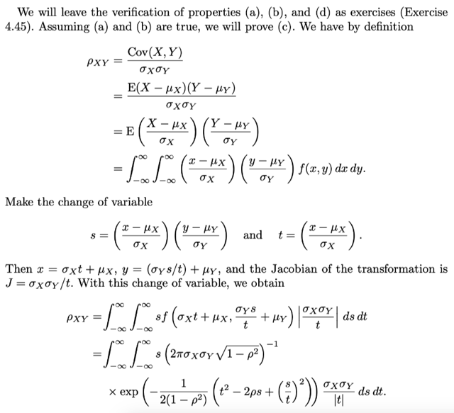</kbd>

> [!NOTE]
> QUAY LẠI SAU

> [!TIP]
> 🤖 **AI Check** — 🔴 Critical issues — ❌ **0/100** · ✗ Fix first
>
> Ghi chú chưa có nội dung nào được thực hiện (học viên đánh dấu quay lại sau). Cần hoàn thiện việc đọc hiểu hoặc giải tiếp các bước biến đổi tích phân trong tài liệu tham khảo.
>
> **🔴 Critical issues**
>
> **1.** *"QUAY LẠI SAU"*
>
> Chưa có bất kỳ nội dung ghi chú, tính toán hay tóm tắt nào được thực hiện.
>

 

###### Chứng minh ρXY = ρ

<kbd>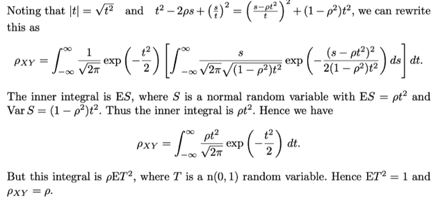</kbd>

> [!NOTE]
> QUAY LẠI SAU

> [!TIP]
> 🤖 **AI Check** — 🔴 Critical issues — ❌ **0/100** · ✗ Fix first
>
> Ghi chú chưa có nội dung học tập hay biến đổi nào được thực hiện ngoài việc đánh dấu 'QUAY LẠI SAU'.
>
> **🔴 Critical issues**
>
> **1.** *"QUAY LẠI SAU"*
>
> Chưa có bất kỳ nội dung ghi chú, lập luận hay giải thích nào được thực hiện so với tài liệu tham khảo.
>

 

###### Hội tụ phân phối có điều kiện

<kbd></kbd>

> [!NOTE]
> QUAY LẠI SAU

> [!TIP]
> 🤖 **AI Check** — 🔴 Critical issues — ❌ **0/100** · ✗ Fix first
>
> Bạn chưa ghi chép nội dung kiến thức nào từ tài liệu tham khảo mà chỉ để lại ghi chú quay lại sau. Hãy đọc và tóm tắt lại các ý chính về phân phối có điều kiện của phân phối chuẩn hai biến.
>
> **🔴 Critical issues**
>
> **1.** *"QUAY LẠI SAU"*
>
> Ghi chú hoàn toàn chưa có nội dung học tập, phân tích hay tóm tắt kiến thức từ tài liệu tham khảo.
>

**🔗 See also:** [Section 11.3 Simple Linear Regression](./113_simple_linear_regression.md#node-73smgnz)

 

